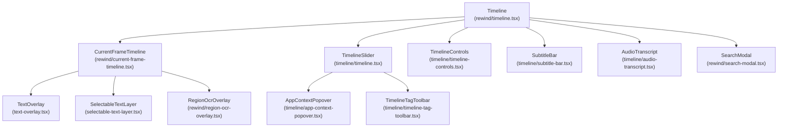
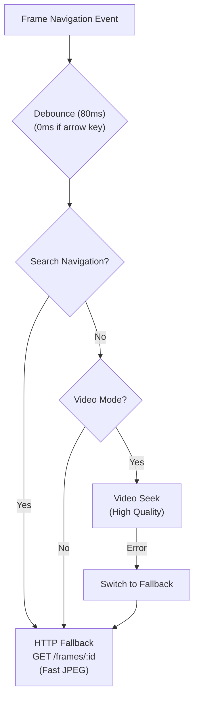

<!-- source: DeepWiki mcp.deepwiki.com · repo screenpipe/screenpipe · page 3.3 Timeline & Rewind · fetched 2026-10-27 -->

# Timeline & Rewind

<details>
<summary>Relevant source files</summary>

The following files were used as context for generating this wiki page:

- [apps/screenpipe-app-tauri/app/shortcut-reminder/use-meeting-overlay.test.ts](apps/screenpipe-app-tauri/app/shortcut-reminder/use-meeting-overlay.test.ts)
- [apps/screenpipe-app-tauri/app/shortcut-reminder/use-meeting-overlay.ts](apps/screenpipe-app-tauri/app/shortcut-reminder/use-meeting-overlay.ts)
- [apps/screenpipe-app-tauri/app/shortcut-reminder/use-overlay-data.ts](apps/screenpipe-app-tauri/app/shortcut-reminder/use-overlay-data.ts)
- [apps/screenpipe-app-tauri/components/conversation-bubble.tsx](apps/screenpipe-app-tauri/components/conversation-bubble.tsx)
- [apps/screenpipe-app-tauri/components/onboarding/particle-stream.tsx](apps/screenpipe-app-tauri/components/onboarding/particle-stream.tsx)
- [apps/screenpipe-app-tauri/components/rewind/current-frame-timeline.tsx](apps/screenpipe-app-tauri/components/rewind/current-frame-timeline.tsx)
- [apps/screenpipe-app-tauri/components/rewind/hooks/__tests__/use-live-text.test.tsx](apps/screenpipe-app-tauri/components/rewind/hooks/__tests__/use-live-text.test.tsx)
- [apps/screenpipe-app-tauri/components/rewind/hooks/use-date-navigation.ts](apps/screenpipe-app-tauri/components/rewind/hooks/use-date-navigation.ts)
- [apps/screenpipe-app-tauri/components/rewind/hooks/use-live-text.ts](apps/screenpipe-app-tauri/components/rewind/hooks/use-live-text.ts)
- [apps/screenpipe-app-tauri/components/rewind/hooks/use-scroll-zoom.ts](apps/screenpipe-app-tauri/components/rewind/hooks/use-scroll-zoom.ts)
- [apps/screenpipe-app-tauri/components/rewind/hooks/use-timeline-filters.ts](apps/screenpipe-app-tauri/components/rewind/hooks/use-timeline-filters.ts)
- [apps/screenpipe-app-tauri/components/rewind/native-timeline.test.tsx](apps/screenpipe-app-tauri/components/rewind/native-timeline.test.tsx)
- [apps/screenpipe-app-tauri/components/rewind/native-timeline.tsx](apps/screenpipe-app-tauri/components/rewind/native-timeline.tsx)
- [apps/screenpipe-app-tauri/components/rewind/timeline.tsx](apps/screenpipe-app-tauri/components/rewind/timeline.tsx)
- [apps/screenpipe-app-tauri/components/rewind/timeline/app-context-popover.tsx](apps/screenpipe-app-tauri/components/rewind/timeline/app-context-popover.tsx)
- [apps/screenpipe-app-tauri/components/rewind/timeline/audio-transcript.tsx](apps/screenpipe-app-tauri/components/rewind/timeline/audio-transcript.tsx)
- [apps/screenpipe-app-tauri/components/rewind/timeline/subtitle-bar.test.tsx](apps/screenpipe-app-tauri/components/rewind/timeline/subtitle-bar.test.tsx)
- [apps/screenpipe-app-tauri/components/rewind/timeline/subtitle-bar.tsx](apps/screenpipe-app-tauri/components/rewind/timeline/subtitle-bar.tsx)
- [apps/screenpipe-app-tauri/components/rewind/timeline/timeline-controls.tsx](apps/screenpipe-app-tauri/components/rewind/timeline/timeline-controls.tsx)
- [apps/screenpipe-app-tauri/components/rewind/timeline/timeline.tsx](apps/screenpipe-app-tauri/components/rewind/timeline/timeline.tsx)
- [apps/screenpipe-app-tauri/components/speaker-assign-popover.tsx](apps/screenpipe-app-tauri/components/speaker-assign-popover.tsx)
- [apps/screenpipe-app-tauri/e2e/specs/meeting-overlay-stream.spec.ts](apps/screenpipe-app-tauri/e2e/specs/meeting-overlay-stream.spec.ts)
- [apps/screenpipe-app-tauri/e2e/specs/search/search-bugs-4645.spec.ts](apps/screenpipe-app-tauri/e2e/specs/search/search-bugs-4645.spec.ts)
- [apps/screenpipe-app-tauri/lib/actions/get-start-date.ts](apps/screenpipe-app-tauri/lib/actions/get-start-date.ts)
- [apps/screenpipe-app-tauri/lib/actions/has-frames-date.ts](apps/screenpipe-app-tauri/lib/actions/has-frames-date.ts)
- [apps/screenpipe-app-tauri/lib/api.ts](apps/screenpipe-app-tauri/lib/api.ts)
- [apps/screenpipe-app-tauri/lib/hooks/__tests__/timeline-store-logic.test.ts](apps/screenpipe-app-tauri/lib/hooks/__tests__/timeline-store-logic.test.ts)
- [apps/screenpipe-app-tauri/lib/hooks/timeline-frame-merge.ts](apps/screenpipe-app-tauri/lib/hooks/timeline-frame-merge.ts)
- [apps/screenpipe-app-tauri/lib/hooks/timeline-frame-navigation.ts](apps/screenpipe-app-tauri/lib/hooks/timeline-frame-navigation.ts)
- [apps/screenpipe-app-tauri/lib/hooks/use-current-frame.tsx](apps/screenpipe-app-tauri/lib/hooks/use-current-frame.tsx)
- [apps/screenpipe-app-tauri/lib/hooks/use-health-check.tsx](apps/screenpipe-app-tauri/lib/hooks/use-health-check.tsx)
- [apps/screenpipe-app-tauri/lib/hooks/use-meetings.tsx](apps/screenpipe-app-tauri/lib/hooks/use-meetings.tsx)
- [apps/screenpipe-app-tauri/lib/hooks/use-timeline-store.tsx](apps/screenpipe-app-tauri/lib/hooks/use-timeline-store.tsx)
- [apps/screenpipe-app-tauri/scripts/test-timeline.sh](apps/screenpipe-app-tauri/scripts/test-timeline.sh)
- [apps/screenpipe-app-tauri/src-tauri/livetext-stress/Cargo.toml](apps/screenpipe-app-tauri/src-tauri/livetext-stress/Cargo.toml)
- [apps/screenpipe-app-tauri/src-tauri/livetext-stress/src/bin/frame-scope.rs](apps/screenpipe-app-tauri/src-tauri/livetext-stress/src/bin/frame-scope.rs)
- [apps/screenpipe-app-tauri/src-tauri/livetext-stress/src/bin/interactive.rs](apps/screenpipe-app-tauri/src-tauri/livetext-stress/src/bin/interactive.rs)
- [apps/screenpipe-app-tauri/src-tauri/livetext-stress/src/bin/window-scope.rs](apps/screenpipe-app-tauri/src-tauri/livetext-stress/src/bin/window-scope.rs)
- [apps/screenpipe-app-tauri/src-tauri/livetext-stress/src/main.rs](apps/screenpipe-app-tauri/src-tauri/livetext-stress/src/main.rs)
- [apps/screenpipe-app-tauri/src-tauri/livetext-stress/swift/support.swift](apps/screenpipe-app-tauri/src-tauri/livetext-stress/swift/support.swift)
- [apps/screenpipe-app-tauri/src-tauri/livetext-stress/tests/stress.rs](apps/screenpipe-app-tauri/src-tauri/livetext-stress/tests/stress.rs)
- [apps/screenpipe-app-tauri/src-tauri/src/commands/native_actions.rs](apps/screenpipe-app-tauri/src-tauri/src/commands/native_actions.rs)
- [apps/screenpipe-app-tauri/src-tauri/src/livetext.rs](apps/screenpipe-app-tauri/src-tauri/src/livetext.rs)
- [apps/screenpipe-app-tauri/src-tauri/src/livetext_ffi.rs](apps/screenpipe-app-tauri/src-tauri/src/livetext_ffi.rs)
- [apps/screenpipe-app-tauri/src-tauri/src/native_timeline.rs](apps/screenpipe-app-tauri/src-tauri/src/native_timeline.rs)
- [apps/screenpipe-app-tauri/src-tauri/swift/livetext_bridge.swift](apps/screenpipe-app-tauri/src-tauri/swift/livetext_bridge.swift)
- [apps/screenpipe-app-tauri/src-tauri/swift/timeline/TimelineAPI.swift](apps/screenpipe-app-tauri/src-tauri/swift/timeline/TimelineAPI.swift)
- [apps/screenpipe-app-tauri/src-tauri/swift/timeline/TimelineCore.swift](apps/screenpipe-app-tauri/src-tauri/swift/timeline/TimelineCore.swift)
- [apps/screenpipe-app-tauri/src-tauri/swift/timeline/TimelineLiveText.swift](apps/screenpipe-app-tauri/src-tauri/swift/timeline/TimelineLiveText.swift)
- [apps/screenpipe-app-tauri/src-tauri/swift/timeline/TimelineModels.swift](apps/screenpipe-app-tauri/src-tauri/swift/timeline/TimelineModels.swift)
- [apps/screenpipe-app-tauri/src-tauri/swift/timeline/TimelineScrubberView.swift](apps/screenpipe-app-tauri/src-tauri/swift/timeline/TimelineScrubberView.swift)
- [apps/screenpipe-app-tauri/src-tauri/swift/timeline/TimelineViewModel.swift](apps/screenpipe-app-tauri/src-tauri/swift/timeline/TimelineViewModel.swift)
- [apps/screenpipe-app-tauri/src-tauri/swift/timeline/TimelineViews.swift](apps/screenpipe-app-tauri/src-tauri/swift/timeline/TimelineViews.swift)
- [apps/screenpipe-app-tauri/src-tauri/swift/timeline/TimelineWindow.swift](apps/screenpipe-app-tauri/src-tauri/swift/timeline/TimelineWindow.swift)
- [apps/screenpipe-app-tauri/src-tauri/swift/timeline_deletion_tests.swift](apps/screenpipe-app-tauri/src-tauri/swift/timeline_deletion_tests.swift)
- [apps/screenpipe-app-tauri/src-tauri/swift/timeline_interaction_tests.swift](apps/screenpipe-app-tauri/src-tauri/swift/timeline_interaction_tests.swift)
- [apps/screenpipe-app-tauri/src-tauri/swift/timeline_media_tests.swift](apps/screenpipe-app-tauri/src-tauri/swift/timeline_media_tests.swift)
- [apps/screenpipe-app-tauri/src-tauri/swift/timeline_performance_tests.swift](apps/screenpipe-app-tauri/src-tauri/swift/timeline_performance_tests.swift)
- [apps/screenpipe-app-tauri/src-tauri/swift/timeline_render_tests.swift](apps/screenpipe-app-tauri/src-tauri/swift/timeline_render_tests.swift)
- [apps/screenpipe-app-tauri/src-tauri/swift/timeline_stream_tests.swift](apps/screenpipe-app-tauri/src-tauri/swift/timeline_stream_tests.swift)
- [apps/screenpipe-app-tauri/src-tauri/swift/timeline_tests.swift](apps/screenpipe-app-tauri/src-tauri/swift/timeline_tests.swift)
- [crates/screenpipe-db/src/db/frames.rs](crates/screenpipe-db/src/db/frames.rs)
- [crates/screenpipe-db/src/migrations/20260818133000_activity_ledger_query_indexes.sql](crates/screenpipe-db/src/migrations/20260818133000_activity_ledger_query_indexes.sql)
- [crates/screenpipe-db/tests/timeline_frameless_audio_test.rs](crates/screenpipe-db/tests/timeline_frameless_audio_test.rs)
- [crates/screenpipe-engine/src/hot_frame_cache.rs](crates/screenpipe-engine/src/hot_frame_cache.rs)
- [crates/screenpipe-engine/src/routes/streaming.rs](crates/screenpipe-engine/src/routes/streaming.rs)
- [crates/screenpipe-engine/src/routes/websocket.rs](crates/screenpipe-engine/src/routes/websocket.rs)

</details>


This page documents the Timeline & Rewind feature of the Screenpipe desktop application: the interactive history viewer that lets users scroll through captured screen activity, search content, replay audio, and send context to AI. Coverage includes the React component tree, client-side state management hooks, frame loading strategies, and the macOS native Live Text integration.

For the underlying capture pipeline that produces frames, see [Data Capture Pipeline](2.2). For the REST API endpoints used by the frontend, see [HTTP API](5.2). For the Tauri window management that shows and hides the Timeline window, see [Window Management & Overlays](3.2).

---

## Component Architecture

The entry point is the `Timeline` default export in `apps/screenpipe-app-tauri/components/rewind/timeline.tsx`. It coordinates the WebSocket data stream, filter logic, and navigation state.

**Timeline component tree:**


Sources: [apps/screenpipe-app-tauri/components/rewind/timeline.tsx:9-33]()

---

## State Management

Screenpipe uses a hybrid state approach combining **Zustand** for cross-component persistence and **Custom Hooks** for local feature logic.

### useTimelineStore (Zustand)
Located in `apps/screenpipe-app-tauri/lib/hooks/use-timeline-store.tsx`, this store manages the global timeline state, including frame buffers and WebSocket connection health.

- **Frame Batching:** Uses a `frameBuffer` and `FLUSH_INTERVAL_MS` (500ms) to batch incoming WebSocket frames, reducing re-renders. [apps/screenpipe-app-tauri/lib/hooks/use-timeline-store.tsx:23-24]()
- **Persistence:** Implements `loadFromCache` to pull frames from local storage for instant UI hydration on startup. [apps/screenpipe-app-tauri/lib/hooks/use-timeline-store.tsx:130]()
- **Navigation Sync:** Tracks `pendingNavigation` to coordinate jumps across different dates when frames are still loading. [apps/screenpipe-app-tauri/lib/hooks/use-timeline-store.tsx:109]()
- **Connection Logic:** Manages WebSocket lifecycle with exponential backoff and silent retries. [apps/screenpipe-app-tauri/lib/hooks/use-timeline-store.tsx:30-49]()

### Feature Hooks
| Hook | Module | Responsibility |
|------|--------|----------------|
| `useCurrentFrame` | `lib/hooks/use-current-frame` | Syncs `currentIndex` with the active frame object. |
| `useTimelineData` | `lib/hooks/use-timeline-data` | Manages the WebSocket lifecycle and historical data fetching. |
| `useLiveText` | `rewind/hooks/use-live-text` | Orchestrates macOS VisionKit analysis and click guards. |
| `useFrameLoading` | `rewind/hooks/use-frame-loading` | Decides between video seek and HTTP JPEG fallback. |
| `useAudioPlayback` | `lib/hooks/use-audio-playback` | Controls audio chunk playback synced to frame timestamps. |
| `useScrollZoom` | `rewind/hooks/use-scroll-zoom` | Manages trackpad/mousewheel navigation and zoom scaling. |
Sources: [apps/screenpipe-app-tauri/components/rewind/timeline.tsx:15-32](), [apps/screenpipe-app-tauri/components/rewind/current-frame-timeline.tsx:21-26](), [apps/screenpipe-app-tauri/components/rewind/hooks/use-live-text.ts:43-60]()

---

## CurrentFrameTimeline: Loading Strategies

The `CurrentFrameTimeline` component manages the primary visual display. It utilizes `useFrameLoading` to optimize for performance versus accuracy.

### Frame Loading Strategy

- **Video Seek Mode:** Uses the HTML5 Video element to seek into `.mp4` chunks. [apps/screenpipe-app-tauri/components/rewind/current-frame-timeline.tsx:180]()
- **HTTP Fallback:** Used for instant display after a search jump (`searchNavFrame`) or when video decoding fails. Fetches a JPEG frame directly from the screenpipe server via `appendAuthToken`. [apps/screenpipe-app-tauri/lib/api.ts:18-20]()
- **OCR & Context:** Fetches accessibility tree nodes and OCR text positions to enable clickable text overlays even during video playback. [apps/screenpipe-app-tauri/components/rewind/current-frame-timeline.tsx:8-10]()
Sources: [apps/screenpipe-app-tauri/components/rewind/current-frame-timeline.tsx:137-158](), [apps/screenpipe-app-tauri/components/rewind/hooks/use-frame-loading.ts:18-50]()

---

## Live Text (macOS VisionKit)

Screenpipe integrates with macOS **VisionKit** via a Swift bridge to provide native-feeling text interaction (selection, copy, lookup) directly on top of video frames.

### Implementation Flow
```mermaid
graph TD
    A[Tauri App] --> B{Native Timeline Attach Event\n`native-timeline-attach`}
    B --> C{`install_native_timeline_placement`\n(Rust)}
    C --> D{`native_timeline::show_raw`\n(Rust FFI to Swift)}
    D --> E{`lt_init`\n(Swift)}
    E --> F[Attach `ImageAnalysisOverlayView` to NSPanel/NSWindow]
    F --> G{Frame Ready Event\n`isFrameReady`}
    G --> H{`useLiveText` Hook\n(React)}
    H --> I{`livetextAnalyze`\n(React FFI to Rust)}
    I --> J{`lt_analyze`\n(Swift)}
    J --> K[VisionKit `ImageAnalyzer` processes frame]
    K --> L[Overlay displays selectable text]
    L --> M{User Interaction (Click/Select)}
    M --> N{`ClickGuardView` prevents interference}
    N --> O[Native overlay handles text selection]
```
- **Bridge Initialization:** `lt_init` attaches a native `ImageAnalysisOverlayView` to the Tauri NSPanel/NSWindow. [apps/screenpipe-app-tauri/src-tauri/swift/livetext_bridge.swift:129]()
- **Analysis:** `lt_analyze` sends the current frame image (local path or HTTP) to the `ImageAnalyzer`. [apps/screenpipe-app-tauri/src-tauri/swift/livetext_bridge.swift:166-177]()
- **Geometry Sync:** `livetextUpdatePosition` aligns the native overlay with the React-rendered image dimensions, accounting for letterboxing and offsets via `getAbsolutePosition`. [apps/screenpipe-app-tauri/components/rewind/hooks/use-live-text.ts:84-92]()
- **Click Guards:** Because VisionKit's hit regions are aggressive, Screenpipe places `ClickGuardView` over UI elements (filters, nav bar). This prevents the overlay from intercepting clicks meant for the app controls. [apps/screenpipe-app-tauri/src-tauri/swift/livetext_bridge.swift:38-41](), [apps/screenpipe-app-tauri/components/rewind/hooks/use-live-text.ts:31-32]()
Sources: [apps/screenpipe-app-tauri/components/rewind/hooks/use-live-text.ts:43-60](), [apps/screenpipe-app-tauri/src-tauri/swift/livetext_bridge.swift:38-41](), [apps/screenpipe-app-tauri/src-tauri/swift/livetext_bridge.swift:129](), [apps/screenpipe-app-tauri/src-tauri/swift/livetext_bridge.swift:166-177]()

---

## Audio Transcript & Meetings

The `AudioTranscript` component provides a specialized view for voice data, supporting real-time interaction and historical review.

- **Conversation View:** Groups audio chunks into "left" and "right" bubbles based on `is_input` (microphone vs. system audio). [apps/screenpipe-app-tauri/components/rewind/timeline/audio-transcript.tsx:37-42]()
- **Meeting Detection:** Identifies temporal clusters of audio using the `useMeetings` hook. [apps/screenpipe-app-tauri/components/rewind/timeline/audio-transcript.tsx:102-111]()
- **Speaker Management:** Supports bulk speaker re-assignment and per-chunk transcription overrides via `localFetch` to the `/raw_sql` endpoint. [apps/screenpipe-app-tauri/components/rewind/timeline/audio-transcript.tsx:180-195]()
Sources: [apps/screenpipe-app-tauri/components/rewind/timeline/audio-transcript.tsx:37-42](), [apps/screenpipe-app-tauri/components/rewind/timeline/audio-transcript.tsx:102-111](), [apps/screenpipe-app-tauri/components/rewind/timeline/audio-transcript.tsx:180-195]()

---

## AI Panel & Integration

The Timeline serves as a context feeder for AI agents and workflows.

- **AppContextPopover:** Allows users to run specific "Pipes" (AI workflows) against the context of a specific app's activity. [apps/screenpipe-app-tauri/components/rewind/timeline/app-context-popover.tsx:64-71]()
- **UI Events:** AI features can query `ui_events` (clicks, typing, clipboard) via the `/raw_sql` endpoint to understand user intent during a specific time window. [apps/screenpipe-app-tauri/components/rewind/timeline/app-context-popover.tsx:95-100]()
- **TimelineTag Toolbar:** Provides a radial menu for running AI pipes and tagging frame ranges for future retrieval via `tagFrames`. [apps/screenpipe-app-tauri/components/rewind/timeline/timeline.tsx:129]()
Sources: [apps/screenpipe-app-tauri/components/rewind/timeline/app-context-popover.tsx:64-71](), [apps/screenpipe-app-tauri/components/rewind/timeline/app-context-popover.tsx:95-100](), [apps/screenpipe-app-tauri/components/rewind/timeline.tsx:129]()

---

## Navigation & Filters

Navigation is filter-aware, allowing users to jump between specific applications or monitors.

| Function | File | Logic |
|----------|------|-------|
| `snapToDevice` | `timeline.tsx` | Jumps to the nearest frame matching the `selectedDeviceId`. |
| `snapToApp` | `timeline.tsx` | Jumps to the nearest frame matching the `selectedAppName`. |
| `handleDateChange` | `timeline.tsx` | Triggers a date swap in `useTimelineStore`, clearing buffers and fetching new data. |
| `useScrollZoom` | `use-scroll-zoom.ts` | Manages trackpad pinch-to-zoom and wheel navigation with variable intensity. |
| `TimelineControls` | `timeline-controls.tsx` | Provides the date picker and jump-to-today logic. |
Sources: [apps/screenpipe-app-tauri/components/rewind/timeline.tsx:162-163](), [apps/screenpipe-app-tauri/components/rewind/timeline/timeline-controls.tsx:94-98](), [apps/screenpipe-app-tauri/components/rewind/hooks/use-scroll-zoom.ts:18-39]()

---

