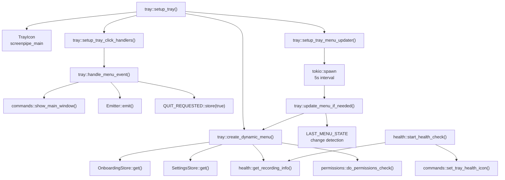
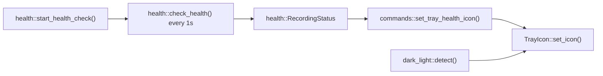
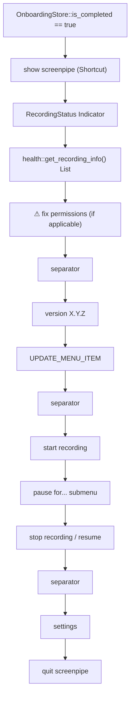

<!-- source: DeepWiki mcp.deepwiki.com · repo screenpipe/screenpipe · page 3.7 System Tray & Notifications · fetched 2026-10-27 -->

# System Tray & Notifications

<details>
<summary>Relevant source files</summary>

The following files were used as context for generating this wiki page:

- [.github/pr-media/notification-action-overflow-native.png](.github/pr-media/notification-action-overflow-native.png)
- [.github/pr-media/notification-action-overflow.png](.github/pr-media/notification-action-overflow.png)
- [apps/screenpipe-app-tauri/app/notification-panel/page.test.tsx](apps/screenpipe-app-tauri/app/notification-panel/page.test.tsx)
- [apps/screenpipe-app-tauri/app/notification-panel/page.tsx](apps/screenpipe-app-tauri/app/notification-panel/page.tsx)
- [apps/screenpipe-app-tauri/components/notification-action-button.test.tsx](apps/screenpipe-app-tauri/components/notification-action-button.test.tsx)
- [apps/screenpipe-app-tauri/components/notification-action-button.tsx](apps/screenpipe-app-tauri/components/notification-action-button.tsx)
- [apps/screenpipe-app-tauri/components/notification-bell.tsx](apps/screenpipe-app-tauri/components/notification-bell.tsx)
- [apps/screenpipe-app-tauri/components/notification-feedback.test.tsx](apps/screenpipe-app-tauri/components/notification-feedback.test.tsx)
- [apps/screenpipe-app-tauri/components/notification-feedback.tsx](apps/screenpipe-app-tauri/components/notification-feedback.tsx)
- [apps/screenpipe-app-tauri/components/notification-handler.tsx](apps/screenpipe-app-tauri/components/notification-handler.tsx)
- [apps/screenpipe-app-tauri/components/settings/general-settings.tsx](apps/screenpipe-app-tauri/components/settings/general-settings.tsx)
- [apps/screenpipe-app-tauri/components/settings/privacy-section.tsx](apps/screenpipe-app-tauri/components/settings/privacy-section.tsx)
- [apps/screenpipe-app-tauri/components/settings/recording-settings.tsx](apps/screenpipe-app-tauri/components/settings/recording-settings.tsx)
- [apps/screenpipe-app-tauri/components/update-banner.tsx](apps/screenpipe-app-tauri/components/update-banner.tsx)
- [apps/screenpipe-app-tauri/lib/hooks/use-notification-panel.ts](apps/screenpipe-app-tauri/lib/hooks/use-notification-panel.ts)
- [apps/screenpipe-app-tauri/lib/hooks/use-settings.tsx](apps/screenpipe-app-tauri/lib/hooks/use-settings.tsx)
- [apps/screenpipe-app-tauri/lib/utils/tauri.ts](apps/screenpipe-app-tauri/lib/utils/tauri.ts)
- [apps/screenpipe-app-tauri/src-tauri/src/commands.rs](apps/screenpipe-app-tauri/src-tauri/src/commands.rs)
- [apps/screenpipe-app-tauri/src-tauri/src/embedded_server.rs](apps/screenpipe-app-tauri/src-tauri/src/embedded_server.rs)
- [apps/screenpipe-app-tauri/src-tauri/src/health.rs](apps/screenpipe-app-tauri/src-tauri/src/health.rs)
- [apps/screenpipe-app-tauri/src-tauri/src/main.rs](apps/screenpipe-app-tauri/src-tauri/src/main.rs)
- [apps/screenpipe-app-tauri/src-tauri/src/notifications/gate.rs](apps/screenpipe-app-tauri/src-tauri/src/notifications/gate.rs)
- [apps/screenpipe-app-tauri/src-tauri/src/notifications/routes.rs](apps/screenpipe-app-tauri/src-tauri/src/notifications/routes.rs)
- [apps/screenpipe-app-tauri/src-tauri/src/notifications/store.rs](apps/screenpipe-app-tauri/src-tauri/src/notifications/store.rs)
- [apps/screenpipe-app-tauri/src-tauri/src/process_exit.rs](apps/screenpipe-app-tauri/src-tauri/src/process_exit.rs)
- [apps/screenpipe-app-tauri/src-tauri/src/recording.rs](apps/screenpipe-app-tauri/src-tauri/src/recording.rs)
- [apps/screenpipe-app-tauri/src-tauri/src/recording/db_wedge.rs](apps/screenpipe-app-tauri/src-tauri/src/recording/db_wedge.rs)
- [apps/screenpipe-app-tauri/src-tauri/src/server.rs](apps/screenpipe-app-tauri/src-tauri/src/server.rs)
- [apps/screenpipe-app-tauri/src-tauri/src/server_core.rs](apps/screenpipe-app-tauri/src-tauri/src/server_core.rs)
- [apps/screenpipe-app-tauri/src-tauri/src/store.rs](apps/screenpipe-app-tauri/src-tauri/src/store.rs)
- [apps/screenpipe-app-tauri/src-tauri/src/tray.rs](apps/screenpipe-app-tauri/src-tauri/src/tray.rs)
- [apps/screenpipe-app-tauri/src-tauri/src/updates.rs](apps/screenpipe-app-tauri/src-tauri/src/updates.rs)
- [apps/screenpipe-app-tauri/src-tauri/swift/notification_panel.swift](apps/screenpipe-app-tauri/src-tauri/swift/notification_panel.swift)
- [crates/screenpipe-config/src/recording.rs](crates/screenpipe-config/src/recording.rs)
- [crates/screenpipe-engine/src/bin/screenpipe-engine.rs](crates/screenpipe-engine/src/bin/screenpipe-engine.rs)
- [crates/screenpipe-engine/src/cli/mod.rs](crates/screenpipe-engine/src/cli/mod.rs)
- [crates/screenpipe-engine/src/lib.rs](crates/screenpipe-engine/src/lib.rs)
- [crates/screenpipe-engine/src/recording_config.rs](crates/screenpipe-engine/src/recording_config.rs)
- [crates/screenpipe-engine/src/routes/mod.rs](crates/screenpipe-engine/src/routes/mod.rs)
- [crates/screenpipe-engine/src/server.rs](crates/screenpipe-engine/src/server.rs)
- [docs/images/notification-feedback/collapsed.png](docs/images/notification-feedback/collapsed.png)
- [docs/images/notification-feedback/negative.png](docs/images/notification-feedback/negative.png)
- [docs/images/notification-feedback/options.png](docs/images/notification-feedback/options.png)
- [docs/images/notification-feedback/positive.png](docs/images/notification-feedback/positive.png)

</details>


This page details the implementation of the Screenpipe desktop application's system tray icon and its associated dynamic menu, as well as the custom notification system. It covers the tray icon's visual states, the menu's dynamic content based on application health and user settings, and the architecture for delivering rich, actionable notifications.

For information about the recording status that drives tray display, see [Application Lifecycle & Server](3.1). For window management triggered by tray actions, see [Window Management & Overlays](3.2).

---

## Architecture Overview

The tray system consists of a static icon with a dynamic context menu that updates periodically. The menu structure changes based on onboarding completion, recording state, device status, and permission issues. All I/O (store reads, settings, permission checks) is performed off the main thread via `prefetch_tray_menu_data` to ensure UI responsiveness.

**Tray Component Relationships**



Sources: [apps/screenpipe-app-tauri/src-tauri/src/tray.rs:22-32](), [apps/screenpipe-app-tauri/src-tauri/src/tray.rs:60-146](), [apps/screenpipe-app-tauri/src-tauri/src/tray.rs:39-39]()

---

## Tray Icon Management

The tray icon displays the current recording status through visual changes, with separate icons for healthy, unhealthy, starting, and error states. The icon also adapts to the system theme (light/dark mode).

### Icon States and Theme Handling

| Status | Icon (Light Mode) | Icon (Dark Mode) | Description |
|--------|------------------|------------------|-------------|
| Starting | `screenpipe-logo-tray-black.png` | `screenpipe-logo-tray-white.png` | During `STARTUP_GRACE_PERIOD` (30s) [apps/screenpipe-app-tauri/src-tauri/src/health.rs:16-31]() |
| Recording | `screenpipe-logo-tray-black.png` | `screenpipe-logo-tray-white.png` | Healthy recording in progress |
| Stopped | `screenpipe-logo-tray-black-failed.png` | `screenpipe-logo-tray-white-failed.png` | Connection failures > `CONSECUTIVE_FAILURES_THRESHOLD` (30) [apps/screenpipe-app-tauri/src-tauri/src/health.rs:163-172]() |
| Error | `screenpipe-logo-tray-black-failed.png` | `screenpipe-logo-tray-white-failed.png` | Explicit unhealthy status > `CONSECUTIVE_UNHEALTHY_THRESHOLD` (120) [apps/screenpipe-app-tauri/src-tauri/src/health.rs:163-172]() |

The health monitoring system updates the icon automatically using the `set_tray_health_icon` and `set_tray_unhealth_icon` commands. [apps/screenpipe-app-tauri/src-tauri/src/main.rs:173-174]()



Sources: [apps/screenpipe-app-tauri/src-tauri/src/health.rs:16-31](), [apps/screenpipe-app-tauri/src-tauri/src/health.rs:163-172](), [apps/screenpipe-app-tauri/src-tauri/src/tray.rs:7-15](), [apps/screenpipe-app-tauri/src-tauri/src/main.rs:173-174]()

### Tooltip and Health Updates

The tray tooltip changes based on permission status and pause timers to provide immediate feedback:
- **Normal**: `"screenpipe"`
- **Permission Issue**: `"screenpipe — ⚠️ permissions needed"` (detected via `do_permissions_check`) [apps/screenpipe-app-tauri/src-tauri/src/tray.rs:121-133]()
- **Paused**: `"screenpipe — resumes in Xm"` (calculated via `pause_remaining()`) [apps/screenpipe-app-tauri/src-tauri/src/tray.rs:202-210]()

Sources: [apps/screenpipe-app-tauri/src-tauri/src/tray.rs:121-133](), [apps/screenpipe-app-tauri/src-tauri/src/tray.rs:202-210]()

---

## Menu Structure

The menu structure changes dynamically based on `OnboardingStore` state, `RecordingStatus`, device status, and configuration.

### Onboarding vs Full Menu

**Onboarding Menu (Minimal)**
When `onboarding_completed` is false, the menu is restricted to version info and a quit option to guide the user through the setup flow. [apps/screenpipe-app-tauri/src-tauri/src/tray.rs:60-65]()

**Full Menu Structure**
Includes global shortcut labels (e.g., `Alt+S`, `Alt+K`), recording controls, and device-specific submenus. [apps/screenpipe-app-tauri/src-tauri/src/tray.rs:77-91]()



Sources: [apps/screenpipe-app-tauri/src-tauri/src/tray.rs:60-65](), [apps/screenpipe-app-tauri/src-tauri/src/tray.rs:27-32]()

### Dynamic Menu Items

**Optimistic UI Feedback**
The tray uses `OPTIMISTIC_STATUS` to provide instant feedback when the user clicks start/stop, overriding the real health-check status for up to 15 seconds while the backend capture session initializes or tears down. [apps/screenpipe-app-tauri/src-tauri/src/tray.rs:191-200]()

Sources: [apps/screenpipe-app-tauri/src-tauri/src/tray.rs:191-200]()

**Pause Timers and Auto-Resume**
Selecting a duration from the "Pause for..." submenu spawns a `PauseTimer` in a tokio `JoinHandle`.
- `PAUSE_TIMER` stores the start instant and total duration. [apps/screenpipe-app-tauri/src-tauri/src/tray.rs:202-210]()
- Manual resume calls `cancel_pause_timer()`, which aborts the background task. [apps/screenpipe-app-tauri/src-tauri/src/tray.rs:214-220]()

Sources: [apps/screenpipe-app-tauri/src-tauri/src/tray.rs:202-210](), [apps/screenpipe-app-tauri/src-tauri/src/tray.rs:214-220]()

---

## Notification Architecture

Screenpipe implements a custom notification system to provide rich, actionable alerts that match the brand's aesthetic.

### Notification Flow

Notifications can originate from various sources (e.g., pipes, backend events) and are routed through the `POST /notify` endpoint. The `NotificationHandler.tsx` component acts as a central dispatcher, deciding whether to display a native SwiftUI panel (on macOS) or a webview-based panel.

```mermaid
graph TD
    PIPE_OR_BACKEND["Pipe/Backend Event"] -->|POST /notify| AXUM_NOTIFY["Axum /notify endpoint<br/>(notifications::routes::notify)"]
    AXUM_NOTIFY -->|Emit 'notification-requested' event| TAURI_EVENT_BUS["Tauri Event Bus"]
    TAURI_EVENT_BUS -->|Listen for 'notification-requested'| NOTIF_HANDLER["NotificationHandler.tsx"]
    
    subgraph "Frontend"
        NOTIF_HANDLER -->|Platform check (macOS)| NATIVE_PANEL["SwiftUI Notification Panel<br/>(notification_panel.swift)"]
        NOTIF_HANDLER -->|Other OS / Fallback| WEBVIEW_PANEL["Webview Notification Panel<br/>(app/notification-panel/page.tsx)"]
    end

    NATIVE_PANEL -->|Action Click (C callback)| RUST_ACTION_CB["notif_set_action_callback"]
    RUST_ACTION_CB -->|Emit 'native-notification-action'| TAURI_EVENT_BUS
    TAURI_EVENT_BUS -->|Listen for 'native-notification-action'| NOTIF_HANDLER
    NOTIF_HANDLER -->|Process Action| ACTION_DISPATCH["executeNotificationAction()"]

    WEBVIEW_PANEL -->|Action Click (JS)| JS_ACTION_HANDLER["handleAction()"]
    JS_ACTION_HANDLER -->|Process Action| ACTION_DISPATCH

    ACTION_DISPATCH --> PIPE_EXEC["Execute Pipe / API"]
    ACTION_DISPATCH --> DEEPLINK_NAV["routeNotificationDeeplink()"]
    ACTION_DISPATCH --> CHAT_PREFILL["showChatWithPrefill()"]
```

Sources: [apps/screenpipe-app-tauri/components/notification-handler.tsx:58-77](), [apps/screenpipe-app-tauri/components/notification-handler.tsx:119-195](), [apps/screenpipe-app-tauri/src-tauri/swift/notification_panel.swift:77-83](), [apps/screenpipe-app-tauri/app/notification-panel/page.tsx:113-155](), [apps/screenpipe-app-tauri/src-tauri/src/notifications/routes.rs:18-30]()

### Notification Payload and Actions

The `NotificationPayload` struct defines the data structure for notifications, including `id`, `type`, `title`, `body`, and a list of `NotificationAction` objects. Actions can trigger various behaviors:
- `pipe`: Executes a named pipe, optionally with context. [apps/screenpipe-app-tauri/lib/notifications/actions.ts:158-192]()
- `api`: Makes a local API call to the embedded server. [apps/screenpipe-app-tauri/lib/notifications/actions.ts:194-222]()
- `deeplink`: Navigates to a `screenpipe://` URL via `routeNotificationDeeplink`. [apps/screenpipe-app-tauri/lib/notifications/actions.ts:94-127]()
- `copy`: Copies text to the system clipboard. [apps/screenpipe-app-tauri/app/notification-panel/page.tsx:133-146]()
- `dismiss`: Dismisses the notification and captures analytics. [apps/screenpipe-app-tauri/app/notification-panel/page.tsx:92-111]()

Sources: [apps/screenpipe-app-tauri/app/notification-panel/page.tsx:26-37](), [apps/screenpipe-app-tauri/src-tauri/swift/notification_panel.swift:37-48](), [apps/screenpipe-app-tauri/lib/notifications/actions.ts:18-53]()

### Native SwiftUI Panel (macOS)
On macOS, notifications are rendered using a custom `NSPanel` written in SwiftUI, providing a native look and feel.
- **Brand Elements**: The `Brand` enum and associated SwiftUI views (`BrandButton`, `BrandTextButton`) enforce Screenpipe's design language: sharp corners (0px radius), 1px borders, and `IBMPlexMono` font. [apps/screenpipe-app-tauri/src-tauri/swift/notification_panel.swift:89-128]()
- **Action Dispatch**: Actions from the native panel are sent back to Rust via a C callback (`notif_set_action_callback`) and then emitted as a `native-notification-action` event. [apps/screenpipe-app-tauri/src-tauri/swift/notification_panel.swift:77-83](), [apps/screenpipe-app-tauri/components/notification-handler.tsx:119-125]()

Sources: [apps/screenpipe-app-tauri/src-tauri/swift/notification_panel.swift:89-128](), [apps/screenpipe-app-tauri/src-tauri/swift/notification_panel.swift:77-83](), [apps/screenpipe-app-tauri/components/notification-handler.tsx:119-125]()

### Webview Notification Panel
For other operating systems or as a fallback, a webview-based notification panel (`app/notification-panel/page.tsx`) is used.
- **Auto-Dismiss**: The panel includes a progress bar and auto-dismiss timer (default 20s). [apps/screenpipe-app-tauri/app/notification-panel/page.tsx:87-91]()
- **Analytics**: Both native and webview panels capture PostHog events for `notification_shown`, `notification_dismissed`, and `notification_action`. [apps/screenpipe-app-tauri/app/notification-panel/page.tsx:99-103](), [apps/screenpipe-app-tauri/components/notification-handler.tsx:91-91]()

Sources: [apps/screenpipe-app-tauri/app/notification-panel/page.tsx:87-91](), [apps/screenpipe-app-tauri/app/notification-panel/page.tsx:99-103](), [apps/screenpipe-app-tauri/components/notification-handler.tsx:91-91]()

---

## Menu State and Lifecycle

To avoid unnecessary menu rebuilds and potential crashes, the system uses state change detection and safe memory management.

**State Change Detection**
The `LAST_MENU_STATE` global stores a snapshot of shortcuts, recording status, and active devices. The system compares the current state and only triggers a rebuild if a change is detected. [apps/screenpipe-app-tauri/src-tauri/src/tray.rs:187-187]()

Sources: [apps/screenpipe-app-tauri/src-tauri/src/tray.rs:187-187]()

### Memory Safety (Use-After-Free Prevention)
The `UPDATE_MENU_ITEM` static keeps a reference to the update menu item, ensuring it remains valid across tray recreations. [apps/screenpipe-app-tauri/src-tauri/src/tray.rs:184-184]()

Sources: [apps/screenpipe-app-tauri/src-tauri/src/tray.rs:184-184]()

---

