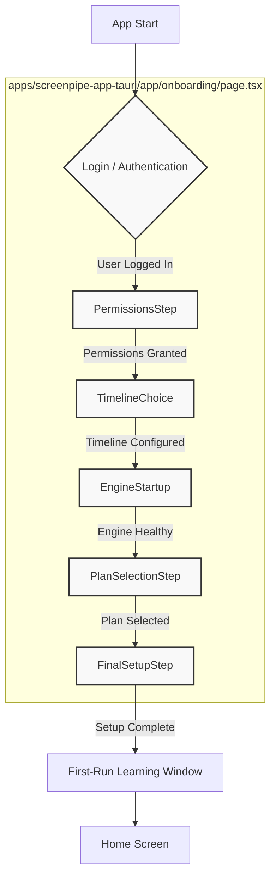
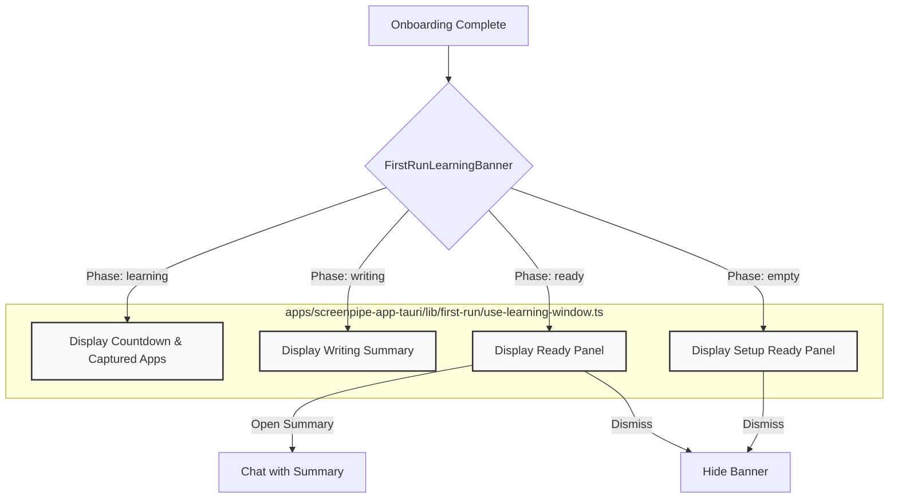
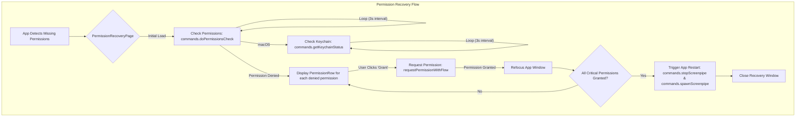

<!-- source: DeepWiki mcp.deepwiki.com · repo screenpipe/screenpipe · page 3.8 Onboarding & Health · fetched 2026-10-27 -->

# Onboarding & Health

Relevant source files

The following files were used as context for generating this wiki page:

- [apps/screenpipe-app-tauri/app/onboarding/page.test.tsx](apps/screenpipe-app-tauri/app/onboarding/page.test.tsx)
- [apps/screenpipe-app-tauri/app/onboarding/page.tsx](apps/screenpipe-app-tauri/app/onboarding/page.tsx)
- [apps/screenpipe-app-tauri/app/permission-recovery/page.test.tsx](apps/screenpipe-app-tauri/app/permission-recovery/page.test.tsx)
- [apps/screenpipe-app-tauri/app/permission-recovery/page.tsx](apps/screenpipe-app-tauri/app/permission-recovery/page.tsx)
- [apps/screenpipe-app-tauri/components/__tests__/chat-sidebar-archive-all.test.tsx](apps/screenpipe-app-tauri/components/__tests__/chat-sidebar-archive-all.test.tsx)
- [apps/screenpipe-app-tauri/components/chat/standalone/chat-main-pane.test.tsx](apps/screenpipe-app-tauri/components/chat/standalone/chat-main-pane.test.tsx)
- [apps/screenpipe-app-tauri/components/chat/standalone/chat-main-pane.tsx](apps/screenpipe-app-tauri/components/chat/standalone/chat-main-pane.tsx)
- [apps/screenpipe-app-tauri/components/chat/standalone/hooks/use-chat-conversation-events.ts](apps/screenpipe-app-tauri/components/chat/standalone/hooks/use-chat-conversation-events.ts)
- [apps/screenpipe-app-tauri/components/first-run/learning-banner.test.tsx](apps/screenpipe-app-tauri/components/first-run/learning-banner.test.tsx)
- [apps/screenpipe-app-tauri/components/first-run/learning-banner.tsx](apps/screenpipe-app-tauri/components/first-run/learning-banner.tsx)
- [apps/screenpipe-app-tauri/components/first-run/trial-activation-paywall.test.tsx](apps/screenpipe-app-tauri/components/first-run/trial-activation-paywall.test.tsx)
- [apps/screenpipe-app-tauri/components/first-run/trial-activation-paywall.tsx](apps/screenpipe-app-tauri/components/first-run/trial-activation-paywall.tsx)
- [apps/screenpipe-app-tauri/components/onboarding/engine-startup.test.tsx](apps/screenpipe-app-tauri/components/onboarding/engine-startup.test.tsx)
- [apps/screenpipe-app-tauri/components/onboarding/engine-startup.tsx](apps/screenpipe-app-tauri/components/onboarding/engine-startup.tsx)
- [apps/screenpipe-app-tauri/components/onboarding/login-gate.test.tsx](apps/screenpipe-app-tauri/components/onboarding/login-gate.test.tsx)
- [apps/screenpipe-app-tauri/components/onboarding/login-gate.tsx](apps/screenpipe-app-tauri/components/onboarding/login-gate.tsx)
- [apps/screenpipe-app-tauri/components/onboarding/permissions-step.test.tsx](apps/screenpipe-app-tauri/components/onboarding/permissions-step.test.tsx)
- [apps/screenpipe-app-tauri/components/onboarding/permissions-step.tsx](apps/screenpipe-app-tauri/components/onboarding/permissions-step.tsx)
- [apps/screenpipe-app-tauri/components/onboarding/plan-selection-step.test.tsx](apps/screenpipe-app-tauri/components/onboarding/plan-selection-step.test.tsx)
- [apps/screenpipe-app-tauri/components/onboarding/plan-selection-step.tsx](apps/screenpipe-app-tauri/components/onboarding/plan-selection-step.tsx)
- [apps/screenpipe-app-tauri/components/onboarding/timeline-choice.test.tsx](apps/screenpipe-app-tauri/components/onboarding/timeline-choice.test.tsx)
- [apps/screenpipe-app-tauri/components/onboarding/timeline-choice.tsx](apps/screenpipe-app-tauri/components/onboarding/timeline-choice.tsx)
- [apps/screenpipe-app-tauri/components/status/permission-banner.tsx](apps/screenpipe-app-tauri/components/status/permission-banner.tsx)
- [apps/screenpipe-app-tauri/e2e/helpers/tauri.ts](apps/screenpipe-app-tauri/e2e/helpers/tauri.ts)
- [apps/screenpipe-app-tauri/e2e/specs/first-run-learning-window.spec.ts](apps/screenpipe-app-tauri/e2e/specs/first-run-learning-window.spec.ts)
- [apps/screenpipe-app-tauri/e2e/specs/onboarding-first-run.spec.ts](apps/screenpipe-app-tauri/e2e/specs/onboarding-first-run.spec.ts)
- [apps/screenpipe-app-tauri/e2e/specs/onboarding-trust-affordances.spec.ts](apps/screenpipe-app-tauri/e2e/specs/onboarding-trust-affordances.spec.ts)
- [apps/screenpipe-app-tauri/lib/first-run/learning-window.test.ts](apps/screenpipe-app-tauri/lib/first-run/learning-window.test.ts)
- [apps/screenpipe-app-tauri/lib/first-run/learning-window.ts](apps/screenpipe-app-tauri/lib/first-run/learning-window.ts)
- [apps/screenpipe-app-tauri/lib/first-run/use-learning-window.test.ts](apps/screenpipe-app-tauri/lib/first-run/use-learning-window.test.ts)
- [apps/screenpipe-app-tauri/lib/first-run/use-learning-window.ts](apps/screenpipe-app-tauri/lib/first-run/use-learning-window.ts)
- [apps/screenpipe-app-tauri/lib/onboarding-checkout-navigation.ts](apps/screenpipe-app-tauri/lib/onboarding-checkout-navigation.ts)
- [apps/screenpipe-app-tauri/scripts/probe-screen-recording-permission-state.sh](apps/screenpipe-app-tauri/scripts/probe-screen-recording-permission-state.sh)
- [apps/screenpipe-app-tauri/src-tauri/src/permissions.rs](apps/screenpipe-app-tauri/src-tauri/src/permissions.rs)
- [docs/pr-assets/shortcut-teach/first-run-summary-shortcut-complete.png](docs/pr-assets/shortcut-teach/first-run-summary-shortcut-complete.png)
- [docs/pr-assets/shortcut-teach/first-run-summary-shortcut-teach.png](docs/pr-assets/shortcut-teach/first-run-summary-shortcut-teach.png)
- [docs/pr-assets/shortcut-teach/first-run-summary-shortcut-waiting.png](docs/pr-assets/shortcut-teach/first-run-summary-shortcut-waiting.png)

This document covers the onboarding flow that guides users through initial setup and the health monitoring system that tracks the embedded server's status. The onboarding process handles permission requests, server startup, and readiness checks. The health system provides continuous monitoring of recording engines (audio, screen, UI) via WebSocket connections and HTTP health checks.

For configuration of recording settings after onboarding, see [Settings & Configuration](#3.5). For system tray status indicators, see [System Tray & Notifications](#3.7).

---

## Onboarding Flow

The onboarding sequence is implemented as a multi-slide wizard in `OnboardingPage` [apps/screenpipe-app-tauri/app/onboarding/page.tsx:7-56](). It transitions through multiple states: login, permission checks, engine startup, timeline choice, plan selection, and final setup. The page utilizes `useOnboarding` to persist the current step, allowing users to resume if the app is closed mid-process [apps/screenpipe-app-tauri/app/onboarding/page.tsx:19]().

### Onboarding State Machine

The `OnboardingPage` orchestrates the flow through various steps, each represented by a `SlideKey` [apps/screenpipe-app-tauri/app/onboarding/page.tsx:49-56](). The `persistOnboardingStepWithRetry` function ensures that the current step is saved to the backend [apps/screenpipe-app-tauri/app/onboarding/page.tsx:112-129]().

Sources: [apps/screenpipe-app-tauri/app/onboarding/page.tsx:49-56](), [apps/screenpipe-app-tauri/app/onboarding/page.tsx:112-129]()

### Login Gate

The `OnboardingLogin` component [apps/screenpipe-app-tauri/components/onboarding/login-gate.tsx:22-25]() handles user authentication. It includes a background canvas animation for visual appeal [apps/screenpipe-app-tauri/components/onboarding/login-gate.tsx:33-115]() and a button canvas for interactive effects [apps/screenpipe-app-tauri/components/onboarding/login-gate.tsx:119-204](). The `isDevLoginSkipEnabled` function allows bypassing login in development environments [apps/screenpipe-app-tauri/components/onboarding/login-gate.tsx:12]().

Sources: [apps/screenpipe-app-tauri/components/onboarding/login-gate.tsx:22-25](), [apps/screenpipe-app-tauri/components/onboarding/login-gate.tsx:33-115](), [apps/screenpipe-app-tauri/components/onboarding/login-gate.tsx:119-204](), [apps/screenpipe-app-tauri/components/onboarding/login-gate.tsx:12]()

### Permission Checks

The `PermissionsStep` component [apps/screenpipe-app-tauri/components/onboarding/permissions-step.tsx:138-141]() guides the user through granting necessary OS permissions. It defines a `PermissionDef` interface for each required permission [apps/screenpipe-app-tauri/components/onboarding/permissions-step.tsx:27-35]().

| Permission ID | Icon | Title | Subtitle | Check Function | Request Function | macOS Only |
|---------------|------|-------|----------|----------------|------------------|------------|
| `mic` | Mic | Capture what you say | Lets Screenpipe transcribe your voice in meetings and calls | `commands.checkMicrophonePermission()` | `commands.requestPermission("microphone")` | No |
| `accessibility` | Keyboard | Read on-screen text | Lets Screenpipe understand app content without OCR | `commands.checkAccessibilityPermissionCmd()` / `commands.checkAccessibilityPermissionLiveCmd()` | `requestPermissionWithFlow("accessibility")` | Yes |
| `screen` | Monitor | Capture what you see | Lets Screenpipe record your screen activity | `commands.checkScreenRecordingPermission()` | `requestPermissionWithFlow("screenRecording")` | No |

The component uses a "wheel" UI where rows recede in opacity and scale based on their distance from the focused step [apps/screenpipe-app-tauri/components/onboarding/permissions-step.tsx:52-56](). The `refocusAppWindow` function ensures the app regains focus after the user interacts with system settings [apps/screenpipe-app-tauri/components/onboarding/permissions-step.tsx:39-47]().

Sources: [apps/screenpipe-app-tauri/components/onboarding/permissions-step.tsx:138-141](), [apps/screenpipe-app-tauri/components/onboarding/permissions-step.tsx:27-35](), [apps/screenpipe-app-tauri/components/onboarding/permissions-step.tsx:164-191](), [apps/screenpipe-app-tauri/components/onboarding/permissions-step.tsx:52-56](), [apps/screenpipe-app-tauri/components/onboarding/permissions-step.tsx:39-47]()

### Timeline Choice

The `TimelineChoice` component [apps/screenpipe-app-tauri/components/onboarding/timeline-choice.tsx:159-162]() allows users to decide whether to enable screenshot capture. It provides a visual preview of the timeline feature using CSS animations [apps/screenpipe-app-tauri/components/onboarding/timeline-choice.tsx:64-129](). The recommendation for enabling screenshots is based on the `deviceTier` setting [apps/screenpipe-app-tauri/components/onboarding/timeline-choice.tsx:25-26](). If the device is `low` tier, it recommends skipping screenshots [apps/screenpipe-app-tauri/components/onboarding/timeline-choice.tsx:173-175]().

Sources: [apps/screenpipe-app-tauri/components/onboarding/timeline-choice.tsx:159-162](), [apps/screenpipe-app-tauri/components/onboarding/timeline-choice.tsx:64-129](), [apps/screenpipe-app-tauri/components/onboarding/timeline-choice.tsx:25-26](), [apps/screenpipe-app-tauri/components/onboarding/timeline-choice.tsx:173-175]()

### Engine Startup & Readiness

The `EngineStartup` component [apps/screenpipe-app-tauri/components/onboarding/engine-startup.tsx:31-33]() handles the transition from "starting" to "running". It monitors the `BootPhaseSnapshot` emitted by the Rust backend via Tauri IPC [apps/screenpipe-app-tauri/components/onboarding/engine-startup.tsx:71-90]().

| Phase | Description |
|-------|-------------|
| `idle` | Engine is not active. |
| `starting` | Initializing engine components. |
| `migrating_database` | Performing database schema migrations. |
| `building_audio` | Setting up the audio capture pipeline. |
| `starting_pipes` | Initializing scheduled AI workflows. |
| `ready` | Server is listening on HTTP port and ready for operations. |
| `error` | An error occurred during startup. |

The component polls the `/health` endpoint [apps/screenpipe-app-tauri/components/onboarding/engine-startup.tsx:123-124]() and validates the `EngineHealthPayload` [apps/screenpipe-app-tauri/components/onboarding/engine-startup.tsx:94-97]() to ensure the engine is genuinely responsive and not just listening on the port [apps/screenpipe-app-tauri/components/onboarding/engine-startup.tsx:119-122](). It also includes timeouts for `SPAWN_TIMEOUT_MS` and `MAX_ENGINE_WAIT_MS` to prevent indefinite hangs [apps/screenpipe-app-tauri/components/onboarding/engine-startup.tsx:45-62]().

Sources: [apps/screenpipe-app-tauri/components/onboarding/engine-startup.tsx:31-33](), [apps/screenpipe-app-tauri/components/onboarding/engine-startup.tsx:71-90](), [apps/screenpipe-app-tauri/components/onboarding/engine-startup.tsx:123-124](), [apps/screenpipe-app-tauri/components/onboarding/engine-startup.tsx:94-97](), [apps/screenpipe-app-tauri/components/onboarding/engine-startup.tsx:119-122](), [apps/screenpipe-app-tauri/components/onboarding/engine-startup.tsx:45-62]()

### First-Run Learning Window

After onboarding, the `FirstRunLearningBanner` [apps/screenpipe-app-tauri/components/first-run/learning-banner.tsx:166-169]() is displayed. This banner provides feedback on the initial data capture and learning process. It uses the `useFirstRunLearningWindow` hook [apps/screenpipe-app-tauri/components/first-run/learning-banner.tsx:19-20]() to manage its state, which includes phases like `learning`, `writing`, `ready`, and `empty` [apps/screenpipe-app-tauri/lib/first-run/use-learning-window.ts:59-60]().

The learning window tracks `capturedApps` [apps/screenpipe-app-tauri/lib/first-run/use-learning-window.ts:61]() and `remainingMs` [apps/screenpipe-app-tauri/lib/first-run/use-learning-window.ts:62-63]() for the initial learning period. Once ready, it offers to open a summary chat or dismiss the banner [apps/screenpipe-app-tauri/components/first-run/learning-banner.tsx:79-89]().

Sources: [apps/screenpipe-app-tauri/components/first-run/learning-banner.tsx:166-169](), [apps/screenpipe-app-tauri/components/first-run/learning-banner.tsx:19-20](), [apps/screenpipe-app-tauri/lib/first-run/use-learning-window.ts:59-60](), [apps/screenpipe-app-tauri/lib/first-run/use-learning-window.ts:61](), [apps/screenpipe-app-tauri/lib/first-run/use-learning-window.ts:62-63](), [apps/screenpipe-app-tauri/components/first-run/learning-banner.tsx:79-89]()

### Permission Recovery

If permissions are revoked during operation, the app redirects to a `PermissionRecoveryPage` [apps/screenpipe-app-tauri/app/permission-recovery/page.tsx:128-150](). This page:
1.  **Polls Status**: Checks `screenRecording`, `microphone`, and `accessibility` status every 3 seconds using `commands.doPermissionsCheck` [apps/screenpipe-app-tauri/app/permission-recovery/page.tsx:143-154]().
2.  **Keychain Check**: Specifically for macOS, it monitors the keychain status to ensure encrypted storage is accessible [apps/screenpipe-app-tauri/app/permission-recovery/page.tsx:156-173]().
3.  **Auto-Restart**: Once critical permissions are restored, it triggers `commands.stopScreenpipe` and `commands.spawnScreenpipe` before closing the recovery window [apps/screenpipe-app-tauri/app/permission-recovery/page.tsx:175-181]().

The `OSPermission` enum [apps/screenpipe-app-tauri/src-tauri/src/permissions.rs:18-26]() defines the types of permissions managed. The `ScreenRecordingPermissionState` enum [apps/screenpipe-app-tauri/src-tauri/src/permissions.rs:32-37]() on macOS provides detailed states for screen recording access, including `GrantedNeedsRestart` [apps/screenpipe-app-tauri/src-tauri/src/permissions.rs:35](), which prompts the user to restart the application via `restart_after_screen_recording_permission` [apps/screenpipe-app-tauri/src-tauri/src/permissions.rs:113-156]().

Sources: [apps/screenpipe-app-tauri/app/permission-recovery/page.tsx:128-150](), [apps/screenpipe-app-tauri/app/permission-recovery/page.tsx:143-154](), [apps/screenpipe-app-tauri/app/permission-recovery/page.tsx:156-173](), [apps/screenpipe-app-tauri/app/permission-recovery/page.tsx:175-181](), [apps/screenpipe-app-tauri/src-tauri/src/permissions.rs:18-26](), [apps/screenpipe-app-tauri/src-tauri/src/permissions.rs:32-37](), [apps/screenpipe-app-tauri/src-tauri/src/permissions.rs:35](), [apps/screenpipe-app-tauri/src-tauri/src/permissions.rs:113-156]()

---

## Health Check System

The health system monitors the state of recording engines and the availability of the embedded server.

### useHealthCheck Hook
The `useHealthCheck` hook [apps/screenpipe-app-tauri/components/status/permission-banner.tsx]() (not fully provided in the snippets, but referenced) provides a unified interface for the frontend to monitor the backend. It primarily uses a WebSocket connection to `/ws/health` for real-time updates.

#### Grace Period Logic
To prevent flickering during server restarts or heavy migrations, the health check system employs a grace period. It waits before marking the server as "down" in the UI to allow for recovery. The `SERVER_DOWN_GRACE_PERIOD_MS` constant defines this duration.

### Health Response Structure
The backend returns a `HealthCheckResponse` containing the status of all capture pipelines.

| Field | Description |
|-------|-------------|
| `frame_status` | Status of screen capture (`ok`, `stale`, `disabled`) |
| `audio_status` | Status of audio capture (`ok`, `stale`, `disabled`) |
| `ui_status` | Status of accessibility tree capture |
| `audio_pipeline` | Detailed metrics like `chunks_sent`, `vad_passed`, and `transcription_errors` |

Sources: [apps/screenpipe-app-tauri/components/status/permission-banner.tsx]()

---

