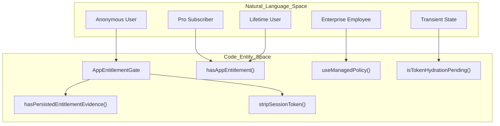
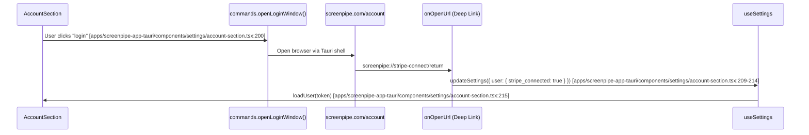
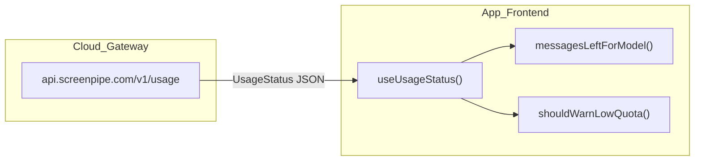

<!-- source: DeepWiki mcp.deepwiki.com · repo screenpipe/screenpipe · page 3.9 Account & Billing · fetched 2026-10-27 -->

# Account & Billing

Relevant source files

The following files were used as context for generating this wiki page:

- [apps/screenpipe-app-tauri/components/app-entitlement-gate.test.tsx](apps/screenpipe-app-tauri/components/app-entitlement-gate.test.tsx)
- [apps/screenpipe-app-tauri/components/app-entitlement-gate.tsx](apps/screenpipe-app-tauri/components/app-entitlement-gate.tsx)
- [apps/screenpipe-app-tauri/components/chat/standalone/hooks/use-chat-composer-shell.escape.test.ts](apps/screenpipe-app-tauri/components/chat/standalone/hooks/use-chat-composer-shell.escape.test.ts)
- [apps/screenpipe-app-tauri/components/plan-expiration-notice.test.tsx](apps/screenpipe-app-tauri/components/plan-expiration-notice.test.tsx)
- [apps/screenpipe-app-tauri/components/plan-expiration-notice.tsx](apps/screenpipe-app-tauri/components/plan-expiration-notice.tsx)
- [apps/screenpipe-app-tauri/components/settings/__tests__/account-section.subscription-gate.test.tsx](apps/screenpipe-app-tauri/components/settings/__tests__/account-section.subscription-gate.test.tsx)
- [apps/screenpipe-app-tauri/components/settings/account-data-sync-card.tsx](apps/screenpipe-app-tauri/components/settings/account-data-sync-card.tsx)
- [apps/screenpipe-app-tauri/components/settings/account-plan-options.test.ts](apps/screenpipe-app-tauri/components/settings/account-plan-options.test.ts)
- [apps/screenpipe-app-tauri/components/settings/account-plan-options.tsx](apps/screenpipe-app-tauri/components/settings/account-plan-options.tsx)
- [apps/screenpipe-app-tauri/components/settings/account-section.tsx](apps/screenpipe-app-tauri/components/settings/account-section.tsx)
- [apps/screenpipe-app-tauri/components/settings/business-upgrade-card.test.tsx](apps/screenpipe-app-tauri/components/settings/business-upgrade-card.test.tsx)
- [apps/screenpipe-app-tauri/components/settings/business-upgrade-card.tsx](apps/screenpipe-app-tauri/components/settings/business-upgrade-card.tsx)
- [apps/screenpipe-app-tauri/components/settings/team-section.tsx](apps/screenpipe-app-tauri/components/settings/team-section.tsx)
- [apps/screenpipe-app-tauri/e2e/specs/zz-audio-fallback-reverify.spec.ts](apps/screenpipe-app-tauri/e2e/specs/zz-audio-fallback-reverify.spec.ts)
- [apps/screenpipe-app-tauri/lib/__tests__/team-api-contract.test.ts](apps/screenpipe-app-tauri/lib/__tests__/team-api-contract.test.ts)
- [apps/screenpipe-app-tauri/lib/__tests__/team-crypto.test.ts](apps/screenpipe-app-tauri/lib/__tests__/team-crypto.test.ts)
- [apps/screenpipe-app-tauri/lib/app-entitlement.test.ts](apps/screenpipe-app-tauri/lib/app-entitlement.test.ts)
- [apps/screenpipe-app-tauri/lib/app-entitlement.ts](apps/screenpipe-app-tauri/lib/app-entitlement.ts)
- [apps/screenpipe-app-tauri/lib/auth-guard.test.tsx](apps/screenpipe-app-tauri/lib/auth-guard.test.tsx)
- [apps/screenpipe-app-tauri/lib/auth-guard.tsx](apps/screenpipe-app-tauri/lib/auth-guard.tsx)
- [apps/screenpipe-app-tauri/lib/business-upgrade-offer.test.ts](apps/screenpipe-app-tauri/lib/business-upgrade-offer.test.ts)
- [apps/screenpipe-app-tauri/lib/business-upgrade-offer.ts](apps/screenpipe-app-tauri/lib/business-upgrade-offer.ts)
- [apps/screenpipe-app-tauri/lib/hooks/use-team.ts](apps/screenpipe-app-tauri/lib/hooks/use-team.ts)
- [apps/screenpipe-app-tauri/lib/team-crypto.ts](apps/screenpipe-app-tauri/lib/team-crypto.ts)
- [apps/screenpipe-app-tauri/src-tauri/src/enterprise/policy.rs](apps/screenpipe-app-tauri/src-tauri/src/enterprise/policy.rs)
- [apps/screenpipe-app-tauri/src-tauri/src/enterprise_recording_access.rs](apps/screenpipe-app-tauri/src-tauri/src/enterprise_recording_access.rs)
- [apps/screenpipe-app-tauri/src-tauri/src/recording/authorized_start.rs](apps/screenpipe-app-tauri/src-tauri/src/recording/authorized_start.rs)

This document describes the account management, billing, and data lifecycle systems for Screenpipe. The system implements a multi-tier access model (anonymous, logged-in, subscribed) with daily query limits and entitlement gating. It also covers advanced data management features for Pro and Enterprise users, including Cloud Sync, Enterprise Policy enforcement, and Team management.

---

## Entitlement & Access Control

Screenpipe uses an entitlement-based gate to manage access to features. The `AppEntitlementGate` serves as the primary UI barrier, ensuring users have the necessary permissions (subscription or enterprise license) to use the application.

### Entitlement Logic Space to Code Mapping

**Key Behaviors**:
- **Transient Access Loss**: The gate "fails open" via `failOpenForTransientAccessLoss` if a user was previously entitled but the token is temporarily missing from the secret store (e.g., during database locks). This prevents recording interruptions for signed-in users [apps/screenpipe-app-tauri/components/app-entitlement-gate.tsx:157-162]().
- **Primary Window Logic**: Entitlement resumes and recording triggers are driven exclusively by the "primary" window (`home` on macOS, `main` on Windows) to prevent race conditions between multiple webviews [apps/screenpipe-app-tauri/components/app-entitlement-gate.tsx:29-30](), [apps/screenpipe-app-tauri/components/app-entitlement-gate.test.tsx:88-90]().
- **Lifetime & Grace**: Perpetual grants (`isLifetimeEntitlement`) and server-issued offline grace windows (`hasFutureGrace`) stay valid even when the cached entitlement is stale, allowing local-first recording without server reachability [apps/screenpipe-app-tauri/lib/app-entitlement.ts:260-267]().
- **Session Stripping**: On session expiry, `stripSessionToken` removes only the token while preserving profile and entitlement evidence, allowing the "fail-open" cushion to function [apps/screenpipe-app-tauri/lib/auth-guard.tsx:170-174]().

Sources: [apps/screenpipe-app-tauri/components/app-entitlement-gate.tsx:29-30](), [apps/screenpipe-app-tauri/components/app-entitlement-gate.tsx:157-162](), [apps/screenpipe-app-tauri/components/app-entitlement-gate.test.tsx:88-90](), [apps/screenpipe-app-tauri/lib/app-entitlement.ts:260-267](), [apps/screenpipe-app-tauri/lib/auth-guard.tsx:170-174]()

---

## Authentication & Login

The desktop app uses a deep-link protocol to receive authentication tokens and account updates from the Screenpipe website.

### Login Flow

The `AccountSection` handles deep-link scenarios, including Stripe Connect onboarding for creators. It listens for URLs via `onOpenUrl` from `@tauri-apps/plugin-deep-link` and updates the user's `stripe_connected` status and reloads the profile [apps/screenpipe-app-tauri/components/settings/account-section.tsx:190-217]().

Sources: [apps/screenpipe-app-tauri/components/settings/account-section.tsx:190-217](), [apps/screenpipe-app-tauri/components/settings/account-section.tsx:200]()

---

## Subscription & Billing

### Checkout Process
Subscription status is verified via polling after a Stripe checkout session is initiated.

1.  **Initiation**: `handleCheckout` checks for a user ID and triggers `openLoginWindow` if missing [apps/screenpipe-app-tauri/components/settings/account-section.tsx:200]().
2.  **Redirection**: Opens `SUBSCRIPTION_CHECKOUT_URL` or `BILLING_URL` using the `openExternalUrl` wrapper [apps/screenpipe-app-tauri/components/settings/account-section.tsx:220-227]().
3.  **Plan Detection**: `hasExistingStripeSubscriptionPlan` filters out "none" or "lifetime" to determine if a user needs to manage an existing Stripe subscription [apps/screenpipe-app-tauri/components/settings/account-section.tsx:110-114]().

Sources: [apps/screenpipe-app-tauri/components/settings/account-section.tsx:110-114](), [apps/screenpipe-app-tauri/components/settings/account-section.tsx:200](), [apps/screenpipe-app-tauri/components/settings/account-section.tsx:220-227]()

---

## AI Usage Tracking

The system tracks daily AI query quotas via an external gateway.

### Usage Status Data Flow

**Usage Logic**:
- **Polling**: `useUsageStatus` polls the `/v1/usage` endpoint every 30 seconds [apps/screenpipe-app-tauri/lib/hooks/use-usage-status.tsx:34-43]().
- **Weighted Quotas**: The gateway uses weighted counters (e.g., Claude Opus costs more than Haiku). `messagesLeftForModel` divides `remaining` units by the model's `query_weight` [apps/screenpipe-app-tauri/lib/hooks/use-usage-status.tsx:96-103]().
- **Low Quota Warning**: `shouldWarnLowQuota` triggers when a user is within 30% of exhausting their daily limit for a specific model [apps/screenpipe-app-tauri/lib/hooks/use-usage-status.tsx:110-122]().

Sources: [apps/screenpipe-app-tauri/lib/hooks/use-usage-status.tsx:31-34](), [apps/screenpipe-app-tauri/lib/hooks/use-usage-status.tsx:96-103](), [apps/screenpipe-app-tauri/lib/hooks/use-usage-status.tsx:110-122]()

---

## Team Management

Team management has transitioned to a web-centric model, with the desktop app focusing on secure key storage for shared configurations.

### Team Lifecycle & Crypto
- **Web-Centric**: The `TeamSection` is a thin marketing card pointing to `screenpipe.com/team`, as management UI is no longer hosted in-app [apps/screenpipe-app-tauri/components/settings/team-section.tsx:30-31](), [apps/screenpipe-app-tauri/components/settings/team-section.tsx:69-74]().
- **Secure Key Storage**: Team AES-256-GCM keys are stored in the Tauri secure store (`store.bin`) under `team_key_{teamId}` [apps/screenpipe-app-tauri/lib/hooks/use-team.ts:20-21](), [apps/screenpipe-app-tauri/lib/hooks/use-team.ts:71-73]().
- **Key Operations**: `loadTeamKeyFromStore` and `saveTeamKeyToStore` handle the retrieval and persistence of `CryptoKey` objects using base64 encoding [apps/screenpipe-app-tauri/lib/hooks/use-team.ts:75-96]().
- **Shared Configs**: `fetchConfigs` retrieves encrypted team settings which are decrypted locally using the team key via `decryptConfig` [apps/screenpipe-app-tauri/lib/hooks/use-team.ts:238-260]().

Sources: [apps/screenpipe-app-tauri/components/settings/team-section.tsx:30-31](), [apps/screenpipe-app-tauri/components/settings/team-section.tsx:69-74](), [apps/screenpipe-app-tauri/lib/hooks/use-team.ts:20-21](), [apps/screenpipe-app-tauri/lib/hooks/use-team.ts:71-73](), [apps/screenpipe-app-tauri/lib/hooks/use-team.ts:75-96](), [apps/screenpipe-app-tauri/lib/hooks/use-team.ts:238-260]()

---

## Sync Settings

Pro users can synchronize their local data (pipes, memories, and connections) across devices.

### Sync Controls
The `AccountSection` provides toggles for cross-device synchronization:
- **Pipe Sync**: Syncs installed AI workflows [apps/screenpipe-app-tauri/components/settings/account-section.tsx:19]().
- **Memories Sync**: Syncs extracted facts and long-term memory [apps/screenpipe-app-tauri/components/settings/account-section.tsx:20]().
- **Connection Sync**: Syncs third-party integrations like Slack or Notion [apps/screenpipe-app-tauri/components/settings/account-section.tsx:21]().

The `AccountDataSyncCard` component manages the UI for enabling/disabling data sync, displaying the device name, and listing synced devices [apps/screenpipe-app-tauri/components/settings/account-data-sync-card.tsx:31-32](). It interacts with the backend to update sync settings and fetch device information [apps/screenpipe-app-tauri/components/settings/account-data-sync-card.tsx:69-72](), [apps/screenpipe-app-tauri/components/settings/account-data-sync-card.tsx:105-108]().

Sources: [apps/screenpipe-app-tauri/components/settings/account-section.tsx:19-21](), [apps/screenpipe-app-tauri/components/settings/account-data-sync-card.tsx:31-32](), [apps/screenpipe-app-tauri/components/settings/account-data-sync-card.tsx:69-72](), [apps/screenpipe-app-tauri/components/settings/account-data-sync-card.tsx:105-108]()

---

