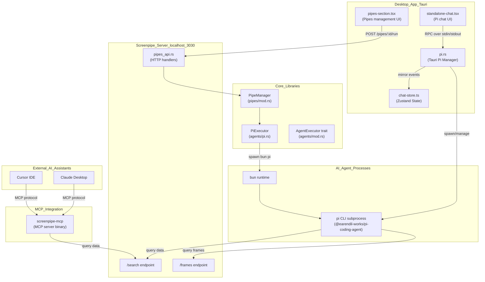
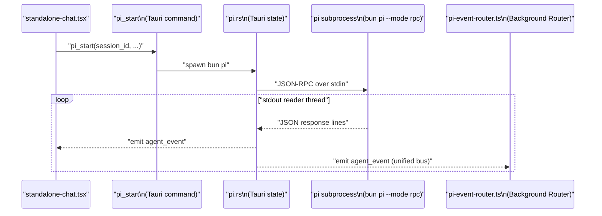

<!-- source: DeepWiki mcp.deepwiki.com · repo screenpipe/screenpipe · page 4 AI Integration · fetched 2026-10-27 -->

# AI Integration

Relevant source files

The following files were used as context for generating this wiki page:

- [apps/screenpipe-app-tauri/components/pipe-install-dialog.tsx](apps/screenpipe-app-tauri/components/pipe-install-dialog.tsx)
- [apps/screenpipe-app-tauri/components/pipe-store.tsx](apps/screenpipe-app-tauri/components/pipe-store.tsx)
- [apps/screenpipe-app-tauri/components/settings/pipes-section.tsx](apps/screenpipe-app-tauri/components/settings/pipes-section.tsx)
- [apps/screenpipe-app-tauri/components/standalone-chat.tsx](apps/screenpipe-app-tauri/components/standalone-chat.tsx)
- [apps/screenpipe-app-tauri/lib/cache.ts](apps/screenpipe-app-tauri/lib/cache.ts)
- [apps/screenpipe-app-tauri/lib/hooks/use-pipe-favorites.ts](apps/screenpipe-app-tauri/lib/hooks/use-pipe-favorites.ts)
- [apps/screenpipe-app-tauri/src-tauri/src/pi.rs](apps/screenpipe-app-tauri/src-tauri/src/pi.rs)
- [crates/screenpipe-core/Cargo.toml](crates/screenpipe-core/Cargo.toml)
- [crates/screenpipe-core/src/agents/bash_env.rs](crates/screenpipe-core/src/agents/bash_env.rs)
- [crates/screenpipe-core/src/agents/mod.rs](crates/screenpipe-core/src/agents/mod.rs)
- [crates/screenpipe-core/src/agents/pi.rs](crates/screenpipe-core/src/agents/pi.rs)
- [crates/screenpipe-core/src/pipes/favorites.rs](crates/screenpipe-core/src/pipes/favorites.rs)
- [crates/screenpipe-core/src/pipes/mod.rs](crates/screenpipe-core/src/pipes/mod.rs)
- [crates/screenpipe-engine/src/pipe_store.rs](crates/screenpipe-engine/src/pipe_store.rs)
- [crates/screenpipe-engine/src/pipes_api.rs](crates/screenpipe-engine/src/pipes_api.rs)
- [crates/screenpipe-engine/src/routes/pipe_store.rs](crates/screenpipe-engine/src/routes/pipe_store.rs)

This document explains how AI agents and assistants integrate with Screenpipe data. Screenpipe provides three primary AI integration paths: the Pi coding agent for interactive sessions, the Pipes system for scheduled AI workflows, and the MCP server for third-party AI assistant integration.

For detailed information on each integration mechanism, see:
- **Pi Coding Agent**: [Pi Coding Agent](#4.1) — `PiManager`, RPC subprocess communication, and chat store state management.
- **Pipes System**: [Pipes System](#4.2) — Scheduled AI workflows, `pipe.md` format, YAML permissions, and security layers.
- **MCP Server**: [MCP Server](#4.3) — Model Context Protocol for Claude, Cursor, and VS Code extensions.
- **Connections & Third-Party Integrations**: [Connections & Third-Party Integrations](#4.4) — OAuth flows and API integrations (ChatGPT, WhatsApp, Ollama, etc.).
- **Meetings & Activity Intelligence**: [Meetings & Activity Intelligence](#4.5) — Meeting detection, notes UI, and speaker identification.
- **Workflows & Live Views**: [Workflows & Live Views](#4.6) — UI for creating and managing workflows, and AI-generated live view dashboards.

## AI Integration Architecture

Screenpipe provides three primary AI integration paths: (1) the **Pi coding agent** for interactive chat and code execution, (2) the **Pipes system** for scheduled AI workflows, and (3) the **MCP server** for external AI assistant integration. All three paths query the same local Screenpipe API (`http://localhost:3030`) to access captured screen and audio data.

**AI Integration Paths (Code-Level Architecture)**

Sources: [apps/screenpipe-app-tauri/src-tauri/src/pi.rs:5-15](), [apps/screenpipe-app-tauri/components/standalone-chat.tsx:1-123](), [crates/screenpipe-core/src/pipes/mod.rs:5-25](), [crates/screenpipe-core/src/agents/pi.rs:5-22](), [crates/screenpipe-core/src/agents/mod.rs:5-11]()

## Screenpipe API Foundation

All AI integrations query the Screenpipe server at `http://localhost:3030` to access captured data. The server provides a REST API with full-text search, frame retrieval, and audio transcription endpoints. AI agents are instructed to ALWAYS include `start_time` in queries to avoid scanning the entire database [apps/screenpipe-app-tauri/components/pipe-store.tsx:171-177]().

**Core API Endpoints Used by AI Agents**

| Endpoint | Method | Purpose | Used By |
|----------|--------|---------|---------|
| `/search` | GET | Full-text search across OCR, audio, and input events | Pi agent, MCP, Pipes |
| `/frames` | GET | Retrieve frames for a time range | Pi agent skills |
| `/audio` | GET | Retrieve audio chunks for a time range | Pi agent skills |
| `/pipes` | GET | List and manage scheduled AI agents | `pipes_api.rs` |
| `/raw_sql` | POST | Execute SQL against SQLite (with safety checks) | Pi agent (for custom aggregations) |

Sources: [apps/screenpipe-app-tauri/components/standalone-chat.tsx:89-97](), [crates/screenpipe-core/src/agents/pi.rs:21-22](), [apps/screenpipe-app-tauri/components/settings/pipes-section.tsx:184-210](), [crates/screenpipe-engine/src/pipes_api.rs:67-75]()

## AI Provider Authentication

AI agents can use local models (Ollama) or cloud providers. Authentication is managed via user tokens or API keys stored in AI presets.

- **Screenpipe Cloud**: User token is wrapped in `ArcSwap` so the desktop app can refresh it at runtime via Tauri commands [crates/screenpipe-core/src/agents/pi.rs:167-175]().
- **Cloud Providers**: LLM model and provider overrides are defined in `PipeConfig` from `pipe.md` front-matter [crates/screenpipe-core/src/pipes/mod.rs:163-168]().
- **Rate Limits**: The system handles HTTP 429 errors with bounded retries and backoff logic [crates/screenpipe-core/src/agents/pi.rs:23-28]().
- **Model Catalog**: `PiExecutor` fetches the model catalog from the Cloudflare Worker gateway (`/v1/models`) to keep the agent updated with the latest LLMs [crates/screenpipe-core/src/agents/pi.rs:83-91]().

Sources: [crates/screenpipe-core/src/agents/pi.rs:157-175](), [crates/screenpipe-core/src/pipes/mod.rs:151-170](), [apps/screenpipe-app-tauri/components/standalone-chat.tsx:73-80]()

## Pi Agent Communication Protocol

The Pi coding agent (`@earendil-works/pi-coding-agent`) runs as a subprocess and communicates via JSON-RPC over stdin/stdout [apps/screenpipe-app-tauri/src-tauri/src/pi.rs:5-10]().

**Pi Agent RPC Communication Flow**

**Key Implementation Details:**
- `PiExecutor` manages the lifecycle of the Pi CLI subprocess [crates/screenpipe-core/src/agents/pi.rs:157-175]().
- `read_lines_lossy` handles stdout with lossy UTF-8 conversion to prevent crashes on invalid bytes [apps/screenpipe-app-tauri/src-tauri/src/pi.rs:51-73]().
- `TEXT_DELTA_EMIT_BATCH_MS` (50ms) controls the batching of streaming text for UI performance [apps/screenpipe-app-tauri/src-tauri/src/pi.rs:75-76]().
- `pi-event-router.ts` subscribes to the unified agent-event bus to mirror per-session liveness into the global `chat-store` [apps/screenpipe-app-tauri/components/standalone-chat.tsx:88-95]().

Sources: [apps/screenpipe-app-tauri/src-tauri/src/pi.rs:5-112](), [apps/screenpipe-app-tauri/components/standalone-chat.tsx:44-73](), [crates/screenpipe-core/src/agents/pi.rs:5-22]()

## Pi Agent Skills & State

Before execution, Screenpipe ensures the Pi agent has access to specific "skills" which are specialized prompt instructions and tool definitions.

| Feature | Purpose | Implementation |
|-------|---------|----------------|
| **Skills** | Prompt instructions for API usage | `screenpipe-api`, `screenpipe-mcp` [apps/screenpipe-app-tauri/components/settings/pipes-section.tsx:132-172]() |
| **Global Store** | Multi-tab chat state | `useChatConversations` in `standalone-chat.tsx` [apps/screenpipe-app-tauri/components/standalone-chat.tsx:36]() |
| **Persistence** | Conversation JSON files | `saveConversationFile` in `chat-storage.ts` [apps/screenpipe-app-tauri/components/standalone-chat.tsx:51]() |
| **Liveness** | Sidebar status indicators | `useTurnLiveness` in `standalone-chat.tsx` [apps/screenpipe-app-tauri/components/standalone-chat.tsx:96]() |

The `PiExecutor` ensures that even if the UI component is unmounted (e.g., navigating to Timeline), the background Pi subprocess continues to stream events which are captured by the `pi-event-router` [apps/screenpipe-app-tauri/components/standalone-chat.tsx:88-95]().

Sources: [crates/screenpipe-core/src/agents/pi.rs:82-146](), [apps/screenpipe-app-tauri/components/settings/pipes-section.tsx:132-172](), [apps/screenpipe-app-tauri/components/standalone-chat.tsx:36](), [apps/screenpipe-app-tauri/components/standalone-chat.tsx:51](), [apps/screenpipe-app-tauri/components/standalone-chat.tsx:96]()

## Integration Paths Overview

| Integration Path | Use Case | Implementation |
|------------------|----------|----------------|
| **Pi Chat** | Interactive conversational memory and code execution | `standalone-chat.tsx` using `usePiChatState` [apps/screenpipe-app-tauri/components/standalone-chat.tsx:88]() |
| **Pipes** | Scheduled AI workflows and background automation | `PipeManager` scanning `~/.screenpipe/pipes/` for `pipe.md` files [crates/screenpipe-core/src/pipes/mod.rs:7-11](). |
| **MCP Server** | Exposing Screenpipe context to external IDEs and tools | `screenpipe-mcp` package integration [crates/screenpipe-core/src/pipes/mod.rs:16-17](). |

For details on scheduled automation, see [Pipes System](#4.2). For external tool integration, see [MCP Server](#4.3).

Sources: [apps/screenpipe-app-tauri/components/standalone-chat.tsx:1-123](), [crates/screenpipe-core/src/pipes/mod.rs:1-100]()

---

