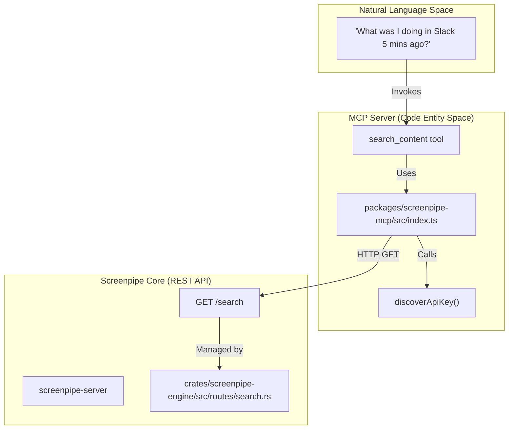
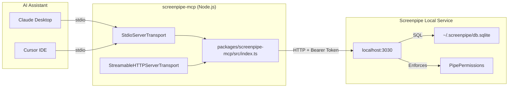
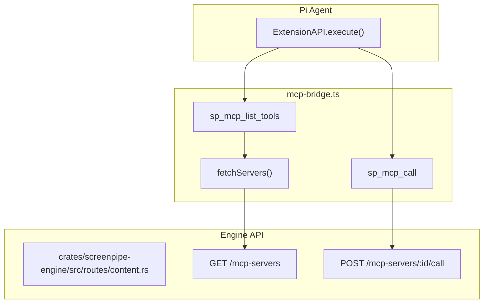

<!-- source: DeepWiki mcp.deepwiki.com · repo screenpipe/screenpipe · page 4.3 MCP Server · fetched 2026-10-27 -->

# MCP Server

<details>
<summary>Relevant source files</summary>

The following files were used as context for generating this wiki page:

- [.claude/skills/screenpipe-api/SKILL.md](.claude/skills/screenpipe-api/SKILL.md)
- [.claude/skills/screenpipe-cli/SKILL.md](.claude/skills/screenpipe-cli/SKILL.md)
- [.github/workflows/release-mcp.yml](.github/workflows/release-mcp.yml)
- [.github/workflows/test-mcp.yml](.github/workflows/test-mcp.yml)
- [apps/screenpipe-app-tauri/bun.lock](apps/screenpipe-app-tauri/bun.lock)
- [apps/screenpipe-app-tauri/components/settings/__tests__/ai-tools-card.test.tsx](apps/screenpipe-app-tauri/components/settings/__tests__/ai-tools-card.test.tsx)
- [apps/screenpipe-app-tauri/components/settings/ai-tools-card.tsx](apps/screenpipe-app-tauri/components/settings/ai-tools-card.tsx)
- [apps/screenpipe-app-tauri/e2e/helpers/app-launcher.ts](apps/screenpipe-app-tauri/e2e/helpers/app-launcher.ts)
- [apps/screenpipe-app-tauri/e2e/specs/onboarding-background-ai-tools.spec.ts](apps/screenpipe-app-tauri/e2e/specs/onboarding-background-ai-tools.spec.ts)
- [apps/screenpipe-app-tauri/lib/__tests__/ai-tools-mcp.test.ts](apps/screenpipe-app-tauri/lib/__tests__/ai-tools-mcp.test.ts)
- [apps/screenpipe-app-tauri/lib/ai-tools-mcp.ts](apps/screenpipe-app-tauri/lib/ai-tools-mcp.ts)
- [apps/screenpipe-app-tauri/lib/generated/screenpipe-skills.ts](apps/screenpipe-app-tauri/lib/generated/screenpipe-skills.ts)
- [apps/screenpipe-app-tauri/package.json](apps/screenpipe-app-tauri/package.json)
- [apps/screenpipe-app-tauri/src-tauri/src/skills.rs](apps/screenpipe-app-tauri/src-tauri/src/skills.rs)
- [crates/screenpipe-core/assets/extensions/screenpipe-permissions.test.ts](crates/screenpipe-core/assets/extensions/screenpipe-permissions.test.ts)
- [crates/screenpipe-core/assets/extensions/screenpipe-permissions.ts](crates/screenpipe-core/assets/extensions/screenpipe-permissions.ts)
- [crates/screenpipe-core/assets/skills/screenpipe-api/SKILL.md](crates/screenpipe-core/assets/skills/screenpipe-api/SKILL.md)
- [crates/screenpipe-core/assets/skills/screenpipe-cli/SKILL.md](crates/screenpipe-core/assets/skills/screenpipe-cli/SKILL.md)
- [crates/screenpipe-core/assets/skills/screenpipe-process-guide/SKILL.md](crates/screenpipe-core/assets/skills/screenpipe-process-guide/SKILL.md)
- [crates/screenpipe-core/assets/skills/screenpipe-workflow-discovery/SKILL.md](crates/screenpipe-core/assets/skills/screenpipe-workflow-discovery/SKILL.md)
- [crates/screenpipe-core/src/pipes/permissions.rs](crates/screenpipe-core/src/pipes/permissions.rs)
- [crates/screenpipe-db/src/types.rs](crates/screenpipe-db/src/types.rs)
- [crates/screenpipe-engine/src/cli/agent.rs](crates/screenpipe-engine/src/cli/agent.rs)
- [crates/screenpipe-engine/src/routes/content.rs](crates/screenpipe-engine/src/routes/content.rs)
- [crates/screenpipe-engine/src/routes/search.rs](crates/screenpipe-engine/src/routes/search.rs)
- [docs/mintlify/docs-mintlify-mig-tmp/claude-code.mdx](docs/mintlify/docs-mintlify-mig-tmp/claude-code.mdx)
- [docs/mintlify/docs-mintlify-mig-tmp/cline.mdx](docs/mintlify/docs-mintlify-mig-tmp/cline.mdx)
- [docs/mintlify/docs-mintlify-mig-tmp/continue.mdx](docs/mintlify/docs-mintlify-mig-tmp/continue.mdx)
- [docs/mintlify/docs-mintlify-mig-tmp/for-developers.mdx](docs/mintlify/docs-mintlify-mig-tmp/for-developers.mdx)
- [docs/mintlify/docs-mintlify-mig-tmp/gemini-cli.mdx](docs/mintlify/docs-mintlify-mig-tmp/gemini-cli.mdx)
- [docs/mintlify/docs-mintlify-mig-tmp/mcp-server.mdx](docs/mintlify/docs-mintlify-mig-tmp/mcp-server.mdx)
- [docs/mintlify/docs-mintlify-mig-tmp/meeting-follow-up.mdx](docs/mintlify/docs-mintlify-mig-tmp/meeting-follow-up.mdx)
- [docs/mintlify/docs-mintlify-mig-tmp/meeting-intelligence.mdx](docs/mintlify/docs-mintlify-mig-tmp/meeting-intelligence.mdx)
- [docs/mintlify/docs-mintlify-mig-tmp/search-screen-history.mdx](docs/mintlify/docs-mintlify-mig-tmp/search-screen-history.mdx)
- [docs/pr-assets/granola-meeting-prompt/after.png](docs/pr-assets/granola-meeting-prompt/after.png)
- [docs/pr-assets/granola-meeting-prompt/before.png](docs/pr-assets/granola-meeting-prompt/before.png)
- [packages/screenpipe-mcp/.gitignore](packages/screenpipe-mcp/.gitignore)
- [packages/screenpipe-mcp/README.md](packages/screenpipe-mcp/README.md)
- [packages/screenpipe-mcp/RELEASE.md](packages/screenpipe-mcp/RELEASE.md)
- [packages/screenpipe-mcp/bun.lock](packages/screenpipe-mcp/bun.lock)
- [packages/screenpipe-mcp/manifest.json](packages/screenpipe-mcp/manifest.json)
- [packages/screenpipe-mcp/package.json](packages/screenpipe-mcp/package.json)
- [packages/screenpipe-mcp/plugins/screenpipe-cloud/README.md](packages/screenpipe-mcp/plugins/screenpipe-cloud/README.md)
- [packages/screenpipe-mcp/plugins/screenpipe-cloud/SUBMISSION.md](packages/screenpipe-mcp/plugins/screenpipe-cloud/SUBMISSION.md)
- [packages/screenpipe-mcp/plugins/screenpipe-cloud/mcp.json](packages/screenpipe-mcp/plugins/screenpipe-cloud/mcp.json)
- [packages/screenpipe-mcp/scripts/assert-pack-contents.js](packages/screenpipe-mcp/scripts/assert-pack-contents.js)
- [packages/screenpipe-mcp/server.json](packages/screenpipe-mcp/server.json)
- [packages/screenpipe-mcp/src/generated/bundled-skills.ts](packages/screenpipe-mcp/src/generated/bundled-skills.ts)
- [packages/screenpipe-mcp/src/http-server.test.ts](packages/screenpipe-mcp/src/http-server.test.ts)
- [packages/screenpipe-mcp/src/http-server.ts](packages/screenpipe-mcp/src/http-server.ts)
- [packages/screenpipe-mcp/src/index.ts](packages/screenpipe-mcp/src/index.ts)
- [packages/screenpipe-mcp/src/pack-contents.test.ts](packages/screenpipe-mcp/src/pack-contents.test.ts)
- [packages/screenpipe-mcp/src/stdio-startup.test.ts](packages/screenpipe-mcp/src/stdio-startup.test.ts)
- [packages/screenpipe-mcp/src/workflow-tools.test.ts](packages/screenpipe-mcp/src/workflow-tools.test.ts)
- [packages/screenpipe-mcp/src/workflow-tools.ts](packages/screenpipe-mcp/src/workflow-tools.ts)
- [packages/screenpipe-mcp/src/workflow-transport.test.ts](packages/screenpipe-mcp/src/workflow-transport.test.ts)

</details>


## Purpose
The MCP (Model Context Protocol) Server integration enables AI assistants and coding tools to query Screenpipe's local screen and audio data. This allows tools like Claude Desktop, Cursor, and VS Code extensions to incorporate real-time computer activity as context for reasoning and generation.

For information about AI workflows that run on schedules, see [Pipes System](4.2). For information about the Pi coding agent, see [Pi Coding Agent](4.1).

---

## Overview
The Screenpipe MCP server is distributed as an NPM package (`screenpipe-mcp`) that exposes the local REST API (defaulting to `localhost:3030`) to MCP-compatible clients. It provides a bridge between the Model Context Protocol and Screenpipe's local data stores [packages/screenpipe-mcp/package.json:2-10]().

**Key characteristics:**
- **Protocol Bridge**: Translates MCP tool calls into standard Screenpipe API requests [packages/screenpipe-mcp/src/index.ts:28-53]().
- **Multi-Transport Support**: Supports `stdio` for local tools and `HTTP` (Streamable HTTP) for remote/networked access [packages/screenpipe-mcp/src/http-server.ts:6-19]().
- **Rich Toolset**: Includes content search, video export, meeting summaries, and UI element inspection [packages/screenpipe-mcp/README.md:127-166]().
- **NPM Distribution**: Easily updated via `npx -y screenpipe-mcp@latest` [packages/screenpipe-mcp/README.md:89-92]().
- **MCP Registry**: Published to the official MCP Registry under the `io.github.screenpipe` namespace [packages/screenpipe-mcp/package.json:4]().

Sources: [packages/screenpipe-mcp/package.json:1-49](), [packages/screenpipe-mcp/src/index.ts:1-53](), [packages/screenpipe-mcp/README.md:1-514](), [packages/screenpipe-mcp/server.json:1-23](), [packages/screenpipe-mcp/src/http-server.ts:6-19]()

---

## Architecture

### Data Flow: Natural Language to Code Entities
The following diagram illustrates how a natural language request from an AI assistant is resolved through the MCP server into specific Screenpipe code entities.

**Diagram: NL Space to Code Entity Space**


Sources: [packages/screenpipe-mcp/src/index.ts:75-176](), [crates/screenpipe-engine/src/routes/search.rs:122-190]()

### Component Topology
The MCP server acts as a translation layer. It discovers the local API key to authenticate against the local Screenpipe daemon.

**Diagram: Component Interaction**


Sources: [packages/screenpipe-mcp/src/index.ts:6-14](), [packages/screenpipe-mcp/src/http-server.ts:6-19](), [crates/screenpipe-core/src/pipes/permissions.rs:163-183]()

---

## Installation & Setup

### Automated Setup
The Screenpipe desktop app provides automated installation for Claude Desktop via the connections panel. The MCP server is published to the NPM registry as `screenpipe-mcp` [packages/screenpipe-mcp/package.json:2-3](). The `screenpipe agent setup` CLI command can also install skills and configure MCP servers for various AI tools [crates/screenpipe-engine/src/cli/agent.rs:51-72]().

Sources: [packages/screenpipe-mcp/package.json:1-49](), [crates/screenpipe-engine/src/cli/agent.rs:51-72]()

### Manual Configuration (Stdio)
For tools like Claude Desktop, add the following to the `claude_desktop_config.json`:

```json
{
  "mcpServers": {
    "screenpipe": {
      "command": "npx",
      "args": ["-y", "screenpipe-mcp@latest"],
      "env": {
        "SCREENPIPE_LOCAL_API_KEY": "sp-…"
      }
    }
  }
}
```
This configuration uses `npx` to run the `screenpipe-mcp` package and explicitly sets the `SCREENPIPE_LOCAL_API_KEY` environment variable for authentication. This is recommended for faster startup and to avoid slow key discovery fallbacks [packages/screenpipe-mcp/README.md:89-108]().

Sources: [packages/screenpipe-mcp/README.md:89-108]()

### Remote/Network Access (HTTP)
The MCP server can run over HTTP using the Streamable HTTP transport, allowing remote clients to connect over the network [packages/screenpipe-mcp/src/http-server.ts:6-19]().

```bash
# loopback only (default)
npx -y screenpipe-mcp --http --port 3031

# expose to your LAN with bearer auth
npx -y screenpipe-mcp --http --listen-on-lan --api-key $(openssl rand -hex 16)

# or from source — must build first so dist/ exists
bun install && bun run build
bun run start:http -- --port 3031
```
The HTTP server exposes an MCP endpoint at `http://localhost:3031/mcp` and a health check at `http://localhost:3031/health`. It supports `--port`, `--screenpipe-port`, `--listen-on-lan`, and `--api-key` flags [packages/screenpipe-mcp/README.md:111-145]().

Sources: [packages/screenpipe-mcp/README.md:111-145](), [packages/screenpipe-mcp/src/http-server.ts:49-89]()

---

## MCP Tools
The server exposes specialized tools defined in the MCP schema to provide context to LLMs. These tools are documented in `SKILL.md` files within the `screenpipe-core` assets [crates/screenpipe-core/assets/skills/screenpipe-api/SKILL.md:1-4]().

| Tool Name | Purpose | Key Parameters |
|:---|:---|:---|
| `search-content` | Search OCR, Audio, Accessibility, and Input events [crates/screenpipe-engine/src/routes/search.rs:122-190]() | `q`, `content_type`, `start_time`, `app_name` |
| `export-video` | Generates an MP4 file of a specific time range [crates/screenpipe-core/assets/skills/screenpipe-api/SKILL.md:300-303]() | `start_time`, `end_time`, `fps` |
| `activity-summary`| Compressed activity overview [crates/screenpipe-core/assets/skills/screenpipe-api/SKILL.md:31-33]() | `start_time`, `end_time` |
| `list-meetings` | List detected meetings with attendees [crates/screenpipe-core/assets/skills/screenpipe-api/SKILL.md:320-322]() | `q` |
| `search-elements` | Search structured UI nodes [crates/screenpipe-core/assets/skills/screenpipe-api/SKILL.md:330-334]() | `q`, `app_name`, `role` |
| `frame-context` | Get accessibility text and extracted URLs for a frame [crates/screenpipe-core/assets/skills/screenpipe-api/SKILL.md:340-342]() | `frame_id` |

Sources: [crates/screenpipe-core/assets/skills/screenpipe-api/SKILL.md:1-661](), [crates/screenpipe-engine/src/routes/search.rs:122-190]()

---

## Implementation Details

### API Key Discovery
The MCP server uses a robust multi-step discovery logic in `discoverApiKey()` to handle different environments and encrypted stores [packages/screenpipe-mcp/src/index.ts:99-100]():
1. **Environment**: Checks `SCREENPIPE_LOCAL_API_KEY` or `SCREENPIPE_API_KEY` [packages/screenpipe-mcp/src/index.ts:100-101]().
2. **Bundled Runtime**: Attempts to use the `bun` binary shipped with the desktop app at deterministic paths (e.g., `/Applications/screenpipe.app/Contents/MacOS/bun` on macOS) to run `screenpipe auth token`. This handles the encrypted keychain-backed secret store [packages/screenpipe-mcp/src/index.ts:131-153]().
3. **Node-adjacent NPX**: Tries `npx` located in the same directory as the node executable [packages/screenpipe-mcp/src/index.ts:158-169]().
4. **Path-based NPX**: Final CLI fallback using the system PATH [packages/screenpipe-mcp/src/index.ts:173-184]().
5. **Direct DB Read**: The MCP process never opens Screenpipe's SQLite files directly. The desktop app and CLI own database access, locking, WAL handling, and secret-store decoding [packages/screenpipe-mcp/src/index.ts:92-96]().

Sources: [packages/screenpipe-mcp/src/index.ts:99-184]()

### Dynamic MCP Server Management
The `screenpipe-connect` crate manages user-defined dynamic MCP server instances. This is handled by the desktop application's frontend, which interacts with the backend to store and retrieve MCP server configurations [apps/screenpipe-app-tauri/components/settings/ai-tools-card.tsx:1-10]().

- **Storage**: Public config (id, name, url, enabled) is managed by the desktop app.
- **Secrets**: Header values are stored in the `SecretStore` and are never written to the JSON file.
- **Auth**: Supports static request headers and OAuth 2.0 with PKCE.

Sources: [apps/screenpipe-app-tauri/components/settings/ai-tools-card.tsx:1-10]()

### Proxy-Tool Bridge
To avoid consuming excessive context window tokens with individual tool registrations, Screenpipe uses a proxy-tool bridge (`mcp-bridge.ts`). This bridge registers generic tools like `sp_mcp_list_tools` and `sp_mcp_call`, which lazily dispatch requests to registered MCP servers [crates/screenpipe-core/assets/extensions/mcp-bridge.ts:7-12]().

**Diagram: Proxy Bridge Flow**


Sources: [crates/screenpipe-core/assets/extensions/mcp-bridge.ts:96-200](), [crates/screenpipe-engine/src/routes/content.rs:1-10]()

### OAuth Integration
For custom MCP servers requiring authentication, Screenpipe supports OAuth 2.0. The `render_oauth_result_page` function provides a branded success/error page for the authorization flow [crates/screenpipe-engine/src/routes/content.rs:1-10]().

Sources: [packages/screenpipe-mcp/src/index.ts:75-176](), [crates/screenpipe-engine/src/routes/content.rs:1-10]()

---

