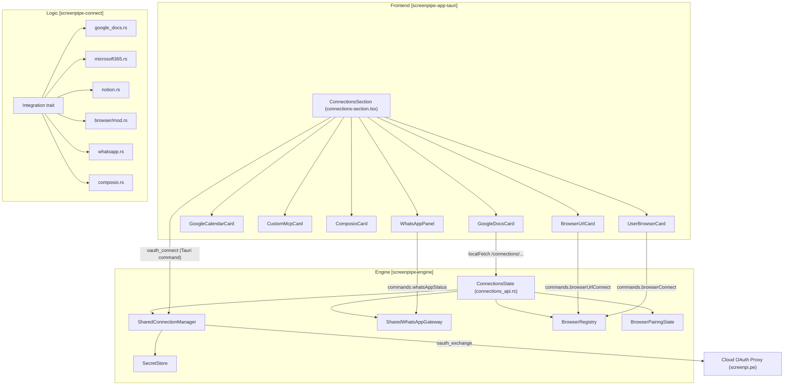
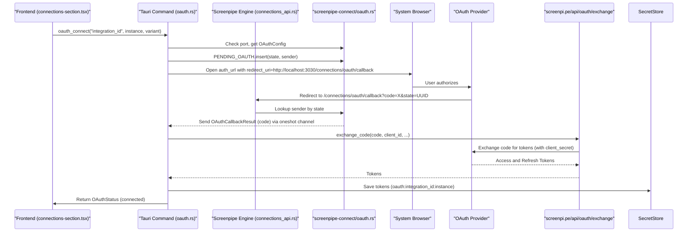

<!-- source: DeepWiki mcp.deepwiki.com · repo screenpipe/screenpipe · page 4.4 Connections & Third-Party Integrations · fetched 2026-10-27 -->

# Connections & Third-Party Integrations

Relevant source files

The following files were used as context for generating this wiki page:

- [apps/screenpipe-app-tauri/components/browser-sidebar.tsx](apps/screenpipe-app-tauri/components/browser-sidebar.tsx)
- [apps/screenpipe-app-tauri/components/meeting-notes/calendar-connect-dialog.tsx](apps/screenpipe-app-tauri/components/meeting-notes/calendar-connect-dialog.tsx)
- [apps/screenpipe-app-tauri/components/post-install-connections-modal.tsx](apps/screenpipe-app-tauri/components/post-install-connections-modal.tsx)
- [apps/screenpipe-app-tauri/components/settings/__tests__/composio-card.test.tsx](apps/screenpipe-app-tauri/components/settings/__tests__/composio-card.test.tsx)
- [apps/screenpipe-app-tauri/components/settings/__tests__/integration-icon-keys.test.ts](apps/screenpipe-app-tauri/components/settings/__tests__/integration-icon-keys.test.ts)
- [apps/screenpipe-app-tauri/components/settings/agent-card.tsx](apps/screenpipe-app-tauri/components/settings/agent-card.tsx)
- [apps/screenpipe-app-tauri/components/settings/composio-card.tsx](apps/screenpipe-app-tauri/components/settings/composio-card.tsx)
- [apps/screenpipe-app-tauri/components/settings/connections-section.tsx](apps/screenpipe-app-tauri/components/settings/connections-section.tsx)
- [apps/screenpipe-app-tauri/components/settings/google-calendar-card.tsx](apps/screenpipe-app-tauri/components/settings/google-calendar-card.tsx)
- [apps/screenpipe-app-tauri/components/settings/google-docs-card.tsx](apps/screenpipe-app-tauri/components/settings/google-docs-card.tsx)
- [apps/screenpipe-app-tauri/components/settings/input-monitoring-card.tsx](apps/screenpipe-app-tauri/components/settings/input-monitoring-card.tsx)
- [apps/screenpipe-app-tauri/e2e/specs/zz-owned-browser-background-nav.spec.ts](apps/screenpipe-app-tauri/e2e/specs/zz-owned-browser-background-nav.spec.ts)
- [apps/screenpipe-app-tauri/lib/__tests__/owned-browser-ownership.test.ts](apps/screenpipe-app-tauri/lib/__tests__/owned-browser-ownership.test.ts)
- [apps/screenpipe-app-tauri/lib/connections/foreground-oauth.test.ts](apps/screenpipe-app-tauri/lib/connections/foreground-oauth.test.ts)
- [apps/screenpipe-app-tauri/lib/connections/foreground-oauth.ts](apps/screenpipe-app-tauri/lib/connections/foreground-oauth.ts)
- [apps/screenpipe-app-tauri/lib/constants/__tests__/connections-suggestions.test.ts](apps/screenpipe-app-tauri/lib/constants/__tests__/connections-suggestions.test.ts)
- [apps/screenpipe-app-tauri/lib/constants/connections.ts](apps/screenpipe-app-tauri/lib/constants/connections.ts)
- [apps/screenpipe-app-tauri/lib/hooks/use-hardcoded-tiles.ts](apps/screenpipe-app-tauri/lib/hooks/use-hardcoded-tiles.ts)
- [apps/screenpipe-app-tauri/lib/owned-browser-ownership.ts](apps/screenpipe-app-tauri/lib/owned-browser-ownership.ts)
- [apps/screenpipe-app-tauri/lib/utils/connection-chip.test.ts](apps/screenpipe-app-tauri/lib/utils/connection-chip.test.ts)
- [apps/screenpipe-app-tauri/lib/utils/connection-chip.ts](apps/screenpipe-app-tauri/lib/utils/connection-chip.ts)
- [apps/screenpipe-app-tauri/public/images/codex.svg](apps/screenpipe-app-tauri/public/images/codex.svg)
- [apps/screenpipe-app-tauri/public/images/gmail.svg](apps/screenpipe-app-tauri/public/images/gmail.svg)
- [apps/screenpipe-app-tauri/public/images/google-docs.svg](apps/screenpipe-app-tauri/public/images/google-docs.svg)
- [apps/screenpipe-app-tauri/public/images/google-drive.svg](apps/screenpipe-app-tauri/public/images/google-drive.svg)
- [apps/screenpipe-app-tauri/public/images/google-sheets.svg](apps/screenpipe-app-tauri/public/images/google-sheets.svg)
- [apps/screenpipe-app-tauri/src-tauri/assets/extensions/connection-gate.ts](apps/screenpipe-app-tauri/src-tauri/assets/extensions/connection-gate.ts)
- [apps/screenpipe-app-tauri/src-tauri/src/oauth.rs](apps/screenpipe-app-tauri/src-tauri/src/oauth.rs)
- [apps/screenpipe-app-tauri/src-tauri/src/owned_browser.rs](apps/screenpipe-app-tauri/src-tauri/src/owned_browser.rs)
- [apps/screenpipe-app-tauri/src-tauri/src/owned_browser_cookies.rs](apps/screenpipe-app-tauri/src-tauri/src/owned_browser_cookies.rs)
- [crates/screenpipe-connect/Cargo.toml](crates/screenpipe-connect/Cargo.toml)
- [crates/screenpipe-connect/src/connections/browser/bridge.rs](crates/screenpipe-connect/src/connections/browser/bridge.rs)
- [crates/screenpipe-connect/src/connections/browser/mod.rs](crates/screenpipe-connect/src/connections/browser/mod.rs)
- [crates/screenpipe-connect/src/connections/browser/owned.rs](crates/screenpipe-connect/src/connections/browser/owned.rs)
- [crates/screenpipe-connect/src/connections/calcom.rs](crates/screenpipe-connect/src/connections/calcom.rs)
- [crates/screenpipe-connect/src/connections/calendly.rs](crates/screenpipe-connect/src/connections/calendly.rs)
- [crates/screenpipe-connect/src/connections/github_issues.rs](crates/screenpipe-connect/src/connections/github_issues.rs)
- [crates/screenpipe-connect/src/connections/google_calendar.rs](crates/screenpipe-connect/src/connections/google_calendar.rs)
- [crates/screenpipe-connect/src/connections/google_docs.rs](crates/screenpipe-connect/src/connections/google_docs.rs)
- [crates/screenpipe-connect/src/connections/microsoft365.rs](crates/screenpipe-connect/src/connections/microsoft365.rs)
- [crates/screenpipe-connect/src/connections/mod.rs](crates/screenpipe-connect/src/connections/mod.rs)
- [crates/screenpipe-connect/src/connections/notion.rs](crates/screenpipe-connect/src/connections/notion.rs)
- [crates/screenpipe-connect/src/connections/quickbooks.rs](crates/screenpipe-connect/src/connections/quickbooks.rs)
- [crates/screenpipe-connect/src/connections/slack.rs](crates/screenpipe-connect/src/connections/slack.rs)
- [crates/screenpipe-connect/src/connections/teams.rs](crates/screenpipe-connect/src/connections/teams.rs)
- [crates/screenpipe-connect/src/lib.rs](crates/screenpipe-connect/src/lib.rs)
- [crates/screenpipe-connect/src/mdns.rs](crates/screenpipe-connect/src/mdns.rs)
- [crates/screenpipe-connect/src/oauth.rs](crates/screenpipe-connect/src/oauth.rs)
- [crates/screenpipe-connect/src/remote_sync.rs](crates/screenpipe-connect/src/remote_sync.rs)
- [crates/screenpipe-engine/src/connections_api.rs](crates/screenpipe-engine/src/connections_api.rs)
- [docs/mintlify/docs-mintlify-mig-tmp/connection-reference.mdx](docs/mintlify/docs-mintlify-mig-tmp/connection-reference.mdx)
- [docs/mintlify/docs-mintlify-mig-tmp/docs-maintenance.mdx](docs/mintlify/docs-mintlify-mig-tmp/docs-maintenance.mdx)
- [docs/mintlify/docs-mintlify-mig-tmp/openclaw.mdx](docs/mintlify/docs-mintlify-mig-tmp/openclaw.mdx)
- [docs/mintlify/docs-mintlify-mig-tmp/second-brain.mdx](docs/mintlify/docs-mintlify-mig-tmp/second-brain.mdx)
- [docs/mintlify/validate-docs.mjs](docs/mintlify/validate-docs.mjs)
- [docs/pr-assets/slack-multiple-workspaces-before-after.png](docs/pr-assets/slack-multiple-workspaces-before-after.png)

**Purpose**: This page documents Screenpipe's external integrations and connection mechanisms. It covers how Screenpipe connects to AI assistants, OAuth authentication for cloud services, local AI providers, messaging platforms, and calendar systems.

For information about the Model Context Protocol (MCP) implementation that exposes Screenpipe data to these integrations, see [4.3 MCP Server](). For AI workflow automation using Pipes, see [4.2 Pipes System]().

## Overview

Screenpipe provides multiple integration pathways to connect local screen and audio data with external tools. All integrations maintain Screenpipe's local-first architecture — captured data never leaves your machine unless explicitly enabled.

The connections system is implemented in the Settings UI as a tile-based grid. Integration logic is split between:

- **Frontend panels**: UI components in `connections-section.tsx` [apps/screenpipe-app-tauri/components/settings/connections-section.tsx:7-46]() and specialized cards like `GoogleDocsCard` [apps/screenpipe-app-tauri/components/settings/google-docs-card.tsx:30-31]() or `GoogleCalendarCard` [apps/screenpipe-app-tauri/components/settings/google-calendar-card.tsx:45-47]().
- **Backend commands**: Rust-based OAuth flows and credential management defined in `oauth.rs` [apps/screenpipe-app-tauri/src-tauri/src/oauth.rs:61-65]() and `connections_api.rs` [crates/screenpipe-engine/src/connections_api.rs:5-11]().
- **External tool detection**: Logic to find local installations of AI tools like Claude or Cursor [apps/screenpipe-app-tauri/components/settings/connections-section.tsx:91-127]().

### Connection Architecture Diagram

The following diagram bridges the user-facing integration tiles to the underlying Rust entities and state management.

**Sources**: [apps/screenpipe-app-tauri/components/settings/connections-section.tsx:7-46](), [crates/screenpipe-engine/src/connections_api.rs:32-42](), [apps/screenpipe-app-tauri/components/settings/connections-section.tsx:91-127](), [apps/screenpipe-app-tauri/components/settings/google-calendar-card.tsx:45-47](), [crates/screenpipe-connect/src/connections/mod.rs:175](), [apps/screenpipe-app-tauri/components/settings/composio-card.tsx](), [apps/screenpipe-app-tauri/components/settings/whatsapp-panel.tsx](), [apps/screenpipe-app-tauri/components/settings/browser-url-card.tsx](), [apps/screenpipe-app-tauri/components/settings/user-browser-card.tsx]()

## Credential Management & Proxying

Screenpipe uses a **Credential Proxy** architecture. Instead of pipes or LLMs handling raw API keys, the Screenpipe server injects credentials into requests server-side.

### SecretStore

Credentials (API keys, OAuth tokens) are stored in a unified `SecretStore` [crates/screenpipe-secrets/src/store.rs:9]().
- **Storage**: Backed by the local `db.sqlite` [apps/screenpipe-app-tauri/src-tauri/src/oauth.rs:43-47]().
- **Encryption**: Tokens are encrypted using keys from the OS keychain [apps/screenpipe-app-tauri/src-tauri/src/oauth.rs:46-49]().
- **Keying**: Keys in the store are prefixed with `oauth:` [crates/screenpipe-connect/src/oauth.rs:131]() and can include instance identifiers for multi-account support [crates/screenpipe-connect/src/oauth.rs:133-138]().
- **Migration**: Screenpipe includes logic to migrate legacy plaintext `-oauth.json` files into the unified `SecretStore` [crates/screenpipe-secrets/src/migration.rs:25-28]().

### API Proxy Flow

Integrations define a `ProxyConfig` [crates/screenpipe-connect/src/connections/mod.rs:125-134]() which tells the server how to forward requests.
- **Auth Injection**: Supports `Bearer`, `Token`, `Header`, and `BasicAuth` [crates/screenpipe-connect/src/connections/mod.rs:137-154]().
- **Path Routing**: Allows re-routing specific sub-paths to different base URLs (e.g., Google Docs vs Google Drive) via `path_routes` [crates/screenpipe-connect/src/connections/mod.rs:212-215]().

**Sources**: [crates/screenpipe-connect/src/connections/mod.rs:125-154](), [apps/screenpipe-app-tauri/src-tauri/src/oauth.rs:43-49](), [crates/screenpipe-connect/src/oauth.rs:131-138](), [crates/screenpipe-secrets/src/migration.rs:25-28](), [crates/screenpipe-secrets/src/store.rs:9]()

## OAuth Flow Lifecycle

Screenpipe implements a generic OAuth 2.0 `authorization_code` flow for all supported integrations.

1. **Initiation**: The UI calls the `oauth_connect` command [apps/screenpipe-app-tauri/src-tauri/src/oauth.rs:113-120]().
2. **Port Check**: OAuth callbacks require the Screenpipe API to be on port 3030, or an `redirect_uri_override` [apps/screenpipe-app-tauri/src-tauri/src/oauth.rs:155-163]().
3. **Pending State**: A `oneshot::Sender` is inserted into `PENDING_OAUTH` keyed by a random `state` UUID [crates/screenpipe-connect/src/oauth.rs:96-107]().
4. **Authorization**: The system browser opens the provider's `auth_url` [apps/screenpipe-app-tauri/src-tauri/src/oauth.rs:169-176]().
5. **Callback**: The engine handles `GET /connections/oauth/callback`, looks up the sender via `state`, and delivers the code [crates/screenpipe-connect/src/oauth.rs:32-40]().
6. **Exchange**: The backend calls `exchange_code` (proxied via `screenpi.pe/api/oauth/exchange` to protect the `client_secret`) and saves tokens to the `SecretStore` [crates/screenpipe-connect/src/oauth.rs:84-88]().

**Sources**: [apps/screenpipe-app-tauri/src-tauri/src/oauth.rs:113-176](), [crates/screenpipe-connect/src/oauth.rs:24-41](), [crates/screenpipe-connect/src/oauth.rs:96-107]()

## Key Integrations

### Microsoft 365 & Teams
- **Shared App**: Both `microsoft365` and `teams` use the same client ID [crates/screenpipe-connect/src/connections/microsoft365.rs:28]().
- **Scopes**: Requests specific permissions like `Mail.Read`, `Calendars.Read`, and `Chat.ReadWrite` [crates/screenpipe-connect/src/connections/microsoft365.rs:29-38]().
- **Personal Account Caveats**: Personal accounts (Outlook.com) often lack Teams provisioning, returning 403 or 404 for Teams/OneDrive endpoints [crates/screenpipe-connect/src/connections/microsoft365.rs:64-70]().

### Google Workspace (Gmail, Docs, Calendar)
- **Multi-account**: Supports connecting multiple accounts via `instance` identifiers (e.g., different email addresses) [apps/screenpipe-app-tauri/components/settings/google-docs-card.tsx:41-47]().
- **Privacy**: Uses restricted scopes like `drive.file` so Screenpipe only sees files it created or the user explicitly opened [apps/screenpipe-app-tauri/components/settings/google-docs-card.tsx:168-171]().
- **Health Check**: `GoogleCalendarCard` and `GoogleDocsCard` verify connection status via `commands.oauthStatus` and `commands.oauthListInstances` [apps/screenpipe-app-tauri/components/settings/google-calendar-card.tsx:56-70]().

### WhatsApp
- **Implementation**: Managed via a local `WhatsAppGateway` [crates/screenpipe-engine/src/connections_api.rs:30-35]().
- **CLI Access**: The CLI can list WhatsApp status and verify if the gateway is reachable at `http://localhost:3035/status` [crates/screenpipe-engine/src/cli/connection.rs:51-57]().

### Composio & MCP Servers
Screenpipe integrates with Composio, a platform that provides managed OAuth for various services.
- **Managed OAuth**: Composio handles the OAuth flow and token management, simplifying integration for Screenpipe.
- **MCP Server**: Composio-managed integrations are accessed via a shared Composio MCP server (`sp_mcp tools`), not the direct connection proxy [docs/mintlify/docs-mintlify-mig-tmp/connection-reference.mdx:37]().
- **`ComposioCard`**: The frontend component `ComposioCard` [apps/screenpipe-app-tauri/components/settings/composio-card.tsx]() manages the connection status and toolkit installation for Composio. It uses `COMPOSIO_TOOLKITS` [apps/screenpipe-app-tauri/components/settings/composio-card.tsx:19]() to define available tools.
- **`CustomMcpCard`**: Allows users to configure custom MCP servers [apps/screenpipe-app-tauri/components/settings/custom-mcp-card.tsx]().

### Local AI (Ollama & LM Studio)
- **Presets**: Screenpipe provides presets for local LLM providers to simplify setup for non-technical users [apps/screenpipe-app-tauri/components/settings/connections-section.tsx:20]().
- **Integration**: These are treated as standard connections that can be selected as AI providers in the app settings.

### Browser Integrations
Screenpipe offers integrations with browsers to capture URLs and manage browser sessions.
- **`BrowserUrlCard`**: Allows connecting to the browser to capture URLs [apps/screenpipe-app-tauri/components/settings/browser-url-card.tsx]().
- **`UserBrowserCard`**: Manages the user's primary browser connection [apps/screenpipe-app-tauri/components/settings/user-browser-card.tsx]().
- **Owned Browser**: Screenpipe can control an embedded browser instance. This is managed by `owned_browser.rs` [apps/screenpipe-app-tauri/src-tauri/src/owned_browser.rs:5-11]().
    - **Session Access**: The owned browser can request access to the user's real browser session (cookies) for seamless login [apps/screenpipe-app-tauri/src-tauri/src/owned_browser.rs:77-81](). This triggers a `SESSION_ACCESS_REQUEST_EVENT` [apps/screenpipe-app-tauri/src-tauri/src/owned_browser.rs:80]() to the frontend.
    - **Navigation Ownership**: Navigations are tagged with an `owner` (e.g., chat session ID or pipe name) to prevent background agents from revealing the browser over unrelated UI [apps/screenpipe-app-tauri/src-tauri/src/owned_browser.rs:108-114]().

**Sources**: [crates/screenpipe-connect/src/connections/microsoft365.rs:26-83](), [apps/screenpipe-app-tauri/components/settings/google-docs-card.tsx:41-171](), [apps/screenpipe-app-tauri/components/settings/google-calendar-card.tsx:56-70](), [crates/screenpipe-engine/src/connections_api.rs:30-35](), [crates/screenpipe-engine/src/cli/connection.rs:51-57](), [docs/mintlify/docs-mintlify-mig-tmp/connection-reference.mdx:37](), [apps/screenpipe-app-tauri/components/settings/composio-card.tsx](), [apps/screenpipe-app-tauri/components/settings/composio-card.tsx:19](), [apps/screenpipe-app-tauri/components/settings/custom-mcp-card.tsx](), [apps/screenpipe-app-tauri/components/settings/browser-url-card.tsx](), [apps/screenpipe-app-tauri/components/settings/user-browser-card.tsx](), [apps/screenpipe-app-tauri/src-tauri/src/owned_browser.rs:5-11](), [apps/screenpipe-app-tauri/src-tauri/src/owned_browser.rs:77-81](), [apps/screenpipe-app-tauri/src-tauri/src/owned_browser.rs:80](), [apps/screenpipe-app-tauri/src-tauri/src/owned_browser.rs:108-114]()

## Code Entity Reference

| Entity | Location | Role |
| :--- | :--- | :--- |
| `Integration` | [crates/screenpipe-connect/src/connections/mod.rs:185]() | Trait defining metadata, OAuth config, and proxy behavior for all integrations. |
| `ConnectionManager` | [crates/screenpipe-connect/src/connections/mod.rs:12]() | Core logic for managing credentials and API forwarding. |
| `SecretStore` | [crates/screenpipe-secrets/src/store.rs:9]() | Encrypted storage for all sensitive tokens and API keys. |
| `BrowserRegistry` | [crates/screenpipe-connect/src/connections/browser/mod.rs:27]() | Manages browser-based integrations and pairing with the extension. |
| `OAuthConfig` | [crates/screenpipe-connect/src/oauth.rs:116]() | Configuration struct for OAuth endpoints, client IDs, and scopes. |
| `BrowserPairingState` | [crates/screenpipe-engine/src/connections_api.rs:45]() | Manages the ephemeral lifecycle of pairing the browser extension with the engine. |
| `WhatsAppGateway` | [crates/screenpipe-engine/src/connections_api.rs:31]() | Manages the local WhatsApp integration. |
| `ProxyConfig` | [crates/screenpipe-connect/src/connections/mod.rs:127]() | Defines how the credential proxy should forward requests and inject authentication. |
| `CONNECTION_CATEGORY_BY_ID` | [apps/screenpipe-app-tauri/lib/constants/connections.ts:20]() | Frontend map for categorizing connections in the UI. |
| `ConnectionSuggestionTile` | [apps/screenpipe-app-tauri/lib/constants/connections.ts:146]() | Interface for connection tiles displayed in the UI. |

**Sources**: [crates/screenpipe-connect/src/connections/mod.rs:12-185](), [crates/screenpipe-connect/src/oauth.rs:116](), [crates/screenpipe-engine/src/connections_api.rs:45](), [crates/screenpipe-secrets/src/store.rs:9](), [crates/screenpipe-engine/src/connections_api.rs:31](), [crates/screenpipe-connect/src/connections/mod.rs:127](), [apps/screenpipe-app-tauri/lib/constants/connections.ts:20](), [apps/screenpipe-app-tauri/lib/constants/connections.ts:146](), [crates/screenpipe-connect/src/connections/browser/mod.rs:27]()

---

