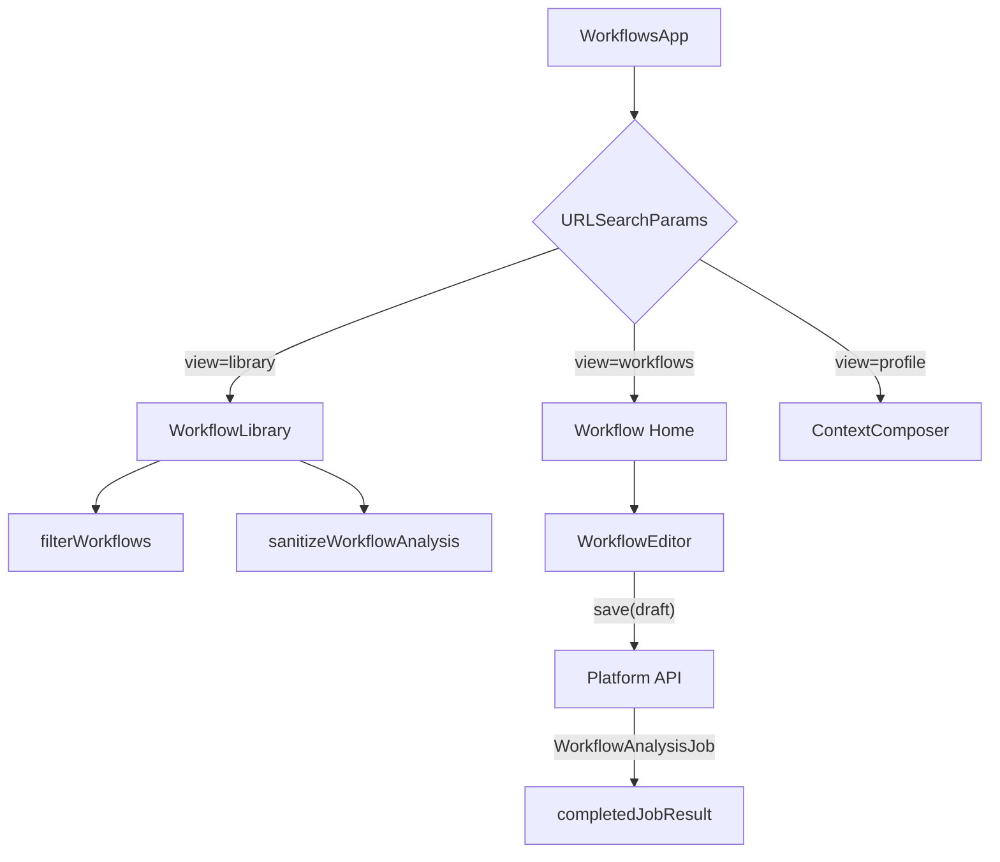
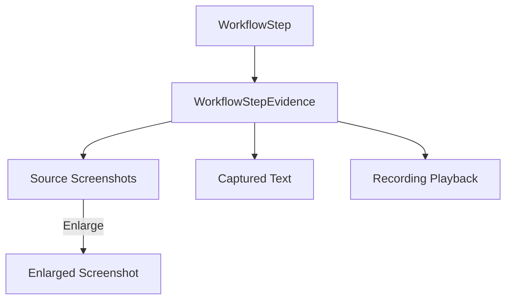

<!-- source: DeepWiki mcp.deepwiki.com · repo screenpipe/screenpipe · page 4.6 Workflows & Live Views · fetched 2026-10-27 -->

# Workflows & Live Views

<details>
<summary>Relevant source files</summary>

The following files were used as context for generating this wiki page:

- [.github/pr-assets/chat-local-markdown-images/after.png](.github/pr-assets/chat-local-markdown-images/after.png)
- [.github/pr-assets/chat-local-markdown-images/before.png](.github/pr-assets/chat-local-markdown-images/before.png)
- [.github/pr-assets/workflow-source-previews/README.md](.github/pr-assets/workflow-source-previews/README.md)
- [.github/pr-assets/workflow-source-previews/after.png](.github/pr-assets/workflow-source-previews/after.png)
- [.github/pr-assets/workflow-source-previews/before.png](.github/pr-assets/workflow-source-previews/before.png)
- [.github/pr-assets/workflow-source-previews/compact.png](.github/pr-assets/workflow-source-previews/compact.png)
- [.github/pr-assets/workflow-source-previews/error.png](.github/pr-assets/workflow-source-previews/error.png)
- [.github/pr-assets/workflow-source-previews/loading.png](.github/pr-assets/workflow-source-previews/loading.png)
- [.github/pr-assets/workflow-source-previews/missing.png](.github/pr-assets/workflow-source-previews/missing.png)
- [apps/screenpipe-app-tauri/app/dev/workflows-ux/page.tsx](apps/screenpipe-app-tauri/app/dev/workflows-ux/page.tsx)
- [apps/screenpipe-app-tauri/components/__tests__/markdown-local-image.test.tsx](apps/screenpipe-app-tauri/components/__tests__/markdown-local-image.test.tsx)
- [apps/screenpipe-app-tauri/components/chat/home-card-agent-actions.test.tsx](apps/screenpipe-app-tauri/components/chat/home-card-agent-actions.test.tsx)
- [apps/screenpipe-app-tauri/components/chat/home-card-agent-actions.tsx](apps/screenpipe-app-tauri/components/chat/home-card-agent-actions.tsx)
- [apps/screenpipe-app-tauri/components/chat/summary-cards.test.tsx](apps/screenpipe-app-tauri/components/chat/summary-cards.test.tsx)
- [apps/screenpipe-app-tauri/components/chat/summary-cards.tsx](apps/screenpipe-app-tauri/components/chat/summary-cards.tsx)
- [apps/screenpipe-app-tauri/components/markdown/local-markdown-image.tsx](apps/screenpipe-app-tauri/components/markdown/local-markdown-image.tsx)
- [apps/screenpipe-app-tauri/components/settings/__tests__/brain-overview.test.tsx](apps/screenpipe-app-tauri/components/settings/__tests__/brain-overview.test.tsx)
- [apps/screenpipe-app-tauri/components/settings/__tests__/brain-section.filter.test.tsx](apps/screenpipe-app-tauri/components/settings/__tests__/brain-section.filter.test.tsx)
- [apps/screenpipe-app-tauri/components/settings/__tests__/live-view-ai-composer.test.tsx](apps/screenpipe-app-tauri/components/settings/__tests__/live-view-ai-composer.test.tsx)
- [apps/screenpipe-app-tauri/components/settings/__tests__/live-view-canvas.test.tsx](apps/screenpipe-app-tauri/components/settings/__tests__/live-view-canvas.test.tsx)
- [apps/screenpipe-app-tauri/components/settings/__tests__/live-view-card.test.tsx](apps/screenpipe-app-tauri/components/settings/__tests__/live-view-card.test.tsx)
- [apps/screenpipe-app-tauri/components/settings/__tests__/live-view-dashboard-switcher.test.tsx](apps/screenpipe-app-tauri/components/settings/__tests__/live-view-dashboard-switcher.test.tsx)
- [apps/screenpipe-app-tauri/components/settings/brain-overview.tsx](apps/screenpipe-app-tauri/components/settings/brain-overview.tsx)
- [apps/screenpipe-app-tauri/components/settings/brain-section.tsx](apps/screenpipe-app-tauri/components/settings/brain-section.tsx)
- [apps/screenpipe-app-tauri/components/settings/compact-markdown.tsx](apps/screenpipe-app-tauri/components/settings/compact-markdown.tsx)
- [apps/screenpipe-app-tauri/components/settings/live-view-ai-composer.tsx](apps/screenpipe-app-tauri/components/settings/live-view-ai-composer.tsx)
- [apps/screenpipe-app-tauri/components/settings/live-view-canvas.tsx](apps/screenpipe-app-tauri/components/settings/live-view-canvas.tsx)
- [apps/screenpipe-app-tauri/components/settings/live-view-card.tsx](apps/screenpipe-app-tauri/components/settings/live-view-card.tsx)
- [apps/screenpipe-app-tauri/components/settings/live-view-create-dashboard-dialog.tsx](apps/screenpipe-app-tauri/components/settings/live-view-create-dashboard-dialog.tsx)
- [apps/screenpipe-app-tauri/components/settings/live-view-dashboard-switcher.tsx](apps/screenpipe-app-tauri/components/settings/live-view-dashboard-switcher.tsx)
- [apps/screenpipe-app-tauri/components/settings/live-view-item-controls.tsx](apps/screenpipe-app-tauri/components/settings/live-view-item-controls.tsx)
- [apps/screenpipe-app-tauri/components/settings/live-view-layout-editor.tsx](apps/screenpipe-app-tauri/components/settings/live-view-layout-editor.tsx)
- [apps/screenpipe-app-tauri/components/settings/live-view-line-chart.tsx](apps/screenpipe-app-tauri/components/settings/live-view-line-chart.tsx)
- [apps/screenpipe-app-tauri/components/settings/live-view-onboarding-activation.tsx](apps/screenpipe-app-tauri/components/settings/live-view-onboarding-activation.tsx)
- [apps/screenpipe-app-tauri/components/settings/live-view-onboarding-guide.tsx](apps/screenpipe-app-tauri/components/settings/live-view-onboarding-guide.tsx)
- [apps/screenpipe-app-tauri/components/workflows/integrated-workflows.test.tsx](apps/screenpipe-app-tauri/components/workflows/integrated-workflows.test.tsx)
- [apps/screenpipe-app-tauri/components/workflows/integrated-workflows.tsx](apps/screenpipe-app-tauri/components/workflows/integrated-workflows.tsx)
- [apps/screenpipe-app-tauri/components/workflows/step-evidence.test.tsx](apps/screenpipe-app-tauri/components/workflows/step-evidence.test.tsx)
- [apps/screenpipe-app-tauri/components/workflows/workflow-run-progress.test.tsx](apps/screenpipe-app-tauri/components/workflows/workflow-run-progress.test.tsx)
- [apps/screenpipe-app-tauri/docs/media/onboarding-goal-choices.png](apps/screenpipe-app-tauri/docs/media/onboarding-goal-choices.png)
- [apps/screenpipe-app-tauri/e2e/specs/brain-overview.spec.ts](apps/screenpipe-app-tauri/e2e/specs/brain-overview.spec.ts)
- [apps/screenpipe-app-tauri/e2e/specs/brain-section.spec.ts](apps/screenpipe-app-tauri/e2e/specs/brain-section.spec.ts)
- [apps/screenpipe-app-tauri/e2e/specs/live-view-item-actions.spec.ts](apps/screenpipe-app-tauri/e2e/specs/live-view-item-actions.spec.ts)
- [apps/screenpipe-app-tauri/e2e/specs/live-view-pinch-zoom.spec.ts](apps/screenpipe-app-tauri/e2e/specs/live-view-pinch-zoom.spec.ts)
- [apps/screenpipe-app-tauri/lib/active-ai-preset.ts](apps/screenpipe-app-tauri/lib/active-ai-preset.ts)
- [apps/screenpipe-app-tauri/lib/hooks/__tests__/use-onboarding.test.ts](apps/screenpipe-app-tauri/lib/hooks/__tests__/use-onboarding.test.ts)
- [apps/screenpipe-app-tauri/lib/hooks/use-onboarding.tsx](apps/screenpipe-app-tauri/lib/hooks/use-onboarding.tsx)
- [apps/screenpipe-app-tauri/lib/live-views/__tests__/canvas-layout-evals.test.ts](apps/screenpipe-app-tauri/lib/live-views/__tests__/canvas-layout-evals.test.ts)
- [apps/screenpipe-app-tauri/lib/live-views/__tests__/generate-live-view-proposal.test.ts](apps/screenpipe-app-tauri/lib/live-views/__tests__/generate-live-view-proposal.test.ts)
- [apps/screenpipe-app-tauri/lib/live-views/__tests__/generate-live-view-with-pi.test.ts](apps/screenpipe-app-tauri/lib/live-views/__tests__/generate-live-view-with-pi.test.ts)
- [apps/screenpipe-app-tauri/lib/live-views/__tests__/onboarding-activation.test.ts](apps/screenpipe-app-tauri/lib/live-views/__tests__/onboarding-activation.test.ts)
- [apps/screenpipe-app-tauri/lib/live-views/__tests__/onboarding-live-view.test.ts](apps/screenpipe-app-tauri/lib/live-views/__tests__/onboarding-live-view.test.ts)
- [apps/screenpipe-app-tauri/lib/live-views/__tests__/source-cadence.test.ts](apps/screenpipe-app-tauri/lib/live-views/__tests__/source-cadence.test.ts)
- [apps/screenpipe-app-tauri/lib/live-views/__tests__/source-status.test.ts](apps/screenpipe-app-tauri/lib/live-views/__tests__/source-status.test.ts)
- [apps/screenpipe-app-tauri/lib/live-views/__tests__/time-range.test.ts](apps/screenpipe-app-tauri/lib/live-views/__tests__/time-range.test.ts)
- [apps/screenpipe-app-tauri/lib/live-views/canvas-layout.ts](apps/screenpipe-app-tauri/lib/live-views/canvas-layout.ts)
- [apps/screenpipe-app-tauri/lib/live-views/generate-live-view-with-pi.ts](apps/screenpipe-app-tauri/lib/live-views/generate-live-view-with-pi.ts)
- [apps/screenpipe-app-tauri/lib/live-views/onboarding-activation.ts](apps/screenpipe-app-tauri/lib/live-views/onboarding-activation.ts)
- [apps/screenpipe-app-tauri/lib/live-views/onboarding-goals.ts](apps/screenpipe-app-tauri/lib/live-views/onboarding-goals.ts)
- [apps/screenpipe-app-tauri/lib/live-views/onboarding-live-view.ts](apps/screenpipe-app-tauri/lib/live-views/onboarding-live-view.ts)
- [apps/screenpipe-app-tauri/lib/live-views/source-cadence.ts](apps/screenpipe-app-tauri/lib/live-views/source-cadence.ts)
- [apps/screenpipe-app-tauri/lib/live-views/source-status.ts](apps/screenpipe-app-tauri/lib/live-views/source-status.ts)
- [apps/screenpipe-app-tauri/lib/live-views/time-range.ts](apps/screenpipe-app-tauri/lib/live-views/time-range.ts)
- [apps/screenpipe-app-tauri/lib/utils/memory-display.test.ts](apps/screenpipe-app-tauri/lib/utils/memory-display.test.ts)
- [apps/screenpipe-app-tauri/lib/utils/memory-display.ts](apps/screenpipe-app-tauri/lib/utils/memory-display.ts)
- [apps/screenpipe-app-tauri/lib/workflows/scheduled-discovery.test.ts](apps/screenpipe-app-tauri/lib/workflows/scheduled-discovery.test.ts)
- [apps/screenpipe-app-tauri/lib/workflows/scheduled-discovery.ts](apps/screenpipe-app-tauri/lib/workflows/scheduled-discovery.ts)
- [apps/screenpipe-app-tauri/lib/workflows/source-screenshot.test.ts](apps/screenpipe-app-tauri/lib/workflows/source-screenshot.test.ts)
- [apps/screenpipe-app-tauri/lib/workflows/source-screenshot.ts](apps/screenpipe-app-tauri/lib/workflows/source-screenshot.ts)
- [apps/screenpipe-app-tauri/src-tauri/assets/extensions/__tests__/live-views.test.ts](apps/screenpipe-app-tauri/src-tauri/assets/extensions/__tests__/live-views.test.ts)
- [apps/screenpipe-app-tauri/src-tauri/assets/extensions/live-views.ts](apps/screenpipe-app-tauri/src-tauri/assets/extensions/live-views.ts)
- [apps/screenpipe-app-tauri/src-tauri/src/brain_views.rs](apps/screenpipe-app-tauri/src-tauri/src/brain_views.rs)
- [apps/screenpipe-workflows-web/scripts/eval-workflow-editor.cjs](apps/screenpipe-workflows-web/scripts/eval-workflow-editor.cjs)
- [crates/screenpipe-core/assets/extensions/structured-output.ts](crates/screenpipe-core/assets/extensions/structured-output.ts)
- [crates/screenpipe-engine/schemas/examples/live-view-template.v1.json](crates/screenpipe-engine/schemas/examples/live-view-template.v1.json)
- [crates/screenpipe-engine/schemas/live-view-template.v1.schema.json](crates/screenpipe-engine/schemas/live-view-template.v1.schema.json)
- [crates/screenpipe-engine/src/cli/view.rs](crates/screenpipe-engine/src/cli/view.rs)
- [crates/screenpipe-engine/src/live_views.rs](crates/screenpipe-engine/src/live_views.rs)
- [crates/screenpipe-engine/src/routes/structured_outputs.rs](crates/screenpipe-engine/src/routes/structured_outputs.rs)
- [crates/screenpipe-engine/src/routes/workflow_edits.rs](crates/screenpipe-engine/src/routes/workflow_edits.rs)
- [crates/screenpipe-engine/src/structured_outputs.rs](crates/screenpipe-engine/src/structured_outputs.rs)
- [docs/assets/pr/live-view-focus-mode/canvas-first.png](docs/assets/pr/live-view-focus-mode/canvas-first.png)
- [docs/assets/pr/live-view-range-truth.png](docs/assets/pr/live-view-range-truth.png)
- [packages/ai-gateway/src/providers/gemini.ts](packages/ai-gateway/src/providers/gemini.ts)
- [packages/ai-gateway/src/test/gemini.unit.test.ts](packages/ai-gateway/src/test/gemini.unit.test.ts)
- [packages/workflows-ui/src/fixture-platform.ts](packages/workflows-ui/src/fixture-platform.ts)
- [packages/workflows-ui/src/model.ts](packages/workflows-ui/src/model.ts)
- [packages/workflows-ui/src/platform.ts](packages/workflows-ui/src/platform.ts)
- [packages/workflows-ui/src/use-source-screenshot.ts](packages/workflows-ui/src/use-source-screenshot.ts)
- [packages/workflows-ui/src/workflow-editor.module.css](packages/workflows-ui/src/workflow-editor.module.css)
- [packages/workflows-ui/src/workflow-editor.tsx](packages/workflows-ui/src/workflow-editor.tsx)
- [packages/workflows-ui/src/workflow-edits.ts](packages/workflows-ui/src/workflow-edits.ts)
- [packages/workflows-ui/src/workflow-run-progress.tsx](packages/workflows-ui/src/workflow-run-progress.tsx)
- [packages/workflows-ui/src/workflow-step-evidence.module.css](packages/workflows-ui/src/workflow-step-evidence.module.css)
- [packages/workflows-ui/src/workflow-step-evidence.tsx](packages/workflows-ui/src/workflow-step-evidence.tsx)
- [packages/workflows-ui/src/workflows-app.module.css](packages/workflows-ui/src/workflows-app.module.css)
- [packages/workflows-ui/src/workflows-app.tsx](packages/workflows-ui/src/workflows-app.tsx)

</details>


This page details the implementation of workflows and live views within Screenpipe. It covers the `workflows-ui` package, the workflow editor, the catalog and editing routes, the display of step evidence and source screenshots, the Brain overview, and AI-generated live view dashboards.

## Workflows-UI Package and Editor

The `workflows-ui` package [packages/workflows-ui/src/workflows-app.tsx]() provides the frontend components for managing and interacting with workflows. The core component is `WorkflowEditor` [packages/workflows-ui/src/workflow-editor.tsx](), which allows users to define and modify workflows.

A workflow is composed of a series of stages, each containing multiple blocks. The editor provides functionalities for:
*   **Editing workflow metadata**: Title, description, and other high-level properties.
*   **Adding/Removing stages and blocks**: Users can structure their workflows by adding or removing steps and sub-steps.
*   **Reordering stages and blocks**: Drag-and-drop functionality is implemented for intuitive reordering [packages/workflows-ui/src/workflow-editor.tsx:100-110]().
*   **Inline text editing**: `InlineText` component [packages/workflows-ui/src/workflow-editor.tsx:28]() allows direct editing of titles and block content.
*   **Saving and undoing changes**: The editor maintains a history of changes and allows users to revert to previous states [packages/workflows-ui/src/workflow-editor.tsx:77-78]().
*   **Session recovery**: Drafts are saved to `sessionStorage` to prevent data loss [packages/workflows-ui/src/workflow-editor.tsx:67-75]().

The styling for the workflow editor is defined in `workflow-editor.module.css` [packages/workflows-ui/src/workflow-editor.module.css]().

### Workflow Data Structure

Workflows are represented by `WorkflowMap` and `WorkflowEdit` types [packages/workflows-ui/src/workflow-editor.tsx:15-23]().
*   `WorkflowMap`: The canonical representation of a saved workflow.
*   `WorkflowEdit`: A draft version of a workflow, used during editing, which includes additional metadata like `key` for local identity tracking during reordering [packages/workflows-ui/src/workflow-editor.tsx:32-33]().

The `keyedDraft` function [packages/workflows-ui/src/workflow-editor.tsx:34-36]() converts a `WorkflowEdit` into an `EditorDraft` by adding unique keys to stages and blocks, which are crucial for React's reconciliation process during drag-and-drop operations. The `payload` function [packages/workflows-ui/src/workflow-editor.tsx:37-39]() reverses this process to generate the savable `WorkflowEdit`.

### Workflow Editor UI Components

The `WorkflowEditor` [packages/workflows-ui/src/workflow-editor.tsx]() integrates several UI components:
*   `InlineText`: For editable text fields [packages/workflows-ui/src/workflow-editor.tsx:28]().
*   `TimingDisclosure`: Displays timing information related to the workflow [packages/workflows-ui/src/workflow-editor.tsx:25]().
*   Buttons for actions like adding steps, deleting steps, and moving steps [packages/workflows-ui/src/workflow-editor.tsx:8-14]().

```mermaid
graph TD
    A[WorkflowEditor] --> B{WorkflowEdit (Draft)}
    B -- "keyedDraft()" --> C[EditorDraft (with keys)]
    C -- "User Interactions (Drag/Drop, Edit)" --> C
    C -- "payload()" --> B
    B -- "save()" --> D[WorkflowMap (Saved)]
    D -- "workflowEdit()" --> B
    A --> E[InlineText]
    A --> F[TimingDisclosure]
    A --> G[Action Buttons]
```
**Diagram: Workflow Editor Data Flow**

Sources:
* [packages/workflows-ui/src/workflows-app.tsx]()
* [packages/workflows-ui/src/workflow-editor.tsx]()
* [packages/workflows-ui/src/workflow-editor.module.css]()

## Workflow Catalog and Editing Routes

The `WorkflowsApp` component [packages/workflows-ui/src/workflows-app.tsx]() serves as the main entry point for the workflows UI. It manages different views such as "workflows" (home), "library", and "profile" [packages/workflows-ui/src/workflows-app.tsx:99-103]().

The application uses `URLSearchParams` to determine the current view [packages/workflows-ui/src/workflows-app.tsx:156-160]().

The `WorkflowLibrary` component [packages/workflows-ui/src/workflows-app.tsx:15]() is responsible for displaying a catalog of available workflows. Workflows can be filtered using `filterWorkflows` [packages/workflows-ui/src/workflows-app.tsx:65-68]() and their analysis can be sanitized using `sanitizeWorkflowAnalysis` [packages/workflows-ui/src/workflows-app.tsx:71]().

The `WorkflowsApp` also handles the saving of workflow edits. When a user saves a draft, the `save` function is called, which then interacts with the platform to persist the changes [packages/workflows-ui/src/workflow-editor.tsx:61-63](). The `completedJobResult` function [packages/workflows-ui/src/workflows-app.tsx:123-136]() is used to poll for the completion of a workflow analysis job, indicating that the workflow has been processed and its results are available.


**Diagram: Workflow Catalog and Editing Flow**

Sources:
* [packages/workflows-ui/src/workflows-app.tsx]()
* [packages/workflows-ui/src/workflow-editor.tsx]()

## Step Evidence and Source Screenshots

The `WorkflowStepEvidence` component [packages/workflows-ui/src/workflow-step-evidence.tsx]() is crucial for providing context and transparency to workflow execution. It displays evidence related to individual steps within a workflow, including source screenshots and captured text.

When a workflow step is executed, Screenpipe captures relevant information, such as screenshots of the UI at the time of execution and any extracted text. This data is then associated with the workflow step as "evidence."

The `WorkflowStepEvidence` component:
*   Renders a list of evidence items for a given workflow step.
*   Displays source screenshots, allowing users to visually verify the actions taken by the workflow.
*   Shows captured text, providing the textual context of the step.
*   Allows users to enlarge screenshots for better inspection [apps/screenpipe-workflows-web/scripts/eval-workflow-editor.cjs:81-86]().
*   Provides a way to view the recording associated with a step [apps/screenpipe-workflows-web/scripts/eval-workflow-editor.cjs:88-91]().

The `serializeWorkflowData` function [packages/workflows-ui/src/workflows-app.tsx:6]() is likely involved in preparing this evidence data for display or storage.

The styling for the step evidence is defined in `workflow-step-evidence.module.css` [packages/workflows-ui/src/workflow-step-evidence.module.css]().


**Diagram: Workflow Step Evidence Display**

Sources:
* [packages/workflows-ui/src/workflow-step-evidence.tsx]()
* [packages/workflows-ui/src/workflow-step-evidence.module.css]()
* [packages/workflows-ui/src/workflows-app.tsx:6]()
* [apps/screenpipe-workflows-web/scripts/eval-workflow-editor.cjs:81-91]()

## Brain Overview

The "Brain" in Screenpipe refers to the central hub where all captured data and AI-generated insights are aggregated and presented. The `BrainOverview` component [apps/screenpipe-app-tauri/components/settings/brain-overview.tsx]() is the primary UI for interacting with this aggregated information, particularly focusing on Live Views.

The `BrainOverview` component provides:
*   **Dashboard Management**: Users can create, edit, duplicate, and delete live view dashboards [apps/screenpipe-app-tauri/components/settings/brain-overview.tsx:590-600]().
*   **Live View Generation**: It integrates with AI to generate live views based on user prompts [apps/screenpipe-app-tauri/components/settings/brain-overview.tsx:91-95](). This is handled by `generateLiveViewWithPi` [apps/screenpipe-app-tauri/lib/live-views/generate-live-view-with-pi.ts]().
*   **Template Gallery**: Users can browse and apply predefined live view templates [apps/screenpipe-app-tauri/components/settings/live-view-template-gallery.tsx]().
*   **Onboarding**: Guides new users through the process of setting up their first live view [apps/screenpipe-app-tauri/lib/live-views/onboarding-activation.ts]().
*   **Data Refresh**: Manages the refresh state of live view data, showing statuses like "running", "complete", "error", and reasons for blocking [apps/screenpipe-app-tauri/components/settings/brain-overview.tsx:166-190]().
*   **AI Presets**: Allows selection of different AI models for live view generation [apps/screenpipe-app-tauri/components/settings/brain-overview.tsx:80-82]().

The `BrainOverview` component interacts with the Tauri backend commands for listing, saving, and deleting brain views and templates [apps/screenpipe-app-tauri/components/settings/brain-overview.test.tsx:59-66]().

```mermaid
graph TD
    A[BrainOverview Component] --> B[Live View Dashboards]
    A --> C[Live View Generation (AI)]
    A --> D[Template Gallery]
    A --> E[Onboarding Activation]
    A --> F[Data Refresh State]
    A --> G[AI Presets Selector]

    C -- "generateLiveViewWithPi()" --> H[Pi Agent]
    H -- "AI Model (e.g., Gemini)" --> I[AI Gateway]

    A -- "Tauri Commands" --> J[Backend (brain_views.rs)]
```
**Diagram: Brain Overview Architecture**

Sources:
* [apps/screenpipe-app-tauri/components/settings/brain-overview.tsx]()
* [apps/screenpipe-app-tauri/components/settings/brain-overview.test.tsx]()
* [apps/screenpipe-app-tauri/lib/live-views/generate-live-view-with-pi.ts]()
* [apps/screenpipe-app-tauri/components/settings/live-view-template-gallery.tsx]()
* [apps/screenpipe-app-tauri/lib/live-views/onboarding-activation.ts]()
* [apps/screenpipe-app-tauri/src-tauri/src/brain_views.rs]()

## AI-Generated Live View Dashboards

Live View Dashboards are dynamic, AI-generated summaries and insights derived from the user's activity. They are displayed within the `BrainOverview` using the `LiveViewCanvas` component [apps/screenpipe-app-tauri/components/settings/live-view-canvas.tsx]().

Key aspects of AI-generated live view dashboards:
*   **Generation Process**: The `generateLiveViewWithPi` function [apps/screenpipe-app-tauri/lib/live-views/generate-live-view-with-pi.ts]() orchestrates the AI generation. It takes a `LiveViewGenerationIntent` [apps/screenpipe-app-tauri/components/settings/live-view-ai-composer.tsx:39]() (e.g., "create a dashboard about my focus time") and uses the Pi agent to produce `GeneratedLiveView` blocks [apps/screenpipe-app-tauri/lib/live-views/generate-live-view-with-pi.ts:20-21]().
*   **Canvas Layout**: The `LiveViewCanvas` component [apps/screenpipe-app-tauri/components/settings/live-view-canvas.tsx]() uses `@xyflow/react` to render the dashboard as a visual canvas. This canvas supports:
    *   **Nodes**: Representing individual live view blocks (`LiveViewFlowNode`) or notes (`NoteFlowNode`) [apps/screenpipe-app-tauri/components/settings/live-view-canvas.tsx:126-128]().
    *   **Edges**: Connecting nodes, often representing relationships or flows [apps/screenpipe-app-tauri/components/settings/live-view-canvas.tsx:129]().
    *   **Tools**: Users can interact with the canvas using tools like select, pan, note, arrow, and draw [apps/screenpipe-app-tauri/components/settings/live-view-canvas.tsx:136-146]().
    *   **Resizing and Positioning**: Blocks can be resized and moved on the canvas [apps/screenpipe-app-tauri/components/settings/live-view-canvas.tsx:224-241]().
*   **Data Binding**: Each live view block (`BrainViewSlot`) can be bound to a `pipeName` [apps/screenpipe-app-tauri/components/settings/brain-overview.test.tsx:223](), indicating which scheduled AI workflow (pipe) is responsible for generating its content.
*   **Feedback Mechanism**: Users can provide feedback (up/down votes) on individual live view blocks, which helps in refining future AI generations [apps/screenpipe-app-tauri/components/settings/live-view-canvas.tsx:111-114]().
*   **Onboarding Live View**: A special onboarding live view can be created to guide new users [apps/screenpipe-app-tauri/lib/live-views/onboarding-live-view.ts]().

The `brain_views.rs` [apps/screenpipe-app-tauri/src-tauri/src/brain_views.rs]() module in the Rust backend handles the persistence and retrieval of `BrainViewDefinition` and `BrainViewCanvasDocument` data.

```mermaid
graph TD
    A[User Prompt] --> B[LiveViewAiComposer]
    B -- "LiveViewGenerationIntent" --> C[generateLiveViewWithPi]
    C --> D[Pi Agent]
    D -- "AI Model (e.g., Gemini)" --> E[AI Gateway]
    E --> F[GeneratedLiveView (Blocks)]
    F --> G[BrainOverview]
    G --> H[LiveViewCanvas]
    H -- "Renders" --> I[Live View Blocks (Nodes)]
    H -- "Renders" --> J[Notes (Nodes)]
    H -- "Renders" --> K[Connections (Edges)]
    I -- "Bound to" --> L[Pipes (Scheduled AI Workflows)]
    I -- "User Feedback" --> G
    G -- "Save/Load" --> M[brain_views.rs (Tauri Backend)]
```
**Diagram: AI-Generated Live View Dashboard Flow**

Sources:
* [apps/screenpipe-app-tauri/components/settings/brain-overview.tsx]()
* [apps/screenpipe-app-tauri/components/settings/live-view-canvas.tsx]()
* [apps/screenpipe-app-tauri/lib/live-views/generate-live-view-with-pi.ts]()
* [apps/screenpipe-app-tauri/components/settings/live-view-ai-composer.tsx:39]()
* [apps/screenpipe-app-tauri/lib/live-views/onboarding-live-view.ts]()
* [apps/screenpipe-app-tauri/src-tauri/src/brain_views.rs]()
* [apps/screenpipe-app-tauri/components/settings/brain-overview.test.tsx:223]()
* [apps/screenpipe-app-tauri/components/settings/live-view-canvas.tsx:126-129]()
* [apps/screenpipe-app-tauri/components/settings/live-view-canvas.tsx:136-146]()
* [apps/screenpipe-app-tauri/components/settings/live-view-canvas.tsx:224-241]()
* [apps/screenpipe-app-tauri/components/settings/live-view-canvas.tsx:111-114]()

---

