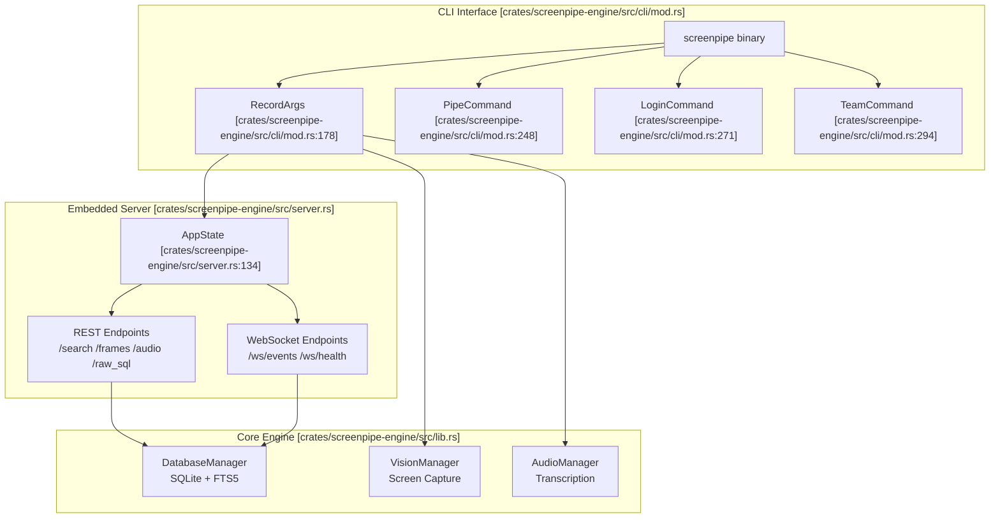
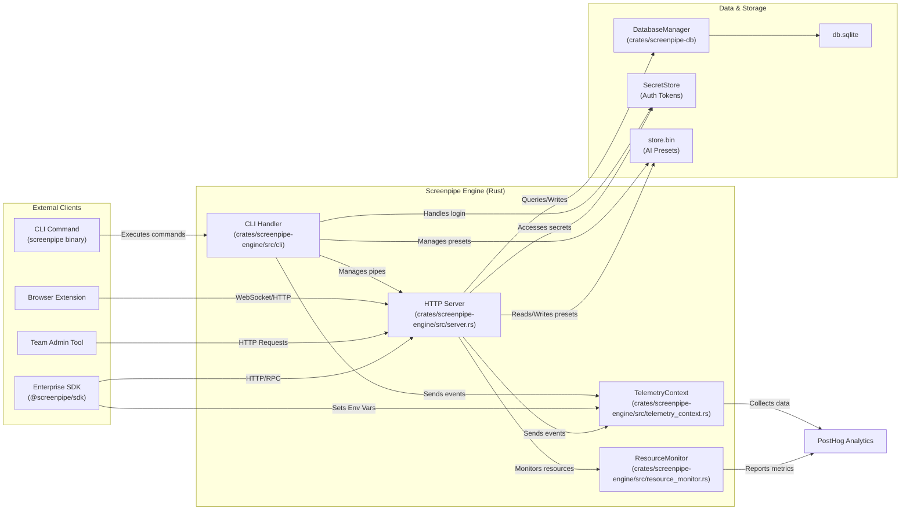

<!-- source: DeepWiki mcp.deepwiki.com · repo screenpipe/screenpipe · page 5 CLI & API · fetched 2026-10-27 -->

# CLI & API

Relevant source files

The following files were used as context for generating this wiki page:

- [crates/screenpipe-a11y/examples/linux_debug.rs](crates/screenpipe-a11y/examples/linux_debug.rs)
- [crates/screenpipe-a11y/examples/linux_deep.rs](crates/screenpipe-a11y/examples/linux_deep.rs)
- [crates/screenpipe-audio-eval/src/bin/screenpipe_fixtures.rs](crates/screenpipe-audio-eval/src/bin/screenpipe_fixtures.rs)
- [crates/screenpipe-engine/src/analytics.rs](crates/screenpipe-engine/src/analytics.rs)
- [crates/screenpipe-engine/src/calendar_speaker_id.rs](crates/screenpipe-engine/src/calendar_speaker_id.rs)
- [crates/screenpipe-engine/src/cli/browser.rs](crates/screenpipe-engine/src/cli/browser.rs)
- [crates/screenpipe-engine/src/cli/install.rs](crates/screenpipe-engine/src/cli/install.rs)
- [crates/screenpipe-engine/src/cli/login.rs](crates/screenpipe-engine/src/cli/login.rs)
- [crates/screenpipe-engine/src/cli/pipe.rs](crates/screenpipe-engine/src/cli/pipe.rs)
- [crates/screenpipe-engine/src/cli/presets.rs](crates/screenpipe-engine/src/cli/presets.rs)
- [crates/screenpipe-engine/src/cli/survey.rs](crates/screenpipe-engine/src/cli/survey.rs)
- [crates/screenpipe-engine/src/cli_reminder.rs](crates/screenpipe-engine/src/cli_reminder.rs)
- [crates/screenpipe-engine/src/resource_monitor.rs](crates/screenpipe-engine/src/resource_monitor.rs)
- [crates/screenpipe-engine/src/telemetry_context.rs](crates/screenpipe-engine/src/telemetry_context.rs)
- [docs/telemetry-support-context.md](docs/telemetry-support-context.md)
- [packages/cli/screenpipe-darwin-arm64/package.json](packages/cli/screenpipe-darwin-arm64/package.json)
- [packages/cli/screenpipe-darwin-x64/package.json](packages/cli/screenpipe-darwin-x64/package.json)
- [packages/cli/screenpipe-linux-x64/package.json](packages/cli/screenpipe-linux-x64/package.json)
- [packages/cli/screenpipe-win32-x64/package.json](packages/cli/screenpipe-win32-x64/package.json)
- [packages/cli/screenpipe/lib/cli.js](packages/cli/screenpipe/lib/cli.js)
- [packages/cli/screenpipe/lib/index.js](packages/cli/screenpipe/lib/index.js)
- [packages/cli/screenpipe/lib/telemetry.js](packages/cli/screenpipe/lib/telemetry.js)
- [packages/cli/screenpipe/lib/telemetry.test.js](packages/cli/screenpipe/lib/telemetry.test.js)
- [packages/cli/screenpipe/package.json](packages/cli/screenpipe/package.json)
- [packages/cli/screenpipe/scripts/postinstall.js](packages/cli/screenpipe/scripts/postinstall.js)
- [packages/cli/screenpipe/scripts/postinstall.sh](packages/cli/screenpipe/scripts/postinstall.sh)

This page documents Screenpipe's command-line interface and HTTP API for programmatic access to screen and audio data. The CLI provides management commands for the engine and pipes, while the HTTP API (running on port 3030 by default) exposes endpoints for searching, retrieving frames, audio transcriptions, and raw database queries.

For information about the embedded server lifecycle and configuration, see [Desktop Application](#3). For AI integration patterns using the API, see [AI Integration](#4).

---

## Overview

Screenpipe exposes two primary interfaces for developers:

1.  **CLI** (`screenpipe` binary or `npx screenpipe`) - Core engine control, pipe management, and status monitoring [crates/screenpipe-engine/src/cli/mod.rs:153-164]().
2.  **HTTP API** (embedded server on port 3030) - REST and WebSocket endpoints for querying captured data [crates/screenpipe-engine/src/server.rs:5-64]().

The engine and server are started via the `record` command, which initializes vision, audio, and the Axum-based HTTP server [crates/screenpipe-engine/src/server.rs:5-45]().

**CLI to Engine Interaction Flow**

Sources: [crates/screenpipe-engine/src/server.rs:134-175](), [crates/screenpipe-engine/src/lib.rs:5-60](), [crates/screenpipe-engine/src/cli/mod.rs:153-174]()

---

## CLI Installation & Commands

The Screenpipe CLI is the primary way to interact with the engine outside of the GUI. It includes periodic nudges and update checks to ensure users are on the latest version [crates/screenpipe-engine/src/cli_reminder.rs:16-57](). The CLI wrapper (`packages/cli/screenpipe/lib/cli.js`) handles spawning the native binary and forwarding signals [packages/cli/screenpipe/lib/cli.js:11-83](). Telemetry for CLI usage is collected via PostHog, with options to disable it via environment variables [packages/cli/screenpipe/lib/telemetry.js:1-10](), [crates/screenpipe-engine/src/analytics.rs:58-66]().

### Core Commands

| Command | Description | File Reference |
| :--- | :--- | :--- |
| `record` | Starts the screen/audio capture and API server. | [crates/screenpipe-engine/src/cli/mod.rs:178]() |
| `pipe` | Manages AI agents (install, list, enable, run, logs). | [crates/screenpipe-engine/src/cli/mod.rs:248]() |
| `login` / `logout` | Manages cloud authentication. | [crates/screenpipe-engine/src/cli/mod.rs:271]() |
| `team` | Enterprise admin queries for devices and records. | [crates/screenpipe-engine/src/cli/mod.rs:294]() |
| `backup` | Database checkpoints and atomic exports. | [crates/screenpipe-engine/src/cli/mod.rs:288]() |
| `status` | Show screenpipe status (running state, data stats). | [crates/screenpipe-engine/src/cli/mod.rs:181]() |
| `survey` | Opens the CLI usage survey in the browser. | [crates/screenpipe-engine/src/cli/survey.rs:20-33]() |

### Login Flow
The `screenpipe login` command initiates an OAuth-like flow, opening a browser to `screenpipe.com/login` with a unique code. The CLI then polls the server for an authentication token, which is persisted in the shared SecretStore [crates/screenpipe-engine/src/cli/login.rs:64-143]().

### Pipe Management
The CLI handles pipe operations without requiring a running server by using a standalone `PipeManager` [crates/screenpipe-engine/src/cli/pipe.rs:15-25](). It supports installing from URLs or local paths and managing their lifecycle.

For details, see [CLI Installation & Commands](#5.1).

Sources: [crates/screenpipe-engine/src/cli/mod.rs:174-310](), [crates/screenpipe-engine/src/cli_reminder.rs:16-57](), [packages/cli/screenpipe/lib/cli.js:11-83](), [crates/screenpipe-engine/src/analytics.rs:58-66](), [crates/screenpipe-engine/src/cli/login.rs:64-143](), [crates/screenpipe-engine/src/cli/pipe.rs:15-25](), [crates/screenpipe-engine/src/cli/survey.rs:20-33]()

---

## HTTP API

The embedded HTTP server is built with Axum and manages state through the `AppState` struct [crates/screenpipe-engine/src/server.rs:134-175]().

### Authentication & API Key Management
The CLI can resolve auth tokens from the `SCREENPIPE_API_KEY` environment variable or the local configuration file [crates/screenpipe-engine/src/bin/screenpipe-engine.rs:119-129]().

### Key Endpoints

*   **Search**: `/search` for multi-modal data retrieval. The `SearchQuery` struct supports filtering by `app_name`, `window_name`, `tags`, and `content_type` (OCR, Audio, Memory, Input) [crates/screenpipe-engine/src/routes/search.rs:78-173]().
*   **Audio**: `/audio/devices` and `/audio/start` for managing audio streams [crates/screenpipe-engine/src/server.rs:24-27]().
*   **Meetings**: Comprehensive suite including `/meetings/list`, `/meetings/merge`, and `/meetings/transcript` [crates/screenpipe-engine/src/server.rs:46-51]().
*   **Speakers**: `/speakers/search`, `/speakers/merge`, and `/speakers/sample` for biometric data management and sample playback [crates/screenpipe-engine/src/server.rs:59-64](). Speaker identification is enhanced by calendar context [crates/screenpipe-engine/src/calendar_speaker_id.rs:81-147]().
*   **Raw SQL**: `/raw_sql` for direct SQLite access [crates/screenpipe-engine/src/server.rs:29]().

### Intelligence Features
The API supports calendar-assisted speaker identification, using meeting context to name unnamed speakers automatically [crates/screenpipe-engine/src/lib.rs:65-66](). It also includes tag autocomplete for efficient filtering [crates/screenpipe-engine/src/server.rs:29]().

For details, see [HTTP API](#5.2).

Sources: [crates/screenpipe-engine/src/server.rs:5-88](), [crates/screenpipe-engine/src/routes/search.rs:78-173](), [crates/screenpipe-engine/src/bin/screenpipe-engine.rs:119-129](), [crates/screenpipe-engine/src/calendar_speaker_id.rs:81-147]()

---

## Component Registry

Screenpipe uses a registry system to manage reusable components and AI presets. The `presets.rs` module handles the IO and validation for AI configurations (OpenAI, Anthropic, Ollama, etc.) [crates/screenpipe-engine/src/cli/presets.rs:5-39]().

*   **Validation**: Strict validation for provider-specific API keys and URLs [crates/screenpipe-engine/src/cli/presets.rs:154-192]().
*   **Atomic Writes**: Ensures configuration remains consistent between CLI and Desktop App writes [crates/screenpipe-engine/src/cli/presets.rs:12-15]().

For details, see [Component Registry](#5.3).

Sources: [crates/screenpipe-engine/src/cli/presets.rs:5-39](), [crates/screenpipe-engine/src/cli/presets.rs:154-192](), [crates/screenpipe-engine/src/cli/presets.rs:12-15]()

---

## Browser Extension

The browser extension integrates with Screenpipe to capture web-specific context and interact with the local API.

*   **Capture**: Uses a WebSocket bridge to stream events to Screenpipe [crates/screenpipe-engine/src/server.rs:66-68]().
*   **Interactions**: Supports executing JS in tabs and managing auth tokens.

For details, see [Browser Extension](#5.4).

Sources: [crates/screenpipe-engine/src/server.rs:66-68]()

---

## Enterprise SDK

The enterprise SDK (`@screenpipe/sdk`) provides high-level abstractions for embedding Screenpipe in commercial applications. It leverages telemetry context to tag events with enterprise-specific identifiers like `customer_id`, `deployment_id`, and `enterprise_license_hash` [crates/screenpipe-engine/src/telemetry_context.rs:56-76]().

*   **Recorder API**: Low-level control over session management and privacy filters.
*   **Multi-platform**: Support for Electron, Swift, Tauri, and Node.js.
*   **Telemetry**: Tracks usage and resource consumption, including a memory leak sentinel [crates/screenpipe-engine/src/resource_monitor.rs:55-105]().

For details, see [Enterprise SDK](#5.5).

Sources: [crates/screenpipe-engine/src/lib.rs:52-55](), [crates/screenpipe-engine/src/telemetry_context.rs:56-76](), [crates/screenpipe-engine/src/resource_monitor.rs:55-105]()

---

## Technical Architecture: API & Data Flow

**API Request Lifecycle**

Sources: [crates/screenpipe-engine/src/server.rs:134-175](), [crates/screenpipe-engine/src/routes/search.rs:78-173](), [crates/screenpipe-engine/src/bin/screenpipe-engine.rs:119-129](), [crates/screenpipe-engine/src/cli/mod.rs:153-164](), [crates/screenpipe-engine/src/telemetry_context.rs:56-76](), [crates/screenpipe-engine/src/resource_monitor.rs:55-105](), [crates/screenpipe-engine/src/cli/login.rs:64-143](), [crates/screenpipe-engine/src/cli/presets.rs:12-15]()

---

