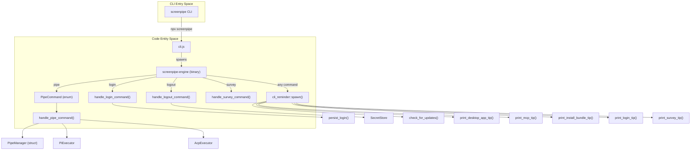
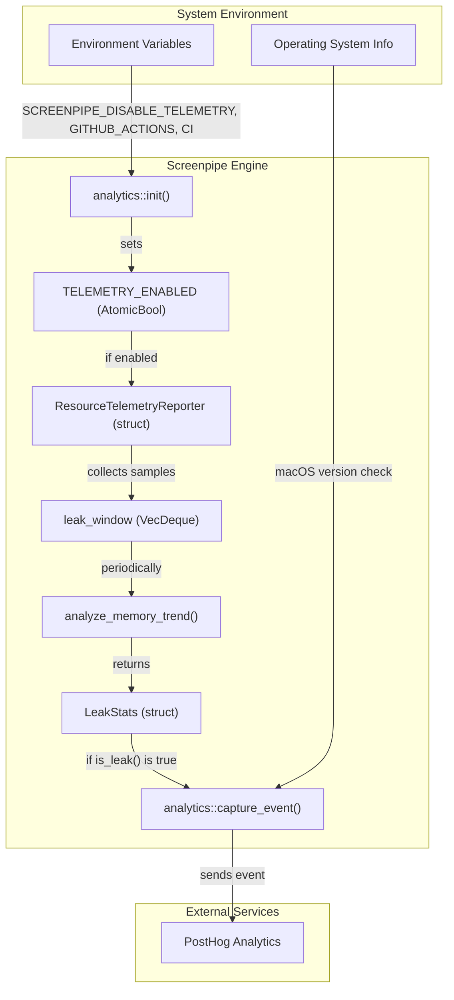

<!-- source: DeepWiki mcp.deepwiki.com · repo screenpipe/screenpipe · page 5.1 CLI Installation & Commands · fetched 2026-10-27 -->

# CLI Installation & Commands

<details>
<summary>Relevant source files</summary>

The following files were used as context for generating this wiki page:

- [crates/screenpipe-a11y/examples/linux_debug.rs](crates/screenpipe-a11y/examples/linux_debug.rs)
- [crates/screenpipe-a11y/examples/linux_deep.rs](crates/screenpipe-a11y/examples/linux_deep.rs)
- [crates/screenpipe-audio-eval/src/bin/screenpipe_fixtures.rs](crates/screenpipe-audio-eval/src/bin/screenpipe_fixtures.rs)
- [crates/screenpipe-engine/src/analytics.rs](crates/screenpipe-engine/src/analytics.rs)
- [crates/screenpipe-engine/src/calendar_speaker_id.rs](crates/screenpipe-engine/src/calendar_speaker_id.rs)
- [crates/screenpipe-engine/src/cli/browser.rs](crates/screenpipe-engine/src/cli/browser.rs)
- [crates/screenpipe-engine/src/cli/install.rs](crates/screenpipe-engine/src/cli/install.rs)
- [crates/screenpipe-engine/src/cli/login.rs](crates/screenpipe-engine/src/cli/login.rs)
- [crates/screenpipe-engine/src/cli/pipe.rs](crates/screenpipe-engine/src/cli/pipe.rs)
- [crates/screenpipe-engine/src/cli/presets.rs](crates/screenpipe-engine/src/cli/presets.rs)
- [crates/screenpipe-engine/src/cli/survey.rs](crates/screenpipe-engine/src/cli/survey.rs)
- [crates/screenpipe-engine/src/cli_reminder.rs](crates/screenpipe-engine/src/cli_reminder.rs)
- [crates/screenpipe-engine/src/resource_monitor.rs](crates/screenpipe-engine/src/resource_monitor.rs)
- [crates/screenpipe-engine/src/telemetry_context.rs](crates/screenpipe-engine/src/telemetry_context.rs)
- [docs/telemetry-support-context.md](docs/telemetry-support-context.md)
- [packages/cli/screenpipe-darwin-arm64/package.json](packages/cli/screenpipe-darwin-arm64/package.json)
- [packages/cli/screenpipe-darwin-x64/package.json](packages/cli/screenpipe-darwin-x64/package.json)
- [packages/cli/screenpipe-linux-x64/package.json](packages/cli/screenpipe-linux-x64/package.json)
- [packages/cli/screenpipe-win32-x64/package.json](packages/cli/screenpipe-win32-x64/package.json)
- [packages/cli/screenpipe/lib/cli.js](packages/cli/screenpipe/lib/cli.js)
- [packages/cli/screenpipe/lib/index.js](packages/cli/screenpipe/lib/index.js)
- [packages/cli/screenpipe/lib/telemetry.js](packages/cli/screenpipe/lib/telemetry.js)
- [packages/cli/screenpipe/lib/telemetry.test.js](packages/cli/screenpipe/lib/telemetry.test.js)
- [packages/cli/screenpipe/package.json](packages/cli/screenpipe/package.json)
- [packages/cli/screenpipe/scripts/postinstall.js](packages/cli/screenpipe/scripts/postinstall.js)
- [packages/cli/screenpipe/scripts/postinstall.sh](packages/cli/screenpipe/scripts/postinstall.sh)

</details>


This page covers the installation and usage of the Screenpipe CLI, a command-line interface for running Screenpipe's recording engine, managing pipes (AI workflows), and configuring service connections. The CLI is the core engine that powers the 24/7 capture system.

## Installation Methods

The Screenpipe CLI is primarily distributed via NPM and platform-specific binaries.

### 1. NPM Installation (Recommended)
The CLI can be run without manual installation using `npx` or `bun`. This ensures you always use the latest version.
```bash
# Run via npx
npx -y screenpipe@latest record

# Check version
npx -y screenpipe@latest --version
```
Sources: [packages/cli/screenpipe/package.json:1-33]()

### 2. Platform-Specific Setup
The CLI requires certain system dependencies depending on the OS:
- **Linux**: Requires `libasound2-dev` and `ffmpeg`.
- **Windows**: Requires `.NET 8.0` runtime.
- **macOS**: May require removing the Gatekeeper quarantine attribute if the binary is blocked:
  `xattr -d com.apple.quarantine ~/.npm/_npx/*/node_modules/screenpipe*/bin/screenpipe`.

The `postinstall.js` script [packages/cli/screenpipe/scripts/postinstall.js:1-147]() handles platform-specific setup, including running `postinstall.sh` for Unix-like systems. [packages/cli/screenpipe/scripts/postinstall.js:130-136]()

### 3. Build from Source
For developers, the CLI can be built using Cargo from the workspace root:
```bash
cargo build --release -p screenpipe-engine
```

Sources: [packages/cli/screenpipe/scripts/postinstall.js:1-147]()

## CLI Command Architecture

The CLI organizes functionality into subcommands. The `handle_pipe_command` function manages the lifecycle of pipes (AI agents) by interacting with the `PipeManager`. [crates/screenpipe-engine/src/cli/pipe.rs:15-27]()

### Command Structure Diagram
This diagram maps CLI commands to their respective implementation entities in the Rust codebase.


Sources: [crates/screenpipe-engine/src/cli/pipe.rs:15-27](), [crates/screenpipe-engine/src/cli_reminder.rs:22-38](), [crates/screenpipe-engine/src/cli_reminder.rs:57-161](), [crates/screenpipe-engine/src/cli/login.rs:64-162](), [crates/screenpipe-engine/src/cli/login.rs:170-190](), [crates/screenpipe-engine/src/cli/survey.rs:19-33](), [packages/cli/screenpipe/lib/cli.js:11-83]()

## Core Commands & Usage

### 1. Authentication & Tokens
The CLI manages authentication for accessing local and cloud features.
- **Login**: `screenpipe login` initiates the authentication flow. It generates a unique code, opens a browser to the Screenpipe login page, and then polls the server for an authentication token. This token is then persisted using `persist_login()` which stores it in the shared SecretStore. [crates/screenpipe-engine/src/cli/login.rs:64-162]()
- **Logout**: `screenpipe logout` clears the cloud authentication token from the shared SecretStore and removes related user metadata from `store.bin`. [crates/screenpipe-engine/src/cli/login.rs:170-190]()

The `current_cloud_token` function resolves the active cloud token by first checking the `SCREENPIPE_API_KEY` environment variable and then consulting the data directory. [crates/screenpipe-engine/src/cli/login.rs:12-14]()

### 2. Pipe Management (`pipe`)
Pipes are automated workflows defined in markdown. The CLI provides a suite for managing them via the `PipeManager`. [crates/screenpipe-engine/src/cli/pipe.rs:41-42]() The `handle_pipe_command` function dispatches to various `PipeManager` methods based on the subcommand. [crates/screenpipe-engine/src/cli/pipe.rs:44-162]()

| Command | Function | Description |
|---------|----------|-------------|
| `pipe list` | `manager.list_pipes()` | Shows installed pipes, their enabled status, schedule, and last run time. Supports JSON output. [crates/screenpipe-engine/src/cli/pipe.rs:45-75]() |
| `pipe install <source>` | `manager.install_pipe(source)` | Installs a pipe from a local path or a URL. [crates/screenpipe-engine/src/cli/pipe.rs:76-79]() |
| `pipe run <name>` | `manager.run_pipe(name)` | Manually triggers a specific pipe's execution. Outputs success/failure and stdout. [crates/screenpipe-engine/src/cli/pipe.rs:89-111]() |
| `pipe logs <name>` | `manager.get_logs(name)` | Displays execution history and error output for a given pipe. [crates/screenpipe-engine/src/cli/pipe.rs:113-144]() |
| `pipe enable <name>` | `manager.enable_pipe(name, true)` | Enables the scheduled execution of a pipe. [crates/screenpipe-engine/src/cli/pipe.rs:81-84]() |
| `pipe disable <name>` | `manager.enable_pipe(name, false)` | Disables the scheduled execution of a pipe. [crates/screenpipe-engine/src/cli/pipe.rs:85-88]() |
| `pipe delete <name>` | `manager.delete_pipe(name)` | Deletes a pipe. [crates/screenpipe-engine/src/cli/pipe.rs:145-148]() |
| `pipe models <subcommand>` | `handle_model_command(subcommand)` | Manages AI model presets. [crates/screenpipe-engine/src/cli/pipe.rs:149-151]() |
| `pipe publish <name>` | `handle_publish_command(name, &pipes_dir)` | Publishes a pipe. [crates/screenpipe-engine/src/cli/pipe.rs:152-154]() |
| `pipe search <query>` | `handle_search_command(query)` | Searches for pipes. [crates/screenpipe-engine/src/cli/pipe.rs:155-157]() |
| `pipe info <slug>` | `handle_info_command(slug)` | Displays information about a pipe. [crates/screenpipe-engine/src/cli/pipe.rs:158-160]() |
| `pipe status <slug>` | `handle_status_command(slug)` | Displays the status of a pipe. [crates/screenpipe-engine/src/cli/pipe.rs:161-163]() |

### 3. AI Presets (`pipe models`)
The `pipe models` subcommand allows managing AI model configurations, known as presets. These presets are stored in `~/.screenpipe/store.bin` and can be manipulated via the CLI. [crates/screenpipe-engine/src/cli/presets.rs:5-15]()

- **Providers**: The CLI supports various AI providers like `openai`, `anthropic`, `native-ollama`, `custom`, and `screenpipe-cloud`. [crates/screenpipe-engine/src/cli/presets.rs:29-50]()
- **Validation**: Preset IDs are validated to ensure they are alphanumeric and do not end with "copy". URLs are checked for `http://` or `https://` prefixes, and API keys are validated against provider-specific patterns (e.g., `sk-` for OpenAI). [crates/screenpipe-engine/src/cli/presets.rs:151-192]()

### 4. AI Agent Setup
The CLI can automatically configure AI tools to use Screenpipe via the Model Context Protocol (MCP):
```bash
npx -y screenpipe@latest setup
```
This command adds MCP and supported skills to various AI tools like Claude, Codex, Cursor, OpenClaw, Hermes, and Windsurf/Devin. [crates/screenpipe-engine/src/cli_reminder.rs:114-124]()

### 5. Survey
The `screenpipe survey` command opens a browser to a survey about CLI usage, including attribution for the CLI build and platform. [crates/screenpipe-engine/src/cli/survey.rs:10-16]()

Sources: [crates/screenpipe-engine/src/cli/pipe.rs:1-163](), [crates/screenpipe-engine/src/cli/login.rs:1-190](), [crates/screenpipe-engine/src/cli/presets.rs:1-192](), [crates/screenpipe-engine/src/cli_reminder.rs:114-124](), [crates/screenpipe-engine/src/cli/survey.rs:10-33]()

## Data Flow: Resource Monitoring & Telemetry

When the CLI starts, it can initialize a `ResourceTelemetryReporter` to track system health and telemetry. This includes platform-specific memory tracking to detect leaks. [crates/screenpipe-engine/src/resource_monitor.rs:153-171]() Telemetry is disabled by default in CI/automated environments via environment variables like `SCREENPIPE_DISABLE_TELEMETRY`, `GITHUB_ACTIONS`, or `CI`. [crates/screenpipe-engine/src/analytics.rs:58-66]()

### Resource Monitoring and Leak Detection Diagram



### Resource Monitor Implementation
- **Memory Tracking**: The `ResourceTelemetryReporter` collects resource snapshots. On macOS, it can leverage `ri_phys_footprint` for memory usage. [crates/screenpipe-engine/src/resource_monitor.rs:30-51]()
- **Leak Detection**: The `analyze_memory_trend` function performs a least-squares fit over a rolling window of `(runtime_secs, mem_gb)` samples to detect sustained linear memory growth. It returns `LeakStats` including slope, R-squared value, and growth. [crates/screenpipe-engine/src/resource_monitor.rs:82-147]() A leak is detected if the slope, R-squared, fitted growth, and end memory usage exceed predefined thresholds. [crates/screenpipe-engine/src/resource_monitor.rs:98-104]()
- **Telemetry**: The `analytics::capture_event` function sends events to PostHog, including properties from `TelemetryContext` such as `distinct_id` and `screenpipe_distribution`. [crates/screenpipe-engine/src/analytics.rs:99-130]() The `TelemetryContext` resolves the `distinct_id` from environment variables or falls back to a persistent machine ID. [crates/screenpipe-engine/src/telemetry_context.rs:82-93]()

Sources: [crates/screenpipe-engine/src/resource_monitor.rs:1-176](), [crates/screenpipe-engine/src/analytics.rs:1-141](), [crates/screenpipe-engine/src/telemetry_context.rs:1-164]()

## CLI Environment Variables

The CLI behavior can be modified using the following environment variables:

| Variable | Purpose | Source |
|----------|---------|--------|
| `SCREENPIPE_NO_REMINDERS` | Disables periodic CLI nudges (e.g., tip to download desktop app). | [crates/screenpipe-engine/src/cli_reminder.rs:9-10]() |
| `SCREENPIPE_NO_UPDATE_CHECK` | Disables the automatic version check against NPM. | [crates/screenpipe-engine/src/cli_reminder.rs:58-60]() |
| `SCREENPIPE_API_KEY` | Provides the API key for authenticated requests, overriding other sources. | [crates/screenpipe-engine/src/cli/login.rs:8-10]() |
| `SCREENPIPE_LOCAL_API_KEY` | Used by `AcpExecutor` for local API authentication. | [crates/screenpipe-engine/src/cli/pipe.rs:30-36]() |
| `SCREENPIPE_DISTRIBUTION` | Tags engine telemetry as the npm/bunx CLI (vs desktop-app / source). | [packages/cli/screenpipe/lib/cli.js:77-82]() |
| `SCREENPIPE_DISABLE_TELEMETRY`, `GITHUB_ACTIONS`, `CI` | Force-disables telemetry collection. | [crates/screenpipe-engine/src/analytics.rs:58-66]() |
| `SCREENPIPE_ANALYTICS_ID`, `SCREENPIPE_SUPPORT_ID`, `SCREENPIPE_TELEMETRY_ID` | Used to set the telemetry `distinct_id`. | [crates/screenpipe-engine/src/telemetry_context.rs:9-13]() |
| `SCREENPIPE_CUSTOMER_ID`, `SCREENPIPE_ORG_ID`, `SCREENPIPE_TELEMETRY_CUSTOMER_ID` | Used to set the telemetry `customer_id`. | [crates/screenpipe-engine/src/telemetry_context.rs:16-20]() |
| `SCREENPIPE_DEPLOYMENT_ID`, `SCREENPIPE_TELEMETRY_DEPLOYMENT_ID` | Used to set the telemetry `deployment_id`. | [crates/screenpipe-engine/src/telemetry_context.rs:21-24]() |
| `SCREENPIPE_EMBEDDER`, `SCREENPIPE_HOST_APP`, `SCREENPIPE_TELEMETRY_HOST_APP` | Used to set the telemetry `embedder` context. | [crates/screenpipe-engine/src/telemetry_context.rs:25-29]() |
| `SCREENPIPE_EMBEDDER_VERSION`, `SCREENPIPE_HOST_VERSION`, `SCREENPIPE_TELEMETRY_HOST_VERSION` | Used to set the telemetry `embedder_version` context. | [crates/screenpipe-engine/src/telemetry_context.rs:30-34]() |
| `SCREENPIPE_ENTERPRISE_LICENSE_HASH` | Used to set the telemetry `enterprise_license_hash`. | [crates/screenpipe-engine/src/telemetry_context.rs:36-36]() |
| `SCREENPIPE_ENTERPRISE_DEVICE_ID` | Used to set the telemetry `enterprise_device_id`. | [crates/screenpipe-engine/src/telemetry_context.rs:37-37]() |

Sources: [crates/screenpipe-engine/src/cli_reminder.rs:9-10](), [crates/screenpipe-engine/src/cli_reminder.rs:58-60](), [crates/screenpipe-engine/src/cli/login.rs:8-10](), [crates/screenpipe-engine/src/cli/pipe.rs:30-36](), [packages/cli/screenpipe/lib/cli.js:77-82](), [crates/screenpipe-engine/src/analytics.rs:58-66](), [crates/screenpipe-engine/src/telemetry_context.rs:9-37]()

---

