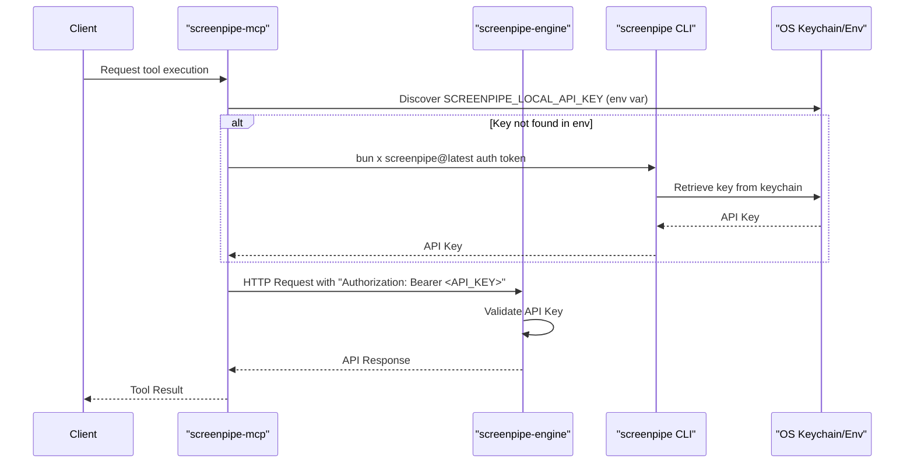
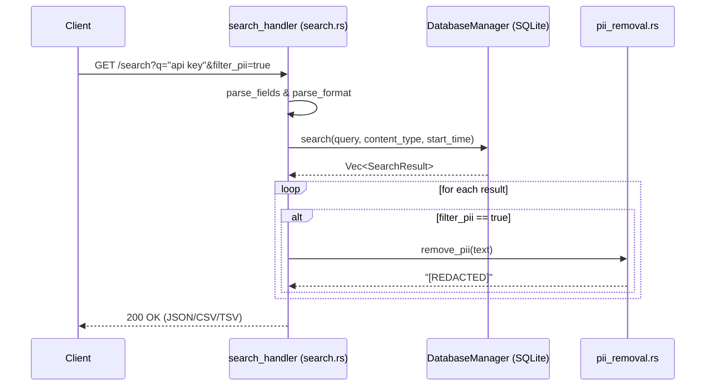

<!-- source: DeepWiki mcp.deepwiki.com · repo screenpipe/screenpipe · page 5.2 HTTP API · fetched 2026-10-27 -->

# HTTP API

Relevant source files

The following files were used as context for generating this wiki page:

- [.claude/skills/screenpipe-api/SKILL.md](.claude/skills/screenpipe-api/SKILL.md)
- [.claude/skills/screenpipe-cli/SKILL.md](.claude/skills/screenpipe-cli/SKILL.md)
- [apps/screenpipe-app-tauri/app/shortcut-reminder/use-meeting-overlay.test.ts](apps/screenpipe-app-tauri/app/shortcut-reminder/use-meeting-overlay.test.ts)
- [apps/screenpipe-app-tauri/app/shortcut-reminder/use-meeting-overlay.ts](apps/screenpipe-app-tauri/app/shortcut-reminder/use-meeting-overlay.ts)
- [apps/screenpipe-app-tauri/app/shortcut-reminder/use-overlay-data.ts](apps/screenpipe-app-tauri/app/shortcut-reminder/use-overlay-data.ts)
- [apps/screenpipe-app-tauri/components/conversation-bubble.tsx](apps/screenpipe-app-tauri/components/conversation-bubble.tsx)
- [apps/screenpipe-app-tauri/components/onboarding/particle-stream.tsx](apps/screenpipe-app-tauri/components/onboarding/particle-stream.tsx)
- [apps/screenpipe-app-tauri/components/rewind/timeline/audio-transcript.tsx](apps/screenpipe-app-tauri/components/rewind/timeline/audio-transcript.tsx)
- [apps/screenpipe-app-tauri/components/rewind/timeline/subtitle-bar.test.tsx](apps/screenpipe-app-tauri/components/rewind/timeline/subtitle-bar.test.tsx)
- [apps/screenpipe-app-tauri/components/rewind/timeline/subtitle-bar.tsx](apps/screenpipe-app-tauri/components/rewind/timeline/subtitle-bar.tsx)
- [apps/screenpipe-app-tauri/components/speaker-assign-popover.tsx](apps/screenpipe-app-tauri/components/speaker-assign-popover.tsx)
- [apps/screenpipe-app-tauri/e2e/mock-updates/packaged-update-restart.e2e.ts](apps/screenpipe-app-tauri/e2e/mock-updates/packaged-update-restart.e2e.ts)
- [apps/screenpipe-app-tauri/e2e/specs/api.spec.ts](apps/screenpipe-app-tauri/e2e/specs/api.spec.ts)
- [apps/screenpipe-app-tauri/e2e/specs/capture-stall-stage-marker.spec.ts](apps/screenpipe-app-tauri/e2e/specs/capture-stall-stage-marker.spec.ts)
- [apps/screenpipe-app-tauri/e2e/specs/meeting-overlay-stream.spec.ts](apps/screenpipe-app-tauri/e2e/specs/meeting-overlay-stream.spec.ts)
- [apps/screenpipe-app-tauri/e2e/specs/meetings-only-audio-lifecycle.spec.ts](apps/screenpipe-app-tauri/e2e/specs/meetings-only-audio-lifecycle.spec.ts)
- [apps/screenpipe-app-tauri/lib/api.ts](apps/screenpipe-app-tauri/lib/api.ts)
- [apps/screenpipe-app-tauri/lib/generated/screenpipe-skills.ts](apps/screenpipe-app-tauri/lib/generated/screenpipe-skills.ts)
- [apps/screenpipe-app-tauri/lib/hooks/timeline-frame-merge.ts](apps/screenpipe-app-tauri/lib/hooks/timeline-frame-merge.ts)
- [apps/screenpipe-app-tauri/lib/hooks/use-health-check.tsx](apps/screenpipe-app-tauri/lib/hooks/use-health-check.tsx)
- [apps/screenpipe-app-tauri/lib/hooks/use-meetings.tsx](apps/screenpipe-app-tauri/lib/hooks/use-meetings.tsx)
- [apps/screenpipe-app-tauri/lib/hooks/use-timeline-store.tsx](apps/screenpipe-app-tauri/lib/hooks/use-timeline-store.tsx)
- [apps/screenpipe-app-tauri/lib/utils/live-capture-state.test.ts](apps/screenpipe-app-tauri/lib/utils/live-capture-state.test.ts)
- [apps/screenpipe-app-tauri/lib/utils/live-capture-state.ts](apps/screenpipe-app-tauri/lib/utils/live-capture-state.ts)
- [apps/screenpipe-app-tauri/src-tauri/src/staged_update.rs](apps/screenpipe-app-tauri/src-tauri/src/staged_update.rs)
- [crates/screenpipe-core/assets/extensions/screenpipe-permissions.test.ts](crates/screenpipe-core/assets/extensions/screenpipe-permissions.test.ts)
- [crates/screenpipe-core/assets/extensions/screenpipe-permissions.ts](crates/screenpipe-core/assets/extensions/screenpipe-permissions.ts)
- [crates/screenpipe-core/assets/skills/screenpipe-api/SKILL.md](crates/screenpipe-core/assets/skills/screenpipe-api/SKILL.md)
- [crates/screenpipe-core/assets/skills/screenpipe-cli/SKILL.md](crates/screenpipe-core/assets/skills/screenpipe-cli/SKILL.md)
- [crates/screenpipe-core/assets/skills/screenpipe-process-guide/SKILL.md](crates/screenpipe-core/assets/skills/screenpipe-process-guide/SKILL.md)
- [crates/screenpipe-core/assets/skills/screenpipe-workflow-discovery/SKILL.md](crates/screenpipe-core/assets/skills/screenpipe-workflow-discovery/SKILL.md)
- [crates/screenpipe-core/src/pipes/permissions.rs](crates/screenpipe-core/src/pipes/permissions.rs)
- [crates/screenpipe-db/src/db/frames.rs](crates/screenpipe-db/src/db/frames.rs)
- [crates/screenpipe-db/src/types.rs](crates/screenpipe-db/src/types.rs)
- [crates/screenpipe-db/tests/timeline_frameless_audio_test.rs](crates/screenpipe-db/tests/timeline_frameless_audio_test.rs)
- [crates/screenpipe-engine/src/hot_frame_cache.rs](crates/screenpipe-engine/src/hot_frame_cache.rs)
- [crates/screenpipe-engine/src/routes/audio.rs](crates/screenpipe-engine/src/routes/audio.rs)
- [crates/screenpipe-engine/src/routes/content.rs](crates/screenpipe-engine/src/routes/content.rs)
- [crates/screenpipe-engine/src/routes/health.rs](crates/screenpipe-engine/src/routes/health.rs)
- [crates/screenpipe-engine/src/routes/search.rs](crates/screenpipe-engine/src/routes/search.rs)
- [crates/screenpipe-engine/src/routes/streaming.rs](crates/screenpipe-engine/src/routes/streaming.rs)
- [crates/screenpipe-engine/src/routes/websocket.rs](crates/screenpipe-engine/src/routes/websocket.rs)
- [crates/screenpipe-screen/src/metrics.rs](crates/screenpipe-screen/src/metrics.rs)
- [packages/screenpipe-mcp/README.md](packages/screenpipe-mcp/README.md)
- [packages/screenpipe-mcp/scripts/assert-pack-contents.js](packages/screenpipe-mcp/scripts/assert-pack-contents.js)
- [packages/screenpipe-mcp/src/generated/bundled-skills.ts](packages/screenpipe-mcp/src/generated/bundled-skills.ts)
- [packages/screenpipe-mcp/src/http-server.test.ts](packages/screenpipe-mcp/src/http-server.test.ts)
- [packages/screenpipe-mcp/src/http-server.ts](packages/screenpipe-mcp/src/http-server.ts)
- [packages/screenpipe-mcp/src/index.ts](packages/screenpipe-mcp/src/index.ts)
- [packages/screenpipe-mcp/src/pack-contents.test.ts](packages/screenpipe-mcp/src/pack-contents.test.ts)
- [packages/screenpipe-mcp/src/stdio-startup.test.ts](packages/screenpipe-mcp/src/stdio-startup.test.ts)
- [packages/screenpipe-mcp/src/workflow-tools.test.ts](packages/screenpipe-mcp/src/workflow-tools.test.ts)
- [packages/screenpipe-mcp/src/workflow-tools.ts](packages/screenpipe-mcp/src/workflow-tools.ts)
- [packages/screenpipe-mcp/src/workflow-transport.test.ts](packages/screenpipe-mcp/src/workflow-transport.test.ts)

## Purpose and Scope

The HTTP API is the central interface for interacting with the Screenpipe engine. It provides a RESTful surface for the desktop application, CLI, and third-party AI agents (Pipes, MCP) to query captured data, manage the system state, and interact with the local-first memory store. The API runs on `http://localhost:3030` by default [crates/screenpipe-core/assets/skills/screenpipe-api/SKILL.md:8-8](). It serves as the bridge between the raw captured data in SQLite and the high-level intelligence features used by agents.

## API Architecture

The API is built using the **Axum** framework [crates/screenpipe-engine/src/routes/search.rs:5-10]() and integrated with **oasgen** for automatic OpenAPI specification generation [crates/screenpipe-engine/src/routes/search.rs:11-11](). The server state is encapsulated in `AppState`, which manages access to the `DatabaseManager`, audio hardware, and high-performance caches [crates/screenpipe-engine/src/server/mod.rs:23-23]().

### Data Flow and Entity Mapping

The following diagram bridges the high-level API concepts to the specific Rust entities and handlers that implement them.

```mermaid
graph TD
    subgraph "crates/screenpipe-engine/src/routes"
        SearchH["search_handler (search.rs)"]
        HealthH["health_check (health.rs)"]
        StreamH["stream_frames (streaming.rs)"]
        ContentH["add_tags (content.rs)"]
        AudioH["audio_routes (audio.rs)"]
        RawSQLH["raw_sql (raw_sql.rs)"]
        SpeakersH["speakers_routes (audio.rs)"]
        ElementsH["elements_routes (elements.rs)"]
        ConnectionsH["connections_routes (connections.rs)"]
        PipesH["pipes_routes (pipes.rs)"]
    end

    subgraph "crates/screenpipe-db/src/lib.rs"
        DBM["DatabaseManager"]
        FTS["FTS5 Search (search.rs)"]
        Tags["Tags Table (content.rs)"]
        AudioDB["Audio DB (audio.rs)"]
        RawSQLDB["Raw SQL (raw_sql.rs)"]
        SpeakersDB["Speakers DB (audio.rs)"]
        ElementsDB["Elements DB (elements.rs)"]
        ConnectionsDB["Connections DB (connections.rs)"]
        PipesDB["Pipes DB (pipes.rs)"]
    end

    subgraph "crates/screenpipe-audio/src/metrics.rs"
        AudioMetrics["AudioPipelineMetrics"]
    end

    SearchH -->|"db.search()"| FTS
    HealthH -->|"read metrics"| AudioMetrics
    StreamH -->|"db.get_frame_data()"| DBM
    ContentH -->|"db.insert_tag()"| Tags
    AudioH -->|"db.audio_ops()"| AudioDB
    RawSQLH -->|"db.execute_sql()"| RawSQLDB
    SpeakersH -->|"db.speaker_ops()"| SpeakersDB
    ElementsH -->|"db.element_ops()"| ElementsDB
    ConnectionsH -->|"db.connection_ops()"| ConnectionsDB
    PipesH -->|"db.pipe_ops()"| PipesDB
```

**Sources:** [crates/screenpipe-engine/src/routes/search.rs:69-74](), [crates/screenpipe-engine/src/routes/health.rs:23-26](), [crates/screenpipe-engine/src/routes/streaming.rs:23-27](), [crates/screenpipe-db/src/types.rs:49-49](), [crates/screenpipe-engine/src/routes/audio.rs:23-27](), [crates/screenpipe-engine/src/routes/raw_sql.rs:23-27](), [crates/screenpipe-engine/src/routes/speakers.rs:23-27](), [crates/screenpipe-engine/src/routes/elements.rs:23-27](), [crates/screenpipe-engine/src/routes/pipes.rs:23-27]()

## Core API Endpoints

### 1. Intelligence & Search
The search endpoint is the primary way to access historical data. It supports complex filtering including application name, window title, and PII redaction.

| Endpoint | Method | Description |
|----------|--------|-------------|
| `/search` | GET | Full-text search across `OCR`, `Audio`, `Input`, and `Memory`. Supports `filter_pii=true` [crates/screenpipe-engine/src/routes/search.rs:75-173](). |
| `/memories` | GET/POST | Interface for persistent AI memories (facts, insights). Supports importance scoring [docs/mintlify/docs-mintlify-mig-tmp/openapi.yaml:262-262](). |
| `/raw_sql` | POST | Direct SQLite access for advanced reporting [crates/screenpipe-core/assets/skills/screenpipe-cli/SKILL.md:101-108](). |
| `/elements` | GET | Retrieves UI elements from frames, useful for automation and understanding screen context [crates/screenpipe-core/assets/skills/screenpipe-api/SKILL.md:77-77](). |

### 2. Audio & Speaker Management
Screenpipe performs speaker diarization and allows users to manage speaker identities via the API.

| Endpoint | Method | Description |
|----------|--------|-------------|
| `/speakers` | GET | List identified speakers and their metadata [crates/screenpipe-core/assets/skills/screenpipe-api/SKILL.md:62-62](). |
| `/speakers/update` | POST | Updates speaker information, such as names [crates/screenpipe-core/assets/skills/screenpipe-api/SKILL.md:62-62](). |
| `/audio/list` | GET | Returns all available audio input and output devices [crates/screenpipe-engine/src/routes/health.rs:134-147](). |
| `/audio/stream` | WS | WebSocket for real-time audio transcriptions and metadata [crates/screenpipe-engine/src/routes/streaming.rs:138-148](). |

### 3. System Health & Monitoring
The `/health` endpoint provides detailed telemetry on the recording pipeline.

| Endpoint | Method | Description |
|----------|--------|-------------|
| `/health` | GET | Returns status of vision/audio engines, DB pool stats, and audio levels [crates/screenpipe-engine/src/routes/health.rs:28-42](). |
| `/vision/list` | GET | Returns all available monitors/displays [docs/mintlify/docs-mintlify-mig-tmp/openapi.yaml:169-184](). |

### 4. Pipes & Connections
Endpoints for managing automated workflows and third-party integrations.

| Endpoint | Method | Description |
|----------|--------|-------------|
| `/pipes/info` | GET | Provides information about configured pipes [crates/screenpipe-core/assets/skills/screenpipe-api/SKILL.md:62-62](). |
| `/connections/*` | GET | Manages third-party service connections [crates/screenpipe-core/assets/skills/screenpipe-api/SKILL.md:62-62](). |

**Sources:** [crates/screenpipe-engine/src/routes/search.rs:78-173](), [crates/screenpipe-engine/src/routes/health.rs:99-132](), [docs/mintlify/docs-mintlify-mig-tmp/openapi.yaml:153-168](), [crates/screenpipe-core/assets/skills/screenpipe-api/SKILL.md:62-62](), [crates/screenpipe-core/assets/skills/screenpipe-cli/SKILL.md:101-108]()

## Authentication

All API requests, except for `/health`, require authentication using a bearer token [crates/screenpipe-core/assets/skills/screenpipe-api/SKILL.md:11-12](). The token is passed in the `Authorization` header as `Bearer $SCREENPIPE_LOCAL_API_KEY`. Additionally, `X-Screenpipe-Client` and `X-Screenpipe-Agent` headers are used for attribution [crates/screenpipe-core/assets/skills/screenpipe-api/SKILL.md:15-27]().

The `SCREENPIPE_LOCAL_API_KEY` is typically set in the environment by the desktop application or can be obtained via the CLI using `screenpipe auth token` [packages/screenpipe-mcp/src/index.ts:134-135]().

### Authentication Flow

**Sources:** [crates/screenpipe-core/assets/skills/screenpipe-api/SKILL.md:11-27](), [packages/screenpipe-mcp/src/index.ts:99-153](), [crates/screenpipe-core/assets/skills/screenpipe-cli/SKILL.md:104-106]()

## PII Redaction
When `filter_pii=true` is passed to `/search`, Screenpipe applies regex-based redaction to text fields (`ocr_text`, `transcription`, `text_content`, etc.) [crates/screenpipe-engine/src/routes/search.rs:139-144]().

The redaction logic is implemented in `screenpipe-core`:
- **Financial**: Credit cards and bank details [crates/screenpipe-core/src/pii_removal.rs:5-9]().
- **Credentials**: API keys (OpenAI, Anthropic, Stripe), SSNs, and JWT tokens [crates/screenpipe-core/src/pii_removal.rs:10-50]().
- **Integration**: Redaction is performed before returning results to the caller to ensure privacy in AI contexts [crates/screenpipe-audio/src/transcription/handle_new_transcript.rs:43-43]().

**Sources:** [crates/screenpipe-core/src/pii_removal.rs:5-50](), [crates/screenpipe-engine/src/routes/search.rs:139-144]()

## Request Processing Flow

The following diagram illustrates how a search request is handled, from parameter parsing to database execution and PII filtering.

**Sources:** [crates/screenpipe-engine/src/routes/search.rs:136-170](), [crates/screenpipe-db/src/types.rs:82-92](), [crates/screenpipe-audio/src/transcription/transcription_result.rs:9-10]()

## Context Window Optimization
For AI agents, the API provides several features to minimize token usage:
- **Columnar Formats**: Passing `format=csv` or `format=tsv` reduces JSON overhead [crates/screenpipe-core/assets/skills/screenpipe-api/SKILL.md:67-67]().
- **Field Selection**: The `fields` parameter allows requesting only specific dotted paths (e.g., `content.app_name,content.text`) [crates/screenpipe-core/assets/skills/screenpipe-api/SKILL.md:68-68]().
- **Middle Truncation**: `max_content_length` ensures large blobs are truncated in the middle, preserving start/end context [crates/screenpipe-core/assets/skills/screenpipe-api/SKILL.md:66-66]().

**Sources:** [crates/screenpipe-core/assets/skills/screenpipe-api/SKILL.md:66-68]()

## WebSocket Streaming
The API supports real-time streaming via WebSockets for low-latency UI updates and live capture monitoring [crates/screenpipe-engine/src/routes/streaming.rs:8-13]().

- **Frame Streaming**: `GET /stream/frames` upgrades to a WebSocket to send `StreamTimeSeriesResponse` packets [crates/screenpipe-engine/src/routes/streaming.rs:106-121]().
- **Batching**: Results are batched every 100ms or 100 items to balance latency and throughput [crates/screenpipe-engine/src/routes/streaming.rs:49-50]().
- **Downsampling**: To prevent UI lag over long time ranges, frames are downsampled in-place using an evenly-spaced stride [crates/screenpipe-engine/src/routes/streaming.rs:80-103]().

**Sources:** [crates/screenpipe-engine/src/routes/streaming.rs:8-121]()

## OpenAPI Specification

The API automatically generates an OpenAPI specification using `oasgen` [crates/screenpipe-engine/src/routes/search.rs:11-11](). This specification can be accessed at `/openapi.json` and provides a machine-readable description of all available endpoints, parameters, and response schemas. This is crucial for integration with AI agents and external tools.

**Sources:** [crates/screenpipe-engine/src/routes/search.rs:11-11]()

---

