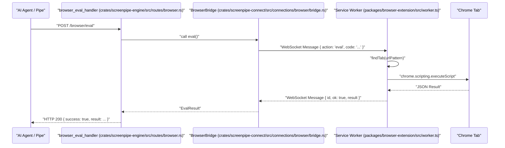
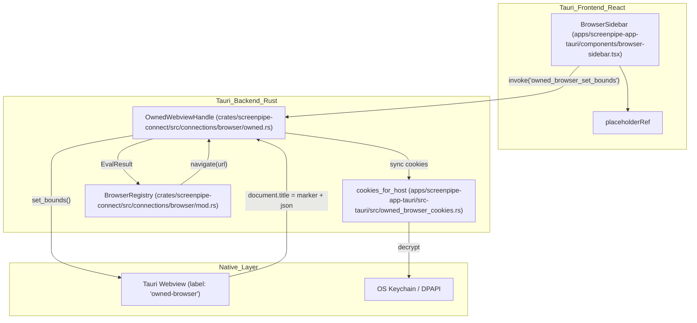

<!-- source: DeepWiki mcp.deepwiki.com · repo screenpipe/screenpipe · page 5.4 Browser Extension · fetched 2026-10-27 -->

# Browser Extension

Relevant source files

The following files were used as context for generating this wiki page:

- [apps/screenpipe-app-tauri/components/browser-sidebar.tsx](apps/screenpipe-app-tauri/components/browser-sidebar.tsx)
- [apps/screenpipe-app-tauri/e2e/specs/zz-owned-browser-background-nav.spec.ts](apps/screenpipe-app-tauri/e2e/specs/zz-owned-browser-background-nav.spec.ts)
- [apps/screenpipe-app-tauri/lib/__tests__/owned-browser-ownership.test.ts](apps/screenpipe-app-tauri/lib/__tests__/owned-browser-ownership.test.ts)
- [apps/screenpipe-app-tauri/lib/owned-browser-ownership.ts](apps/screenpipe-app-tauri/lib/owned-browser-ownership.ts)
- [apps/screenpipe-app-tauri/src-tauri/src/owned_browser.rs](apps/screenpipe-app-tauri/src-tauri/src/owned_browser.rs)
- [apps/screenpipe-app-tauri/src-tauri/src/owned_browser_cookies.rs](apps/screenpipe-app-tauri/src-tauri/src/owned_browser_cookies.rs)
- [crates/screenpipe-connect/src/connections/browser/bridge.rs](crates/screenpipe-connect/src/connections/browser/bridge.rs)
- [crates/screenpipe-connect/src/connections/browser/mod.rs](crates/screenpipe-connect/src/connections/browser/mod.rs)
- [crates/screenpipe-connect/src/connections/browser/owned.rs](crates/screenpipe-connect/src/connections/browser/owned.rs)
- [crates/screenpipe-engine/src/routes/browser.rs](crates/screenpipe-engine/src/routes/browser.rs)
- [packages/browser-extension/dist/manifest.json](packages/browser-extension/dist/manifest.json)
- [packages/browser-extension/dist/options.html](packages/browser-extension/dist/options.html)
- [packages/browser-extension/dist/options.js](packages/browser-extension/dist/options.js)
- [packages/browser-extension/dist/popup.html](packages/browser-extension/dist/popup.html)
- [packages/browser-extension/dist/popup.js](packages/browser-extension/dist/popup.js)
- [packages/browser-extension/dist/worker.js](packages/browser-extension/dist/worker.js)
- [packages/browser-extension/package.json](packages/browser-extension/package.json)
- [packages/browser-extension/src/config.ts](packages/browser-extension/src/config.ts)
- [packages/browser-extension/src/options.ts](packages/browser-extension/src/options.ts)
- [packages/browser-extension/src/popup.ts](packages/browser-extension/src/popup.ts)
- [packages/browser-extension/src/worker.ts](packages/browser-extension/src/worker.ts)

The Screenpipe browser integration consists of two primary components: a **Chrome Extension** (the "Browser Bridge") that connects the user's daily browser (Chrome, Arc, Edge) to the Screenpipe engine, and an **Owned Browser** which is a Tauri-managed isolated webview used for background tasks and agent-driven automation.

## Browser Bridge (Chrome Extension)

The Browser Bridge is a Manifest V3 extension that establishes a persistent WebSocket connection to the Screenpipe local server. It allows AI agents to execute JavaScript within the context of the user's active tabs, leveraging existing sessions, cookies, and authentication states.

### Implementation Details

The extension's core logic resides in a background service worker `worker.ts` [packages/browser-extension/src/worker.ts:7-16](). It maintains a single WebSocket connection to the `/connections/browser/ws` endpoint of the Screenpipe engine [packages/browser-extension/dist/worker.js:9-16]().

#### Connection Lifecycle & Reconnect Policy
The extension implements an exponential backoff strategy for reconnections:
*   **Base Delay:** 500ms (`RECONNECT_BASE_MS`) [packages/browser-extension/src/worker.ts:30]().
*   **Max Delay:** 30,000ms (`RECONNECT_MAX_MS`) [packages/browser-extension/src/worker.ts:31]().
*   **Auth Failure Detection:** If the connection closes three times consecutively without ever reaching an `OPEN` state, the extension flags an authentication failure (`AUTH_FAIL_THRESHOLD`) [packages/browser-extension/src/worker.ts:33, 49]().
*   **Heartbeat:** A ping/pong mechanism runs every 20 seconds (`HEARTBEAT_INTERVAL_MS`) to ensure the connection is alive [packages/browser-extension/src/worker.ts:37, 190-204]().
*   **Health Checks:** The extension monitors the engine's health via `/health` and status via `/connections/browser/status` [packages/browser-extension/dist/worker.js:17-22]().

#### Data Flow: Agent to Tab
When an agent sends a request to the Screenpipe API, the following flow occurs:

1.  **API Request:** Agent calls `POST /connections/browser/eval` [crates/screenpipe-engine/src/routes/browser.rs:124-127]().
2.  **WebSocket Dispatch:** The Screenpipe engine forwards the `eval` payload to the connected extension via the WebSocket [crates/screenpipe-engine/src/routes/browser.rs:104-109]().
3.  **Tab Selection:** The extension identifies the target tab using a URL substring filter in `findTab(urlPattern)` or defaults to the active tab [packages/browser-extension/src/worker.ts:216-232]().
4.  **JS Execution:** The extension uses `chrome.scripting.executeScript` to run the code in the tab context [packages/browser-extension/src/worker.ts:233-245]().
5.  **Result Return:** The result of the execution is serialized and sent back through the WebSocket to the engine [packages/browser-extension/src/worker.ts:183-189]().

### System Interaction Diagram

This diagram maps the natural language flow to specific code entities across the extension and the Rust backend.

Sources: [packages/browser-extension/src/worker.ts:187-197](), [crates/screenpipe-engine/src/routes/browser.rs:124-171](), [crates/screenpipe-connect/src/connections/browser/bridge.rs:23-35]()

---

## Owned Browser

The Owned Browser is an isolated webview embedded directly into the chat layout [apps/screenpipe-app-tauri/src-tauri/src/owned_browser.rs:7-12](). It is managed as a native Tauri child `Webview` parented to the window hosting the `<BrowserSidebar />` [apps/screenpipe-app-tauri/src-tauri/src/owned_browser.rs:7-11]().

### Implementation: Embedded Native Webview
The Owned Browser uses a hybrid approach to visual integration:
1.  **Layout Synchronization:** The React component `BrowserSidebar` measures a placeholder div and pushes parent-local bounds to Rust via `owned_browser_set_bounds` [apps/screenpipe-app-tauri/components/browser-sidebar.tsx:7-12]().
2.  **Native Parenting:** Rust uses `Window::add_child` and `Webview::set_bounds` so the OS handles window movement without per-frame JS loops [apps/screenpipe-app-tauri/src-tauri/src/owned_browser.rs:9-11]().
3.  **IPC Bridge:** Since cross-origin pages (e.g., Wikipedia) lack `window.__TAURI__`, results are transported via `document.title` updates, which are observable from Rust via `on_document_title_changed` [apps/screenpipe-app-tauri/src-tauri/src/owned_browser.rs:18-24]().

### Cookie Inheritance (Session Sync)
To bypass login walls on authenticated sites (Gmail, GitHub), the Owned Browser implements lazy, per-navigation cookie sync from the user's real browser (Chrome, Brave, Edge, Arc) [apps/screenpipe-app-tauri/src-tauri/src/owned_browser_cookies.rs:7-19]().

*   **Platform Support:** macOS (Keychain decryption) and Windows (DPAPI decryption) [apps/screenpipe-app-tauri/src-tauri/src/owned_browser_cookies.rs:21-25]().
*   **Security Prompt:** Before copying cookies, the sidebar emits a `SESSION_ACCESS_REQUEST_EVENT` to ask for user permission [apps/screenpipe-app-tauri/src-tauri/src/owned_browser.rs:73-76]().
*   **V20 Block (Windows):** On Windows, cookies protected by "App-Bound Encryption" (v20) cannot be decrypted; the system detects this and notifies the user via `V20_COOKIE_BLOCK_EVENT` [apps/screenpipe-app-tauri/src-tauri/src/owned_browser_cookies.rs:115-124](), [apps/screenpipe-app-tauri/src-tauri/src/owned_browser.rs:80-81]().

### Owned Browser Integration Diagram

Sources: [apps/screenpipe-app-tauri/src-tauri/src/owned_browser.rs:50-95](), [apps/screenpipe-app-tauri/components/browser-sidebar.tsx:10-25](), [crates/screenpipe-connect/src/connections/browser/owned.rs:35-63](), [apps/screenpipe-app-tauri/src-tauri/src/owned_browser_cookies.rs:140-145]()

---

## Auth & Ownership Integration

### Token Management
*   **Extension Storage:** The extension reads the token from `chrome.storage.local` under `screenpipe_token` [packages/browser-extension/src/worker.ts:63-65]().
*   **WS URL:** The token is appended as a query parameter: `ws://127.0.0.1:3030/connections/browser/ws?token=...` [packages/browser-extension/dist/worker.js:10-16]().

### Navigation Ownership
The Owned Browser is a singleton webview shared by every chat and every background pipe. To prevent background tasks from interrupting the user's active chat, Screenpipe implements an ownership model [apps/screenpipe-app-tauri/src-tauri/src/owned_browser.rs:105-119]().

*   **Owner Tags:** Every navigation is tagged with an `owner` (the chat `conversationId` or `pipe:<name>`) [apps/screenpipe-app-tauri/src-tauri/src/owned_browser.rs:114-119]().
*   **Filtering:** The `BrowserSidebar` uses `isForeignNavigation` to drop events that belong to a different chat than the one currently on screen [apps/screenpipe-app-tauri/components/browser-sidebar.tsx:57-61](), [apps/screenpipe-app-tauri/lib/owned-browser-ownership.ts:73-89]().
*   **Session Matching:** Navigations are also matched against `agentSessionId` to ensure the chat's own agent process can drive the browser even if state lags [apps/screenpipe-app-tauri/components/browser-sidebar.tsx:74-80](), [apps/screenpipe-app-tauri/lib/owned-browser-ownership.ts:86]().

Sources: [apps/screenpipe-app-tauri/src-tauri/src/owned_browser.rs:105-119](), [packages/browser-extension/src/worker.ts:63-68](), [apps/screenpipe-app-tauri/components/browser-sidebar.tsx:57-80](), [apps/screenpipe-app-tauri/lib/owned-browser-ownership.ts:73-89]()

---

