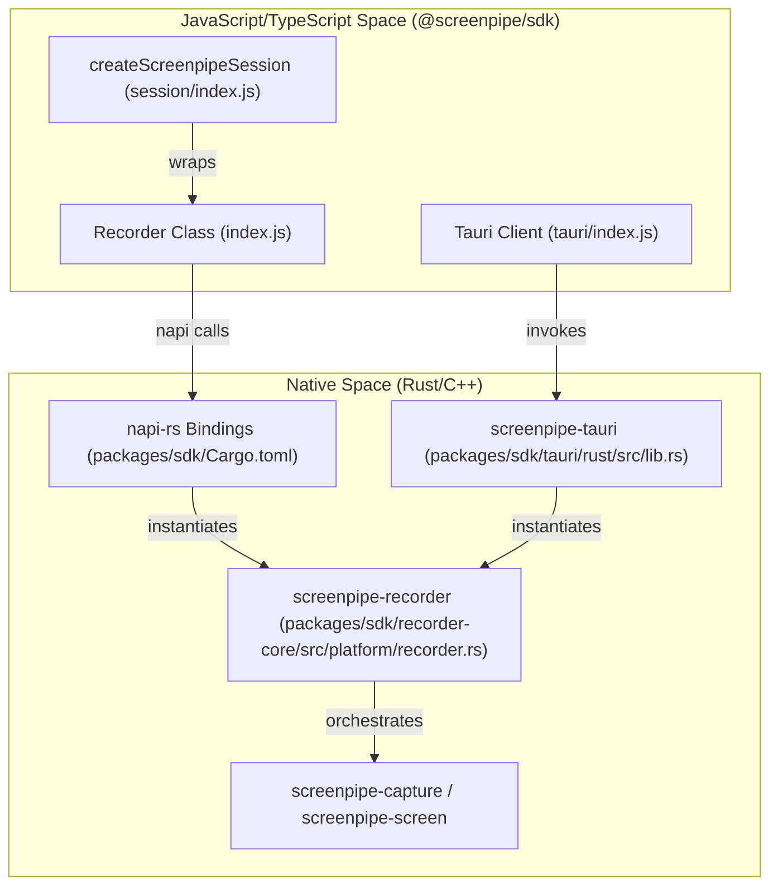
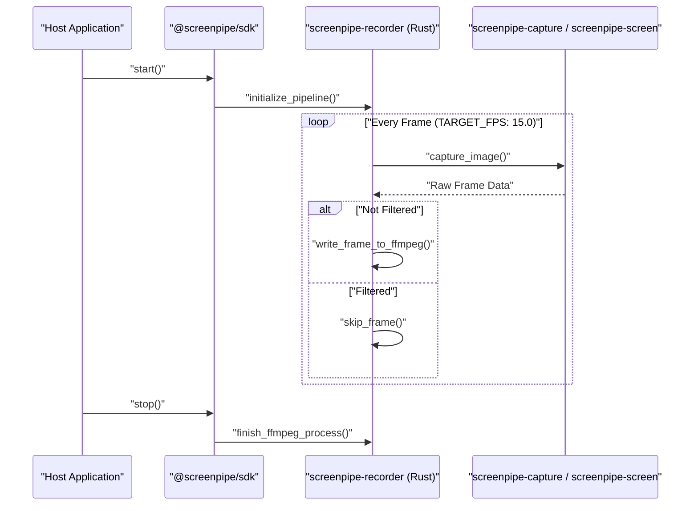

<!-- source: DeepWiki mcp.deepwiki.com · repo screenpipe/screenpipe · page 5.5 Enterprise SDK · fetched 2026-10-27 -->

# Enterprise SDK

Relevant source files

The following files were used as context for generating this wiki page:

- [.github/workflows/docs.yml](.github/workflows/docs.yml)
- [.github/workflows/eval-diarization.yml](.github/workflows/eval-diarization.yml)
- [.github/workflows/eval-meeting-detection.yml](.github/workflows/eval-meeting-detection.yml)
- [.github/workflows/sdk.yml](.github/workflows/sdk.yml)
- [.github/workflows/test-ai-gateway.yml](.github/workflows/test-ai-gateway.yml)
- [Cargo.lock](Cargo.lock)
- [Cargo.toml](Cargo.toml)
- [apps/screenpipe-app-tauri/src-tauri/Cargo.lock](apps/screenpipe-app-tauri/src-tauri/Cargo.lock)
- [apps/screenpipe-app-tauri/src-tauri/Cargo.toml](apps/screenpipe-app-tauri/src-tauri/Cargo.toml)
- [crates/screenpipe-audio-eval/Cargo.toml](crates/screenpipe-audio-eval/Cargo.toml)
- [crates/screenpipe-audio-eval/src/bin/eval_transcription.rs](crates/screenpipe-audio-eval/src/bin/eval_transcription.rs)
- [crates/screenpipe-audio/Cargo.toml](crates/screenpipe-audio/Cargo.toml)
- [crates/screenpipe-screen/Cargo.toml](crates/screenpipe-screen/Cargo.toml)
- [crates/screenpipe-screen/examples/wgc_cpu_probe.rs](crates/screenpipe-screen/examples/wgc_cpu_probe.rs)
- [crates/screenpipe-screen/examples/wgc_session_ab.rs](crates/screenpipe-screen/examples/wgc_session_ab.rs)
- [crates/screenpipe-screen/src/monitor/windows.rs](crates/screenpipe-screen/src/monitor/windows.rs)
- [crates/screenpipe-screen/src/wgc_capture.rs](crates/screenpipe-screen/src/wgc_capture.rs)
- [packages/sdk/Cargo.lock](packages/sdk/Cargo.lock)
- [packages/sdk/examples/tauri-app/src-tauri/Cargo.lock](packages/sdk/examples/tauri-app/src-tauri/Cargo.lock)

The Enterprise SDK (`@screenpipe/sdk`) is a commercial-grade embedding toolkit designed for Electron, Swift, Tauri, and Node.js applications. It exposes the core capture primitives of the Screenpipe stack—including high-performance screen recording, MP4 muxing, JPEG snapshots, and privacy filtering—as a library that runs in-process or via lightweight native bindings [packages/sdk/package.json:2-6]().

Unlike the standard Screenpipe application, the SDK is designed for developers who want to integrate "AI memory" or "always-on recording" features directly into their own branded products while maintaining local-first privacy.

## Architecture & Platform Support

The SDK is built around `screenpipe-recorder`, a pure-Rust orchestration crate that manages the capture pipeline [packages/sdk/recorder-core/Cargo.toml:1-5](). This core is then wrapped for different environments:

1.  **Node.js/Electron**: Uses `napi-rs` to provide high-performance native bindings [packages/sdk/Cargo.toml:1-5]().
2.  **Tauri**: A native Tauri v2 plugin (`screenpipe-tauri`) that runs the recorder directly in the host app's `tokio` runtime, avoiding any Node.js bridge [packages/sdk/tauri/rust/Cargo.toml:1-5]().
3.  **Swift**: Exposed via `Package.swift` and native examples for macOS integration [packages/sdk/package.json:91-92]().

### System Component Topology

The following diagram illustrates how the SDK components interact across the language boundary, highlighting the shared `recorder-core` which prevents duplication of capture logic [packages/sdk/Cargo.toml:39-42]().

**SDK Entity Mapping: JS to Rust**

Sources: [packages/sdk/Cargo.toml:39-46](), [packages/sdk/tauri/rust/Cargo.toml:17-20](), [packages/sdk/package.json:7-38]()

## Recorder API & Session Management

The `Recorder` struct in the backend acts as a thin wrapper over the main Screenpipe monorepo, orchestrating screen capture, accessibility events, and video encoding [packages/sdk/recorder-core/src/platform/recorder.rs:5-15]().

### Key Functions and Classes

| Entity | Location | Purpose |
| :--- | :--- | :--- |
| `Recorder` | `packages/sdk/recorder-core/src/platform/recorder.rs` | Main Rust struct managing `mp4_handles`, `filter_handle`, and `paired_handles` [packages/sdk/recorder-core/src/platform/recorder.rs:83-103](). |
| `FilterState` | `packages/sdk/recorder-core/src/platform/recorder.rs` | Cached state for focus-watching and window filtering [packages/sdk/recorder-core/src/platform/recorder.rs:139-143](). |
| `screenpipe-recorder` | `packages/sdk/recorder-core/` | Rust crate implementing the actual capture logic, consumed by both NAPI and Tauri [packages/sdk/recorder-core/Cargo.toml:1-5](). |
| `RecordingHandle` | `packages/sdk/recorder-core/src/platform/recorder.rs` | Handle for platform UI hooks that outlive individual monitor tasks [packages/sdk/recorder-core/src/platform/recorder.rs:98-101](). |

### Data Flow: Recording Lifecycle

The SDK uses a "paired capture" strategy, combining screen frames with UI events (accessibility tree) into the local database [packages/sdk/recorder-core/src/platform/recorder.rs:94-97]().

Sources: [packages/sdk/recorder-core/src/platform/recorder.rs:27-47](), [packages/sdk/recorder-core/src/platform/recorder.rs:83-103](), [packages/sdk/recorder-core/Cargo.toml:10-15]()

## Privacy Filters & Permission Handling

The SDK implements a privacy model that relies on `FilterState` to determine if a specific window or application should be excluded from the recording. The `filter_handle` runs a background task that re-evaluates the filter against the currently focused window every 1000ms (`FILTER_POLL_INTERVAL`) [packages/sdk/recorder-core/src/platform/recorder.rs:49-53]().

### Permission Management
The SDK utilizes the `accessibility` crate to inspect window titles and the UI tree for privacy filtering and metadata extraction [packages/sdk/Cargo.lock:9-19](). It allows setting `ignored_windows`, `included_windows`, and `ignored_urls` at runtime via `set_filters` without restarting the recorder [packages/sdk/recorder-core/src/platform/recorder.rs:134-150]().

## Telemetry and Enterprise Controls

The Enterprise SDK is part of a broader "Enterprise Edition" which includes specialized controls for managed environments [apps/screenpipe-app-tauri/src-tauri/Cargo.toml:171-179]().

*   **Admin Policy Enforcement**: Centralized lockable settings pushed by admins, including update policies [apps/screenpipe-app-tauri/src-tauri/Cargo.toml:171-179]().
*   **Update Management**: The `EnterpriseAppUpdatePolicy` allows organizations to define update modes such as `mdm` (managed by Intune/MDM), `screenpipe` (automatic), or `manual` [apps/screenpipe-app-tauri/src-tauri/Cargo.toml:171-179]().
*   **Native Telemetry**: The Tauri plugin (`screenpipe-tauri`) includes a native telemetry sender using `reqwest` with `rustls` to track health and performance without requiring system OpenSSL dependencies [apps/screenpipe-app-tauri/src-tauri/Cargo.toml:94]().

## Multi-Platform Implementation

### Tauri Plugin
The Tauri integration (`screenpipe-tauri`) uses `links = "screenpipe"` to align the build-time namespace with the runtime plugin identity [packages/sdk/tauri/rust/Cargo.toml:8-15](). It performs in-process recording, avoiding the overhead of spawning external Node.js processes [packages/sdk/tauri/rust/Cargo.toml:17-20]().

### Node.js (NAPI)
The Node.js SDK supports pre-built binaries for multiple triples, including ARM64 support for both macOS and Windows [packages/sdk/package.json:96-107](). It targets Node 18+ and provides specific entry points for Electron main and preload scripts [packages/sdk/package.json:7-25]().

### Swift Integration
The SDK is compatible with Swift via `Package.swift`, allowing native macOS applications to leverage the same Rust-based capture stack [packages/sdk/package.json:91-92]().

Sources: [packages/sdk/Cargo.toml:1-5](), [packages/sdk/tauri/rust/Cargo.toml:1-5](), [packages/sdk/recorder-core/src/platform/recorder.rs:5-15](), [apps/screenpipe-app-tauri/src-tauri/Cargo.toml:171-179](), [apps/screenpipe-app-tauri/src-tauri/Cargo.toml:94]()

---

