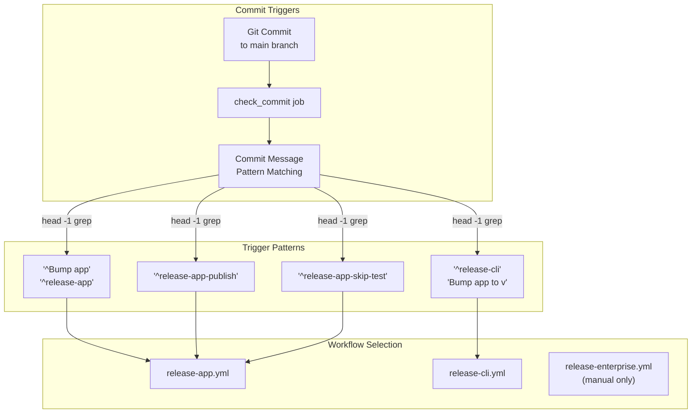
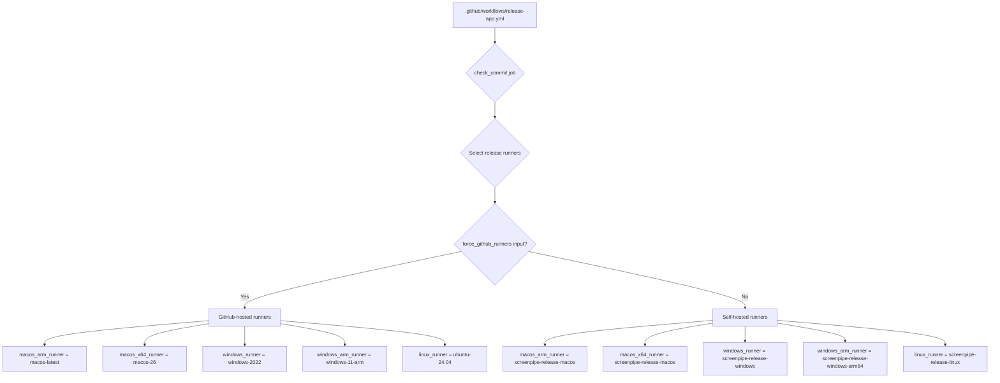

<!-- source: DeepWiki mcp.deepwiki.com · repo screenpipe/screenpipe · page 6 Release & Distribution · fetched 2026-10-27 -->

# Release & Distribution

<details>
<summary>Relevant source files</summary>

The following files were used as context for generating this wiki page:

- [.github/scripts/assert_windows_audio_rms.ps1](.github/scripts/assert_windows_audio_rms.ps1)
- [.github/scripts/release-workflows.test.ts](.github/scripts/release-workflows.test.ts)
- [.github/scripts/setup-ninja-windows.ps1](.github/scripts/setup-ninja-windows.ps1)
- [.github/workflows/benchmark.yml](.github/workflows/benchmark.yml)
- [.github/workflows/ci.yml](.github/workflows/ci.yml)
- [.github/workflows/e2e-test.yml](.github/workflows/e2e-test.yml)
- [.github/workflows/release-app.yml](.github/workflows/release-app.yml)
- [.github/workflows/release-cli.yml](.github/workflows/release-cli.yml)
- [.github/workflows/release-enterprise.yml](.github/workflows/release-enterprise.yml)
- [.github/workflows/style.yml](.github/workflows/style.yml)
- [.github/workflows/windows-integration-test.yml](.github/workflows/windows-integration-test.yml)

</details>


This document describes how Screenpipe is built, packaged, and distributed across platforms. It covers the primary GitHub Actions workflows that handle releases, platform-specific build requirements, artifact signing, and distribution channels.

For information about the development build system and local compilation, see [Build System](#7.2). For continuous integration testing, see [CI/CD Pipeline](#7.4).

## Scope

Screenpipe uses four primary release workflows to target different user segments and platforms:
1.  **Desktop App Release** ([.github/workflows/release-app.yml:8-30]()) - Tauri application for macOS and Windows.
2.  **CLI & MCP Release** ([.github/workflows/release-cli.yml:10-26]()) - Command-line binary distributed via npm and GitHub.
3.  **Enterprise Windows Release** ([.github/workflows/release-enterprise.yml:12-35]()) - Specialized builds for Windows, macOS, and Linux with EV code signing and Intune packaging.
4.  **Integration & Validation** ([.github/workflows/windows-integration-test.yml:7-15](), [.github/workflows/e2e-test.yml:11-18]()) - Automated validation of audio/OCR performance and E2E flows before distribution.

Sources: [.github/workflows/release-app.yml:8-30](), [.github/workflows/release-cli.yml:10-26](), [.github/workflows/release-enterprise.yml:12-35](), [.github/workflows/windows-integration-test.yml:7-15](), [.github/workflows/e2e-test.yml:11-18]()

## Release Workflow Triggers



**Commit Message Parsing Logic**

The `check_commit` job parses the first line of commit messages to determine which workflows to trigger. This uses grep with start-of-line anchors (`^`) to avoid false positives.

Sources: [.github/workflows/release-app.yml:98-123](), [.github/workflows/release-cli.yml:63-74]()

| Commit Message Pattern | Triggers | Testing Enabled | Description |
| :--- | :--- | :--- | :--- |
| `^Bump app` | Desktop App | Yes | Standard app release with community testing |
| `^release-app` | Desktop App | Yes | Explicit app release request |
| `^release-app-publish` | Desktop App | No | Production release (skip testing) |
| `^release-cli` | CLI | N/A | CLI binary release |
| Tag push `v*` | CLI | N/A | Versioned CLI release from git tags |

Sources: [.github/workflows/release-app.yml:98-123](), [.github/workflows/release-cli.yml:63-74]()

## Desktop App Release Pipeline

For details, see [Desktop App Release](#6.1).

### Runner Selection Strategy

Screenpipe uses a runner selection logic in [.github/workflows/release-app.yml:125-144]() to ensure Apple Intelligence support while maintaining availability. For macOS, it prioritizes `screenpipe-release-macos` (self-hosted) for specific hardware and SDKs, falling back to GitHub-hosted runners if `force_github_runners` is enabled.



Sources: [.github/workflows/release-app.yml:125-144]()

### Build Matrix and Targets

The release strategy uses a matrix to build for multiple architectures. The `release-app.yml` workflow defines specific targets and features for macOS and Windows.

| Platform | Target | Features |
| :--- | :--- | :--- |
| macOS ARM64 | `aarch64-apple-darwin` | `metal`, `parakeet-mlx`, `rfdetr-mlx`, `redact-onnx-coreml` |
| Windows x64 | `x86_64-pc-windows-msvc` | `official-build` |

Sources: [.github/workflows/release-app.yml:172-180]()

## CLI & MCP Release Pipeline

For details, see [CLI & MCP Release](#6.2).

The CLI release workflow builds platform-specific binaries and publishes them to npm as optional dependencies. The `release-cli.yml` workflow handles the build process for macOS, Windows, and Linux.

```mermaid
graph TD
    A[".github/workflows/release-cli.yml"] --> B{check_commit job};
    B --> C{build-macos job};
    B --> D{build-windows job};
    B --> E{build-linux job};

    C --> C1["Build screenpipe-engine (macOS)"];
    C1 --> C2["Features: metal, parakeet-mlx, rfdetr-mlx, redact-onnx-coreml"];
    C2 --> C3["Target: x86_64-apple-darwin, aarch64-apple-darwin"];

    D --> D1["Build screenpipe-engine (Windows)"];
    D1 --> D2["Features: redact-onnx-directml"];
    D2 --> D3["Target: x86_64-pc-windows-msvc, aarch64-pc-windows-msvc"];

    E --> E1["Build screenpipe-engine (Linux)"];
    E1 --> E2["Features: redact-onnx-cpu"];
    E2 --> E3["Target: x86_64-unknown-linux-gnu"];

    C3 & D3 & E3 --> F[Upload debug symbols to Sentry];
    F --> G[Codesign binary (macOS/Windows)];
    G --> H[Notarize/Sign (macOS/Windows)];
    H --> I[Publish to npm];
    I --> J[Create GitHub Release];
```

**npm Package Structure**

The CLI is distributed via the `@screenpipe/screenpipe` package. It bundles platform-specific binaries into scoped packages.

Sources: [.github/workflows/release-cli.yml:76-84](), [.github/workflows/release-cli.yml:146-150]()

## Enterprise Windows Release

For details, see [Enterprise Windows Release](#6.3).

For enterprise environments, Screenpipe provides signed installers and MDM-compatible packages. The `release-enterprise.yml` workflow manages these specialized builds.

-   **EV Code Signing**: Windows binaries are signed with SSL.com EV certificates [.github/workflows/release-enterprise.yml:7]().
-   **Intune Packaging**: The build process creates `.intunewin` packages for Microsoft Intune deployment [.github/workflows/release-enterprise.yml:7]().
-   **Path Length Workarounds**: Windows enterprise builds use junction links to `C:\t` to avoid `MAX_PATH` limitations during deep Rust builds. This is configured via the `CARGO_TARGET_DIR` environment variable set to `C:/t` [.github/scripts/release-workflows.test.ts:119-120]().
-   **Linux Repacking**: AppImage artifacts are repacked with bundled runtime dependencies to ensure compatibility across distributions like Debian 13.

Sources: [.github/workflows/release-enterprise.yml:5-10](), [.github/scripts/release-workflows.test.ts:119-120]()

## Platform-Specific Build Requirements

### macOS
-   **Codesigning**: Binaries are signed with a hardened runtime using `codesign` and an Apple Developer certificate [.github/workflows/release-cli.yml:160-168]().
-   **Notarization**: Signed binaries are zipped and submitted to Apple's Notary Service via `xcrun notarytool`.
-   **Apple Silicon Fixes**: Specific `CFLAGS` are used to undefine `__ARM_FEATURE_MATMUL_INT8` to prevent build errors on M1/M2 chips, ensuring compatibility with `whisper.cpp` dependencies [.github/workflows/release-cli.yml:141-142]().

### Windows
-   **ONNX Runtime**: The build system downloads and extracts ONNX Runtime 1.24.2 for both integration tests and releases [.github/workflows/ci.yml:135-137](), [.github/workflows/e2e-test.yml:179-182]().
-   **Ninja Build System**: Windows builds utilize Ninja as the CMake generator for native dependencies, configured via `setup-ninja-windows.ps1` [.github/scripts/setup-ninja-windows.ps1:41-42](). This script ensures Ninja is installed and correctly set up in the environment.
-   **FFmpeg**: The `windows-integration-test.yml` workflow explicitly downloads and installs a pinned version of FFmpeg via Chocolatey to ensure consistent audio processing capabilities [.github/workflows/windows-integration-test.yml:115-144]().
-   **Scream Audio Driver**: For E2E and integration tests, the Scream audio driver is installed and signed to enable virtual audio capture and playback, allowing for robust audio pipeline testing [.github/workflows/e2e-test.yml:80-108](), [.github/workflows/windows-integration-test.yml:148-166]().

### Linux
-   **Dependency Management**: Uses `install_dependencies.sh` for CI and `apt-get` for AppImage builds, including `libtesseract-dev`, `libavformat-dev`, and `libayatana-appindicator3-dev`.
-   **Runtime Bundling**: The `bundle-appimage-runtime-deps.sh` script explicitly bundles `libopenblas.so.0` and transitive dependencies into the AppImage `squashfs-root`.

Sources: [.github/workflows/release-cli.yml:141-142](), [.github/workflows/release-cli.yml:160-168](), [.github/workflows/ci.yml:135-137](), [.github/workflows/e2e-test.yml:80-108](), [.github/workflows/e2e-test.yml:179-182](), [.github/workflows/windows-integration-test.yml:115-144](), [.github/workflows/windows-integration-test.yml:148-166](), [.github/scripts/setup-ninja-windows.ps1:41-42]()

## Distribution Channels & Release Infrastructure

For details, see [Distribution Channels & Release Infrastructure](#6.4).

-   **Cloudflare R2**: Primary storage for desktop app installers and versioned releases. This is used as a shared sccache backend for Rust compilation across various CI jobs, improving build times [.github/workflows/release-cli.yml:100-107](), [.github/workflows/ci.yml:97-103](), [.github/workflows/benchmark.yml:29-36]().
-   **npm Registry**: Distribution channel for the Screenpipe CLI package.
-   **GitHub Releases**: Rolling releases for CLI binaries and versioned tags [.github/workflows/release-cli.yml:13-16]().
-   **Sentry**: Debug symbols are uploaded during the release process to enable symbolicated crash reports for both the desktop app and CLI [.github/workflows/release-cli.yml:152-157]().
-   **Self-hosted Runners**: Screenpipe utilizes self-hosted runners for specific build environments, particularly for macOS and Windows, to ensure consistent environments and access to specialized hardware or software configurations. This is evident in the runner selection logic for release workflows [.github/workflows/release-app.yml:138-143]().

Sources: [.github/workflows/release-cli.yml:13-16](), [.github/workflows/release-cli.yml:100-107](), [.github/workflows/release-cli.yml:152-157](), [.github/workflows/ci.yml:97-103](), [.github/workflows/benchmark.yml:29-36](), [.github/workflows/release-app.yml:138-143]()

---

