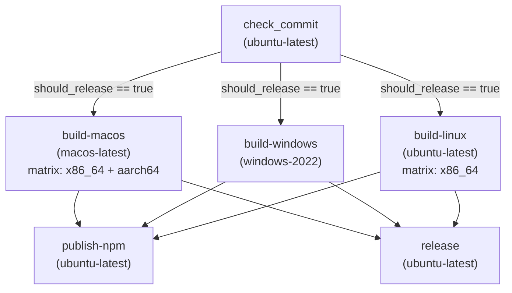
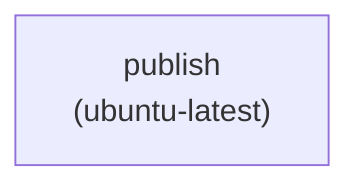
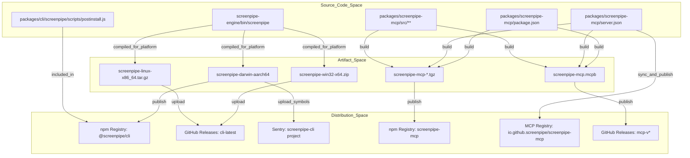
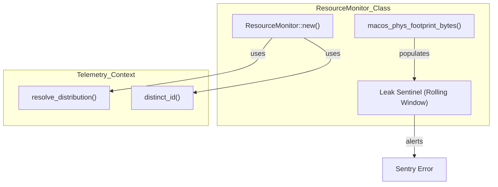

<!-- source: DeepWiki mcp.deepwiki.com · repo screenpipe/screenpipe · page 6.2 CLI & MCP Release · fetched 2026-10-27 -->

# CLI & MCP Release

Relevant source files

The following files were used as context for generating this wiki page:

- [.github/scripts/assert_windows_audio_rms.ps1](.github/scripts/assert_windows_audio_rms.ps1)
- [.github/scripts/release-workflows.test.ts](.github/scripts/release-workflows.test.ts)
- [.github/scripts/setup-ninja-windows.ps1](.github/scripts/setup-ninja-windows.ps1)
- [.github/workflows/benchmark.yml](.github/workflows/benchmark.yml)
- [.github/workflows/ci.yml](.github/workflows/ci.yml)
- [.github/workflows/e2e-test.yml](.github/workflows/e2e-test.yml)
- [.github/workflows/release-app.yml](.github/workflows/release-app.yml)
- [.github/workflows/release-cli.yml](.github/workflows/release-cli.yml)
- [.github/workflows/release-enterprise.yml](.github/workflows/release-enterprise.yml)
- [.github/workflows/release-mcp.yml](.github/workflows/release-mcp.yml)
- [.github/workflows/style.yml](.github/workflows/style.yml)
- [.github/workflows/test-mcp.yml](.github/workflows/test-mcp.yml)
- [.github/workflows/windows-integration-test.yml](.github/workflows/windows-integration-test.yml)
- [packages/screenpipe-mcp/.gitignore](packages/screenpipe-mcp/.gitignore)
- [packages/screenpipe-mcp/RELEASE.md](packages/screenpipe-mcp/RELEASE.md)
- [packages/screenpipe-mcp/bun.lock](packages/screenpipe-mcp/bun.lock)
- [packages/screenpipe-mcp/manifest.json](packages/screenpipe-mcp/manifest.json)
- [packages/screenpipe-mcp/package.json](packages/screenpipe-mcp/package.json)
- [packages/screenpipe-mcp/plugins/screenpipe-cloud/README.md](packages/screenpipe-mcp/plugins/screenpipe-cloud/README.md)
- [packages/screenpipe-mcp/plugins/screenpipe-cloud/SUBMISSION.md](packages/screenpipe-mcp/plugins/screenpipe-cloud/SUBMISSION.md)
- [packages/screenpipe-mcp/plugins/screenpipe-cloud/mcp.json](packages/screenpipe-mcp/plugins/screenpipe-cloud/mcp.json)
- [packages/screenpipe-mcp/server.json](packages/screenpipe-mcp/server.json)

This page documents the `release-cli.yml` and `release-mcp.yml` GitHub Actions workflows, which build and publish the standalone `screenpipe` CLI binary and the `screenpipe-mcp` package for the Model Context Protocol (MCP). It covers the commit-gate logic, per-platform CLI build jobs, dependency management (ONNX Runtime, FFmpeg), Sentry symbol uploads, macOS security protocols, npm multi-package publishing, and GitHub Releases.

---

## Workflow Overview

**Files:**
- [.github/workflows/release-cli.yml](.github/workflows/release-cli.yml)
- [.github/workflows/release-mcp.yml](.github/workflows/release-mcp.yml)

The `release-cli.yml` workflow consists of a check phase followed by parallel build jobs for each major OS, culminating in publication to npm and GitHub Releases. It is designed to serialize releases to prevent race conditions during the publication of binaries [.github/workflows/release-cli.yml:27-30]().

The `release-mcp.yml` workflow builds and publishes the `screenpipe-mcp` package to npm and the official MCP Registry. It also creates a GitHub Release for the `.mcpb` bundle. This workflow also serializes releases to prevent conflicts [.github/workflows/release-mcp.yml:14-17]().

**Job dependency diagram: release-cli.yml**

Sources: [.github/workflows/release-cli.yml:27-632]()

**Job dependency diagram: release-mcp.yml**

Sources: [.github/workflows/release-mcp.yml:27-189]()

---

## Triggers and Gatekeeping

### CLI Release Triggers
The `release-cli.yml` workflow runs on `push` to `main`, tag creation (`v*`), or `workflow_dispatch` [.github/workflows/release-cli.yml:12-17](). The `check_commit` job acts as a gatekeeper.

| Trigger | Condition | `should_release` result |
|---|---|---|
| `workflow_dispatch` | Manual run | Always `true` [.github/workflows/release-cli.yml:50-54]() |
| `push` to tag `v*` | Tag creation | Always `true` [.github/workflows/release-cli.yml:56-60]() |
| `push` to `main` | Commit message check | `true` if message matches release patterns [.github/workflows/release-cli.yml:66-71]() |

The check scans the latest commit message for keywords like `release-app`, `release-cli`, or version bumps [.github/workflows/release-cli.yml:66]().

### MCP Release Triggers
The `release-mcp.yml` workflow runs on `push` to tags matching `mcp-v*` or `workflow_dispatch` [.github/workflows/release-mcp.yml:4-8](). There is no explicit `check_commit` job; the `publish` job directly proceeds based on these triggers. A `workflow_dispatch` input `allow_already_published` can be used to re-run parts of the workflow even if the version is already on npm [.github/workflows/release-mcp.yml:9-12]().

Sources: [.github/workflows/release-cli.yml:28-74](), [.github/workflows/release-mcp.yml:4-12]()

---

## Platform Build Jobs (CLI)

### macOS
- **Runner**: `macos-latest` [.github/workflows/release-cli.yml:81]().
- **Targets**: `x86_64-apple-darwin` and `aarch64-apple-darwin` [.github/workflows/release-cli.yml:84]().
- **Dependencies**: Uses `actions-rust-lang/setup-rust-toolchain@v1` for Rust setup [.github/workflows/release-cli.yml:88-96](), `actions/cache@v4` for Homebrew packages and Cargo dependencies [.github/workflows/release-cli.yml:109-118](), and installs `ffmpeg` and `pkg-config` via Homebrew [.github/workflows/release-cli.yml:121-124](). `sccache` is configured for shared R2 compile caching [.github/workflows/release-cli.yml:100-107]().
- **Features**: For `aarch64`, it enables `metal,parakeet-mlx,rfdetr-mlx,redact-onnx-coreml` [.github/workflows/release-cli.yml:146](). For `x86_64`, it enables `metal,redact-onnx-coreml` [.github/workflows/release-cli.yml:148]().
- **Build Fixes**: For Apple Silicon, it sets `CFLAGS` and `CXXFLAGS` to `-mcpu=apple-m1 -U__ARM_FEATURE_MATMUL_INT8` to resolve `i8mm` matmul macro conflicts in `whisper.cpp` [.github/workflows/release-cli.yml:143-144]().
- **Security**: The binary is signed with `codesign --options runtime` using an Apple Developer certificate and submitted for notarization via `xcrun notarytool` [.github/workflows/release-cli.yml:160-202]().
- **Sentry**: Debug symbols are uploaded to Sentry for the `screenpipe-cli` project [.github/workflows/release-cli.yml:151-157]().

Sources: [.github/workflows/release-cli.yml:77-213]()

### Windows
- **Runner**: `windows-2022` [.github/workflows/release-cli.yml:217]().
- **Dependencies**: Uses `actions-rust-lang/setup-rust-toolchain@v1` for Rust setup [.github/workflows/release-cli.yml:229-236](). `sccache` is configured for shared R2 compile caching [.github/workflows/release-cli.yml:238-245](). `setup-openblas.js` is used to set up OpenBLAS [.github/workflows/release-cli.yml:250-257]().
- **Build Environment**: Uses `ilammy/msvc-dev-cmd@v1` for MSVC development environment [.github/workflows/release-cli.yml:248](). Ninja is configured as the CMake generator for native dependencies [.github/workflows/release-cli.yml:260-266](), as detailed in `.github/scripts/setup-ninja-windows.ps1` [.github/scripts/setup-ninja-windows.ps1:1-10]().
- **ONNX Runtime**: Downloads ONNX Runtime v1.24.2 for Windows x64 and extracts it [.github/workflows/release-cli.yml:269-286]().
- **Binary**: Built with `cargo build --release -p screenpipe-engine --bin screenpipe` targeting `x86_64-pc-windows-msvc` [.github/workflows/release-cli.yml:298]().
- **Packaging**: Bundles `onnxruntime.dll`, `vcruntime140.dll`, and `msvcp140.dll` into the distribution ZIP [.github/workflows/release-cli.yml:335-351]().
- **Smoke Tests**: Includes a `launch-smoke` step to run native and Intel SDE (non-AVX2) probes, verifying the CLI package functionality [.github/workflows/release-cli.yml:353-363](). This is also used for `smoke_only` workflow dispatch input [.github/workflows/release-cli.yml:18-21]().

Sources: [.github/workflows/release-cli.yml:215-363](), [.github/scripts/setup-ninja-windows.ps1:1-10]()

### Linux
- **Runner**: `ubuntu-latest` [.github/workflows/release-cli.yml:367]().
- **Dependencies**: Uses `actions-rust-lang/setup-rust-toolchain@v1` for Rust setup [.github/workflows/release-cli.yml:371-378](). `sccache` is configured for shared R2 compile caching [.github/workflows/release-cli.yml:380-387](). Installs `tesseract-ocr`, `libtesseract-dev`, `ffmpeg`, and `libpipewire-0.3-dev` via `apt` [.github/workflows/release-cli.yml:390-399]().
- **Compilation**: Uses `clang-14` and `llvm-14` for compilation [.github/workflows/release-cli.yml:401-409]().
- **Artifact**: Produces a `.tar.gz` containing the `screenpipe` binary [.github/workflows/release-cli.yml:471-483]().

Sources: [.github/workflows/release-cli.yml:365-483]()

---

## Data Flow: Build to Distribution

This diagram associates build-time entities with their final release packages and registries.

Sources: [.github/workflows/release-cli.yml:485-632](), [.packages/cli/screenpipe/scripts/postinstall.js:1-10](), [.github/workflows/release-mcp.yml:27-189](), [packages/screenpipe-mcp/package.json:1-49](), [packages/screenpipe-mcp/server.json:1-23]()

---

## Telemetry and Distribution Context

The CLI release utilizes the `TelemetryContext` to identify the distribution channel and machine identity for analytics.

| Code Entity | Purpose |
|---|---|
| `resolve_distribution` | Inferred as "cli" when `SCREENPIPE_DISTRIBUTION` is set by the npm installer [.crates/screenpipe-engine/src/telemetry_context.rs:44-53]() |
| `distinct_id` | Prefers environment IDs, falls back to machine-specific persistent ID via `get_or_create_machine_id` [.crates/screenpipe-engine/src/telemetry_context.rs:91-93]() |
| `AnalyticsManager` | Constructs JSON payloads for PostHog, including `app_version` from `CARGO_PKG_VERSION` [.apps/screenpipe-app-tauri/src-tauri/src/analytics.rs:159-177]() |
| `postinstall.js` | Node script that tracks `cli_install_npm` events during the `npm install` lifecycle [.packages/cli/screenpipe/scripts/postinstall.js:53-70]() |

### Resource Monitoring Flow

Sources: [.crates/screenpipe-engine/src/resource_monitor.rs:28-102](), [.crates/screenpipe-engine/src/telemetry_context.rs:44-93]()

---

## Release Publication

### CLI npm Multi-Package Strategy
Screenpipe uses a wrapper package that depends on platform-specific binary packages. The `publish-npm` job:
1. Updates versions in `package.json` for every platform package (e.g., `screenpipe-linux-x64`) [.github/workflows/release-cli.yml:535-545]().
2. Updates the main `screenpipe` wrapper's `optionalDependencies` [.github/workflows/release-cli.yml:547-554]().
3. Publishes all modified packages to the npm registry [.github/workflows/release-cli.yml:556-571]().

### CLI GitHub Releases
The `release-cli.yml` workflow manages a rolling release named `cli-latest`. It automatically deletes the previous `cli-latest` tag and asset before uploading the new binaries to ensure the "latest" link always points to current builds [.github/workflows/release-cli.yml:603-625]().

### MCP npm Publishing
The `release-mcp.yml` workflow's `publish` job handles the npm publication for `screenpipe-mcp`.
1. **Authentication**: Sets up Node.js and authenticates to npm using `NPM_TOKEN` [.github/workflows/release-mcp.yml:33-53]().
2. **Dependencies & Tests**: Installs dependencies, runs type checks, and executes tests for the `screenpipe-mcp` package [.github/workflows/release-mcp.yml:55-63]().
3. **License Bundling**: Copies `LICENSE.md` into the package directory [.github/workflows/release-mcp.yml:65-67]().
4. **Tarball Verification**: Runs `npm run verify:pack` to ensure the tarball contains necessary files like `dist/index.js` and `dist/team-config.js` before publishing. This prevents shipping broken packages, a lesson learned from previous incidents (SCR-352) [.github/workflows/release-mcp.yml:75-78]().
5. **Installable MCP Packages**: Builds `.mcpb` installer bundles using `bun scripts/build-installers.mjs` [.github/workflows/release-mcp.yml:80-85]().
6. **MCPB Bundle Verification**: Verifies that the `.mcpb` bundle contains the `SCREENPIPE_TEAM_API_URL` configuration, crucial for customer gateway support [.github/workflows/release-mcp.yml:95-104]().
7. **npm Publish**: Publishes the package to npm. It includes logic to prevent re-publishing an already existing version unless `allow_already_published` is explicitly set, which is an error condition as npm does not allow overwriting versions [.github/workflows/release-mcp.yml:116-131]().

### MCP Registry Publication
After npm publishing, the `publish` job also publishes the `screenpipe-mcp` package to the official Model Context Protocol Registry (`registry.modelcontextprotocol.io`).
1. **Version Sync**: Synchronizes the version in `server.json` with `package.json` [.github/workflows/release-mcp.yml:137-142]().
2. **`mcp-publisher`**: Installs `mcp-publisher` and uses it to publish the package to the MCP Registry. This step uses OIDC authentication for the `io.github.screenpipe` namespace [.github/workflows/release-mcp.yml:146-152](). This step is configured to `continue-on-error` to avoid blocking the npm publish or GitHub release if the MCP Registry has a transient issue [.github/workflows/release-mcp.yml:146]().

### MCP GitHub Releases
The `release-mcp.yml` workflow creates a GitHub Release for the `mcp-v*` tag, attaching the `screenpipe-mcp.mcpb` bundle as an asset [.github/workflows/release-mcp.yml:178-189]().

Sources: [.github/workflows/release-cli.yml:485-632](), [.github/workflows/release-mcp.yml:27-189](), [packages/screenpipe-mcp/package.json:1-49](), [packages/screenpipe-mcp/server.json:1-23]()

---

