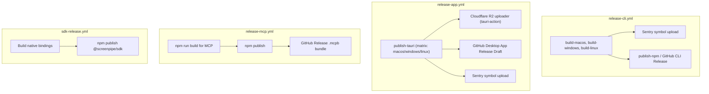
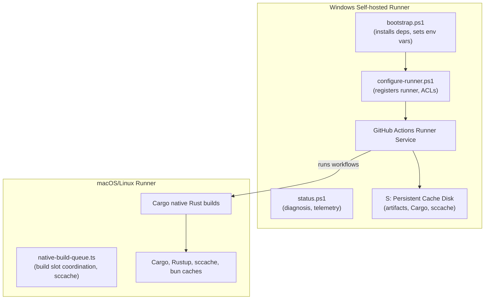
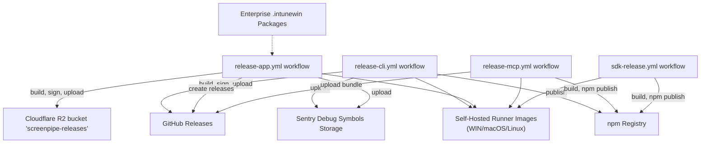

<!-- source: DeepWiki mcp.deepwiki.com · repo screenpipe/screenpipe · page 6.4 Distribution Channels & Release Infrastructure · fetched 2026-10-27 -->

# 6.4 Distribution Channels & Release Infrastructure

<details>
<summary>Relevant source files</summary>

The following files were used as context for generating this wiki page:

- [.github/actions/install-windows-frontend-dependencies/action.yml](.github/actions/install-windows-frontend-dependencies/action.yml)
- [.github/actions/install-windows-frontend-dependencies/prune-dependencies.test.ts](.github/actions/install-windows-frontend-dependencies/prune-dependencies.test.ts)
- [.github/actions/install-windows-frontend-dependencies/prune-dependencies.ts](.github/actions/install-windows-frontend-dependencies/prune-dependencies.ts)
- [.github/actions/setup-persistent-windows-cache/action.yml](.github/actions/setup-persistent-windows-cache/action.yml)
- [.github/scripts/enterprise-release.cjs](.github/scripts/enterprise-release.cjs)
- [.github/scripts/upload-release-artifacts.sh](.github/scripts/upload-release-artifacts.sh)
- [.github/workflows/test-release-workflows.yml](.github/workflows/test-release-workflows.yml)
- [AGENTS.md](AGENTS.md)
- [CLAUDE.md](CLAUDE.md)
- [apps/screenpipe-app-tauri/scripts/i18n/service.mjs](apps/screenpipe-app-tauri/scripts/i18n/service.mjs)
- [apps/screenpipe-app-tauri/scripts/i18n/service.test.ts](apps/screenpipe-app-tauri/scripts/i18n/service.test.ts)
- [apps/screenpipe-app-tauri/scripts/native-build-queue.test.ts](apps/screenpipe-app-tauri/scripts/native-build-queue.test.ts)
- [apps/screenpipe-app-tauri/scripts/native-build-queue.ts](apps/screenpipe-app-tauri/scripts/native-build-queue.ts)
- [apps/screenpipe-app-tauri/src-tauri/sign-ssl.ps1](apps/screenpipe-app-tauri/src-tauri/sign-ssl.ps1)
- [docs/human-only-app-publication.md](docs/human-only-app-publication.md)
- [docs/macos-dev-builds.md](docs/macos-dev-builds.md)
- [infra/release-artifact-uploader/package.json](infra/release-artifact-uploader/package.json)
- [infra/release-artifact-uploader/src/index.js](infra/release-artifact-uploader/src/index.js)
- [infra/release-artifact-uploader/src/index.test.js](infra/release-artifact-uploader/src/index.test.js)
- [infra/release-artifact-uploader/wrangler.jsonc](infra/release-artifact-uploader/wrangler.jsonc)
- [infra/release-windows-runner/README.md](infra/release-windows-runner/README.md)
- [infra/release-windows-runner/bootstrap.ps1](infra/release-windows-runner/bootstrap.ps1)
- [infra/release-windows-runner/configure-runner.ps1](infra/release-windows-runner/configure-runner.ps1)
- [infra/release-windows-runner/configure-runner.sh](infra/release-windows-runner/configure-runner.sh)
- [infra/release-windows-runner/deploy.sh](infra/release-windows-runner/deploy.sh)
- [infra/release-windows-runner/main.bicep](infra/release-windows-runner/main.bicep)
- [infra/release-windows-runner/status.ps1](infra/release-windows-runner/status.ps1)
- [infra/release-windows-runner/status.sh](infra/release-windows-runner/status.sh)

</details>


This page details the technical infrastructure and implementations underlying Screenpipe's distribution channels and release system. It covers artifact upload to Cloudflare R2, npm registry publishing, GitHub Releases, Sentry debug symbol management, Microsoft Intune packaging for enterprise deployments, and the self-hosted runner images used in CI/CD pipelines on Windows, macOS, and Linux platforms.

---

## Overview

Screenpipe employs multiple interconnected infrastructure components to build, sign, package, and distribute its software artifacts across platforms and audiences. The release infrastructure interleaves automation with manual human gates to guarantee integrity and controlled publication.

Key distribution channels and release artifacts:

| Channel / Infrastructure  | Artifact Types                              | Usage / Audience                            |
|---------------------------|---------------------------------------------|--------------------------------------------|
| **Cloudflare R2 Object Storage**  | Desktop app installers (.exe, .dmg, .deb) | End users, auto-update clients via Tauri updater |
| **npm Registry**                | `screenpipe`, `screenpipe-mcp`, `@screenpipe/sdk` packages | CLI users and developers, MCP server, SDK consumers |
| **GitHub Releases**             | CLI binaries, `.mcpb` bundles, desktop release drafts | Developer access, automation integration |
| **Sentry Debug Symbol Upload** | `.dSYM` (macOS), `.pdb` (Windows)          | Crash reporting and debugging             |
| **Microsoft Intune Packaging** | `.intunewin` installer packages              | Enterprise Windows deployment              |
| **Self-Hosted Runner Images**  | Windows/macOS/Linux runner setups & scripts  | CI/CD infrastructure                        |

The release workflows orchestrate these channels and artifacts (citations listed per component below):

- `release-cli.yml` - CLI binary builds, npm publication, GitHub CLI release, Sentry symbol upload.  
- `release-app.yml` - Desktop app builds, Cloudflare R2 uploading, GitHub Releases, Sentry symbols.  
- `release-mcp.yml` - MCP server npm and GitHub `.mcpb` bundle releases.  
- `sdk-release.yml` - Native binding builds and npm releases for `@screenpipe/sdk`.  

### Distribution Channels Mapping to Code Entities



Sources:  
[.github/workflows/release-cli.yml:28-68]()  
[.github/workflows/release-app.yml:33-162]()  
[.github/workflows/release-mcp.yml:22-137]()  
[.github/workflows/sdk-release.yml:45-152]()

---

## Cloudflare R2 Upploader

The desktop app release artifacts — NSIS installers for Windows, `.dmg` for macOS, `.deb` for Linux — are uploaded to the Cloudflare R2 bucket named `screenpipe-releases`. This storage is the authoritative source for Tauri's auto-updater.

The `release-app.yml` GitHub Actions workflow uses a dedicated `tauri-action` step which implements an uploader for Cloudflare R2. This step streams the binary artifacts from the build matrix jobs directly into R2, using authentication scoped to the R2 bucket. The uploader verifies artifact naming conventions and paths before upload to avoid pollution or misplacement.

The use of Cloudflare R2 allows decentralizing artifact storage and reliable distribution worldwide without vendor lock-in to traditional cloud providers.

**R2 Upload Data Flow**

```mermaid
graph TD
    APP_BUILDER["CI build job (Windows/macOS/Linux)"]
    TAURI_ACTION["tauri-action (Uploader step)"]
    R2["Cloudflare R2 bucket\n(screenpipe-releases)"]
    APP_AUTOMATOR["Tauri auto-updater client"]

    APP_BUILDER -->|artifact (.exe/.dmg/.deb)| TAURI_ACTION
    TAURI_ACTION -->|PUT /write "releases/<version>/<target>/<artifact>"| R2
    APP_AUTOMATOR -->|fetch installers| R2
```

Sources:  
[.github/workflows/release-app.yml:155-207]()

---

## npm Registry Publishing

Screenpipe's CLI (`screenpipe`), MCP server (`screenpipe-mcp`), and enterprise SDK (`@screenpipe/sdk`) packages are published systematically to the public npm registry:

- **`screenpipe-mcp`**: The MCP server package is built and published on npm during `release-mcp.yml`. The release also syncs the MCP registry with the new version and uploads the bundled `.mcpb` package as an attached asset on GitHub Releases. This enables `npx screenpipe-mcp` for developers and automations.  
- **`@screenpipe/sdk`**: The SDK uses `napi-rs` to build native bindings for -- macOS (x86_64 and arm64), Windows (x64 and arm64), and Linux where supported. The `sdk-release.yml` workflow builds these bindings in separate jobs and publishes them as optional dependencies with platform-specific npm packages under the monorepo. This lets Node.js consumers select the right binary transparently.

**SDK Package Structure**

```mermaid
graph TD
    SDK_ROOT["@screenpipe/sdk Main"]
    SDK_WIN_X64["@screenpipe/sdk-win32-x64-msvc"]
    SDK_WIN_ARM["@screenpipe/sdk-win32-arm64-msvc"]
    SDK_MAC_X64["@screenpipe/sdk-darwin-x64"]
    SDK_MAC_ARM["@screenpipe/sdk-darwin-arm64"]

    SDK_ROOT -->|"optionalDependencies"| SDK_WIN_X64
    SDK_ROOT -->|"optionalDependencies"| SDK_WIN_ARM
    SDK_ROOT -->|"optionalDependencies"| SDK_MAC_X64
    SDK_ROOT -->|"optionalDependencies"| SDK_MAC_ARM

    SDK_WIN_X64 -->|"binary"|"screenpipe-sdk.win32-x64-msvc.node"
    SDK_MAC_ARM -->|"binary"|"screenpipe-sdk.darwin-arm64.node"
```

Sources:  
[.github/workflows/release-mcp.yml:58-95]()  
[.github/workflows/sdk-release.yml:103-152]()  
[packages/screenpipe-mcp/package.json:2-10]()

---

## GitHub Releases

### CLI Rolling Latest Release

The CLI artifacts are attached to a rolling GitHub Release tag `cli-latest` which is deleted and recreated on each valid CLI release run. This tag includes all platform builds (macOS x86_64 & arm64, Windows x86_64, Linux x86_64) as tarballs or zip archives.

The release workflow (`release-cli.yml`) coordinates builds and attaches these artifacts automatically, ensuring each commit can be fetched via GitHub for those use cases not served by npm.

### Desktop App Versioned Releases

Each desktop app version trigger creates a GitHub Release draft (`release-app.yml`) that contains all platform-specific installers. This draft complements the Cloudflare R2 uploads and provides a human-readable changelog, binary snapshots, and manual download fallback.

### MCP Bundles

MCP packages are also attached as `.mcpb` bundles to version-tagged GitHub Releases generated by the `release-mcp.yml` workflow.

Sources:  
[.github/workflows/release-cli.yml:300-363]()  
[.github/workflows/release-app.yml:150-200]()  
[.github/workflows/release-mcp.yml:104-109]()

---

## Sentry Debug Symbol Upload

Debug symbols enabling crash trace symbolication are uploaded to Sentry as part of release workflows:

- The `release-cli.yml` and `release-app.yml` workflows invoke `sentry-cli` to upload platform-specific debug files: `.dSYM` on macOS and `.pdb` on Windows.  
- These uploads include version tags and debug identifiers for associating symbols with shipped binaries.  
- A dedicated cleanup workflow maintains symbol hygiene by auto-resolving unused symbol sets based on version metadata.

Uploading symbols during release is critical for supporting developers in diagnosing crashes with full stack traces, correlating binary versions and source code locations.

Sources:  
[.github/workflows/release-cli.yml:130-145]()  
[.github/workflows/release-app.yml:146-154]()  
[.github/workflows/sentry-cleanup.yml:1-12]()

---

## Enterprise Windows Intune Packaging

For enterprise customers needing managed Windows deployments, Screenpipe provides `.intunewin` packaged installers built and signed with EV certificates for Microsoft Intune MDM deployment:

- A specialized `release-enterprise.yml` workflow performs EV code signing on Windows binaries using SSL.com CodeSignTool invoked via PowerShell (`src-tauri/sign-ssl.ps1`).  
- Signed binaries are assembled into `.intunewin` packages using the Microsoft Win32 Content Prep Tool.  
- These packages are uploaded to Cloudflare R2 for enterprise distribution.  
- The Windows self-hosted release runner scripts ensure proper environment setup and service registration for consistent and secure builds.

**Signed Binary Code Signing Flow (Partial)**

- PowerShell script `sign-ssl.ps1` (lines 5-152) integrates with SSL.com's CodeSignTool jar to sign binaries with retries and error handling for transient API failures.  
- Supports aliasing unsigned PE files with `.exe` extensions for signing purposes inside NSIS packaging.

**Intune Packaging Flow**

- Uses signed executables as inputs to `.intunewin` packager for MDM ingestion.  
- Uploaded artifacts are versioned and secured similarly to public releases.

Sources:  
[.github/workflows/release-enterprise.yml:5-10]()  
[apps/screenpipe-app-tauri/src-tauri/sign-ssl.ps1:1-152]()  
[infra/release-windows-runner/bootstrap.ps1:1-131]()  
[infra/release-windows-runner/configure-runner.ps1:1-112]()

---

## Self-Hosted Runner Images (Windows/macOS/Linux)

Screenpipe operates dedicated self-hosted runners for build and release jobs, hosted as disposable or persistent VMs for Windows, macOS, and Linux:

- **Windows Runners:**  
  - PowerShell bootstrapper `infra/release-windows-runner/bootstrap.ps1` installs required tools (Rust, Node.js, bun, Visual Studio Build Tools, LLVM, Chocolatey packages).  
  - Runner service configuration manages workflow access control and cache mounting via junction points for performance.  
  - Environment variables direct Cargo, Rustup, sccache, and bun cache paths to persistent attached disks labeled `S:\screenpipe-cache`.  
  - Status script `infra/release-windows-runner/status.ps1` reports tool installation state, disk usage, and runner service state.  
  - Configuration script `configure-runner.ps1` provisions the runner with registration tokens and workflow ref restrictions.  

- **macOS/Linux Runners:**  
  - Utilize build queue coordination implemented in `apps/screenpipe-app-tauri/scripts/native-build-queue.ts` to serialize native Rust compilations and sccache cache coordination for concurrent checkouts.  
  - Cache directories for Cargo, Rustup, sccache, bun, and native dependencies are preserved in system cache paths (`~/Library/Caches` or XDG cache locations).  
  - The build queue script manages build slot ownership, lock files, and worktree management to prevent simultaneous conflicting native builds.

**Runner CI/CD Infrastructure Overview**



Sources:  
[infra/release-windows-runner/bootstrap.ps1:1-131]()  
[infra/release-windows-runner/configure-runner.ps1:1-112]()  
[infra/release-windows-runner/status.ps1:1-50]()  
[apps/screenpipe-app-tauri/scripts/native-build-queue.ts:1-205]()

---

# Summary Diagram: Distribution & Release Component Interaction



---

This infrastructure ensures Screenpipe binaries and packages are delivered securely, reliably, and efficiently to diverse users, from individual desktop customers to enterprise managed deployments while preserving the ability for debugging and monitoring.

Sources summary:  
- [.github/workflows/release-cli.yml]()  
- [.github/workflows/release-app.yml]()  
- [.github/workflows/release-mcp.yml]()  
- [.github/workflows/sdk-release.yml]()  
- [apps/screenpipe-app-tauri/src-tauri/sign-ssl.ps1]()  
- [infra/release-windows-runner/bootstrap.ps1]()  
- [infra/release-windows-runner/configure-runner.ps1]()  
- [infra/release-windows-runner/status.ps1]()  
- [apps/screenpipe-app-tauri/scripts/native-build-queue.ts]()

---

