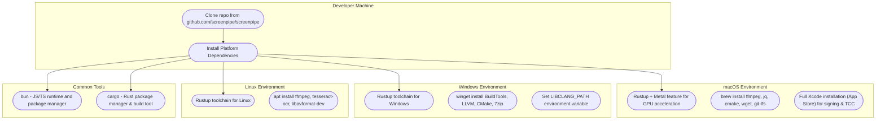
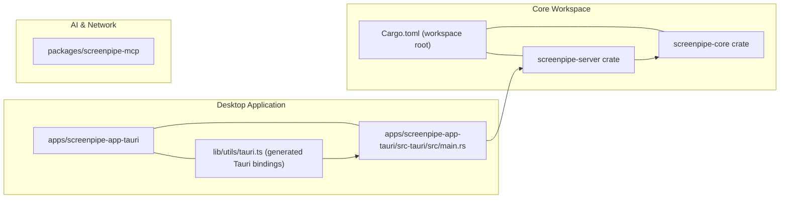

<!-- source: DeepWiki mcp.deepwiki.com · repo screenpipe/screenpipe · page 7 Development · fetched 2026-10-27 -->

# Development

Relevant source files

The following files were used as context for generating this wiki page:

- [.github/ISSUE_TEMPLATE/bug_report.md](.github/ISSUE_TEMPLATE/bug_report.md)
- [.github/ISSUE_TEMPLATE/documentation.md](.github/ISSUE_TEMPLATE/documentation.md)
- [.github/ISSUE_TEMPLATE/feature_request.md](.github/ISSUE_TEMPLATE/feature_request.md)
- [.github/ISSUE_TEMPLATE/question.md](.github/ISSUE_TEMPLATE/question.md)
- [.github/pull_request_template.md](.github/pull_request_template.md)
- [.github/scripts/upload-release-artifacts.sh](.github/scripts/upload-release-artifacts.sh)
- [AGENTS.md](AGENTS.md)
- [CLAUDE.md](CLAUDE.md)
- [CONTRIBUTING.md](CONTRIBUTING.md)
- [apps/screenpipe-app-tauri/scripts/native-build-queue.test.ts](apps/screenpipe-app-tauri/scripts/native-build-queue.test.ts)
- [apps/screenpipe-app-tauri/scripts/native-build-queue.ts](apps/screenpipe-app-tauri/scripts/native-build-queue.ts)
- [docs/human-only-app-publication.md](docs/human-only-app-publication.md)
- [docs/macos-dev-builds.md](docs/macos-dev-builds.md)
- [infra/release-artifact-uploader/package.json](infra/release-artifact-uploader/package.json)
- [infra/release-artifact-uploader/src/index.js](infra/release-artifact-uploader/src/index.js)
- [infra/release-artifact-uploader/src/index.test.js](infra/release-artifact-uploader/src/index.test.js)
- [infra/release-artifact-uploader/wrangler.jsonc](infra/release-artifact-uploader/wrangler.jsonc)
- [scripts/dev/README.md](scripts/dev/README.md)
- [scripts/dev/pr-evidence](scripts/dev/pr-evidence)
- [scripts/dev/sp-dev-app](scripts/dev/sp-dev-app)
- [scripts/dev/sp-dev-cli](scripts/dev/sp-dev-cli)
- [scripts/dev/sp-update-src](scripts/dev/sp-update-src)

This page provides a high-level guide for developers contributing to Screenpipe. It covers the development environment architecture, build system, testing infrastructure, CI/CD workflows, and core contributing principles.

## Overview

Screenpipe is a local-first system implemented primarily in **Rust** for the core recording engine and CLI, and **TypeScript/React** for the Tauri desktop application. Development involves managing native dependencies across major platforms, ensuring correct integration of media processing, OCR, and audio transcription components.

**Key Development Principles**:

- **User fanatic**: Build features that maximize real user value and focus on solving meaningful problems [[CONTRIBUTING.md:184-186]]().
- **Concurrency**: Prefer actor-like concurrency with channels instead of mutex locks for thread safety [[CONTRIBUTING.md:187-187]]().
- **Simplicity**: Write code oriented around human readability and comprehensibility; avoid premature optimizations [[CONTRIBUTING.md:188-188]]().
- **Stability**: Prioritize system reliability over aggressive new feature rollout; focus on activation rather than feature creep [[CLAUDE.md:8-8]]().
- **Measurement**: Instrument code well; if you can’t measure it, you cannot improve it [[CONTRIBUTING.md:191-191]]().

Sources: [[CONTRIBUTING.md:184-193]](), [[CLAUDE.md:1-9]]()

---

## Development Environment Architecture

The development environment setup varies by platform due to different native dependencies and toolchains.

The setup installs language toolchains, platform-specific native libs, and media dependencies, including FFmpeg for audio/video processing and Tesseract for OCR fallback.

For detailed platform-specific setup, commands, and helper scripts, see **[Getting Started](#7.1)**.

Sources: [[CONTRIBUTING.md:15-131]](), [[CLAUDE.md:25-28]]()

---

## Build System

Screenpipe uses a hybrid build system combining Rust’s native compilation with Tauri’s frontend packaging.

- **Pre-build scripts** (e.g. `src-tauri/build.rs`) scan Rust source for commands annotated with `#[tauri::command]` and generate bindings for frontend communication [[.claude/skills/screenpipe-tauri/SKILL.md:40-40]]().
- **Tauri integration** packages the React frontend with the Rust native core; frontend builds use `bun` scripts for dependency install and bundling [[CLAUDE.md:35-38]]().
- Platform features like `--features metal` enable GPU acceleration on macOS to optimize local ML workloads [[CONTRIBUTING.md:42-42]]().
- Dependencies such as ONNX Runtime, OpenBLAS, FFmpeg, and Tesseract are managed through build configurations and caching.
- A global native build queue prevents simultaneous expensive compilations on a single machine, coordinating build slots and sccache cache-sharing [[apps/screenpipe-app-tauri/scripts/native-build-queue.ts:1-205]]().

For platform-specific build flags, detailed dependency setup, and native build queue usage, see **[Build System](#7.2)**.

Sources: [[CONTRIBUTING.md:42-55]](), [[CLAUDE.md:35-39]](), [[.claude/skills/screenpipe-tauri/SKILL.md:1-45]](), [[apps/screenpipe-app-tauri/scripts/native-build-queue.ts:1-205]]()

---

## Testing & Benchmarks

Screenpipe employs extensive testing to ensure reliability and prevent regressions, especially in critical data capture and processing paths.

- **Rust & TypeScript tests**: Use `cargo test` for Rust crates; frontend/Node tests run with `bun test` [[CLAUDE.md:33-34]]().
- **Tauri native command tests**: Validate Rust->JS bindings with `bun run bindings:check` to ensure frontend interfaces remain consistent [[CLAUDE.md:35-37]]().
- **Regression coverage**: Developers must check `docs/TESTING.md` before modifying sensitive parts like window management, audio pipelines, or storage migration to avoid regressions [[CLAUDE.md:40-40]]().
- **Visual evidence for PRs**: Contributors are encouraged to include before/after screen captures or ASCII demos using `scripts/dev/pr-evidence` to produce shareable GIFs for UI/UX changes [[CLAUDE.md:31-31]]().
- **Benchmarks**: Specialized suites test OCR, speech-to-text pipelines, and database performance.
- An E2E infrastructure leverages WebdriverIO and the Tart VM for integration tests that mirror real user workflows.

See **[Testing & Benchmarks](#7.3)** for full details.

Sources: [[CLAUDE.md:29-41]](), [[scripts/dev/pr-evidence:1-64]](), [[.claude/skills/screenpipe-tauri/SKILL.md:30-37]]()

---

## CI/CD Pipeline

Screenpipe uses GitHub Actions workflows for automated building, testing, and releasing.

- The `ci.yml` runs style enforcement, unit tests, and builds on all supported platforms.
- Pushes with special commit messages trigger release pipelines like `release-app.yml` for the desktop app or `release-cli.yml` for CLI binaries [[.claude/skills/release/SKILL.md:1-150]]().
- Artifacts include platform-specific installers and signature files.
- Secret scanning and security checks are integrated.
- The CI orchestrates multi-package monorepo operations, ensuring consistent versioning and controlled deployment.

Refer to **[CI/CD Pipeline](#7.4)** for a breakdown of workflows and artifact generation.

Sources: [[.claude/skills/release/SKILL.md:1-150]]()

---

## Contributing Guidelines

Contributors commit to high code quality, community conventions, and clear documentation.

- **Commit messages**: Use present-tense, imperative style (e.g. “add feature”, not “added feature”) [[CONTRIBUTING.md:170-171]]().
- **Pull requests**: Follow the template, describe changes clearly, and attach evidence (screenshots, recordings) without committing media files directly [[.github/pull_request_template.md:1-44]]().
- **File headers**: Every source file must include the Screenpipe AI header comment for traceability [[CLAUDE.md:14-23]]().
- **Code style**: Rust coding conventions must be followed strictly ([[CONTRIBUTING.md:178-178]]()).
- **AI-assisted contributions**: Must be declared honestly and verified by the contributor [[CONTRIBUTING.md:120-122]]().
- **Do not push to release tags** or weaken human gate controls; publication requires human approval [[docs/human-only-app-publication.md:1-38]]().

See **[Contributing Guidelines](#7.5)** for full policies, agent instructions, and concurrency patterns.

Sources: [[CONTRIBUTING.md:156-182]](), [[CLAUDE.md:14-23]](), [[.github/pull_request_template.md:1-44]](), [[docs/human-only-app-publication.md:1-38]]()

---

## Code Entity Map

This diagram connects natural language system components with their codebase counterparts, helping developers navigate the code.

This map reflects major build components and runtime dependencies, linking frontend commands to backend server crates and the AI MCP package.

Sources: [[.claude/skills/release/SKILL.md:11-29]](), [[.claude/skills/screenpipe-tauri/SKILL.md:8-43]](), [[CONTRIBUTING.md:50-55]]()

---

Each section of this page links to focused child pages that provide development workflow details:

- Setup and environment: **[Getting Started](#7.1)**
- Native and Tauri build system: **[Build System](#7.2)**
- Testing strategies and benchmarks: **[Testing & Benchmarks](#7.3)**
- Automated CI/CD workflows: **[CI/CD Pipeline](#7.4)**
- Community contribution standards: **[Contributing Guidelines](#7.5)**
- Coding agent evaluation harness: **[Coding-Agent Evals](#7.6)**

These child pages are the recommended next step to dive into practical development.

---

# References

- CONTRIBUTING.md  
- CLAUDE.md  
- .github/pull_request_template.md  
- docs/human-only-app-publication.md  
- apps/screenpipe-app-tauri/scripts/native-build-queue.ts  
- scripts/dev/pr-evidence  
- .claude/skills/screenpipe-tauri/SKILL.md  
- .claude/skills/release/SKILL.md

---

