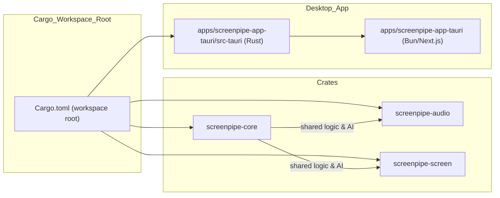
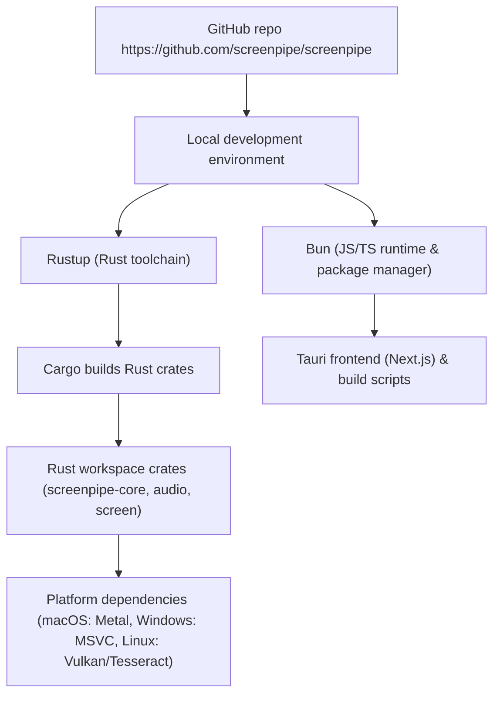
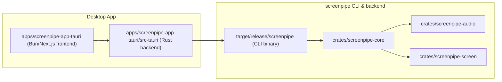

<!-- source: DeepWiki mcp.deepwiki.com · repo screenpipe/screenpipe · page 7.1 Getting Started · fetched 2026-10-27 -->

# Getting Started

<details>
<summary>Relevant source files</summary>

The following files were used as context for generating this wiki page:

- [.github/ISSUE_TEMPLATE/bug_report.md](.github/ISSUE_TEMPLATE/bug_report.md)
- [.github/ISSUE_TEMPLATE/documentation.md](.github/ISSUE_TEMPLATE/documentation.md)
- [.github/ISSUE_TEMPLATE/feature_request.md](.github/ISSUE_TEMPLATE/feature_request.md)
- [.github/ISSUE_TEMPLATE/question.md](.github/ISSUE_TEMPLATE/question.md)
- [.github/pr-assets/live-view-empty-state.png](.github/pr-assets/live-view-empty-state.png)
- [.github/pr-assets/live-view-freshness-warning.png](.github/pr-assets/live-view-freshness-warning.png)
- [.github/pull_request_template.md](.github/pull_request_template.md)
- [CONTRIBUTING.md](CONTRIBUTING.md)
- [Cargo.lock](Cargo.lock)
- [Cargo.toml](Cargo.toml)
- [apps/screenpipe-app-tauri/README.md](apps/screenpipe-app-tauri/README.md)
- [apps/screenpipe-app-tauri/components/workflows/workflow-source.test.tsx](apps/screenpipe-app-tauri/components/workflows/workflow-source.test.tsx)
- [apps/screenpipe-app-tauri/lib/__tests__/api.test.ts](apps/screenpipe-app-tauri/lib/__tests__/api.test.ts)
- [apps/screenpipe-app-tauri/lib/__tests__/notification-actions.test.ts](apps/screenpipe-app-tauri/lib/__tests__/notification-actions.test.ts)
- [apps/screenpipe-app-tauri/lib/dev/browser-runtime.test.ts](apps/screenpipe-app-tauri/lib/dev/browser-runtime.test.ts)
- [apps/screenpipe-app-tauri/lib/dev/browser-runtime.ts](apps/screenpipe-app-tauri/lib/dev/browser-runtime.ts)
- [apps/screenpipe-app-tauri/lib/dev/browser-tauri-mock.ts](apps/screenpipe-app-tauri/lib/dev/browser-tauri-mock.ts)
- [apps/screenpipe-app-tauri/lib/live-views/__tests__/freshness.test.ts](apps/screenpipe-app-tauri/lib/live-views/__tests__/freshness.test.ts)
- [apps/screenpipe-app-tauri/lib/live-views/freshness.ts](apps/screenpipe-app-tauri/lib/live-views/freshness.ts)
- [apps/screenpipe-app-tauri/lib/notifications/actions.test.ts](apps/screenpipe-app-tauri/lib/notifications/actions.test.ts)
- [apps/screenpipe-app-tauri/lib/notifications/actions.ts](apps/screenpipe-app-tauri/lib/notifications/actions.ts)
- [apps/screenpipe-app-tauri/src-tauri/Cargo.lock](apps/screenpipe-app-tauri/src-tauri/Cargo.lock)
- [apps/screenpipe-app-tauri/src-tauri/Cargo.toml](apps/screenpipe-app-tauri/src-tauri/Cargo.toml)
- [apps/screenpipe-app-tauri/src-tauri/src/dev_isolation.rs](apps/screenpipe-app-tauri/src-tauri/src/dev_isolation.rs)
- [apps/screenpipe-app-tauri/src-tauri/src/port_conflict.rs](apps/screenpipe-app-tauri/src-tauri/src/port_conflict.rs)
- [crates/screenpipe-audio/Cargo.toml](crates/screenpipe-audio/Cargo.toml)
- [crates/screenpipe-screen/Cargo.toml](crates/screenpipe-screen/Cargo.toml)
- [packages/sdk/Cargo.lock](packages/sdk/Cargo.lock)
- [packages/sdk/examples/tauri-app/src-tauri/Cargo.lock](packages/sdk/examples/tauri-app/src-tauri/Cargo.lock)
- [scripts/dev/README.md](scripts/dev/README.md)
- [scripts/dev/pr-evidence](scripts/dev/pr-evidence)
- [scripts/dev/sp-dev-app](scripts/dev/sp-dev-app)
- [scripts/dev/sp-dev-cli](scripts/dev/sp-dev-cli)
- [scripts/dev/sp-update-src](scripts/dev/sp-update-src)

</details>


This page provides a detailed technical guide for developers to set up the Screenpipe development environment, clone the repository, handle dependencies, utilize development container and VM scripts, understand various helper scripts, and comprehend the Cargo workspace structure. Screenpipe combines Rust backend crates for AI-driven memory capture with a Tauri-based desktop app frontend built using Bun (JavaScript runtime and package manager).

---

## Development Environment Setup

Screenpipe supports multi-platform development (macOS, Windows, Linux), with platform-specific dependencies for video capture, OCR, audio processing, and privacy tooling.

### Repository Cloning & Prerequisites

1. **Clone the repository**:

```bash
git clone https://github.com/screenpipe/screenpipe
cd screenpipe
```

2. **Install Rust Toolchain**:

Managed using `rustup` recommended for version 1.94 or later.

3. **Install Bun**:

Used as the JS/TS runtime and package manager for frontend and build scripts:

```bash
curl -fsSL https://bun.sh/install | bash
```

4. **Platform-specific dependencies**:

- **macOS**:
  - Install Xcode (full IDE, not only CLI tools).
  - Run license acceptance and first launch initialization:
    ```bash
    sudo xcodebuild -license
    xcodebuild -runFirstLaunch
    ```
  - Install additional tools:
    ```bash
    brew install pkg-config ffmpeg cmake jq git-lfs wget
    ```
- **Windows**:
  - Install Visual Studio 2022 Build Tools with Desktop Development C++ workload via `winget`.
  - Install LLVM, CMake, Git, 7zip.
  - Ensure environment variable `LIBCLANG_PATH` points to LLVM's `bin` directory.
- **Linux**:
  - Install build essentials, ffmpeg, tesseract-ocr, libssl-dev, libsdl2-dev, pipewire development headers, and other dependencies.

Refer to the detailed instructions per platform in the [CONTRIBUTING.md](CONTRIBUTING.md) file lines 16-132 for exact setup commands and environment configurations.

---

### Development Container & dev-vm Scripts

Screenpipe provides convenience scripts in `scripts/dev/` to facilitate development environments:

- **Devcontainer**: Supports containerized Linux development for ease of setup and consistency. It includes caching for native dependencies like FFmpeg and OpenBLAS stored in `~/.cache/screenpipe/native-deps`.
- **Dev-vm scripts**: For managing and provisioning virtual machines suitable for development.

These scripts automate dependency installation, workspace caching, and building tasks, reducing friction across multiple developer setups.

---

### Helper Scripts

Within `scripts/dev/` are helper scripts to manage:

- Starting local development versions of the CLI and desktop app.
- Managing source updates, rebuilds, and artifact cleanup.
- Running smoke tests and integration tests in isolated environments.
- Helpers to speed up worktree sharing of native dependencies cache and frontend output cache via environment variables, e.g.:

```bash
export SCREENPIPE_NATIVE_CACHE_DIR="$HOME/.cache/screenpipe/native-deps"
export SCREENPIPE_FRONTEND_CACHE_DIR="$HOME/.cache/screenpipe/frontend-out"
```

Setting these variables ensures native dependencies and frontend outputs are shared and cached correctly across multiple worktrees.

---

## Cargo Workspace Structure

Screenpipe is organized as a Rust workspace to manage its collection of crates, shared logic, and binaries.

### Workspace Overview

- **Root `Cargo.toml`** defines the workspace over `crates/*`, excluding some legacy or platform-specific parts like `apps/screenpipe-app-tauri/src-tauri`.
- The **CLI** and shared libraries live as members under `crates/`.
- The **Desktop app** is in `apps/screenpipe-app-tauri/`, with its own `Cargo.toml` in `src-tauri/` for the Rust backend embedded in Tauri.
- The frontend code is built with Bun in `apps/screenpipe-app-tauri/`, driven by package scripts for building and bundling the Tauri assets.

### Key Workspace Members

| Component | Location | Description |
| --------- | -------- | ----------- |
| `screenpipe-core` | `crates/screenpipe-core` | Core Rust library with shared business logic and AI integrations. |
| `screenpipe-audio` | `crates/screenpipe-audio` | Audio capture, processing, and transcription subsystem. |
| `screenpipe-screen` | `crates/screenpipe-screen` | Multi-platform screen capture and OCR processing crate. |
| Desktop App Backend | `apps/screenpipe-app-tauri/src-tauri/` | Rust backend server and Tauri config for desktop app. |
| Desktop App Frontend | `apps/screenpipe-app-tauri/` | Next.js UI components and Bun-based frontend build scripts. |

### Versioning & Dependencies

- The Cargo workspace enforces consistent Rust edition (2021) and Rust minimum version (1.94).
- Dependency versions for the desktop app, e.g. Tauri, are pinned precisely in `apps/screenpipe-app-tauri/src-tauri/Cargo.toml` [apps/screenpipe-app-tauri/src-tauri/Cargo.toml:5-179]().
- The root `Cargo.toml` manages workspace-level dependencies for crates [Cargo.toml:1-205]().
  
---

### Cargo Workspace Relationship Diagram



Sources: [Cargo.toml:1-205](), [apps/screenpipe-app-tauri/src-tauri/Cargo.toml:1-179]()

---

## Build & Run Commands

### Building the CLI/Core

From the workspace root:

```bash
cargo build --release --features metal   # Use 'metal' feature on supported macOS arm64 machines
```

This builds the `screenpipe` CLI binary targeting 24/7 local AI memory CLI [CONTRIBUTING.md:34-43]().

### Building the Desktop Application

The desktop app has a separate build process incorporating Bun for frontend assets and Tauri for the native shell.

```bash
cd apps/screenpipe-app-tauri
bun install                           # Install frontend dependencies & tooling
bun run bindings:generate             # Generate TS bindings for Rust commands if backend changed
bun tauri build --features metal     # Build the full desktop app (with macOS Metal feature)
```

You may omit `--features metal` on unsupported platforms. This builds the Tauri shell and embedded Rust backend [CONTRIBUTING.md:52-55]().

---

## Development Workflows & Helpers

Screenpipe provides several scripted helpers and extension points for development ease.

### Extensions (`crates/screenpipe-core/assets/extensions`)

- **Orphan guard**: A Bun script that detects if the main `screenpipe` process dies and kills orphaned Bun child processes to prevent zombie resource usage on misbehaving workflows.
- **Context pruning**: Manages LLM chat contexts, clamping large messages and pruning old results to avoid prompt length errors and improve model performance.

These scripts provide process lifecycle stability and AI interaction efficiency.

### Running Tests

- **Frontend and logic tests** can be run via:

```bash
bun run test
```

Runs Vitest and Bun-native tests for TypeScript and JS components [apps/screenpipe-app-tauri/package.json:6-8]().

- **E2E tests** with the WebdriverIO setup:

```bash
bun run test:e2e
```

- **Type checking of TS code**:

```bash
bun run typecheck
```

---

## Summary

Screenpipe development is based on a tightly integrated Rust and Bun/Next.js monorepo with cross-platform accommodations ensured via the Cargo workspace and auxiliary scripts. Developers need to set up platform dependencies carefully per OS, use Bun for JavaScript ecosystem management, and leverage helper scripts to ease local development and testing.

---

# Diagrams Bridging Natural Language System to Code Entities

## 1. Development Environment Setup Flow



## 2. Key Code Entity Relationships for Desktop App and CLI



---

## References

- `CONTRIBUTING.md` [CONTRIBUTING.md:16-132](), [CONTRIBUTING.md:34-43](), [CONTRIBUTING.md:52-55]()
- `apps/screenpipe-app-tauri/src-tauri/Cargo.toml` [apps/screenpipe-app-tauri/src-tauri/Cargo.toml:1-179]()
- `Cargo.toml` (workspace) [Cargo.toml:1-205]()
- `apps/screenpipe-app-tauri/package.json` for build scripts (not shown but referenced)
- Development helper scripts and extensions (paths summarized above)

Sources: [CONTRIBUTING.md:16-132](), [CONTRIBUTING.md:34-55](), [apps/screenpipe-app-tauri/src-tauri/Cargo.toml:1-179](), [Cargo.toml:1-205]()

---

