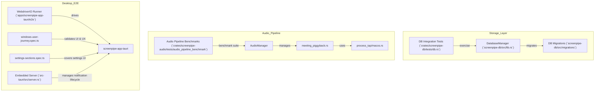
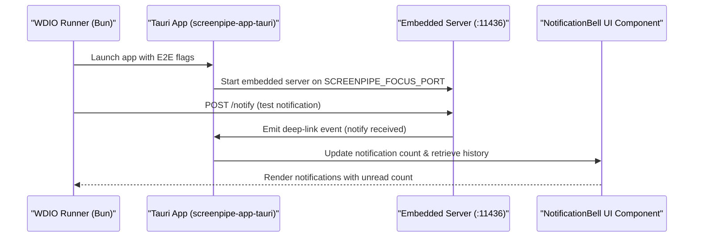

<!-- source: DeepWiki mcp.deepwiki.com · repo screenpipe/screenpipe · page 7.3 Testing & Benchmarks · fetched 2026-10-27 -->

# Testing & Benchmarks

Relevant source files

The following files were used as context for generating this wiki page:

- [.github/scripts/e2e/lib.ts](.github/scripts/e2e/lib.ts)
- [.github/scripts/e2e/run-all.ts](.github/scripts/e2e/run-all.ts)
- [.github/scripts/e2e/test-api.ts](.github/scripts/e2e/test-api.ts)
- [.github/scripts/e2e/test-app-launch.ts](.github/scripts/e2e/test-app-launch.ts)
- [.github/scripts/e2e/test-capture-fidelity.ts](.github/scripts/e2e/test-capture-fidelity.ts)
- [.github/scripts/e2e/test-chat.ts](.github/scripts/e2e/test-chat.ts)
- [.github/scripts/e2e/test-main-window.ts](.github/scripts/e2e/test-main-window.ts)
- [.github/scripts/e2e/test-onboarding.ts](.github/scripts/e2e/test-onboarding.ts)
- [.github/scripts/e2e/test-permissions.ts](.github/scripts/e2e/test-permissions.ts)
- [.github/scripts/e2e/test-recording.ts](.github/scripts/e2e/test-recording.ts)
- [.github/scripts/e2e/test-settings.ts](.github/scripts/e2e/test-settings.ts)
- [.github/workflows/e2e-macos.yml](.github/workflows/e2e-macos.yml)
- [apps/screenpipe-app-tauri/components/settings/__tests__/compact-markdown.test.tsx](apps/screenpipe-app-tauri/components/settings/__tests__/compact-markdown.test.tsx)
- [apps/screenpipe-app-tauri/e2e/COVERAGE.md](apps/screenpipe-app-tauri/e2e/COVERAGE.md)
- [apps/screenpipe-app-tauri/e2e/README.md](apps/screenpipe-app-tauri/e2e/README.md)
- [apps/screenpipe-app-tauri/e2e/coverage-map.json](apps/screenpipe-app-tauri/e2e/coverage-map.json)
- [apps/screenpipe-app-tauri/e2e/helpers/api-utils.ts](apps/screenpipe-app-tauri/e2e/helpers/api-utils.ts)
- [apps/screenpipe-app-tauri/e2e/specs/api-search-stress.spec.ts](apps/screenpipe-app-tauri/e2e/specs/api-search-stress.spec.ts)
- [apps/screenpipe-app-tauri/e2e/specs/app-lifecycle.spec.ts](apps/screenpipe-app-tauri/e2e/specs/app-lifecycle.spec.ts)
- [apps/screenpipe-app-tauri/e2e/specs/settings-sections.spec.ts](apps/screenpipe-app-tauri/e2e/specs/settings-sections.spec.ts)
- [apps/screenpipe-app-tauri/e2e/specs/windows-core-recording.spec.ts](apps/screenpipe-app-tauri/e2e/specs/windows-core-recording.spec.ts)
- [apps/screenpipe-app-tauri/e2e/specs/windows-system-integration.spec.ts](apps/screenpipe-app-tauri/e2e/specs/windows-system-integration.spec.ts)
- [apps/screenpipe-app-tauri/e2e/specs/windows-user-journey.spec.ts](apps/screenpipe-app-tauri/e2e/specs/windows-user-journey.spec.ts)
- [apps/screenpipe-app-tauri/src-tauri/src/disk_pressure_notifications.rs](apps/screenpipe-app-tauri/src-tauri/src/disk_pressure_notifications.rs)
- [apps/screenpipe-app-tauri/src-tauri/src/feedback_upload.rs](apps/screenpipe-app-tauri/src-tauri/src/feedback_upload.rs)
- [apps/screenpipe-app-tauri/src-tauri/src/notifications/client.rs](apps/screenpipe-app-tauri/src-tauri/src/notifications/client.rs)
- [crates/screenpipe-audio-eval/src/bin/pipeline_replay.rs](crates/screenpipe-audio-eval/src/bin/pipeline_replay.rs)
- [crates/screenpipe-audio/src/speaker/prepare_segments.rs](crates/screenpipe-audio/src/speaker/prepare_segments.rs)
- [crates/screenpipe-audio/src/vad/mod.rs](crates/screenpipe-audio/src/vad/mod.rs)
- [crates/screenpipe-audio/src/vad/webrtc.rs](crates/screenpipe-audio/src/vad/webrtc.rs)
- [crates/screenpipe-audio/tests/accuracy_test.rs](crates/screenpipe-audio/tests/accuracy_test.rs)
- [crates/screenpipe-audio/tests/audio_pipeline_benchmark/cross_device_benchmark.rs](crates/screenpipe-audio/tests/audio_pipeline_benchmark/cross_device_benchmark.rs)
- [crates/screenpipe-audio/tests/audio_pipeline_benchmark/pipeline_benchmark.rs](crates/screenpipe-audio/tests/audio_pipeline_benchmark/pipeline_benchmark.rs)
- [crates/screenpipe-audio/tests/audio_pipeline_benchmark/quality_regression.rs](crates/screenpipe-audio/tests/audio_pipeline_benchmark/quality_regression.rs)
- [crates/screenpipe-audio/tests/audio_pipeline_benchmark/vad_benchmark.rs](crates/screenpipe-audio/tests/audio_pipeline_benchmark/vad_benchmark.rs)
- [crates/screenpipe-audio/tests/core_tests.rs](crates/screenpipe-audio/tests/core_tests.rs)
- [crates/screenpipe-audio/tests/vad_frame_continuity_test.rs](crates/screenpipe-audio/tests/vad_frame_continuity_test.rs)
- [crates/screenpipe-db/benches/search_accuracy.rs](crates/screenpipe-db/benches/search_accuracy.rs)
- [crates/screenpipe-db/src/migrations/20260415000000_frames_fts_external_content.sql](crates/screenpipe-db/src/migrations/20260415000000_frames_fts_external_content.sql)
- [crates/screenpipe-db/src/migrations/20260702000000_add_frames_snapshot_pending_index.sql](crates/screenpipe-db/src/migrations/20260702000000_add_frames_snapshot_pending_index.sql)
- [crates/screenpipe-db/src/storage/bulk/cache.rs](crates/screenpipe-db/src/storage/bulk/cache.rs)
- [crates/screenpipe-db/src/storage/bulk/elements.rs](crates/screenpipe-db/src/storage/bulk/elements.rs)
- [crates/screenpipe-db/src/storage/bulk/elements/lifecycle.rs](crates/screenpipe-db/src/storage/bulk/elements/lifecycle.rs)
- [crates/screenpipe-db/src/storage/bulk/lifecycle.rs](crates/screenpipe-db/src/storage/bulk/lifecycle.rs)
- [crates/screenpipe-db/src/storage/bulk/tests.rs](crates/screenpipe-db/src/storage/bulk/tests.rs)
- [crates/screenpipe-db/src/storage/diagnostics.rs](crates/screenpipe-db/src/storage/diagnostics.rs)
- [crates/screenpipe-db/src/storage/import.rs](crates/screenpipe-db/src/storage/import.rs)
- [crates/screenpipe-db/src/storage/in_place.rs](crates/screenpipe-db/src/storage/in_place.rs)
- [crates/screenpipe-db/src/storage/lifecycle.rs](crates/screenpipe-db/src/storage/lifecycle.rs)
- [crates/screenpipe-db/src/storage/mod.rs](crates/screenpipe-db/src/storage/mod.rs)
- [crates/screenpipe-db/src/storage/parity.rs](crates/screenpipe-db/src/storage/parity.rs)
- [crates/screenpipe-db/src/storage/reclaim.rs](crates/screenpipe-db/src/storage/reclaim.rs)
- [crates/screenpipe-db/src/storage/sealing.rs](crates/screenpipe-db/src/storage/sealing.rs)
- [crates/screenpipe-db/src/text_normalizer.rs](crates/screenpipe-db/src/text_normalizer.rs)
- [crates/screenpipe-db/tests/db.rs](crates/screenpipe-db/tests/db.rs)
- [crates/screenpipe-db/tests/fts_contention_test.rs](crates/screenpipe-db/tests/fts_contention_test.rs)
- [crates/screenpipe-db/tests/fts_dots_test.rs](crates/screenpipe-db/tests/fts_dots_test.rs)
- [crates/screenpipe-db/tests/heavy_read_test.rs](crates/screenpipe-db/tests/heavy_read_test.rs)
- [crates/screenpipe-db/tests/in_place_migration.rs](crates/screenpipe-db/tests/in_place_migration.rs)
- [crates/screenpipe-db/tests/keyword_search_accessibility_test.rs](crates/screenpipe-db/tests/keyword_search_accessibility_test.rs)
- [crates/screenpipe-db/tests/migration_foreign_keys.rs](crates/screenpipe-db/tests/migration_foreign_keys.rs)
- [crates/screenpipe-db/tests/migration_source_recovery.rs](crates/screenpipe-db/tests/migration_source_recovery.rs)
- [crates/screenpipe-db/tests/query_plan_test.rs](crates/screenpipe-db/tests/query_plan_test.rs)
- [crates/screenpipe-db/tests/search_ocr_snapshot_test.rs](crates/screenpipe-db/tests/search_ocr_snapshot_test.rs)
- [crates/screenpipe-db/tests/tag_filter_bench.rs](crates/screenpipe-db/tests/tag_filter_bench.rs)
- [crates/screenpipe-engine/src/routes/speakers.rs](crates/screenpipe-engine/src/routes/speakers.rs)
- [docs/COVERAGE.md](docs/COVERAGE.md)
- [docs/coverage/CORE.md](docs/coverage/CORE.md)
- [docs/coverage/core-engine-map.json](docs/coverage/core-engine-map.json)

This page describes the comprehensive testing and benchmarking infrastructure for the Screenpipe Rust workspace and the Tauri desktop application. It covers layers of automated verification, from unit and integration tests to end-to-end (E2E) platform-specific behavioral validation. It also outlines benchmark suites for OCR, Speech-to-Text (STT), and database performance, as well as continuous tracking of performance regressions.

---

## Test Organization

Testing in Screenpipe is stratified into three primary levels, ensuring thorough quality assurance across subsystems and platforms:

- **Inline Unit Tests**: These are Rust unit tests embedded within source files guarded by `#[cfg(test)]`. They verify low-level logic, algorithms, and data transformations. Typical usage seen inline in the source such as in `screenpipe-db` or `screenpipe-audio` crates.  
- **Integration Tests**: Located in dedicated `tests/*.rs` files within each crate. These focus on interactions within crate boundaries, such as database schema migrations, blob insertions, search features, and lifecycle behaviors.  
- **End-to-End (E2E) UI Specs**: TypeScript test suites powered by WebdriverIO to automate realistic user interactions and system integration tests on macOS, Windows, and Linux. These validate UI flows, accessibility, settings, notifications, and platform-specific behaviors in the Tauri desktop app.

### Core Test Suites and Their Focus

| Category                 | Crate / App                | Location                                        | Purpose                                                |
|--------------------------|----------------------------|------------------------------------------------|--------------------------------------------------------|
| Database                 | `screenpipe-db`             | `crates/screenpipe-db/tests/db.rs`             | Insert/search OCR and audio data, test FTS5, migrations, and ordering in DB queries. |
| Audio Pipeline           | `screenpipe-audio`          | `crates/screenpipe-audio/src/audio_manager/meeting_piggyback.rs` | Test meeting-aware mic follow state machine, event-driven capture behavior, and device health holdoffs. |
| Windows UI User Journey  | `screenpipe-app-tauri`      | `apps/screenpipe-app-tauri/e2e/specs/windows-user-journey.spec.ts` | Drives cross-window UX from Home UI to Search and Timeline. |
| Pipes Lifecycle          | `screenpipe-app-tauri`      | `apps/screenpipe-app-tauri/e2e/specs/pipes.spec.ts`                | Validate Pipes discover, install, run flow for AI workflows. |
| Settings Sections        | `screenpipe-app-tauri`      | `apps/screenpipe-app-tauri/e2e/specs/settings-sections.spec.ts`   | Confirm all settings subsections load and render without errors. |
| Notification and Orphans | `screenpipe-app-tauri`      | `apps/screenpipe-app-tauri/src-tauri/src/server.rs` (lines 127-187) | Validates notification port cleanup and orphaned process handling. |

Sources: [apps/screenpipe-app-tauri/e2e/README.md:1-3](), [apps/screenpipe-app-tauri/e2e/specs/windows-user-journey.spec.ts:6-11](), [crates/screenpipe-audio/src/audio_manager/meeting_piggyback.rs:19-35](), [apps/screenpipe-app-tauri/e2e/specs/settings-sections.spec.ts:1-155](), [apps/screenpipe-app-tauri/src-tauri/src/server.rs:127-187]()

---

## System Topology & Code Entities

This diagram maps natural language concepts in testing and benchmarking into concrete code artifacts, facilitating navigability and understanding of test responsibilities by subsystem.

Sources: [crates/screenpipe-db/tests/db.rs:10-90](), [crates/screenpipe-audio/src/audio_manager/meeting_piggyback.rs:19-35](), [crates/screenpipe-audio/src/core/process_tap/macos.rs:5-48](), [apps/screenpipe-app-tauri/e2e/specs/windows-user-journey.spec.ts:6-150](), [apps/screenpipe-app-tauri/e2e/specs/settings-sections.spec.ts:1-155](), [apps/screenpipe-app-tauri/src-tauri/src/server.rs:120-180]()

---

## Integration & Regression Testing

### Audio Processing & Hardware Integration

- **MicFollow State Machine**: The meeting_piggyback component in `screenpipe-audio` employs an event-driven state machine to avoid "SCO negotiation storms" commonly seen with Bluetooth microphones. Instead of polling aggressively, it adopts existing audio streams and only switches capture based on stable device changes [crates/screenpipe-audio/src/audio_manager/meeting_piggyback.rs:19-55]().
- **Process Tap Stability on macOS**: Process tap audio capture is gated to macOS 14.4+ to avoid unstable TCC permission flux. The code initializes availability checks [crates/screenpipe-audio/src/core/process_tap/macos.rs:31-48]().
- **Damping and Holdoffs**: To reduce tearing down of audio capture when a device momentarily vanishes (e.g., during enumeration changes), a `MIC_RELEASE_HOLDOFF_MS` constant of 2000 ms is used to hold capture active briefly [crates/screenpipe-audio/src/audio_manager/meeting_piggyback.rs:93-99]().
- **Heavy Read Tests and Accuracy Benchmarks**: Additional tests in `screenpipe-db` validate database heavy reads and correctness, while `screenpipe-audio` runs benchmark suites to measure latency and quality regressions against specific audio devices [crates/screenpipe-db/tests/heavy_read_test.rs, crates/screenpipe-audio/tests/audio_pipeline_benchmark]()

### UI & System Integration

- **macOS Overlay Behavior**: Critical UI tests verify overlay windows use `NSPanel` correctly remain on screen spaces during fullscreen and app space transitions. These ensure reliability during space swipes or workspace switches.  
- **VisionKit Semaphore Timeouts**: Stability tests assert VisionKit (macOS OCR) semaphore timeouts prevent deadlocks, with a conservative 10 second wait duration to avoid app hangs.  
- **Window Focus and Recovery**: The main window should regain focus correctly immediately after a tray icon use and recover focus when embedded WebKit views freeze or crash unexpectedly.  
- **Exclusion of Protected Windows**: Windows enumerated in ignore lists for `ScreenCaptureKit` do not produce screen captures, avoiding privacy compliance faults. This uses precise window lookup and filtering in the capturing pipeline.

These functional and regression tests form a multi-platform checklist preventing major UX regressions and stability breaks especially on macOS and Windows.

Sources: [crates/screenpipe-audio/src/audio_manager/meeting_piggyback.rs:90-116](), [crates/screenpipe-audio/src/core/process_tap/macos.rs:123-132](), [apps/screenpipe-app-tauri/e2e/specs/windows-core-recording.spec.ts:20-120]()

---

## End-to-End (E2E) Infrastructure

Screenpipe’s E2E infrastructure relies on `tauri-plugin-webdriver` to enable cross-platform UI testing performed by WebdriverIO-driven TypeScript tests. These tests simulate real user workflows and verify system integration on macOS, Windows, and Linux [apps/screenpipe-app-tauri/e2e/README.md:1-62]().

The E2E tests run the application with special environment flags such as `NEXT_PUBLIC_SCREENPIPE_E2E=true` to enable testing hooks in the UI and backend. Tests use an isolated `.e2e/` data directory to keep user data separate and unaffected [apps/screenpipe-app-tauri/e2e/README.md:100-130]().

### Coverage Dashboards

E2E test coverage is measured as behavioral coverage — checking test block presence and associated product risk coverage rather than pure line/branch coverage. Critical end-user scenarios and platform-specific features are mapped to suites in `e2e/coverage-map.json`. Examples include:

- Window lifecycle and focus behaviors (`window-lifecycle` layer)  
- Audio device health and usage (`audio-device` layer)  
- Capture and OCR indexing (`capture-ocr` layer)  
- AI chat and pipes flows (`chat-ai`, `pipes` layers)  
- Settings UI and notification system UI (`settings`, `notifications` layers)  

Confidence levels are assigned to tests (`strong`, `partial`, `conditional`, and `smoke`) to weight coverage points. The Windows user journey spec is a canonical strong-coverage scenario driving from Home UI through Search and Timeline [apps/screenpipe-app-tauri/e2e/README.md:25-40]().

### Key E2E Specs

- **Windows User Journey**: Automates the user flow from Home UI to Search input, waiting for search results, navigating timeline frames, and returning to Home, testing window focus and UX end-to-end [apps/screenpipe-app-tauri/e2e/specs/windows-user-journey.spec.ts:6-149]()  
- **Core Recording and Event Capture**: Tests keystroke and clipboard triggers on Windows including verifying proper frame linking and timeline updates with OCR data [apps/screenpipe-app-tauri/e2e/specs/windows-core-recording.spec.ts]()  
- **Audio Fallback on macOS**: Asserts fallback notifications and UI states when core capture features are disabled, relying on retained audio and transcription [apps/screenpipe-app-tauri/e2e/README.md:27-38]()  
- **Settings Panel Navigation**: Opens each settings subpage, asserting no runtime errors or blank states during fast navigation, verifying all sections mount properly [apps/screenpipe-app-tauri/e2e/specs/settings-sections.spec.ts:38-140]()  

---

### E2E Test Execution Flow

Sources: [apps/screenpipe-app-tauri/e2e/README.md:59-62](), [apps/screenpipe-app-tauri/src-tauri/src/server.rs:113-115](), [apps/screenpipe-app-tauri/components/notification-bell.tsx:150-170]()

---

## Benchmarks & Performance Tracking

Performance benchmarks run as part of automated CI workflows to prevent regressions in OCR, STT, and database performance. The infrastructure includes:

### Automated Benchmark Suites

- **OCR Benchmarks** target platforms including macOS’s Apple OCR, Linux’s Tesseract, and Windows OCR engines. These tests measure throughput and accuracy under controlled conditions [crates/screenpipe-db/tests/search_ocr_snapshot_test.rs]().  
- **Speech-to-Text (STT) Benchmarks** run on Linux runners measuring latency and transcript accuracy on stored sample audio files using configurable STT backends [crates/screenpipe-audio/tests/core_tests.rs]().  
- **HD Capture Benchmarking** ensures the high-fps recording pipeline works concurrently with OCR indexing, posting frames using the local API `/capture/hd/start` and validating on-disk chunk generation and search-index OCR arrival [apps/screenpipe-app-tauri/e2e/README.md:70-80]().

### Performance Monitoring & Alerts

GitHub Actions workflows use thresholds for alert notifications. The alert threshold is currently set at a 200% deviation, meaning once a benchmark’s metric worsens by twice the previous measurement, maintainers receive a failure alert for investigation.

Additional style and security tooling runs on CI, such as `cargo machete` to detect unused Rust dependencies and `cargo audit` to catch vulnerabilities. The frontend uses `knip` to find dead component code and unused dependencies [github workflows/style.yml:52-95]().

---

# Summary

Screenpipe employs a robust multi-tier testing and benchmarking strategy:

- Fine-grained unit and integration tests in Rust crates ensure core logic correctness and stable DB schemas.  
- Behavioral cross-platform E2E tests run with WebdriverIO enforce UX flows, access control, and system integration stability.  
- Automated benchmark suites monitor OCR, STT, and high-fps recording pipeline performance continuously.  
- Coverage dashboards offer internal visibility on test focus, identifying gaps and confidence levels for efficient maintenance.  
- Platform-specific validation ensures native integration points, overlays, and audio device management behave correctly on macOS, Windows, and Linux.

This rigorous infrastructure safeguards Screenpipe’s quality as a 24/7 AI memory platform, balancing reliability with rich feature coverage.

---

Sources:  
- [crates/screenpipe-db/tests/db.rs:10-90]()  
- [crates/screenpipe-audio/src/audio_manager/meeting_piggyback.rs:19-116]()  
- [crates/screenpipe-audio/src/core/process_tap/macos.rs:5-48]()  
- [apps/screenpipe-app-tauri/e2e/README.md:1-165]()  
- [apps/screenpipe-app-tauri/e2e/specs/windows-user-journey.spec.ts:6-149]()  
- [apps/screenpipe-app-tauri/e2e/specs/settings-sections.spec.ts:1-155]()  
- [apps/screenpipe-app-tauri/src-tauri/src/server.rs:120-180]()  
- [apps/screenpipe-app-tauri/components/notification-bell.tsx:150-170]()  
- [.github/workflows/benchmark.yml:10-152]()  
- [.github/workflows/style.yml:52-95]()

---

