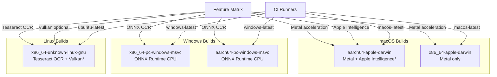
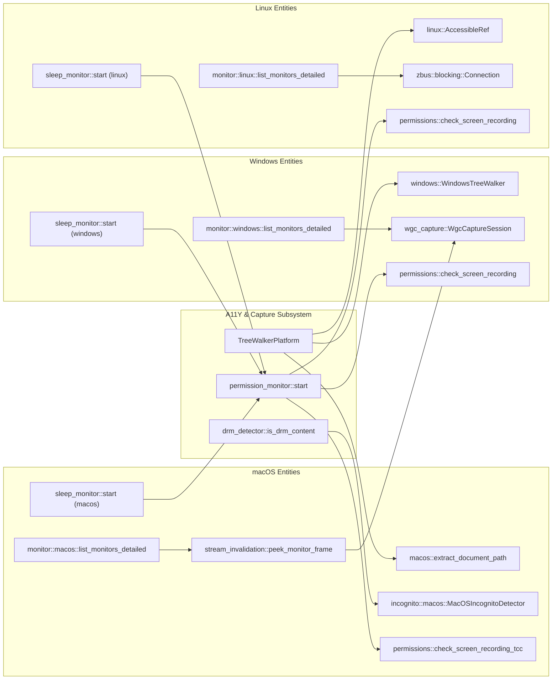
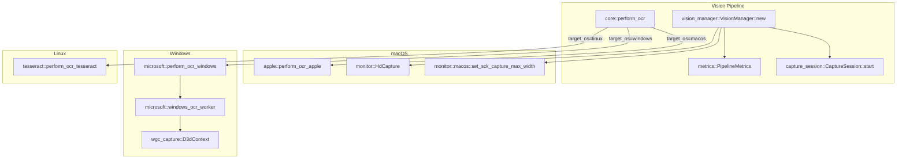

<!-- source: DeepWiki mcp.deepwiki.com · repo screenpipe/screenpipe · page 8 Platform-Specific Details · fetched 2026-10-27 -->

# Platform-Specific Details

Relevant source files

The following files were used as context for generating this wiki page:

- [apps/screenpipe-app-tauri/lib/hooks/__tests__/use-permission-monitor.test.tsx](apps/screenpipe-app-tauri/lib/hooks/__tests__/use-permission-monitor.test.tsx)
- [apps/screenpipe-app-tauri/lib/hooks/use-permission-monitor.tsx](apps/screenpipe-app-tauri/lib/hooks/use-permission-monitor.tsx)
- [apps/screenpipe-app-tauri/src-tauri/src/capture_session.rs](apps/screenpipe-app-tauri/src-tauri/src/capture_session.rs)
- [apps/screenpipe-app-tauri/src-tauri/src/engine_events/permission.rs](apps/screenpipe-app-tauri/src-tauri/src/engine_events/permission.rs)
- [apps/screenpipe-app-tauri/src-tauri/src/recording/retry.rs](apps/screenpipe-app-tauri/src-tauri/src/recording/retry.rs)
- [crates/screenpipe-core/examples/probe_accessibility.rs](crates/screenpipe-core/examples/probe_accessibility.rs)
- [crates/screenpipe-core/examples/probe_screen_recording.rs](crates/screenpipe-core/examples/probe_screen_recording.rs)
- [crates/screenpipe-core/src/permissions.rs](crates/screenpipe-core/src/permissions.rs)
- [crates/screenpipe-engine/src/permission_monitor.rs](crates/screenpipe-engine/src/permission_monitor.rs)
- [crates/screenpipe-engine/src/routes/vision.rs](crates/screenpipe-engine/src/routes/vision.rs)
- [crates/screenpipe-engine/src/sleep_monitor.rs](crates/screenpipe-engine/src/sleep_monitor.rs)
- [crates/screenpipe-engine/src/vision_manager/monitor_watcher.rs](crates/screenpipe-engine/src/vision_manager/monitor_watcher.rs)
- [crates/screenpipe-screen/src/lib.rs](crates/screenpipe-screen/src/lib.rs)
- [crates/screenpipe-screen/src/microsoft.rs](crates/screenpipe-screen/src/microsoft.rs)
- [crates/screenpipe-screen/src/monitor.rs](crates/screenpipe-screen/src/monitor.rs)
- [crates/screenpipe-screen/src/monitor/macos.rs](crates/screenpipe-screen/src/monitor/macos.rs)
- [crates/screenpipe-screen/src/ocr_worker.rs](crates/screenpipe-screen/src/ocr_worker.rs)
- [crates/screenpipe-screen/tests/windows_vision_test.rs](crates/screenpipe-screen/tests/windows_vision_test.rs)

This document describes platform-specific implementation details, build configurations, dependency requirements, and runtime quirks for Screenpipe across macOS, Windows, and Linux. Each platform has unique characteristics that affect compilation, bundling, signing, and deployment workflows.

For details on the Apple-specific integration, see [macOS](#8.1). For Windows-specific setup, see [Windows](#8.2). For Linux dependencies, see [Linux](#8.3).

---

## Platform Build Matrix

Screenpipe supports multiple platforms and architectures with varying feature availability. The build process utilizes conditional compilation and platform-specific features defined in the core application manifest.

**Sources:** [crates/screenpipe-screen/Cargo.toml:79-121](), [crates/screenpipe-audio/Cargo.toml:169-176]()

---

## macOS Platform Details

macOS is a primary platform for Screenpipe, utilizing native frameworks like Apple Vision for OCR and Apple Intelligence for semantic features.

### Key Characteristics
- **Apple Intelligence & MLX:** Conditionally enabled via `metal`, `apple-intelligence`, and `parakeet-mlx` features. On macOS 15+, the app uses `objc2` to handle ObjC method signature changes.
- **Accessibility:** Uses a specialized tree walker via `cidre` AX APIs and `accessibility-sys` [crates/screenpipe-core/examples/probe_accessibility.rs:1-2](). It handles complex logic for browsers and Electron apps like VS Code forks.
- **Audio Capture:** Uses `cidre` for macOS-specific audio handling and `sck-rs` for ScreenCaptureKit integration [crates/screenpipe-screen/Cargo.toml:80-83]().
- **Incognito Detection:** Combines AppleScript queries for Chromium browsers (Chrome, Brave, Edge) with title-based matching. Arc incognito is detected via `AXIdentifier` in the tree walker.
- **DRM Protection:** Specifically monitors for apps like Netflix or Apple TV that trigger `ScreenCaptureKit` content protection, pausing capture to prevent black screens [crates/screenpipe-engine/src/drm_detector.rs:76-95]().
- **Monitor Management:** The `screenpipe-screen` crate handles monitor enumeration and capture, using `sck-rs` for macOS 12.3+ and `xcap` as a fallback for older versions or when `sck-rs` encounters issues [crates/screenpipe-screen/src/monitor.rs:51-55](). It also manages a persistent `SCStream` for efficient capture [crates/screenpipe-screen/src/lib.rs:85-143]().
- **Sleep/Wake Monitoring:** Detects screen lock and system sleep/wake events using `CGSessionCopyCurrentDictionary` and `NSWorkspace` notifications to pause/resume capture and avoid resource waste [crates/screenpipe-engine/src/sleep_monitor.rs:7-14]().

For deep technical details on NSPanel, CoreAudio process tapping, and FoundationModels weak-linking, see [macOS](#8.1).

**Sources:** [crates/screenpipe-core/examples/probe_accessibility.rs:1-2](), [crates/screenpipe-engine/src/drm_detector.rs:76-95](), [crates/screenpipe-screen/Cargo.toml:80-83](), [crates/screenpipe-screen/src/monitor.rs:51-55](), [crates/screenpipe-screen/src/lib.rs:85-143](), [crates/screenpipe-engine/src/sleep_monitor.rs:7-14]()

---

## Windows Platform Details

Windows support focuses on broad compatibility across x64 and ARM64 architectures using ONNX Runtime and Windows Graphics Capture (WGC).

### Key Characteristics
- **WGC Capture:** Uses a persistent `Direct3D11CaptureFramePool` to bypass high-CPU overhead in standard capture libraries. It shares a `D3dContext` across sessions and handles GPU resets. The `SafeMonitor` struct includes fields for persistent WGC capture and failure tracking [crates/screenpipe-screen/src/monitor.rs:128-137]().
- **Accessibility:** Implements a tree walker using UI Automation (UIA) `CacheRequest` to extract visible text efficiently.
- **OCR Engine:** Supports native Windows Media OCR via `perform_ocr_windows` [crates/screenpipe-screen/src/microsoft.rs:31-61]() in addition to custom ONNX-based engines. It uses a worker pool and semaphore to manage OCR requests [crates/screenpipe-screen/src/microsoft.rs:85-92]().
- **Audio Routing:** Uses Windows COM APIs to query "Default Communications Device" roles, ensuring capture of MS Teams/Zoom audio.
- **Sleep/Wake Monitoring:** Subscribes to suspend/resume notifications and polls `OpenInputDesktop` for screen lock, with clock-gap wake detection as a fallback [crates/screenpipe-engine/src/sleep_monitor.rs:10-12]().

For details on ARM64 support, path length workarounds, and WGC screen capture, see [Windows](#8.2).

**Sources:** [crates/screenpipe-screen/src/monitor.rs:128-137](), [crates/screenpipe-screen/src/microsoft.rs:31-61](), [crates/screenpipe-screen/src/microsoft.rs:85-92](), [crates/screenpipe-engine/src/sleep_monitor.rs:10-12]()

---

## Linux Platform Details

Linux support relies on standard open-source libraries like Tesseract and AT-SPI2, with a focus on portable distribution via AppImage.

### Key Characteristics
- **Accessibility:** Uses AT-SPI2 via D-Bus (`zbus`) to walk UI element trees in GNOME, KDE, and other desktop environments.
- **OCR:** Primarily uses Tesseract via `rusty-tesseract` [crates/screenpipe-screen/Cargo.toml:28]().
- **Audio Support:** Primarily uses PulseAudio via `libpulse-binding`.
- **Memory Optimization:** Uses `tikv-jemallocator` to aggressively return freed pages to the OS, reducing RSS bloat common in 24/7 capture processes.
- **Monitor Management:** Uses `xcap` for monitor enumeration and capture, with specific modules for `linux` and `linux_portal` to handle Wayland and X11 environments [crates/screenpipe-screen/src/monitor.rs:13-18]().
- **Sleep/Wake Monitoring:** Detects system wake via clock-gap polling [crates/screenpipe-engine/src/sleep_monitor.rs:12]().

For details on AppImage packaging, Vulkan acceleration, and specific APT dependencies, see [Linux](#8.3).

**Sources:** [crates/screenpipe-screen/Cargo.toml:28](), [crates/screenpipe-screen/Cargo.toml:114-121](), [crates/screenpipe-screen/src/monitor.rs:13-18](), [crates/screenpipe-engine/src/sleep_monitor.rs:12]()

---

## Code Entity Association

The following diagrams map high-level platform components to their respective implementation entities in the codebase.

### Platform Accessibility & Capture Drivers

**Sources:** [crates/screenpipe-core/examples/probe_accessibility.rs:1-2](), [crates/screenpipe-core/examples/probe_screen_recording.rs:1-2](), [crates/screenpipe-screen/src/wgc_capture.rs:5-13](), [crates/screenpipe-screen/src/lib.rs:85-143](), [crates/screenpipe-engine/src/sleep_monitor.rs:7-14](), [crates/screenpipe-engine/src/permission_monitor.rs:143-161](), [crates/screenpipe-screen/src/monitor.rs:24-49]()

### OCR & Vision Pipeline Implementation

**Sources:** [crates/screenpipe-screen/src/lib.rs:22-31](), [crates/screenpipe-screen/src/metrics.rs:48-132](), [apps/screenpipe-app-tauri/src-tauri/src/capture_session.rs:133-137](), [crates/screenpipe-screen/src/monitor/macos.rs:80-85](), [crates/screenpipe-screen/src/microsoft.rs:85-92]()

---

## Cross-Platform Dependency Summary

Screenpipe manages a complex set of shared and platform-specific dependencies to ensure a consistent experience while leveraging native optimizations.

### Build Configuration Summary

| Feature / Dependency | macOS | Windows | Linux |
| :--- | :--- | :--- | :--- |
| **Allocator** | jemalloc | System | jemalloc |
| **OCR Engine** | Apple Vision / ONNX | Windows OCR / ONNX | Tesseract |
| **A11Y API** | `cidre` (AX) | `windows-rs` (UIA) | `zbus` (AT-SPI2) |
| **Capture API** | `sck-rs` (SCK) | `windows-rs` (WGC) | `xcap` |
| **Incognito Strategy** | AppleScript + Titles | Title Matching | Title Matching |

**Sources:** [crates/screenpipe-screen/Cargo.toml:79-121](), [crates/screenpipe-core/examples/probe_accessibility.rs:1-2](), [crates/screenpipe-screen/src/monitor.rs:13-22]()

---

