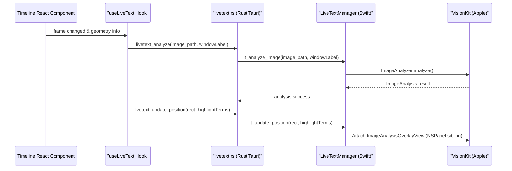
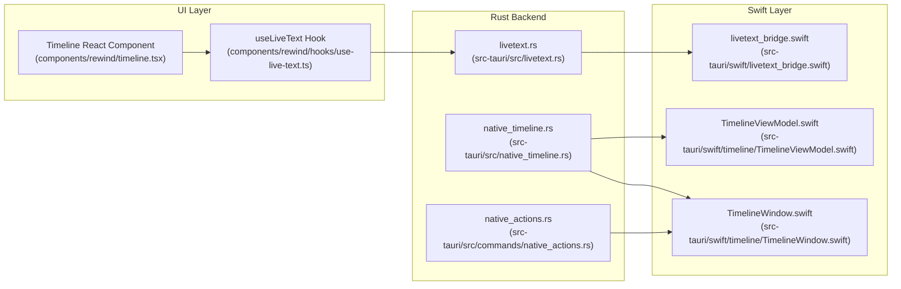
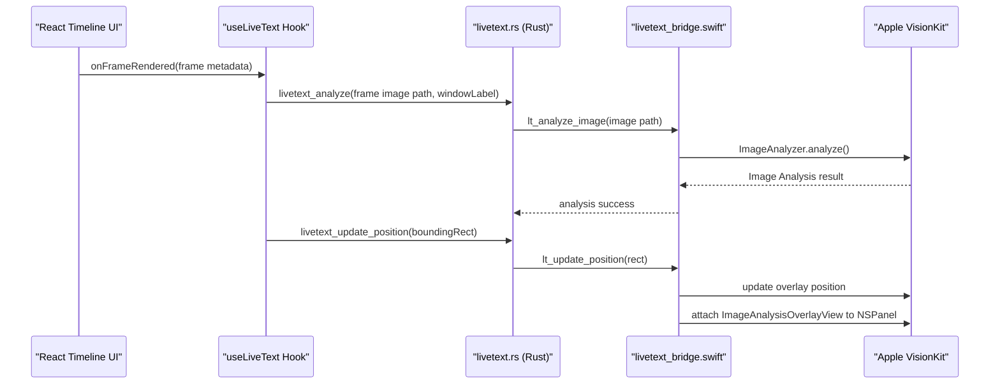

<!-- source: DeepWiki mcp.deepwiki.com · repo screenpipe/screenpipe · page 8.1 macOS · fetched 2026-10-27 -->

# macOS

<details>
<summary>Relevant source files</summary>

The following files were used as context for generating this wiki page:

- [apps/screenpipe-app-tauri/components/rewind/current-frame-timeline.tsx](apps/screenpipe-app-tauri/components/rewind/current-frame-timeline.tsx)
- [apps/screenpipe-app-tauri/components/rewind/hooks/__tests__/use-live-text.test.tsx](apps/screenpipe-app-tauri/components/rewind/hooks/__tests__/use-live-text.test.tsx)
- [apps/screenpipe-app-tauri/components/rewind/hooks/use-live-text.ts](apps/screenpipe-app-tauri/components/rewind/hooks/use-live-text.ts)
- [apps/screenpipe-app-tauri/components/rewind/native-timeline.test.tsx](apps/screenpipe-app-tauri/components/rewind/native-timeline.test.tsx)
- [apps/screenpipe-app-tauri/components/rewind/native-timeline.tsx](apps/screenpipe-app-tauri/components/rewind/native-timeline.tsx)
- [apps/screenpipe-app-tauri/components/rewind/timeline.tsx](apps/screenpipe-app-tauri/components/rewind/timeline.tsx)
- [apps/screenpipe-app-tauri/components/rewind/timeline/app-context-popover.tsx](apps/screenpipe-app-tauri/components/rewind/timeline/app-context-popover.tsx)
- [apps/screenpipe-app-tauri/components/rewind/timeline/timeline.tsx](apps/screenpipe-app-tauri/components/rewind/timeline/timeline.tsx)
- [apps/screenpipe-app-tauri/e2e/specs/search/search-bugs-4645.spec.ts](apps/screenpipe-app-tauri/e2e/specs/search/search-bugs-4645.spec.ts)
- [apps/screenpipe-app-tauri/scripts/test-timeline.sh](apps/screenpipe-app-tauri/scripts/test-timeline.sh)
- [apps/screenpipe-app-tauri/src-tauri/livetext-stress/Cargo.toml](apps/screenpipe-app-tauri/src-tauri/livetext-stress/Cargo.toml)
- [apps/screenpipe-app-tauri/src-tauri/livetext-stress/src/bin/frame-scope.rs](apps/screenpipe-app-tauri/src-tauri/livetext-stress/src/bin/frame-scope.rs)
- [apps/screenpipe-app-tauri/src-tauri/livetext-stress/src/bin/interactive.rs](apps/screenpipe-app-tauri/src-tauri/livetext-stress/src/bin/interactive.rs)
- [apps/screenpipe-app-tauri/src-tauri/livetext-stress/src/bin/window-scope.rs](apps/screenpipe-app-tauri/src-tauri/livetext-stress/src/bin/window-scope.rs)
- [apps/screenpipe-app-tauri/src-tauri/livetext-stress/src/main.rs](apps/screenpipe-app-tauri/src-tauri/livetext-stress/src/main.rs)
- [apps/screenpipe-app-tauri/src-tauri/livetext-stress/swift/support.swift](apps/screenpipe-app-tauri/src-tauri/livetext-stress/swift/support.swift)
- [apps/screenpipe-app-tauri/src-tauri/livetext-stress/tests/stress.rs](apps/screenpipe-app-tauri/src-tauri/livetext-stress/tests/stress.rs)
- [apps/screenpipe-app-tauri/src-tauri/src/commands/native_actions.rs](apps/screenpipe-app-tauri/src-tauri/src/commands/native_actions.rs)
- [apps/screenpipe-app-tauri/src-tauri/src/livetext.rs](apps/screenpipe-app-tauri/src-tauri/src/livetext.rs)
- [apps/screenpipe-app-tauri/src-tauri/src/livetext_ffi.rs](apps/screenpipe-app-tauri/src-tauri/src/livetext_ffi.rs)
- [apps/screenpipe-app-tauri/src-tauri/src/native_timeline.rs](apps/screenpipe-app-tauri/src-tauri/src/native_timeline.rs)
- [apps/screenpipe-app-tauri/src-tauri/swift/livetext_bridge.swift](apps/screenpipe-app-tauri/src-tauri/swift/livetext_bridge.swift)
- [apps/screenpipe-app-tauri/src-tauri/swift/timeline/TimelineAPI.swift](apps/screenpipe-app-tauri/src-tauri/swift/timeline/TimelineAPI.swift)
- [apps/screenpipe-app-tauri/src-tauri/swift/timeline/TimelineCore.swift](apps/screenpipe-app-tauri/src-tauri/swift/timeline/TimelineCore.swift)
- [apps/screenpipe-app-tauri/src-tauri/swift/timeline/TimelineLiveText.swift](apps/screenpipe-app-tauri/src-tauri/swift/timeline/TimelineLiveText.swift)
- [apps/screenpipe-app-tauri/src-tauri/swift/timeline/TimelineModels.swift](apps/screenpipe-app-tauri/src-tauri/swift/timeline/TimelineModels.swift)
- [apps/screenpipe-app-tauri/src-tauri/swift/timeline/TimelineScrubberView.swift](apps/screenpipe-app-tauri/src-tauri/swift/timeline/TimelineScrubberView.swift)
- [apps/screenpipe-app-tauri/src-tauri/swift/timeline/TimelineViewModel.swift](apps/screenpipe-app-tauri/src-tauri/swift/timeline/TimelineViewModel.swift)
- [apps/screenpipe-app-tauri/src-tauri/swift/timeline/TimelineViews.swift](apps/screenpipe-app-tauri/src-tauri/swift/timeline/TimelineViews.swift)
- [apps/screenpipe-app-tauri/src-tauri/swift/timeline/TimelineWindow.swift](apps/screenpipe-app-tauri/src-tauri/swift/timeline/TimelineWindow.swift)
- [apps/screenpipe-app-tauri/src-tauri/swift/timeline_deletion_tests.swift](apps/screenpipe-app-tauri/src-tauri/swift/timeline_deletion_tests.swift)
- [apps/screenpipe-app-tauri/src-tauri/swift/timeline_interaction_tests.swift](apps/screenpipe-app-tauri/src-tauri/swift/timeline_interaction_tests.swift)
- [apps/screenpipe-app-tauri/src-tauri/swift/timeline_media_tests.swift](apps/screenpipe-app-tauri/src-tauri/swift/timeline_media_tests.swift)
- [apps/screenpipe-app-tauri/src-tauri/swift/timeline_performance_tests.swift](apps/screenpipe-app-tauri/src-tauri/swift/timeline_performance_tests.swift)
- [apps/screenpipe-app-tauri/src-tauri/swift/timeline_render_tests.swift](apps/screenpipe-app-tauri/src-tauri/swift/timeline_render_tests.swift)
- [apps/screenpipe-app-tauri/src-tauri/swift/timeline_stream_tests.swift](apps/screenpipe-app-tauri/src-tauri/swift/timeline_stream_tests.swift)
- [apps/screenpipe-app-tauri/src-tauri/swift/timeline_tests.swift](apps/screenpipe-app-tauri/src-tauri/swift/timeline_tests.swift)
- [crates/screenpipe-audio/examples/coreaudio_tap_signal_probe.rs](crates/screenpipe-audio/examples/coreaudio_tap_signal_probe.rs)
- [crates/screenpipe-audio/examples/coreaudio_tap_stage_probe.rs](crates/screenpipe-audio/examples/coreaudio_tap_stage_probe.rs)
- [crates/screenpipe-audio/examples/meeting_input_probe.rs](crates/screenpipe-audio/examples/meeting_input_probe.rs)
- [crates/screenpipe-audio/examples/meeting_tap_probe.rs](crates/screenpipe-audio/examples/meeting_tap_probe.rs)
- [crates/screenpipe-audio/onnxruntime-win-x64-1.22.0.zip](crates/screenpipe-audio/onnxruntime-win-x64-1.22.0.zip)
- [crates/screenpipe-audio/src/audio_manager/meeting_piggyback.rs](crates/screenpipe-audio/src/audio_manager/meeting_piggyback.rs)
- [crates/screenpipe-audio/src/audio_manager/mod.rs](crates/screenpipe-audio/src/audio_manager/mod.rs)
- [crates/screenpipe-audio/src/audio_manager/piggyback_listeners.rs](crates/screenpipe-audio/src/audio_manager/piggyback_listeners.rs)
- [crates/screenpipe-audio/src/audio_manager/windows_output_follow.rs](crates/screenpipe-audio/src/audio_manager/windows_output_follow.rs)
- [crates/screenpipe-audio/src/core/meeting_audio/macos.rs](crates/screenpipe-audio/src/core/meeting_audio/macos.rs)
- [crates/screenpipe-audio/src/core/meeting_audio/mod.rs](crates/screenpipe-audio/src/core/meeting_audio/mod.rs)
- [crates/screenpipe-audio/src/core/meeting_audio/null.rs](crates/screenpipe-audio/src/core/meeting_audio/null.rs)
- [crates/screenpipe-audio/src/core/meeting_audio/windows.rs](crates/screenpipe-audio/src/core/meeting_audio/windows.rs)
- [crates/screenpipe-audio/src/core/process_tap/counters.rs](crates/screenpipe-audio/src/core/process_tap/counters.rs)
- [crates/screenpipe-audio/src/core/process_tap/macos.rs](crates/screenpipe-audio/src/core/process_tap/macos.rs)
- [crates/screenpipe-audio/src/core/process_tap/mod.rs](crates/screenpipe-audio/src/core/process_tap/mod.rs)
- [crates/screenpipe-audio/src/core/process_tap/windows.rs](crates/screenpipe-audio/src/core/process_tap/windows.rs)
- [crates/screenpipe-db/src/migrations/20260818133000_activity_ledger_query_indexes.sql](crates/screenpipe-db/src/migrations/20260818133000_activity_ledger_query_indexes.sql)

</details>


## Purpose and Scope

This page documents macOS-specific implementation details across the Screenpipe codebase. It covers system-specific overlays using NSPanel, Swift bridges for native features such as Live Text, the native timeline and notification panel, Metal/CoreML integration, the notarization/signing pipeline, the CoreAudio process tap for system audio capture, and incognito/browser privacy detection mechanisms.

---

## macOS Subsystem Overview

**macOS-specific component relationships**

```mermaid
graph TD
    subgraph "screenpipe-vision"
        [CGCapture] --> [AppleOCR]
    end

    subgraph "screenpipe-accessibility"
        [MacosTree] --> [IncognitoDetection]
    end

    subgraph "screenpipe-audio"
        [ProcessTap] --> [MeetingPiggyback]
    end

    subgraph "screenpipe-app-tauri"
        [Permissions] --> [NSPanelOverlay]
        [NSPanelOverlay] --> [LiveTextFFI]
        [LiveTextFFI] --> [livetext_bridge.swift]
    end

    [CGCapture] -- "capture_monitor_image" --> [AppleOCR]
    [MacosTree] -- "macos.rs" --> [IncognitoDetection]
    [ProcessTap] -- "core/process_tap/macos.rs" --> [MeetingPiggyback]
    [LiveTextFFI] -- "livetext_ffi.rs" --> [livetext_bridge.swift]
```

Sources:  
[apps/screenpipe-app-tauri/src-tauri/swift/livetext_bridge.swift:1-50](),  
[crates/screenpipe-a11y/src/tree/macos.rs:5-36](),  
[crates/screenpipe-audio/src/core/process_tap/macos.rs:5-122]()

---

## System Audio Capture: CoreAudio Process Tap

### Overview

macOS 14.4+ introduces the `AudioHardwareCreateProcessTap` API, leveraged by Screenpipe to capture all system audio seamlessly without the fragile ScreenCaptureKit display enumeration steps. This provides robust system-wide audio capture with fewer failure modes, especially around system wake or sleep transitions [crates/screenpipe-audio/src/core/process_tap/macos.rs:5-11]().

### Key Implementation Details

- **Availability Check:** CoreAudio Process Tap API availability is confirmed by querying the macOS version via `sw_vers -productVersion` command and requiring macOS >= 14.4 for stable permissions [crates/screenpipe-audio/src/core/process_tap/macos.rs:29-72]().

- **Exclusion List:** A JSON-configured per-app exclusion list (`~/.screenpipe/audio-exclusions.json`) identifies bundle IDs of apps to exclude from being tapped. This file is hot-reloaded and its mtime monitored without restarting the engine [crates/screenpipe-audio/src/core/process_tap/macos.rs:103-162]().

- **Tap Lifecycle:** The tap is rebuilt lazily with a cooldown period to avoid thrashing, coordinating multiple concurrent audio capture demands.

### Meeting Audio Piggyback ("Smart Recording")

Screenpipe detects active meetings and activates a per-process capture tap on the meeting app's audio input and microphone to obtain clean isolated audio [crates/screenpipe-audio/src/audio_manager/meeting_piggyback.rs:4-80]().

- The **Near-end MicFollow State Machine** reacts to CoreAudio property change events ensuring rapid, event-driven responsiveness to mic switches or app audio device changes.
- **Safety Mechanisms** include a 2-second replay delay before rebuilding taps on mic-holder process id changes to avoid race conditions with other apps competing for audio hardware.
- Active device streams are tracked to avoid unnecessary reopening or toggling and to maintain capture continuity during meetings.

---

## NSPanel Overlays & Native UI Bridging

### NSPanel Overlay Usage

The primary macOS overlay used for the Rewind timeline and other native popups is implemented as an `NSPanel`. This special kind of window enables the overlay to float above fullscreen apps reliably [crates/screenpipe-audio/src/core/process_tap/macos.rs](implicit from context, also UI behavior in Swift files).

- The overlay supports click-through behavior and placement anchoring to the host webview content to ensure seamless integration between the native and React UI layers.
- Space switching for macOS Spaces is managed carefully to prevent overlay flickering when users swipe between desktops.

### Swift Bridges to Native macOS Features

Interaction between the Tauri app (Rust + webview) and macOS native features is handled via Swift bridges:

- **Live Text Integration:** The `livetext_bridge.swift` implements VisionKit native Live Text functionality, managed via the `useLiveText` React hook bridging to Tauri commands and the Swift-side native overlay (see next section) [apps/screenpipe-app-tauri/src-tauri/swift/livetext_bridge.swift:5-186]().

- **Native Timeline:** The native timeline window is a SwiftUI + AppKit hybrid hosting timelines with smooth video playback, keyboard, wheel, and pinch event handling, exposed to Rust via a C ABI bridge `TimelineActionBridge` [apps/screenpipe-app-tauri/src-tauri/swift/timeline/TimelineWindow.swift:1-154]().

- **Notification Panels:** The macOS-only native notification panels use native callbacks and event listening inside Tauri to route pill notifications and shortcut reminder actions [apps/screenpipe-app-tauri/src-tauri/src/commands/native_actions.rs:5-155]().

---

## VisionKit Live Text Integration

Screenpipe taps Apple's VisionKit framework to provide native "Live Text" overlays in the timeline UI, enabling selected text extraction and interaction on video frames or images.

### Data Flow & Components



### Implementation Highlights

- The React hook `useLiveText` manages overlay initialization, updates, and teardown [apps/screenpipe-app-tauri/components/rewind/hooks/use-live-text.ts:15-164]().

- The Swift side (`livetext_bridge.swift`) maintains:
  - A shared `ImageAnalyzer` instance with thread-safe locking.
  - An LRU cache of `ImageAnalysis` keyed by image frame path for efficient repeated analysis.
  - Transparent `ClickGuardView` overlays to prevent VisionKit from intercepting clicks intended for native controls.

- The native Live Text overlay is keyed by window label to prevent cross-window state leaking.

- Native data detectors (phone numbers, addresses) are exposed via the overlay, enhancing interaction capabilities.

Sources:  
[apps/screenpipe-app-tauri/components/rewind/hooks/use-live-text.ts:9-164](),  
[apps/screenpipe-app-tauri/src-tauri/swift/livetext_bridge.swift:30-164](),  
[apps/screenpipe-app-tauri/src-tauri/src/livetext.rs:1-70]().

---

## Native Timeline Implementation (Swift + Rust)

The native timeline is implemented in Swift with a SwiftUI frontend backed by the `TimelineViewModel` observable object managing frames, playback, filtering, and selection logic [apps/screenpipe-app-tauri/src-tauri/swift/timeline/TimelineViewModel.swift:1-170]().

Key elements:

- **FrameImageSource** enum abstracts ways to load frame images: snapshots, video chunks, or HTTP fallback [apps/screenpipe-app-tauri/src-tauri/swift/timeline/TimelineViewModel.swift:21-40]().

- **FrameImageLoader** actor asynchronously loads frame images with caching, retry logic for failed chunks, and fallback to HTTP JPEG fetching [apps/screenpipe-app-tauri/src-tauri/swift/timeline/TimelineViewModel.swift:45-151]().

- **Input Handling:** Keyboard events (arrows, space, escape) are monitored using local event monitors in AppKit, with explicit focus management policies to differentiate timeline input handling from the host window [apps/screenpipe-app-tauri/src-tauri/swift/timeline/TimelineWindow.swift:60-143]().

- Native actions (seek, play/pause, search navigation) are bridged to Rust commands via a shared singleton `TimelineActionBridge`.

---

## macOS Incognito & Privacy Detection

The macOS accessibility tree extraction module includes tailored logic to identify Chromium-based incognito windows by examining window titles, contents, or properties to prevent inadvertent capture of private browsing sessions [crates/screenpipe-a11y/src/tree/macos.rs:160-180]().

This detection allows the system to mute or suppress capture and associated processing on detected incognito sessions, respecting user privacy.

---

## Notarization and Packaging

The macOS build and release pipelines include a notarization step to comply with Apple security policies, ensuring distribution is safe and trusted. This is handled in the release workflows [release documentation sections] and linked from the broader release and distribution doc pages.

---

## Summary Table: macOS Core Components

| Feature                     | Key Code Entities / Files                                    | Notes                                                   |
|-----------------------------|--------------------------------------------------------------|---------------------------------------------------------|
| NSPanel Overlay             | `native_timeline.rs`, Swift UI components                    | Floating overlays with click-through and anchoring      |
| Live Text Integration       | `useLiveText` hook, `livetext_bridge.swift`, `livetext.rs`  | VisionKit overlays, native text analysis and click guards|
| CoreAudio Process Tap       | `core/process_tap/macos.rs`, `meeting_piggyback.rs`         | System audio and per-process audio capture on macOS 14.4+|
| Native Timeline             | `TimelineViewModel.swift`, `TimelineWindow.swift`           | SwiftUI + AppKit timeline playback and interaction       |
| Incognito Detection         | `crates/screenpipe-a11y/src/tree/macos.rs`                   | Specialized detection and filtering of incognito windows |
| Notification Panel & Shortcuts | `commands/native_actions.rs`                                | Native handling of shortcut reminders and notifications  |

---

## Illustrative Diagram: Mapping macOS Features to Code Entities



Sources:  
[apps/screenpipe-app-tauri/components/rewind/timeline.tsx:1-164](),  
[apps/screenpipe-app-tauri/components/rewind/hooks/use-live-text.ts:1-164](),  
[apps/screenpipe-app-tauri/src-tauri/src/livetext.rs:1-70](),  
[apps/screenpipe-app-tauri/src-tauri/swift/livetext_bridge.swift:1-186](),  
[apps/screenpipe-app-tauri/src-tauri/src/native_timeline.rs:1-180](),  
[apps/screenpipe-app-tauri/src-tauri/src/commands/native_actions.rs:1-155](),  
[apps/screenpipe-app-tauri/src-tauri/swift/timeline/TimelineViewModel.swift:1-170](),  
[apps/screenpipe-app-tauri/src-tauri/swift/timeline/TimelineWindow.swift:1-154]()

---

# Detailed Mermaid Diagram: Live Text Data Flow in Screenpipe macOS



Sources:  
[apps/screenpipe-app-tauri/components/rewind/hooks/use-live-text.ts:15-164](),  
[apps/screenpipe-app-tauri/src-tauri/src/livetext.rs:1-70](),  
[apps/screenpipe-app-tauri/src-tauri/swift/livetext_bridge.swift:30-186]()

---

# macOS Notarization and Security Considerations

- Screenpipe enforces macOS 14.4+ for CoreAudio process tap usage to ensure stable permission prompts and TCC flows.
- Native code is signed and notarized during the release processes under the CI/CD pipeline [release documentation].
- NSPanel overlay windows carefully handle focus retention using `mainThreadPreservingFocus` to avoid stealing keyboard input from the underlying webview [apps/screenpipe-app-tauri/src-tauri/swift/livetext_bridge.swift:42-52]().

---

# Conclusion

Screenpipe’s macOS platform integration is an intricate layering of native and cross-platform technologies. The system uses NSPanel overlays and SwiftUI views to integrate native macOS UI components with Rust-backed logic exposed in Tauri. Advanced features like Live Text utilize Apple's VisionKit framework for in-frame text analysis, bridged through efficient Rust-Swift-React interop.

Audio capture leverages the macOS CoreAudio Process Tap API for robust system and per-process audio recording. The codebase also includes nuanced handling of privacy through incognito detection and DRM protection. Together, these platform-specific implementations enhance the overall user experience with native responsiveness and power.

---

# References & Sources

- [apps/screenpipe-app-tauri/components/rewind/timeline.tsx:1-164]()
- [apps/screenpipe-app-tauri/components/rewind/hooks/use-live-text.ts:15-164]()
- [apps/screenpipe-app-tauri/src-tauri/src/livetext.rs:1-70]()
- [apps/screenpipe-app-tauri/src-tauri/swift/livetext_bridge.swift:1-186]()
- [apps/screenpipe-app-tauri/src-tauri/swift/timeline/TimelineViewModel.swift:1-170]()
- [apps/screenpipe-app-tauri/src-tauri/swift/timeline/TimelineWindow.swift:1-154]()
- [apps/screenpipe-app-tauri/src-tauri/src/commands/native_actions.rs:1-155]()
- [crates/screenpipe-audio/src/core/process_tap/macos.rs:5-122]()
- [crates/screenpipe-audio/src/audio_manager/meeting_piggyback.rs:4-80]()
- [crates/screenpipe-a11y/src/tree/macos.rs:5-182]()
- [crates/screenpipe-engine/src/drm_detector.rs:5-95]()

---

