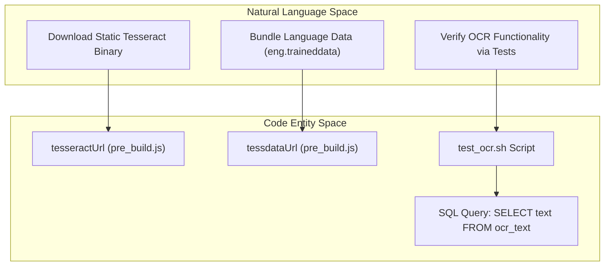
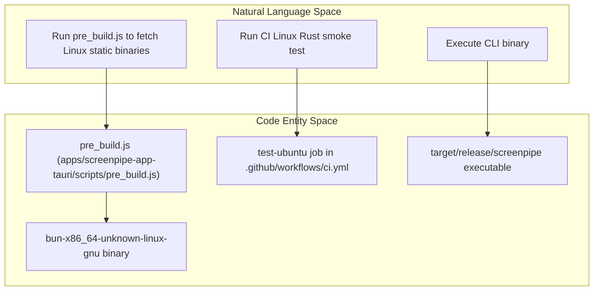

<!-- source: DeepWiki mcp.deepwiki.com · repo screenpipe/screenpipe · page 8.3 Linux · fetched 2026-10-27 -->

# Linux

<details>
<summary>Relevant source files</summary>

The following files were used as context for generating this wiki page:

- [.github/scripts/assert_windows_audio_rms.ps1](.github/scripts/assert_windows_audio_rms.ps1)
- [.github/scripts/release-workflows.test.ts](.github/scripts/release-workflows.test.ts)
- [.github/scripts/setup-ninja-windows.ps1](.github/scripts/setup-ninja-windows.ps1)
- [.github/workflows/benchmark.yml](.github/workflows/benchmark.yml)
- [.github/workflows/ci.yml](.github/workflows/ci.yml)
- [.github/workflows/e2e-test.yml](.github/workflows/e2e-test.yml)
- [.github/workflows/release-app.yml](.github/workflows/release-app.yml)
- [.github/workflows/release-cli.yml](.github/workflows/release-cli.yml)
- [.github/workflows/release-enterprise.yml](.github/workflows/release-enterprise.yml)
- [.github/workflows/style.yml](.github/workflows/style.yml)
- [.github/workflows/windows-integration-test.yml](.github/workflows/windows-integration-test.yml)
- [apps/screenpipe-app-tauri/components/settings/capture-filters/content-filters-card.tsx](apps/screenpipe-app-tauri/components/settings/capture-filters/content-filters-card.tsx)
- [crates/screenpipe-a11y/Cargo.toml](crates/screenpipe-a11y/Cargo.toml)
- [crates/screenpipe-a11y/examples/macos_weburl_probe.rs](crates/screenpipe-a11y/examples/macos_weburl_probe.rs)
- [crates/screenpipe-a11y/src/config.rs](crates/screenpipe-a11y/src/config.rs)
- [crates/screenpipe-a11y/src/incognito/linux.rs](crates/screenpipe-a11y/src/incognito/linux.rs)
- [crates/screenpipe-a11y/src/incognito/macos.rs](crates/screenpipe-a11y/src/incognito/macos.rs)
- [crates/screenpipe-a11y/src/incognito/mod.rs](crates/screenpipe-a11y/src/incognito/mod.rs)
- [crates/screenpipe-a11y/src/incognito/titles.rs](crates/screenpipe-a11y/src/incognito/titles.rs)
- [crates/screenpipe-a11y/src/incognito/windows.rs](crates/screenpipe-a11y/src/incognito/windows.rs)
- [crates/screenpipe-a11y/src/platform/macos.rs](crates/screenpipe-a11y/src/platform/macos.rs)
- [crates/screenpipe-a11y/src/platform/windows.rs](crates/screenpipe-a11y/src/platform/windows.rs)
- [crates/screenpipe-a11y/src/platform/windows_uia.rs](crates/screenpipe-a11y/src/platform/windows_uia.rs)
- [crates/screenpipe-a11y/src/tree/linux.rs](crates/screenpipe-a11y/src/tree/linux.rs)
- [crates/screenpipe-a11y/src/tree/macos.rs](crates/screenpipe-a11y/src/tree/macos.rs)
- [crates/screenpipe-a11y/src/tree/mod.rs](crates/screenpipe-a11y/src/tree/mod.rs)
- [crates/screenpipe-a11y/src/tree/windows.rs](crates/screenpipe-a11y/src/tree/windows.rs)
- [crates/screenpipe-a11y/src/url_filter.rs](crates/screenpipe-a11y/src/url_filter.rs)
- [crates/screenpipe-engine/src/event_driven_capture.rs](crates/screenpipe-engine/src/event_driven_capture.rs)
- [crates/screenpipe-engine/src/ui_recorder.rs](crates/screenpipe-engine/src/ui_recorder.rs)
- [crates/screenpipe-engine/src/vision_manager/manager.rs](crates/screenpipe-engine/src/vision_manager/manager.rs)
- [crates/screenpipe-screen/src/capture_screenshot_by_window.rs](crates/screenpipe-screen/src/capture_screenshot_by_window.rs)

</details>


## Purpose and Scope

This page documents Linux-specific implementation details, dependencies, and configuration for Screenpipe. It covers system requirements, build setup, runtime dependencies, platform-specific features such as OCR with Tesseract, audio capture integration via PulseAudio/PipeWire, Wayland window attribution, Vulkan acceleration for rendering, AppImage portability, and devcontainer-based development environments.

---

## System Dependencies Overview

Screenpipe on Linux depends on a carefully selected set of system libraries that enable screen capture, audio processing, OCR, and GUI rendering. These dependencies are managed primarily via APT on Debian-based systems (e.g., Ubuntu) and supplemented with static binaries for AppImage distribution for portability.

### Dependency Architecture

```mermaid
graph TB
    subgraph "Core Runtime Dependencies"
        FFMPEG["ffmpeg (libavformat, libavfilter, libavdevice)"]
        TESS["tesseract-ocr (libtesseract-dev)"]
        SSL["libssl-dev"]
    end
    
    subgraph "Audio Subsystem"
        ALSA["libasound2-dev"]
        PIPEWIRE["libpipewire-0.3-dev"]
        OPENBLAS["libopenblas-dev"]
    end
    
    subgraph "Display & Input"
        XDO["libxdo-dev"]
        WAYLAND["libwayland-dev, libgbm-dev, libegl-dev"]
        XTST["libxtst-dev"]
    end
    
    subgraph "GUI Framework (Tauri)"
        GTK["libgtk-3-dev"]
        WEBKIT["libwebkit2gtk-4.1-dev"]
        APPIND["libayatana-appindicator3-dev"]
    end
    
    FFMPEG --> CLI["screenpipe-cli"]
    TESS --> CLI
    ALSA --> CLI
    XDO --> CLI
    
    GTK --> APP["screenpipe-app-tauri"]
    WEBKIT --> APP
    APPIND --> APP
```



This dependency graph illustrates key components with their respective Linux packages and their target application submodules (`screenpipe-cli` or `screenpipe-app-tauri`).

**Sources:** [.github/scripts/install_dependencies.sh:3-3](), [apps/screenpipe-app-tauri/scripts/pre_build.js:48-64]()

---

## Package Installation

For Ubuntu/Debian systems, the installation script installs all native headers and binaries that Screenpipe requires. This includes components for X11, audio backends, and OCR libraries.

### Ubuntu/Debian Dependencies List

```bash
sudo apt-get install -y \
  xvfb x11-xserver-utils ffmpeg libasound2-dev libgtk-3-dev \
  libavformat-dev libavfilter-dev libavdevice-dev x11-utils \
  x11-apps xdotool sqlite3 openbox xterm fonts-liberation \
  tesseract-ocr libtesseract-dev imagemagick fonts-dejavu \
  alsa-utils pulseaudio pulseaudio-utils libxdo-dev \
  libpipewire-0.3-dev libgbm-dev libwayland-dev libegl-dev libopenblas-dev
```

This comprehensive list includes packages for:
- **Screen capture & X server utilities** (`xvfb`, `x11-xserver-utils`, `x11-utils`, `x11-apps`, `xterm`, `openbox`)
- **Audio** (`libasound2-dev`, `alsa-utils`, `pulseaudio`, `pulseaudio-utils`, `libpipewire-0.3-dev`)
- **GUI Framework dependencies** (`libgtk-3-dev`, `libwebkit2gtk-4.1-dev`, `libayatana-appindicator3-dev` included transitively)
- **OCR** (`tesseract-ocr`, `libtesseract-dev`, `imagemagick`)
- **Miscellaneous** (`xdotool` for input, `fonts-liberation`, `fonts-dejavu` for font support)
- **Math acceleration** (`libopenblas-dev`)

**Sources:** [.github/scripts/install_dependencies.sh:3-3](), [apps/screenpipe-app-tauri/scripts/pre_build.js:48-64]()

---

## OCR: Tesseract Engine on Linux

On Linux, Screenpipe uses the Tesseract OCR engine to extract text from screen captures and images. This strongly contrasts with macOS and Windows, which utilize native OCR APIs.

### Tesseract Integration Details

- **Static Tesseract Binary:** For portability, especially in the AppImage distribution, Screenpipe downloads a static Tesseract binary from the `DanielMYT/tesseract-static` GitHub repository. This saves users from performing complex system-wide installs and version mismatches [apps/screenpipe-app-tauri/scripts/pre_build.js:66-67]().
  
- **Language Data Bundling:** The build also bundles the English `eng.traineddata` file from the `tessdata_fast` repository (~4MB). This file is deployed inside the AppImage and used at runtime to perform English text recognition [apps/screenpipe-app-tauri/scripts/pre_build.js:71-72]().
  
- **Startup Verification:** During system health checks, logs are scanned for `tesseract not found` errors to detect OCR subsystem issues at startup [.github/scripts/check_logs.sh:15-18]().

### OCR Pipeline Mapping Diagram



This flow demonstrates how pre-build deployment of Tesseract enables OCR functionality verified at runtime.

**Sources:** [apps/screenpipe-app-tauri/scripts/pre_build.js:66-72](), [.github/scripts/check_logs.sh:15-18](), [.github/scripts/test_ocr.sh:5-24]()

---

## Audio Capture and Acceleration

### PulseAudio and PipeWire

Screenpipe integrates with the Linux audio stack through PulseAudio and PipeWire. The required development libraries (`libasound2-dev`, `libpipewire-0.3-dev`) enable audio capture and processing. PulseAudio has been the traditional sound server, and PipeWire provides modern replacement capabilities for some distros.

In CI testing, audio capture health is determined by verifying presence of audio files in the data directory after capture runs.

### OpenBLAS Acceleration

Local AI model inference libraries benefit from accelerated linear algebra via OpenBLAS (`libopenblas-dev`).

- **Linker Workaround:** Due to a linker quirk on Linux where `antirez-asr-sys` expects a double-prefixed library name (`-llibopenblas` instead of `-lopenblas`), the install script creates symbolic links under `/usr/lib/x86_64-linux-gnu/openblas/lib/liblibopenblas.so` to satisfy linker expectations [.github/scripts/install_dependencies.sh:7-9]().
  
- **Environment Variable:** The path of this custom location is exported as `OPENBLAS_PATH` for consumption by build tooling and runtime [.github/scripts/install_dependencies.sh:10-10]().

**Sources:** [.github/scripts/install_dependencies.sh:3-10]()

---

## Wayland and Window Attribution

Linux screen capture supports both X11 and Wayland protocols. For Wayland, Screenpipe relies on window attribution via Wayland protocols and compositors. The package dependencies include `libwayland-dev`, `libgbm-dev`, and `libegl-dev` which provide EGL and GBM buffers required for GPU-accelerated rendering on Wayland.

The compositor window attribution interface ensures that overlays and UI elements are correctly associated with the active windows, aiding in selective capture and event attribution.

---

## Vulkan GPU Acceleration

Screenpipe leverages Vulkan for GPU acceleration on Linux, improving rendering and capture efficiency.

- Vulkan support depends on the `libgbm` and `libegl` libraries and uses GPU-accelerated frame handling.
- Vulkan integration paths are exposed through the `screenpipe-screen` crate for efficient image processing pipelines.

These accelerations are especially important for live video composition and high-resolution frame processing workloads.

---

## AppImage Packaging and Portability

To distribute Screenpipe on Linux with minimal user setup, an AppImage is built which bundles all dependencies.

### Enterprise / Community Build Process

The release workflow includes these steps:

1. **Check Dependencies:** Gather all external `.so` libraries for core executables like `ffmpeg` and `tesseract` using library inspection tools [.github/workflows/release-enterprise.yml:9-9]().

2. **Bundle Libraries:** Copy these dependencies into the AppImage bundle directory structure.

3. **RPATH Adjustment:** Patch executables' RPATH entries to prefer user-bundled libraries over the host system's to ensure portability.

4. **Sign & Package:** The AppImage is signed and tagged ready for distribution.

### Bun Sidecar and Baseline Variant

The bundled Node.js runtime "Bun" used as a sidecar on Linux employs a `bun-linux-x64-baseline` binary variant, which is compiled against an older version of `glibc`. This ensures compatibility with older distributions and broadest possible runtime support [apps/screenpipe-app-tauri/scripts/pre_build.js:182-183]().

**Sources:** [apps/screenpipe-app-tauri/scripts/pre_build.js:170-183](), [.github/workflows/release-enterprise.yml:9-9]()

---

## Development Environments: DevContainer

Screenpipe development on Linux is facilitated by a containerized development environment defined as a DevContainer.

- **Encapsulation:** The devcontainer encapsulates required Linux system dependencies, simplifying local setup and replicating CI test environments.
- **CI Smoke Tests:** The container environment is used in CI to run "smoke" tests, validating that the CLI and embedded server start correctly headlessly using `xvfb` for offscreen X11 framebuffer support [.github/scripts/install_dependencies.sh:3-3]().

### Linux Development Flow Mapping



This diagram connects the Linux native development steps from build scripts through continuous integration to executable runtime.

**Sources:** [apps/screenpipe-app-tauri/scripts/pre_build.js:170-172](), [.github/workflows/ci.yml:34-35](), [.github/scripts/install_dependencies.sh:3-3]()

---

## Summary of Linux-Specific Code Entities

| Category               | File/Path                                 | Role                                                                                                 |
|------------------------|------------------------------------------|----------------------------------------------------------------------------------------------------|
| Dependency Installation | `.github/scripts/install_dependencies.sh` | Installs required APT packages and applies OpenBLAS symlink hacks for linker compatibility [.github/scripts/install_dependencies.sh:1-11](). |
| Pre-Build Logic        | `apps/screenpipe-app-tauri/scripts/pre_build.js` | Downloads static Tesseract and Bun binaries for Linux distribution [.github/scripts/install_dependencies.sh:7-9](), [apps/screenpipe-app-tauri/scripts/pre_build.js:47-75](). |
| Enterprise Release      | `.github/workflows/release-enterprise.yml` | Builds AppImage and Debian artifacts, bundles dependencies, and signs updater packages [.github/workflows/release-enterprise.yml:9-9](). |
| Deployment Validation   | `.github/scripts/check_logs.sh`           | Validates successful Tesseract OCR engine startup and server readiness by log scanning [.github/scripts/check_logs.sh:7-18](). |

---

# Appendix: Linux Runtime and Build Overview

```mermaid
graph LR
    subgraph "Linux Runtime"
        ScreenpipeCLI["screenpipe CLI"]
        ScreenpipeApp["screenpipe-app-tauri Desktop App"]
        TesseractOCR["Tesseract OCR engine (libtesseract)"]
        PulseAudioPipeWire["PulseAudio / PipeWire audio capture"]
        VulkanAcc["Vulkan GPU Acceleration"]
        WaylandAttribution["Wayland Window Attribution"]
    end

    subgraph "Build & Release System"
        PreBuildScript["pre_build.js - Linux binaries download"]
        AppImageBuilder["AppImage Packaging & Bundling"]
        DevContainerEnv["DevContainer Development Environment"]
        CIWorkflow["GitHub Actions CI Linux Smoke Test"]
    end

    PreBuildScript -->|Bundles| TesseractOCR
    PreBuildScript -->|Bundles| ScreenpipeApp
    AppImageBuilder -->|Bundles| TesseractOCR
    AppImageBuilder -->|Bundles| ScreenpipeCLI
    DevContainerEnv -->|Provides| BuildDependencies
    CIWorkflow -->|Runs| ScreenpipeCLI
    ScreenpipeCLI -->|Calls| TesseractOCR
    ScreenpipeApp -->|Uses| VulkanAcc
    ScreenpipeApp -->|Uses| WaylandAttribution
    ScreenpipeApp -->|Captures| PulseAudioPipeWire

    note right of TesseractOCR: OCR engine reads \n decompressed \n screenshot images
    note right of PulseAudioPipeWire: Captures system audio streams \n for transcript pipeline
```

This diagram bridges natural language concepts (e.g., OCR, audio capture) to concrete code and build entities.

---

# References

Screenscreenpipe's Linux platform support demonstrates a local-first approach relying on open-source Linux infrastructure combined with custom packaging and sophisticated runtime integration.

This documentation synthesizes build scripts, release pipelines, and runtime source code to provide comprehensive coverage for Linux developers and integrators.

---

**Sources:**

- [.github/scripts/install_dependencies.sh:1-11]()
- [apps/screenpipe-app-tauri/scripts/pre_build.js:47-75]()
- [.github/scripts/check_logs.sh:7-18]()
- [.github/workflows/release-enterprise.yml:9-9]()
- [.github/workflows/ci.yml:34-35]()

---

