# Page: Overview

# Overview

<details>
<summary>Relevant source files</summary>

The following files were used as context for generating this wiki page:

- [LICENSE.md](LICENSE.md)
- [README.md](README.md)
- [docs/mintlify/docs-mintlify-mig-tmp/ai-memory.mdx](docs/mintlify/docs-mintlify-mig-tmp/ai-memory.mdx)
- [docs/mintlify/docs-mintlify-mig-tmp/api-recipes.mdx](docs/mintlify/docs-mintlify-mig-tmp/api-recipes.mdx)
- [docs/mintlify/docs-mintlify-mig-tmp/architecture.mdx](docs/mintlify/docs-mintlify-mig-tmp/architecture.mdx)
- [docs/mintlify/docs-mintlify-mig-tmp/cli-reference.mdx](docs/mintlify/docs-mintlify-mig-tmp/cli-reference.mdx)
- [docs/mintlify/docs-mintlify-mig-tmp/connections.mdx](docs/mintlify/docs-mintlify-mig-tmp/connections.mdx)
- [docs/mintlify/docs-mintlify-mig-tmp/docs.json](docs/mintlify/docs-mintlify-mig-tmp/docs.json)
- [docs/mintlify/docs-mintlify-mig-tmp/faq.mdx](docs/mintlify/docs-mintlify-mig-tmp/faq.mdx)
- [docs/mintlify/docs-mintlify-mig-tmp/getting-started.mdx](docs/mintlify/docs-mintlify-mig-tmp/getting-started.mdx)
- [docs/mintlify/docs-mintlify-mig-tmp/home.mdx](docs/mintlify/docs-mintlify-mig-tmp/home.mdx)
- [docs/mintlify/docs-mintlify-mig-tmp/meeting-transcription.mdx](docs/mintlify/docs-mintlify-mig-tmp/meeting-transcription.mdx)
- [docs/mintlify/docs-mintlify-mig-tmp/privacy-data-flow.mdx](docs/mintlify/docs-mintlify-mig-tmp/privacy-data-flow.mdx)
- [docs/mintlify/docs-mintlify-mig-tmp/privacy-filter.mdx](docs/mintlify/docs-mintlify-mig-tmp/privacy-filter.mdx)
- [docs/mintlify/docs-mintlify-mig-tmp/quickstart.mdx](docs/mintlify/docs-mintlify-mig-tmp/quickstart.mdx)
- [docs/mintlify/docs-mintlify-mig-tmp/troubleshooting.mdx](docs/mintlify/docs-mintlify-mig-tmp/troubleshooting.mdx)
- [docs/mintlify/docs-mintlify-mig-tmp/vs-fathom.mdx](docs/mintlify/docs-mintlify-mig-tmp/vs-fathom.mdx)
- [docs/mintlify/docs-mintlify-mig-tmp/vs-fireflies.mdx](docs/mintlify/docs-mintlify-mig-tmp/vs-fireflies.mdx)
- [docs/mintlify/docs-mintlify-mig-tmp/vs-granola.mdx](docs/mintlify/docs-mintlify-mig-tmp/vs-granola.mdx)
- [docs/mintlify/docs-mintlify-mig-tmp/vs-limitless.mdx](docs/mintlify/docs-mintlify-mig-tmp/vs-limitless.mdx)
- [docs/mintlify/docs-mintlify-mig-tmp/vs-littlebird.mdx](docs/mintlify/docs-mintlify-mig-tmp/vs-littlebird.mdx)
- [docs/mintlify/docs-mintlify-mig-tmp/vs-omi.mdx](docs/mintlify/docs-mintlify-mig-tmp/vs-omi.mdx)
- [docs/mintlify/docs-mintlify-mig-tmp/vs-otter.mdx](docs/mintlify/docs-mintlify-mig-tmp/vs-otter.mdx)
- [docs/mintlify/docs-mintlify-mig-tmp/vs-pieces.mdx](docs/mintlify/docs-mintlify-mig-tmp/vs-pieces.mdx)
- [docs/mintlify/docs-mintlify-mig-tmp/vs-recall.mdx](docs/mintlify/docs-mintlify-mig-tmp/vs-recall.mdx)
- [docs/mintlify/docs-mintlify-mig-tmp/vs-rewind.mdx](docs/mintlify/docs-mintlify-mig-tmp/vs-rewind.mdx)

</details>


This document provides a high-level introduction to Screenpipe: its purpose, architecture, core capabilities, and system components. For platform-specific installation instructions, see [Installation](#1.1). For first-time setup and basic usage, see [Quick Start](#1.2). For detailed architecture documentation, see [Core Concepts](#1.3).

## What is Screenpipe?

Screenpipe is an open-source, 24/7 AI memory system that continuously captures your screen content, audio, and UI interactions, recording everything locally in a searchable database [README.md:16-18](). It provides a REST API, desktop application, CLI tools, and a plugin system (referred to as Pipes) for building AI-powered automations on top of your digital activity history [README.md:63-72]().

Operating under a **local-first philosophy**, data capture, processing, and storage occur entirely on your device by default. This ensures privacy and offline functionality while allowing optional cloud AI, team sync, and integrations through separate data paths [README.md:73]().

Screenpipe helps you:
- **Remember everything** — never lose track of what you did, saw, or heard.
- **Map workflows** — automatically discover workflows worth automating without tedious interviews or consultants.
- **Run AI agents** — generate agents, skills, and automations triggered by your actual screen activity.

### System Topology Diagram

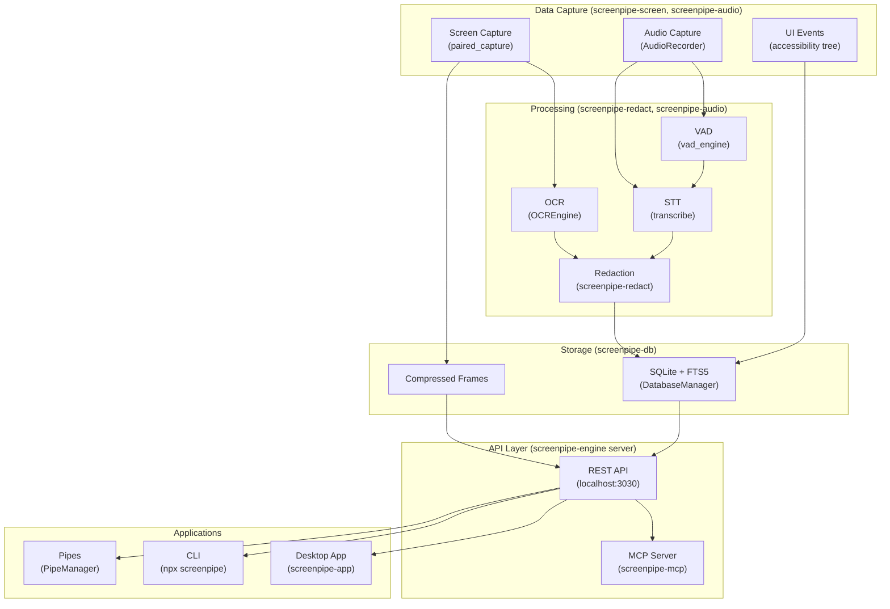

This diagram shows how hardware inputs (screen and audio) are captured and processed through OCR, speech-to-text, and PII redaction before being stored locally. The API layer exposes this data to the desktop app, CLI, and AI agents using either REST or the Model Context Protocol (MCP).

> Sources: [README.md:16-18](), [README.md:63-78](), [docs/mintlify/docs-mintlify-mig-tmp/architecture.mdx:12-130]()

## Core Capabilities

Screenpipe offers several core capabilities through tightly integrated components:

| Capability           | Description                                                  | Implementation Highlights                          |
|----------------------|--------------------------------------------------------------|--------------------------------------------------|
| Screen Recording     | Capture screen frames paired with accessibility tree data    | Event-driven capture using OS APIs [architecture.mdx:130-152]()  |
| OCR Text Extraction  | Fallback pixel-based text extraction when accessibility unavailable | Apple Vision (macOS), Windows OCR, Tesseract (Linux) [architecture.mdx:154-157]() |
| Audio Transcription  | Local and cloud speech-to-text, with speaker diarization     | Whisper (local), Deepgram, OpenAI-compatible endpoints [meeting-transcription.mdx:12-15]() |
| PII Redaction       | Local AI model for sensitive data redaction                   | screenpipe-redact crate, outperforms cloud solutions [README.md:56-57]() |
| Full-Text Search     | Natural language semantic search across screen and audio data | SQLite FTS5 backend with background indexing [README.md:77]() |
| MCP Integration      | Provide AI assistants (Claude, Cursor, Codex) access to screen data | MCP server (`screenpipe-mcp`) to serve AI tools [README.md:101-103]() |
| Enterprise Controls  | License keys, managed policies, MDM lock for secure deployments | Features in `ee/` folder and desktop app [ee/README.md:9-13]() |

For developers and advanced users, Screenpipe is extensible via **Pipes** — YAML/Markdown scheduled tasks that automate workflows using your screen and audio data.

> Sources: [README.md:56-57](), [meeting-transcription.mdx:12-38](), [README.md:101-115](), [ee/README.md:9-13](), [docs/mintlify/docs-mintlify-mig-tmp/architecture.mdx:150-190]()

## System Components

Screenpipe is structured as a Rust workspace encompassing capture, processing, database, API, and UI crates, combined with a Tauri frontend application.

### Crate-to-Code Entity Mapping

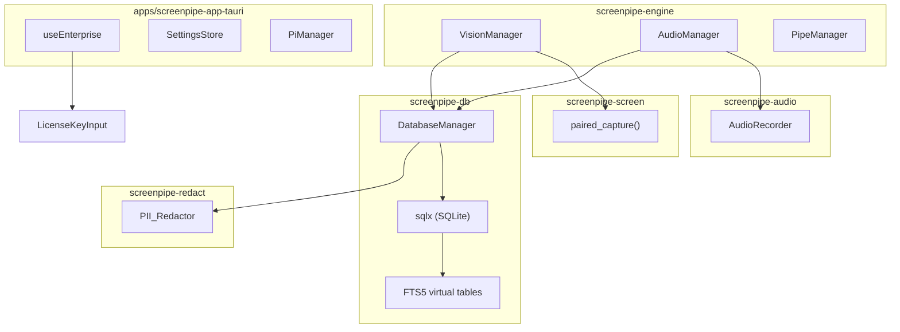

### Key Crates and Roles

| Crate / Module            | Primary Entities              | Role and Responsibility                        |
|--------------------------|------------------------------|------------------------------------------------|
| `screenpipe-engine`       | `VisionManager`, `AudioManager`, `PipeManager` | Orchestrates capture, processing, and scheduled tasks [README.md:101-103]() |
| `screenpipe-db`           | `DatabaseManager`, `sqlx`, `FTS5`                | SQLite storage, full-text search indexing [README.md:67-68]() |
| `screenpipe-screen`       | `paired_capture()`                               | Event-driven screen capture and accessibility processing [architecture.mdx:145-147]() |
| `screenpipe-audio`        | `AudioRecorder`                                   | Audio capture and speech-to-text transcription [meeting-transcription.mdx:12-15]() |
| `screenpipe-redact`       | `PII_Redactor`                                    | Local PII detection and redaction on text and images [README.md:56-57]() |
| `apps/screenpipe-app-tauri` | `useEnterprise`, `SettingsStore`, `PiManager` | Desktop app UI, settings, and AI agent orchestration [ee/desktop/index.ts:4-30]() |
| `ee/` (Enterprise)        | `AdminPolicy`, `LicenseInfo`                      | Enterprise-only enterprise policies, license validation [ee/README.md:9-13]() |

> Sources: [README.md:56-57](), [README.md:101-115](), [ee/README.md:9-13](), [ee/desktop/index.ts:4-30](), [docs/mintlify/docs-mintlify-mig-tmp/architecture.mdx:100-126]()

## Data Flow: Bridging Human Context to Code

The data flow bridges your natural world (screen and audio) into data structures that the system processes and AI agents consume.

### Conceptual Flowchart: Natural Language to Code Entities

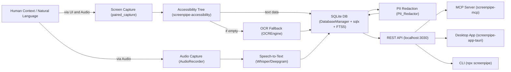

This diagram illustrates how real-world activities (screen visuals, audio, UI events) are captured and transformed into structured data, stored locally, then exposed via API for searching or AI interactions.

> Sources: [README.md:16-18](), [README.md:63-78](), [docs/mintlify/docs-mintlify-mig-tmp/architecture.mdx:12-130](), [docs/mintlify/docs-mintlify-mig-tmp/cli-reference.mdx:8-156]()

### Code Entity Relation: From Natural Language to Crate-Level Components

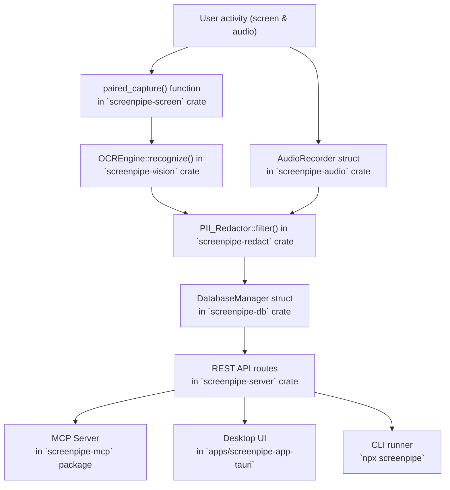

This diagram highlights key code entities involved in processing the natural activities into stored records accessible via API and AI interfaces.

> Sources: [README.md:63-78](), [docs/mintlify/docs-mintlify-mig-tmp/architecture.mdx:101-126]()

## Local-First Philosophy and Privacy

Screenpipe is designed to keep your data local by default:
- All capture, transcription, and indexing happen on your machine to maximize privacy.
- Optional cloud AI providers, team sync, and third-party integrations use separate controlled paths.
- You can run fully offline with local models (e.g., Whisper, Ollama).
- PII redaction runs locally using proprietary AI models.
- Encryption at rest is available.
- Full API authentication is enabled by default for secure local access.

This design prevents data leakage and reduces reliance on cloud services, while still enabling scalable AI integration where desired.

> Sources: [README.md:73, 114-115](), [meeting-transcription.mdx:140](), [docs/mintlify/docs-mintlify-mig-tmp/privacy-filter.mdx]()

## Deployment and Access Models

| Deployment Model  | Description                                                  | Access Methods                       |
|-------------------|--------------------------------------------------------------|------------------------------------|
| Desktop App       | Tauri-based UI and full experience including timeline, settings, scheduled tasks, connections | Desktop GUI, REST API              |
| CLI               | Headless, lightweight recording and API server for terminal-first use | Command line, REST API             |
| SDK               | Embeddable libraries for Tauri, Electron, Swift, Node apps    | Direct API integration             |

The desktop app offers the richest user experience, while the CLI and SDK provide flexible integration points for automation and embedding into other tools.

> Sources: [README.md:90, 95](), [ee/README.md:13]()

## Performance and Resources

- CPU usage typically ranges from 5% to 20%, depending on hardware and workload.
- RAM usage ranges from 0.5 to 3 GB for capture; local AI models and processing can increase usage.
- Storage usage varies with retention policies, display count, and recording settings. Expect roughly 20 GB per month at standard fidelity.
- Data is stored in `~/.screenpipe/db.sqlite` (SQLite DB with FTS5) and media files in `~/.screenpipe/data/`.

> Sources: [README.md:125-127]()

## Next Steps: Explore Child Pages

For more detailed information, proceed to these child pages:

- **[Installation](#1.1)** — Platform-specific installation instructions for the desktop app and CLI, including development environment setup.
- **[Quick Start](#1.2)** — Step-by-step guide to get started with your first screen capture, search, and AI interaction.
- **[Core Concepts](#1.3)** — Deep dive into event-driven capture, local storage architecture, Pipes plugin system, MCP protocol, and privacy model.

---

This overview summarizes Screenpipe’s purpose as a local-first, source-available AI memory system that empowers you to continually record, understand, and automate your computer work, while maintaining full control over privacy and data.

---

**Sources:**  
`README.md:16-78`(),  
`docs/mintlify/docs-mintlify-mig-tmp/architecture.mdx:12-130`(),  
`README.md:56-57`(),  
`meeting-transcription.mdx:12-15`(),  
`docs/mintlify/docs-mintlify-mig-tmp/cli-reference.mdx:8-156`(),  
`ee/README.md:9-13`(),  
`ee/desktop/index.ts:4-30`()

---

# Page: Installation

# Installation

<details>
<summary>Relevant source files</summary>

The following files were used as context for generating this wiki page:

- [LICENSE.md](LICENSE.md)
- [README.md](README.md)
- [crates/screenpipe-engine/src/analytics.rs](crates/screenpipe-engine/src/analytics.rs)
- [crates/screenpipe-engine/src/resource_monitor.rs](crates/screenpipe-engine/src/resource_monitor.rs)
- [crates/screenpipe-engine/src/telemetry_context.rs](crates/screenpipe-engine/src/telemetry_context.rs)
- [docs/telemetry-support-context.md](docs/telemetry-support-context.md)
- [packages/cli/screenpipe-darwin-arm64/package.json](packages/cli/screenpipe-darwin-arm64/package.json)
- [packages/cli/screenpipe-darwin-x64/package.json](packages/cli/screenpipe-darwin-x64/package.json)
- [packages/cli/screenpipe-linux-x64/package.json](packages/cli/screenpipe-linux-x64/package.json)
- [packages/cli/screenpipe-win32-x64/package.json](packages/cli/screenpipe-win32-x64/package.json)
- [packages/cli/screenpipe/lib/cli.js](packages/cli/screenpipe/lib/cli.js)
- [packages/cli/screenpipe/lib/index.js](packages/cli/screenpipe/lib/index.js)
- [packages/cli/screenpipe/lib/telemetry.js](packages/cli/screenpipe/lib/telemetry.js)
- [packages/cli/screenpipe/lib/telemetry.test.js](packages/cli/screenpipe/lib/telemetry.test.js)
- [packages/cli/screenpipe/package.json](packages/cli/screenpipe/package.json)
- [packages/cli/screenpipe/scripts/postinstall.js](packages/cli/screenpipe/scripts/postinstall.js)
- [packages/cli/screenpipe/scripts/postinstall.sh](packages/cli/screenpipe/scripts/postinstall.sh)

</details>


This document provides platform-specific installation instructions for the Screenpipe desktop application, CLI, and development environments. Screenpipe is a local-first system that captures screen and audio data, requiring specific system dependencies for OCR, transcription engines, and event-driven capture.

## Installation Methods Overview

Screenpipe is distributed as a unified Rust workspace where the desktop app (Tauri) and CLI share core recording logic.

| Method           | Use Case                                         | Platforms              | Distribution                                         |
|------------------|-------------------------------------------------|-----------------------|----------------------------------------------------|
| **Desktop App**  | GUI, visual timeline, tray management, automatic updates | macOS, Windows, Linux | `.dmg`, `.exe`, `.AppImage` via [screenpi.pe](https://screenpi.pe/onboarding) |
| **CLI**          | Headless recording, server-side usage, automation | macOS, Windows, Linux | `npx screenpipe record`                             |
| **Development**  | Building from source, contributing                | macOS, Windows, Linux | Git clone + Cargo/Bun                               |

**System Topology: Installation to Execution**

```mermaid
graph TD
    subgraph "Distribution Layer"
        NPM["npm Registry"]
        DMG["macOS .dmg"]
        EXE["Windows .exe"]
        SRC["GitHub Source"]
    end

    subgraph "Build & Preparation"
        PRE["pre_build.js (Dependency Fetcher)"]
        SETUP_BLAS["setup_openblas.js"]
    end

    subgraph "Execution Layer"
        CLI["screenpipe CLI (Binary)"]
        APP["screenpipe-app-tauri (GUI)"]
    end

    subgraph "Core Engines"
        VM["VisionManager Engine"]
        AM["AudioManager Engine"]
        DB["SQLite DB (FTS5 Full-Text Search)"]
    end

    NPM -->|"npx" CLI
    DMG -->|"Install" APP
    EXE -->|"Install" APP
    SRC --> PRE
    PRE --> SETUP_BLAS
    PRE --> APP

    CLI --> VM
    CLI --> AM
    APP --> VM
    APP --> AM

    VM --> DB
    AM --> DB
```

The diagram depicts the flow from distribution formats to build and preparation scripts, leading to the executable CLI and desktop applications, which in turn connect to core engines managing vision and audio capture, both storing data locally in SQLite with full-text-search capabilities.

Sources: [README.md:86-100]()

---

## Desktop Application

The Screenpipe desktop application is built using **Tauri** for a lightweight, cross-platform native shell with a **Next.js** frontend. It manages the lifecycle of the local recording server and offers a rich graphical UI for timeline review, search, notifications, and managing AI "Pipes" and "Connections".

### Platform Support

- **macOS (Apple Silicon & Intel)**  
  Full support with Screen Recording permissions required in System Settings → Privacy & Security → Screen Recording.  
  Utilizes native optimizations such as ScreenCaptureKit and Metal integration for efficient screen capture.

- **Windows 10/11**  
  Distributed as signed `.exe` installers and binaries. Requires `.NET 8.0` runtime for some CLI components if not using installer. Screen capture relies on Windows Graphics Capture (WGC) and UI Automation (UIA) accessibility APIs.

- **Linux**  
  Provided as an AppImage bundle. Requires system dependencies like `libasound2-dev` (Ubuntu/Debian), `alsa-lib` (Fedora), and `ffmpeg` to be installed for audio capture and video processing.

### Setup & Onboarding

- Upon first launch, the app guides the user through granting required permissions (screen/audio recording) and configures settings such as storage location and retention.
- It automatically starts the embedded local REST API server on `localhost:3030` managing the recording engines.
- The desktop app UI provides access to recordings, search interfaces, pipes management, and AI integrations.

Sources: [README.md:86-100]()

---

## CLI Installation

The CLI is designed for terminal/automation-first users or environments where the desktop app is unnecessary or unavailable, such as headless servers.

### Quick Start

Run the following command to start continuous recording and local data capture:

```bash
npx -y screenpipe@latest record
```

This command downloads the correct prebuilt binary for your platform and architecture, then launches the background recorder. Recorded data is stored by default in the `~/.screenpipe/` directory on Unix-like systems.

### Usage Notes

- The CLI binary invocation is wrapped by a Node.js script (`lib/cli.js`) that manages telemetry, signal forwarding, and platform-specific binary resolution based on OS and architecture [packages/cli/screenpipe/lib/cli.js:1-160]().
- Telemetry is opt-in but automatically disabled during CI runs or if environment variables specifying opt-out are set, to avoid polluting metrics.
- If the binary is not available for your platform or architecture, you will see an error suggesting reinstalling via npm.
- To suppress periodic prompts reminding users to install the desktop app, set the environment variable:  
  `SCREENPIPE_NO_REMINDERS=1`

### MCP Server Installation for AI Integration

To enable AI assistants like Claude to interface with Screenpipe's memory and pipes system, install the Model Context Protocol (MCP) server which communicates via standard IO or other transports:

```bash
claude mcp add screenpipe -- npx -y screenpipe-mcp@latest
```

This setup links your local screen and audio memory with AI assistants for query and automation workflows.

Sources: [README.md:87-101](), [packages/cli/screenpipe/lib/cli.js:1-160]()

---

## System Dependencies and Post-Install Setup

### FFmpeg and Audio Libraries

- **macOS**: The postinstall script downloads a prebuilt `ffmpeg` binary for ARM64 or x64 architectures if `ffmpeg` is missing. The binary is installed under `~/.local/bin/ffmpeg` with quarantine removed for execution permissions [packages/cli/screenpipe/scripts/postinstall.sh:14-37]().
- **Linux**: It installs `ffmpeg` via common package managers (`apt-get`, `dnf`, or `pacman`) and ensures the availability of audio libraries such as `libasound2-dev` or `alsa-lib` [packages/cli/screenpipe/scripts/postinstall.sh:40-67]().
- **Windows**: No `ffmpeg` installation attempted by postinstall; users should install manually if needed.

The postinstall scripts run automatically upon `npm install screenpipe` or `bunx screenpipe` and also send anonymized telemetry about the install success or failure to PostHog for usage tracking.

Sources: [packages/cli/screenpipe/scripts/postinstall.sh:1-120](), [packages/cli/screenpipe/scripts/postinstall.js:1-147]()

---

## Development Environment Setup

Developers working on Screenpipe can leverage ready-made devcontainers and scripts for setting up a consistent development environment.

### Devcontainer Configuration

- The repository includes a `.devcontainer/` directory (not shown here but part of the repo) which configures VS Code Remote Containers or compatible systems.
- The devcontainer provides the Rust toolchain, Node.js/Bun, and system dependencies preinstalled for quick startup.
- Useful for contributors targeting Linux or cross-platform compatibility, with scripts automating first-time setup, including OpenBLAS for numerical computations.

### Build from Source

- Clone the repository:  
  `git clone https://github.com/screenpipe/screenpipe.git`
- Enter the workspace and use Cargo to build the Rust crates and Tauri desktop app.
- Run frontend `Next.js` with `npm run dev` or similar inside the `apps/` directory.
- Linux developers need to ensure libraries such as `libasound2-dev` and `ffmpeg` are installed before building.

Sources: [README.md:87-101]()

---

## Verification and Health Check

After installation (desktop or CLI), verify the local backend server is running:

```bash
curl http://localhost:3030/health
```

You should receive a JSON response:

```json
{"status":"healthy"}
```

Indicating the recording server and REST API are ready for interaction.

Sources: [README.md:87-101]()

---

## Enterprise Deployment Considerations

For enterprise users requiring centralized management and compliance:

- Windows builds are signed with EV code signing certificates via the CI pipeline, ensuring compliance with Microsoft Intune and other policy platforms.
- Screenpipe supports enterprise-grade license enforcement and audit telemetry.
- The signing process integrates with the build pipeline using scripts like `sign-ssl.ps1` combined with certificates from SSL.com, managed within the GitHub Actions workflows.

**Enterprise Build & Signing Data Flow**

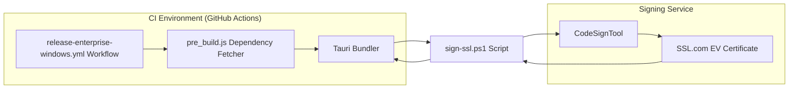

Sources: [README.md:176-177]()

---

## Key Installation File Locations

| Data Type          | Default Path                                               | Description                                  |
|--------------------|------------------------------------------------------------|----------------------------------------------|
| SQLite Database    | `~/.screenpipe/db.sqlite`                                   | Main local storage with FTS5-enabled tables |
| Media Assets       | `~/.screenpipe/data/`                                       | Captured screen frames (JPEG) and audio chunks |
| Pipes Configuration| `~/.screenpipe/pipes/`                                      | User-configured AI Pipes (workflows, automations) |

These directories contain your local-screen capture history and AI interaction state.

Sources: [README.md:87-101]()

---

# Summary

Screenpipe’s installation covers multiple deployment options:

- **Desktop App:** Full GUI and automatic lifecycle management.
- **CLI:** Headless background recording daemon, easy to install via `npx`.
- **Development:** Source builds with Rust and Node.js environments using devcontainers.
- **System dependencies**: Managed through postinstall scripts with platform-specific logic.
- **Enterprise**: Signed Windows builds and compliance via CI pipeline.

This local-first and modular setup ensures that Screenpipe runs efficiently across all supported platforms with minimum friction.

---

# Maps Bridging Natural Language Entities to Code Entities

### 1. Installation Components and Code Entities

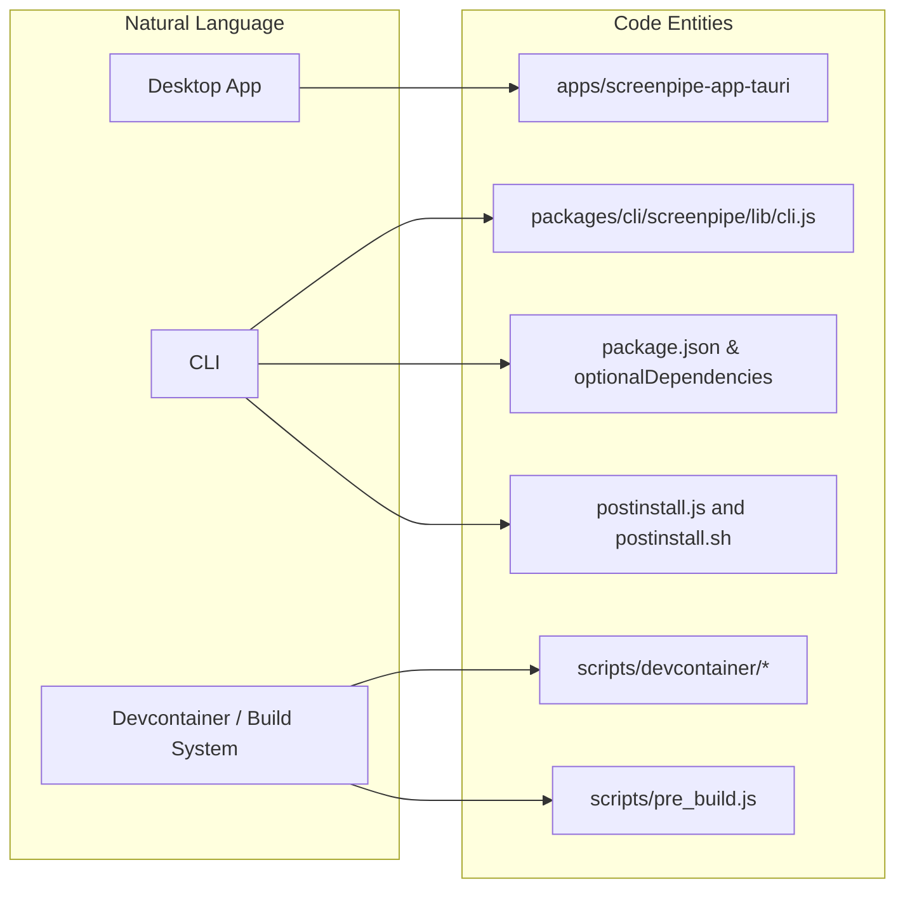

This diagram connects high-level user terms like “Desktop App” and “CLI” to their concrete implementations in the codebase, including wrapper scripts and package.json metadata for platform binaries.

---

### 2. CLI Execution Flow and Telemetry Integration

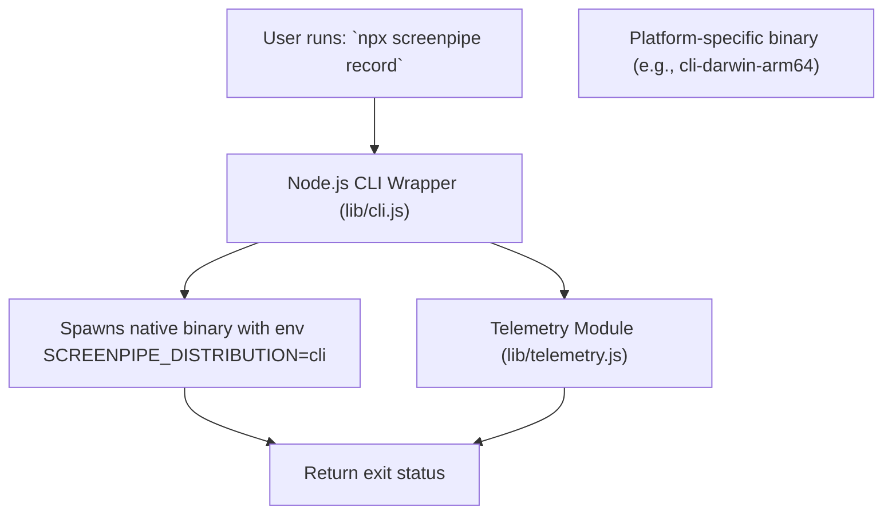

This flowchart shows the role of the Node.js CLI utility in launching the platform binary and handling telemetry events, as orchestrated by the `lib/cli.js` file.

Sources: [packages/cli/screenpipe/lib/cli.js:1-160](), [packages/cli/screenpipe/scripts/postinstall.js:1-147]()

---

# References to Key Files

- Desktop app packaging and entry: `apps/screenpipe-app-tauri`
- CLI wrapper script: `packages/cli/screenpipe/lib/cli.js:1-161`  
- CLI platform-dependent binaries: `packages/cli/screenpipe-darwin-arm64/package.json` and similar  
- Post-installation and dependency setup: `packages/cli/screenpipe/scripts/postinstall.js:1-148`, `packages/cli/screenpipe/scripts/postinstall.sh:1-120`  
- Telemetry context and analytics integration: `crates/screenpipe-engine/src/analytics.rs:1-209`, `crates/screenpipe-engine/src/telemetry_context.rs:1-186`  

Sources: [README.md:86-101](), [packages/cli/screenpipe/lib/cli.js:1-160](), [packages/cli/screenpipe/scripts/postinstall.js:1-147](), [packages/cli/screenpipe/scripts/postinstall.sh:1-120](), [crates/screenpipe-engine/src/analytics.rs:1-209](), [crates/screenpipe-engine/src/telemetry_context.rs:1-186]()

---

# Page: Quick Start

# Quick Start

<details>
<summary>Relevant source files</summary>

The following files were used as context for generating this wiki page:

- [LICENSE.md](LICENSE.md)
- [README.md](README.md)
- [docs/mintlify/docs-mintlify-mig-tmp/ai-memory.mdx](docs/mintlify/docs-mintlify-mig-tmp/ai-memory.mdx)
- [docs/mintlify/docs-mintlify-mig-tmp/api-recipes.mdx](docs/mintlify/docs-mintlify-mig-tmp/api-recipes.mdx)
- [docs/mintlify/docs-mintlify-mig-tmp/architecture.mdx](docs/mintlify/docs-mintlify-mig-tmp/architecture.mdx)
- [docs/mintlify/docs-mintlify-mig-tmp/cli-reference.mdx](docs/mintlify/docs-mintlify-mig-tmp/cli-reference.mdx)
- [docs/mintlify/docs-mintlify-mig-tmp/connections.mdx](docs/mintlify/docs-mintlify-mig-tmp/connections.mdx)
- [docs/mintlify/docs-mintlify-mig-tmp/docs.json](docs/mintlify/docs-mintlify-mig-tmp/docs.json)
- [docs/mintlify/docs-mintlify-mig-tmp/faq.mdx](docs/mintlify/docs-mintlify-mig-tmp/faq.mdx)
- [docs/mintlify/docs-mintlify-mig-tmp/getting-started.mdx](docs/mintlify/docs-mintlify-mig-tmp/getting-started.mdx)
- [docs/mintlify/docs-mintlify-mig-tmp/home.mdx](docs/mintlify/docs-mintlify-mig-tmp/home.mdx)
- [docs/mintlify/docs-mintlify-mig-tmp/meeting-transcription.mdx](docs/mintlify/docs-mintlify-mig-tmp/meeting-transcription.mdx)
- [docs/mintlify/docs-mintlify-mig-tmp/privacy-data-flow.mdx](docs/mintlify/docs-mintlify-mig-tmp/privacy-data-flow.mdx)
- [docs/mintlify/docs-mintlify-mig-tmp/privacy-filter.mdx](docs/mintlify/docs-mintlify-mig-tmp/privacy-filter.mdx)
- [docs/mintlify/docs-mintlify-mig-tmp/quickstart.mdx](docs/mintlify/docs-mintlify-mig-tmp/quickstart.mdx)
- [docs/mintlify/docs-mintlify-mig-tmp/troubleshooting.mdx](docs/mintlify/docs-mintlify-mig-tmp/troubleshooting.mdx)
- [docs/mintlify/docs-mintlify-mig-tmp/vs-fathom.mdx](docs/mintlify/docs-mintlify-mig-tmp/vs-fathom.mdx)
- [docs/mintlify/docs-mintlify-mig-tmp/vs-fireflies.mdx](docs/mintlify/docs-mintlify-mig-tmp/vs-fireflies.mdx)
- [docs/mintlify/docs-mintlify-mig-tmp/vs-granola.mdx](docs/mintlify/docs-mintlify-mig-tmp/vs-granola.mdx)
- [docs/mintlify/docs-mintlify-mig-tmp/vs-limitless.mdx](docs/mintlify/docs-mintlify-mig-tmp/vs-limitless.mdx)
- [docs/mintlify/docs-mintlify-mig-tmp/vs-littlebird.mdx](docs/mintlify/docs-mintlify-mig-tmp/vs-littlebird.mdx)
- [docs/mintlify/docs-mintlify-mig-tmp/vs-omi.mdx](docs/mintlify/docs-mintlify-mig-tmp/vs-omi.mdx)
- [docs/mintlify/docs-mintlify-mig-tmp/vs-otter.mdx](docs/mintlify/docs-mintlify-mig-tmp/vs-otter.mdx)
- [docs/mintlify/docs-mintlify-mig-tmp/vs-pieces.mdx](docs/mintlify/docs-mintlify-mig-tmp/vs-pieces.mdx)
- [docs/mintlify/docs-mintlify-mig-tmp/vs-recall.mdx](docs/mintlify/docs-mintlify-mig-tmp/vs-recall.mdx)
- [docs/mintlify/docs-mintlify-mig-tmp/vs-rewind.mdx](docs/mintlify/docs-mintlify-mig-tmp/vs-rewind.mdx)

</details>


This page guides you through your first 10 minutes with Screenpipe: installing the application, granting necessary permissions, verifying recording is working, and performing your initial search. By the end, you will have Screenpipe capturing your screen and audio locally, making the data searchable both via the UI and AI assistants.

For detailed platform-specific installation instructions, see [Installation](#1.1). For technical background on how Screenpipe functions internally, see [Core Concepts](#1.3).

---

## Installation Options

Screenpipe can be installed via two main methods: a full desktop application with an integrated UI and a CLI-only mode ideal for headless or server deployments.

### Desktop Application (Recommended)

Download the desktop app from [screenpi.pe/onboarding](https://screenpi.pe/onboarding). This gives you a full user interface including:

- Visual timeline to browse captured data.
- Integrated search UI.
- System tray controls.
- Automatic management of native dependencies like FFmpeg, Tesseract OCR, and audio capture frameworks.
- Built-in automation “Pipes” support for scheduled AI tasks.

The desktop app offers platform-specific installers:

| Platform | Installer Type           |
|----------|-------------------------|
| macOS    | Native `.dmg` (Intel & Apple Silicon) |
| Windows  | Native `.exe` (x64)      |
| Linux    | Build from source        |

This method is the fastest way to start with Screenpipe, managing permissions and capture out of the box.

Sources: [README.md:87-101](), [README.md:179-184](), [docs/mintlify/docs-mintlify-mig-tmp/getting-started.mdx:21-33]()

### CLI-Only Mode

For headless usage or those preferring terminal-first workflows, use:

```bash
npx screenpipe@latest record
```

This starts the Screenpipe daemon, capturing your screen and audio to `~/.screenpipe/` locally without a visual UI.

Use this mode if you want lightweight background capture or to build custom integrations.

Sources: [README.md:93-95](), [docs/mintlify/docs-mintlify-mig-tmp/getting-started.mdx:29-33]()

---

## First Launch: Permissions Setup

Screenpipe requires system permissions to capture screen content and audio on macOS and Windows platforms.

### Permission Flow

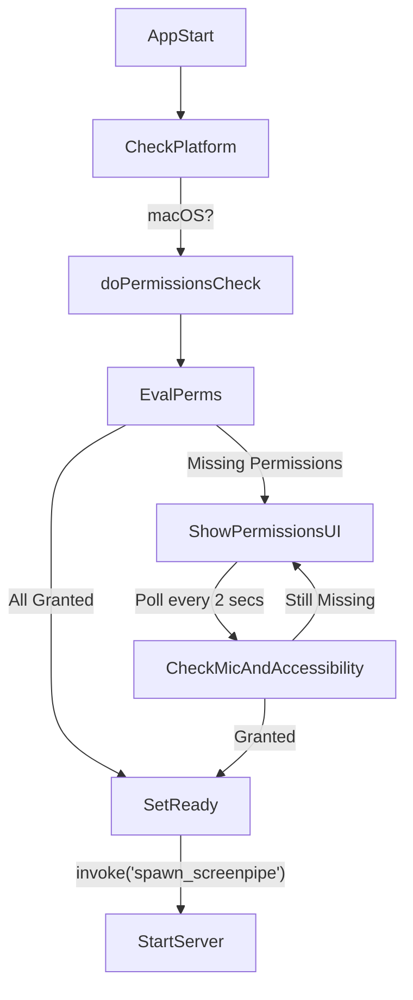

This flow ensures interactive permission prompts until all required permissions are granted, after which the core recording server starts.

### Required Permissions

| Permission          | Purpose                                                   |
|---------------------|-----------------------------------------------------------|
| **Screen Recording**| Capture screenshots and walk the accessibility UI tree   |
| **Microphone**       | Capture system audio and mic input for transcription      |
| **Accessibility**    | Access UI element text (buttons, labels, input fields)    |

These are essential to extract structured text metadata from apps directly (best quality) and fall back to OCR when necessary.

Sources: [docs/mintlify/docs-mintlify-mig-tmp/architecture.mdx:141-147](), [docs/mintlify/docs-mintlify-mig-tmp/getting-started.mdx:53-58](), [README.md:108]()

---

## Server Startup and Health Monitoring

After permissions are accepted, Screenpipe launches an embedded REST API server on `localhost:3030`.

### Server Startup Sequence

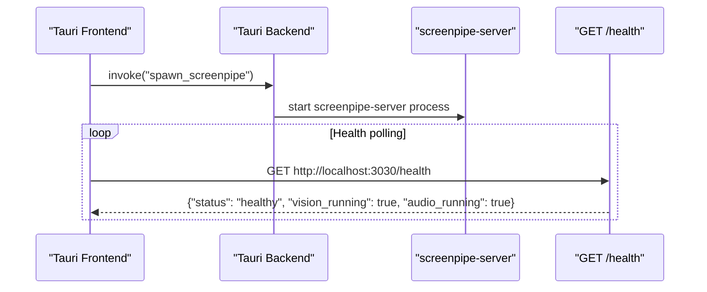

The `/health` endpoint reports system status including the screen capture engine and audio transcription process.

Query it with:

```bash
curl http://localhost:3030/health
```

This confirms whether screen and audio capture engines are active.

Sources: [docs/mintlify/docs-mintlify-mig-tmp/getting-started.mdx:102-110](), [docs/mintlify/docs-mintlify-mig-tmp/cli-reference.mdx:74-80]()

---

## Verifying Recording Activity

Screenpipe uses an event-driven, reactive capture model that triggers on meaningful UI events instead of high-frequency polling. This reduces CPU and storage usage significantly.

### Event-Driven Capture Flow

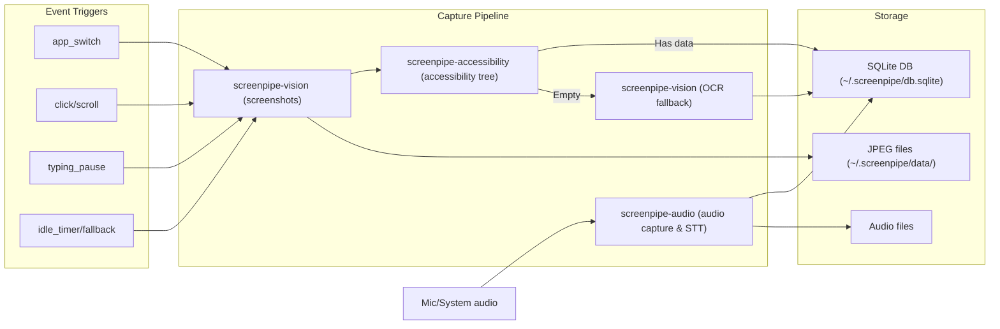

- UI events (app switch, typing, clicks) trigger screenshot capture and accessibility tree extraction.
- If accessibility data is missing (remote desktop, games), OCR acts as fallback.
- Audio streams (microphone/system) are captured and transcribed (Whisper, Deepgram).
- All data is indexed and stored locally for fast retrieval.

Sources: [docs/mintlify/docs-mintlify-mig-tmp/architecture.mdx:14-56](), [docs/mintlify/docs-mintlify-mig-tmp/architecture.mdx:128-147]()

### Success Indicators

- CPU usage generally ~5-10% depending on hardware and capture settings.
- Screenpipe writes to `~/.screenpipe/db.sqlite` and media files in `~/.screenpipe/data/`.
- The desktop app timeline view populates with frame thumbnails and text shortly after startup.

Sources: [README.md:110](), [docs/mintlify/docs-mintlify-mig-tmp/architecture.mdx:165-170]()

---

## Searching Your First Data

Once you have created some screen and audio data, try querying your history via the REST API or the built-in UI.

### Search Example with curl

```bash
curl "http://localhost:3030/search?q=meeting&limit=5&content_type=all"
```

This performs a natural language search for the term "meeting" across all data types (screen text, OCR fallback, audio transcripts).

> Note: By default, the API does not require authentication. If enabled, provide the token via a Bearer header:
> ```bash
> curl -H "Authorization: Bearer $(npx screenpipe auth token)" "http://localhost:3030/search?q=meeting"
> ```

### Search Parameters

| Parameter     | Description                                      |
|---------------|------------------------------------------------|
| `q`           | Query string (natural language or keywords)    |
| `content_type`| `accessibility`, `ocr`, `audio`, `input`, or `all` |
| `app_name`    | Filter by application name                       |
| `window_name` | Filter by window title                           |
| `browser_url` | Filter by browser URL                            |
| `start_time`  | ISO 8601 timestamp to filter start              |
| `end_time`    | ISO 8601 timestamp to filter end                |
| `limit`       | Maximum number of results (pagination)          |
| `offset`      | Pagination offset                                |

Start broad with `content_type=all` for initial discovery.

Sources: [docs/mintlify/docs-mintlify-mig-tmp/cli-reference.mdx:103-120](), [docs/mintlify/docs-mintlify-mig-tmp/getting-started.mdx:110]()

---

## Connecting to AI (MCP)

Screenpipe integrates with external AI tools using the Model Context Protocol (MCP), allowing AI assistants like Claude or Cursor to query your recent screen and audio history as context.

### MCP Setup

The simplest way to connect is by running:

```bash
claude mcp add screenpipe --transport stdio -- npx -y screenpipe-mcp
```

Or use the built-in agent setup command:

```bash
npx -y screenpipe@latest agent setup claude-desktop
```

This registers Screenpipe as an MCP data provider and makes it queryable inside supported AI applications.

### Example AI Requests

You can ask your AI:

- *"What did I see in the last 5 minutes?"*
- *"Summarize today’s conversations."*
- *"What tasks was I working on this morning?"*

These queries leverage Screenpipe’s indexed screen and audio data to provide informed replies.

Sources: [README.md:99-101](), [README.md:104](), [docs/mintlify/docs-mintlify-mig-tmp/mcp-server.mdx:18-24]()

---

## Next Steps

- **Explore Pipes**: Install automation “pipes” (AI workflows) from the sidebar’s Pipes section.
- **Configure Connections**: Add app connections like Google Calendar under **Settings → Connections** to enrich AI context and improve speaker identification.
- **Enable Cloud Archive**: Offload older data securely to cloud storage in **Settings → Cloud Archive** to save local disk space.

---

# Summary Diagrams

## 1. Natural Language Space to Code Entity Space: Screen Capture and Data Flow

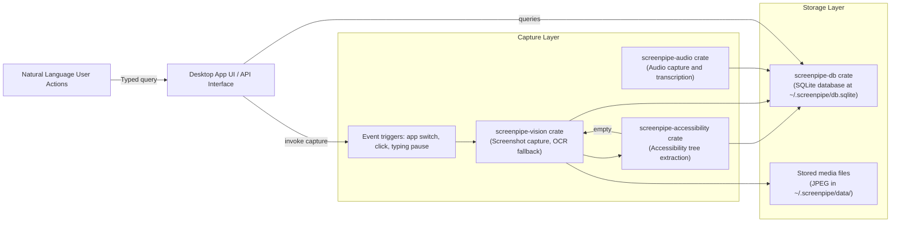

This shows the connection between user-level actions or queries in natural language through the core capture crates and into persistent storage, accessible via the UI or API.

Sources: [docs/mintlify/docs-mintlify-mig-tmp/architecture.mdx:12-64](), [README.md:58-62]()

## 2. Natural Language Space to Code Entity Space: AI Interaction with MCP

```mermaid
graph TD
    AI[Natural Language AI Assistant\n(Claude, Cursor, Codex)]
    MCP["screenpipe-mcp package\n(MCP server interface)"]
    API["screenpipe-server crate\n(REST API on localhost:3030)"]
    DB["screenpipe-db crate\n(SQLite database)"]

    AI -->|MCP Query| MCP
    MCP -->|Data request| API
    API --> DB
    DB -->|Response with screen/audio context| API
    API --> MCP
    MCP --> AI
```

The diagram illustrates how AI assistants send queries to the MCP server, which queries the Screenpipe REST API and database, streaming back context to the AI in natural language conversational flow.

Sources: [docs/mintlify/docs-mintlify-mig-tmp/mcp-server.mdx:18-24](), [README.md:104]()

---

This completes your quick start guide to getting Screenpipe recording, searchable, and AI-integrated in your environment.

Sources:  
[README.md:87-101,93-95,99-104]()  
[docs/mintlify/docs-mintlify-mig-tmp/getting-started.mdx:21-33,53-58,102-134,159]()  
[docs/mintlify/docs-mintlify-mig-tmp/architecture.mdx:12-64,128-147]()  
[docs/mintlify/docs-mintlify-mig-tmp/cli-reference.mdx:31-50,103-120]()  
[docs/mintlify/docs-mintlify-mig-tmp/mcp-server.mdx:18-24]()

---

# Page: Core Concepts

# Core Concepts

<details>
<summary>Relevant source files</summary>

The following files were used as context for generating this wiki page:

- [LICENSE.md](LICENSE.md)
- [README.md](README.md)
- [apps/screenpipe-app-tauri/components/settings/capture-filters/content-filters-card.tsx](apps/screenpipe-app-tauri/components/settings/capture-filters/content-filters-card.tsx)
- [crates/screenpipe-a11y/Cargo.toml](crates/screenpipe-a11y/Cargo.toml)
- [crates/screenpipe-a11y/examples/macos_weburl_probe.rs](crates/screenpipe-a11y/examples/macos_weburl_probe.rs)
- [crates/screenpipe-a11y/src/config.rs](crates/screenpipe-a11y/src/config.rs)
- [crates/screenpipe-a11y/src/incognito/linux.rs](crates/screenpipe-a11y/src/incognito/linux.rs)
- [crates/screenpipe-a11y/src/incognito/macos.rs](crates/screenpipe-a11y/src/incognito/macos.rs)
- [crates/screenpipe-a11y/src/incognito/mod.rs](crates/screenpipe-a11y/src/incognito/mod.rs)
- [crates/screenpipe-a11y/src/incognito/titles.rs](crates/screenpipe-a11y/src/incognito/titles.rs)
- [crates/screenpipe-a11y/src/incognito/windows.rs](crates/screenpipe-a11y/src/incognito/windows.rs)
- [crates/screenpipe-a11y/src/platform/macos.rs](crates/screenpipe-a11y/src/platform/macos.rs)
- [crates/screenpipe-a11y/src/platform/windows.rs](crates/screenpipe-a11y/src/platform/windows.rs)
- [crates/screenpipe-a11y/src/platform/windows_uia.rs](crates/screenpipe-a11y/src/platform/windows_uia.rs)
- [crates/screenpipe-a11y/src/tree/linux.rs](crates/screenpipe-a11y/src/tree/linux.rs)
- [crates/screenpipe-a11y/src/tree/macos.rs](crates/screenpipe-a11y/src/tree/macos.rs)
- [crates/screenpipe-a11y/src/tree/mod.rs](crates/screenpipe-a11y/src/tree/mod.rs)
- [crates/screenpipe-a11y/src/tree/windows.rs](crates/screenpipe-a11y/src/tree/windows.rs)
- [crates/screenpipe-a11y/src/url_filter.rs](crates/screenpipe-a11y/src/url_filter.rs)
- [crates/screenpipe-engine/src/event_driven_capture.rs](crates/screenpipe-engine/src/event_driven_capture.rs)
- [crates/screenpipe-engine/src/ui_recorder.rs](crates/screenpipe-engine/src/ui_recorder.rs)
- [crates/screenpipe-engine/src/vision_manager/manager.rs](crates/screenpipe-engine/src/vision_manager/manager.rs)
- [crates/screenpipe-screen/src/capture_screenshot_by_window.rs](crates/screenpipe-screen/src/capture_screenshot_by_window.rs)

</details>


This page explains the fundamental architectural concepts that make Screenpipe unique: event-driven capture, local-first storage, AI integration through Pipes and MCP, and the privacy model.

---

## Event-Driven Capture

Screenpipe uses an **event-driven capture model** rather than continuous polling. Instead of capturing every frame at fixed intervals, the system listens for meaningful OS events that indicate user activity or screen changes, triggering captures only when necessary. This approach dramatically reduces CPU usage (to roughly 5-10%) and average storage requirements (around 20GB/month).

### Trigger Events and Capture Model

The core coordination for event-driven capture resides in the `event_driven_capture` module. This replaces older polling-based video capture with a system that responds to specific user and system events. Key capture triggers include:

| Event Type       | Code Entity                     | Description                                  |
|------------------|--------------------------------|----------------------------------------------|
| **App Switch**   | `CaptureTrigger::AppSwitch`     | When the foreground application changes.    |
| **Window Focus** | `CaptureTrigger::WindowFocus`   | Focus changes between windows within an app.|
| **Click**       | `CaptureTrigger::Click`          | Mouse click events detected.                  |
| **Typing Pause**| `CaptureTrigger::TypingPause`    | Triggered during pauses in keyboard input.   |
| **Scroll Stop** | `CaptureTrigger::ScrollStop`     | Triggered when scrolling activity ceases.    |
| **Visual Change**| `CaptureTrigger::VisualChange`   | Screen content changes independent of input (e.g. video). |
| **Idle Fallback**| `CaptureTrigger::Idle`           | Periodic fallback capture after inactivity timeout. |

This design ensures captures happen only on meaningful activity, avoiding redundant data capture during idle or unchanged periods.

### Implementation Highlights

- Each active monitor recording spawns an event-driven capture loop (`event_driven_capture.rs`) that listens asynchronously for trigger events and orchestrates captures under a timeout budget (typically 15s per capture).

- A key function, `paired_capture()`, performs an atomic operation concatenating a screen image snapshot with an accessibility tree capture. This synchronous pairing ensures the image and semantic context are aligned in time.

- Captures include multi-layered exclusion filters, power profile adaptations (e.g., idle throttling), and fallback logic for accessibilities that might not expose enough text.

### Accessibility Tree Extraction vs. OCR

Screenpipe prioritizes accessibility tree extraction over OCR for textual data because it provides structured semantic context, is faster, and more accurate. However, if accessibility text is thin or incomplete, OCR (e.g., Apple Vision or Windows OCR) activates as a fallback.

The combined "paired capture" produces:

- A **screenshot** with pixel data
- An **accessibility node tree** with text, roles, bounds, and metadata
- Optional **OCR transcriptions** for unidentified text regions

**Capture flow with decision points:**

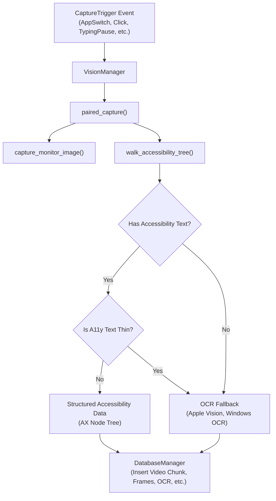

This layered approach combines semantic accuracy with fallback robustness for text extraction.

Sources: [crates/screenpipe-engine/src/event_driven_capture.rs:5-62](), [crates/screenpipe-engine/src/vision_manager/manager.rs:5-142](), [README.md:104-119]()

---

## Local-First Data Storage

Screenpipe emphasizes a **local-first** philosophy. All captured data—video frames, audio transcriptions, UI events, accessibility trees, and extracted text—are stored locally, by default offline and optionally encrypted at rest.

### Directory and File Layout

The base directory is typically `~/.screenpipe/` (user’s home directory). The structure includes:

```
~/.screenpipe/
├── db.sqlite                # Core SQLite database (WAL journal mode)
├── store.bin                # Persistent settings store (SettingsStore)
├── screenpipe.log           # Rotating application logs
├── data/
│   └── snapshots/           # Per-monitor JPEG screenshots by monitor ID
└── pipes/                   # Local pipes directory
    └── my-pipe/
        └── pipe.md          # Pipe definition file (YAML + markdown)
```

This filesystem organization supports modular management of data and workflows.

### Database Architecture

The primary data repository is a SQLite database managed by the `DatabaseManager` abstraction. Features include:

- **WAL mode** for concurrency (enables readers during writes).
- **FTS5 (Full Text Search)** extensions powering robust natural language search across:

  - Full frames and metadata
  - OCR text chunks from screenshots
  - Audio transcription texts
  - UI events including keyboard, mouse, and window activity

**Storage Schema Entity Map:**

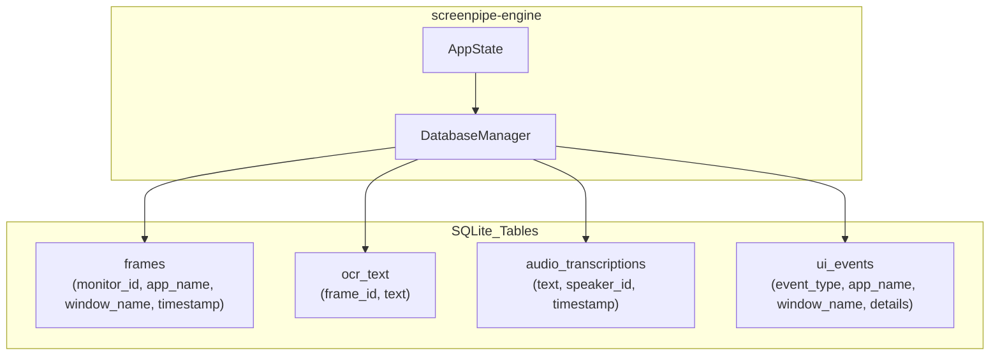

- **Redaction**: The system supports asynchronous PII redaction on text and images at rest, configurable through `RecordingConfig` flags such as `async_pii_redaction` and `async_image_pii_redaction`.

Sources: [crates/screenpipe-engine/src/bin/screenpipe-engine.rs:131-156](), [crates/screenpipe-engine/src/server.rs:130-170](), [crates/screenpipe-engine/src/recording_config.rs:35-70](), [README.md:60-80]()

---

## Pipes System

**Pipes** are user-definable automated AI workflows that operate on Screenpipe data at scheduled intervals. Each pipe corresponds to a directory under `~/.screenpipe/pipes/` containing a `pipe.md` file that specifies the workflow, AI prompts, scheduling, and optionally environment variables for secrets.

### PipeManager Responsibilities

- **Discovery**: Watches the `pipes` directory for new, changed, or removed pipes.
- **Scheduling**: Parses `schedule` frontmatter like `"every 30m"` to trigger execution.
- **Prompt Construction**: Prepends context such as time ranges, API URL endpoints, and output directories to the `pipe.md` content.
- **Execution**: Runs pipes using the `pi` coding agent through JSON-RPC or local API calls.
- **Result Handling**: Pipes can write files, trigger notifications, or call external APIs.

### Pipe Execution Flow

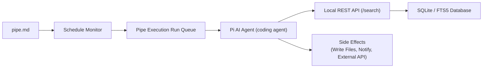

This enables flexible, scheduled AI processing loops that leverage the entire local data store.

Sources: [docs/mintlify/docs-mintlify-mig-tmp/pipes.mdx:130-160](), [crates/screenpipe-engine/src/server.rs:150-170]()

---

## Model Context Protocol (MCP) Integration

Screenpipe implements the **Model Context Protocol (MCP)**, which exposes local captured data securely to external AI assistants, IDEs, or tools such as Claude, Cursor, or VS Code extensions.

### MCP Server Features

- The `screenpipe-mcp` package runs a microservice that provides MCP endpoints.
- Offers LLM-accessible methods like `search_screen`, `list_audio`, `get_activity_summary` to query local data.
- Supports **MCP Apps**: interactive HTML/UI overlays that agents can show, enabling rich visualizations and workflows that operate on Screenpipe data in real time.

This integration enables external AI agents to tap into the user’s capture history, enabling augmented intelligence features.

Sources: [README.md:99-104](), [docs/mintlify/docs-mintlify-mig-tmp/pipes.mdx:150-160]()

---

## Privacy Model

Screenpipe follows a privacy-conscious design with several technical enforcements:

1. **Local-Only Storage:**  
   All data is stored locally in SQLite databases. Cloud sync or AI inference uses separate data paths and opt-in flows. Data does not leave the user’s device by default.  

2. **PII Masking and Redaction:**  
   A trained ONNX privacy model on-device or the Tinfoil enclave automatically removes personally identifiable information from stored text and images asynchronously.

3. **Selective Capture Filtering:**

   - **App and Window Exclusion:**  
     Password managers, lock screens, and other sensitive apps are excluded automatically by name patterns.  

   - **Incognito Window Detection:**  
     Private browsing windows are detected and ignored to protect browsing privacy automatically.

4. **DRM Content Detection:**  
   Captures pause automatically when DRM-protected streaming apps (Netflix, Disney+, etc.) are in focus, avoiding unauthorized recording.

5. **Auditability and Transparency:**  
   Screenpipe is source-available, with a clearly documented privacy model and modular design permitting security audits and user modifications.

This multi-layered model prioritizes local control and data minimization to protect user privacy.

Sources: [crates/screenpipe-engine/src/recording_config.rs:40-65](), [apps/screenpipe-app-tauri/components/settings/privacy-section.tsx:10-15](), [README.md:70-80]()

---

# Summary Mermaid Diagram: Core Concepts to Code Entities

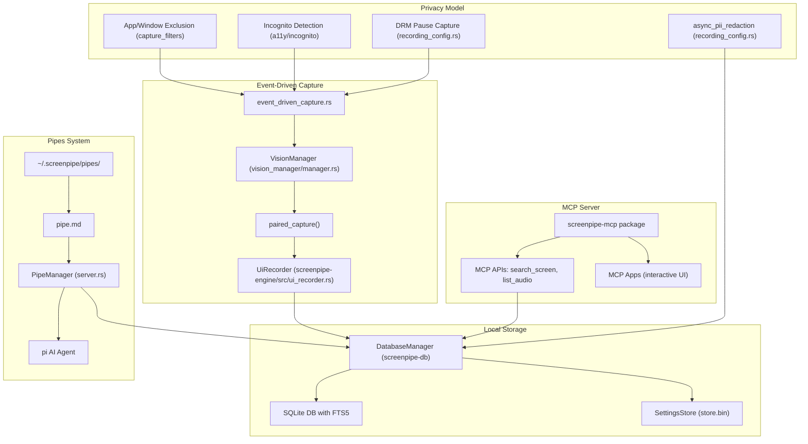

This diagram maps the major conceptual areas of Screenpipe to the core code entities handling them.

---

# Full Details and File Pointers

| Concept                    | Primary Files and Lines                                            |
|----------------------------|------------------------------------------------------------------|
| Event-Driven Capture Loop   | `crates/screenpipe-engine/src/event_driven_capture.rs:1-163`      |
| VisionManager (Multi-Monitor Capture) | `crates/screenpipe-engine/src/vision_manager/manager.rs:1-142`         |
| Accessibility Tree Capture  | `crates/screenpipe-a11y/src/tree/mod.rs` and platform-specific modules (`macos.rs`, `windows.rs`, `linux.rs`) |
| UI Recorder Integration     | `crates/screenpipe-engine/src/ui_recorder.rs:1-182`               |
| DatabaseManager & Storage   | `crates/screenpipe-engine/src/server.rs:130-170` and `bin/screenpipe-engine.rs:130-156` |
| Pipe System Lifecycle       | `docs/mintlify/docs-mintlify-mig-tmp/pipes.mdx` and `crates/screenpipe-engine/src/server.rs` |
| MCP Server Integration      | `packages/screenpipe-mcp` (not shown here) and README notes      |
| Privacy Controls            | `crates/screenpipe-engine/src/recording_config.rs:30-70` and UI filters in `apps/screenpipe-app-tauri/components/settings/privacy-section.tsx` |

Sources:  
[crates/screenpipe-engine/src/event_driven_capture.rs:1-163](),  
[crates/screenpipe-engine/src/vision_manager/manager.rs:1-142](),  
[crates/screenpipe-a11y/src/tree/mod.rs:1-150](),  
[crates/screenpipe-engine/src/ui_recorder.rs:1-182](),  
[crates/screenpipe-engine/src/server.rs:130-170](),  
[crates/screenpipe-engine/src/bin/screenpipe-engine.rs:130-156](),  
[docs/mintlify/docs-mintlify-mig-tmp/pipes.mdx:130-160](),  
[README.md:60-140](),  
[apps/screenpipe-app-tauri/components/settings/privacy-section.tsx:10-15](),  
[crates/screenpipe-engine/src/recording_config.rs:30-70]()

---

# Page: Architecture

# Architecture

<details>
<summary>Relevant source files</summary>

The following files were used as context for generating this wiki page:

- [Cargo.lock](Cargo.lock)
- [Cargo.toml](Cargo.toml)
- [apps/screenpipe-app-tauri/components/settings/general-settings.tsx](apps/screenpipe-app-tauri/components/settings/general-settings.tsx)
- [apps/screenpipe-app-tauri/components/settings/privacy-section.tsx](apps/screenpipe-app-tauri/components/settings/privacy-section.tsx)
- [apps/screenpipe-app-tauri/components/settings/recording-settings.tsx](apps/screenpipe-app-tauri/components/settings/recording-settings.tsx)
- [apps/screenpipe-app-tauri/components/update-banner.tsx](apps/screenpipe-app-tauri/components/update-banner.tsx)
- [apps/screenpipe-app-tauri/lib/hooks/use-settings.tsx](apps/screenpipe-app-tauri/lib/hooks/use-settings.tsx)
- [apps/screenpipe-app-tauri/lib/utils/tauri.ts](apps/screenpipe-app-tauri/lib/utils/tauri.ts)
- [apps/screenpipe-app-tauri/src-tauri/Cargo.lock](apps/screenpipe-app-tauri/src-tauri/Cargo.lock)
- [apps/screenpipe-app-tauri/src-tauri/Cargo.toml](apps/screenpipe-app-tauri/src-tauri/Cargo.toml)
- [apps/screenpipe-app-tauri/src-tauri/src/commands.rs](apps/screenpipe-app-tauri/src-tauri/src/commands.rs)
- [apps/screenpipe-app-tauri/src-tauri/src/embedded_server.rs](apps/screenpipe-app-tauri/src-tauri/src/embedded_server.rs)
- [apps/screenpipe-app-tauri/src-tauri/src/health.rs](apps/screenpipe-app-tauri/src-tauri/src/health.rs)
- [apps/screenpipe-app-tauri/src-tauri/src/main.rs](apps/screenpipe-app-tauri/src-tauri/src/main.rs)
- [apps/screenpipe-app-tauri/src-tauri/src/process_exit.rs](apps/screenpipe-app-tauri/src-tauri/src/process_exit.rs)
- [apps/screenpipe-app-tauri/src-tauri/src/recording.rs](apps/screenpipe-app-tauri/src-tauri/src/recording.rs)
- [apps/screenpipe-app-tauri/src-tauri/src/recording/db_wedge.rs](apps/screenpipe-app-tauri/src-tauri/src/recording/db_wedge.rs)
- [apps/screenpipe-app-tauri/src-tauri/src/server_core.rs](apps/screenpipe-app-tauri/src-tauri/src/server_core.rs)
- [apps/screenpipe-app-tauri/src-tauri/src/store.rs](apps/screenpipe-app-tauri/src-tauri/src/store.rs)
- [apps/screenpipe-app-tauri/src-tauri/src/tray.rs](apps/screenpipe-app-tauri/src-tauri/src/tray.rs)
- [apps/screenpipe-app-tauri/src-tauri/src/updates.rs](apps/screenpipe-app-tauri/src-tauri/src/updates.rs)
- [crates/screenpipe-audio/Cargo.toml](crates/screenpipe-audio/Cargo.toml)
- [crates/screenpipe-config/src/recording.rs](crates/screenpipe-config/src/recording.rs)
- [crates/screenpipe-engine/src/bin/screenpipe-engine.rs](crates/screenpipe-engine/src/bin/screenpipe-engine.rs)
- [crates/screenpipe-engine/src/cli/mod.rs](crates/screenpipe-engine/src/cli/mod.rs)
- [crates/screenpipe-engine/src/lib.rs](crates/screenpipe-engine/src/lib.rs)
- [crates/screenpipe-engine/src/recording_config.rs](crates/screenpipe-engine/src/recording_config.rs)
- [crates/screenpipe-engine/src/routes/mod.rs](crates/screenpipe-engine/src/routes/mod.rs)
- [crates/screenpipe-engine/src/server.rs](crates/screenpipe-engine/src/server.rs)
- [crates/screenpipe-screen/Cargo.toml](crates/screenpipe-screen/Cargo.toml)
- [packages/sdk/Cargo.lock](packages/sdk/Cargo.lock)
- [packages/sdk/examples/tauri-app/src-tauri/Cargo.lock](packages/sdk/examples/tauri-app/src-tauri/Cargo.lock)

</details>


Screenpipe is a Tauri-based desktop application embedding a high-performance recording engine directly in-process. The architecture is layered into three primary tiers: the **Desktop Application** (Tauri with React UI and Rust backend), the **Core Recording Engine** (event-driven screen/audio/UI capture), and the **Data Layer** (SQLite with FTS5, local file storage). All captured data remains local by default, aligned with Screenpipe’s local-first philosophy, with optional cloud integrations for AI model access and device synchronization.

This page presents a high-level overview of the system architecture, illustrating major components and their interactions. For in-depth technical details, please refer to the child pages linked below.

---

## System Topology and Component Relationships

Screenpipe's system architecture centers on an embedded server model and modular engine components that collectively handle screen and audio capture, accessibility recording, and AI integration. The desktop application coordinates user interactions and orchestrates the underlying recording subsystems.

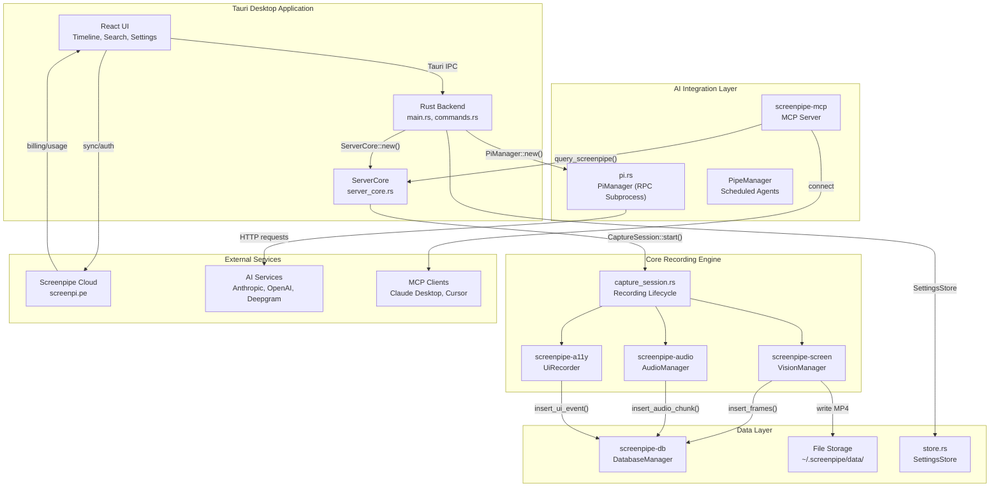

The `ServerCore` component manages long-lived resources such as the embedded HTTP server and SQLite database. Meanwhile, the `CaptureSession` handles volatile recording lifecycles for vision, audio, and UI events [apps/screenpipe-app-tauri/src-tauri/src/embedded_server.rs:5-12](). The screen and audio streams are persisted primarily in SQLite and local file storage under the data directory, with `store.rs` providing a robust settings store including snapshotting to prevent corruption during app updates [apps/screenpipe-app-tauri/src-tauri/src/store.rs:49-86]().

**Sources:** [apps/screenpipe-app-tauri/src-tauri/src/embedded_server.rs:5-12](), [crates/screenpipe-engine/src/server.rs:185-187](), [apps/screenpipe-app-tauri/src-tauri/src/store.rs:49-86]()

---

## Desktop Application Architecture

Screenpipe’s frontend is built using React and TypeScript within a Tauri application shell. The React UI presents components like Timeline, Search, and Settings, and communicates through Tauri IPC commands with the Rust backend. The backend coordinates with modular subsystems managing recording sessions, state, AI agents, and persistent settings.

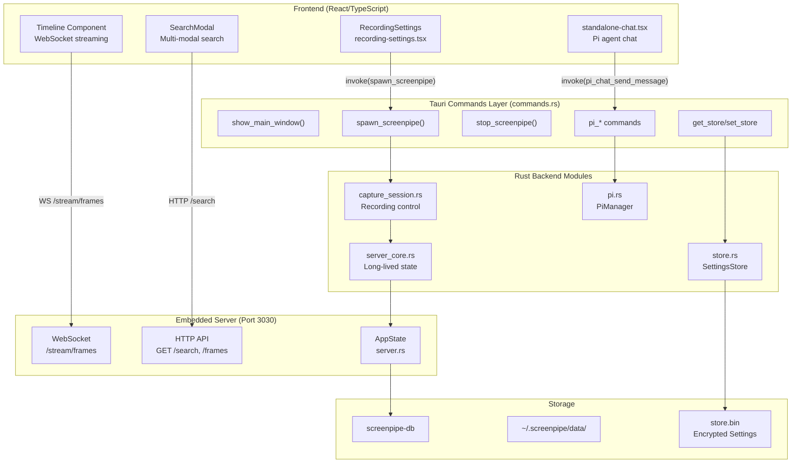

Key backend components include `AppState`, which encapsulates shared resources like `DatabaseManager` and `AudioManager` [crates/screenpipe-engine/src/server.rs:129-171](), and the `PiManager` for AI assistant RPC communication. Settings management uses a persistent encrypted `store.bin` file backed by a fail-safe snapshot mechanism, avoiding configuration loss upon abrupt shutdown or app upgrade [apps/screenpipe-app-tauri/src-tauri/src/store.rs:89-95]().

The frontend `RecordingSettings` component exposes unified UI controls for complex recording configurations, including audio capture modes, transcription engine selection, and capture frequency. This aligns settings management across the desktop GUI, CLI, and engine subsystems [apps/screenpipe-app-tauri/components/settings/recording-settings.tsx:14-38](), [crates/screenpipe-engine/src/cli/mod.rs:67-78]().

**Sources:** [crates/screenpipe-engine/src/server.rs:129-171](), [apps/screenpipe-app-tauri/components/settings/recording-settings.tsx:14-38](), [apps/screenpipe-app-tauri/src-tauri/src/store.rs:89-95](), [crates/screenpipe-engine/src/cli/mod.rs:67-78]()

---

## Data Capture & Recording Configuration

Screenpipe’s recording configuration is designed for consistency across interfaces and execution environments — configuring the screen, audio, UI recorder, and transcription engines in a cohesive manner.

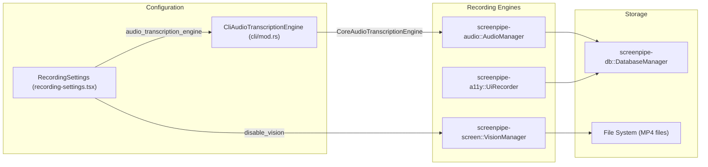

The system automatically selects the best-fitting audio transcription engine based on hardware tiers, defaulting to `WhisperTiny` for low-tier configurations and `Parakeet` for devices with higher capabilities [crates/screenpipe-engine/src/cli/mod.rs:71-78](). The `VisionManager` captures video frames for screen context and optionally writes MP4 files. Accessibility tree events and audio data are inserted into SQLite for integrated searching and AI analysis [apps/screenpipe-app-tauri/components/settings/recording-settings.tsx:14-38]().

**Sources:** [crates/screenpipe-engine/src/cli/mod.rs:71-78](), [apps/screenpipe-app-tauri/components/settings/recording-settings.tsx:14-38]()

---

## Cargo Workspace & Build Configuration

Screenpipe is structured as a unified Cargo workspace comprising multiple interdependent crates. The workspace enables modular development and deployment while optimizing binary size and runtime performance.

| Crate                    | Description                                                         |
|--------------------------|---------------------------------------------------------------------|
| `screenpipe-app-tauri`   | Main desktop application entry point; Tauri app frontend and Rust backend [apps/screenpipe-app-tauri/src-tauri/Cargo.toml:1-179]() |
| `screenpipe-engine`      | Core recording engine, embedded HTTP server, CLI, and recording control [crates/screenpipe-engine/src/bin/screenpipe-engine.rs:27-49]() |
| `screenpipe-audio`       | Audio capture, VAD, speaker ID, and transcription engines [apps/screenpipe-app-tauri/src-tauri/Cargo.toml:135-154]() |
| `screenpipe-db`          | SQLite storage, FTS5 integration, migration system [apps/screenpipe-app-tauri/src-tauri/Cargo.toml:155]() |
| `screenpipe-core`        | Shared utilities, pipe runtime, AI agent executors [Cargo.toml:22-28]() |

To minimize memory usage on non-Windows platforms, the project uses `jemalloc` as the global allocator. Build profiles include a fully optimized `release` profile with LTO and a `release-dev` profile using thin LTO for faster iteration cycles [Cargo.toml:165-177]().

**Sources:** [Cargo.toml:1-179](), [apps/screenpipe-app-tauri/src-tauri/Cargo.toml:1-179](), [crates/screenpipe-engine/src/bin/screenpipe-engine.rs:27-49]()

---

## Summary and Links to Subsystems

The Screenpipe system consists of several major subsystems working together under a common local-first principle:

- **System Overview (#2.1):** In-depth component topology and crate map detailing Tauri app, embedded server, engines, DB, AI layer.  
- **Data Capture Pipeline (#2.2):** Event-driven screen capture, accessibility extraction, OCR fallback, UI event monitoring, DRM detection, monitor watching.  
- **Audio Processing (#2.3):** Audio capture workflow, VAD and speaker identification, transcription engines (Whisper, Deepgram, OpenAI), deduplication, CoreAudio taps.  
- **Storage & Database (#2.4):** SQLite with FTS5, WAL mode, write queue/coalescing, migration system, cloud sync integration. Includes hybrid storage details.  
- **AI Gateway & Usage Tracking (#2.5):** Cloud AI gateway on Cloudflare Workers, tiered SaaS access, rate limiting, cost metrics, routing to Anthropic, Gemini, OpenRouter, Vertex providers.  
- **Privacy & Redaction (#2.6):** screenpipe-redact pipeline with ONNX/CoreML/DirectML backends, image/text privacy filters, secrets vaults.

For detailed architectural and functional information on these subsystems, please consult their respective child pages.

---

# End of Architecture Page

---

**Sources:**

- [apps/screenpipe-app-tauri/src-tauri/src/embedded_server.rs:5-12]()
- [crates/screenpipe-engine/src/server.rs:185-187]()
- [apps/screenpipe-app-tauri/src-tauri/src/store.rs:49-86]()
- [crates/screenpipe-engine/src/server.rs:129-171]()
- [apps/screenpipe-app-tauri/components/settings/recording-settings.tsx:14-38]()
- [crates/screenpipe-engine/src/cli/mod.rs:67-78]()
- [apps/screenpipe-app-tauri/src-tauri/src/store.rs:89-95]()
- [Cargo.toml:1-179]()
- [apps/screenpipe-app-tauri/src-tauri/Cargo.toml:1-179]()
- [crates/screenpipe-engine/src/bin/screenpipe-engine.rs:27-49]()

---

# Page: System Overview

# System Overview

<details>
<summary>Relevant source files</summary>

The following files were used as context for generating this wiki page:

- [Cargo.lock](Cargo.lock)
- [Cargo.toml](Cargo.toml)
- [apps/screenpipe-app-tauri/lib/frame-thumbnails.test.ts](apps/screenpipe-app-tauri/lib/frame-thumbnails.test.ts)
- [apps/screenpipe-app-tauri/lib/frame-thumbnails.ts](apps/screenpipe-app-tauri/lib/frame-thumbnails.ts)
- [apps/screenpipe-app-tauri/src-tauri/Cargo.lock](apps/screenpipe-app-tauri/src-tauri/Cargo.lock)
- [apps/screenpipe-app-tauri/src-tauri/Cargo.toml](apps/screenpipe-app-tauri/src-tauri/Cargo.toml)
- [crates/screenpipe-audio/Cargo.toml](crates/screenpipe-audio/Cargo.toml)
- [crates/screenpipe-audio/src/utils/ffmpeg.rs](crates/screenpipe-audio/src/utils/ffmpeg.rs)
- [crates/screenpipe-core/src/ffmpeg.rs](crates/screenpipe-core/src/ffmpeg.rs)
- [crates/screenpipe-core/src/lib.rs](crates/screenpipe-core/src/lib.rs)
- [crates/screenpipe-engine/src/routes/frames.rs](crates/screenpipe-engine/src/routes/frames.rs)
- [crates/screenpipe-engine/src/snapshot_compaction.rs](crates/screenpipe-engine/src/snapshot_compaction.rs)
- [crates/screenpipe-engine/src/video_utils.rs](crates/screenpipe-engine/src/video_utils.rs)
- [crates/screenpipe-screen/Cargo.toml](crates/screenpipe-screen/Cargo.toml)
- [packages/sdk/Cargo.lock](packages/sdk/Cargo.lock)
- [packages/sdk/examples/tauri-app/src-tauri/Cargo.lock](packages/sdk/examples/tauri-app/src-tauri/Cargo.lock)

</details>


This page documents the component topology of Screenpipe, detailing the integration of the Tauri app, embedded server, recording engines, database, AI execution layer, and the Cargo workspace crate organization. It clarifies the implementation structure, data flows, key classes and functions, and how these elements coordinate to provide a 24/7 local-first AI-powered memory system.

---

## Component Topology

Screenpipe is a modular Rust-based system with a Tauri desktop shell embedding an HTTP server and managing multiple data capture engines. It emphasizes local data capture and processing combined with AI interaction.

```mermaid
graph TB
    subgraph "Apps/screenpipe-app-tauri"
        Main["main.rs<br/>(AppHandle & Lifecycle)"]
        Tray["tray.rs<br/>(System Tray & Menu)"]
        Shortcuts["shortcuts.rs<br/>(Global Hotkeys)"]
        Vault["screenpipe-vault<br/>(Encrypted Storage)"]
        Store["store.rs<br/>(Settings Store & Recovery)"]
        CaptureSession["CaptureSession<br/>(Recording Orchestration)"]
        ServerCore["ServerCore<br/>(HTTP API, Pipe & DB)"]
        PiAgent["pi.rs<br/>(Pi Coding Agent Controller)"]
    end

    subgraph "Crates workspace crates"
        ScreenpipeScreen["screenpipe-screen<br/>(Screen Capture, OCR, Video)"]
        ScreenpipeAudio["screenpipe-audio<br/>(Audio Capture, VAD, STT)"]
        ScreenpipeA11y["screenpipe-a11y<br/>(UI Events accessibility)"]
        ScreenpipeDB["screenpipe-db<br/>(SQLite + FTS5 DB Layer)"]
        ScreenpipeCore["screenpipe-core<br/>(Pipes & Agents Runtime)"]
        ScreenpipeEngine["screenpipe-engine<br/>(Server Core, Pipes, HTTP API)"]
        ScreenpipeRedact["screenpipe-redact<br/>(PII Redaction AI)"]
        ScreenpipeVault["screenpipe-vault<br/>(encryption & secrets)"]
        ScreenpipeConnect["screenpipe-connect<br/>(Third-party Connections)"]
        ScreenpipeEvents["screenpipe-events<br/>(Event Types & Coordination)"]
    end
    
    Frontend["Tauri UI (React + TypeScript)"]

    %% Frontend <--> Tauri Shell
    Frontend <-->|Tauri Invoke RPC| Main
    Main --> Tray
    Main --> Shortcuts
    Main --> Vault

    %% Tauri Shell --> Engine & Session Control
    Main --> ServerCore
    Main --> CaptureSession

    %% CaptureSession --> Recording Engines
    CaptureSession --> ScreenpipeScreen
    CaptureSession --> ScreenpipeAudio
    CaptureSession --> ScreenpipeA11y

    %% Recording Engines --> DB
    ScreenpipeScreen --> ScreenpipeDB
    ScreenpipeAudio --> ScreenpipeDB
    ScreenpipeA11y --> ScreenpipeDB

    %% ServerCore --> DB
    ServerCore --> ScreenpipeDB

    %% ServerCore --> PiAgent (JSON-RPC)
    ServerCore <-->|JSON-RPC (pipes & reasoning)| PiAgent

    %% PiAgent --> ServerCore (HTTP API)
    PiAgent --> ServerCore

    %% Vault accessed from Main and related crates
    ServerCore --> ScreenpipeVault

```

**Title:** Screenpipe Component Topology and Crate Map  
**Sources:**  
- [apps/screenpipe-app-tauri/src-tauri/Cargo.toml:5-60]()  
- [apps/screenpipe-app-tauri/src-tauri/src/main.rs:1-143]()  
- [apps/screenpipe-app-tauri/src-tauri/src/recording.rs:7-170]()  
- [crates/screenpipe-engine/src/server.rs]()  
- [crates/screenpipe-audio/Cargo.toml]()  
- [crates/screenpipe-core/src/lib.rs:5-75]()  

---

## 1. Desktop Application (Tauri Shell)

The desktop application is implemented using Tauri, serving as a native shell for the web frontend and acting as the orchestrator for background components.

### Implementation Details

- **`main.rs`** initializes the core application state, including the `RecordingState` which holds the embedded server (`ServerCore`) and a `CaptureSession` instance for managing recording workers. It manages app lifecycle events and sets up the IPC (Tauri invoke) communication channels with the frontend UI [apps/screenpipe-app-tauri/src-tauri/src/main.rs:1-143]().
  
- **Global Shortcuts** are registered and dynamically updated based on user preferences using Tauri plugins, enabling hotkeys for recording controls and UI toggling [apps/screenpipe-app-tauri/src-tauri/src/main.rs:137-140]().

- **System Tray and Health Monitoring** are handled in `tray.rs`. The tray menu dynamically reflects the current recording status, providing context-aware user controls and feedback [apps/screenpipe-app-tauri/src-tauri/src/tray.rs:40-80]().

- **Settings Storage (`store.rs`)** uses an encrypted `store.bin` file managed by `screenpipe-vault`. It implements layered recovery and atomic write techniques to ensure data durability and integrity [apps/screenpipe-app-tauri/src-tauri/src/store.rs:1-134]().

### Data Flow

User interactions from the frontend translate into invoke commands handled in Rust code, while state and settings are persisted locally. Lifecycle management ensures recording and server components operate independently but cohesively.

**Sources:**  
- [apps/screenpipe-app-tauri/src-tauri/src/main.rs:1-143]()  
- [apps/screenpipe-app-tauri/src-tauri/src/tray.rs:40-80]()  
- [apps/screenpipe-app-tauri/src-tauri/src/store.rs:1-134]()  
- [apps/screenpipe-app-tauri/lib/utils/tauri.ts:50-90]()  

---

## 2. Embedded Server and Recording Orchestration

Screenpipe separates the long-lived service layer (`ServerCore`) from the resource-intensive, start/stop capable recording machinery (`CaptureSession`).

### Key Components

| Component      | Code Entity                                  | Responsibilities                                   |
|----------------|---------------------------------------------|---------------------------------------------------|
| `ServerCore`   | `screenpipe-engine/src/server.rs`           | HTTP API with Axum, SQLite DB connection pool, pipe execution, cloud token management, and downloads [apps/screenpipe-app-tauri/src-tauri/src/recording.rs:10-40]() |
| `CaptureSession` | `apps/screenpipe-app-tauri/src-tauri/src/capture_session.rs` | Manages start/stop of capture engines: screen, audio, accessibility event watchers [apps/screenpipe-app-tauri/src-tauri/src/recording.rs:140-170]() |

### Boot and Health Phases

The system uses a `BootPhase` state machine controlling startup sequencing, database migration, and initialization of media pipelines to avoid race conditions. The system delays HTTP server binding until migration completes [apps/screenpipe-app-tauri/src-tauri/src/health.rs:50-63]().

---

### Recording Engines

The capture session controls three main capture engines, each as dedicated async subsystems:

- **Screen Capture & Video (`screenpipe-screen`)**: Captures frames, extracts UI accessibility trees, applies OCR fallback, manages video chunk writing and compaction [crates/screenpipe-screen/Cargo.toml]().

- **Audio Capture & Processing (`screenpipe-audio`)**: Captures system microphone data with voice activity detection (VAD), applies speaker diarization, runs transcription using Whisper, Deepgram, or OpenAI, and handles audio encoding with FFmpeg [crates/screenpipe-audio/Cargo.toml](), [crates/screenpipe-audio/src/utils/ffmpeg.rs]().

- **Accessibility Events and UI Monitoring (`screenpipe-a11y`)**: Observes platform accessibility APIs to log UI interactions contextually [crates/screenpipe-a11y/Cargo.toml - not shown but inferred].

Each engine writes structured data to the shared SQLite backend for indexed search and AI querying.

**Sources:**  
- [apps/screenpipe-app-tauri/src-tauri/src/recording.rs:140-170]()  
- [crates/screenpipe-screen/Cargo.toml]()  
- [crates/screenpipe-audio/Cargo.toml]()  
- [crates/screenpipe-audio/src/utils/ffmpeg.rs]()  

---

## 3. Storage and Database Layer

Screenpipe adopts a local-first architecture, optimizing SQLite for storing rich multimedia data and full-text search.

### Database Layer: `screenpipe-db`

- Implements SQLite database with FTS5 full-text search and WAL mode for concurrent access.

- Contains schema and query abstractions for frames, audio transcriptions, UI elements, and metadata.

- Provides write queue and coalescing mechanisms to avoid write amplification [apps/screenpipe-app-tauri/src-tauri/src/recording.rs:70-90]().

### Settings and Encrypted Storage: `screenpipe-vault`

- Manages encryption and decryption of sensitive storage files like `store.bin` with a magic header `SPSTORE1` [apps/screenpipe-app-tauri/src-tauri/src/store.rs:40-60]().

- Ensures atomic writes using temporary files and `fsync`, preventing data loss on crashes or power loss [apps/screenpipe-app-tauri/src-tauri/src/store.rs:120-134]().

### Data Persistence Flow

Captured frames and audio chunks are asynchronously written to the database via the engine processes, which concurrently serve the HTTP API for queries and AI pipes execution.

**Sources:**  
- [apps/screenpipe-app-tauri/src-tauri/src/store.rs:1-134]()  
- [apps/screenpipe-app-tauri/src-tauri/src/recording.rs:68-90]()  
- [crates/screenpipe-db/src/lib.rs - inferred, not shown]()

---

## 4. AI Layer: Pi Agent and AI Gateway Integration

Screenpipe integrates AI thoughtfully, orchestrating local and cloud AI providers to reason over captured data.

### Pi Coding Agent (`pi.rs`)

- Acts as a JSON-RPC subprocess controller communicating with the Pi agent executable (`@earendil-works/pi-coding-agent`).

- Manages multi-session conversation kinds including `chat` for user dialogues, `pipe-watch` for live pipe execution, and `pipe-run` for historical query runs [apps/screenpipe-app-tauri/lib/hooks/use-settings.tsx:120-140]().

- Maintains stateful chat stores with messages, intents, and citation tracking for AI responses [apps/screenpipe-app-tauri/lib/hooks/use-settings.tsx:145-195]().

### AI Provider Routing

- Supports multiple providers via tiered routing through a Cloudflare worker-based AI gateway including native Ollama, OpenAI, Anthropic, Gemini, OpenRouter, and Vertex.

- Configuration presets (`AIPreset`) define URL, model, max input tokens, and other parameters [apps/screenpipe-app-tauri/lib/hooks/use-settings.tsx:50-82]().

### AI Workflow

```mermaid
graph LR
    ChatUI["UI Chat Component<br/>(standalone-chat.tsx)"] -->|Tauri Invoke 'pi_start'| PiManager["pi.rs<br/>(Tauri Backend Controller)"]
    PiManager -->|Std IO JSON-RPC| PiProc["Pi Coding Agent<br/>(Subprocess, @earendil-works/pi-coding-agent)"]
    PiProc -->|HTTP Requests| LocalAPI["screenpipe-engine API<br/>(localhost:3030)"]
    LocalAPI -->|SQLite Queries| screenpipeDB[("screenpipe-db<br/>(SQLite + FTS5)")]
    PiProc -->|HTTP Requests| CloudGateway["Cloud AI Gateway<br/>(api.screenpipe.com/v1)"]
    CloudGateway --> Providers["AI Providers<br/>(OpenAI / Anthropic / Gemini / OpenRouter)"]

    subgraph "Pi Internal Data Flow"
        PiProc -- "Model Discovery & LLM Calls" --> CloudGateway
        PiProc -- "Retrieve Captured Data" --> LocalAPI
    end
```

**Title:** AI Layer Data Flow  
**Sources:**  
- [apps/screenpipe-app-tauri/lib/hooks/use-settings.tsx:50-140]()  
- [apps/screenpipe-app-tauri/src-tauri/src/pi.rs:1-40]()  

---

## 5. Cargo Workspace Crate Map

Screenpipe workspace is organized into multiple crates to modularize functionality. Key crates include:

| Crate Name            | Description                                       | Location                        |
|-----------------------|-------------------------------------------------|--------------------------------|
| `screenpipe-app`      | The Tauri desktop application shell              | `apps/screenpipe-app-tauri`    |
| `screenpipe-engine`   | Embedded HTTP server, pipe runtime, API          | `crates/screenpipe-engine`     |
| `screenpipe-screen`   | Screen capture, OCR and video handling            | `crates/screenpipe-screen`     |
| `screenpipe-audio`    | Audio capture, VAD, diarization and transcription | `crates/screenpipe-audio`      |
| `screenpipe-a11y`     | Accessibility event monitoring                     | `crates/screenpipe-a11y`       |
| `screenpipe-db`       | SQLite schema, FTS5, and query layer              | `crates/screenpipe-db`         |
| `screenpipe-core`     | Core types, pipes and agents runtime               | `crates/screenpipe-core`       |
| `screenpipe-vault`    | Encrypted storage (store.bin), secrets            | `crates/screenpipe-vault`      |
| `screenpipe-connect`  | Third-party integrations and connections          | `crates/screenpipe-connect`    |
| `screenpipe-redact`   | Privacy filters and PII redaction pipelines        | `crates/screenpipe-redact`     |
| `screenpipe-events`   | Event schemas and event distribution utilities     | `crates/screenpipe-events`     |

This workspace organization enables independent development, testing, and versioning while maintaining strong internal module boundaries.

**Sources:**  
- [apps/screenpipe-app-tauri/src-tauri/Cargo.toml:5-60]()  
- [Cargo.toml:5-100]()  
- [crates/screenpipe-core/src/lib.rs]()  

---

## Summary Data Flow

| Phase           | Component               | Description                  | Primary Code Entities                   |
|-----------------|-------------------------|------------------------------|----------------------------------------|
| **UI Interaction** | Tauri UI (React/TS)       | User commands, settings       | `main.rs`, `tray.rs`, `shortcuts.rs`  |
| **Server Startup** | Embedded HTTP Server      | Pipe runtime, DB API          | `screenpipe-engine::server`            |
| **Data Capture**  | Recording Engines         | Screen, audio, UI events      | `CaptureSession`, `screenpipe-screen`, `screenpipe-audio`, `screenpipe-a11y` |
| **Storage**      | SQLite & Encrypted Store  | Data persistence and security | `screenpipe-db`, `screenpipe-vault`    |
| **AI Reasoning** | Pi Coding Agent           | AI query execution            | `pi.rs`, `screenpipe-core::agents`, cloud AI gateway       |

---

# Detailed Interactions

### Reading captured screen/audio data

- The `CaptureSession` controls and monitors all active capture engines. Each engine feeds its data into `screenpipe-db` asynchronously.

- User interface frames and audio chunks are stored with rich metadata including timestamps, subtitles, and contextual information.

- Video frames can be extracted and cached as JPEG thumbnails by the embedded HTTP API in `screenpipe-engine` [crates/screenpipe-engine/src/routes/frames.rs]().

### AI Query Execution

- Queries from the Tauri frontend invoke methods on the Pi Coding Agent controller `pi.rs` which communicates with its subprocess via JSON-RPC.

- The agent fetches screen and audio data from local DB through the embedded server API and also routes natural language queries through cloud AI when configured.

- AI provider interaction supports flexible routing, model selection, and authentication management.

---

# Conclusion

This page provided an in-depth system overview of Screenpipe's component topology, including the Tauri shell, embedded server, multi-engine recording architecture, database layer, AI integration, and crate workspace organization. The design emphasizes modularity, local data ownership, and seamless AI reasoning to deliver a comprehensive desktop memory system.

---

**Sources Summary:**  
- apps/screenpipe-app-tauri/src-tauri/Cargo.toml:5-60  
- apps/screenpipe-app-tauri/src-tauri/src/main.rs:1-143  
- apps/screenpipe-app-tauri/src-tauri/src/recording.rs:7-170  
- apps/screenpipe-app-tauri/src-tauri/src/tray.rs:40-80  
- apps/screenpipe-app-tauri/src-tauri/src/store.rs:1-134  
- apps/screenpipe-app-tauri/lib/hooks/use-settings.tsx:49-195  
- apps/screenpipe-app-tauri/src-tauri/src/pi.rs:1-40  
- crates/screenpipe-engine/src/server.rs  
- crates/screenpipe-audio/Cargo.toml  
- crates/screenpipe-audio/src/utils/ffmpeg.rs  
- crates/screenpipe-core/src/lib.rs:5-75  
- crates/screenpipe-screen/Cargo.toml  
- crates/screenpipe-engine/src/routes/frames.rs:1-204  
- Cargo.toml:5-100

---

# Page: Data Capture Pipeline

# Data Capture Pipeline

<details>
<summary>Relevant source files</summary>

The following files were used as context for generating this wiki page:

- [.github/workflows/docs.yml](.github/workflows/docs.yml)
- [.github/workflows/eval-diarization.yml](.github/workflows/eval-diarization.yml)
- [.github/workflows/eval-meeting-detection.yml](.github/workflows/eval-meeting-detection.yml)
- [.github/workflows/sdk.yml](.github/workflows/sdk.yml)
- [.github/workflows/test-ai-gateway.yml](.github/workflows/test-ai-gateway.yml)
- [apps/screenpipe-app-tauri/components/settings/capture-filters/content-filters-card.tsx](apps/screenpipe-app-tauri/components/settings/capture-filters/content-filters-card.tsx)
- [apps/screenpipe-app-tauri/lib/hooks/__tests__/use-permission-monitor.test.tsx](apps/screenpipe-app-tauri/lib/hooks/__tests__/use-permission-monitor.test.tsx)
- [apps/screenpipe-app-tauri/lib/hooks/use-permission-monitor.tsx](apps/screenpipe-app-tauri/lib/hooks/use-permission-monitor.tsx)
- [apps/screenpipe-app-tauri/src-tauri/src/capture_session.rs](apps/screenpipe-app-tauri/src-tauri/src/capture_session.rs)
- [apps/screenpipe-app-tauri/src-tauri/src/engine_events/permission.rs](apps/screenpipe-app-tauri/src-tauri/src/engine_events/permission.rs)
- [apps/screenpipe-app-tauri/src-tauri/src/recording/retry.rs](apps/screenpipe-app-tauri/src-tauri/src/recording/retry.rs)
- [crates/screenpipe-a11y/Cargo.toml](crates/screenpipe-a11y/Cargo.toml)
- [crates/screenpipe-a11y/examples/macos_weburl_probe.rs](crates/screenpipe-a11y/examples/macos_weburl_probe.rs)
- [crates/screenpipe-a11y/src/config.rs](crates/screenpipe-a11y/src/config.rs)
- [crates/screenpipe-a11y/src/incognito/linux.rs](crates/screenpipe-a11y/src/incognito/linux.rs)
- [crates/screenpipe-a11y/src/incognito/macos.rs](crates/screenpipe-a11y/src/incognito/macos.rs)
- [crates/screenpipe-a11y/src/incognito/mod.rs](crates/screenpipe-a11y/src/incognito/mod.rs)
- [crates/screenpipe-a11y/src/incognito/titles.rs](crates/screenpipe-a11y/src/incognito/titles.rs)
- [crates/screenpipe-a11y/src/incognito/windows.rs](crates/screenpipe-a11y/src/incognito/windows.rs)
- [crates/screenpipe-a11y/src/platform/macos.rs](crates/screenpipe-a11y/src/platform/macos.rs)
- [crates/screenpipe-a11y/src/platform/windows.rs](crates/screenpipe-a11y/src/platform/windows.rs)
- [crates/screenpipe-a11y/src/platform/windows_uia.rs](crates/screenpipe-a11y/src/platform/windows_uia.rs)
- [crates/screenpipe-a11y/src/tree/linux.rs](crates/screenpipe-a11y/src/tree/linux.rs)
- [crates/screenpipe-a11y/src/tree/macos.rs](crates/screenpipe-a11y/src/tree/macos.rs)
- [crates/screenpipe-a11y/src/tree/mod.rs](crates/screenpipe-a11y/src/tree/mod.rs)
- [crates/screenpipe-a11y/src/tree/windows.rs](crates/screenpipe-a11y/src/tree/windows.rs)
- [crates/screenpipe-a11y/src/url_filter.rs](crates/screenpipe-a11y/src/url_filter.rs)
- [crates/screenpipe-audio-eval/Cargo.toml](crates/screenpipe-audio-eval/Cargo.toml)
- [crates/screenpipe-audio-eval/src/bin/eval_transcription.rs](crates/screenpipe-audio-eval/src/bin/eval_transcription.rs)
- [crates/screenpipe-core/examples/probe_accessibility.rs](crates/screenpipe-core/examples/probe_accessibility.rs)
- [crates/screenpipe-core/examples/probe_screen_recording.rs](crates/screenpipe-core/examples/probe_screen_recording.rs)
- [crates/screenpipe-core/src/permissions.rs](crates/screenpipe-core/src/permissions.rs)
- [crates/screenpipe-engine/src/event_driven_capture.rs](crates/screenpipe-engine/src/event_driven_capture.rs)
- [crates/screenpipe-engine/src/permission_monitor.rs](crates/screenpipe-engine/src/permission_monitor.rs)
- [crates/screenpipe-engine/src/routes/vision.rs](crates/screenpipe-engine/src/routes/vision.rs)
- [crates/screenpipe-engine/src/sleep_monitor.rs](crates/screenpipe-engine/src/sleep_monitor.rs)
- [crates/screenpipe-engine/src/ui_recorder.rs](crates/screenpipe-engine/src/ui_recorder.rs)
- [crates/screenpipe-engine/src/vision_manager/manager.rs](crates/screenpipe-engine/src/vision_manager/manager.rs)
- [crates/screenpipe-engine/src/vision_manager/monitor_watcher.rs](crates/screenpipe-engine/src/vision_manager/monitor_watcher.rs)
- [crates/screenpipe-screen/examples/wgc_cpu_probe.rs](crates/screenpipe-screen/examples/wgc_cpu_probe.rs)
- [crates/screenpipe-screen/examples/wgc_session_ab.rs](crates/screenpipe-screen/examples/wgc_session_ab.rs)
- [crates/screenpipe-screen/src/capture_screenshot_by_window.rs](crates/screenpipe-screen/src/capture_screenshot_by_window.rs)
- [crates/screenpipe-screen/src/lib.rs](crates/screenpipe-screen/src/lib.rs)
- [crates/screenpipe-screen/src/microsoft.rs](crates/screenpipe-screen/src/microsoft.rs)
- [crates/screenpipe-screen/src/monitor.rs](crates/screenpipe-screen/src/monitor.rs)
- [crates/screenpipe-screen/src/monitor/macos.rs](crates/screenpipe-screen/src/monitor/macos.rs)
- [crates/screenpipe-screen/src/monitor/windows.rs](crates/screenpipe-screen/src/monitor/windows.rs)
- [crates/screenpipe-screen/src/ocr_worker.rs](crates/screenpipe-screen/src/ocr_worker.rs)
- [crates/screenpipe-screen/src/wgc_capture.rs](crates/screenpipe-screen/src/wgc_capture.rs)
- [crates/screenpipe-screen/tests/windows_vision_test.rs](crates/screenpipe-screen/tests/windows_vision_test.rs)

</details>


This page documents how Screenpipe captures screen data and UI events driven by user activity, accessibility tree extraction with OCR fallback, UI event monitoring, DRM detection to avoid protected content capture, and monitor watching for dynamic system changes.

---

## Overview

Screenpipe implements an **event-driven screen capture pipeline** that triggers captures only on meaningful user interactions such as application switches, window focus changes, clicks, typing pauses, scroll stops, clipboard changes, visual changes, and idle fallbacks. This optimizes resource usage by avoiding unnecessary polling captures.

It combines native accessibility tree extraction on macOS, Windows, and Linux with a fallback to OCR-based text extraction for robust text retrieval from screen content. UI events like clicks and keypresses are captured and correlated to captured frames, enhancing contextual search and recall.

Dynamic monitor watching supports detection of monitor connect/disconnect events and adapts capture tasks accordingly. DRM detection prevents capture during protected video playback by known apps or URLs. The pipeline uses various controllers and power profiles to manage capture quality, frequency, and resource use.

The following diagram shows the relationship between major subsystems and key code entities:

```mermaid
flowchart TD
    subgraph "UI Event Capture\n(screenpipe-a11y / ui_recorder.rs)"
        UIR[UiRecorder\n`ui_recorder.rs`]
        TWP[TreeWalkerPlatform\n`tree/macos.rs`, `tree/windows.rs`, `tree/linux.rs`]
    end

    subgraph "Event-Driven Capture\n(screenpipe-engine/event_driven_capture.rs)"
        EDC[EventDrivenCapture module\n`event_driven_capture.rs`]
        TRIG[CaptureTrigger enum\n`event_driven_capture.rs`]
        TRIG_TX[TriggerSender broadcast channel\n`event_driven_capture.rs`]
    end

    subgraph "Paired Capture\n(screenpipe-capture/paired_capture.rs)"
        PC[paired_capture()\n`paired_capture.rs`]
        SNAP[SnapshotWriter\n`screenpipe-screen/src/snapshot_writer.rs`]
        PII[remove_pii()\n`screenpipe-core`]
    end

    subgraph "Vision Manager\n(screenpipe-engine/vision_manager/manager.rs)"
        VM[VisionManager struct\n`vision_manager/manager.rs`]
        MON_TASK[Per-monitor capture task]
    end

    subgraph "Storage\n(screenpipe-db)"
        DB[DatabaseManager\n`db.rs`]
        FRAMES[frames table]
    end

    subgraph "DRM Detection\n(screenpipe-engine/drm_detector.rs)"
        DRM[DRMDetector class]
    end

    subgraph "Monitor Watcher\n(screenpipe-engine/vision_manager/monitor_watcher.rs)"
        MON_WATCHER[MonitorWatcher loop]
    end

    UIR -->|UI events| TRIG_TX
    EDC -->|Polls ActivityFeed| TRIG_TX
    TRIG_TX -->|Broadcast triggers| MON_TASK
    MON_TASK --> PC
    TWP -->|Accessibility trees| PC
    PC --> SNAP
    PC --> PII
    PC --> DB
    DB --> FRAMES
    DRM --> VM
    MON_WATCHER --> VM
```

Sources:  
[crates/screenpipe-engine/src/event_driven_capture.rs:5-52]()  
[crates/screenpipe-engine/src/vision_manager/manager.rs:5-142]()  
[crates/screenpipe-a11y/src/platform/macos.rs:5-162]()  
[crates/screenpipe-a11y/src/tree/macos.rs:5-182]()  
[crates/screenpipe-a11y/src/tree/windows.rs:5-208]()  
[crates/screenpipe-a11y/src/tree/linux.rs:5-203]()  
[crates/screenpipe-engine/src/ui_recorder.rs:1-182]()  
[crates/screenpipe-engine/src/drm_detector.rs:5-56]()  
[crates/screenpipe-engine/src/vision_manager/monitor_watcher.rs:1-132]()

---

## Screen Capture Pipeline

### Capture Triggers

Capture events are represented by the `CaptureTrigger` enum, which enumerates all user events causing a capture:

| Variant | Trigger Condition | Source |
|---------|-------------------|--------|
| `AppSwitch { app_name }` | User switches applications | UI event |
| `WindowFocus { window_name }` | Window focus change within same app | UI event |
| `Click` | Mouse click detected | UI event |
| `TypingPause` | User stopped typing (pause after keystroke activity) | Activity poll |
| `ScrollStop` | Scrolling stopped | Activity poll |
| `KeyPress` | Keyboard event observed (if enabled) | UI event |
| `Clipboard` | Clipboard content changed | UI event |
| `VisualChange` | Screen visual content changed without input (video, animation) | Visual poll |
| `Idle` | Periodic fallback when idle | Activity poll |
| `Manual` | Manual/forced capture request | API / code |

These triggers drive an event-driven capture loop that listens on a broadcast channel (`TriggerSender`) to schedule capture tasks per monitor.

Sources: [crates/screenpipe-engine/src/event_driven_capture.rs:87-117]()

---

### EventDrivenCapture and VisionManager Coordination

`VisionManager` manages screen recording across multiple monitors. It:

- Maintains a map of active per-monitor recording tasks.
- Uses a broadcast channel to receive `CaptureTrigger`s.
- Spawns dynamic capture loops that respond to triggers and power profile changes.
- Coordinates with specialized controllers:
  - **FocusAwareController**: prioritizes focused monitor capture.
  - **HighFpsController**: manages high frame rate capture during active sessions.
  - **PowerProfile**: adapts capture intervals and detail level based on power states.

Each monitor task captures paired screenshots and accessibility trees triggered by the event-driven capture system.

Sources:  
[crates/screenpipe-engine/src/vision_manager/manager.rs:70-130]()

---

### Accessibility Tree Extraction with Fallback

Screenpipe extracts UI accessibility trees to obtain structured text content from applications to enhance search and recall.

- The `TreeWalkerPlatform` trait defines platform-specific tree walking strategies.
- On **macOS**, `tree/macos.rs` uses `cidre` AX APIs including:
  - Filtering excluded apps (e.g., password managers, screen capture UIs).
  - Extracting absolute file paths for editor documents via AXDocument or Electron-specific state files.
  - Retrieving browser URL information from Safari, Chrome, Arc.
- On **Windows**, `tree/windows.rs` utilizes UI Automation (UIA) with caching:
  - Filters exclude password managers, system UI, and certain fragile providers.
  - Captures visible text and certain structural nodes.
- On **Linux**, `tree/linux.rs` uses AT-SPI2 over D-Bus:
  - Parses UI hierarchy with role-based filtering.

Accessibility tree nodes are represented by the `AccessibilityTreeNode` struct, which stores hierarchy, bounding boxes (normalized to 0-1 relative to monitor or window), line spans for multi-line text, and various automation properties such as automation ID, class name, and URL.

OCR acts as a fallback for content not accessible via the accessibility APIs.

Sources:  
[crates/screenpipe-a11y/src/tree/macos.rs:10-182]()  
[crates/screenpipe-a11y/src/tree/windows.rs:5-208]()  
[crates/screenpipe-a11y/src/tree/linux.rs:5-203]()  
[crates/screenpipe-a11y/src/tree/mod.rs:73-156]()

---

### DRM Detection to Avoid Protected Content Capture

Screenpipe uses a DRM detection mechanism (`DRMDetector`) that:

- Checks the focused app's executable or process name against a list of known DRM/streaming providers (Netflix, Disney+, Hulu, Horizon Client, etc.).
- Checks URLs in the focused browser matching domains serving DRM content (e.g., netflix.com, primevideo.com).
- On DRM detection, releases system recording handles by stopping VisionManager monitor tasks and suspending UI event recording. This avoids capturing blank or black screens common with DRM playback.

This behavior preserves system stability and user privacy.

Sources:  
[crates/screenpipe-engine/src/drm_detector.rs:5-56]()

---

### UI Event Monitoring and Correlation

The `UiRecorder` integrates UI event capture into the Screenpipe pipeline:

- Runs platform-specific capture (macOS uses CGEventTap and Accessibility APIs; Windows uses low-level SetWindowsHookEx hooks and UI Automation).
- Captures events such as clicks, key presses, clipboard updates, scrolls, app switches, and window focus changes.
- Correlates UI events with captures via a `CorrelationId` assigned on capture triggers.
- Batches events and applies throttling to mouse movement and keystrokes to reduce noise.
- Supports configurable granularity in capturing privacy-sensitive information like keystrokes and clipboard content.
- Enriches click events with accessibility context when available to improve semantic understanding.

**UI Event to Capture Trigger Flow**

```mermaid
sequenceDiagram
    participant OS as "OS Input Event (Hook/Tap)"
    participant UIR as "UiRecorder\n`ui_recorder.rs`"
    participant AF as "ActivityFeed\n(screenpipe-a11y)"
    participant EDC as "EventDrivenCapture\n`event_driven_capture.rs`"
    participant TS as "TriggerSender\n(broadcast channel)"

    OS->>UIR: Mouse click / Key press
    UIR->>AF: Log ActivityKind event
    UIR->>TS: Send CaptureTriggerMsg (with CorrelationId)
    loop Continuous Poll
        EDC->>AF: Query activity state (idle time)
        AF-->>EDC: Activity durations and idle flags
        EDC->>TS: Send CaptureTrigger::Idle or VisualChange
    end
```

Sources:  
[crates/screenpipe-engine/src/ui_recorder.rs:5-182]()  
[crates/screenpipe-a11y/src/platform/macos.rs:5-162]()  
[crates/screenpipe-engine/src/event_driven_capture.rs:87-91]()  
[crates/screenpipe-engine/src/frame_linker_actor.rs:15-23]()

---

### Monitor Watching and Lifecycle Management

Screenpipe includes a `MonitorWatcher` that:

- Polls the system every few seconds for monitor connect/disconnect, resolution, and primary status changes with `list_monitors_detailed()`.
- Keeps a cached snapshot of monitor info to avoid blocking system calls on hot paths like health checks.
- Observes system sleep/wake and screen lock/unlock states using platform-specific methods (e.g., `CGSessionCopyCurrentDictionary` on macOS).
- Implements watchdogs to detect silent capture loop stalls ("silent-wedge") where frames stop being written but status remains "Running".
- Triggers recovery and restart of capture loops on fault detection or topology changes.

This maintains robustness by adapting capture tasks dynamically and recovering from system or capture pipeline faults.

Sources:  
[crates/screenpipe-engine/src/vision_manager/monitor_watcher.rs:1-132]()  
[crates/screenpipe-engine/src/sleep_monitor.rs:5-157]()  
[crates/screenpipe-screen/src/monitor.rs:43-55]()

---

### Key Data Structures

| Entity | Description | Defined In |
|--------|-------------|------------|
| `CaptureParams` | Stable configuration bundle for a single capture operation | `event_driven_capture.rs` [62-74]() |
| `CaptureTrigger` | Enum representing user/system events that cause captures | `event_driven_capture.rs` [87-120]() |
| `CaptureTriggerMsg` | Capture trigger coupled with a unique `correlation_id` for linking UI events | `event_driven_capture.rs` [126-129]() |
| `VisionManager` | Central orchestrator managing multi-monitor recording tasks | `vision_manager/manager.rs` [111-142]() |
| `UiRecorder` | UI event capture system integrating input and accessibility data | `ui_recorder.rs` [109-182]() |
| `AccessibilityTreeNode` | Structured node from platform accessibility tree, with hierarchical and bounding box metadata | `tree/mod.rs` [77-156]() |
| `SafeMonitor` | Represents a physical monitor with cached handles and metadata | `screenpipe-screen/src/monitor.rs` [97-171]() |
| `DRMDetector` | Detects DRM protected content by process or URL and triggers capture pause | `drm_detector.rs` [5-56]() |

Sources:  
[crates/screenpipe-engine/src/event_driven_capture.rs:62-129]()  
[crates/screenpipe-engine/src/vision_manager/manager.rs:111-142]()  
[crates/screenpipe-engine/src/ui_recorder.rs:109-182]()  
[crates/screenpipe-a11y/src/tree/mod.rs:77-156]()  
[crates/screenpipe-screen/src/monitor.rs:97-171]()  
[crates/screenpipe-engine/src/drm_detector.rs:5-56]()

---

# Summary

The Data Capture Pipeline in Screenpipe is a complex, event-driven system that balances responsiveness, privacy, and efficiency. It leverages native platform capabilities to extract rich UI context beyond mere pixels, efficiently manages capture tasks per monitor, integrates UI event recording for contextual correlation, and guards against capturing protected content via DRM detection. Dynamic system state monitoring ensures resilient capture through topology changes, screen locks, and system sleep states. This design underpins Screenpipe’s core value of recording a trustworthy, searchable memory of user screen activity.

# Mermaid Diagram: Associating Natural Language Components to Core Code Entities

```mermaid
classDiagram
    class VisionManager {
        <<struct>>
        -config: VisionManagerConfig
        -recording_tasks: DashMap<u32, JoinHandle<()>>
        +start()
        +stop()
    }

    class EventDrivenCapture {
        <<module>>
        +CaptureTrigger
        +TriggerSender
        +capture_loop()
    }

    class UiRecorder {
        <<struct>>
        -config: UiCaptureConfig
        +start_recording()
        +stop_recording()
        +recv_event()
    }

    class DRMPause {
        <<struct>>
        +detect_drm()
        +pause_capture()
    }

    class MonitorWatcher {
        <<async task>>
        +poll_monitors()
        +detect_topology_change()
    }

    VisionManager --> EventDrivenCapture : subscribes to triggers
    UiRecorder --> EventDrivenCapture : sends capture triggers
    EventDrivenCapture --> VisionManager : triggers per-monitor captures
    VisionManager --> DRMPause : queries DRM status
    MonitorWatcher --> VisionManager : restart tasks on topology changes
```

Sources:  
[crates/screenpipe-engine/src/event_driven_capture.rs:21-42]()  
[crates/screenpipe-engine/src/vision_manager/manager.rs:111-142]()  
[crates/screenpipe-engine/src/ui_recorder.rs:109-182]()  
[crates/screenpipe-engine/src/drm_detector.rs:5-56]()  
[crates/screenpipe-engine/src/vision_manager/monitor_watcher.rs:1-132]()

---

# Mermaid Diagram: Data Flow from OS Input to Persisted Frames

```mermaid
flowchart LR
    OSInput["OS Input Events\n(Mouse, Keyboard, Clipboard)"]
    UiRecorder["UiRecorder\n`ui_recorder.rs`"]
    TriggerSender["TriggerSender\nbroadcast channel"]
    MonitorTask["Monitor Recording Task\n(per-monitor)"]
    PairedCapture["paired_capture()\n`screencast + A11y walk`"]
    SnapshotWriter["SnapshotWriter\n(pixel + JPEG write)"]
    PiiRemoval["remove_pii()\n(text redaction)"]
    Database["DatabaseManager\nSQLite write"]
    AccessibilityTree["Accessibility Tree\n(TreeWalkerPlatform)"]

    OSInput --> UiRecorder
    UiRecorder --> TriggerSender
    TriggerSender --> MonitorTask
    MonitorTask --> PairedCapture
    AccessibilityTree --> PairedCapture
    PairedCapture --> SnapshotWriter
    PairedCapture --> PiiRemoval
    PiiRemoval --> Database
    SnapshotWriter --> Database
```

Sources:  
[crates/screenpipe-engine/src/ui_recorder.rs:10-40]()  
[crates/screenpipe-engine/src/event_driven_capture.rs:20-45]()  
[crates/screenpipe-engine/src/vision_manager/manager.rs:111-142]()  
[crates/screenpipe-a11y/src/tree/mod.rs:75-120]()  
[crates/screenpipe-core/src/pii_removal.rs]()  

---

This completes the detailed technical documentation for the Screenpipe Data Capture Pipeline.

---

# Page: Audio Processing

# Audio Processing

<details>
<summary>Relevant source files</summary>

The following files were used as context for generating this wiki page:

- [crates/screenpipe-audio-eval/evals/README.md](crates/screenpipe-audio-eval/evals/README.md)
- [crates/screenpipe-audio/examples/coreaudio_tap_signal_probe.rs](crates/screenpipe-audio/examples/coreaudio_tap_signal_probe.rs)
- [crates/screenpipe-audio/examples/coreaudio_tap_stage_probe.rs](crates/screenpipe-audio/examples/coreaudio_tap_stage_probe.rs)
- [crates/screenpipe-audio/examples/meeting_input_probe.rs](crates/screenpipe-audio/examples/meeting_input_probe.rs)
- [crates/screenpipe-audio/examples/meeting_tap_probe.rs](crates/screenpipe-audio/examples/meeting_tap_probe.rs)
- [crates/screenpipe-audio/examples/wer_battle_test.rs](crates/screenpipe-audio/examples/wer_battle_test.rs)
- [crates/screenpipe-audio/onnxruntime-win-x64-1.22.0.zip](crates/screenpipe-audio/onnxruntime-win-x64-1.22.0.zip)
- [crates/screenpipe-audio/scripts/gen_wer_corpus.sh](crates/screenpipe-audio/scripts/gen_wer_corpus.sh)
- [crates/screenpipe-audio/src/audio_manager/builder.rs](crates/screenpipe-audio/src/audio_manager/builder.rs)
- [crates/screenpipe-audio/src/audio_manager/device_monitor.rs](crates/screenpipe-audio/src/audio_manager/device_monitor.rs)
- [crates/screenpipe-audio/src/audio_manager/manager.rs](crates/screenpipe-audio/src/audio_manager/manager.rs)
- [crates/screenpipe-audio/src/audio_manager/meeting_piggyback.rs](crates/screenpipe-audio/src/audio_manager/meeting_piggyback.rs)
- [crates/screenpipe-audio/src/audio_manager/mod.rs](crates/screenpipe-audio/src/audio_manager/mod.rs)
- [crates/screenpipe-audio/src/audio_manager/piggyback_listeners.rs](crates/screenpipe-audio/src/audio_manager/piggyback_listeners.rs)
- [crates/screenpipe-audio/src/audio_manager/reconciliation.rs](crates/screenpipe-audio/src/audio_manager/reconciliation.rs)
- [crates/screenpipe-audio/src/audio_manager/windows_output_follow.rs](crates/screenpipe-audio/src/audio_manager/windows_output_follow.rs)
- [crates/screenpipe-audio/src/core/device.rs](crates/screenpipe-audio/src/core/device.rs)
- [crates/screenpipe-audio/src/core/e2e_ghost_word_silent_room.rs](crates/screenpipe-audio/src/core/e2e_ghost_word_silent_room.rs)
- [crates/screenpipe-audio/src/core/meeting_audio/macos.rs](crates/screenpipe-audio/src/core/meeting_audio/macos.rs)
- [crates/screenpipe-audio/src/core/meeting_audio/mod.rs](crates/screenpipe-audio/src/core/meeting_audio/mod.rs)
- [crates/screenpipe-audio/src/core/meeting_audio/null.rs](crates/screenpipe-audio/src/core/meeting_audio/null.rs)
- [crates/screenpipe-audio/src/core/meeting_audio/windows.rs](crates/screenpipe-audio/src/core/meeting_audio/windows.rs)
- [crates/screenpipe-audio/src/core/mod.rs](crates/screenpipe-audio/src/core/mod.rs)
- [crates/screenpipe-audio/src/core/process_tap/counters.rs](crates/screenpipe-audio/src/core/process_tap/counters.rs)
- [crates/screenpipe-audio/src/core/process_tap/macos.rs](crates/screenpipe-audio/src/core/process_tap/macos.rs)
- [crates/screenpipe-audio/src/core/process_tap/mod.rs](crates/screenpipe-audio/src/core/process_tap/mod.rs)
- [crates/screenpipe-audio/src/core/process_tap/windows.rs](crates/screenpipe-audio/src/core/process_tap/windows.rs)
- [crates/screenpipe-audio/src/core/run_record_and_transcribe.rs](crates/screenpipe-audio/src/core/run_record_and_transcribe.rs)
- [crates/screenpipe-audio/src/core/stream.rs](crates/screenpipe-audio/src/core/stream.rs)
- [crates/screenpipe-audio/src/device/device_manager.rs](crates/screenpipe-audio/src/device/device_manager.rs)
- [crates/screenpipe-audio/src/lib.rs](crates/screenpipe-audio/src/lib.rs)
- [crates/screenpipe-audio/src/meeting_streaming/config.rs](crates/screenpipe-audio/src/meeting_streaming/config.rs)
- [crates/screenpipe-audio/src/meeting_streaming/controller.rs](crates/screenpipe-audio/src/meeting_streaming/controller.rs)
- [crates/screenpipe-audio/src/meeting_streaming/deepgram_live.rs](crates/screenpipe-audio/src/meeting_streaming/deepgram_live.rs)
- [crates/screenpipe-audio/src/meeting_streaming/events.rs](crates/screenpipe-audio/src/meeting_streaming/events.rs)
- [crates/screenpipe-audio/src/meeting_streaming/selected_engine.rs](crates/screenpipe-audio/src/meeting_streaming/selected_engine.rs)
- [crates/screenpipe-audio/src/metrics.rs](crates/screenpipe-audio/src/metrics.rs)
- [crates/screenpipe-audio/src/models/download.rs](crates/screenpipe-audio/src/models/download.rs)
- [crates/screenpipe-audio/src/models/mod.rs](crates/screenpipe-audio/src/models/mod.rs)
- [crates/screenpipe-audio/src/segmentation/segmentation_manager.rs](crates/screenpipe-audio/src/segmentation/segmentation_manager.rs)
- [crates/screenpipe-audio/src/speaker/embedding.rs](crates/screenpipe-audio/src/speaker/embedding.rs)
- [crates/screenpipe-audio/src/speaker/embedding_manager.rs](crates/screenpipe-audio/src/speaker/embedding_manager.rs)
- [crates/screenpipe-audio/src/speaker/mod.rs](crates/screenpipe-audio/src/speaker/mod.rs)
- [crates/screenpipe-audio/src/speaker/models.rs](crates/screenpipe-audio/src/speaker/models.rs)
- [crates/screenpipe-audio/src/speaker/segment.rs](crates/screenpipe-audio/src/speaker/segment.rs)
- [crates/screenpipe-audio/src/transcription/deepgram/batch.rs](crates/screenpipe-audio/src/transcription/deepgram/batch.rs)
- [crates/screenpipe-audio/src/transcription/deepgram/mod.rs](crates/screenpipe-audio/src/transcription/deepgram/mod.rs)
- [crates/screenpipe-audio/src/transcription/engine.rs](crates/screenpipe-audio/src/transcription/engine.rs)
- [crates/screenpipe-audio/src/transcription/handle_new_transcript.rs](crates/screenpipe-audio/src/transcription/handle_new_transcript.rs)
- [crates/screenpipe-audio/src/transcription/mod.rs](crates/screenpipe-audio/src/transcription/mod.rs)
- [crates/screenpipe-audio/src/transcription/openai_compatible/batch.rs](crates/screenpipe-audio/src/transcription/openai_compatible/batch.rs)
- [crates/screenpipe-audio/src/transcription/stt.rs](crates/screenpipe-audio/src/transcription/stt.rs)
- [crates/screenpipe-audio/src/transcription/transcription_result.rs](crates/screenpipe-audio/src/transcription/transcription_result.rs)
- [crates/screenpipe-audio/src/transcription/whisper/batch.rs](crates/screenpipe-audio/src/transcription/whisper/batch.rs)
- [crates/screenpipe-audio/src/utils/mod.rs](crates/screenpipe-audio/src/utils/mod.rs)
- [crates/screenpipe-audio/src/utils/ort_watchdog.rs](crates/screenpipe-audio/src/utils/ort_watchdog.rs)
- [crates/screenpipe-audio/src/vad/silero.rs](crates/screenpipe-audio/src/vad/silero.rs)
- [crates/screenpipe-audio/tests/audio_pipeline_benchmark/main.rs](crates/screenpipe-audio/tests/audio_pipeline_benchmark/main.rs)
- [crates/screenpipe-audio/tests/audio_pipeline_benchmark/smart_mode_benchmark.rs](crates/screenpipe-audio/tests/audio_pipeline_benchmark/smart_mode_benchmark.rs)
- [crates/screenpipe-core/src/connections/mod.rs](crates/screenpipe-core/src/connections/mod.rs)
- [crates/screenpipe-core/src/connections/sync.rs](crates/screenpipe-core/src/connections/sync.rs)
- [crates/screenpipe-core/src/health_diagnostics.rs](crates/screenpipe-core/src/health_diagnostics.rs)
- [crates/screenpipe-core/src/pipes/preset_fallback.rs](crates/screenpipe-core/src/pipes/preset_fallback.rs)
- [crates/screenpipe-db/src/db/audio.rs](crates/screenpipe-db/src/db/audio.rs)
- [crates/screenpipe-db/src/db/meetings.rs](crates/screenpipe-db/src/db/meetings.rs)
- [crates/screenpipe-db/src/db/speakers.rs](crates/screenpipe-db/src/db/speakers.rs)
- [crates/screenpipe-db/tests/keyword_search_order_test.rs](crates/screenpipe-db/tests/keyword_search_order_test.rs)
- [crates/screenpipe-db/tests/speaker_identity_eval.rs](crates/screenpipe-db/tests/speaker_identity_eval.rs)
- [crates/screenpipe-db/tests/speaker_reassignment_test.rs](crates/screenpipe-db/tests/speaker_reassignment_test.rs)
- [crates/screenpipe-db/tests/timeline_live_meeting_test.rs](crates/screenpipe-db/tests/timeline_live_meeting_test.rs)
- [crates/screenpipe-db/tests/timeline_performance_test.rs](crates/screenpipe-db/tests/timeline_performance_test.rs)
- [crates/screenpipe-engine/src/routes/retranscribe.rs](crates/screenpipe-engine/src/routes/retranscribe.rs)
- [crates/screenpipe-engine/tests/tags_test.rs](crates/screenpipe-engine/tests/tags_test.rs)

</details>


## Purpose and Scope

This document describes Screenpipe's audio processing system — responsible for capturing audio from input and output devices, performing voice activity detection (VAD), identifying speakers, transcribing audio with various backends (Whisper, Deepgram, OpenAI-compatible, Parakeet, Qwen3-ASR), deduplicating and persisting transcripts, and managing CoreAudio process taps on macOS.

The system supports two primary audio capture modes:

- **Realtime mode:** Immediate transcription as audio arrives.
- **Batch (Reconciliation) mode:** Buffered audio chunks are transcribed in batches for improved quality and efficiency.

Audio capture runs continuously with resilience to device disconnects, transient silence, and multi-device scenarios, including specialized meeting audio capture taps.

Sources: [crates/screenpipe-audio/src/audio_manager/manager.rs:1-104](), [crates/screenpipe-audio/src/lib.rs:1-25]()

## System Architecture Overview

The `AudioManager` is the central orchestrator for audio capture, VAD, transcription, and persistence. It manages device lifecycle via `DeviceManager`, handles audio input from multiple sources including the CoreAudio process tap on macOS, and runs transcription engines in parallel.

### Audio Processing Pipeline

```mermaid
graph TB
    subgraph "Audio Devices"
        INPUT["Input Devices<br/>(Microphone)"]
        OUTPUT["Output Devices<br/>(Speakers/SCK)"]
        TAP["CoreAudio Process Tap<br/>(macOS 14.4+)"]
    end
    
    subgraph "Device Management"
        DM["DeviceManager<br/>cpal streams"]
        MON["Device Monitor<br/>start_device_monitor()"]
    end
    
    subgraph "AudioManager Components"
        RECV["recording_receiver<br/>crossbeam::channel"]
        AUDIO_HANDLER["start_audio_receiver_handler()<br/>VAD + Speaker Segmentation + Transcription"]
        TRANS_RECV["transcription_receiver<br/>crossbeam::channel"]
        TRANS_HANDLER["start_transcription_receiver_handler()<br/>DB Persistence"]
        RECON["Reconciliation<br/>Batch Transcription"]
        MEET["MeetingDetector<br/>Meeting Audio Tap"]
    end
    
    subgraph "Processing Engines"
        VAD["VadEngine<br/>Silero/WebRTC"]
        SEG["SegmentationManager<br/>Speech Segmentation & Embedding"]
        STT["TranscriptionEngine<br/>Whisper / Deepgram / OpenAI-compatible / Qwen3-ASR / Parakeet"]
    end
    
    subgraph "Storage"
        FS["Audio Files (MP4, AAC, MP3)"]
        DB["DatabaseManager<br/>audio_chunks + audio_transcriptions"]
    end

    INPUT -->|capture| DM
    OUTPUT -->|capture| DM
    TAP -->|spawn_process_tap_capture| DM
    MON -->|device changes| DM
    DM -->|record_and_transcribe()| RECV
    RECV -->|Raw AudioInput| AUDIO_HANDLER
    AUDIO_HANDLER -->|persist chunks early| FS
    AUDIO_HANDLER -->|analyze voice/speakers| VAD
    VAD -->|segments| SEG
    SEG -->|embedding + segments| STT
    STT -->|TranscriptionResult| TRANS_RECV
    TRANS_RECV -->|batch insert| TRANS_HANDLER
    TRANS_HANDLER -->|insert chunk + transcription| DB
    MEET -->|meeting state| AUDIO_HANDLER
    MEET -->|meeting end triggers| RECON
    RECON -->|batch re-transcribe| STT
    RECON -->|persist| DB
```

This diagram summarizes:

- Multiple audio sources feeding Capture streams managed by `DeviceManager`.
- Continuous recording handled in `run_record_and_transcribe()`.
- VAD detecting speech presence: Silero and WebRTC engines.
- Speaker diarization via segmentation + embedding extraction.
- Transcription engines pluggable by configuration (local and cloud).
- Deferred batch processing in Reconciliation mode.
- Meeting-aware specialized audio capture and piggyback recording.

Sources: [crates/screenpipe-audio/src/audio_manager/manager.rs:130-170](), [crates/screenpipe-audio/src/core/stream.rs:76-90, 138-179]()

## AudioManager

The `AudioManager` struct coordinates audio capture and processing end-to-end:

- **Device Manager:** Tracks enabled devices and manages start/stop of recording streams [crates/screenpipe-audio/src/audio_manager/manager.rs:170-175]().
- **Processing Engines:**
  - `VadEngine` for voice/silence detection [crates/screenpipe-audio/src/audio_manager/manager.rs:170-175]().
  - `SegmentationManager` for speech segmentation and speaker embedding [crates/screenpipe-audio/src/audio_manager/manager.rs:139-139]().
  - `TranscriptionEngine` abstracting Whisper, cloud APIs, and others [crates/screenpipe-audio/src/transcription/engine.rs:156-194]().
- **Communication Channels:** Uses crossbeam channels:
  - `recording_receiver` receives raw audio chunk messages.
  - `transcription_receiver` receives results for database insertion.
- **Meeting Detection & Piggybacking:** Integrates meeting-aware audio tap and audio stream suspension/resumption during meetings.

### Core Handlers

The audio manager spawns several key async tasks:

- **`start_audio_receiver_handler()`**: Receives `AudioInput`, applies VAD, segments speech, queues transcription requests, and optionally persists early audio files.
- **`start_transcription_receiver_handler()`**: Consumes `TranscriptionResult`s, performing database inserts and managing speaker diarization integration.
- **`reconciliation_handle`**: Runs in background performing batch transcription/reconciliation on untranscribed historical audio chunks.

This separation ensures robust concurrency, resource isolation, and responsiveness in handling live and backfill transcription workloads.

Sources: [crates/screenpipe-audio/src/audio_manager/manager.rs:170-200]()

## Audio Capture Pipeline

### Recording Tasks

Each audio device is captured by an independent Tokio task spawned by `run_record_and_transcribe()` [crates/screenpipe-audio/src/core/run_record_and_transcribe.rs:89-130]():

- Uses `cpal` for device audio streaming except on macOS where CoreAudio or process taps are possible.
- Streams chunks of audio to a crossbeam channel (`recording_receiver`).
- Enforces sanity checks and stream health monitoring with timeout watchdogs.

### Stream Reliability and Recovery

To improve robustness, Screenpipe implements:

- **Receive Timeout:** If a device stream produces no audio for 8 seconds, considered dead — triggers restart [crates/screenpipe-audio/src/core/run_record_and_transcribe.rs:28-42]().
- **Zero-Fill Timeout:** If the device emits exact-zero silent buffers for 30 seconds (common CoreAudio hijack failure), stream is forcibly recycled [crates/screenpipe-audio/src/core/run_record_and_transcribe.rs:56-78]().
- **VPIO-Specific Recovery:** On macOS, audio “receive timeout” errors identified as VPIO-related also cause fast recovery attempts [crates/screenpipe-audio/src/audio_manager/manager.rs:33-41]().

Sources: [crates/screenpipe-audio/src/core/run_record_and_transcribe.rs:28-119](), [crates/screenpipe-audio/src/audio_manager/manager.rs:33-41]()

### CoreAudio Process Tap (macOS)

For macOS 14.4+ environments, Screenpipe uses the **CoreAudio Process Tap** API to capture system audio more reliably without relying on ScreenCaptureKit display enumeration, which can fail after sleep/wake cycles [crates/screenpipe-audio/src/core/process_tap/macos.rs:1-162]().

- **Availability:** Confirmed by `is_process_tap_available()` which checks macOS version >= 14.4 [crates/screenpipe-audio/src/core/process_tap/macos.rs:50-72]().
- **Implementation:** Uses `AudioHardwareCreateProcessTap` via `cidre` bindings to tap system audio per-process.
- **Exclusions:** Supports dynamic updates of per-app exclusions to avoid capturing certain apps sensitive to recording [crates/screenpipe-audio/src/core/process_tap/macos.rs:123-145]().

This backend can coexist with the normal `cpal`/ScreenCaptureKit paths but is preferred for system output capture due to higher stability.

Sources: [crates/screenpipe-audio/src/core/process_tap/macos.rs:5-162](), [crates/screenpipe-audio/src/core/stream.rs:140-179]()

## Transcription Engines

The system supports a unified `TranscriptionEngine` abstraction that encompasses local and cloud-based transcription backends [crates/screenpipe-audio/src/transcription/engine.rs:150-194]():

| Engine         | Backend              | Notes                                                         |
|----------------|----------------------|---------------------------------------------------------------|
| **Whisper**    | `whisper-rs`         | Local, GPU-accelerated or CPU fallback, model caching.        |
| **Qwen3-ASR**  | `audiopipe`          | Lightweight GGML-based ASR, feature-gated.                    |
| **Parakeet**   | `audiopipe` + Metal  | Optimized for Apple Silicon with MLX Metal memory management. |
| **Deepgram**   | Cloud API            | Paid API with speaker diarization support.                    |
| **OpenAI-Compatible** | API Server      | Custom endpoints, API keys, raw WAV or MP3 audio.             |
| **Disabled**   |                      | No transcription, useful for testing.                         |

### MLX Metal Memory Management (Apple Silicon)

When using Parakeet with Metal acceleration, the system caps the MLX buffer cache to prevent unbounded GPU memory growth — lowering peak memory usage during transcription [crates/screenpipe-audio/src/transcription/engine.rs:95-145]().

Sources: [crates/screenpipe-audio/src/transcription/engine.rs:150-194](), [crates/screenpipe-audio/src/transcription/engine.rs:95-145]()

## Batch Reconciliation

In batch (smart) mode, Screenpipe defers transcription for non-urgent audio chunks, then runs a background reconciliation sweep to transcribe them in efficient batches [crates/screenpipe-audio/src/audio_manager/reconciliation.rs:1-144]().

### Reconciliation Logic

- Queries untranscribed chunks from the database within a lookback window.
- Groups them by device and timestamp proximity, splitting batches by configured max durations (e.g., 480 seconds for Deepgram, 600 for Whisper) [crates/screenpipe-audio/src/audio_manager/reconciliation.rs:120-146]().

- Batching logic respects gaps >60 seconds that break session continuity.
- Concurrency is guarded by `RECONCILIATION_RUNNING` atomic to prevent CPU starvation from overlapping sweeps.
- Deferred inserts of partially transcribed or orphaned chunks use durable JSON markers for recovery on failure.

This mode increases transcription stability and lowers CPU load by batching and retrying audio chunk processing.

Sources: [crates/screenpipe-audio/src/audio_manager/reconciliation.rs:19-144]()

## Diarization and Speaker Identification

Screenpipe performs speaker diarization using embedding-based clustering and speaker ID assignment [crates/screenpipe-audio/src/audio_manager/manager.rs:139-139]().

### Diarization Flow

```mermaid
graph LR
    subgraph "Natural Language Space"
        VOICE["Human Speech"]
    end

    subgraph "Processing in Code"
        SEG["SegmentationManager<br/>(segmentation_manager.rs)"]
        EMB["get_or_create_speaker_from_embedding()<br/>(reconciliation.rs)"]
        DB["DatabaseManager<br/>(audio_transcriptions table)"]
        RESULT["Result<br/>Identified Speaker"]
    end

    VOICE --> SEG
    SEG -->|SpeechSegment objects| EMB
    EMB -->|speaker_id assignment| DB
    DB --> RESULT
```

- `SegmentationManager` detects voice activity and splits audio into speech segments.
- The reconciliation process attempts to assign speaker IDs to segments using embeddings.
- Inserts diarized speech metadata into `audio_transcriptions` for downstream search and AI use.

### Meeting-Aware Piggyback Audio Capture

Meeting detection triggers a special "piggyback" sweep during locked-in meetings:

- Captures meeting app audio and follow the active mic device used by the app.
- Employs a near-end state machine (`MicFollow`) to adopt and track meeting mics.
- Defers normal output capture during meetings to avoid duplicate capture and improve diarization.

This system avoids mic disruptions observed in videoconference apps with Bluetooth headsets.

Sources: [crates/screenpipe-audio/src/audio_manager/meeting_piggyback.rs:4-60](), [crates/screenpipe-audio/src/audio_manager/manager.rs:139-140](), [crates/screenpipe-audio/src/audio_manager/reconciliation.rs:41-41]()

---

# Summary

Screenpipe's audio processing combines robust multi-device capture, voice activity detection, speaker diarization, and powerful transcription backends with batch reconciliation and meeting-aware capture. The system is engineered for resilience on all major platforms with special macOS process tap support, efficiently feeding audio data into searchable transcripts for the AI memory layer.

# References and Sources

- `crates/screenpipe-audio/src/audio_manager/manager.rs:1-176`  
- `crates/screenpipe-audio/src/audio_manager/reconciliation.rs:1-147`  
- `crates/screenpipe-audio/src/core/run_record_and_transcribe.rs:1-173`  
- `crates/screenpipe-audio/src/core/process_tap/macos.rs:1-162`  
- `crates/screenpipe-audio/src/transcription/engine.rs:150-194`  
- `crates/screenpipe-audio/src/transcription/stt.rs:1-182`  
- `crates/screenpipe-audio/src/audio_manager/meeting_piggyback.rs:1-60`  
- `crates/screenpipe-audio/src/core/stream.rs:70-179`

---

# Page: Storage & Database

# Storage & Database

<details>
<summary>Relevant source files</summary>

The following files were used as context for generating this wiki page:

- [apps/screenpipe-app-tauri/components/settings/__tests__/compact-markdown.test.tsx](apps/screenpipe-app-tauri/components/settings/__tests__/compact-markdown.test.tsx)
- [apps/screenpipe-app-tauri/components/settings/retention-settings.tsx](apps/screenpipe-app-tauri/components/settings/retention-settings.tsx)
- [apps/screenpipe-app-tauri/src-tauri/src/chatgpt_oauth.rs](apps/screenpipe-app-tauri/src-tauri/src/chatgpt_oauth.rs)
- [apps/screenpipe-app-tauri/src-tauri/src/e2e/seeds.rs](apps/screenpipe-app-tauri/src-tauri/src/e2e/seeds.rs)
- [apps/screenpipe-app-tauri/src-tauri/src/secrets.rs](apps/screenpipe-app-tauri/src-tauri/src/secrets.rs)
- [apps/screenpipe-app-tauri/src-tauri/src/sync.rs](apps/screenpipe-app-tauri/src-tauri/src/sync.rs)
- [crates/screenpipe-audio-eval/src/bin/pipeline_replay.rs](crates/screenpipe-audio-eval/src/bin/pipeline_replay.rs)
- [crates/screenpipe-audio/src/core/engine.rs](crates/screenpipe-audio/src/core/engine.rs)
- [crates/screenpipe-audio/src/core/source_buffer.rs](crates/screenpipe-audio/src/core/source_buffer.rs)
- [crates/screenpipe-audio/tests/bluetooth_gap_hallucination_test.rs](crates/screenpipe-audio/tests/bluetooth_gap_hallucination_test.rs)
- [crates/screenpipe-config/src/defaults.rs](crates/screenpipe-config/src/defaults.rs)
- [crates/screenpipe-db/Cargo.toml](crates/screenpipe-db/Cargo.toml)
- [crates/screenpipe-db/benches/search_accuracy.rs](crates/screenpipe-db/benches/search_accuracy.rs)
- [crates/screenpipe-db/src/db/maintenance.rs](crates/screenpipe-db/src/db/maintenance.rs)
- [crates/screenpipe-db/src/db/mod.rs](crates/screenpipe-db/src/db/mod.rs)
- [crates/screenpipe-db/src/db/setup.rs](crates/screenpipe-db/src/db/setup.rs)
- [crates/screenpipe-db/src/failpoint_vfs.rs](crates/screenpipe-db/src/failpoint_vfs.rs)
- [crates/screenpipe-db/src/lib.rs](crates/screenpipe-db/src/lib.rs)
- [crates/screenpipe-db/src/migrations/20260415000000_frames_fts_external_content.sql](crates/screenpipe-db/src/migrations/20260415000000_frames_fts_external_content.sql)
- [crates/screenpipe-db/src/migrations/20260702000000_add_frames_snapshot_pending_index.sql](crates/screenpipe-db/src/migrations/20260702000000_add_frames_snapshot_pending_index.sql)
- [crates/screenpipe-db/src/text_normalizer.rs](crates/screenpipe-db/src/text_normalizer.rs)
- [crates/screenpipe-db/src/write_queue.rs](crates/screenpipe-db/src/write_queue.rs)
- [crates/screenpipe-db/tests/close_severs_connections_test.rs](crates/screenpipe-db/tests/close_severs_connections_test.rs)
- [crates/screenpipe-db/tests/db.rs](crates/screenpipe-db/tests/db.rs)
- [crates/screenpipe-db/tests/evict_media_null_chunk_test.rs](crates/screenpipe-db/tests/evict_media_null_chunk_test.rs)
- [crates/screenpipe-db/tests/fts_contention_test.rs](crates/screenpipe-db/tests/fts_contention_test.rs)
- [crates/screenpipe-db/tests/fts_dots_test.rs](crates/screenpipe-db/tests/fts_dots_test.rs)
- [crates/screenpipe-db/tests/heavy_read_test.rs](crates/screenpipe-db/tests/heavy_read_test.rs)
- [crates/screenpipe-db/tests/keyword_search_accessibility_test.rs](crates/screenpipe-db/tests/keyword_search_accessibility_test.rs)
- [crates/screenpipe-db/tests/multi_pool_wal_parity_test.rs](crates/screenpipe-db/tests/multi_pool_wal_parity_test.rs)
- [crates/screenpipe-db/tests/orphan_chunk_null_poisoning_test.rs](crates/screenpipe-db/tests/orphan_chunk_null_poisoning_test.rs)
- [crates/screenpipe-db/tests/query_plan_test.rs](crates/screenpipe-db/tests/query_plan_test.rs)
- [crates/screenpipe-db/tests/search_ocr_snapshot_test.rs](crates/screenpipe-db/tests/search_ocr_snapshot_test.rs)
- [crates/screenpipe-db/tests/sqlite_architecture_invariants_test.rs](crates/screenpipe-db/tests/sqlite_architecture_invariants_test.rs)
- [crates/screenpipe-db/tests/support/writer_recovery.rs](crates/screenpipe-db/tests/support/writer_recovery.rs)
- [crates/screenpipe-db/tests/tag_filter_bench.rs](crates/screenpipe-db/tests/tag_filter_bench.rs)
- [crates/screenpipe-engine/src/archive.rs](crates/screenpipe-engine/src/archive.rs)
- [crates/screenpipe-engine/src/cli/backup.rs](crates/screenpipe-engine/src/cli/backup.rs)
- [crates/screenpipe-engine/src/cli/store_file.rs](crates/screenpipe-engine/src/cli/store_file.rs)
- [crates/screenpipe-engine/src/power/monitor.rs](crates/screenpipe-engine/src/power/monitor.rs)
- [crates/screenpipe-engine/src/retention.rs](crates/screenpipe-engine/src/retention.rs)
- [crates/screenpipe-engine/src/routes/data.rs](crates/screenpipe-engine/src/routes/data.rs)
- [crates/screenpipe-engine/src/routes/speakers.rs](crates/screenpipe-engine/src/routes/speakers.rs)
- [crates/screenpipe-engine/src/sync_api.rs](crates/screenpipe-engine/src/sync_api.rs)
- [crates/screenpipe-engine/src/sync_provider.rs](crates/screenpipe-engine/src/sync_provider.rs)
- [crates/screenpipe-engine/tests/retention_lean_test.rs](crates/screenpipe-engine/tests/retention_lean_test.rs)
- [crates/screenpipe-screen/src/browser_utils/windows.rs](crates/screenpipe-screen/src/browser_utils/windows.rs)
- [crates/screenpipe-secrets/Cargo.toml](crates/screenpipe-secrets/Cargo.toml)
- [crates/screenpipe-secrets/src/lib.rs](crates/screenpipe-secrets/src/lib.rs)
- [crates/screenpipe-secrets/src/migration.rs](crates/screenpipe-secrets/src/migration.rs)
- [crates/screenpipe-secrets/src/store.rs](crates/screenpipe-secrets/src/store.rs)
- [crates/screenpipe-secrets/src/telemetry.rs](crates/screenpipe-secrets/src/telemetry.rs)

</details>


Screenpipe leverages SQLite as its core local storage engine, using Full-Text Search 5 (FTS5) and Write-Ahead Logging (WAL) mode to achieve efficient, concurrent access with robust ACID guarantees. The database forms the backbone of all captured data: screen frames, OCR, audio transcriptions, UI events, and related metadata. Media files — video chunks, audio blobs, and snapshots — reside on the filesystem and are linked through the database schema.

Local-first design emphasizes performance, data integrity, and correctness on a broad range of hardware through careful configuration, batching, backpressure, and recovery strategies. This page gives a high-level overview of these key areas, illustrating how they fit together to power Screenpipe’s 24/7 AI memory.

For advanced functionality around payload archiving, hybrid parquet-SQLite migration, sealing, and storage reclamation, see the child page [Hybrid Storage & Migration](#2.4.1).

---

## Database Configuration

The main database engine is a SQLite instance configured for a high-throughput, multi-threaded environment optimized for read/write concurrency and crash resilience:

| Pragma               | Value    | Purpose                                                                           |
|----------------------|----------|-----------------------------------------------------------------------------------|
| `journal_mode`        | `WAL`    | Allows concurrent readers with a single writer; essential for real-time capture. |
| `synchronous`         | `NORMAL` | Trades fsync overhead for good durability in WAL mode.                           |
| `cache_size`          | varies*  | Negative value sets page cache in KiB. Hardware-tier tuned (8MB/32MB/64MB).       |
| `mmap_size`           | 0        | Memory-mapped I/O is **disabled** to avoid corruption from stray native writes.  |
| `wal_autocheckpoint`  | 0        | SQLite’s auto-checkpoint is disabled to avoid contention; manual maintenance used.|

\* Cache size and pool sizing are device-tier dependent as determined by hardware detection (RAM and CPU cores):
- **High Tier**: 64 MB cache, max 27 read connections, 8 write connections
- **Mid Tier**: 32 MB cache, max 12 read, 6 write
- **Low Tier**: 8 MB cache, max 5 read, 4 write

This dynamic tuning balances memory use and concurrency scaling on diverse machines. Memory-mapped I/O is disabled (`mmap_size=0`) due to prior corruption incidents caused by unsafe native code writing directly to SQLite pages, risking irreversible database damage.

The two-tier connection pool design separates read-only queries (which scale) from a dedicated write pool coordinated by the single-writer protocol. This is critical for SQLite to avoid write lock deadlocks.

Sources: [crates/screenpipe-db/src/db/setup.rs:130-147](), [crates/screenpipe-config/src/defaults.rs:127-147](), [crates/screenpipe-config/src/defaults.rs:153-167]()

---

## Schema Overview

Screenpipe’s database schema centers around capturing rich, timestamped screen and audio content, with FTS5-powered text search and organized metadata.

```mermaid
erDiagram
    "video_chunks" ||--o{ "frames" : "contains"
    "frames" ||--o{ "ocr_text" : "has"
    "frames" ||--o{ "elements" : "contains"
    "frames" ||--o{ "ui_events" : "correlates"
    "audio_chunks" ||--o{ "audio_transcriptions" : "has"
    "audio_transcriptions" }o--|| "speakers" : "spoken_by"
    "frames" ||--o{ "tags" : "has"
    "audio_transcriptions" ||--o{ "tags" : "has"
    "memories" ||--o{ "tags" : "has"
    "pipe_executions" ||--o{ "pipe_scheduler_state" : "tracks"

    "frames" {
        int id PK
        datetime timestamp
        string device_name
        string app_name
        string window_name
        string browser_url
        text full_text FTS5
    }
    
    "ocr_text" {
        int frame_id FK
        text text
        jsonb text_json
        string ocr_engine
        string text_source
    }
    
    "audio_transcriptions" {
        int id PK
        int audio_chunk_id FK
        text transcription
        int speaker_id FK
        float start_time
        float end_time
    }
    
    "speakers" {
        int id PK
        string name
        text metadata
    }

    "pipe_executions" {
        int id PK
        string pipe_name
        string status
        text stdout
        text stderr
    }
```

- **`frames`**: Core table capturing each sampled frame from the screen, recording metadata such as timestamp, device, active application/window names, and full-text searchable extracted text.
- **`ocr_text`**: Stores optical character recognition results per frame, supporting both OS-native accessibility extraction (labeled `"accessibility"`) and fallback OCR (`"ocr"`). 
- **`audio_transcriptions`**: Segmented audio transcriptions annotated with speaker IDs and timestamps. Supports multi-speaker diarization.
- **`speakers`**: Maintains speaker profiles and metadata to associate audio segments across time.
- **`pipe_executions`**: Persists execution records of AI automation pipes, including status and logs.

Sources: [crates/screenpipe-db/src/types.rs:70-210](), [crates/screenpipe-db/tests/db.rs:80-160](), [crates/screenpipe-engine/src/pipe_store.rs:40-110]()

---

## Write Coalescing Queue

SQLite is optimized for serialized writes, so Screenpipe employs a **write coalescing queue** to batch concurrent database mutations and minimize lock contention.

### Overview of `write_queue.rs`

```mermaid
graph TD
    subgraph "Capturing & Pipe Processing"
        VC["Vision Capture"]
        AC["Audio Capture"]
        PE["Pipe Engine"]
    end

    subgraph "Write Queue System [write_queue.rs]"
        MQ["mpsc::channel (cap: 4096)"]
        DL["Drain Loop \n(Only One Writer)"]
        BATCH["Batch Buffer \n(Max 500 ops)"]
        HEALTH["WriteQueueHealth Tracking"]
        ESCALATION["FatalRunEscalation & Hooks"]
    end

    VC -->|"send WriteOp"| MQ
    AC -->|"send WriteOp"| MQ
    PE -->|"send WriteOp"| MQ

    MQ --> |"collect ops"| BATCH
    BATCH --> |"BEGIN IMMEDIATE"| DB["SQLite Write Transaction"]
    DB --> |"COMMIT"| BATCH
    BATCH --> |"Send results (oneshot)"| VC
    DL --> |"Manage health & escalations"| HEALTH
    DL --> |"Trigger restarts if needed"| ESCALATION
```

- **Batching**: Collects up to 500 pending write operations before starting a single `BEGIN IMMEDIATE` transaction.
- **Semaphore Lock**: Acquires the SQLite write semaphore just once per batch.
- **Amortized fsync**: Amortizes costly fsync + commit overhead over the entire batch, improving write throughput dramatically.
- **Sleep/Wake Coordination**: Hooks `request_write_pause()` / `request_write_resume()` temporarily suspend writes during OS sleep to avoid corruption due to power events.
- **Wedge Detection and Recovery**: A health-tracking mechanism detects consecutive fatal failures or excessive contention. It triggers escalation hooks to restart the SQLite engine proactively, preventing longest-term wedging conditions.

Sources: [crates/screenpipe-db/src/write_queue.rs:1-164]()

---

## Transaction Management with ImmediateTx

To address SQLite WAL contention and deadlock conditions, Screenpipe wraps every write transaction in an `ImmediateTx` type (a wrapper over `SqliteTransaction`). This wrapper:

- Acquires an owned semaphore permit to serialize all writers.
- Issues `BEGIN IMMEDIATE` immediately upon transaction start to lock the write coordinator up front.
- Provides async-friendly rollback logic in `Drop` to prevent connection-pool hangs or poisoning.
- Ensures no long-running transactions block writer progress or degrade durability.

This upfront locking pattern avoids `SQLITE_BUSY_SNAPSHOT` errors common with default deferred transactions when readers hold snapshots.

Sources: [crates/screenpipe-db/src/db.rs:105-162]()

---

## Retention & Archiving

Screenpipe manages storage size and privacy compliance with both local retention and cloud archive modules.

### Local Retention

The local retention system enforces automatic deletion of old data after a user-configurable number of days. It supports modes to customize what is purged:

- **Media**: Deletes only large media files (e.g. `.mp4`, `.wav`), preserving text and event metadata for search continuity.
- **Lean**: Deletes media and purges heavy frame payloads such as accessibility JSON and UI event streams, reducing database size.
- **All**: Deletes all data including searchable text, effectively wiping old content completely.

This retention runs asynchronously and can be configured via API and UI. It is a local alternative to cloud archiving.

### Cloud Archive

Screenpipe’s cloud archive system encrypts and uploads data older than the retention cutoff to a cloud provider before local deletion. It maintains a single watermark (`archive_uploaded_through` timestamp) instead of per-record sync states to minimize complexity and I/O. Archive state, errors, and progress are tracked and surfaced to the UI.

Sources: [crates/screenpipe-engine/src/retention.rs:56-100](), [crates/screenpipe-engine/src/archive.rs:1-60]()

---

## Cloud Sync Provider

The cloud sync subsystem connects Screenpipe’s local storage to cloud backends for data syncing across devices. It splits data into `SyncChunk` payloads containing frames, OCR records, audio transcriptions, UI events, and accessibility info. Sync respects user tagging and gating preferences to only upload enabled data classes.

Data is encrypted client-side, uploaded in batch chunks, and downloaded/imported as needed. Sync status, errors, and progress are managed via the Tauri app’s sync commands.

Sources: [apps/screenpipe-app-tauri/src-tauri/src/sync.rs:1-150](), [crates/screenpipe-engine/src/sync_provider.rs:10-170]()

---

## Speaker Management

Screenpipe’s database supports multi-speaker diarization and identification via the `speakers` table and related audio transcription fields. Speaker profiles carry metadata and persistent audio samples for UI playback and refinement.

The desktop frontend provides a `/speakers/sample/:id` endpoint that streams stored audio clips representing speaker samples for preview purposes.

Sources: [crates/screenpipe-db/src/db/speakers.rs](), [apps/screenpipe-app-tauri/components/settings/speakers-section.tsx:40-82]()

---

## Linking Natural Language Concepts to Code Entities

```mermaid
flowchart TD
    A["AI Memory System"] --> B["SQLite DB (db.sqlite)"]
    B --> C["`DatabaseManager` (crates/screenpipe-db/src/db.rs)"]
    B --> D["`write_queue` (crates/screenpipe-db/src/write_queue.rs)"]
    B --> E["Schema: Frames, OCR, Audio, UI Events (crates/screenpipe-db/src/types.rs)"]
    B --> F["WAL & Config (crates/screenpipe-config/src/defaults.rs)"]
    B --> G["ImmediateTx for transactions (crates/screenpipe-db/src/db.rs)"]
    H["Tauri App"] --> I["Sync Commands & State (apps/screenpipe-app-tauri/src-tauri/src/sync.rs)"]
    I --> J["Cloud Sync Provider (crates/screenpipe-engine/src/sync_provider.rs)"]
    K["Retention & Archive Logic (crates/screenpipe-engine/src/retention.rs \n & archive.rs)"]
    B --> K
```

---

```mermaid
flowchart TD
    A["Capturing Components"]
    A -->|Send write ops| WQ["Write Queue (write_queue.rs)"]
    WQ -->|Batch & commit| DB["SQLite via `ImmediateTx`"]
    DB -->|Query & Read| RM["Read Pool (configured per tier)"]
    UI["UI & API"] -->|Access data| RM
    UI -->|Trigger retention/archive| RAS["Retention & Archive System"]
    RAS --> DB
    Cloud["Cloud Sync"] -->|Upload/download| Sync["Sync Provider & Manager"]
    Sync --> DB
```

---

### Further Reading

- For deep dive into **Hybrid Storage & Migration** encompassing parquet archives, sealing, and desktop migration UX, see [Hybrid Storage & Migration](#2.4.1).

---

# Summary

Screenpipe’s database infrastructure centers on a carefully tuned local SQLite engine configured with FTS5 and WAL to deliver performant, consistent, and durable storage of rich multimedia and text data. The write coalescing queue abstracts all mutations into efficient batches, minimizing lock contention typical for SQLite. Local retention and cloud archiving modules handle scalable data lifecycle policy enforcement, while synchronization connects local data with the cloud.

Together, these systems form the foundation enabling Screenpipe to function as a local-first, always-on AI memory for screen text, audio, and events.

---

## Sources

- [crates/screenpipe-db/src/write_queue.rs:1-164]()
- [crates/screenpipe-db/src/db/setup.rs:130-147]()
- [crates/screenpipe-config/src/defaults.rs:127-147]()
- [crates/screenpipe-db/src/types.rs:70-210]()
- [crates/screenpipe-db/tests/db.rs:80-160]()
- [crates/screenpipe-engine/src/pipe_store.rs:40-110]()
- [crates/screenpipe-db/src/db.rs:105-162]()
- [crates/screenpipe-engine/src/retention.rs:56-100]()
- [crates/screenpipe-engine/src/archive.rs:1-60]()
- [apps/screenpipe-app-tauri/src-tauri/src/sync.rs:1-150]()
- [crates/screenpipe-engine/src/sync_provider.rs:10-170]()
- [apps/screenpipe-app-tauri/components/settings/speakers-section.tsx:40-82]()

---

# Page: Hybrid Storage & Migration

# Hybrid Storage & Migration

<details>
<summary>Relevant source files</summary>

The following files were used as context for generating this wiki page:

- [apps/screenpipe-app-tauri/components/settings/storage-migration-card.test.tsx](apps/screenpipe-app-tauri/components/settings/storage-migration-card.test.tsx)
- [apps/screenpipe-app-tauri/components/settings/storage-migration-card.tsx](apps/screenpipe-app-tauri/components/settings/storage-migration-card.tsx)
- [apps/screenpipe-app-tauri/components/storage-migration-gate.test.tsx](apps/screenpipe-app-tauri/components/storage-migration-gate.test.tsx)
- [apps/screenpipe-app-tauri/components/storage-migration-gate.tsx](apps/screenpipe-app-tauri/components/storage-migration-gate.tsx)
- [apps/screenpipe-app-tauri/components/storage-migration-prompt.test.tsx](apps/screenpipe-app-tauri/components/storage-migration-prompt.test.tsx)
- [apps/screenpipe-app-tauri/components/storage-migration-prompt.tsx](apps/screenpipe-app-tauri/components/storage-migration-prompt.tsx)
- [apps/screenpipe-app-tauri/components/update-banner.test.tsx](apps/screenpipe-app-tauri/components/update-banner.test.tsx)
- [apps/screenpipe-app-tauri/e2e/COVERAGE.md](apps/screenpipe-app-tauri/e2e/COVERAGE.md)
- [apps/screenpipe-app-tauri/e2e/coverage-map.json](apps/screenpipe-app-tauri/e2e/coverage-map.json)
- [apps/screenpipe-app-tauri/src-tauri/src/feedback_upload.rs](apps/screenpipe-app-tauri/src-tauri/src/feedback_upload.rs)
- [apps/screenpipe-app-tauri/src-tauri/src/storage_migration.rs](apps/screenpipe-app-tauri/src-tauri/src/storage_migration.rs)
- [crates/screenpipe-db/src/storage/bulk/cache.rs](crates/screenpipe-db/src/storage/bulk/cache.rs)
- [crates/screenpipe-db/src/storage/bulk/elements.rs](crates/screenpipe-db/src/storage/bulk/elements.rs)
- [crates/screenpipe-db/src/storage/bulk/elements/lifecycle.rs](crates/screenpipe-db/src/storage/bulk/elements/lifecycle.rs)
- [crates/screenpipe-db/src/storage/bulk/lifecycle.rs](crates/screenpipe-db/src/storage/bulk/lifecycle.rs)
- [crates/screenpipe-db/src/storage/bulk/tests.rs](crates/screenpipe-db/src/storage/bulk/tests.rs)
- [crates/screenpipe-db/src/storage/diagnostics.rs](crates/screenpipe-db/src/storage/diagnostics.rs)
- [crates/screenpipe-db/src/storage/import.rs](crates/screenpipe-db/src/storage/import.rs)
- [crates/screenpipe-db/src/storage/in_place.rs](crates/screenpipe-db/src/storage/in_place.rs)
- [crates/screenpipe-db/src/storage/lifecycle.rs](crates/screenpipe-db/src/storage/lifecycle.rs)
- [crates/screenpipe-db/src/storage/mod.rs](crates/screenpipe-db/src/storage/mod.rs)
- [crates/screenpipe-db/src/storage/parity.rs](crates/screenpipe-db/src/storage/parity.rs)
- [crates/screenpipe-db/src/storage/reclaim.rs](crates/screenpipe-db/src/storage/reclaim.rs)
- [crates/screenpipe-db/src/storage/sealing.rs](crates/screenpipe-db/src/storage/sealing.rs)
- [crates/screenpipe-db/tests/in_place_migration.rs](crates/screenpipe-db/tests/in_place_migration.rs)
- [crates/screenpipe-db/tests/migration_foreign_keys.rs](crates/screenpipe-db/tests/migration_foreign_keys.rs)
- [crates/screenpipe-db/tests/migration_source_recovery.rs](crates/screenpipe-db/tests/migration_source_recovery.rs)
- [docs/COVERAGE.md](docs/COVERAGE.md)
- [docs/coverage/CORE.md](docs/coverage/CORE.md)
- [docs/coverage/core-engine-map.json](docs/coverage/core-engine-map.json)

</details>


This page provides a comprehensive deep dive into Screenpipe’s hybrid storage system with an emphasis on handling Parquet payload archives, sealed storage, reclamation strategies, in-place SQLite storage conversions, migration journaling and diagnostics, as well as the desktop user experience for storage migration. These features collectively enable Screenpipe to efficiently manage and transition large volumes of recorded AI memory data in a local-first, resilient manner.

---

## Purpose and Scope

Screenpipe employs a hybrid storage architecture that blends on-disk compact Parquet payload archive files with relational SQLite metadata and indexes. This hybrid approach enables advanced storage compaction, archival, and efficient search while maintaining seamless real-time recording capabilities. The page covers the implementation mechanics of this hybrid storage, migration workflows including resumable in-place conversions, error handling, migration progress tracking, and the interactive user interface components managing migration states.

---

## 1. HybridStorage: Architecture and Role

`HybridStorage` is the core abstraction that manages a dual storage model combining:

- **SQLite DB**: Handles indexing, relational metadata, and search using WAL mode and FTS5 extensions.
- **Parquet Payload Archives**: Store large payload data compactly in columnar Parquet files external to SQLite for scalable storage.

`HybridStorage` interacts with these layers to read, write, seal, and reclaim storage efficiently.

The hybrid design allows capturing most data into payload archives while SQLite metadata references the payloads for querying, facilitating scalable long-term storage.

### Key Components and Data Flow

- **Payload Directory Structure**: Archives are organized under the storage root within designated payload paths, e.g., `bulk-v1/elements/`.
- **Sealing Process**: Records are collected from SQLite `*_rows` staging tables, encoded into Parquet archives, and metadata within SQLite is updated to mark these records as archived.
- **Reclamation**: Old, unused payload files are identified and safely deleted to reclaim disk space.
- **In-place SQLite Conversion**: An offline exclusive SQLite connection runs a conversion process to progressively embed these archives’ data into SQLite/indexes without data loss or service interruption.
- **Migration Journaling/Diagnostics**: Progress, errors, and migration steps are durably logged in JSON and error files to facilitate retries and diagnostics.

```mermaid
flowchart TB
  subgraph Storage Root on Disk
    SQL_DB[/"SQLite DB (WAL, FTS5)"/]
    Payload_Archives[/"Parquet Payload Archives"/]
    Error_Log["migration-error.txt"]
    Journal["storage-migration.json"]
  end

  User[User Recording & Queries] --> SQL_DB
  SQL_DB -->|Seal bulk records| Payload_Archives
  SQL_DB -->|Track archived record refs| SQL_DB
  Payload_Archives -->|Reclamation| Disk[Disk space reclaimed]
  Migration[In-place sqlite Conversion & Migration] --> SQL_DB
  Migration --> Payload_Archives
  Migration --> Error_Log
  Migration --> Journal
```

**Sources:**  
- `crates/screenpipe-db/src/storage/bulk/elements/lifecycle.rs:48-95`  
- `crates/screenpipe-db/src/storage/in_place.rs:1-154`  
- `apps/screenpipe-app-tauri/src-tauri/src/storage_migration.rs:1-195`  

---

## 2. Sealing: Creating Parquet Payload Archives

Sealing is the process that converts staged live records from SQLite into compacted Parquet archive files on disk.

### How Sealing Works

1. **Identify Sealable Records**: Query `_bulk_element_rows` for records flagged as not deleted and ready for sealing.
2. **Select Range**: Retrieve a contiguous range of records to encode.
3. **Encoding and Verification**:  
   - Records are encoded via the `codec` module into a Parquet file named with a UUID under `bulk-v1/elements/`.
   - Encoding includes data parity checks; decoding back verifies the archive integrity.
4. **Write Metadata in SQLite**: Insert the archive’s description and rows into `_bulk_files`.
5. **Settle and Sync**: Sync directory metadata to ensure durable committing.
6. **Mark Records as Archived**: Update SQLite to mark sealed records so they aren't reprocessed.
7. **Return Next Cursor**: Provide a cursor ID for incremental sealing continuation.

### Important Function: `seal_after`

- `seal_after` loops to find the next sealable range and rewrite the archive.
- Avoids interfering with concurrent edits by retrying if a range is blocked.
- Uses a write lock pool to serialize file metadata updates.

```mermaid
sequenceDiagram
  participant Storage as HybridStorage
  participant Pool as SqlitePool
  participant Writer as SqliteWritePool
  participant Parquet as Parquet Encoder

  Storage->>Pool: Query _bulk_element_rows for sealable records
  alt Records available
    Storage->>Writer: Lock writer & insert bulk file metadata
    Writer-->>Parquet: Request encode records to Parquet file
    Parquet-->>Writer: Confirm parity and encoding success
    Storage->>Pool: Update records as archived with file ref
    Storage-->>Caller: Return count of sealed records and cursor
  else No sealable records
    Storage-->>Caller: Return 0 and current cursor
  end
```

**Sources:**  
- `crates/screenpipe-db/src/storage/bulk/elements/lifecycle.rs:48-95`  

---

## 3. Reclamation: Disk Space Recovery

Reclamation safely removes old Parquet archive files no longer referenced or needed, freeing disk space without disrupting live recording.

- Uses a `Reclaimer` type that scans storage roots for unreferenced archives.
- Deletes safely only after ensuring no ongoing migration or referencing.
- Runs asynchronously alongside migration and recording.

**Sources:**  
- `crates/screenpipe-db/src/storage/in_place.rs:135-139`

---

## 4. In-Place SQLite Conversion

To migrate legacy or external payloads into a consistent resident format, Screenpipe provides an **in-place conversion** operation that operates under exclusive offline SQLite ownership.

### Conversion Workflow

- Acquires an exclusive SQLite manager lease on the database file.
- Opens the database with appropriate pragmas for exclusive locking.
- Uses a single offline SQLite connection pool with limited concurrency.
- Runs migration steps atomically in batches:
  - Converts Parquet payloads or other bulk payloads into resident SQLite indexes.
  - Optionally reclaims payload files once safely embedded.
  - Updates `_storage_conversion_steps` table to track progress persistently.
- Supports **resuming after interruptions**, avoiding starting over.
- Includes consistency checks and validation.

### OfflineFile

- Encapsulates the exclusive SQLite File handle, connection pool, and lease.
- Ensures asynchronous shutdown and proper resource cleanup when dropped.

### Reserve Disk Space

- `reserve()` verifies enough free disk space is available before conversion batches.
- Ensures a buffer of space proportional to the configured `StorageBudget`.

```mermaid
classDiagram
  class OfflineFile {
    - Option<std::fs::File> file
    - SqlitePool pool
    - Option<SqliteManagerLease> lease
    + drop()
  }
  
  class HybridStorage {
    + root: PathBuf
    + descriptor: StorageDescriptor
    + decoder: DecoderPool
    ...
  }

  class MigrationProgress {
    <<trait>>
    + phase(phase_name: &str) -> Self
  }

  HybridStorage "1" --> "1..*" OfflineFile : owns during conversion
  OfflineFile --> SqlitePool : manages SQLite connections with exclusive locking
  HybridStorage --> MigrationProgress : reports migration staging progress
```

**Sources:**  
- `crates/screenpipe-db/src/storage/in_place.rs:14-154`  

---

## 5. Migration Journaling & Diagnostic State

Screenpipe records migration state between app sessions to ensure recoverability and user transparency.

### StorageMigrationState

- Wraps an internal `Operation` with a mutex for safe cross-thread access.
- `Operation` tracks:
  - Migration root path
  - Busy flag
  - Recovering flag
  - Message/status string
  - Error details
  - Timing info (start time, elapsed seconds)
  - Records processed, total record count
  - Bytes saved and available
  - Completion state
  - Background (hidden) migration flag

### Error Journals

- Migration errors are serialized to readable retry blocks (`storage-migration-error.txt`) with meaningful messages.
- Migration progress and checkpoints recorded in `storage-migration.json`.

### Commands exposed to frontend (Tauri commands)

- `get_storage_migration_activity` returns the current `StorageMigrationActivity` for UI polling.
- Controls progress updates via `update_operation()` that also emits Tauri events for webview listeners.

### Hidden UI Migration Starts

- Background (ui-hidden) migrations start automatically when permitted by policy and state.
- Logs both successes and failures without direct user interaction.

```mermaid
flowchart LR
  subgraph Native Backend (Rust)
    MigrationState[StorageMigrationState (Mutex<Operation>)]
    OperationDetails[Operation State: message, error, progress, etc.]
    MigrationErrorFile["migration-error.txt"]
    MigrationJournal["storage-migration.json"]
    TauriCommands[get_storage_migration_activity, start_storage_migration, cancel_storage_migration]
    EventEmitter["storage-migration-activity event"]
  end

  subgraph Frontend (Webview)
    UI[StorageMigrationPrompt UI]
  end

  MigrationState --> OperationDetails
  OperationDetails -.-> MigrationErrorFile
  OperationDetails -.-> MigrationJournal
  MigrationState --> TauriCommands
  TauriCommands --> EventEmitter
  EventEmitter --> UI
  UI --> TauriCommands
```

**Sources:**  
- `apps/screenpipe-app-tauri/src-tauri/src/storage_migration.rs:21-125`  

---

## 6. Desktop Storage Migration User Experience (UX)

Screenpipe's desktop application presents UI components that interact with the migration state to provide users clear migration controls and messaging:

- The `StorageMigrationPrompt` component triggers when legacy storage is detected and migration is needed.
- It explains migration impact such as paused recording, system awake requirement.
- Offers buttons: **Start now**, **Do later**, **Try again** to control migration initiation and retries.
- Respects users' choice to defer migration for the current app session via session storage.
- Avoids repetitive prompts within the same app process unless the app is restarted (new session ID).
- Shows progress, errors, and completion messages clearly.
- Also supports handling interrupted migrations and recovery workflows.

```mermaid
flowchart TB
  UI[StorageMigrationPrompt]
  CommandLayer[Tauri Commands]
  Backend[StorageMigrationState + Migration Process]

  UI -->|invoke startStorageMigration| CommandLayer
  UI -->|invoke cancelStorageMigration| CommandLayer
  UI -->|invoke deleteOriginalStorageDatabase| CommandLayer

  CommandLayer --> Backend
  Backend -->|emit storage-migration-activity| UI

  UI --> SessionStorage[(Session Storage: doLaterFlag)]
  SessionStorage -.-> UI
```

### Testing & Resilience

- Tests validate withheld prompts if migration is busy or blocked due to app state.
- Tests cover interrupted in-place conversions showing only resume options.
- Confirms migration prompts respect session storage to avoid nagging.
- Verifies the prompt shows contextual messaging about storage state and migration readiness.

**Sources:**  
- `apps/screenpipe-app-tauri/components/storage-migration-prompt.tsx:1-133`  

---

## 7. Summary Mermaid Diagram: Bridging Concepts to Code Entities

```mermaid
flowchart TB
  subgraph "Hybrid Storage Core"
    HS[HybridStorage (crates/screenpipe-db)]
    Parquet[Parquet Payload Archives]
    SQLite[SQLite DB with FTS5]
  end

  subgraph "Sealing & Reclamation"
    Seal[seal_after / seal (bulk/lifecycle.rs)]
    Reclaim[Reclaimer (in_place.rs)]
  end

  subgraph "Migration & In-place Conversion"
    Offline[OfflineFile (in_place.rs)]
    Convert[convert / recover_recording]
    Progress[StorageMigrationState (storage_migration.rs)]
    ErrorJournal[storage-migration-error.txt]
    MigrationJournal[storage-migration.json]
  end

  subgraph "Desktop Application UX"
    UI[StorageMigrationPrompt (prompt.tsx)]
    Commands[Tauri Commands (storage_migration.rs)]
  end

  UserRecording --> HS
  HS --> Parquet
  HS --> SQLite

  HS --> Seal --> Parquet
  HS --> Reclaim --> DiskSpaceFree

  Convert --> Offline --> SQLite
  Convert --> Seal
  Convert --> Progress --> ErrorJournal & MigrationJournal

  Commands --> Progress
  UI --> Commands
  Progress --> UI

  subgraph Legend
    UserRecording[User Recording & Queries]
    DiskSpaceFree[Disk Free/Reclaimed]
  end
```

---

# References & Sources

- Hybrid storage sealing and bulk lifecycle: `crates/screenpipe-db/src/storage/bulk/elements/lifecycle.rs:48-95`  
- In-place SQLite conversion, OfflineFile, migraton logic: `crates/screenpipe-db/src/storage/in_place.rs:1-154`  
- Storage migration state management, journaling, background hidden migration: `apps/screenpipe-app-tauri/src-tauri/src/storage_migration.rs:1-195`  
- Desktop UI Migration Prompt interactions (TypeScript/React): `apps/screenpipe-app-tauri/components/storage-migration-prompt.tsx:1-133`  

This completes the detailed technical overview of Screenpipe's hybrid storage architecture and migration system.

---

# Page: AI Gateway & Usage Tracking

# AI Gateway & Usage Tracking

<details>
<summary>Relevant source files</summary>

The following files were used as context for generating this wiki page:

- [apps/screenpipe-app-tauri/components/chat/standalone/chat-composer.tsx](apps/screenpipe-app-tauri/components/chat/standalone/chat-composer.tsx)
- [apps/screenpipe-app-tauri/components/chat/standalone/upgrade-quota-banner.test.tsx](apps/screenpipe-app-tauri/components/chat/standalone/upgrade-quota-banner.test.tsx)
- [apps/screenpipe-app-tauri/components/chat/standalone/upgrade-quota-banner.tsx](apps/screenpipe-app-tauri/components/chat/standalone/upgrade-quota-banner.tsx)
- [apps/screenpipe-app-tauri/components/settings/__tests__/usage-section.limits.test.tsx](apps/screenpipe-app-tauri/components/settings/__tests__/usage-section.limits.test.tsx)
- [apps/screenpipe-app-tauri/components/settings/speakers-section.tsx](apps/screenpipe-app-tauri/components/settings/speakers-section.tsx)
- [apps/screenpipe-app-tauri/components/settings/usage-section.tsx](apps/screenpipe-app-tauri/components/settings/usage-section.tsx)
- [apps/screenpipe-app-tauri/components/usage/usage-limit-row.tsx](apps/screenpipe-app-tauri/components/usage/usage-limit-row.tsx)
- [apps/screenpipe-app-tauri/components/usage/usage-limits-panel.test.tsx](apps/screenpipe-app-tauri/components/usage/usage-limits-panel.test.tsx)
- [apps/screenpipe-app-tauri/components/usage/usage-limits-panel.tsx](apps/screenpipe-app-tauri/components/usage/usage-limits-panel.tsx)
- [apps/screenpipe-app-tauri/components/usage/usage-popover.test.tsx](apps/screenpipe-app-tauri/components/usage/usage-popover.test.tsx)
- [apps/screenpipe-app-tauri/components/usage/usage-popover.tsx](apps/screenpipe-app-tauri/components/usage/usage-popover.tsx)
- [apps/screenpipe-app-tauri/e2e/specs/chat-cost-limit-upgrade.spec.ts](apps/screenpipe-app-tauri/e2e/specs/chat-cost-limit-upgrade.spec.ts)
- [apps/screenpipe-app-tauri/lib/chat/__tests__/quota-errors.test.ts](apps/screenpipe-app-tauri/lib/chat/__tests__/quota-errors.test.ts)
- [apps/screenpipe-app-tauri/lib/chat/quota-errors.ts](apps/screenpipe-app-tauri/lib/chat/quota-errors.ts)
- [apps/screenpipe-app-tauri/lib/hooks/__tests__/use-usage-status.test.tsx](apps/screenpipe-app-tauri/lib/hooks/__tests__/use-usage-status.test.tsx)
- [apps/screenpipe-app-tauri/lib/hooks/use-usage-status.tsx](apps/screenpipe-app-tauri/lib/hooks/use-usage-status.tsx)
- [docs/pr-assets/ai-limit-preset-scope/hosted-vs-cursor.png](docs/pr-assets/ai-limit-preset-scope/hosted-vs-cursor.png)
- [packages/ai-gateway-tail/src/index.test.ts](packages/ai-gateway-tail/src/index.test.ts)
- [packages/ai-gateway-tail/src/index.ts](packages/ai-gateway-tail/src/index.ts)
- [packages/ai-gateway/.dev.vars.example](packages/ai-gateway/.dev.vars.example)
- [packages/ai-gateway/migrations/0004_add_cache_token_columns.sql](packages/ai-gateway/migrations/0004_add_cache_token_columns.sql)
- [packages/ai-gateway/src/handlers/chat.ts](packages/ai-gateway/src/handlers/chat.ts)
- [packages/ai-gateway/src/handlers/difficulty-router.ts](packages/ai-gateway/src/handlers/difficulty-router.ts)
- [packages/ai-gateway/src/handlers/models.ts](packages/ai-gateway/src/handlers/models.ts)
- [packages/ai-gateway/src/index.ts](packages/ai-gateway/src/index.ts)
- [packages/ai-gateway/src/providers/anthropic-proxy.ts](packages/ai-gateway/src/providers/anthropic-proxy.ts)
- [packages/ai-gateway/src/providers/anthropic.ts](packages/ai-gateway/src/providers/anthropic.ts)
- [packages/ai-gateway/src/providers/index.ts](packages/ai-gateway/src/providers/index.ts)
- [packages/ai-gateway/src/providers/openai.ts](packages/ai-gateway/src/providers/openai.ts)
- [packages/ai-gateway/src/providers/openrouter.ts](packages/ai-gateway/src/providers/openrouter.ts)
- [packages/ai-gateway/src/providers/vertex-maas.ts](packages/ai-gateway/src/providers/vertex-maas.ts)
- [packages/ai-gateway/src/providers/vertex.ts](packages/ai-gateway/src/providers/vertex.ts)
- [packages/ai-gateway/src/services/api-audit.ts](packages/ai-gateway/src/services/api-audit.ts)
- [packages/ai-gateway/src/services/background-limit-fallback.ts](packages/ai-gateway/src/services/background-limit-fallback.ts)
- [packages/ai-gateway/src/services/cloudflare-ai-gateway-usage.ts](packages/ai-gateway/src/services/cloudflare-ai-gateway-usage.ts)
- [packages/ai-gateway/src/services/cloudflare-ai-gateway.ts](packages/ai-gateway/src/services/cloudflare-ai-gateway.ts)
- [packages/ai-gateway/src/services/cost-cap.ts](packages/ai-gateway/src/services/cost-cap.ts)
- [packages/ai-gateway/src/services/cost-tracker.ts](packages/ai-gateway/src/services/cost-tracker.ts)
- [packages/ai-gateway/src/services/free-chat-limit.integration.test.ts](packages/ai-gateway/src/services/free-chat-limit.integration.test.ts)
- [packages/ai-gateway/src/services/free-chat-limit.test.ts](packages/ai-gateway/src/services/free-chat-limit.test.ts)
- [packages/ai-gateway/src/services/free-chat-limit.ts](packages/ai-gateway/src/services/free-chat-limit.ts)
- [packages/ai-gateway/src/services/hosted-ai-policy.test.ts](packages/ai-gateway/src/services/hosted-ai-policy.test.ts)
- [packages/ai-gateway/src/services/hosted-ai-policy.ts](packages/ai-gateway/src/services/hosted-ai-policy.ts)
- [packages/ai-gateway/src/services/usage-tracker.test.ts](packages/ai-gateway/src/services/usage-tracker.test.ts)
- [packages/ai-gateway/src/services/usage-tracker.ts](packages/ai-gateway/src/services/usage-tracker.ts)
- [packages/ai-gateway/src/test/allowance-rescue-route.unit.test.ts](packages/ai-gateway/src/test/allowance-rescue-route.unit.test.ts)
- [packages/ai-gateway/src/test/anthropic-caching.unit.test.ts](packages/ai-gateway/src/test/anthropic-caching.unit.test.ts)
- [packages/ai-gateway/src/test/anthropic-proxy-caching.unit.test.ts](packages/ai-gateway/src/test/anthropic-proxy-caching.unit.test.ts)
- [packages/ai-gateway/src/test/anthropic-proxy.unit.test.ts](packages/ai-gateway/src/test/anthropic-proxy.unit.test.ts)
- [packages/ai-gateway/src/test/anthropic-route-auth.unit.test.ts](packages/ai-gateway/src/test/anthropic-route-auth.unit.test.ts)
- [packages/ai-gateway/src/test/auto-cost-attribution.unit.test.ts](packages/ai-gateway/src/test/auto-cost-attribution.unit.test.ts)
- [packages/ai-gateway/src/test/auto-route.unit.test.ts](packages/ai-gateway/src/test/auto-route.unit.test.ts)
- [packages/ai-gateway/src/test/background-limit-fallback.unit.test.ts](packages/ai-gateway/src/test/background-limit-fallback.unit.test.ts)
- [packages/ai-gateway/src/test/chat-fallback.unit.test.ts](packages/ai-gateway/src/test/chat-fallback.unit.test.ts)
- [packages/ai-gateway/src/test/clerk-standing.unit.test.ts](packages/ai-gateway/src/test/clerk-standing.unit.test.ts)
- [packages/ai-gateway/src/test/cloudflare-ai-gateway-usage.unit.test.ts](packages/ai-gateway/src/test/cloudflare-ai-gateway-usage.unit.test.ts)
- [packages/ai-gateway/src/test/cloudflare-ai-gateway.unit.test.ts](packages/ai-gateway/src/test/cloudflare-ai-gateway.unit.test.ts)
- [packages/ai-gateway/src/test/cloudflare-chat-routing.unit.test.ts](packages/ai-gateway/src/test/cloudflare-chat-routing.unit.test.ts)
- [packages/ai-gateway/src/test/cost-cap.unit.test.ts](packages/ai-gateway/src/test/cost-cap.unit.test.ts)
- [packages/ai-gateway/src/test/cost-tracker.unit.test.ts](packages/ai-gateway/src/test/cost-tracker.unit.test.ts)
- [packages/ai-gateway/src/test/difficulty-router.unit.test.ts](packages/ai-gateway/src/test/difficulty-router.unit.test.ts)
- [packages/ai-gateway/src/test/free-chat-route.unit.test.ts](packages/ai-gateway/src/test/free-chat-route.unit.test.ts)
- [packages/ai-gateway/src/test/local-gateway-harness.integration.test.ts](packages/ai-gateway/src/test/local-gateway-harness.integration.test.ts)
- [packages/ai-gateway/src/test/local-gateway-harness.ts](packages/ai-gateway/src/test/local-gateway-harness.ts)
- [packages/ai-gateway/src/test/model-alias.unit.test.ts](packages/ai-gateway/src/test/model-alias.unit.test.ts)
- [packages/ai-gateway/src/test/openai-models.unit.test.ts](packages/ai-gateway/src/test/openai-models.unit.test.ts)
- [packages/ai-gateway/src/test/provider-usage.unit.test.ts](packages/ai-gateway/src/test/provider-usage.unit.test.ts)
- [packages/ai-gateway/src/test/rate-limiter.unit.test.ts](packages/ai-gateway/src/test/rate-limiter.unit.test.ts)
- [packages/ai-gateway/src/test/vertex-maas.unit.test.ts](packages/ai-gateway/src/test/vertex-maas.unit.test.ts)
- [packages/ai-gateway/src/test/wif-retry.unit.test.ts](packages/ai-gateway/src/test/wif-retry.unit.test.ts)
- [packages/ai-gateway/src/types.ts](packages/ai-gateway/src/types.ts)
- [packages/ai-gateway/src/utils/auth.test.ts](packages/ai-gateway/src/utils/auth.test.ts)
- [packages/ai-gateway/src/utils/auth.ts](packages/ai-gateway/src/utils/auth.ts)
- [packages/ai-gateway/src/utils/clerk-standing.ts](packages/ai-gateway/src/utils/clerk-standing.ts)
- [packages/ai-gateway/src/utils/rate-limiter.ts](packages/ai-gateway/src/utils/rate-limiter.ts)
- [packages/ai-gateway/src/utils/subscription.ts](packages/ai-gateway/src/utils/subscription.ts)
- [packages/ai-gateway/wrangler.toml](packages/ai-gateway/wrangler.toml)

</details>


The AI Gateway is a Cloudflare Worker-based proxy service that provides unified access to multiple AI providers (Anthropic, Google Gemini, OpenAI, Vertex AI MaaS, Tinfoil, OpenRouter) while enforcing tiered usage limits, rate limiting, and cost tracking. It runs at `https://api.screenpi.pe` and serves as the central gateway for all AI requests from Screenpipe clients.

This page covers the gateway's architecture, usage tracking system, tier-based access control, and credit system.

## Architecture Overview

The gateway is implemented as a Cloudflare Worker with a D1 database for persistence and Durable Objects for rate limiting. It uses a provider-agnostic routing layer to translate incoming OpenAI-compatible requests to various upstream backends.

### System Topology

Title: AI Gateway Component Interaction
```mermaid
graph TB
    subgraph "Client Applications"
        APP["Desktop App<br/>(Tauri)"]
        PI["Pi Agent<br/>(Bun Process)"]
        MCP["MCP Clients<br/>(Claude, Cursor)"]
    end
    
    subgraph "Gateway (Cloudflare Worker)"
        HANDLER["handleRequest()<br/>packages/ai-gateway/src/index.ts"]
        AUTH["validateAuth()<br/>src/utils/auth.ts"]
        USAGE["trackUsage()<br/>src/services/usage-tracker.ts"]
        RATELIMIT["checkRateLimit()<br/>src/utils/rate-limiter.ts"]
        COST["logCost()<br/>src/services/cost-tracker.ts"]
        ROUTER["createProvider()<br/>src/providers/index.ts"]
    end
    
    subgraph "AI Providers"
        VMAAS["VertexMaasProvider<br/>(GLM, Kimi, Llama, Qwen)"]
        ANT["AnthropicProvider"]
        GEM["GeminiProvider"]
        TIN["TinfoilProvider"]
        OAI["OpenAIProvider"]
        OR["OpenRouterProvider"]
    end
    
    subgraph "Gateway Storage"
        D1["D1 Database<br/>- usage table<br/>- cost_log table"]
        DO["RateLimiter<br/>Durable Object"]
        SUPA["Supabase<br/>- users table<br/>- user_credits table"]
    end
    
    APP -->|"POST /v1/chat/completions"| HANDLER
    PI -->|"POST /v1/chat/completions"| HANDLER
    
    HANDLER --> AUTH
    AUTH -->|"tier, deviceId, userId"| USAGE
    USAGE --> D1
    USAGE -->|"credit fallback"| SUPA
    
    HANDLER --> RATELIMIT
    RATELIMIT --> DO
    
    HANDLER --> ROUTER
    ROUTER --> VMAAS
    ROUTER --> ANT
    ROUTER --> GEM
    ROUTER --> TIN
    ROUTER --> OAI
    ROUTER --> OR
    
    HANDLER -->|"async ctx.waitUntil"| COST
    COST --> D1
```

**Request Flow:**
1. Client sends request to gateway endpoint with `X-Device-Id` header (anonymous) or `Authorization: Bearer <token>` header (authenticated).
2. `validateAuth()` determines user tier: `anonymous`, `logged_in`, or `subscribed` [packages/ai-gateway/src/index.ts:9]().
3. `checkRateLimit()` enforces per-tier RPM limits via Durable Object [packages/ai-gateway/src/index.ts:10]().
4. `handleChatCompletions()` manages model routing, automatic fallback (cascade) logic, and model gating [packages/ai-gateway/src/index.ts:19]().
5. `logCost()` asynchronously logs estimated cost to `cost_log` table [packages/ai-gateway/src/index.ts:40]().

**Sources:** [packages/ai-gateway/src/index.ts:5-49](), [packages/ai-gateway/src/types.ts:155-221]()

## Tier System and Access Limits

The gateway implements three user tiers with different daily query limits, rate limits, and model access.

### Tier Configuration

| Tier | Daily Queries | RPM | Free RPM | Allowed Models |
|------|--------------|-----|----------|----------------|
| `anonymous` | 25 | 15 | 60 | auto, haiku, gemini-flash, glm-4.7, etc. |
| `logged_in` | 50 | 25 | 100 | + sonnet, gemini-pro, qwen3.5-397b, etc. |
| `subscribed` | 1500 | 60 | 300 | All models (`*`) |

**Default limits** are defined in `DEFAULT_TIER_CONFIG` [packages/ai-gateway/src/services/usage-tracker.ts:189-195]() and can be overridden via environment variables (`LIMIT_ANONYMOUS_DAILY`, etc.) [packages/ai-gateway/src/types.ts:155-221]().

**Model Weights:** Expensive models consume more of the daily quota. Weights are defined in `MODEL_WEIGHTS` [packages/ai-gateway/src/services/usage-tracker.ts:129-165]():
- `claude-fable-5`: 10x [packages/ai-gateway/src/services/usage-tracker.ts:156]()
- `gpt-6-astra`: 10x [packages/ai-gateway/src/services/usage-tracker.ts:135]()
- `gpt-5.5-pro`: 36x [packages/ai-gateway/src/services/usage-tracker.ts:142]()
- `claude-opus-5`: 5x [packages/ai-gateway/src/services/usage-tracker.ts:157]()
- `claude-sonnet`: 3x [packages/ai-gateway/src/services/usage-tracker.ts:161]()
- `auto`: 0x (Free/Unlimited for users) [packages/ai-gateway/src/services/usage-tracker.ts:132]()

### Tier Determination Logic

Title: Authentication & Tier Mapping
```mermaid
graph TD
    START["validateAuth(request)"]
    TOKEN{"Has Token?"}
    CLERK{"Clerk JWT?"}
    SUB_CHECK{"Has Active Subscription?"}
    
    START --> TOKEN
    TOKEN -- "No" --> ANON["Tier: anonymous"]
    TOKEN -- "Yes" --> CLERK
    CLERK -- "Valid" --> SUB_CHECK
    CLERK -- "Invalid" --> ANON
    
    SUB_CHECK -- "Yes" --> SUBS["Tier: subscribed"]
    SUB_CHECK -- "No" --> LOGGED["Tier: logged_in"]
```

The gateway resolves identities and tiers using `validateAuth()` [packages/ai-gateway/src/utils/auth.ts:50-160](). It unifies `deviceId` and `userId` to ensure consistent tracking [packages/ai-gateway/src/utils/auth.ts:35-42]().

**Sources:** [packages/ai-gateway/src/services/usage-tracker.ts:189-195](), [packages/ai-gateway/src/utils/auth.ts:50-160]()

## Usage Tracking & Credit System

Usage is tracked per device/user in the `usage` table. When daily free queries are exhausted, the system attempts to deduct from the user's credit balance.

### Credit Deduction Flow

1. **Limit Exceeded:** If daily count exceeds the limit, `trackUsage()` calls `tryDeductCredit()` [packages/ai-gateway/src/services/usage-tracker.ts:317-326]().
2. **Identity Resolution:** `resolveClerkId()` converts UUIDs to Clerk IDs via Supabase lookup, as the `user_credits` table uses Clerk IDs [packages/ai-gateway/src/services/usage-tracker.ts:18-56]().
3. **RPC Execution:** A Supabase RPC `deduct_credits` is called to atomically decrement the balance [packages/ai-gateway/src/services/usage-tracker.ts:62-80]().
4. **Success Handling:** If deduction succeeds, the request is allowed and the remaining balance is tracked [packages/ai-gateway/src/services/usage-tracker.ts:81-84]().

### Cost Tracking & Daily Caps

The gateway enforces account-wide daily cost caps to prevent runaway expenses.
- **Cap Calculation:** `reserveDailyCostCap()` calculates a USD limit based on tier [packages/ai-gateway/src/index.ts:56]().
- **Enforcement:** `withDailyCostSettlement()` checks if the user has hit their spend limit [packages/ai-gateway/src/index.ts:57]().
- **Credits Extension:** User credit balance extends the daily cap 1:1 ($1 credit = $1 additional headroom) [packages/ai-gateway/src/services/usage-tracker.ts:102-105]().

**Sources:** [packages/ai-gateway/src/services/usage-tracker.ts:18-127](), [packages/ai-gateway/src/index.ts:56-58](), [packages/ai-gateway/src/services/cost-tracker.ts:9-119]()

## Model Routing & Resilience

Screenpipe uses a "cascade" strategy to ensure high availability. If a preferred model fails with a transient error (524 timeout, 429 rate limit), the gateway automatically tries alternatives.

### Cascade Logic

| Category | Primary Models | Fallback Chain |
|----------|----------------|----------------|
| **Auto (Interactive)** | `gpt-6-luna` | `claude-sonnet-5` → `gpt-5.4-mini` [packages/ai-gateway/src/handlers/chat.ts:38-41]() |
| **Auto (Vision)** | `gpt-6-luna` | `claude-sonnet-5` → `gpt-5.4-mini` [packages/ai-gateway/src/handlers/chat.ts:44-47]() |
| **Background** | `gpt-6-luna` | `claude-sonnet-5` → `gpt-5.4-mini` [packages/ai-gateway/src/handlers/chat.ts:52-55]() |

- **Transient Errors:** Defined in `TRANSIENT_STATUSES` (403, 404, 408, 429, 500, 502, 503, 504, 524) [packages/ai-gateway/src/handlers/chat.ts:110]().
- **Cascade Implementation:** The `handleChatCompletions` logic manages retries and fallback chains [packages/ai-gateway/src/handlers/chat.ts:210-260]().

### Provider Implementation Details

- **Vertex AI MaaS:** Routes open-source models (GLM, Kimi, Llama, Qwen) through Google Cloud. These are weighted at `0` because they consume GCP credits [packages/ai-gateway/src/providers/vertex-maas.ts:6-11]().
- **Anthropic:** Includes prompt caching logic for system prompts and agentic loops [packages/ai-gateway/src/providers/anthropic.ts:92-173]().
- **Gemini:** Routes through Vertex AI for enterprise terms, using the `global` endpoint for Gemini 3.x models [packages/ai-gateway/src/services/cost-tracker.ts:103-105](). It supports a `flex` service tier for background traffic [packages/ai-gateway/src/services/cost-tracker.ts:107-111]().
- **Tinfoil:** Provides confidential inference in secure enclaves for privacy-sensitive models [packages/ai-gateway/src/types.ts:220-221]().
- **OpenAI:** Implements explicit prompt caching for GPT-5.6 and GPT-6 Luna models to optimize cost for agentic loops [packages/ai-gateway/src/providers/openai.ts:139-188]().

**Sources:** [packages/ai-gateway/src/handlers/chat.ts:38-99](), [packages/ai-gateway/src/providers/vertex-maas.ts:99-115](), [packages/ai-gateway/src/services/cost-tracker.ts:98-111](), [packages/ai-gateway/src/providers/anthropic.ts:92-173](), [packages/ai-gateway/src/providers/openai.ts:139-188](), [packages/ai-gateway/src/types.ts:220-221]()

## Model Catalog & Metadata

The gateway serves a curated list of models via `/v1/models`, providing metadata for UI pills and recommendations.

Title: Model Catalog Entity Mapping
```mermaid
classDiagram
    class ModelEntry {
        +String id
        +String name
        +Boolean free
        +String cost_tier
        +String intelligence
        +String[] recommended_for
        +Number query_weight
        +Boolean locked
    }
    class CURATED_MODELS {
        +auto
        +gpt-6-astra
        +gpt-5.6-sol
        +gpt-5.6-terra
        +gpt-6-luna
        +gpt-5.6-luna
        +gpt-5.5-pro
        +gpt-5.5
        +gpt-5.4-pro
        +gpt-5.3-codex
        +gpt-5.4-mini
        +gpt-5.4-nano
        +gpt-5.4
        +gpt-5-mini
        +gpt-5-nano
        +claude-fable-5
        +claude-opus-5
        +claude-sonnet-5
        +claude-haiku-4-5
        +claude-sonnet-4-5
        +claude-opus-4-5
        +claude-sonnet-4-6
        +claude-opus-4-6
        +claude-opus-4-7
        +claude-opus-4-8
        +claude-3-5-sonnet
        +claude-3-5-haiku
        +glm-4.7
        +glm-5
        +kimi-k2.5
        +gemma4-31b
        +qwen3.5-flash
        +qwen3.5-397b
        +llama-4-maverick
        +llama-4-scout
        +qwen3-coder
        +qwen3-next
        +qwen3-next-thinking
        +gemini-2.5-flash
        +gemini-2.5-pro
        +gemini-3-flash
        +gemini-3-pro
        +gemini-3.5-flash
        +gemini-3.1-flash-lite
        +gemini-1.5-flash
        +gemini-1.5-pro
    }
    ModelEntry <|-- CURATED_MODELS
```

The `CURATED_MODELS` list [packages/ai-gateway/src/handlers/models.ts:66-433]() defines the source of truth for the desktop app's model selector, including `intelligence` levels, `speed` ratings, and `query_weight` which determines quota consumption [packages/ai-gateway/src/handlers/models.ts:13-55]().

**Sources:** [packages/ai-gateway/src/handlers/models.ts:13-433]()

---

# Page: Privacy & Redaction

# Privacy & Redaction

<details>
<summary>Relevant source files</summary>

The following files were used as context for generating this wiki page:

- [apps/screenpipe-app-tauri/components/settings/retention-settings.tsx](apps/screenpipe-app-tauri/components/settings/retention-settings.tsx)
- [apps/screenpipe-app-tauri/src-tauri/src/chatgpt_oauth.rs](apps/screenpipe-app-tauri/src-tauri/src/chatgpt_oauth.rs)
- [apps/screenpipe-app-tauri/src-tauri/src/secrets.rs](apps/screenpipe-app-tauri/src-tauri/src/secrets.rs)
- [apps/screenpipe-app-tauri/src-tauri/src/sync.rs](apps/screenpipe-app-tauri/src-tauri/src/sync.rs)
- [crates/screenpipe-audio/src/core/source_buffer.rs](crates/screenpipe-audio/src/core/source_buffer.rs)
- [crates/screenpipe-audio/tests/bluetooth_gap_hallucination_test.rs](crates/screenpipe-audio/tests/bluetooth_gap_hallucination_test.rs)
- [crates/screenpipe-db/Cargo.toml](crates/screenpipe-db/Cargo.toml)
- [crates/screenpipe-db/src/migrations/20260627000000_add_frames_text_json_redacted_at.sql](crates/screenpipe-db/src/migrations/20260627000000_add_frames_text_json_redacted_at.sql)
- [crates/screenpipe-db/tests/evict_media_null_chunk_test.rs](crates/screenpipe-db/tests/evict_media_null_chunk_test.rs)
- [crates/screenpipe-db/tests/multi_pool_wal_parity_test.rs](crates/screenpipe-db/tests/multi_pool_wal_parity_test.rs)
- [crates/screenpipe-db/tests/orphan_chunk_null_poisoning_test.rs](crates/screenpipe-db/tests/orphan_chunk_null_poisoning_test.rs)
- [crates/screenpipe-engine/Cargo.toml](crates/screenpipe-engine/Cargo.toml)
- [crates/screenpipe-engine/src/archive.rs](crates/screenpipe-engine/src/archive.rs)
- [crates/screenpipe-engine/src/cli/backup.rs](crates/screenpipe-engine/src/cli/backup.rs)
- [crates/screenpipe-engine/src/cli/store_file.rs](crates/screenpipe-engine/src/cli/store_file.rs)
- [crates/screenpipe-engine/src/power/monitor.rs](crates/screenpipe-engine/src/power/monitor.rs)
- [crates/screenpipe-engine/src/retention.rs](crates/screenpipe-engine/src/retention.rs)
- [crates/screenpipe-engine/src/routes/data.rs](crates/screenpipe-engine/src/routes/data.rs)
- [crates/screenpipe-engine/src/sync_api.rs](crates/screenpipe-engine/src/sync_api.rs)
- [crates/screenpipe-engine/src/sync_provider.rs](crates/screenpipe-engine/src/sync_provider.rs)
- [crates/screenpipe-engine/tests/retention_lean_test.rs](crates/screenpipe-engine/tests/retention_lean_test.rs)
- [crates/screenpipe-redact/Cargo.toml](crates/screenpipe-redact/Cargo.toml)
- [crates/screenpipe-redact/examples/v45_phase3_smoke.rs](crates/screenpipe-redact/examples/v45_phase3_smoke.rs)
- [crates/screenpipe-redact/src/adapters/onnx.rs](crates/screenpipe-redact/src/adapters/onnx.rs)
- [crates/screenpipe-redact/src/adapters/rfdetr.rs](crates/screenpipe-redact/src/adapters/rfdetr.rs)
- [crates/screenpipe-redact/src/adapters/tinfoil.rs](crates/screenpipe-redact/src/adapters/tinfoil.rs)
- [crates/screenpipe-redact/src/adapters/tinfoil_image.rs](crates/screenpipe-redact/src/adapters/tinfoil_image.rs)
- [crates/screenpipe-redact/src/image/frame_redactor.rs](crates/screenpipe-redact/src/image/frame_redactor.rs)
- [crates/screenpipe-redact/src/image/mod.rs](crates/screenpipe-redact/src/image/mod.rs)
- [crates/screenpipe-redact/src/image/worker.rs](crates/screenpipe-redact/src/image/worker.rs)
- [crates/screenpipe-redact/src/lib.rs](crates/screenpipe-redact/src/lib.rs)
- [crates/screenpipe-redact/src/ocr_json.rs](crates/screenpipe-redact/src/ocr_json.rs)
- [crates/screenpipe-redact/src/pipeline.rs](crates/screenpipe-redact/src/pipeline.rs)
- [crates/screenpipe-redact/src/span.rs](crates/screenpipe-redact/src/span.rs)
- [crates/screenpipe-redact/src/worker/columns.rs](crates/screenpipe-redact/src/worker/columns.rs)
- [crates/screenpipe-redact/src/worker/mod.rs](crates/screenpipe-redact/src/worker/mod.rs)
- [crates/screenpipe-redact/src/worker/tables.rs](crates/screenpipe-redact/src/worker/tables.rs)
- [crates/screenpipe-redact/tests/worker_integration.rs](crates/screenpipe-redact/tests/worker_integration.rs)
- [crates/screenpipe-screen/src/browser_utils/windows.rs](crates/screenpipe-screen/src/browser_utils/windows.rs)
- [crates/screenpipe-secrets/Cargo.toml](crates/screenpipe-secrets/Cargo.toml)
- [crates/screenpipe-secrets/src/lib.rs](crates/screenpipe-secrets/src/lib.rs)
- [crates/screenpipe-secrets/src/migration.rs](crates/screenpipe-secrets/src/migration.rs)
- [crates/screenpipe-secrets/src/store.rs](crates/screenpipe-secrets/src/store.rs)
- [crates/screenpipe-secrets/src/telemetry.rs](crates/screenpipe-secrets/src/telemetry.rs)

</details>


This page details the `screenpipe-redact` pipeline, which is responsible for identifying and redacting Personally Identifiable Information (PII) from various data sources within Screenpipe. This includes adapters for machine learning models (ONNX, CoreML, DirectML), image and text redaction workers, privacy filters, and secure storage for secrets and vaults. The system is designed to operate off the capture hot path, ensuring that sensitive data is processed asynchronously and securely.

## Redaction Pipeline Overview

The core of the redaction system is the `screenpipe-redact` crate [crates/screenpipe-redact/Cargo.toml:6-12](). It provides a background reconciliation worker that polls the database for un-redacted rows across various text surfaces (e.g., `frames.full_text`, audio transcripts, accessibility text, typed/clipboard input, and per-element text) and writes redacted versions back [crates/screenpipe-redact/src/worker/mod.rs:6-12](). The worker operates on a newest-first basis to ensure recent activity is redacted promptly [crates/screenpipe-redact/src/worker/mod.rs:14-16]().

The redaction process is destructive: when a row is processed, the original source column is overwritten with the redacted version, ensuring the raw secret is removed [crates/screenpipe-redact/src/worker/mod.rs:45-51]().

### Key Components

*   **`Redactor` Trait**: Defines the interface for redaction logic, allowing different implementations (e.g., regex-based, ML-based).
*   **`Pipeline`**: Orchestrates multiple `Redactor` implementations, applying them sequentially.
*   **`Worker`**: The asynchronous background task that manages the redaction process, interacting with the database and `Redactor` implementations.
*   **ONNX/CoreML/DirectML Adapters**: Provide machine learning capabilities for PII detection in both text and images.
*   **Privacy Filters**: Mechanisms to prevent sensitive data from being processed or stored.
*   **Secrets/Vault Storage**: Securely stores sensitive information like API keys and OAuth tokens.

### Data Flow

The redaction worker continuously monitors the SQLite database for new, unredacted data.

```mermaid
graph TD
    A[Data Capture] --> B{SQLite Database};
    B -- Unredacted Data --> C[Redaction Worker ("Worker")];
    C -- Polls for unredacted rows --> D{Redaction Pipeline ("Pipeline")};
    D -- Text/Image Data --> E[Redactor Adapters];
    E -- Detected PII --> F[Redaction Logic];
    F -- Redacted Data --> D;
    D -- Updates Database --> B;
    B -- Redacted Data --> G[Search & Display];

    subgraph Redaction Worker
        C
        D
        E
        F
    end

    subgraph Redactor Adapters
        E1[ONNX Text Redactor]
        E2[RF-DETR Image Redactor]
        E3[Regex Redactor]
        E4[Tinfoil Enclave Redactor]
        E --> E1
        E --> E2
        E --> E3
        E --> E4
    end

    subgraph Secrets Management
        H[SecretStore]
        I[OS Keychain]
        J[Vault Key]
        H -- Encrypts/Decrypts --> I
        H -- Uses --> J
    end

    C -- Reads config --> K[WorkerConfig];
    C -- Manages resources --> L[ResourceGovernor];
    C -- Updates --> M[WorkerStatus];
    H -- Stores --> N[OAuthTokens];
    N -- Used by --> O[ChatGPT OAuth];

    style C fill:#f9f,stroke:#333,stroke-width:2px
    style D fill:#f9f,stroke:#333,stroke-width:2px
    style E fill:#f9f,stroke:#333,stroke-width:2px
    style F fill:#f9f,stroke:#333,stroke-width:2px
    style H fill:#f9f,stroke:#333,stroke-width:2px
```
**Diagram: Redaction Pipeline Data Flow**

Sources:
- [crates/screenpipe-redact/src/worker/mod.rs:6-12]()
- [crates/screenpipe-redact/src/worker/mod.rs:14-16]()
- [crates/screenpipe-redact/src/worker/mod.rs:45-51]()
- [crates/screenpipe-redact/Cargo.toml:6-12]()

## Redaction Worker

The `Worker` struct [crates/screenpipe-redact/src/worker/mod.rs:129-139]() is the central orchestrator for redaction. It operates as a background task, continuously polling the database for unredacted content.

### `WorkerConfig`

The behavior of the `Worker` is controlled by `WorkerConfig` [crates/screenpipe-redact/src/worker/mod.rs:52-100]().

*   `batch_size`: Maximum rows to redact per database round-trip.
*   `initial_batch_size`: Starting batch size for new backlogs.
*   `target_batch_duration`: Target wall time for a single redaction work slice.
*   `idle_between_batches`: Minimum cooldown between batches.
*   `poll_interval`: Sleep duration when no unredacted data is found.
*   `resource_governor`: An optional `ResourceGovernor` [crates/screenpipe-resource/src/lib.rs]() to coordinate CPU usage with other background tasks.
*   `tables`: Specifies which database tables to reconcile (e.g., `audio_transcriptions`, `frames`, `ui_events`, `elements`) [crates/screenpipe-redact/src/worker/tables.rs]().
*   `columns`: Defines which specific columns within those tables should be scrubbed [crates/screenpipe-redact/src/worker/columns.rs]().
*   `session_dir`: Optional directory for coding-agent session logs (`*.jsonl`) to scrub secrets from.
*   `session_min_idle`: Minimum idle time for a session file before it's eligible for scrubbing.

### `WorkerStatus`

The `Worker` exposes its current state through `WorkerStatus` [crates/screenpipe-redact/src/worker/mod.rs:120-126](), which includes:
*   `running`: Whether the worker is active.
*   `paused`: Whether the worker is paused.
*   `redacted_total`: Cumulative count of redacted items.
*   `last_error`: Last encountered error.
*   `last_redacted_at`: Timestamp of the last redaction.

### Database Interaction

The `Worker` uses `sqlx::SqlitePool` for database connections and `screenpipe_sqlite_coordinator::SqliteWritePool` for write operations [crates/screenpipe-redact/src/worker/mod.rs:132-133](). It queries for rows where the `*_redacted_at` timestamp is `NULL` and updates the corresponding text column with the redacted content, setting the `*_redacted_at` timestamp to the current time [crates/screenpipe-redact/tests/worker_integration.rs:76-130]().

```mermaid
graph TD
    A[Worker] --> B{SqliteWritePool};
    B -- "SELECT * FROM table WHERE redacted_at IS NULL ORDER BY id DESC LIMIT batch_size" --> C[SQLite Database];
    C -- Unredacted Rows --> A;
    A -- Redacts Content --> D[Redacted Content];
    D -- "UPDATE table SET text = ?, redacted_at = ?" --> B;
    B -- Updates --> C;
    A -- Updates --> E[WorkerStatus];
```
**Diagram: Redaction Worker Database Interaction**

Sources:
- [crates/screenpipe-redact/src/worker/mod.rs:129-139]()
- [crates/screenpipe-redact/src/worker/mod.rs:52-100]()
- [crates/screenpipe-redact/src/worker/tables.rs]()
- [crates/screenpipe-redact/src/worker/columns.rs]()
- [crates/screenpipe-redact/src/worker/mod.rs:120-126]()
- [crates/screenpipe-redact/src/worker/mod.rs:132-133]()
- [crates/screenpipe-redact/tests/worker_integration.rs:76-130]()

## Redactor Adapters

Screenpipe employs various redactor adapters, each specialized for different types of PII and data formats. These adapters implement the `Redactor` trait [crates/screenpipe-redact/src/lib.rs:100-105]().

### ONNX Text Redactor

The ONNX text redactor (`OnnxRedactor`) is responsible for detecting PII in text using a machine learning model.

*   **Model**: A 6-layer xlm-roberta student model, distilled from an xlm-roberta-large teacher, trained on a large gold corpus [crates/screenpipe-redact/src/adapters/onnx.rs:5-10](). It uses mixed int4-matmul/int8-embedding quantization.
*   **Runtime**: Utilizes ONNX Runtime for inference, supporting CPU, CoreML (macOS), and DirectML (Windows) execution providers [crates/screenpipe-redact/src/adapters/onnx.rs:11-15](). This avoids the need for platform-specific GPU SDKs like CUDA or Vulkan.
*   **Model Files**: Expects `model.onnx` (or `model_quantized.onnx`), `tokenizer.json`, and `config.json` in a specified directory [crates/screenpipe-redact/src/adapters/onnx.rs:25-32](). These files are downloaded from HuggingFace on first run [crates/screenpipe-redact/src/adapters/onnx.rs:155-158]().
*   **BIO Decoding**: The model outputs a 27-way distribution per WordPiece token. `OnnxRedactor::infer` picks the argmax, coalesces `B-X (I-X)*` runs into `RedactedSpan`s, and maps labels [crates/screenpipe-redact/src/adapters/onnx.rs:38-43]().

### RF-DETR Image Redactor

The RF-DETR image redactor (`RfdetrRedactor`) detects PII in images.

*   **Model**: RF-DETR-Nano ONNX model, exported from the `screenpipe-pii-bench-image` training pipeline [crates/screenpipe-redact/src/adapters/rfdetr.rs:5-9]().
*   **Runtime**: Similar to the text redactor, it uses ONNX Runtime with CoreML on Mac, DirectML on Windows, and CPU as a baseline [crates/screenpipe-redact/src/adapters/rfdetr.rs:9-11]().
*   **Performance**: `rfdetr_v38` (512x512 input, FP16 ONNX) shows improved recall and precision on real-screen data compared to previous versions [crates/screenpipe-redact/src/adapters/rfdetr.rs:22-44]().
*   **Tiled Inference**: Can perform inference on a 2x2 grid of overlapping tiles for larger frames, significantly improving recall for small text [crates/screenpipe-redact/src/adapters/rfdetr.rs:137-152]().

### Regex Redactor

The `RegexRedactor` uses regular expressions to identify and redact PII. This is a simpler, rule-based approach often used for common patterns like email addresses, API keys, and phone numbers. It's particularly useful for scrubbing coding-agent session logs [crates/screenpipe-redact/src/worker/mod.rs:90-94]().

### Tinfoil Enclave Redactor

This adapter is designed for enhanced security, leveraging Tinfoil enclave attestation. It uses AMD SEV-SNP attestation and Sigstore code-provenance verification, along with TLS certificate pinning, for a privacy-filter PII redaction service [crates/screenpipe-engine/Cargo.toml:98-102](), [crates/screenpipe-redact/Cargo.toml:43-47](). This protects unredacted text in transit to the enclave from MITM attacks or compromised CAs.

### MLX Adapter (Apple Silicon)

For Apple Silicon Macs, an experimental MLX adapter (`screenpipe-rfdetr-mlx`) is available for image PII detection, offering significantly faster performance than the CoreML EP for the same model [crates/screenpipe-redact/Cargo.toml:110-114]().

```mermaid
graph TD
    A[Redactor Trait] --> B[OnnxRedactor];
    A --> C[RfdetrRedactor];
    A --> D[RegexRedactor];
    A --> E[TinfoilEnclaveRedactor];
    A --> F[MlxRfdetrRedactor];

    subgraph ONNX Text Redactor
        B -- "xlm-roberta model" --> B1[ONNX Runtime];
        B1 -- "CPU, CoreML, DirectML EPs" --> B2[Text PII Detection];
    end

    subgraph RF-DETR Image Redactor
        C -- "RF-DETR-Nano model" --> C1[ONNX Runtime];
        C1 -- "CPU, CoreML, DirectML EPs" --> C2[Image PII Detection];
    end

    subgraph Regex Redactor
        D -- "Configured Regex Patterns" --> D1[Pattern Matching];
        D1 -- "Secrets, Emails, etc." --> D2[Text PII Detection];
    end

    subgraph Tinfoil Enclave Redactor
        E -- "Secure Enclave" --> E1[Attested Redaction Service];
        E1 -- "TLS Cert Pinning" --> E2[Protected PII Redaction];
    end

    subgraph MLX Image Redactor (Apple Silicon)
        F -- "RF-DETR-Nano model" --> F1[MLX Framework];
        F1 -- "Apple Silicon Acceleration" --> F2[Faster Image PII Detection];
    end
```
**Diagram: Redactor Adapter Implementations**

Sources:
- [crates/screenpipe-redact/src/lib.rs:100-105]()
- [crates/screenpipe-redact/src/adapters/onnx.rs:5-10]()
- [crates/screenpipe-redact/src/adapters/onnx.rs:11-15]()
- [crates/screenpipe-redact/src/adapters/onnx.rs:25-32]()
- [crates/screenpipe-redact/src/adapters/onnx.rs:155-158]()
- [crates/screenpipe-redact/src/adapters/onnx.rs:38-43]()
- [crates/screenpipe-redact/src/adapters/rfdetr.rs:5-9]()
- [crates/screenpipe-redact/src/adapters/rfdetr.rs:9-11]()
- [crates/screenpipe-redact/src/adapters/rfdetr.rs:22-44]()
- [crates/screenpipe-redact/src/adapters/rfdetr.rs:137-152]()
- [crates/screenpipe-redact/src/worker/mod.rs:90-94]()
- [crates/screenpipe-engine/Cargo.toml:98-102]()
- [crates/screenpipe-redact/Cargo.toml:43-47]()
- [crates/screenpipe-redact/Cargo.toml:110-114]()

## Privacy Filters and Retention

Screenpipe offers mechanisms to control data retention and ensure privacy.

### Local Data Retention

The `retention` module [crates/screenpipe-engine/src/retention.rs:5-7]() manages the automatic deletion of old data after a configurable number of days. This is a local alternative to cloud archiving, ensuring permanent deletion without upload.

*   **`RetentionConfig`**: Defines whether retention is enabled, the `retention_days`, and the `RetentionMode` [crates/screenpipe-engine/src/retention.rs:77-83]().
*   **`RetentionMode`**:
    *   `Media` (default): Keeps all database rows but reclaims media files (mp4/wav/jpeg) [crates/screenpipe-engine/src/retention.rs:57-59]().
    *   `Lean`: Reclaims media and strips heavy text data (per-node accessibility/OCR elements, raw accessibility tree JSON, `ui_events`) while keeping `full_text` and transcripts searchable [crates/screenpipe-engine/src/retention.rs:60-63]().
    *   `All`: The legacy behavior that wipes everything past the cutoff [crates/screenpipe-engine/src/retention.rs:64-65]().
*   **API Endpoints**: `/retention/configure` (POST) to enable/disable and set parameters, and `/retention/status` (GET) to retrieve current status [crates/screenpipe-engine/src/retention.rs:133-136](), [crates/screenpipe-engine/src/retention.rs:118-125]().

### Cloud Archive

The `archive` module [crates/screenpipe-engine/src/archive.rs:5-9]() handles encrypting and uploading old data to the cloud, followed by local deletion. This feature has been removed from Storage settings [apps/screenpipe-app-tauri/src-tauri/src/sync.rs:16-17](), [crates/screenpipe-engine/src/archive.rs:188-194]().

### UI for Retention Settings

The desktop application provides a user interface for configuring retention settings [apps/screenpipe-app-tauri/components/settings/retention-settings.tsx:95-104](). Users can enable/disable local retention, set the number of days, and choose the retention mode. It also displays the status of the retention process, including last cleanup time and any errors [apps/screenpipe-app-tauri/components/settings/retention-settings.tsx:136-145]().

## Secrets and Vault Storage

Screenpipe employs a robust system for securely storing sensitive information.

### `SecretStore`

The `screenpipe-secrets` crate provides the `SecretStore` [crates/screenpipe-secrets/src/store.rs]() for managing encrypted secrets.

*   **Encryption**: Secrets are encrypted with AES-256-GCM [apps/screenpipe-app-tauri/src-tauri/src/chatgpt_oauth.rs:15-16]().
*   **Key Management**: The encryption key is stored in the OS keychain [apps/screenpipe-app-tauri/src-tauri/src/chatgpt_oauth.rs:16-17]().
*   **Data Directory**: The `SecretStore` is opened for the default Screenpipe data directory [apps/screenpipe-app-tauri/src-tauri/src/chatgpt_oauth.rs:59-60]().
*   **Retry Logic**: Reading and writing tokens to the store includes retry logic to handle transient failures like database locks or keychain hiccups [apps/screenpipe-app-tauri/src-tauri/src/chatgpt_oauth.rs:71-109](), [apps/screenpipe-app-tauri/src-tauri/src/chatgpt_oauth.rs:111-138]().

### Migration of Legacy Secrets

The `screenpipe-secrets::migration` module handles migrating legacy secret files (e.g., `*-oauth.json`, `connections.json`) into the unified `SecretStore` [crates/screenpipe-secrets/src/migration.rs:19-24]().

*   **File Permissions**: It first fixes permissions on all secret-like files [crates/screenpipe-secrets/src/migration.rs:32-35]().
*   **OAuth Files**: Migrates `*-oauth.json` files to `oauth:{name}` keys in the `SecretStore` [crates/screenpipe-secrets/src/migration.rs:45-48]().
*   **Connections**: Extracts tokens from `connections.json` to `connection:{name}:token` keys [crates/screenpipe-secrets/src/migration.rs:120-122]().
*   **Legacy Files**: Old files are not deleted immediately but are kept for a grace period to ensure compatibility with older readers [crates/screenpipe-secrets/src/migration.rs:97-107]().

### Example: ChatGPT OAuth Tokens

ChatGPT OAuth tokens are stored in the `SecretStore` under the key `oauth:chatgpt` [apps/screenpipe-app-tauri/src-tauri/src/chatgpt_oauth.rs:34-35](). The `OAuthTokens` struct [apps/screenpipe-app-tauri/src-tauri/src/chatgpt_oauth.rs:38-45]() holds the `access_token`, `refresh_token`, and `expires_at`. The system checks for token expiration and handles re-authentication [apps/screenpipe-app-tauri/src-tauri/src/chatgpt_oauth.rs:148-152]().

```mermaid
graph TD
    A[Sensitive Data] --> B[SecretStore];
    B -- Encrypts with AES-256-GCM --> C[OS Keychain];
    C -- Stores --> D[Vault Key];
    B -- Stores encrypted data in --> E[SQLite Database (secrets table)];

    subgraph Legacy Migration
        F[Legacy *-oauth.json files] --> G[Migration Logic];
        H[Legacy connections.json] --> G;
        G -- Migrates to --> B;
        G -- Fixes permissions --> I[Secret Files];
    end

    J[ChatGPT OAuth Flow] --> K[OAuthTokens];
    K -- Stored in --> B;
    B -- Retrieved by --> J;
    J -- Checks --> L[Token Expiration];
```
**Diagram: Secrets and Vault Storage**

Sources:
- [crates/screenpipe-secrets/src/store.rs]()
- [apps/screenpipe-app-tauri/src-tauri/src/chatgpt_oauth.rs:15-16]()
- [apps/screenpipe-app-tauri/src-tauri/src/chatgpt_oauth.rs:16-17]()
- [apps/screenpipe-app-tauri/src-tauri/src/chatgpt_oauth.rs:59-60]()
- [apps/screenpipe-app-tauri/src-tauri/src/chatgpt_oauth.rs:71-109]()
- [apps/screenpipe-app-tauri/src-tauri/src/chatgpt_oauth.rs:111-138]()
- [crates/screenpipe-secrets/src/migration.rs:19-24]()
- [crates/screenpipe-secrets/src/migration.rs:32-35]()
- [crates/screenpipe-secrets/src/migration.rs:45-48]()
- [crates/screenpipe-secrets/src/migration.rs:120-122]()
- [crates/screenpipe-secrets/src/migration.rs:97-107]()
- [apps/screenpipe-app-tauri/src-tauri/src/chatgpt_oauth.rs:34-35]()
- [apps/screenpipe-app-tauri/src-tauri/src/chatgpt_oauth.rs:38-45]()
- [apps/screenpipe-app-tauri/src-tauri/src/chatgpt_oauth.rs:148-152]()

---

# Page: Desktop Application

# Desktop Application

<details>
<summary>Relevant source files</summary>

The following files were used as context for generating this wiki page:

- [apps/screenpipe-app-tauri/app/error.tsx](apps/screenpipe-app-tauri/app/error.tsx)
- [apps/screenpipe-app-tauri/app/global-error.tsx](apps/screenpipe-app-tauri/app/global-error.tsx)
- [apps/screenpipe-app-tauri/app/globals.css](apps/screenpipe-app-tauri/app/globals.css)
- [apps/screenpipe-app-tauri/app/layout.tsx](apps/screenpipe-app-tauri/app/layout.tsx)
- [apps/screenpipe-app-tauri/app/providers.tsx](apps/screenpipe-app-tauri/app/providers.tsx)
- [apps/screenpipe-app-tauri/components/__tests__/reduced-motion.test.ts](apps/screenpipe-app-tauri/components/__tests__/reduced-motion.test.ts)
- [apps/screenpipe-app-tauri/components/meeting-notes/__tests__/note-editor-paste.test.ts](apps/screenpipe-app-tauri/components/meeting-notes/__tests__/note-editor-paste.test.ts)
- [apps/screenpipe-app-tauri/components/meeting-notes/__tests__/note-editor-roundtrip.test.ts](apps/screenpipe-app-tauri/components/meeting-notes/__tests__/note-editor-roundtrip.test.ts)
- [apps/screenpipe-app-tauri/components/meeting-notes/note-editor.tsx](apps/screenpipe-app-tauri/components/meeting-notes/note-editor.tsx)
- [apps/screenpipe-app-tauri/components/settings/general-settings.tsx](apps/screenpipe-app-tauri/components/settings/general-settings.tsx)
- [apps/screenpipe-app-tauri/components/settings/privacy-section.tsx](apps/screenpipe-app-tauri/components/settings/privacy-section.tsx)
- [apps/screenpipe-app-tauri/components/settings/recording-settings.tsx](apps/screenpipe-app-tauri/components/settings/recording-settings.tsx)
- [apps/screenpipe-app-tauri/components/settings/skills-browser.tsx](apps/screenpipe-app-tauri/components/settings/skills-browser.tsx)
- [apps/screenpipe-app-tauri/components/settings/skills-card.test.tsx](apps/screenpipe-app-tauri/components/settings/skills-card.test.tsx)
- [apps/screenpipe-app-tauri/components/settings/skills-card.tsx](apps/screenpipe-app-tauri/components/settings/skills-card.tsx)
- [apps/screenpipe-app-tauri/components/theme-provider.test.tsx](apps/screenpipe-app-tauri/components/theme-provider.test.tsx)
- [apps/screenpipe-app-tauri/components/theme-provider.tsx](apps/screenpipe-app-tauri/components/theme-provider.tsx)
- [apps/screenpipe-app-tauri/components/ui/skeleton.tsx](apps/screenpipe-app-tauri/components/ui/skeleton.tsx)
- [apps/screenpipe-app-tauri/components/update-banner.tsx](apps/screenpipe-app-tauri/components/update-banner.tsx)
- [apps/screenpipe-app-tauri/lib/analytics-id.test.ts](apps/screenpipe-app-tauri/lib/analytics-id.test.ts)
- [apps/screenpipe-app-tauri/lib/analytics-id.ts](apps/screenpipe-app-tauri/lib/analytics-id.ts)
- [apps/screenpipe-app-tauri/lib/events/__tests__/tauri-events.test.ts](apps/screenpipe-app-tauri/lib/events/__tests__/tauri-events.test.ts)
- [apps/screenpipe-app-tauri/lib/events/tauri-events.ts](apps/screenpipe-app-tauri/lib/events/tauri-events.ts)
- [apps/screenpipe-app-tauri/lib/hooks/use-settings.tsx](apps/screenpipe-app-tauri/lib/hooks/use-settings.tsx)
- [apps/screenpipe-app-tauri/lib/logging/__tests__/browser-log.test.ts](apps/screenpipe-app-tauri/lib/logging/__tests__/browser-log.test.ts)
- [apps/screenpipe-app-tauri/lib/logging/browser-log.ts](apps/screenpipe-app-tauri/lib/logging/browser-log.ts)
- [apps/screenpipe-app-tauri/lib/skills-registry.ts](apps/screenpipe-app-tauri/lib/skills-registry.ts)
- [apps/screenpipe-app-tauri/lib/utils/tauri.ts](apps/screenpipe-app-tauri/lib/utils/tauri.ts)
- [apps/screenpipe-app-tauri/src-tauri/src/commands.rs](apps/screenpipe-app-tauri/src-tauri/src/commands.rs)
- [apps/screenpipe-app-tauri/src-tauri/src/embedded_server.rs](apps/screenpipe-app-tauri/src-tauri/src/embedded_server.rs)
- [apps/screenpipe-app-tauri/src-tauri/src/health.rs](apps/screenpipe-app-tauri/src-tauri/src/health.rs)
- [apps/screenpipe-app-tauri/src-tauri/src/main.rs](apps/screenpipe-app-tauri/src-tauri/src/main.rs)
- [apps/screenpipe-app-tauri/src-tauri/src/meeting_export.rs](apps/screenpipe-app-tauri/src-tauri/src/meeting_export.rs)
- [apps/screenpipe-app-tauri/src-tauri/src/process_exit.rs](apps/screenpipe-app-tauri/src-tauri/src/process_exit.rs)
- [apps/screenpipe-app-tauri/src-tauri/src/recording.rs](apps/screenpipe-app-tauri/src-tauri/src/recording.rs)
- [apps/screenpipe-app-tauri/src-tauri/src/recording/db_wedge.rs](apps/screenpipe-app-tauri/src-tauri/src/recording/db_wedge.rs)
- [apps/screenpipe-app-tauri/src-tauri/src/server_core.rs](apps/screenpipe-app-tauri/src-tauri/src/server_core.rs)
- [apps/screenpipe-app-tauri/src-tauri/src/store.rs](apps/screenpipe-app-tauri/src-tauri/src/store.rs)
- [apps/screenpipe-app-tauri/src-tauri/src/tray.rs](apps/screenpipe-app-tauri/src-tauri/src/tray.rs)
- [apps/screenpipe-app-tauri/src-tauri/src/updates.rs](apps/screenpipe-app-tauri/src-tauri/src/updates.rs)
- [crates/screenpipe-config/src/recording.rs](crates/screenpipe-config/src/recording.rs)
- [crates/screenpipe-engine/src/bin/screenpipe-engine.rs](crates/screenpipe-engine/src/bin/screenpipe-engine.rs)
- [crates/screenpipe-engine/src/cli/export.rs](crates/screenpipe-engine/src/cli/export.rs)
- [crates/screenpipe-engine/src/cli/mod.rs](crates/screenpipe-engine/src/cli/mod.rs)
- [crates/screenpipe-engine/src/lib.rs](crates/screenpipe-engine/src/lib.rs)
- [crates/screenpipe-engine/src/meeting_export.rs](crates/screenpipe-engine/src/meeting_export.rs)
- [crates/screenpipe-engine/src/recording_config.rs](crates/screenpipe-engine/src/recording_config.rs)
- [crates/screenpipe-engine/src/routes/mod.rs](crates/screenpipe-engine/src/routes/mod.rs)
- [crates/screenpipe-engine/src/server.rs](crates/screenpipe-engine/src/server.rs)

</details>


The screenpipe desktop application is a Tauri 2.x app that combines a Rust backend with a Next.js static-export frontend. The Rust backend embeds the `screenpipe-engine` recording system and spawns it as an internal HTTP server. The frontend communicates with this embedded server via REST and WebSocket APIs. All IPC between the TypeScript frontend and Rust backend flows through Tauri's command/event system, with TypeScript bindings auto-generated by `tauri-specta`.

For the application startup sequence, recording state machine, and embedded server lifecycle, see [Application Lifecycle & Server](#3.1). For window creation and overlay management, see [Window Management & Overlays](#3.2). For the Timeline component, see [Timeline & Rewind](#3.3). For search and filtering, see [Search & Filtering](#3.4). For settings persistence, see [Settings & Configuration](#3.5). For global shortcuts, see [Global Shortcuts](#3.6). For the system tray, see [System Tray & Notifications](#3.7). For onboarding and health monitoring, see [Onboarding & Health](#3.8). For account management, see [Account & Billing](#3.9). For diagnostics and feedback, see [Diagnostics & Feedback](#3.10).

The desktop app communicates with the embedded server's REST API at `http://localhost:3030` (default).

---

## Technology Stack

The application lives under `apps/screenpipe-app-tauri/` and combines a Rust Tauri backend with a Next.js static export frontend. The frontend is built by Bun and packaged as static HTML/CSS/JS that Tauri serves via its custom protocol handler.

| Component | Technology | Version / Details |
|---|---|---|
| Desktop framework | Tauri | 2.x [apps/screenpipe-app-tauri/src-tauri/Cargo.toml:28-38]() |
| Rust async runtime | tokio | 1.x [apps/screenpipe-app-tauri/src-tauri/Cargo.toml:78-79]() |
| Frontend framework | Next.js (static export) | App Router [apps/screenpipe-app-tauri/app/layout.tsx:1-1]() |
| IPC binding generator | tauri-specta | [apps/screenpipe-app-tauri/lib/utils/tauri.ts:5-5]() |
| Settings persistence | tauri-plugin-store | [apps/screenpipe-app-tauri/src-tauri/Cargo.toml:49-49]() |
| Embedded recording engine | screenpipe-engine | Local crate [apps/screenpipe-app-tauri/src-tauri/Cargo.toml:132-132]() |

Sources: [apps/screenpipe-app-tauri/src-tauri/Cargo.toml:17-132](), [apps/screenpipe-app-tauri/lib/utils/tauri.ts:1-10](), [apps/screenpipe-app-tauri/app/layout.tsx:1-1]()

---

## Directory Structure

```
apps/screenpipe-app-tauri/
├── app/                         # Next.js App Router pages
│   ├── layout.tsx               # Root layout for the application
│   ├── global-error.tsx         # Global error boundary
│   ├── providers.tsx            # Context providers for the app
│   └── globals.css              # Global styles
├── components/
│   ├── settings/                # Settings UI components
│   ├── ui/                      # Shadcn UI components
│   └── update-banner.tsx        # Update notification banner
├── lib/
│   ├── hooks/                   # React hooks (use-settings, use-health-check)
│   ├── utils/tauri.ts           # Auto-generated Tauri IPC bindings
│   └── analytics-id.ts          # Analytics ID management
└── src-tauri/
    ├── src/                     # Rust backend modules
    │   ├── main.rs              # App entry point and plugin registration
    │   ├── recording.rs         # Capture session and server lifecycle
    │   ├── pi.rs                # AI agent (Pi) process management
    │   ├── tray.rs              # System tray menu and status icons
    │   ├── commands.rs          # Tauri commands (IPC handlers)
    │   ├── store.rs             # Persistent settings and local state
    │   └── health.rs            # Health monitoring logic
```

Sources: [apps/screenpipe-app-tauri/src-tauri/src/main.rs:34-100](), [apps/screenpipe-app-tauri/lib/utils/tauri.ts:10-150](), [apps/screenpipe-app-tauri/app/layout.tsx:1-1](), [apps/screenpipe-app-tauri/app/global-error.tsx:1-1](), [apps/screenpipe-app-tauri/app/providers.tsx:1-1](), [apps/screenpipe-app-tauri/app/globals.css:1-1](), [apps/screenpipe-app-tauri/components/update-banner.tsx:1-1](), [apps/screenpipe-app-tauri/lib/analytics-id.ts:1-1]()

---

## Rust Backend

The Rust backend is initialized from `src-tauri/src/main.rs`. It manages two independent lifecycles: the **Server** (DB + HTTP + pipes) and the **Capture** (vision + audio + UI events).

### Module Reference

| Module | Key Symbols | Description |
|---|---|---|
| `recording.rs` | `spawn_screenpipe`, `stop_screenpipe` | Manages capture engine lifecycle and `LocalApiContext` for server communication. [apps/screenpipe-app-tauri/src-tauri/src/recording.rs:11-12](), [apps/screenpipe-app-tauri/src-tauri/src/recording.rs:32-44]() |
| `pi.rs` | `PiExecutor`, `pi_start` | Manages the Pi coding agent subprocesses. [apps/screenpipe-app-tauri/src-tauri/src/main.rs:121-121]() |
| `tray.rs` | `set_tray_health_icon`, `prefetch_tray_menu_data` | Renders the system tray with live status and dynamic menu items. [apps/screenpipe-app-tauri/src-tauri/src/main.rs:173-174](), [apps/screenpipe-app-tauri/src-tauri/src/tray.rs:65-66]() |
| `commands.rs` | `log_webview_build_failure`, `install_native_timeline_bridge` | Rust-side handlers for native OS events and logging webview build failures. [apps/screenpipe-app-tauri/src-tauri/src/commands.rs:35-40](), [apps/screenpipe-app-tauri/src-tauri/src/commands.rs:30-31]() |
| `health.rs` | `start_health_check`, `get_recording_status` | Monitors engine and server health, providing status updates. [apps/screenpipe-app-tauri/src-tauri/src/main.rs:195-195](), [apps/screenpipe-app-tauri/src-tauri/src/health.rs:8-9]() |
| `store.rs` | `get_store`, `SettingsStore`, `retry_windows_store_io` | Persistent settings and local state storage with settings-loss recovery, including Windows-specific retry logic. [apps/screenpipe-app-tauri/src-tauri/src/main.rs:168-168](), [apps/screenpipe-app-tauri/src-tauri/src/store.rs:15-16](), [apps/screenpipe-app-tauri/src-tauri/src/store.rs:82-86]() |
| `server_core.rs` | `ServerCore`, `EmbeddedServerHandle` | Manages the embedded `screenpipe-engine` server lifecycle. [apps/screenpipe-app-tauri/src-tauri/src/server_core.rs:1-1]() |
| `embedded_server.rs` | `spawn_server` | Spawns the embedded server. [apps/screenpipe-app-tauri/src-tauri/src/embedded_server.rs:1-1]() |
| `updates.rs` | `start_update_check`, `stop_before_update` | Handles application updates, including pre-update shutdown procedures. [apps/screenpipe-app-tauri/src-tauri/src/main.rs:39-39](), [apps/screenpipe-app-tauri/src-tauri/src/updates.rs:73-73]() |
| `process_exit.rs` | `request_prepared_app_relaunch` | Manages graceful application exit and relaunch. [apps/screenpipe-app-tauri/src-tauri/src/process_exit.rs:1-1]() |

Sources: [apps/screenpipe-app-tauri/src-tauri/src/main.rs:34-154](), [apps/screenpipe-app-tauri/src-tauri/src/commands.rs:5-12](), [apps/screenpipe-app-tauri/src-tauri/src/store.rs:49-90](), [apps/screenpipe-app-tauri/src-tauri/src/recording.rs:11-12](), [apps/screenpipe-app-tauri/src-tauri/src/recording.rs:32-44](), [apps/screenpipe-app-tauri/src-tauri/src/tray.rs:65-66](), [apps/screenpipe-app-tauri/src-tauri/src/health.rs:8-9](), [apps/screenpipe-app-tauri/src-tauri/src/server_core.rs:1-1](), [apps/screenpipe-app-tauri/src-tauri/src/embedded_server.rs:1-1](), [apps/screenpipe-app-tauri/src-tauri/src/updates.rs:73-73](), [apps/screenpipe-app-tauri/src-tauri/src/process_exit.rs:1-1]()

---

**System Architecture: Boot and Health Lifecycle**

This diagram associates the internal health monitoring states with the code entities that manage them.

```mermaid
graph TD
    subgraph "Rust Backend (src-tauri/src)"
        Main["main.rs (entry point)"]
        EmbeddedServer["embedded_server.rs (spawn_server)"]
        ServerCore["server_core.rs (ServerCore)"]
        Recording["recording.rs (spawn_screenpipe)"]
        Health["health.rs (start_health_check)"]
        Tray["tray.rs (set_tray_health_icon)"]
    end

    subgraph "Boot Phases (health.rs)"
        Starting["'starting'"]
        Migrating["'migrating_database'"]
        BuildingAudio["'building_audio'"]
        Ready["'ready'"]
    end

    Main -- "Initializes" --> EmbeddedServer
    EmbeddedServer -- "Spawns" --> ServerCore
    ServerCore -- "Manages" --> Recording
    Recording -- "Reports status" --> Health
    Health -- "Emits events" --> Starting
    Health -- "Emits events" --> Migrating
    Health -- "Emits events" --> BuildingAudio
    Health -- "Emits events" --> Ready
    Tray -- "Polls status" --> Health
    Ready -- "Enables UI" --> Tray
```

Sources: [apps/screenpipe-app-tauri/src-tauri/src/main.rs:116-118](), [apps/screenpipe-app-tauri/src-tauri/src/main.rs:195-195](), [apps/screenpipe-app-tauri/src-tauri/src/main.rs:112-113](), [apps/screenpipe-app-tauri/src-tauri/src/embedded_server.rs:1-1](), [apps/screenpipe-app-tauri/src-tauri/src/server_core.rs:1-1](), [apps/screenpipe-app-tauri/src-tauri/src/recording.rs:11-12]()

---

## IPC Boundary

The communication between the Next.js frontend and Rust backend is strictly typed via Specta.

### Command & Event Mapping

| TypeScript Call | Rust Handler | Description |
|---|---|---|
| `commands.getMediaFile(path)` | `get_media_file` | Reads local capture files as base64 with retry logic. [apps/screenpipe-app-tauri/src-tauri/src/main.rs:198-198]() |
| `commands.piStart(payload)` | `pi_start` | Spawns a new Pi agent subprocess. [apps/screenpipe-app-tauri/lib/utils/tauri.ts:197-199]() |
| `commands.getEnv(name)` | `get_env` | Retrieves environment variables. [apps/screenpipe-app-tauri/src-tauri/src/main.rs:160-160]() |
| `commands.calendarAuthorize()` | `calendar_authorize` | Requests macOS calendar permissions. [apps/screenpipe-app-tauri/lib/utils/tauri.ts:68-70]() |
| `commands.bunCheck()` | `bun_check` | Locates the bundled Bun binary for agent execution. [apps/screenpipe-app-tauri/lib/utils/tauri.ts:56-58]() |
| `commands.applyEnterpriseUiVisibility()`| `apply_enterprise_ui_visibility` | Reconciles UI with enterprise policy. [apps/screenpipe-app-tauri/lib/utils/tauri.ts:35-37]() |
| `commands.testOpenaiCompatibleTranscription()` | `test_openai_compatible_transcription` | Verifies OpenAI-compatible transcription endpoint. [apps/screenpipe-app-tauri/src-tauri/src/recording.rs:83-83]() |
| `commands.awaitSafeRestart()` | `await_safe_restart` | Frontend-callable gate for safe restarts during updates. [apps/screenpipe-app-tauri/lib/utils/tauri.ts:44-46]() |
| `commands.setTrayHealthIcon()` | `set_tray_health_icon` | Sets the system tray icon based on health status. [apps/screenpipe-app-tauri/src-tauri/src/main.rs:173-173]() |
| `commands.writeBrowserLog()` | `write_browser_log` | Writes browser logs to the Rust backend. [apps/screenpipe-app-tauri/src-tauri/src/main.rs:175-175]() |

Sources: [apps/screenpipe-app-tauri/lib/utils/tauri.ts:10-250](), [apps/screenpipe-app-tauri/src-tauri/src/main.rs:158-200](), [apps/screenpipe-app-tauri/src-tauri/src/recording.rs:83-83](), [apps/screenpipe-app-tauri/src-tauri/src/main.rs:173-173](), [apps/screenpipe-app-tauri/src-tauri/src/main.rs:175-175]()

---

**Data Flow: Settings Persistence & Recovery**

This diagram illustrates how the application protects user settings during updates and power loss by using a durable write strategy and recovery snapshots.

```mermaid
graph TD
    subgraph "Frontend [Next.js]"
        Hook["use-settings.tsx (useSettings)"]
        SettingsWriteQueue["settings-write-queue.ts (enqueueSettingsWrite)"]
    end

    subgraph "Rust Backend [src-tauri/src/store.rs]"
        TauriStorePlugin["tauri-plugin-store"]
        SettingsStoreStruct["store.rs (SettingsStore)"]
        DurableWriteFn["store.rs (durable_write)"]
        RetryWindowsStoreIO["store.rs (retry_windows_store_io)"]
    end

    subgraph "Disk [Filesystem]"
        StoreBin["store.bin"]
        LastGoodSuffix[".last-good"]
        PrevSuffix[".prev"]
        TmpFile[".durable.tmp"]
    end

    Hook -- "Updates settings" --> SettingsWriteQueue
    SettingsWriteQueue -- "Batches writes" --> TauriStorePlugin
    TauriStorePlugin -- "Delegates to" --> SettingsStoreStruct
    SettingsStoreStruct -- "Calls" --> DurableWriteFn
    DurableWriteFn -- "Handles Windows retries" --> RetryWindowsStoreIO
    DurableWriteFn -- "1. Write to temp" --> TmpFile
    TmpFile -- "2. Fsync + Rename" --> StoreBin
    StoreBin -- "3. Snapshot (if healthy)" --> LastGoodSuffix
    LastGoodSuffix -- "4. Rotate" --> PrevSuffix
```

Sources: [apps/screenpipe-app-tauri/src-tauri/src/store.rs:49-100](), [apps/screenpipe-app-tauri/src-tauri/src/store.rs:135-145](), [apps/screenpipe-app-tauri/lib/hooks/use-settings.tsx:9-15](), [apps/screenpipe-app-tauri/lib/hooks/use-settings.tsx:111-111](), [apps/screenpipe-app-tauri/components/settings/settings-write-queue.ts:1-1]()

---

## Frontend Infrastructure

The frontend is a Next.js application using `nuqs` for URL-based state management and React hooks for local state.

### Settings & Configuration
The `useSettings` hook provides a centralized interface for reading and writing application configuration [apps/screenpipe-app-tauri/lib/hooks/use-settings.tsx:133-134](). It manages complex types like `AIPreset` and `RecordingSettings` while ensuring data is persisted via `tauri-plugin-store`. The `SettingsStore` struct in Rust defines the schema for these settings [apps/screenpipe-app-tauri/src-tauri/src/store.rs:400-400]().

### Recording Settings UI
The `RecordingSettings` component allows users to configure audio/video capture parameters, including transcription engines (Whisper, Deepgram), monitor selection, and capture frequency [apps/screenpipe-app-tauri/components/settings/recording-settings.tsx:14-40](). It leverages the `useSettings` hook to interact with the backend.

Sources: [apps/screenpipe-app-tauri/lib/hooks/use-settings.tsx:27-82](), [apps/screenpipe-app-tauri/components/settings/recording-settings.tsx:106-113](), [apps/screenpipe-app-tauri/src-tauri/src/store.rs:400-400]()

---

# Page: Application Lifecycle & Server

# Application Lifecycle & Server

<details>
<summary>Relevant source files</summary>

The following files were used as context for generating this wiki page:

- [apps/screenpipe-app-tauri/components/settings/general-settings.tsx](apps/screenpipe-app-tauri/components/settings/general-settings.tsx)
- [apps/screenpipe-app-tauri/components/settings/privacy-section.tsx](apps/screenpipe-app-tauri/components/settings/privacy-section.tsx)
- [apps/screenpipe-app-tauri/components/settings/recording-settings.tsx](apps/screenpipe-app-tauri/components/settings/recording-settings.tsx)
- [apps/screenpipe-app-tauri/components/update-banner.tsx](apps/screenpipe-app-tauri/components/update-banner.tsx)
- [apps/screenpipe-app-tauri/e2e/mock-updates/packaged-update-restart.e2e.ts](apps/screenpipe-app-tauri/e2e/mock-updates/packaged-update-restart.e2e.ts)
- [apps/screenpipe-app-tauri/e2e/specs/api.spec.ts](apps/screenpipe-app-tauri/e2e/specs/api.spec.ts)
- [apps/screenpipe-app-tauri/e2e/specs/capture-stall-stage-marker.spec.ts](apps/screenpipe-app-tauri/e2e/specs/capture-stall-stage-marker.spec.ts)
- [apps/screenpipe-app-tauri/e2e/specs/meetings-only-audio-lifecycle.spec.ts](apps/screenpipe-app-tauri/e2e/specs/meetings-only-audio-lifecycle.spec.ts)
- [apps/screenpipe-app-tauri/lib/hooks/use-settings.tsx](apps/screenpipe-app-tauri/lib/hooks/use-settings.tsx)
- [apps/screenpipe-app-tauri/lib/utils/live-capture-state.test.ts](apps/screenpipe-app-tauri/lib/utils/live-capture-state.test.ts)
- [apps/screenpipe-app-tauri/lib/utils/live-capture-state.ts](apps/screenpipe-app-tauri/lib/utils/live-capture-state.ts)
- [apps/screenpipe-app-tauri/lib/utils/tauri.ts](apps/screenpipe-app-tauri/lib/utils/tauri.ts)
- [apps/screenpipe-app-tauri/src-tauri/src/commands.rs](apps/screenpipe-app-tauri/src-tauri/src/commands.rs)
- [apps/screenpipe-app-tauri/src-tauri/src/embedded_server.rs](apps/screenpipe-app-tauri/src-tauri/src/embedded_server.rs)
- [apps/screenpipe-app-tauri/src-tauri/src/health.rs](apps/screenpipe-app-tauri/src-tauri/src/health.rs)
- [apps/screenpipe-app-tauri/src-tauri/src/main.rs](apps/screenpipe-app-tauri/src-tauri/src/main.rs)
- [apps/screenpipe-app-tauri/src-tauri/src/process_exit.rs](apps/screenpipe-app-tauri/src-tauri/src/process_exit.rs)
- [apps/screenpipe-app-tauri/src-tauri/src/recording.rs](apps/screenpipe-app-tauri/src-tauri/src/recording.rs)
- [apps/screenpipe-app-tauri/src-tauri/src/recording/db_wedge.rs](apps/screenpipe-app-tauri/src-tauri/src/recording/db_wedge.rs)
- [apps/screenpipe-app-tauri/src-tauri/src/server_core.rs](apps/screenpipe-app-tauri/src-tauri/src/server_core.rs)
- [apps/screenpipe-app-tauri/src-tauri/src/staged_update.rs](apps/screenpipe-app-tauri/src-tauri/src/staged_update.rs)
- [apps/screenpipe-app-tauri/src-tauri/src/store.rs](apps/screenpipe-app-tauri/src-tauri/src/store.rs)
- [apps/screenpipe-app-tauri/src-tauri/src/tray.rs](apps/screenpipe-app-tauri/src-tauri/src/tray.rs)
- [apps/screenpipe-app-tauri/src-tauri/src/updates.rs](apps/screenpipe-app-tauri/src-tauri/src/updates.rs)
- [crates/screenpipe-config/src/recording.rs](crates/screenpipe-config/src/recording.rs)
- [crates/screenpipe-engine/src/bin/screenpipe-engine.rs](crates/screenpipe-engine/src/bin/screenpipe-engine.rs)
- [crates/screenpipe-engine/src/cli/mod.rs](crates/screenpipe-engine/src/cli/mod.rs)
- [crates/screenpipe-engine/src/lib.rs](crates/screenpipe-engine/src/lib.rs)
- [crates/screenpipe-engine/src/recording_config.rs](crates/screenpipe-engine/src/recording_config.rs)
- [crates/screenpipe-engine/src/routes/audio.rs](crates/screenpipe-engine/src/routes/audio.rs)
- [crates/screenpipe-engine/src/routes/health.rs](crates/screenpipe-engine/src/routes/health.rs)
- [crates/screenpipe-engine/src/routes/mod.rs](crates/screenpipe-engine/src/routes/mod.rs)
- [crates/screenpipe-engine/src/server.rs](crates/screenpipe-engine/src/server.rs)
- [crates/screenpipe-screen/src/metrics.rs](crates/screenpipe-screen/src/metrics.rs)

</details>


## Purpose and Scope

This document covers the Tauri desktop application's entry point (`main.rs`), the embedded screenpipe server initialization and lifecycle, the `RecordingState` for managing capture and server components, health monitoring, and the boot phase tracking system. It details how the application transitions from a fresh boot to a fully operational 24/7 recording state, including safety mechanisms for settings recovery and server restarts.

---

## Application Entry Point

The Tauri application starts in `apps/screenpipe-app-tauri/src-tauri/src/main.rs`. The `main` function performs the following initialization sequence:

1.  **Logging Setup**: Configures `tracing-subscriber` with a `RollingFileAppender` [apps/screenpipe-app-tauri/src-tauri/src/main.rs:33-34]() and platform-specific targets like `OsLogger` for macOS [apps/screenpipe-app-tauri/src-tauri/src/main.rs:38](). The `LOG_FILTER` constant [apps/screenpipe-app-tauri/src-tauri/src/main.rs:42]() defines the default log levels for various modules.
2.  **Sentry Initialization**: Initializes crash reporting with `sentry::init` if the DSN is provided [apps/screenpipe-app-tauri/src-tauri/src/main.rs:545-560]().
3.  **Settings Recovery**: Before the Tauri store plugin opens the settings file, `init_store` [apps/screenpipe-app-tauri/src-tauri/src/store.rs:53-86]() performs "defense in depth" to prevent settings loss. It checks if `store.bin` is corrupted or empty and attempts to restore from `.last-good` or `.last-good.prev` snapshots [apps/screenpipe-app-tauri/src-tauri/src/store.rs:88-95](). On Windows, it includes retry logic for store access issues [apps/screenpipe-app-tauri/src-tauri/src/store.rs:111-133]() and permission resets [apps/screenpipe-app-tauri/src-tauri/src/store.rs:140-177]().
4.  **Tauri Builder**: Constructs the app with critical plugins:
    *   `tauri-plugin-store` for settings persistence [apps/screenpipe-app-tauri/src-tauri/Cargo.toml:49]().
    *   `tauri-plugin-updater` for application updates [apps/screenpipe-app-tauri/src-tauri/Cargo.toml:43]().
    *   `tauri-plugin-global-shortcut` for hotkeys [apps/screenpipe-app-tauri/src-tauri/Cargo.toml:171]().
5.  **State Management**: Injects `RecordingState`, which holds the long-lived server core and togglable capture sessions [apps/screenpipe-app-tauri/src-tauri/src/recording.rs:7-19]().
6.  **Setup Hook**: Executes `setup_tray` [apps/screenpipe-app-tauri/src-tauri/src/tray.rs:22](), `initialize_global_shortcuts`, and `start_health_check` [apps/screenpipe-app-tauri/src-tauri/src/health.rs:149]().

**Application Startup Flow**

```mermaid
graph TB
    main["main.rs: main()"]
    store_recovery["store.rs: init_store() (L1-L5 recovery)"]
    logging["tracing_subscriber::init()"]
    builder["tauri::Builder::default()"]
    state["recording.rs: RecordingState"]
    tray["tray.rs: TrayIconBuilder"]
    health["health.rs: start_health_check()"]
    spawn["recording.rs: spawn_screenpipe()"]

    main --> store_recovery
    store_recovery --> logging
    logging --> builder
    builder --> state
    builder --> tray
    builder --> health
    builder --> spawn
```

Sources: [apps/screenpipe-app-tauri/src-tauri/src/main.rs:540-1038](), [apps/screenpipe-app-tauri/src-tauri/src/store.rs:49-86](), [apps/screenpipe-app-tauri/src-tauri/src/recording.rs:7-19](), [apps/screenpipe-app-tauri/src-tauri/src/main.rs:33-34](), [apps/screenpipe-app-tauri/src-tauri/src/main.rs:38](), [apps/screenpipe-app-tauri/src-tauri/src/main.rs:42](), [apps/screenpipe-app-tauri/src-tauri/src/store.rs:111-133](), [apps/screenpipe-app-tauri/src-tauri/src/store.rs:140-177]()

---

## Embedded Server & Recording State

Screenpipe manages two independent lifecycles within the `RecordingState` struct [apps/screenpipe-app-tauri/src-tauri/src/recording.rs:11-22]():

1.  **Server Core**: (DB, HTTP API, Pipes, Secrets) Started once and lives until the app quits. Managed by `ServerCore` [apps/screenpipe-app-tauri/src-tauri/src/server_core.rs]().
2.  **Capture Session**: (Vision, Audio, UI events) Can be toggled without restarting the server. Managed by `CaptureSession` [apps/screenpipe-app-tauri/src-tauri/src/capture_session.rs]().

### RecordingState Structure

```rust
pub struct RecordingState {
    pub server: Arc<Mutex<Option<ServerCore>>>,
    pub capture: Arc<Mutex<Option<CaptureSession>>>,
    pub is_starting: Arc<AtomicBool>,
    pub last_spawn_epoch: Arc<AtomicU64>,
}
```

**Key Components**

| Component | Role | Location |
| :--- | :--- | :--- |
| `ServerCore` | Manages `DatabaseManager`, Axum `Router`, and `SharedPipeManager`. | [crates/screenpipe-engine/src/server.rs:134-175]() |
| `CaptureSession` | Orchestrates `VisionManager`, `AudioManager`, and UI recording. | [apps/screenpipe-app-tauri/src-tauri/src/capture_session.rs]() |
| `spawn_screenpipe` | Validates entitlements and initializes the `ServerCore` and `CaptureSession`. | [apps/screenpipe-app-tauri/src-tauri/src/recording.rs:119]() |
| `LocalApiContext` | Holds the resolved `api_key` and `port` for frontend communication. | [apps/screenpipe-app-tauri/src-tauri/src/recording.rs:28-40]() |

**Server Component Interaction**

```mermaid
graph LR
    subgraph "RecordingState"
        SC["ServerCore (server_core.rs)"]
        CS["CaptureSession (capture_session.rs)"]
    end
    
    Tauri["Tauri Commands"] -->|invoke| SS["recording.rs: spawn_screenpipe"]
    SS --> SC
    SS --> CS
    
    SC --> DB["screenpipe_db::DatabaseManager"]
    SC --> AX["axum::Router"]
    CS --> VM["screenpipe_engine::vision_manager"]
    CS --> AM["screenpipe_audio::AudioManager"]
```

Sources: [apps/screenpipe-app-tauri/src-tauri/src/recording.rs:7-22](), [crates/screenpipe-engine/src/server.rs:134-175](), [apps/screenpipe-app-tauri/src-tauri/src/recording.rs:119]()

---

## Health Monitoring & Boot Phases

Because the HTTP server only binds after DB migrations and audio initialization, a standard `/health` endpoint is unreachable during startup. Screenpipe uses a "Boot Phase" system to track progress.

### Boot Phases

The system tracks the following phases in `BOOT_PHASE` [apps/screenpipe-app-tauri/src-tauri/src/health.rs:50-77]():
*   `idle`: Not starting.
*   `starting`: Initialization begun.
*   `migrating_database`: Running SQL migrations (critical for large databases).
*   `building_audio`: Initializing Whisper/Deepgram engines.
*   `starting_pipes`: Loading and executing JS pipes.
*   `ready`: HTTP server bound and listening.
*   `error`: Startup failed.

### Health Polling Loop

`start_health_check` [apps/screenpipe-app-tauri/src-tauri/src/health.rs:149]() runs a background loop that:
1.  Checks the `RecordingStatus` (Starting, Recording, Paused, Stopped, Error) [apps/screenpipe-app-tauri/src-tauri/src/health.rs:7-10]().
2.  Polls the local API context via `get_recording_status` [apps/screenpipe-app-tauri/src-tauri/src/health.rs:120]().
3.  Updates the system tray icon based on health state [apps/screenpipe-app-tauri/src-tauri/src/main.rs:115-116]().

**Health Check Logic**

```mermaid
sequenceDiagram
    participant H as health.rs: start_health_check
    participant B as health.rs: BOOT_PHASE
    participant S as server.rs: health_check_handler
    participant T as commands.rs: set_tray_health_icon

    H->>B: Read current phase
    alt phase == "migrating_database"
        H->>T: Set status "Starting" (Yellow)
    else phase == "ready"
        H->>S: GET /health
        S-->>H: 200 OK (HealthCheckResponse)
        H->>T: Set status "Recording" (Green)
    else timeout or error
        H->>T: Set status "Error" (Red)
    end
```

Sources: [apps/screenpipe-app-tauri/src-tauri/src/health.rs:50-149](), [crates/screenpipe-engine/src/server.rs:121-127](), [apps/screenpipe-app-tauri/src-tauri/src/main.rs:115-116]()

---

## Recording State Management & Recovery

The application includes a "circuit breaker" to handle persistent database failures.

### DB Wedge Recovery

When database writes wedge persistently, the `PersistentFailureHook` [apps/screenpipe-app-tauri/src-tauri/src/recording/db_wedge.rs:193-204]() is triggered. It uses `DbWedgeState` [apps/screenpipe-app-tauri/src-tauri/src/recording/db_wedge.rs:127-136]() to manage auto-restarts:
*   **Window**: Restarts are limited within `DB_WEDGE_BREAKER_WINDOW` (600s) [apps/screenpipe-app-tauri/src-tauri/src/recording/db_wedge.rs:185]().
*   **Max Restarts**: Allows up to 3 restarts before giving up [apps/screenpipe-app-tauri/src-tauri/src/recording/db_wedge.rs:184]().
*   **Action**: If the limit is reached, it stops auto-recovery and notifies the user via the notification panel [apps/screenpipe-app-tauri/src-tauri/src/recording/db_wedge.rs:206-215]().

### Shutdown & Restart Gate

Every code path leading to `process::exit` (auto-updates, manual relaunch) must pass through the `await_restart_gate` [apps/screenpipe-app-tauri/src-tauri/src/updates.rs:175-184](). This ensures the `ServerCore` reaches a safe state before the process terminates, preventing segfaults in native libraries like `onnxruntime` [apps/screenpipe-app-tauri/src-tauri/src/updates.rs:175-184](). The `stop_before_update` function [apps/screenpipe-app-tauri/src-tauri/src/updates.rs:73-102]() handles the graceful shutdown of recording components before an update.

Sources: [apps/screenpipe-app-tauri/src-tauri/src/recording/db_wedge.rs:127-204](), [apps/screenpipe-app-tauri/src-tauri/src/updates.rs:175-184](), [apps/screenpipe-app-tauri/src-tauri/src/updates.rs:73-102]()

---

## Tray & UI Synchronization

The tray menu [apps/screenpipe-app-tauri/src-tauri/src/tray.rs]() reflects the real-time state of the server and provides quick controls.

*   **Menu Data Prefetch**: `prefetch_tray_menu_data` [apps/screenpipe-app-tauri/src-tauri/src/tray.rs:60-146]() gathers settings, shortcuts, and permission statuses off the main thread to prevent UI lag.
*   **Optimistic Status**: `set_optimistic_status` [apps/screenpipe-app-tauri/src-tauri/src/tray.rs:194-200]() provides instant visual feedback in the tray when a user toggles recording, even before the backend confirms the state change.
*   **Pause Management**: Supports manual pause and "Pause for X minutes" with an auto-resume timer [apps/screenpipe-app-tauri/src-tauri/src/tray.rs:202-206]().

Sources: [apps/screenpipe-app-tauri/src-tauri/src/tray.rs:60-146](), [apps/screenpipe-app-tauri/src-tauri/src/tray.rs:194-206]()

---

# Page: Window Management & Overlays

# Window Management & Overlays

<details>
<summary>Relevant source files</summary>

The following files were used as context for generating this wiki page:

- [apps/screenpipe-app-tauri/app/search/page.test.tsx](apps/screenpipe-app-tauri/app/search/page.test.tsx)
- [apps/screenpipe-app-tauri/app/search/page.tsx](apps/screenpipe-app-tauri/app/search/page.tsx)
- [apps/screenpipe-app-tauri/app/shortcut-reminder/page.test.tsx](apps/screenpipe-app-tauri/app/shortcut-reminder/page.test.tsx)
- [apps/screenpipe-app-tauri/app/shortcut-reminder/page.tsx](apps/screenpipe-app-tauri/app/shortcut-reminder/page.tsx)
- [apps/screenpipe-app-tauri/e2e/specs/history-swipe-navigation.spec.ts](apps/screenpipe-app-tauri/e2e/specs/history-swipe-navigation.spec.ts)
- [apps/screenpipe-app-tauri/src-tauri/src/headless.rs](apps/screenpipe-app-tauri/src-tauri/src/headless.rs)
- [apps/screenpipe-app-tauri/src-tauri/src/native_overlay_win.rs](apps/screenpipe-app-tauri/src-tauri/src/native_overlay_win.rs)
- [apps/screenpipe-app-tauri/src-tauri/src/native_shortcut_reminder.rs](apps/screenpipe-app-tauri/src-tauri/src/native_shortcut_reminder.rs)
- [apps/screenpipe-app-tauri/src-tauri/src/overlay_health.rs](apps/screenpipe-app-tauri/src-tauri/src/overlay_health.rs)
- [apps/screenpipe-app-tauri/src-tauri/src/search_only.rs](apps/screenpipe-app-tauri/src-tauri/src/search_only.rs)
- [apps/screenpipe-app-tauri/src-tauri/src/shortcuts.rs](apps/screenpipe-app-tauri/src-tauri/src/shortcuts.rs)
- [apps/screenpipe-app-tauri/src-tauri/src/window/capture_protection.rs](apps/screenpipe-app-tauri/src-tauri/src/window/capture_protection.rs)
- [apps/screenpipe-app-tauri/src-tauri/src/window/first_responder.rs](apps/screenpipe-app-tauri/src-tauri/src/window/first_responder.rs)
- [apps/screenpipe-app-tauri/src-tauri/src/window/focus.rs](apps/screenpipe-app-tauri/src-tauri/src/window/focus.rs)
- [apps/screenpipe-app-tauri/src-tauri/src/window/gesture.rs](apps/screenpipe-app-tauri/src-tauri/src/window/gesture.rs)
- [apps/screenpipe-app-tauri/src-tauri/src/window/mod.rs](apps/screenpipe-app-tauri/src-tauri/src/window/mod.rs)
- [apps/screenpipe-app-tauri/src-tauri/src/window/panel.rs](apps/screenpipe-app-tauri/src-tauri/src/window/panel.rs)
- [apps/screenpipe-app-tauri/src-tauri/src/window/show.rs](apps/screenpipe-app-tauri/src-tauri/src/window/show.rs)
- [apps/screenpipe-app-tauri/src-tauri/src/windows_overlay.rs](apps/screenpipe-app-tauri/src-tauri/src/windows_overlay.rs)
- [apps/screenpipe-app-tauri/src-tauri/swift/shortcut_reminder.swift](apps/screenpipe-app-tauri/src-tauri/swift/shortcut_reminder.swift)
- [apps/screenpipe-app-tauri/src-tauri/swift/shortcut_reminder_tests.swift](apps/screenpipe-app-tauri/src-tauri/swift/shortcut_reminder_tests.swift)
- [crates/screenpipe-overlay-win/src/actions.rs](crates/screenpipe-overlay-win/src/actions.rs)
- [crates/screenpipe-overlay-win/src/layout.rs](crates/screenpipe-overlay-win/src/layout.rs)
- [crates/screenpipe-overlay-win/src/preview.rs](crates/screenpipe-overlay-win/src/preview.rs)
- [crates/screenpipe-overlay-win/src/render.rs](crates/screenpipe-overlay-win/src/render.rs)
- [crates/screenpipe-overlay-win/src/state.rs](crates/screenpipe-overlay-win/src/state.rs)
- [crates/screenpipe-overlay-win/src/text.rs](crates/screenpipe-overlay-win/src/text.rs)
- [crates/screenpipe-overlay-win/src/window.rs](crates/screenpipe-overlay-win/src/window.rs)
- [docs/TESTING.md](docs/TESTING.md)

</details>


This document describes the window management system in the Screenpipe desktop application, including window types, lifecycle management, overlay modes, and platform-specific implementations for macOS and Windows.

## Overview

The window management system is responsible for creating, showing, hiding, and destroying the various windows that make up the Screenpipe desktop application. The system uses Tauri's `WebviewWindow` API as the foundation, with significant platform-specific enhancements to support overlay behaviors and focus management.

Key capabilities include:
- **macOS**: Uses `NSPanel` API (via `tauri-nspanel`) for overlay mode, providing floating window behavior with proper space management and gesture support (magnify/pinch-to-zoom).
- **Windows**: Implements custom click-through overlays using Win32 APIs and monitor-aware positioning.
- **Unified Lifecycle**: A consistent Rust-based API for showing and hiding windows that handles focus restoration and shortcut registration.
- **Enterprise Policy Integration**: Dynamically hides or restores UI components based on managed enterprise policies.

Sources: [apps/screenpipe-app-tauri/src-tauri/src/window/show.rs:1-122](), [apps/screenpipe-app-tauri/src-tauri/src/windows_overlay.rs:1-23](), [apps/screenpipe-app-tauri/src-tauri/src/window/mod.rs:56-91]()

## Window Types & IDs

The application defines a set of windows using the `RewindWindowId` enum, each with specific dimensions and routing.

### Code Entity Mapping: Window Definitions

```mermaid
graph TB
    subgraph "Window Configuration Space"
        RWI["RewindWindowId (enum)"]
        SRW["ShowRewindWindow (enum)"]
        
        SRW -->|"variant"| Main["Main"]
        SRW -->|"variant"| Home["Home { page: Option }"]
        SRW -->|"variant"| Search["Search { query: Option }"]
        SRW -->|"variant"| Onboarding["Onboarding"]
        SRW -->|"variant"| Chat["Chat"]
        SRW -->|"variant"| PermissionRecovery["PermissionRecovery"]
        
        RWI -->|"label()"| Label["'main', 'home', 'search', 'onboarding', 'chat', 'permission-recovery'"]
        RWI -->|"title()"| Title["'screenpipe', 'ai chat', 'fix permissions', etc."]
        RWI -->|"min_size()"| Size["800x600, 400x56, etc."]
    end

    subgraph "Code Implementation"
        SHOW_RS["apps/screenpipe-app-tauri/src-tauri/src/window/show.rs"]
        CMDS_RS["apps/screenpipe-app-tauri/src-tauri/src/commands.rs"]
        
        SHOW_RS --> RWI
        SHOW_RS --> SRW
        CMDS_RS -->|"calls show()"| SRW
    end
```

| Window Type | Label | Min Size | Purpose |
|-------------|-------|----------|---------|
| `Main` | `main` | 800×600 | Timeline view with frame navigation |
| `Home` | `home` | 800×600 | Main application dashboard and settings |
| `Search` | `search` | 400×56 | Floating search bar interface |
| `Onboarding`| `onboarding`| 450×500 | First-time setup wizard |
| `Chat` | `chat` | 600×750 | Standalone AI memory chat interface |
| `PermissionRecovery` | `permission-recovery` | 500×580 | Guided OS permission fixing UI |

Sources: [apps/screenpipe-app-tauri/src-tauri/src/window/show.rs:71-147]()

## macOS Implementation: NSPanel & Overlays

On macOS, Screenpipe leverages `NSPanel` to create windows that can float above full-screen apps and appear on all Spaces (desktops).

### NSPanel Configuration
When a window is shown as a panel (specifically the `Main` window in overlay mode), the following configurations are applied:
1. **Non-activating**: Uses `NSNonactivatingPanelMask` to prevent the app from taking focus from the current foreground app [apps/screenpipe-app-tauri/src-tauri/src/window/show.rs:52-58]().
2. **Collection Behavior**: Set to `NSWindowCollectionBehaviorCanJoinAllSpaces` so the window follows the user across desktops. This behavior is gated by `window_activation_allowed()` for e2e tests [apps/screenpipe-app-tauri/src-tauri/src/window/mod.rs:144-152]().
3. **First Responder**: The `WKWebView` is explicitly set as the first responder to ensure it receives scroll and gesture events (pinch-to-zoom) [apps/screenpipe-app-tauri/src-tauri/src/window/first_responder.rs:1-10]().

### Focus Management
To provide a seamless "memory overlay" experience, Screenpipe tracks the previously active application:
- **`save_frontmost_app`**: Called before showing the overlay [apps/screenpipe-app-tauri/src-tauri/src/window/focus.rs:10-10]().
- **`restore_frontmost_app`**: Called when the overlay is hidden, returning focus to the user's previous work environment [apps/screenpipe-app-tauri/src-tauri/src/window/focus.rs:11-11]().

### Gestures & Swizzling
Screenpipe implements a custom `NSMagnificationGestureRecognizer` to handle pinch-to-zoom, as `WKWebView` often swallows these events. It also swizzles `WKWebView`'s `scrollWheel:` method to emit `native-scroll` events to the frontend [apps/screenpipe-app-tauri/src-tauri/src/window/gesture.rs:38-142]().

Sources: [apps/screenpipe-app-tauri/src-tauri/src/window/show.rs:49-68](), [apps/screenpipe-app-tauri/src-tauri/src/window/mod.rs:109-152](), [apps/screenpipe-app-tauri/src-tauri/src/window/gesture.rs:5-149](), [apps/screenpipe-app-tauri/src-tauri/src/window/first_responder.rs:1-10](), [apps/screenpipe-app-tauri/src-tauri/src/window/focus.rs:10-11]()

## Windows Implementation: Click-Through & Monitor Awareness

Windows support is handled via direct Win32 API calls to manage extended window styles and monitor positioning.

### Click-Through Logic
The `windows_overlay.rs` module provides functionality to toggle between interactive and "ghost" modes:
- **Interactive**: The window behaves like a normal UI.
- **Click-Through**: Uses `WS_EX_TRANSPARENT` so mouse events fall through to windows beneath Screenpipe [apps/screenpipe-app-tauri/src-tauri/src/windows_overlay.rs:30-30]().

### Monitor Positioning
The overlay is forced to cover the physical monitor rect using `GetMonitorInfoW` and `SetWindowPos`. This ensures the overlay is perfectly aligned with the screen boundaries regardless of Tauri's default decorations [apps/screenpipe-app-tauri/src-tauri/src/windows_overlay.rs:108-133]().

```mermaid
sequenceDiagram
    participant Rust as "windows_overlay.rs"
    participant Win32 as "Win32 API"
    participant HWND as "Window Handle"

    Rust->>Win32: GetWindowLongW(GWL_EXSTYLE)
    Win32-->>Rust: current_style
    Rust->>Win32: SetWindowLongW(new_style | WS_EX_TRANSPARENT)
    Rust->>Win32: MonitorFromWindow(hwnd)
    Win32-->>Rust: monitor_handle
    Rust->>Win32: GetMonitorInfoW(monitor_handle)
    Win32-->>Rust: rcMonitor (Rect)
    Rust->>HWND: SetWindowPos(HWND_TOPMOST, rcMonitor)
```

Sources: [apps/screenpipe-app-tauri/src-tauri/src/windows_overlay.rs:64-156]()

## Native Overlays: Notifications & Shortcut Reminders

Screenpipe uses custom native SwiftUI overlays on macOS for high-performance, non-blocking UI elements like notifications and status indicators.

### Shortcut Reminder
The `shortcut_reminder.swift` provides a persistent, audio-reactive pill that displays active recording status and keyboard shortcuts [apps/screenpipe-app-tauri/src-tauri/swift/shortcut_reminder.swift:100-147]().
- **Audio Equalizer**: The `AudioEqualizer` component in the frontend renders real-time speech-reactive bars based on `speechRatio` [apps/screenpipe-app-tauri/app/shortcut-reminder/page.tsx:32-32]().
- **Screen Matrix**: A scanning animation indicating screen capture activity, reacting to `captureFps` (not directly shown in provided `shortcut_reminder.swift` but implied by `useOverlayData` in frontend) [apps/screenpipe-app-tauri/app/shortcut-reminder/page.tsx:102-102]().
- **Action Callback**: Actions from the shortcut reminder (e.g., "open chat") are dispatched back to Rust via `shortcutSetActionCallback` [apps/screenpipe-app-tauri/src-tauri/swift/shortcut_reminder.swift:53-59]().
- **E2E Testing**: The `nonIntrusiveE2E` flag and `gatedLevel`, `gatedBehavior`, `gatedOrderFront` functions in `shortcut_reminder.swift` allow e2e tests to run without the overlay interfering with the developer's desktop, by placing the panel at a level where it cannot be composited over any app window [apps/screenpipe-app-tauri/src-tauri/swift/shortcut_reminder.swift:22-50]().

### Recording Health State
The shortcut reminder also displays the recording health state, which is pushed from Rust.
- **State Machine**: The `overlay_health.rs` module manages a state machine (`Normal`, `Failure`, `Recovering`, `Fixing`, `Recovered`) and pushes transitions to the overlay [apps/screenpipe-app-tauri/src-tauri/src/overlay_health.rs:74-93]().
- **FFI**: On macOS, `shortcut_set_health_state` is called via FFI to update the SwiftUI panel [apps/screenpipe-app-tauri/src-tauri/swift/shortcut_reminder.swift:82-95]().
- **Frontend Display**: The `ShortcutReminderPage` in the frontend listens for health state changes and displays appropriate messages and actions, such as "Recording needs help" or "Quit & reopen" [apps/screenpipe-app-tauri/app/shortcut-reminder/page.tsx:90-97](), [apps/screenpipe-app-tauri/app/shortcut-reminder/page.test.tsx:178-205]().

Sources: [apps/screenpipe-app-tauri/src-tauri/swift/shortcut_reminder.swift:100-147](), [apps/screenpipe-app-tauri/app/shortcut-reminder/page.tsx:32-32](), [apps/screenpipe-app-tauri/app/shortcut-reminder/page.tsx:102-102](), [apps/screenpipe-app-tauri/src-tauri/swift/shortcut_reminder.swift:53-59](), [apps/screenpipe-app-tauri/src-tauri/swift/shortcut_reminder.swift:22-50](), [apps/screenpipe-app-tauri/src-tauri/src/overlay_health.rs:74-93](), [apps/screenpipe-app-tauri/src-tauri/swift/shortcut_reminder.swift:82-95](), [apps/screenpipe-app-tauri/app/shortcut-reminder/page.tsx:90-97](), [apps/screenpipe-app-tauri/app/shortcut-reminder/page.test.tsx:178-205]()

## Window Lifecycle & Data Flow

Windows are managed via the `ShowRewindWindow` implementation, which ensures windows are only created once and reused when possible.

### State Transitions
- **Creation**: `WebviewWindowBuilder::build()` is wrapped with platform-specific decorators (e.g., `hidden_title` and `TitleBarStyle::Overlay` for macOS) [apps/screenpipe-app-tauri/src-tauri/src/window/show.rs:181-185]().
- **Visibility**: Windows are usually hidden rather than destroyed to maintain frontend state and avoid use-after-free crashes. Logical visibility is tracked via `MAIN_PANEL_SHOWN` [apps/screenpipe-app-tauri/src-tauri/src/window/panel.rs:28-28]().
- **Theme Sync**: The `SettingsStore` is checked during window creation to apply the correct light/dark theme at the OS level [apps/screenpipe-app-tauri/src-tauri/src/window/show.rs:193-200]().
- **Enterprise Enforcement**: `set_enterprise_hidden` reconciles the running session with managed policies, hiding windows if the UI is restricted [apps/screenpipe-app-tauri/src-tauri/src/headless.rs:41-67]().
- **Dormant Mode**: The application can enter a "dormant" state (e.g., tray-only) where UI windows are suppressed. `should_suppress_window` determines if a window should be shown based on this state [apps/screenpipe-app-tauri/src-tauri/src/headless.rs:29-31]().

### Data Flow Diagram

```mermaid
graph LR
    subgraph "Frontend (React)"
        UI["UI Component"]
        Invoke["invoke('show_window')"]
        NotifHandler["NotificationHandler (React)"]
        DeepLink["DeeplinkHandler"]
        SearchPage["app/search/page.tsx"]
    end

    subgraph "Backend (Rust)"
        Cmd["commands::show_window"]
        WinShow["window::show::ShowRewindWindow"]
        Tray["tray::recreate_tray"]
        Headless["headless.rs"]
        
        Cmd --> WinShow
        WinShow -->|"get_webview_window"| Exists{Exists?}
        Exists -->|No| Build["WebviewWindowBuilder::build()"]
        Exists -->|Yes| Focus["window.show() / set_focus()"]
        Tray --> Cmd
        WinShow --> Headless
    end

    UI --> Invoke
    Invoke --> Cmd
    NotifHandler -->|"listen('native-notification-action')"| Cmd
    DeepLink -->|"commands.showWindow"| Cmd
    SearchPage -->|"listens 'search-reset', 'search-hidden'"| SearchModal["SearchModal"]
    Build --> Focus
    Headless -->|"suppress window"| WinShow
```

Sources: [apps/screenpipe-app-tauri/src-tauri/src/window/show.rs:108-112](), [apps/screenpipe-app-tauri/src-tauri/src/window/panel.rs:28-28](), [apps/screenpipe-app-tauri/src-tauri/src/headless.rs:29-31](), [apps/screenpipe-app-tauri/src-tauri/src/headless.rs:41-67](), [apps/screenpipe-app-tauri/app/search/page.tsx:96-131]()

---

# Page: Timeline & Rewind

# Timeline & Rewind

<details>
<summary>Relevant source files</summary>

The following files were used as context for generating this wiki page:

- [apps/screenpipe-app-tauri/app/shortcut-reminder/use-meeting-overlay.test.ts](apps/screenpipe-app-tauri/app/shortcut-reminder/use-meeting-overlay.test.ts)
- [apps/screenpipe-app-tauri/app/shortcut-reminder/use-meeting-overlay.ts](apps/screenpipe-app-tauri/app/shortcut-reminder/use-meeting-overlay.ts)
- [apps/screenpipe-app-tauri/app/shortcut-reminder/use-overlay-data.ts](apps/screenpipe-app-tauri/app/shortcut-reminder/use-overlay-data.ts)
- [apps/screenpipe-app-tauri/components/conversation-bubble.tsx](apps/screenpipe-app-tauri/components/conversation-bubble.tsx)
- [apps/screenpipe-app-tauri/components/onboarding/particle-stream.tsx](apps/screenpipe-app-tauri/components/onboarding/particle-stream.tsx)
- [apps/screenpipe-app-tauri/components/rewind/current-frame-timeline.tsx](apps/screenpipe-app-tauri/components/rewind/current-frame-timeline.tsx)
- [apps/screenpipe-app-tauri/components/rewind/hooks/__tests__/use-live-text.test.tsx](apps/screenpipe-app-tauri/components/rewind/hooks/__tests__/use-live-text.test.tsx)
- [apps/screenpipe-app-tauri/components/rewind/hooks/use-date-navigation.ts](apps/screenpipe-app-tauri/components/rewind/hooks/use-date-navigation.ts)
- [apps/screenpipe-app-tauri/components/rewind/hooks/use-live-text.ts](apps/screenpipe-app-tauri/components/rewind/hooks/use-live-text.ts)
- [apps/screenpipe-app-tauri/components/rewind/hooks/use-scroll-zoom.ts](apps/screenpipe-app-tauri/components/rewind/hooks/use-scroll-zoom.ts)
- [apps/screenpipe-app-tauri/components/rewind/hooks/use-timeline-filters.ts](apps/screenpipe-app-tauri/components/rewind/hooks/use-timeline-filters.ts)
- [apps/screenpipe-app-tauri/components/rewind/native-timeline.test.tsx](apps/screenpipe-app-tauri/components/rewind/native-timeline.test.tsx)
- [apps/screenpipe-app-tauri/components/rewind/native-timeline.tsx](apps/screenpipe-app-tauri/components/rewind/native-timeline.tsx)
- [apps/screenpipe-app-tauri/components/rewind/timeline.tsx](apps/screenpipe-app-tauri/components/rewind/timeline.tsx)
- [apps/screenpipe-app-tauri/components/rewind/timeline/app-context-popover.tsx](apps/screenpipe-app-tauri/components/rewind/timeline/app-context-popover.tsx)
- [apps/screenpipe-app-tauri/components/rewind/timeline/audio-transcript.tsx](apps/screenpipe-app-tauri/components/rewind/timeline/audio-transcript.tsx)
- [apps/screenpipe-app-tauri/components/rewind/timeline/subtitle-bar.test.tsx](apps/screenpipe-app-tauri/components/rewind/timeline/subtitle-bar.test.tsx)
- [apps/screenpipe-app-tauri/components/rewind/timeline/subtitle-bar.tsx](apps/screenpipe-app-tauri/components/rewind/timeline/subtitle-bar.tsx)
- [apps/screenpipe-app-tauri/components/rewind/timeline/timeline-controls.tsx](apps/screenpipe-app-tauri/components/rewind/timeline/timeline-controls.tsx)
- [apps/screenpipe-app-tauri/components/rewind/timeline/timeline.tsx](apps/screenpipe-app-tauri/components/rewind/timeline/timeline.tsx)
- [apps/screenpipe-app-tauri/components/speaker-assign-popover.tsx](apps/screenpipe-app-tauri/components/speaker-assign-popover.tsx)
- [apps/screenpipe-app-tauri/e2e/specs/meeting-overlay-stream.spec.ts](apps/screenpipe-app-tauri/e2e/specs/meeting-overlay-stream.spec.ts)
- [apps/screenpipe-app-tauri/e2e/specs/search/search-bugs-4645.spec.ts](apps/screenpipe-app-tauri/e2e/specs/search/search-bugs-4645.spec.ts)
- [apps/screenpipe-app-tauri/lib/actions/get-start-date.ts](apps/screenpipe-app-tauri/lib/actions/get-start-date.ts)
- [apps/screenpipe-app-tauri/lib/actions/has-frames-date.ts](apps/screenpipe-app-tauri/lib/actions/has-frames-date.ts)
- [apps/screenpipe-app-tauri/lib/api.ts](apps/screenpipe-app-tauri/lib/api.ts)
- [apps/screenpipe-app-tauri/lib/hooks/__tests__/timeline-store-logic.test.ts](apps/screenpipe-app-tauri/lib/hooks/__tests__/timeline-store-logic.test.ts)
- [apps/screenpipe-app-tauri/lib/hooks/timeline-frame-merge.ts](apps/screenpipe-app-tauri/lib/hooks/timeline-frame-merge.ts)
- [apps/screenpipe-app-tauri/lib/hooks/timeline-frame-navigation.ts](apps/screenpipe-app-tauri/lib/hooks/timeline-frame-navigation.ts)
- [apps/screenpipe-app-tauri/lib/hooks/use-current-frame.tsx](apps/screenpipe-app-tauri/lib/hooks/use-current-frame.tsx)
- [apps/screenpipe-app-tauri/lib/hooks/use-health-check.tsx](apps/screenpipe-app-tauri/lib/hooks/use-health-check.tsx)
- [apps/screenpipe-app-tauri/lib/hooks/use-meetings.tsx](apps/screenpipe-app-tauri/lib/hooks/use-meetings.tsx)
- [apps/screenpipe-app-tauri/lib/hooks/use-timeline-store.tsx](apps/screenpipe-app-tauri/lib/hooks/use-timeline-store.tsx)
- [apps/screenpipe-app-tauri/scripts/test-timeline.sh](apps/screenpipe-app-tauri/scripts/test-timeline.sh)
- [apps/screenpipe-app-tauri/src-tauri/livetext-stress/Cargo.toml](apps/screenpipe-app-tauri/src-tauri/livetext-stress/Cargo.toml)
- [apps/screenpipe-app-tauri/src-tauri/livetext-stress/src/bin/frame-scope.rs](apps/screenpipe-app-tauri/src-tauri/livetext-stress/src/bin/frame-scope.rs)
- [apps/screenpipe-app-tauri/src-tauri/livetext-stress/src/bin/interactive.rs](apps/screenpipe-app-tauri/src-tauri/livetext-stress/src/bin/interactive.rs)
- [apps/screenpipe-app-tauri/src-tauri/livetext-stress/src/bin/window-scope.rs](apps/screenpipe-app-tauri/src-tauri/livetext-stress/src/bin/window-scope.rs)
- [apps/screenpipe-app-tauri/src-tauri/livetext-stress/src/main.rs](apps/screenpipe-app-tauri/src-tauri/livetext-stress/src/main.rs)
- [apps/screenpipe-app-tauri/src-tauri/livetext-stress/swift/support.swift](apps/screenpipe-app-tauri/src-tauri/livetext-stress/swift/support.swift)
- [apps/screenpipe-app-tauri/src-tauri/livetext-stress/tests/stress.rs](apps/screenpipe-app-tauri/src-tauri/livetext-stress/tests/stress.rs)
- [apps/screenpipe-app-tauri/src-tauri/src/commands/native_actions.rs](apps/screenpipe-app-tauri/src-tauri/src/commands/native_actions.rs)
- [apps/screenpipe-app-tauri/src-tauri/src/livetext.rs](apps/screenpipe-app-tauri/src-tauri/src/livetext.rs)
- [apps/screenpipe-app-tauri/src-tauri/src/livetext_ffi.rs](apps/screenpipe-app-tauri/src-tauri/src/livetext_ffi.rs)
- [apps/screenpipe-app-tauri/src-tauri/src/native_timeline.rs](apps/screenpipe-app-tauri/src-tauri/src/native_timeline.rs)
- [apps/screenpipe-app-tauri/src-tauri/swift/livetext_bridge.swift](apps/screenpipe-app-tauri/src-tauri/swift/livetext_bridge.swift)
- [apps/screenpipe-app-tauri/src-tauri/swift/timeline/TimelineAPI.swift](apps/screenpipe-app-tauri/src-tauri/swift/timeline/TimelineAPI.swift)
- [apps/screenpipe-app-tauri/src-tauri/swift/timeline/TimelineCore.swift](apps/screenpipe-app-tauri/src-tauri/swift/timeline/TimelineCore.swift)
- [apps/screenpipe-app-tauri/src-tauri/swift/timeline/TimelineLiveText.swift](apps/screenpipe-app-tauri/src-tauri/swift/timeline/TimelineLiveText.swift)
- [apps/screenpipe-app-tauri/src-tauri/swift/timeline/TimelineModels.swift](apps/screenpipe-app-tauri/src-tauri/swift/timeline/TimelineModels.swift)
- [apps/screenpipe-app-tauri/src-tauri/swift/timeline/TimelineScrubberView.swift](apps/screenpipe-app-tauri/src-tauri/swift/timeline/TimelineScrubberView.swift)
- [apps/screenpipe-app-tauri/src-tauri/swift/timeline/TimelineViewModel.swift](apps/screenpipe-app-tauri/src-tauri/swift/timeline/TimelineViewModel.swift)
- [apps/screenpipe-app-tauri/src-tauri/swift/timeline/TimelineViews.swift](apps/screenpipe-app-tauri/src-tauri/swift/timeline/TimelineViews.swift)
- [apps/screenpipe-app-tauri/src-tauri/swift/timeline/TimelineWindow.swift](apps/screenpipe-app-tauri/src-tauri/swift/timeline/TimelineWindow.swift)
- [apps/screenpipe-app-tauri/src-tauri/swift/timeline_deletion_tests.swift](apps/screenpipe-app-tauri/src-tauri/swift/timeline_deletion_tests.swift)
- [apps/screenpipe-app-tauri/src-tauri/swift/timeline_interaction_tests.swift](apps/screenpipe-app-tauri/src-tauri/swift/timeline_interaction_tests.swift)
- [apps/screenpipe-app-tauri/src-tauri/swift/timeline_media_tests.swift](apps/screenpipe-app-tauri/src-tauri/swift/timeline_media_tests.swift)
- [apps/screenpipe-app-tauri/src-tauri/swift/timeline_performance_tests.swift](apps/screenpipe-app-tauri/src-tauri/swift/timeline_performance_tests.swift)
- [apps/screenpipe-app-tauri/src-tauri/swift/timeline_render_tests.swift](apps/screenpipe-app-tauri/src-tauri/swift/timeline_render_tests.swift)
- [apps/screenpipe-app-tauri/src-tauri/swift/timeline_stream_tests.swift](apps/screenpipe-app-tauri/src-tauri/swift/timeline_stream_tests.swift)
- [apps/screenpipe-app-tauri/src-tauri/swift/timeline_tests.swift](apps/screenpipe-app-tauri/src-tauri/swift/timeline_tests.swift)
- [crates/screenpipe-db/src/db/frames.rs](crates/screenpipe-db/src/db/frames.rs)
- [crates/screenpipe-db/src/migrations/20260818133000_activity_ledger_query_indexes.sql](crates/screenpipe-db/src/migrations/20260818133000_activity_ledger_query_indexes.sql)
- [crates/screenpipe-db/tests/timeline_frameless_audio_test.rs](crates/screenpipe-db/tests/timeline_frameless_audio_test.rs)
- [crates/screenpipe-engine/src/hot_frame_cache.rs](crates/screenpipe-engine/src/hot_frame_cache.rs)
- [crates/screenpipe-engine/src/routes/streaming.rs](crates/screenpipe-engine/src/routes/streaming.rs)
- [crates/screenpipe-engine/src/routes/websocket.rs](crates/screenpipe-engine/src/routes/websocket.rs)

</details>


This page documents the Timeline & Rewind feature of the Screenpipe desktop application: the interactive history viewer that lets users scroll through captured screen activity, search content, replay audio, and send context to AI. Coverage includes the React component tree, client-side state management hooks, frame loading strategies, and the macOS native Live Text integration.

For the underlying capture pipeline that produces frames, see [Data Capture Pipeline](2.2). For the REST API endpoints used by the frontend, see [HTTP API](5.2). For the Tauri window management that shows and hides the Timeline window, see [Window Management & Overlays](3.2).

---

## Component Architecture

The entry point is the `Timeline` default export in `apps/screenpipe-app-tauri/components/rewind/timeline.tsx`. It coordinates the WebSocket data stream, filter logic, and navigation state.

**Timeline component tree:**

```mermaid
graph TD
    T["Timeline\n(rewind/timeline.tsx)"]

    T --> CFT["CurrentFrameTimeline\n(rewind/current-frame-timeline.tsx)"]
    T --> TS["TimelineSlider\n(timeline/timeline.tsx)"]
    T --> TC["TimelineControls\n(timeline/timeline-controls.tsx)"]
    T --> SB["SubtitleBar\n(timeline/subtitle-bar.tsx)"]
    T --> AT["AudioTranscript\n(timeline/audio-transcript.tsx)"]
    T --> SM["SearchModal\n(rewind/search-modal.tsx)"]

    TS --> ACP["AppContextPopover\n(timeline/app-context-popover.tsx)"]
    TS --> TTT["TimelineTagToolbar\n(timeline/timeline-tag-toolbar.tsx)"]

    CFT --> TO["TextOverlay\n(text-overlay.tsx)"]
    CFT --> STL["SelectableTextLayer\n(selectable-text-layer.tsx)"]
    CFT --> ROO["RegionOcrOverlay\n(rewind/region-ocr-overlay.tsx)"]
```
Sources: [apps/screenpipe-app-tauri/components/rewind/timeline.tsx:9-33]()

---

## State Management

Screenpipe uses a hybrid state approach combining **Zustand** for cross-component persistence and **Custom Hooks** for local feature logic.

### useTimelineStore (Zustand)
Located in `apps/screenpipe-app-tauri/lib/hooks/use-timeline-store.tsx`, this store manages the global timeline state, including frame buffers and WebSocket connection health.

- **Frame Batching:** Uses a `frameBuffer` and `FLUSH_INTERVAL_MS` (500ms) to batch incoming WebSocket frames, reducing re-renders. [apps/screenpipe-app-tauri/lib/hooks/use-timeline-store.tsx:23-24]()
- **Persistence:** Implements `loadFromCache` to pull frames from local storage for instant UI hydration on startup. [apps/screenpipe-app-tauri/lib/hooks/use-timeline-store.tsx:130]()
- **Navigation Sync:** Tracks `pendingNavigation` to coordinate jumps across different dates when frames are still loading. [apps/screenpipe-app-tauri/lib/hooks/use-timeline-store.tsx:109]()
- **Connection Logic:** Manages WebSocket lifecycle with exponential backoff and silent retries. [apps/screenpipe-app-tauri/lib/hooks/use-timeline-store.tsx:30-49]()

### Feature Hooks
| Hook | Module | Responsibility |
|------|--------|----------------|
| `useCurrentFrame` | `lib/hooks/use-current-frame` | Syncs `currentIndex` with the active frame object. |
| `useTimelineData` | `lib/hooks/use-timeline-data` | Manages the WebSocket lifecycle and historical data fetching. |
| `useLiveText` | `rewind/hooks/use-live-text` | Orchestrates macOS VisionKit analysis and click guards. |
| `useFrameLoading` | `rewind/hooks/use-frame-loading` | Decides between video seek and HTTP JPEG fallback. |
| `useAudioPlayback` | `lib/hooks/use-audio-playback` | Controls audio chunk playback synced to frame timestamps. |
| `useScrollZoom` | `rewind/hooks/use-scroll-zoom` | Manages trackpad/mousewheel navigation and zoom scaling. |
Sources: [apps/screenpipe-app-tauri/components/rewind/timeline.tsx:15-32](), [apps/screenpipe-app-tauri/components/rewind/current-frame-timeline.tsx:21-26](), [apps/screenpipe-app-tauri/components/rewind/hooks/use-live-text.ts:43-60]()

---

## CurrentFrameTimeline: Loading Strategies

The `CurrentFrameTimeline` component manages the primary visual display. It utilizes `useFrameLoading` to optimize for performance versus accuracy.

### Frame Loading Strategy
```mermaid
flowchart TD
    Start["Frame Navigation Event"] --> Debounce{"Debounce (80ms)\n(0ms if arrow key)"}
    Debounce --> Mode{"Search Navigation?"}
    Mode -- "Yes" --> Fallback["HTTP Fallback\nGET /frames/:id\n(Fast JPEG)"]
    Mode -- "No" --> VideoMode{"Video Mode?"}
    VideoMode -- "Yes" --> Seek["Video Seek\n(High Quality)"]
    VideoMode -- "No" --> Fallback
    Seek -- "Error" --> Switch["Switch to Fallback"]
    Switch --> Fallback
```
- **Video Seek Mode:** Uses the HTML5 Video element to seek into `.mp4` chunks. [apps/screenpipe-app-tauri/components/rewind/current-frame-timeline.tsx:180]()
- **HTTP Fallback:** Used for instant display after a search jump (`searchNavFrame`) or when video decoding fails. Fetches a JPEG frame directly from the screenpipe server via `appendAuthToken`. [apps/screenpipe-app-tauri/lib/api.ts:18-20]()
- **OCR & Context:** Fetches accessibility tree nodes and OCR text positions to enable clickable text overlays even during video playback. [apps/screenpipe-app-tauri/components/rewind/current-frame-timeline.tsx:8-10]()
Sources: [apps/screenpipe-app-tauri/components/rewind/current-frame-timeline.tsx:137-158](), [apps/screenpipe-app-tauri/components/rewind/hooks/use-frame-loading.ts:18-50]()

---

## Live Text (macOS VisionKit)

Screenpipe integrates with macOS **VisionKit** via a Swift bridge to provide native-feeling text interaction (selection, copy, lookup) directly on top of video frames.

### Implementation Flow
```mermaid
graph TD
    A[Tauri App] --> B{Native Timeline Attach Event\n`native-timeline-attach`}
    B --> C{`install_native_timeline_placement`\n(Rust)}
    C --> D{`native_timeline::show_raw`\n(Rust FFI to Swift)}
    D --> E{`lt_init`\n(Swift)}
    E --> F[Attach `ImageAnalysisOverlayView` to NSPanel/NSWindow]
    F --> G{Frame Ready Event\n`isFrameReady`}
    G --> H{`useLiveText` Hook\n(React)}
    H --> I{`livetextAnalyze`\n(React FFI to Rust)}
    I --> J{`lt_analyze`\n(Swift)}
    J --> K[VisionKit `ImageAnalyzer` processes frame]
    K --> L[Overlay displays selectable text]
    L --> M{User Interaction (Click/Select)}
    M --> N{`ClickGuardView` prevents interference}
    N --> O[Native overlay handles text selection]
```
- **Bridge Initialization:** `lt_init` attaches a native `ImageAnalysisOverlayView` to the Tauri NSPanel/NSWindow. [apps/screenpipe-app-tauri/src-tauri/swift/livetext_bridge.swift:129]()
- **Analysis:** `lt_analyze` sends the current frame image (local path or HTTP) to the `ImageAnalyzer`. [apps/screenpipe-app-tauri/src-tauri/swift/livetext_bridge.swift:166-177]()
- **Geometry Sync:** `livetextUpdatePosition` aligns the native overlay with the React-rendered image dimensions, accounting for letterboxing and offsets via `getAbsolutePosition`. [apps/screenpipe-app-tauri/components/rewind/hooks/use-live-text.ts:84-92]()
- **Click Guards:** Because VisionKit's hit regions are aggressive, Screenpipe places `ClickGuardView` over UI elements (filters, nav bar). This prevents the overlay from intercepting clicks meant for the app controls. [apps/screenpipe-app-tauri/src-tauri/swift/livetext_bridge.swift:38-41](), [apps/screenpipe-app-tauri/components/rewind/hooks/use-live-text.ts:31-32]()
Sources: [apps/screenpipe-app-tauri/components/rewind/hooks/use-live-text.ts:43-60](), [apps/screenpipe-app-tauri/src-tauri/swift/livetext_bridge.swift:38-41](), [apps/screenpipe-app-tauri/src-tauri/swift/livetext_bridge.swift:129](), [apps/screenpipe-app-tauri/src-tauri/swift/livetext_bridge.swift:166-177]()

---

## Audio Transcript & Meetings

The `AudioTranscript` component provides a specialized view for voice data, supporting real-time interaction and historical review.

- **Conversation View:** Groups audio chunks into "left" and "right" bubbles based on `is_input` (microphone vs. system audio). [apps/screenpipe-app-tauri/components/rewind/timeline/audio-transcript.tsx:37-42]()
- **Meeting Detection:** Identifies temporal clusters of audio using the `useMeetings` hook. [apps/screenpipe-app-tauri/components/rewind/timeline/audio-transcript.tsx:102-111]()
- **Speaker Management:** Supports bulk speaker re-assignment and per-chunk transcription overrides via `localFetch` to the `/raw_sql` endpoint. [apps/screenpipe-app-tauri/components/rewind/timeline/audio-transcript.tsx:180-195]()
Sources: [apps/screenpipe-app-tauri/components/rewind/timeline/audio-transcript.tsx:37-42](), [apps/screenpipe-app-tauri/components/rewind/timeline/audio-transcript.tsx:102-111](), [apps/screenpipe-app-tauri/components/rewind/timeline/audio-transcript.tsx:180-195]()

---

## AI Panel & Integration

The Timeline serves as a context feeder for AI agents and workflows.

- **AppContextPopover:** Allows users to run specific "Pipes" (AI workflows) against the context of a specific app's activity. [apps/screenpipe-app-tauri/components/rewind/timeline/app-context-popover.tsx:64-71]()
- **UI Events:** AI features can query `ui_events` (clicks, typing, clipboard) via the `/raw_sql` endpoint to understand user intent during a specific time window. [apps/screenpipe-app-tauri/components/rewind/timeline/app-context-popover.tsx:95-100]()
- **TimelineTag Toolbar:** Provides a radial menu for running AI pipes and tagging frame ranges for future retrieval via `tagFrames`. [apps/screenpipe-app-tauri/components/rewind/timeline/timeline.tsx:129]()
Sources: [apps/screenpipe-app-tauri/components/rewind/timeline/app-context-popover.tsx:64-71](), [apps/screenpipe-app-tauri/components/rewind/timeline/app-context-popover.tsx:95-100](), [apps/screenpipe-app-tauri/components/rewind/timeline.tsx:129]()

---

## Navigation & Filters

Navigation is filter-aware, allowing users to jump between specific applications or monitors.

| Function | File | Logic |
|----------|------|-------|
| `snapToDevice` | `timeline.tsx` | Jumps to the nearest frame matching the `selectedDeviceId`. |
| `snapToApp` | `timeline.tsx` | Jumps to the nearest frame matching the `selectedAppName`. |
| `handleDateChange` | `timeline.tsx` | Triggers a date swap in `useTimelineStore`, clearing buffers and fetching new data. |
| `useScrollZoom` | `use-scroll-zoom.ts` | Manages trackpad pinch-to-zoom and wheel navigation with variable intensity. |
| `TimelineControls` | `timeline-controls.tsx` | Provides the date picker and jump-to-today logic. |
Sources: [apps/screenpipe-app-tauri/components/rewind/timeline.tsx:162-163](), [apps/screenpipe-app-tauri/components/rewind/timeline/timeline-controls.tsx:94-98](), [apps/screenpipe-app-tauri/components/rewind/hooks/use-scroll-zoom.ts:18-39]()

---

# Page: Search & Filtering

# Search & Filtering

<details>
<summary>Relevant source files</summary>

The following files were used as context for generating this wiki page:

- [apps/screenpipe-app-tauri/components/__tests__/text-overlay.test.tsx](apps/screenpipe-app-tauri/components/__tests__/text-overlay.test.tsx)
- [apps/screenpipe-app-tauri/components/__tests__/url-detection-benchmark-data.json](apps/screenpipe-app-tauri/components/__tests__/url-detection-benchmark-data.json)
- [apps/screenpipe-app-tauri/components/__tests__/url-detection-benchmark.test.ts](apps/screenpipe-app-tauri/components/__tests__/url-detection-benchmark.test.ts)
- [apps/screenpipe-app-tauri/components/rewind/__tests__/near-viewport.test.tsx](apps/screenpipe-app-tauri/components/rewind/__tests__/near-viewport.test.tsx)
- [apps/screenpipe-app-tauri/components/rewind/__tests__/thumbnail-highlight-overlay.test.ts](apps/screenpipe-app-tauri/components/rewind/__tests__/thumbnail-highlight-overlay.test.ts)
- [apps/screenpipe-app-tauri/components/rewind/near-viewport.tsx](apps/screenpipe-app-tauri/components/rewind/near-viewport.tsx)
- [apps/screenpipe-app-tauri/components/rewind/search-modal.tsx](apps/screenpipe-app-tauri/components/rewind/search-modal.tsx)
- [apps/screenpipe-app-tauri/components/rewind/thumbnail-highlight-overlay.tsx](apps/screenpipe-app-tauri/components/rewind/thumbnail-highlight-overlay.tsx)
- [apps/screenpipe-app-tauri/components/text-overlay.tsx](apps/screenpipe-app-tauri/components/text-overlay.tsx)
- [apps/screenpipe-app-tauri/components/ui/multi-select.tsx](apps/screenpipe-app-tauri/components/ui/multi-select.tsx)
- [apps/screenpipe-app-tauri/lib/hooks/__tests__/use-frame-text-data.test.ts](apps/screenpipe-app-tauri/lib/hooks/__tests__/use-frame-text-data.test.ts)
- [apps/screenpipe-app-tauri/lib/hooks/__tests__/use-keyword-search-store.test.ts](apps/screenpipe-app-tauri/lib/hooks/__tests__/use-keyword-search-store.test.ts)
- [apps/screenpipe-app-tauri/lib/hooks/use-frame-text-data.ts](apps/screenpipe-app-tauri/lib/hooks/use-frame-text-data.ts)
- [apps/screenpipe-app-tauri/lib/hooks/use-keyword-search-store.tsx](apps/screenpipe-app-tauri/lib/hooks/use-keyword-search-store.tsx)
- [apps/screenpipe-app-tauri/lib/hooks/use-sql-autocomplete.tsx](apps/screenpipe-app-tauri/lib/hooks/use-sql-autocomplete.tsx)
- [apps/screenpipe-app-tauri/public/CHANGELOG.md](apps/screenpipe-app-tauri/public/CHANGELOG.md)
- [apps/screenpipe-app-tauri/src-tauri/src/audio_exclusions.rs](apps/screenpipe-app-tauri/src-tauri/src/audio_exclusions.rs)
- [apps/screenpipe-app-tauri/src-tauri/src/icons.rs](apps/screenpipe-app-tauri/src-tauri/src/icons.rs)
- [apps/screenpipe-app-tauri/tsconfig.json](apps/screenpipe-app-tauri/tsconfig.json)
- [crates/screenpipe-audio/examples/exclusion_probe.rs](crates/screenpipe-audio/examples/exclusion_probe.rs)
- [crates/screenpipe-db/src/db/accessibility.rs](crates/screenpipe-db/src/db/accessibility.rs)
- [crates/screenpipe-db/src/db/elements.rs](crates/screenpipe-db/src/db/elements.rs)
- [crates/screenpipe-db/src/db/memories.rs](crates/screenpipe-db/src/db/memories.rs)
- [crates/screenpipe-db/src/db/search.rs](crates/screenpipe-db/src/db/search.rs)
- [crates/screenpipe-db/src/db/tests.rs](crates/screenpipe-db/src/db/tests.rs)
- [crates/screenpipe-db/src/db/text_positions.rs](crates/screenpipe-db/src/db/text_positions.rs)
- [crates/screenpipe-db/src/migrations/20260616120000_speaker_filter_autocomplete_indexes.sql](crates/screenpipe-db/src/migrations/20260616120000_speaker_filter_autocomplete_indexes.sql)
- [crates/screenpipe-db/tests/tag_autocomplete_query_test.rs](crates/screenpipe-db/tests/tag_autocomplete_query_test.rs)
- [crates/screenpipe-engine/src/routes/elements.rs](crates/screenpipe-engine/src/routes/elements.rs)
- [crates/screenpipe-engine/src/routes/response_format.rs](crates/screenpipe-engine/src/routes/response_format.rs)
- [crates/screenpipe-engine/tests/endpoint_test.rs](crates/screenpipe-engine/tests/endpoint_test.rs)

</details>


The search and filtering system provides multi-modal content discovery across screen (OCR + accessibility), audio transcriptions, user input events (clicks, keystrokes, clipboard), and persistent memories. The system is exposed through the `SearchModal` component, which queries SQLite FTS5 indexes and applies client-side filters for app, domain, time, speaker, and device. Results are displayed as thumbnail grids with yellow highlight overlays marking matched text positions.

For programmatic search access via HTTP API, see [HTTP API](#5.2). For database schema and FTS5 implementation, see [Storage & Database](#2.4).

---

## Search Modal Architecture

The `SearchModal` is the primary UI for search, triggered by global shortcut (Cmd+F / Ctrl+F) and exposed both in overlay mode (NSPanel) and embedded mode (settings window). To ensure performance, the search window is reused across opens; the Rust backend hides it on close to keep the webview "warm," emitting a `search-reset` event instead of reloading the page [apps/screenpipe-app-tauri/components/rewind/search-modal.tsx:76-83]().

Title: "Search UI Component Flow"
```mermaid
graph TB
    subgraph "SearchModal Component"
        INPUT["SearchModal Input"]
        DEBOUNCE["useDebounce(query, 400ms)"]
        SUGGESTIONS["useSuggestions(isOpen)"]
        KEYWORD_STORE["useKeywordSearchStore()"]
    end
    
    subgraph "Search Execution"
        SEARCH_KEYWORDS["searchKeywords(query, opts)"]
        FTS_QUERY["FTS5 MATCH queries"]
        RAW_SQL["POST /raw_sql"]
    end
    
    subgraph "Filtering"
        FACETS["Facet Aggregations<br/>apps, domains, time"]
        CLIENT_FILTER["useMemo() filters<br/>app/domain/time"]
        SPEAKER_FILTER["Speaker drill-down"]
    end
    
    subgraph "Results Display"
        GRID["Thumbnail Grid"]
        HIGHLIGHT["ThumbnailHighlightOverlay"]
        TRANSCRIPT["Audio Transcriptions"]
    end
    
    INPUT --> DEBOUNCE
    DEBOUNCE --> SEARCH_KEYWORDS
    DEBOUNCE --> RAW_SQL
    SEARCH_KEYWORDS --> KEYWORD_STORE
    KEYWORD_STORE --> GRID
    
    RAW_SQL --> FACETS
    FACETS --> CLIENT_FILTER
    CLIENT_FILTER --> GRID
    
    GRID --> HIGHLIGHT
    SUGGESTIONS --> INPUT
    
    SPEAKER_FILTER --> TRANSCRIPT
```

Sources: [apps/screenpipe-app-tauri/components/rewind/search-modal.tsx:76-83]()

---

## Multi-Modal Search Flow

The search system queries four content types simultaneously: OCR, Audio, Input (UI events), and Memory. Each has a dedicated FTS5 index.

Title: "Multi-Modal FTS5 Mapping"
```mermaid
graph TB
    QUERY["debouncedQuery (min 3 chars)"]
    
    subgraph "FTS5 Indexes (SQL Space)"
        FRAMES_FTS["frames_fts<br/>accessibility_text"]
        OCR_FTS["ocr_text_fts<br/>text"]
        AUDIO_FTS["audio_transcriptions_fts<br/>transcription"]
        MEMORY_FTS["memories_fts<br/>content"]
    end
    
    subgraph "Search Results (Code Space)"
        OCR_RESULTS["OCRContent[]<br/>frame_id, text, app_name"]
        AUDIO_RESULTS["AudioContent[]<br/>transcription, speaker"]
        INPUT_RESULTS["InputContent[]<br/>event_type, text_content"]
        MEMORY_RESULTS["MemoryContent[]<br/>content, tags"]
    end
    
    QUERY --> FRAMES_FTS
    QUERY --> OCR_FTS
    QUERY --> AUDIO_FTS
    QUERY --> MEMORY_FTS
    
    FRAMES_FTS --> OCR_RESULTS
    OCR_FTS --> OCR_RESULTS
    AUDIO_FTS --> AUDIO_RESULTS
    MEMORY_FTS --> MEMORY_RESULTS
```

The `searchKeywords` function in `useKeywordSearchStore` executes the multi-modal query. Key logic includes:
- **Stopword Filtering:** Minimal list `STOP_WORDS` to preserve content words while removing grammatical and code tokens [apps/screenpipe-app-tauri/components/rewind/search-modal.tsx:121-143]().
- **Query Construction:** Minimum 3 characters to avoid wasteful queries, with FTS5 sanitization to handle special characters [apps/screenpipe-app-tauri/lib/hooks/use-keyword-search-store.tsx:211-221]().
- **Exclusion Window:** A 1-minute exclusion window ensures data has been FTS-indexed before appearing in results [apps/screenpipe-app-tauri/lib/hooks/use-keyword-search-store.tsx:218-228]().

Sources: [apps/screenpipe-app-tauri/components/rewind/search-modal.tsx:121-143](), [apps/screenpipe-app-tauri/lib/hooks/use-keyword-search-store.tsx:211-221](), [apps/screenpipe-app-tauri/lib/hooks/use-keyword-search-store.tsx:218-228]()

---

## FTS5 Search Implementation

The database layer uses SQLite FTS5 (Full-Text Search). The search API allows filtering by `app_name`, `window_name`, `speaker_ids`, and even `on_screen` elements for accessibility hits. The `search_with_tags_ordered_projection` function in `DatabaseManager` is the core implementation for these searches [crates/screenpipe-db/src/db/search.rs:147-172]().

| SearchQuery Field | Role |
|-------------------|------|
| `query` | FTS5 match query string [crates/screenpipe-db/src/db/search.rs:125]() |
| `content_type` | Filter by OCR, Audio, UI, Input, or Memory [crates/screenpipe-db/src/db/search.rs:126]() |
| `speaker_ids` | Restrict audio results to specific identified speakers [crates/screenpipe-db/src/db/search.rs:134]() |
| `on_screen` | Filters accessibility tree hits to visible elements only [crates/screenpipe-db/src/db/search.rs:141]() |
| `tags` | Intersect results with specific user/AI-applied tags [crates/screenpipe-db/src/db/search.rs:143]() |

Sources: [crates/screenpipe-db/src/db/search.rs:147-172]()

---

## Faceted Filtering & SQL Autocomplete

The search UI displays filter chips for apps, domains, and tags. These are powered by hooks that perform raw SQL queries or hit dedicated autocomplete endpoints.

Title: "SQL Autocomplete Logic"
```mermaid
graph TD
    subgraph "useSqlAutocomplete(type)"
        FETCH["fetchItems()"]
        CACHE_CHECK["Check CACHE_DURATION (5m)"]
    end
    
    subgraph "SQL Entity Space"
        URL_QUERY["SELECT domain FROM frames<br/>WHERE browser_url IS NOT NULL"]
        WINDOW_QUERY["SELECT app_name FROM frames<br/>GROUP BY app_name"]
        TAG_QUERY["autocomplete_tags(query, limit, offset)"]
    end
    
    FETCH --> CACHE_CHECK
    CACHE_CHECK -- "Expired" --> URL_QUERY
    CACHE_CHECK -- "Expired" --> WINDOW_QUERY
    CACHE_CHECK -- "Expired" --> TAG_QUERY
```

**Autocomplete Implementation:**
- **URL Domain Extraction:** Uses SQL string functions to parse domains from `browser_url` [apps/screenpipe-app-tauri/lib/hooks/use-sql-autocomplete.tsx:46-74]().
- **App/Window Ranking:** Groups by `app_name` and sorts by frequency [apps/screenpipe-app-tauri/lib/hooks/use-sql-autocomplete.tsx:76-83]().
- **Tag Autocomplete:** The `useTagAutocomplete` hook fetches distinct tags across screen, audio, and memories via the `/tags/autocomplete` endpoint [apps/screenpipe-app-tauri/lib/hooks/use-sql-autocomplete.tsx:131-176]().

Sources: [apps/screenpipe-app-tauri/lib/hooks/use-sql-autocomplete.tsx:46-74](), [apps/screenpipe-app-tauri/lib/hooks/use-sql-autocomplete.tsx:76-83](), [apps/screenpipe-app-tauri/lib/hooks/use-sql-autocomplete.tsx:131-176]()

---

## Search Highlighting

The `ThumbnailHighlightOverlay` component renders yellow boxes over matching text in frame thumbnails. It fetches text positions and applies a selection heuristic to find the most relevant visual matches [apps/screenpipe-app-tauri/components/rewind/thumbnail-highlight-overlay.tsx:28-57]().

**Highlight Heuristic:**
1. Filter text positions by matching any highlight term (case-insensitive substring match) [apps/screenpipe-app-tauri/components/rewind/thumbnail-highlight-overlay.tsx:38-40]().
2. Sort by area (`width * height`) ascending to prefer word-level OCR boxes over wide paragraph nodes [apps/screenpipe-app-tauri/components/rewind/thumbnail-highlight-overlay.tsx:51-55]().
3. Skip if the smallest match covers >15% of frame (likely a full-page text block) [apps/screenpipe-app-tauri/components/rewind/thumbnail-highlight-overlay.tsx:43-48]().
4. Take up to 3 smallest matches [apps/screenpipe-app-tauri/components/rewind/thumbnail-highlight-overlay.tsx:56]().
5. Use percentage-based positioning (`left`, `top`, `width`, `height`) to scale with any thumbnail size [apps/screenpipe-app-tauri/components/rewind/thumbnail-highlight-overlay.tsx:169-176]().

Sources: [apps/screenpipe-app-tauri/components/rewind/thumbnail-highlight-overlay.tsx:28-57](), [apps/screenpipe-app-tauri/components/rewind/thumbnail-highlight-overlay.tsx:38-40](), [apps/screenpipe-app-tauri/components/rewind/thumbnail-highlight-overlay.tsx:43-48](), [apps/screenpipe-app-tauri/components/rewind/thumbnail-highlight-overlay.tsx:56](), [apps/screenpipe-app-tauri/components/rewind/thumbnail-highlight-overlay.tsx:169-176]()

---

## Performance Optimization: Hot Frame Cache

To avoid starving the database pool with constant timeline polling, Screenpipe uses a `HotFrameCache`. This in-memory store keeps today's frames and audio transcriptions in a `BTreeMap` for O(log n) inserts and efficient time-range queries.

- **Zero-Allocation Clones:** String fields in `HotFrame` and `HotAudio` use `Arc<str>` to avoid heap allocations during broadcast sends to WebSocket handlers.
- **Day Rollover:** The cache automatically clears itself on day rollover to manage memory usage.
- **Benchmarks:** Performance is tracked via benchmarks measuring `HotFrame` clone costs and range query latency.

Sources: [crates/screenpipe-engine/src/hot_frame_cache.rs:21-80](), [crates/screenpipe-engine/src/hot_frame_cache.rs:107-120](), [crates/screenpipe-engine/benches/hot_frame_cache.rs:7-14]()

---

## Privacy & Redaction in Search

Search results are subject to a multi-layer permission and privacy system.

- **PII Redaction:** The `/search` endpoint supports a `filter_pii` parameter [crates/screenpipe-db/src/db/search.rs:144](). When enabled, text-bearing fields (OCR, audio, input, memory) are redacted before returning to the caller.
- **Pipe Permissions:** The engine extracts `OptionalPipePerms` from request extensions to enforce security policies during search execution.
- **Garbage Word Detection:** The UI filters out OCR noise using regex for consonant clusters and mixed alphanumeric tokens to prevent garbage data from appearing in suggestions [apps/screenpipe-app-tauri/components/rewind/search-modal.tsx:145-158]().

Sources: [crates/screenpipe-db/src/db/search.rs:144](), [apps/screenpipe-app-tauri/components/rewind/search-modal.tsx:145-158]()

---

## Search Suggestions

The `extractInterestingWords` function generates smart suggestions when the search modal opens by analyzing the last 24 hours of OCR data [apps/screenpipe-app-tauri/components/rewind/search-modal.tsx:160-180]().

**Analysis Logic:**
- **Word Extraction:** Splits on whitespace/punctuation and matches tokens 3-25 characters long [apps/screenpipe-app-tauri/components/rewind/search-modal.tsx:164]().
- **Proper Noun Preference:** Prefers capitalized versions of words as they are often more "interesting" entities [apps/screenpipe-app-tauri/components/rewind/search-modal.tsx:173-175]().
- **Exclusion:** Uses `STOP_WORDS` to filter out common grammatical and code tokens [apps/screenpipe-app-tauri/components/rewind/search-modal.tsx:166-167]().

Sources: [apps/screenpipe-app-tauri/components/rewind/search-modal.tsx:160-180](), [apps/screenpipe-app-tauri/components/rewind/search-modal.tsx:164](), [apps/screenpipe-app-tauri/components/rewind/search-modal.tsx:173-175](), [apps/screenpipe-app-tauri/components/rewind/search-modal.tsx:166-167]()

---

# Page: Settings & Configuration

# Settings & Configuration

<details>
<summary>Relevant source files</summary>

The following files were used as context for generating this wiki page:

- [apps/screenpipe-app-tauri/app/(main)/home/page.tsx](apps/screenpipe-app-tauri/app/(main)/home/page.tsx)
- [apps/screenpipe-app-tauri/app/(main)/settings/page.tsx](apps/screenpipe-app-tauri/app/(main)/settings/page.tsx)
- [apps/screenpipe-app-tauri/app/chat/page.tsx](apps/screenpipe-app-tauri/app/chat/page.tsx)
- [apps/screenpipe-app-tauri/components/__tests__/command-palette.test.tsx](apps/screenpipe-app-tauri/components/__tests__/command-palette.test.tsx)
- [apps/screenpipe-app-tauri/components/__tests__/pipes-toolbar.test.tsx](apps/screenpipe-app-tauri/components/__tests__/pipes-toolbar.test.tsx)
- [apps/screenpipe-app-tauri/components/__tests__/recording-status.test.tsx](apps/screenpipe-app-tauri/components/__tests__/recording-status.test.tsx)
- [apps/screenpipe-app-tauri/components/__tests__/shortcut-guide.test.tsx](apps/screenpipe-app-tauri/components/__tests__/shortcut-guide.test.tsx)
- [apps/screenpipe-app-tauri/components/chat/chat-tab-strip.test.tsx](apps/screenpipe-app-tauri/components/chat/chat-tab-strip.test.tsx)
- [apps/screenpipe-app-tauri/components/chat/chat-tab-strip.tsx](apps/screenpipe-app-tauri/components/chat/chat-tab-strip.tsx)
- [apps/screenpipe-app-tauri/components/chat/standalone/acp-config-selector.test.tsx](apps/screenpipe-app-tauri/components/chat/standalone/acp-config-selector.test.tsx)
- [apps/screenpipe-app-tauri/components/chat/standalone/acp-config-selector.tsx](apps/screenpipe-app-tauri/components/chat/standalone/acp-config-selector.tsx)
- [apps/screenpipe-app-tauri/components/chat/standalone/acp-permission-selector.test.tsx](apps/screenpipe-app-tauri/components/chat/standalone/acp-permission-selector.test.tsx)
- [apps/screenpipe-app-tauri/components/chat/standalone/acp-permission-selector.tsx](apps/screenpipe-app-tauri/components/chat/standalone/acp-permission-selector.tsx)
- [apps/screenpipe-app-tauri/components/chat/standalone/acp-sign-in-dialog.test.tsx](apps/screenpipe-app-tauri/components/chat/standalone/acp-sign-in-dialog.test.tsx)
- [apps/screenpipe-app-tauri/components/chat/standalone/chat-title-menu.test.tsx](apps/screenpipe-app-tauri/components/chat/standalone/chat-title-menu.test.tsx)
- [apps/screenpipe-app-tauri/components/chat/standalone/chat-title-menu.tsx](apps/screenpipe-app-tauri/components/chat/standalone/chat-title-menu.tsx)
- [apps/screenpipe-app-tauri/components/chat/standalone/composer-controls-row.test.tsx](apps/screenpipe-app-tauri/components/chat/standalone/composer-controls-row.test.tsx)
- [apps/screenpipe-app-tauri/components/chat/standalone/composer-controls-row.tsx](apps/screenpipe-app-tauri/components/chat/standalone/composer-controls-row.tsx)
- [apps/screenpipe-app-tauri/components/chat/standalone/composer-effort-slider.test.tsx](apps/screenpipe-app-tauri/components/chat/standalone/composer-effort-slider.test.tsx)
- [apps/screenpipe-app-tauri/components/chat/standalone/composer-effort-slider.tsx](apps/screenpipe-app-tauri/components/chat/standalone/composer-effort-slider.tsx)
- [apps/screenpipe-app-tauri/components/chat/standalone/composer-settings-popover.test.tsx](apps/screenpipe-app-tauri/components/chat/standalone/composer-settings-popover.test.tsx)
- [apps/screenpipe-app-tauri/components/chat/standalone/composer-settings-popover.tsx](apps/screenpipe-app-tauri/components/chat/standalone/composer-settings-popover.tsx)
- [apps/screenpipe-app-tauri/components/chat/standalone/composer-worktree-toggle.tsx](apps/screenpipe-app-tauri/components/chat/standalone/composer-worktree-toggle.tsx)
- [apps/screenpipe-app-tauri/components/chat/standalone/hooks/use-coding-workspace.test.tsx](apps/screenpipe-app-tauri/components/chat/standalone/hooks/use-coding-workspace.test.tsx)
- [apps/screenpipe-app-tauri/components/chat/standalone/hooks/use-coding-workspace.ts](apps/screenpipe-app-tauri/components/chat/standalone/hooks/use-coding-workspace.ts)
- [apps/screenpipe-app-tauri/components/command-palette.tsx](apps/screenpipe-app-tauri/components/command-palette.tsx)
- [apps/screenpipe-app-tauri/components/deeplink-handler.tsx](apps/screenpipe-app-tauri/components/deeplink-handler.tsx)
- [apps/screenpipe-app-tauri/components/recording-status.tsx](apps/screenpipe-app-tauri/components/recording-status.tsx)
- [apps/screenpipe-app-tauri/components/rewind/ai-presets-selector.test.tsx](apps/screenpipe-app-tauri/components/rewind/ai-presets-selector.test.tsx)
- [apps/screenpipe-app-tauri/components/rewind/ai-presets-selector.tsx](apps/screenpipe-app-tauri/components/rewind/ai-presets-selector.tsx)
- [apps/screenpipe-app-tauri/components/settings/__tests__/provider-automations-panel.test.tsx](apps/screenpipe-app-tauri/components/settings/__tests__/provider-automations-panel.test.tsx)
- [apps/screenpipe-app-tauri/components/settings/__tests__/shortcut-section.test.tsx](apps/screenpipe-app-tauri/components/settings/__tests__/shortcut-section.test.tsx)
- [apps/screenpipe-app-tauri/components/settings/ai-presets.tsx](apps/screenpipe-app-tauri/components/settings/ai-presets.tsx)
- [apps/screenpipe-app-tauri/components/settings/browser-url-card.tsx](apps/screenpipe-app-tauri/components/settings/browser-url-card.tsx)
- [apps/screenpipe-app-tauri/components/settings/disk-usage-section.tsx](apps/screenpipe-app-tauri/components/settings/disk-usage-section.tsx)
- [apps/screenpipe-app-tauri/components/settings/display-section.tsx](apps/screenpipe-app-tauri/components/settings/display-section.tsx)
- [apps/screenpipe-app-tauri/components/settings/feedback-section.tsx](apps/screenpipe-app-tauri/components/settings/feedback-section.tsx)
- [apps/screenpipe-app-tauri/components/settings/provider-automations-panel.tsx](apps/screenpipe-app-tauri/components/settings/provider-automations-panel.tsx)
- [apps/screenpipe-app-tauri/components/settings/shortcut-row.tsx](apps/screenpipe-app-tauri/components/settings/shortcut-row.tsx)
- [apps/screenpipe-app-tauri/components/settings/shortcut-section.tsx](apps/screenpipe-app-tauri/components/settings/shortcut-section.tsx)
- [apps/screenpipe-app-tauri/components/settings/team-section.test.tsx](apps/screenpipe-app-tauri/components/settings/team-section.test.tsx)
- [apps/screenpipe-app-tauri/components/settings/voice-memos-card.tsx](apps/screenpipe-app-tauri/components/settings/voice-memos-card.tsx)
- [apps/screenpipe-app-tauri/components/shortcut-guide.tsx](apps/screenpipe-app-tauri/components/shortcut-guide.tsx)
- [apps/screenpipe-app-tauri/components/thinking-level-selector.tsx](apps/screenpipe-app-tauri/components/thinking-level-selector.tsx)
- [apps/screenpipe-app-tauri/e2e/specs/chat-coding-worktree.spec.ts](apps/screenpipe-app-tauri/e2e/specs/chat-coding-worktree.spec.ts)
- [apps/screenpipe-app-tauri/e2e/specs/webview-shell-scope.spec.ts](apps/screenpipe-app-tauri/e2e/specs/webview-shell-scope.spec.ts)
- [apps/screenpipe-app-tauri/lib/__tests__/close-tab-shortcut.test.ts](apps/screenpipe-app-tauri/lib/__tests__/close-tab-shortcut.test.ts)
- [apps/screenpipe-app-tauri/lib/__tests__/shell-capability-scope.test.ts](apps/screenpipe-app-tauri/lib/__tests__/shell-capability-scope.test.ts)
- [apps/screenpipe-app-tauri/lib/__tests__/shortcuts.test.ts](apps/screenpipe-app-tauri/lib/__tests__/shortcuts.test.ts)
- [apps/screenpipe-app-tauri/lib/analytics/command-palette.test.ts](apps/screenpipe-app-tauri/lib/analytics/command-palette.test.ts)
- [apps/screenpipe-app-tauri/lib/analytics/command-palette.ts](apps/screenpipe-app-tauri/lib/analytics/command-palette.ts)
- [apps/screenpipe-app-tauri/lib/chat/acp-spawn-signature.ts](apps/screenpipe-app-tauri/lib/chat/acp-spawn-signature.ts)
- [apps/screenpipe-app-tauri/lib/close-tab-shortcut.ts](apps/screenpipe-app-tauri/lib/close-tab-shortcut.ts)
- [apps/screenpipe-app-tauri/lib/hooks/use-recording-storage.test.tsx](apps/screenpipe-app-tauri/lib/hooks/use-recording-storage.test.tsx)
- [apps/screenpipe-app-tauri/lib/hooks/use-recording-storage.ts](apps/screenpipe-app-tauri/lib/hooks/use-recording-storage.ts)
- [apps/screenpipe-app-tauri/lib/shortcuts.ts](apps/screenpipe-app-tauri/lib/shortcuts.ts)
- [apps/screenpipe-app-tauri/lib/stores/acp-session-config.test.ts](apps/screenpipe-app-tauri/lib/stores/acp-session-config.test.ts)
- [apps/screenpipe-app-tauri/lib/stores/acp-session-config.ts](apps/screenpipe-app-tauri/lib/stores/acp-session-config.ts)
- [apps/screenpipe-app-tauri/lib/utils/model-label.ts](apps/screenpipe-app-tauri/lib/utils/model-label.ts)
- [apps/screenpipe-app-tauri/lib/utils/select-worktree-repository.test.ts](apps/screenpipe-app-tauri/lib/utils/select-worktree-repository.test.ts)
- [apps/screenpipe-app-tauri/lib/utils/select-worktree-repository.ts](apps/screenpipe-app-tauri/lib/utils/select-worktree-repository.ts)
- [apps/screenpipe-app-tauri/src-tauri/capabilities/main.json](apps/screenpipe-app-tauri/src-tauri/capabilities/main.json)
- [apps/screenpipe-app-tauri/src-tauri/gen/schemas/capabilities.json](apps/screenpipe-app-tauri/src-tauri/gen/schemas/capabilities.json)
- [apps/screenpipe-app-tauri/src-tauri/src/provider_automations.rs](apps/screenpipe-app-tauri/src-tauri/src/provider_automations.rs)
- [crates/screenpipe-engine/src/disk_pressure.rs](crates/screenpipe-engine/src/disk_pressure.rs)
- [crates/screenpipe-events/src/custom_events/disk_pressure.rs](crates/screenpipe-events/src/custom_events/disk_pressure.rs)
- [docs/pr-assets/active-recording-volume/after.png](docs/pr-assets/active-recording-volume/after.png)
- [docs/pr-assets/active-recording-volume/before.png](docs/pr-assets/active-recording-volume/before.png)
- [docs/pr-assets/active-recording-volume/recovered.png](docs/pr-assets/active-recording-volume/recovered.png)
- [docs/pr-assets/low-storage-recovery/after.png](docs/pr-assets/low-storage-recovery/after.png)
- [docs/pr-assets/low-storage-recovery/before.png](docs/pr-assets/low-storage-recovery/before.png)
- [docs/pr-assets/low-storage-recovery/error.png](docs/pr-assets/low-storage-recovery/error.png)

</details>


This document covers the persistent configuration system used by the screenpipe desktop application. It explains the store architecture, settings categories, default values, and how configuration is accessed throughout the application.

## Store Architecture

The settings system uses `tauri-plugin-store` to persist configuration in a binary file (`store.bin`) located in the screenpipe data directory (`~/.screenpipe/` by default). The store provides a key-value interface with automatic serialization to disk.

### Store File Structure

**Diagram: store.bin — Namespaces and Rust access layer**

```mermaid
graph TB
    subgraph "store.bin (tauri-plugin-store binary file)"
        S["Key: 'settings'\nValue: SettingsStore"]
        O["Key: 'onboarding'\nValue: OnboardingStore"]
    end

    subgraph "store.rs access functions"
        GET["get_store(app, profile_name)\nReturns Arc<Store<Wry>>"]
        SGET["SettingsStore::get(app)\nDeserializes 'settings' key"]
        SSAVE["SettingsStore::save(app, settings)\nSerializes to 'settings' key"]
        OGET["OnboardingStore::get(app)\nDeserializes 'onboarding' key"]
        OSAVE["OnboardingStore::save(app, onboarding)\nSerializes to 'onboarding' key"]
    end

    GET --> S
    GET --> O
    SGET --> GET
    SSAVE --> GET
    OGET --> GET
    OSAVE --> GET
```

The `get_store()` function builds the store using `StoreBuilder::new(app, store_path).build()` [apps/screenpipe-app-tauri/src-tauri/src/store.rs:580-599](). Each settings namespace is a separate JSON key in the binary file.

### Settings-Loss Recovery
The system implements a multi-layered defense against settings loss, particularly due to `tauri-plugin-store` silently swallowing deserialization errors. This prevents the store from being reset to defaults if `store.bin` is corrupted or unreadable.

- **`store.bin.last-good` snapshots**: After every successful save, if the `store.bin` contains AI presets (indicating a healthy state), a snapshot is created as `store.bin.last-good`. The previous `last-good` is rotated to `store.bin.last-good.prev` [apps/screenpipe-app-tauri/src-tauri/src/store.rs:93-100](), [apps/screenpipe-app-tauri/src-tauri/src/store.rs:116-160]().
- **Durable Writes**: The system uses `durable_write`, which writes to a temporary file, `fsync`s it, and then atomically renames it over the target to prevent data loss during power failures [apps/screenpipe-app-tauri/src-tauri/src/store.rs:135-152]().
- **Auto-restore at boot**: If `store.bin` is degraded (e.g., parses but has no AI presets) or unreadable (e.g., encrypted but keychain key is missing), the system attempts to restore from `store.bin.last-good` or `store.bin.last-good.prev` [apps/screenpipe-app-tauri/src-tauri/src/store.rs:162-200]().
- **Refusal to overwrite healthy files**: The system prevents creating a new, empty store over a healthy on-disk file [apps/screenpipe-app-tauri/src-tauri/src/store.rs:202-204]().

### Encryption & Security
`store.bin` supports at-rest encryption using the OS keychain.
- **Opt-in**: Disabled by default due to keychain persistence issues across app updates. Users opt-in via `encryptStore` in settings [apps/screenpipe-app-tauri/src-tauri/src/store.rs:103-112]().
- **Implementation**: Uses a magic header `SPSTORE1` to identify encrypted files [apps/screenpipe-app-tauri/src-tauri/src/store.rs:44-44]().
- **UI Integration**: The `EncryptDataCard` in `privacy-section.tsx` allows users to toggle this via `commands.enableKeychainEncryption()` [apps/screenpipe-app-tauri/components/settings/privacy-section.tsx:195-212]().

Sources: [apps/screenpipe-app-tauri/src-tauri/src/store.rs:44-204](), [apps/screenpipe-app-tauri/components/settings/privacy-section.tsx:195-212]()

## `useSettings` Hook

The primary way frontend components access and modify settings is through the `useSettings` React hook [apps/screenpipe-app-tauri/lib/hooks/use-settings.tsx:11-240]().

### Key Types and Interfaces

| Export | Type | Description |
|--------|------|-------------|
| `Settings` | TypeScript type | The primary frontend settings object [apps/screenpipe-app-tauri/lib/hooks/use-settings.tsx:162-230]() |
| `AIPreset` | Type | Configuration for LLM providers (OpenAI, Anthropic, Ollama, etc.) [apps/screenpipe-app-tauri/lib/hooks/use-settings.tsx:49-82]() |
| `ChatConversation` | Interface | Persists conversations and active session state [apps/screenpipe-app-tauri/lib/hooks/use-settings.tsx:146-194]() |
| `AIProviderType` | Union | Supported AI backends [apps/screenpipe-app-tauri/lib/hooks/use-settings.tsx:27-35]() |

The hook manages the lifecycle of settings, including hydration from the `tauri-plugin-store` and synchronization across windows via event listeners [apps/screenpipe-app-tauri/lib/hooks/use-settings.tsx:10-15]().

Sources: [apps/screenpipe-app-tauri/lib/hooks/use-settings.tsx:27-230]()

## Hardware-Aware Defaults

Screenpipe automatically adjusts its default configuration based on the detected hardware tier to ensure optimal performance.

**Diagram: Hardware-Aware Default Selection**

```mermaid
graph TD
    START["screenpipe_config::detect_tier()"]
    START --> LOW["Low Tier (<= 8GB RAM)"]
    START --> MID["Mid/High Tier"]

    LOW --> LT_STT["CliAudioTranscriptionEngine::WhisperTiny"]
    MID --> MT_STT["CliAudioTranscriptionEngine::Parakeet"]

    LT_STT --> ENGINE["RecordingSettings initialized"]
    MT_STT --> ENGINE
```

- **Audio Engine**: Low-tier devices default to `WhisperTiny` to avoid OOM, while higher-tier devices use `Parakeet` (which auto-upgrades to MLX GPU acceleration when available) [crates/screenpipe-engine/src/cli/mod.rs:71-78]().
- **Default STT**: If no engine is specified, the system falls back to `whisper-large-v3-turbo-quantized` [apps/screenpipe-app-tauri/components/settings/recording-settings.tsx:182]().

Sources: [crates/screenpipe-engine/src/cli/mod.rs:71-78](), [apps/screenpipe-app-tauri/components/settings/recording-settings.tsx:182]()

## Recording Settings

The `RecordingSettings` struct is the single source of truth for capture configuration, shared between the CLI and Desktop app [crates/screenpipe-config/src/recording.rs:96-260]().

### Audio Configuration
- **Transcription Mode**: `"realtime"` for immediate feedback or `"batch"` for higher quality via longer chunks [crates/screenpipe-config/src/recording.rs:108-111]().
- **CoreAudio Tap**: macOS 14.4+ supports `experimental_coreaudio_system_audio`, which sidesteps ScreenCaptureKit's display-enumeration failures after sleep/wake [crates/screenpipe-config/src/recording.rs:144-162]().
- **Vocabulary**: Supports `VocabEntry` for biasing transcription toward specific words or performing text replacement [crates/screenpipe-config/src/recording.rs:9-18]().

### Vision Configuration
- **DRM Detection**: `pause_on_drm_content` automatically pauses screen capture when protected content is detected [crates/screenpipe-config/src/recording.rs:161-167]().
- **Incognito**: `ignore_incognito_windows` skips capture for private browsing sessions [crates/screenpipe-config/src/recording.rs:158-159]().
- **Video Quality**: Controls JPEG quality during frame extraction (low, balanced, high, max) [crates/screenpipe-engine/src/recording_config.rs:143-145]().

### Recording Status Component
The `RecordingStatus` component [apps/screenpipe-app-tauri/components/recording-status.tsx:81-94]() displays the current recording state and allows users to pause/resume capture for individual devices or globally. It handles optimistic UI updates for device toggles [apps/screenpipe-app-tauri/components/recording-status.tsx:147-152]() and refreshes device lists [apps/screenpipe-app-tauri/components/recording-status.tsx:171-181]().

**Diagram: Recording Status Component Interaction**

```mermaid
graph TD
    RS[RecordingStatus Component] -->|Displays| Devices[RecordingDevice[]]
    RS -->|Displays| StorageWarning[RecordingStorageWarning]
    RS -->|User Action: Toggle Device| ToggleDevice[toggleDevice(device)]
    RS -->|User Action: Pause/Resume All| ToggleAllRecording[toggleAllRecording()]
    ToggleDevice -->|Optimistic UI Update| Devices
    ToggleDevice -->|API Call| LocalFetch[localFetch("/vision/device/stop" or "/audio/device/start")]
    LocalFetch --|Success/Failure| Devices
    ToggleAllRecording -->|API Call| LocalFetch
    RS -->|User Action: Refresh Devices| RefreshDevices[refreshDevices()]
    RefreshDevices -->|Callback| OnRefreshDevices[onRefreshDevices()]
    RS -->|User Action: Open Settings| OnOpenRecordingSettings[onOpenRecordingSettings()]
```
The `RecordingStatus` component also integrates with `useRecordingStorage` [apps/screenpipe-app-tauri/lib/hooks/use-recording-storage.ts:1-84]() to display storage warnings and provides actions to refresh storage status or open storage settings.

Sources: [crates/screenpipe-config/src/recording.rs:9-167](), [crates/screenpipe-engine/src/recording_config.rs:143-145](), [apps/screenpipe-app-tauri/components/recording-status.tsx:81-94](), [apps/screenpipe-app-tauri/components/recording-status.tsx:147-152](), [apps/screenpipe-app-tauri/components/recording-status.tsx:171-181](), [apps/screenpipe-app-tauri/lib/hooks/use-recording-storage.ts:1-84]()

## AI Presets & Providers

AI configuration is managed through `AIPreset` objects, allowing users to switch between local and cloud models.

| Provider | Description |
|----------|-------------|
| `screenpipe-cloud` | Proxy to high-performance models with usage tracking [apps/screenpipe-app-tauri/lib/hooks/use-settings.tsx:66-67]() |
| `native-ollama` | Local inference via Ollama [apps/screenpipe-app-tauri/lib/hooks/use-settings.tsx:63-64]() |
| `openai-chatgpt` | Integration with ChatGPT web sessions [apps/screenpipe-app-tauri/lib/hooks/use-settings.tsx:80-81]() |
| `pi` | Native coding agent provider [apps/screenpipe-app-tauri/lib/hooks/use-settings.tsx:77-78]() |

The `AIProviderConfig` component [apps/screenpipe-app-tauri/components/rewind/ai-presets-selector.tsx:162-168]() handles the creation and editing of AI presets, including model discovery for providers like ChatGPT [apps/screenpipe-app-tauri/components/rewind/ai-presets-selector.test.tsx:137-173](). It also manages diagnostic checks for API key validity and model availability [apps/screenpipe-app-tauri/components/settings/ai-presets.tsx:188-200]().

The `AIPresetsSelector` component [apps/screenpipe-app-tauri/components/rewind/ai-presets-selector.tsx:121-122]() is used in various parts of the UI, such as the chat composer [apps/screenpipe-app-tauri/components/chat/standalone/composer-controls-row.tsx:155-158](), to allow users to select an active AI preset.

The `AcpConfigSelector` component [apps/screenpipe-app-tauri/components/chat/standalone/acp-config-selector.tsx:121-146]() provides configuration options for ACP (Agent Context Protocol) agents, allowing users to select models and modes for agents like Pi, Codex, or Claude Code. It can persist these choices as defaults for the active preset [apps/screenpipe-app-tauri/components/chat/standalone/acp-config-selector.tsx:138-140]().

The `GeneralSettings` component manages "Enhanced AI" features, such as Gemma 4 E4B analysis inside the Tinfoil enclave [apps/screenpipe-app-tauri/components/settings/general-settings.tsx:109-112]().

Sources: [apps/screenpipe-app-tauri/lib/hooks/use-settings.tsx:49-82](), [apps/screenpipe-app-tauri/components/settings/general-settings.tsx:109-112](), [apps/screenpipe-app-tauri/components/rewind/ai-presets-selector.tsx:162-168](), [apps/screenpipe-app-tauri/components/rewind/ai-presets-selector.test.tsx:137-173](), [apps/screenpipe-app-tauri/components/settings/ai-presets.tsx:188-200](), [apps/screenpipe-app-tauri/components/rewind/ai-presets-selector.tsx:121-122](), [apps/screenpipe-app-tauri/components/chat/standalone/composer-controls-row.tsx:155-158](), [apps/screenpipe-app-tauri/components/chat/standalone/acp-config-selector.tsx:121-146](), [apps/screenpipe-app-tauri/components/chat/standalone/acp-config-selector.tsx:138-140]()

## Tauri Capabilities

The Tauri application's permissions and access to system resources are defined in capability files, such as `apps/screenpipe-app-tauri/src-tauri/capabilities/main.json` [apps/screenpipe-app-tauri/src-tauri/capabilities/main.json:1-249](). These capabilities dictate what the frontend can do, including network access, file system operations, and global shortcuts.

**Diagram: Key Tauri Capabilities**

```mermaid
graph TD
    CAP[main.json Capabilities] --> Remote[Remote Access]
    Remote --> OpenAI[https://api.openai.com/*]
    Remote --> Anthropic[https://*.anthropic.com/*]
    Remote --> Ollama[https://*.ollama.ai/*]
    Remote --> ScreenpipeAPI[https://api.screenpipe.com/*]

    CAP --> Local[Local Access]
    Local --> Store[store:default]
    Local --> FS[fs:default, fs:scope]
    Local --> GlobalShortcut[global-shortcut:default]
    Local --> Shell[shell:default, shell:allow-open, shell:allow-execute]
    Local --> Window[core:window:default]
    Local --> Opener[opener:allow-open-url]

    FS --> FSScope[fs:scope paths]
    FSScope --> HomeDir[$HOME/.screenpipe/**]
    FSScope --> AppDataDir[$LOCALAPPDATA/**]
    FSScope --> ResourceDir[$RESOURCE/.screenpipe/**]

    Shell --> ShellOpen[shell:allow-open URLs]
    ShellOpen --> HTTPS[https?://.*]
    ShellOpen --> Mailto[mailto:.*]
    ShellOpen --> ScreenpipeDeepLink[screenpipe://(frame/[0-9]+|timeline?timestamp=).*]

    Opener --> OpenerOpen[opener:allow-open-url URLs]
    OpenerOpen --> Obsidian[obsidian://.*]
    OpenerOpen --> ClaudeDeepLink[claude://claude.ai/new?q=.*$]
    OpenerOpen --> CursorDeepLink[cursor://anysphere.cursor-deeplink/prompt?text=.*$]
    OpenerOpen --> CodexDeepLink[codex://threads/new?prompt=.*$]

    Shell --> ShellExecute[shell:allow-execute commands]
    ShellExecute --> ScreenpipeCLI[screenpipe (sidecar)]
    ScreenpipeCLI --> PipeList[pipe list --output json]
    ScreenpipeCLI --> PipeDownload[pipe download <id> --output json]
```

- **Remote URLs**: Specifies allowed network endpoints for API calls, including OpenAI, Anthropic, Ollama, and Screenpipe's own API [apps/screenpipe-app-tauri/src-tauri/capabilities/main.json:9-17]().
- **File System Access**: Defines read/write permissions for specific directories, including the application's data directory and user home directories [apps/screenpipe-app-tauri/src-tauri/capabilities/main.json:115-249]().
- **Shell Access**: Allows opening external URLs and executing the `screenpipe` CLI sidecar for pipe management [apps/screenpipe-app-tauri/src-tauri/capabilities/main.json:30-49](), [apps/screenpipe-app-tauri/src-tauri/capabilities/main.json:30-32](), [apps/screenpipe-app-tauri/src-tauri/capabilities/main.json:30-32]().
- **Deep Linking**: The `shell:allow-open` and `opener:allow-open-url` permissions enable the application to handle custom URI schemes for internal navigation (e.g., `screenpipe://`) and external integrations (e.g., `claude://`, `cursor://`) [apps/screenpipe-app-tauri/src-tauri/capabilities/main.json:45-47](), [apps/screenpipe-app-tauri/src-tauri/capabilities/main.json:89-98](). The `DeeplinkHandler` component [apps/screenpipe-app-tauri/components/deeplink-handler.tsx:76-84]() processes these deep links.

Sources: [apps/screenpipe-app-tauri/src-tauri/capabilities/main.json:1-249](), [apps/screenpipe-app-tauri/src-tauri/capabilities/main.json:9-17](), [apps/screenpipe-app-tauri/src-tauri/capabilities/main.json:115-249](), [apps/screenpipe-app-tauri/src-tauri/capabilities/main.json:30-49](), [apps/screenpipe-app-tauri/src-tauri/capabilities/main.json:30-32](), [apps/screenpipe-app-tauri/src-tauri/capabilities/main.json:45-47](), [apps/screenpipe-app-tauri/src-tauri/capabilities/main.json:89-98](), [apps/screenpipe-app-tauri/components/deeplink-handler.tsx:76-84]()

## Persistence and Data Flow

Settings flow from the UI to the persistent store and finally to the recording engine.

**Diagram: Configuration Data Flow**

```mermaid
graph LR
    UI["recording-settings.tsx"]
    HOOK["use-settings.tsx (hook)"]
    STORE_BIN["store.bin (Tauri Store)"]
    RUST_STORE["store.rs (Rust)"]
    ENGINE["screenpipe-engine"]

    UI -- "updateSettings()" --> HOOK
    HOOK -- "invoke('update_settings')" --> RUST_STORE
    RUST_STORE -- "serialize" --> STORE_BIN
    RUST_STORE -- "RecordingConfig" --> ENGINE
```

- **Server Core**: The `ServerCore` in `server_core.rs` initializes long-lived components (DB, HTTP server, pipes) using the `RecordingConfig` [apps/screenpipe-app-tauri/src-tauri/src/server_core.rs:64-77]().
- **Local API Auth**: The `RESOLVED_API_AUTH_KEY` is a process-lifetime cache that is agreed upon by all callers during a recording session [apps/screenpipe-app-tauri/src-tauri/src/store.rs:28-41]().
- **Analytics**: Analytics are initialized based on the `analytics_enabled` setting [apps/screenpipe-app-tauri/src-tauri/src/server_core.rs:91]().

Sources: [apps/screenpipe-app-tauri/src-tauri/src/server_core.rs:64-91](), [apps/screenpipe-app-tauri/src-tauri/src/store.rs:28-41]()

---

# Page: Global Shortcuts

# Global Shortcuts

<details>
<summary>Relevant source files</summary>

The following files were used as context for generating this wiki page:

- [apps/screenpipe-app-tauri/app/(main)/settings/page.tsx](apps/screenpipe-app-tauri/app/(main)/settings/page.tsx)
- [apps/screenpipe-app-tauri/app/chat/page.tsx](apps/screenpipe-app-tauri/app/chat/page.tsx)
- [apps/screenpipe-app-tauri/app/shortcut-reminder/page.test.tsx](apps/screenpipe-app-tauri/app/shortcut-reminder/page.test.tsx)
- [apps/screenpipe-app-tauri/app/shortcut-reminder/page.tsx](apps/screenpipe-app-tauri/app/shortcut-reminder/page.tsx)
- [apps/screenpipe-app-tauri/components/__tests__/command-palette.test.tsx](apps/screenpipe-app-tauri/components/__tests__/command-palette.test.tsx)
- [apps/screenpipe-app-tauri/components/__tests__/shortcut-guide.test.tsx](apps/screenpipe-app-tauri/components/__tests__/shortcut-guide.test.tsx)
- [apps/screenpipe-app-tauri/components/chat/chat-tab-strip.test.tsx](apps/screenpipe-app-tauri/components/chat/chat-tab-strip.test.tsx)
- [apps/screenpipe-app-tauri/components/chat/chat-tab-strip.tsx](apps/screenpipe-app-tauri/components/chat/chat-tab-strip.tsx)
- [apps/screenpipe-app-tauri/components/chat/standalone/chat-title-menu.test.tsx](apps/screenpipe-app-tauri/components/chat/standalone/chat-title-menu.test.tsx)
- [apps/screenpipe-app-tauri/components/chat/standalone/chat-title-menu.tsx](apps/screenpipe-app-tauri/components/chat/standalone/chat-title-menu.tsx)
- [apps/screenpipe-app-tauri/components/command-palette.tsx](apps/screenpipe-app-tauri/components/command-palette.tsx)
- [apps/screenpipe-app-tauri/components/settings/__tests__/shortcut-section.test.tsx](apps/screenpipe-app-tauri/components/settings/__tests__/shortcut-section.test.tsx)
- [apps/screenpipe-app-tauri/components/settings/team-section.test.tsx](apps/screenpipe-app-tauri/components/settings/team-section.test.tsx)
- [apps/screenpipe-app-tauri/components/shortcut-guide.tsx](apps/screenpipe-app-tauri/components/shortcut-guide.tsx)
- [apps/screenpipe-app-tauri/lib/__tests__/close-tab-shortcut.test.ts](apps/screenpipe-app-tauri/lib/__tests__/close-tab-shortcut.test.ts)
- [apps/screenpipe-app-tauri/lib/__tests__/shortcuts.test.ts](apps/screenpipe-app-tauri/lib/__tests__/shortcuts.test.ts)
- [apps/screenpipe-app-tauri/lib/analytics/command-palette.test.ts](apps/screenpipe-app-tauri/lib/analytics/command-palette.test.ts)
- [apps/screenpipe-app-tauri/lib/analytics/command-palette.ts](apps/screenpipe-app-tauri/lib/analytics/command-palette.ts)
- [apps/screenpipe-app-tauri/lib/close-tab-shortcut.ts](apps/screenpipe-app-tauri/lib/close-tab-shortcut.ts)
- [apps/screenpipe-app-tauri/lib/shortcuts.ts](apps/screenpipe-app-tauri/lib/shortcuts.ts)
- [apps/screenpipe-app-tauri/src-tauri/src/native_overlay_win.rs](apps/screenpipe-app-tauri/src-tauri/src/native_overlay_win.rs)
- [apps/screenpipe-app-tauri/src-tauri/src/native_shortcut_reminder.rs](apps/screenpipe-app-tauri/src-tauri/src/native_shortcut_reminder.rs)
- [apps/screenpipe-app-tauri/src-tauri/src/overlay_health.rs](apps/screenpipe-app-tauri/src-tauri/src/overlay_health.rs)
- [apps/screenpipe-app-tauri/src-tauri/src/window/capture_protection.rs](apps/screenpipe-app-tauri/src-tauri/src/window/capture_protection.rs)
- [apps/screenpipe-app-tauri/src-tauri/swift/shortcut_reminder.swift](apps/screenpipe-app-tauri/src-tauri/swift/shortcut_reminder.swift)
- [apps/screenpipe-app-tauri/src-tauri/swift/shortcut_reminder_tests.swift](apps/screenpipe-app-tauri/src-tauri/swift/shortcut_reminder_tests.swift)
- [crates/screenpipe-overlay-win/src/actions.rs](crates/screenpipe-overlay-win/src/actions.rs)
- [crates/screenpipe-overlay-win/src/layout.rs](crates/screenpipe-overlay-win/src/layout.rs)
- [crates/screenpipe-overlay-win/src/preview.rs](crates/screenpipe-overlay-win/src/preview.rs)
- [crates/screenpipe-overlay-win/src/render.rs](crates/screenpipe-overlay-win/src/render.rs)
- [crates/screenpipe-overlay-win/src/state.rs](crates/screenpipe-overlay-win/src/state.rs)
- [crates/screenpipe-overlay-win/src/text.rs](crates/screenpipe-overlay-win/src/text.rs)
- [crates/screenpipe-overlay-win/src/window.rs](crates/screenpipe-overlay-win/src/window.rs)

</details>


This document describes the global keyboard shortcut system in Screenpipe's desktop application. Global shortcuts allow users to control the application from anywhere in the operating system, even when Screenpipe windows are not focused.

## Purpose and Scope

The global shortcuts system provides system-wide keyboard bindings for common operations:
- Showing/hiding the main overlay window.
- Starting and stopping recording.
- Controlling audio recording.
- Opening the AI chat window.
- Opening the search modal.
- Locking the privacy vault.

The system is implemented using `tauri-plugin-global-shortcut` and integrates with platform-specific native overlays, such as the macOS SwiftUI shortcut reminder and Windows click-through overlays.

**Sources:** [apps/screenpipe-app-tauri/src-tauri/src/shortcuts.rs:5-32](), [apps/screenpipe-app-tauri/src-tauri/src/shortcuts.rs:147-152]()

---

## Shortcut Types and Defaults

Screenpipe maintains a distinction between **Global Shortcuts** (always active) and **Window-Specific Shortcuts** (active only when the app is focused).

| Shortcut Type | Default (macOS) | Default (Windows/Linux) | Function | Scope |
|--------------|----------------------|-------------------|----------|-------|
| `show_screenpipe` | `⌘⌃S` | `Alt+S` | Toggle main overlay visibility | Global |
| `start_recording` | `Super+Alt+U` | `Super+Alt+U` | Emit recording start event | Global |
| `stop_recording` | `Super+Alt+X` | `Super+Alt+X` | Emit recording stop event | Global |
| `start_audio` | `Super+Ctrl+A` | `Alt+Shift+A` | Enable audio recording | Global |
| `stop_audio` | `Super+Ctrl+Z` | `Alt+Shift+Z` | Disable audio recording | Global |
| `show_chat` | `⌘⌃L` | `Alt+L` | Toggle standalone chat window | Global |
| `search` | `⌘⌃K` | `Alt+K` | Open search modal | Global |
| `lock_vault` | - | - | Lock the privacy vault | Global |

**Sources:** [apps/screenpipe-app-tauri/src-tauri/src/shortcuts.rs:40-69](), [apps/screenpipe-app-tauri/app/shortcut-reminder/page.tsx:68-73]()

---

## Architecture Overview

The system bridges high-level user intent with low-level OS shortcut registration via a centralized `ShortcutConfig` and registration logic.

### Natural Language to Code Entity Mapping

This diagram maps user-facing shortcut concepts to their internal Rust representations and registration logic.

Title: Global Shortcut Registration Flow
```mermaid
graph TB
    subgraph "Natural Language Concepts"
        UserAction["User presses 'Alt+S'"]
        UserConfig["User changes shortcut in Settings"]
    end

    subgraph "Code Entity Space (Rust)"
        ShortcutConfig["ShortcutConfig (struct)<br/>shortcuts.rs:21-32"]
        UpdateCmd["update_global_shortcuts (command)<br/>shortcuts.rs:118-140"]
        ApplyFn["apply_shortcuts (function)<br/>shortcuts.rs:147-152"]
        RegisterFn["register_shortcut (function)<br/>shortcuts.rs:89-114"]
        Handler["on_shortcut closure<br/>shortcuts.rs:104-112"]
    end

    subgraph "External Systems"
        TauriPlugin["tauri-plugin-global-shortcut"]
        Store["SettingsStore (SQLite/JSON)"]
    end

    UserAction --> Handler
    UserConfig --> UpdateCmd
    UpdateCmd --> ApplyFn
    ApplyFn --> RegisterFn
    RegisterFn --> TauriPlugin
    ShortcutConfig -- "loads from" --> Store
    ApplyFn -- "uses" --> ShortcutConfig
```

**Sources:** [apps/screenpipe-app-tauri/src-tauri/src/shortcuts.rs:21-32](), [apps/screenpipe-app-tauri/src-tauri/src/shortcuts.rs:118-140](), [apps/screenpipe-app-tauri/src-tauri/src/shortcuts.rs:147-152]()

---

## Handler Logic and Main Thread Deferral

Shortcut handlers are executed within a `std::panic::catch_unwind` block to prevent crashes from crossing the FFI boundary [apps/screenpipe-app-tauri/src-tauri/src/shortcuts.rs:106-110]().

### Main Thread Execution
Handlers must defer UI-related work to the main thread to avoid deadlocks or threading violations:
1. **Window Toggling**: The `show_screenpipe` handler uses `app.run_on_main_thread()` to check window visibility and toggle state [apps/screenpipe-app-tauri/src-tauri/src/shortcuts.rs:156-182]().
2. **Timeline Check**: The "show" shortcut is ignored if `disable_timeline` is enabled in the settings [apps/screenpipe-app-tauri/src-tauri/src/shortcuts.rs:163-171]().
3. **Event Emission**: Shortcuts for recording and audio emit Tauri events (e.g., `shortcut-start-recording`) to the frontend [apps/screenpipe-app-tauri/src-tauri/src/shortcuts.rs:224-226]().

**Sources:** [apps/screenpipe-app-tauri/src-tauri/src/shortcuts.rs:156-182](), [apps/screenpipe-app-tauri/src-tauri/src/shortcuts.rs:224-226]()

---

## Shortcut Reminder Overlay

The `ShortcutReminderPage` provides a visual overlay to remind users of active shortcuts. It is particularly active during meetings and uses a native SwiftUI implementation on macOS for performance.

### Meeting Integration Logic

The overlay is "meeting-aware," using a WebSocket to track meeting status and allow manual toggling.

Title: Meeting State and Shortcut Overlay Interaction
```mermaid
sequenceDiagram
    participant UI as ShortcutReminderPage (page.tsx)
    participant WS as /ws/meeting-status
    participant API as Meetings API (/meetings/start)
    participant Rust as Rust Backend

    UI->>WS: Connect WebSocket
    WS-->>UI: MeetingStatusResponse (active: true)
    UI->>UI: setMeetingState(active: true)
    Note over UI: Displays Phone Icon
    UI->>API: toggle() (POST /meetings/stop)
    API-->>Rust: Stop meeting recording
    Rust-->>WS: Broadcast status update
    WS-->>UI: MeetingStatusResponse (active: false)
```

### Key Components:
- **`useMeetingOverlay`**: Manages the meeting-related state for the overlay, including active meeting ID, app, and transcript items [apps/screenpipe-app-tauri/app/shortcut-reminder/page.tsx:103]().
- **`applyReminderSettings`**: Reads shortcut settings from the `SettingsStore` and formats them for display on the overlay [apps/screenpipe-app-tauri/app/shortcut-reminder/page.tsx:130-175]().
- **`AudioEqualizer`**: Visualizes audio activity based on speech ratio [apps/screenpipe-app-tauri/app/shortcut-reminder/page.tsx:33]().
- **`ShortcutReminderController` (macOS)**: A native SwiftUI implementation that provides an audio-reactive pill that expands on hover, utilizing `AnimationTick` for smooth 60fps LERP-based animations [apps/screenpipe-app-tauri/src-tauri/swift/shortcut_reminder.swift:100-148](). This controller also handles health state updates pushed from Rust [apps/screenpipe-app-tauri/src-tauri/swift/shortcut_reminder.swift:90-93]().

**Sources:** [apps/screenpipe-app-tauri/app/shortcut-reminder/page.tsx:103](), [apps/screenpipe-app-tauri/app/shortcut-reminder/page.tsx:130-175](), [apps/screenpipe-app-tauri/app/shortcut-reminder/page.tsx:33](), [apps/screenpipe-app-tauri/src-tauri/swift/shortcut_reminder.swift:100-148](), [apps/screenpipe-app-tauri/src-tauri/swift/shortcut_reminder.swift:90-93]()

---

## Dynamic Updates and Configuration

Users can rebind shortcuts in the Settings UI. When a change occurs, the frontend invokes the `update_global_shortcuts` command.

### Persistence Flow
1. **Tauri Command**: `update_global_shortcuts` receives new strings for show, start/stop recording, and audio shortcuts [apps/screenpipe-app-tauri/src-tauri/src/shortcuts.rs:118-126]().
2. **Re-registration**: The backend calls `apply_shortcuts`, which first unregisters all current bindings using `global_shortcut.unregister_all()` before applying the new configuration [apps/screenpipe-app-tauri/src-tauri/src/shortcuts.rs:147-151]().
3. **Validation**: The `register_shortcut` function ensures shortcuts are only registered if they are not empty and not explicitly disabled [apps/screenpipe-app-tauri/src-tauri/src/shortcuts.rs:95-97]().

**Sources:** [apps/screenpipe-app-tauri/src-tauri/src/shortcuts.rs:118-140](), [apps/screenpipe-app-tauri/src-tauri/src/shortcuts.rs:147-151](), [apps/screenpipe-app-tauri/src-tauri/src/shortcuts.rs:95-97]()

---

## Command Palette

The command palette (`CommandPalette` component) provides a searchable interface for various application actions, including those triggered by global shortcuts. It uses `IN_APP_SHORTCUTS` and `GLOBAL_SHORTCUTS` definitions to display available commands and their associated keybindings.

Title: Command Palette Interaction Flow
```mermaid
graph TD
    User["User presses Ctrl+K (or Cmd+K)"] --> CommandPalette["CommandPalette (components/command-palette.tsx)"]
    CommandPalette --> SearchInput["Search Input"]
    SearchInput --> FilteredCommands["Filtered List of Commands"]
    FilteredCommands --> ActionExecution["Execute Command/Action"]

    subgraph "Command Definitions"
        IN_APP_SHORTCUTS["IN_APP_SHORTCUTS (lib/shortcuts.ts)"]
        GLOBAL_SHORTCUTS["GLOBAL_SHORTCUTS (lib/shortcuts.ts)"]
    end

    IN_APP_SHORTCUTS --> CommandPalette
    GLOBAL_SHORTCUTS --> CommandPalette
    CommandPalette --> inAppShortcutLabel["inAppShortcutLabel (lib/shortcuts.ts)"]
    CommandPalette --> globalShortcutHint["globalShortcutHint (lib/shortcuts.ts)"]
    inAppShortcutLabel -- "Displays keybinding" --> FilteredCommands
    globalShortcutHint -- "Displays keybinding" --> FilteredCommands
```

The `CommandPalette` component [apps/screenpipe-app-tauri/components/command-palette.tsx]() is responsible for:
- Listening for the `command_menu` shortcut [apps/screenpipe-app-tauri/lib/shortcuts.ts:80-84]().
- Displaying a modal with a search input.
- Filtering commands based on user input.
- Executing selected commands.
- Displaying associated keyboard shortcuts using `inAppShortcutLabel` [apps/screenpipe-app-tauri/lib/shortcuts.ts:133-163]() and `globalShortcutHint` [apps/screenpipe-app-tauri/lib/shortcuts.ts:121-130]().

**Sources:** [apps/screenpipe-app-tauri/components/command-palette.tsx](), [apps/screenpipe-app-tauri/lib/shortcuts.ts:80-84](), [apps/screenpipe-app-tauri/lib/shortcuts.ts:133-163](), [apps/screenpipe-app-tauri/lib/shortcuts.ts:121-130]()

---

## Platform-Specific Implementation Details

### macOS Shortcut Reminder Overlay
The macOS shortcut reminder is implemented in Swift using SwiftUI, providing a native and performant overlay.
- **`shortcut_reminder.swift`**: Contains the SwiftUI view logic and FFI bindings for communication with the Rust backend [apps/screenpipe-app-tauri/src-tauri/swift/shortcut_reminder.swift]().
- **`gatedLevel`, `gatedBehavior`, `gatedOrderFront`**: Functions to control window level, collection behavior, and ordering, especially for non-intrusive E2E testing [apps/screenpipe-app-tauri/src-tauri/swift/shortcut_reminder.swift:29-50]().
- **`shortcutSetActionCallback`**: Registers a C callback from Rust to handle actions triggered by the overlay (e.g., dismiss, open window, toggle meeting) [apps/screenpipe-app-tauri/src-tauri/swift/shortcut_reminder.swift:57-59]().
- **`shortcutSetHealthState`**: Receives recording health state updates from Rust and passes them to the `ShortcutReminderController` [apps/screenpipe-app-tauri/src-tauri/swift/shortcut_reminder.swift:81-96]().
- **`OverlayMetrics`**: An `ObservableObject` in Swift that holds various metrics and health states, published to the SwiftUI view [apps/screenpipe-app-tauri/src-tauri/swift/shortcut_reminder.swift:100-148]().

**Sources:** [apps/screenpipe-app-tauri/src-tauri/swift/shortcut_reminder.swift](), [apps/screenpipe-app-tauri/src-tauri/swift/shortcut_reminder.swift:29-50](), [apps/screenpipe-app-tauri/src-tauri/swift/shortcut_reminder.swift:57-59](), [apps/screenpipe-app-tauri/src-tauri/swift/shortcut_reminder.swift:81-96](), [apps/screenpipe-app-tauri/src-tauri/swift/shortcut_reminder.swift:100-148]()

### Windows Click-Through Overlay
On Windows, the overlay is a pure `windows-rs` implementation in `crates/screenpipe-overlay-win`.
- **`window.rs`**: Manages the Win32 window creation, message pump, and rendering for the overlay [crates/screenpipe-overlay-win/src/window.rs]().
- **`WS_EX_LAYERED | WS_EX_NOACTIVATE`**: Window styles used to create a click-through, non-activating popup window [crates/screenpipe-overlay-win/src/window.rs:55]().
- **`show_brand_context_menu`**: Handles the right-click context menu for the overlay, offering options like "Hide for 1 hour" or "Settings..." [crates/screenpipe-overlay-win/src/window.rs:94-128]().
- **`Overlay` struct**: A handle to the overlay thread, allowing updates and commands to be sent to the overlay window [crates/screenpipe-overlay-win/src/window.rs:151-154]().
- **`layout.rs`**: Defines the geometry and hit-testing logic for the overlay in device-independent pixels, ensuring consistency with the macOS version [crates/screenpipe-overlay-win/src/layout.rs]().

**Sources:** [crates/screenpipe-overlay-win/src/window.rs](), [crates/screenpipe-overlay-win/src/window.rs:55](), [crates/screenpipe-overlay-win/src/window.rs:94-128](), [crates/screenpipe-overlay-win/src/window.rs:151-154](), [crates/screenpipe-overlay-win/src/layout.rs]()

---

# Page: System Tray & Notifications

# System Tray & Notifications

<details>
<summary>Relevant source files</summary>

The following files were used as context for generating this wiki page:

- [.github/pr-media/notification-action-overflow-native.png](.github/pr-media/notification-action-overflow-native.png)
- [.github/pr-media/notification-action-overflow.png](.github/pr-media/notification-action-overflow.png)
- [apps/screenpipe-app-tauri/app/notification-panel/page.test.tsx](apps/screenpipe-app-tauri/app/notification-panel/page.test.tsx)
- [apps/screenpipe-app-tauri/app/notification-panel/page.tsx](apps/screenpipe-app-tauri/app/notification-panel/page.tsx)
- [apps/screenpipe-app-tauri/components/notification-action-button.test.tsx](apps/screenpipe-app-tauri/components/notification-action-button.test.tsx)
- [apps/screenpipe-app-tauri/components/notification-action-button.tsx](apps/screenpipe-app-tauri/components/notification-action-button.tsx)
- [apps/screenpipe-app-tauri/components/notification-bell.tsx](apps/screenpipe-app-tauri/components/notification-bell.tsx)
- [apps/screenpipe-app-tauri/components/notification-feedback.test.tsx](apps/screenpipe-app-tauri/components/notification-feedback.test.tsx)
- [apps/screenpipe-app-tauri/components/notification-feedback.tsx](apps/screenpipe-app-tauri/components/notification-feedback.tsx)
- [apps/screenpipe-app-tauri/components/notification-handler.tsx](apps/screenpipe-app-tauri/components/notification-handler.tsx)
- [apps/screenpipe-app-tauri/components/settings/general-settings.tsx](apps/screenpipe-app-tauri/components/settings/general-settings.tsx)
- [apps/screenpipe-app-tauri/components/settings/privacy-section.tsx](apps/screenpipe-app-tauri/components/settings/privacy-section.tsx)
- [apps/screenpipe-app-tauri/components/settings/recording-settings.tsx](apps/screenpipe-app-tauri/components/settings/recording-settings.tsx)
- [apps/screenpipe-app-tauri/components/update-banner.tsx](apps/screenpipe-app-tauri/components/update-banner.tsx)
- [apps/screenpipe-app-tauri/lib/hooks/use-notification-panel.ts](apps/screenpipe-app-tauri/lib/hooks/use-notification-panel.ts)
- [apps/screenpipe-app-tauri/lib/hooks/use-settings.tsx](apps/screenpipe-app-tauri/lib/hooks/use-settings.tsx)
- [apps/screenpipe-app-tauri/lib/utils/tauri.ts](apps/screenpipe-app-tauri/lib/utils/tauri.ts)
- [apps/screenpipe-app-tauri/src-tauri/src/commands.rs](apps/screenpipe-app-tauri/src-tauri/src/commands.rs)
- [apps/screenpipe-app-tauri/src-tauri/src/embedded_server.rs](apps/screenpipe-app-tauri/src-tauri/src/embedded_server.rs)
- [apps/screenpipe-app-tauri/src-tauri/src/health.rs](apps/screenpipe-app-tauri/src-tauri/src/health.rs)
- [apps/screenpipe-app-tauri/src-tauri/src/main.rs](apps/screenpipe-app-tauri/src-tauri/src/main.rs)
- [apps/screenpipe-app-tauri/src-tauri/src/notifications/gate.rs](apps/screenpipe-app-tauri/src-tauri/src/notifications/gate.rs)
- [apps/screenpipe-app-tauri/src-tauri/src/notifications/routes.rs](apps/screenpipe-app-tauri/src-tauri/src/notifications/routes.rs)
- [apps/screenpipe-app-tauri/src-tauri/src/notifications/store.rs](apps/screenpipe-app-tauri/src-tauri/src/notifications/store.rs)
- [apps/screenpipe-app-tauri/src-tauri/src/process_exit.rs](apps/screenpipe-app-tauri/src-tauri/src/process_exit.rs)
- [apps/screenpipe-app-tauri/src-tauri/src/recording.rs](apps/screenpipe-app-tauri/src-tauri/src/recording.rs)
- [apps/screenpipe-app-tauri/src-tauri/src/recording/db_wedge.rs](apps/screenpipe-app-tauri/src-tauri/src/recording/db_wedge.rs)
- [apps/screenpipe-app-tauri/src-tauri/src/server.rs](apps/screenpipe-app-tauri/src-tauri/src/server.rs)
- [apps/screenpipe-app-tauri/src-tauri/src/server_core.rs](apps/screenpipe-app-tauri/src-tauri/src/server_core.rs)
- [apps/screenpipe-app-tauri/src-tauri/src/store.rs](apps/screenpipe-app-tauri/src-tauri/src/store.rs)
- [apps/screenpipe-app-tauri/src-tauri/src/tray.rs](apps/screenpipe-app-tauri/src-tauri/src/tray.rs)
- [apps/screenpipe-app-tauri/src-tauri/src/updates.rs](apps/screenpipe-app-tauri/src-tauri/src/updates.rs)
- [apps/screenpipe-app-tauri/src-tauri/swift/notification_panel.swift](apps/screenpipe-app-tauri/src-tauri/swift/notification_panel.swift)
- [crates/screenpipe-config/src/recording.rs](crates/screenpipe-config/src/recording.rs)
- [crates/screenpipe-engine/src/bin/screenpipe-engine.rs](crates/screenpipe-engine/src/bin/screenpipe-engine.rs)
- [crates/screenpipe-engine/src/cli/mod.rs](crates/screenpipe-engine/src/cli/mod.rs)
- [crates/screenpipe-engine/src/lib.rs](crates/screenpipe-engine/src/lib.rs)
- [crates/screenpipe-engine/src/recording_config.rs](crates/screenpipe-engine/src/recording_config.rs)
- [crates/screenpipe-engine/src/routes/mod.rs](crates/screenpipe-engine/src/routes/mod.rs)
- [crates/screenpipe-engine/src/server.rs](crates/screenpipe-engine/src/server.rs)
- [docs/images/notification-feedback/collapsed.png](docs/images/notification-feedback/collapsed.png)
- [docs/images/notification-feedback/negative.png](docs/images/notification-feedback/negative.png)
- [docs/images/notification-feedback/options.png](docs/images/notification-feedback/options.png)
- [docs/images/notification-feedback/positive.png](docs/images/notification-feedback/positive.png)

</details>


This page details the implementation of the Screenpipe desktop application's system tray icon and its associated dynamic menu, as well as the custom notification system. It covers the tray icon's visual states, the menu's dynamic content based on application health and user settings, and the architecture for delivering rich, actionable notifications.

For information about the recording status that drives tray display, see [Application Lifecycle & Server](3.1). For window management triggered by tray actions, see [Window Management & Overlays](3.2).

---

## Architecture Overview

The tray system consists of a static icon with a dynamic context menu that updates periodically. The menu structure changes based on onboarding completion, recording state, device status, and permission issues. All I/O (store reads, settings, permission checks) is performed off the main thread via `prefetch_tray_menu_data` to ensure UI responsiveness.

**Tray Component Relationships**

```mermaid
graph TB
    SETUP["tray::setup_tray()"]
    ICON["TrayIcon<br/>screenpipe_main"]
    MENU["tray::create_dynamic_menu()"]
    HANDLERS["tray::setup_tray_click_handlers()"]
    UPDATER["tray::setup_tray_menu_updater()"]
    
    SETUP --> ICON
    SETUP --> MENU
    SETUP --> HANDLERS
    SETUP --> UPDATER
    
    MENU --> ONBOARDING_STORE["OnboardingStore::get()"]
    MENU --> SETTINGS_STORE["SettingsStore::get()"]
    MENU --> RECORDING_INFO["health::get_recording_info()"]
    MENU --> PERMISSIONS["permissions::do_permissions_check()"]
    
    HANDLERS --> HANDLE_EVENT["tray::handle_menu_event()"]
    HANDLE_EVENT --> SHOW_WINDOW["commands::show_main_window()"]
    HANDLE_EVENT --> RECORDING_CONTROL["Emitter::emit()"]
    HANDLE_EVENT --> QUIT["QUIT_REQUESTED::store(true)"]
    
    UPDATER --> UPDATE_LOOP["tokio::spawn<br/>5s interval"]
    UPDATE_LOOP --> UPDATE_IF_NEEDED["tray::update_menu_if_needed()"]
    UPDATE_IF_NEEDED --> LAST_STATE["LAST_MENU_STATE<br/>change detection"]
    UPDATE_IF_NEEDED --> MENU
    
    HEALTH_MONITOR["health::start_health_check()"]
    HEALTH_MONITOR --> ICON_UPDATE["commands::set_tray_health_icon()"]
    HEALTH_MONITOR --> RECORDING_INFO
```

Sources: [apps/screenpipe-app-tauri/src-tauri/src/tray.rs:22-32](), [apps/screenpipe-app-tauri/src-tauri/src/tray.rs:60-146](), [apps/screenpipe-app-tauri/src-tauri/src/tray.rs:39-39]()

---

## Tray Icon Management

The tray icon displays the current recording status through visual changes, with separate icons for healthy, unhealthy, starting, and error states. The icon also adapts to the system theme (light/dark mode).

### Icon States and Theme Handling

| Status | Icon (Light Mode) | Icon (Dark Mode) | Description |
|--------|------------------|------------------|-------------|
| Starting | `screenpipe-logo-tray-black.png` | `screenpipe-logo-tray-white.png` | During `STARTUP_GRACE_PERIOD` (30s) [apps/screenpipe-app-tauri/src-tauri/src/health.rs:16-31]() |
| Recording | `screenpipe-logo-tray-black.png` | `screenpipe-logo-tray-white.png` | Healthy recording in progress |
| Stopped | `screenpipe-logo-tray-black-failed.png` | `screenpipe-logo-tray-white-failed.png` | Connection failures > `CONSECUTIVE_FAILURES_THRESHOLD` (30) [apps/screenpipe-app-tauri/src-tauri/src/health.rs:163-172]() |
| Error | `screenpipe-logo-tray-black-failed.png` | `screenpipe-logo-tray-white-failed.png` | Explicit unhealthy status > `CONSECUTIVE_UNHEALTHY_THRESHOLD` (120) [apps/screenpipe-app-tauri/src-tauri/src/health.rs:163-172]() |

The health monitoring system updates the icon automatically using the `set_tray_health_icon` and `set_tray_unhealth_icon` commands. [apps/screenpipe-app-tauri/src-tauri/src/main.rs:173-174]()

```mermaid
graph LR
    HEALTH["health::start_health_check()"]
    CHECK["health::check_health() every 1s"]
    DECIDE["health::RecordingStatus"]
    ICON["TrayIcon::set_icon()"]
    THEME["dark_light::detect()"]
    
    HEALTH --> CHECK
    CHECK --> DECIDE
    DECIDE --> STATUS_KEY["commands::set_tray_health_icon()"]
    STATUS_KEY --> ICON
    THEME --> ICON
```

Sources: [apps/screenpipe-app-tauri/src-tauri/src/health.rs:16-31](), [apps/screenpipe-app-tauri/src-tauri/src/health.rs:163-172](), [apps/screenpipe-app-tauri/src-tauri/src/tray.rs:7-15](), [apps/screenpipe-app-tauri/src-tauri/src/main.rs:173-174]()

### Tooltip and Health Updates

The tray tooltip changes based on permission status and pause timers to provide immediate feedback:
- **Normal**: `"screenpipe"`
- **Permission Issue**: `"screenpipe — ⚠️ permissions needed"` (detected via `do_permissions_check`) [apps/screenpipe-app-tauri/src-tauri/src/tray.rs:121-133]()
- **Paused**: `"screenpipe — resumes in Xm"` (calculated via `pause_remaining()`) [apps/screenpipe-app-tauri/src-tauri/src/tray.rs:202-210]()

Sources: [apps/screenpipe-app-tauri/src-tauri/src/tray.rs:121-133](), [apps/screenpipe-app-tauri/src-tauri/src/tray.rs:202-210]()

---

## Menu Structure

The menu structure changes dynamically based on `OnboardingStore` state, `RecordingStatus`, device status, and configuration.

### Onboarding vs Full Menu

**Onboarding Menu (Minimal)**
When `onboarding_completed` is false, the menu is restricted to version info and a quit option to guide the user through the setup flow. [apps/screenpipe-app-tauri/src-tauri/src/tray.rs:60-65]()

**Full Menu Structure**
Includes global shortcut labels (e.g., `Alt+S`, `Alt+K`), recording controls, and device-specific submenus. [apps/screenpipe-app-tauri/src-tauri/src/tray.rs:77-91]()

```mermaid
graph TD
    ONBOARDING_DONE["OnboardingStore::is_completed == true"]
    
    ONBOARDING_DONE --> SHOW["show screenpipe (Shortcut)"]
    SHOW --> STATUS["RecordingStatus Indicator"]
    STATUS --> DEVICES["health::get_recording_info() List"]
    DEVICES --> FIX_PERM["⚠ fix permissions (if applicable)"]
    
    FIX_PERM --> SEP1["separator"]
    SEP1 --> VERSION["version X.Y.Z"]
    VERSION --> UPDATE["UPDATE_MENU_ITEM"]
    
    UPDATE --> SEP2["separator"]
    SEP2 --> START_REC["start recording"]
    START_REC --> PAUSE_SUBMENU["pause for... submenu"]
    PAUSE_SUBMENU --> STOP_REC["stop recording / resume"]
    
    STOP_REC --> SEP3["separator"]
    SEP3 --> SETTINGS["settings"]
    SETTINGS --> QUIT["quit screenpipe"]
```

Sources: [apps/screenpipe-app-tauri/src-tauri/src/tray.rs:60-65](), [apps/screenpipe-app-tauri/src-tauri/src/tray.rs:27-32]()

### Dynamic Menu Items

**Optimistic UI Feedback**
The tray uses `OPTIMISTIC_STATUS` to provide instant feedback when the user clicks start/stop, overriding the real health-check status for up to 15 seconds while the backend capture session initializes or tears down. [apps/screenpipe-app-tauri/src-tauri/src/tray.rs:191-200]()

Sources: [apps/screenpipe-app-tauri/src-tauri/src/tray.rs:191-200]()

**Pause Timers and Auto-Resume**
Selecting a duration from the "Pause for..." submenu spawns a `PauseTimer` in a tokio `JoinHandle`.
- `PAUSE_TIMER` stores the start instant and total duration. [apps/screenpipe-app-tauri/src-tauri/src/tray.rs:202-210]()
- Manual resume calls `cancel_pause_timer()`, which aborts the background task. [apps/screenpipe-app-tauri/src-tauri/src/tray.rs:214-220]()

Sources: [apps/screenpipe-app-tauri/src-tauri/src/tray.rs:202-210](), [apps/screenpipe-app-tauri/src-tauri/src/tray.rs:214-220]()

---

## Notification Architecture

Screenpipe implements a custom notification system to provide rich, actionable alerts that match the brand's aesthetic.

### Notification Flow

Notifications can originate from various sources (e.g., pipes, backend events) and are routed through the `POST /notify` endpoint. The `NotificationHandler.tsx` component acts as a central dispatcher, deciding whether to display a native SwiftUI panel (on macOS) or a webview-based panel.

```mermaid
graph TD
    PIPE_OR_BACKEND["Pipe/Backend Event"] -->|POST /notify| AXUM_NOTIFY["Axum /notify endpoint<br/>(notifications::routes::notify)"]
    AXUM_NOTIFY -->|Emit 'notification-requested' event| TAURI_EVENT_BUS["Tauri Event Bus"]
    TAURI_EVENT_BUS -->|Listen for 'notification-requested'| NOTIF_HANDLER["NotificationHandler.tsx"]
    
    subgraph "Frontend"
        NOTIF_HANDLER -->|Platform check (macOS)| NATIVE_PANEL["SwiftUI Notification Panel<br/>(notification_panel.swift)"]
        NOTIF_HANDLER -->|Other OS / Fallback| WEBVIEW_PANEL["Webview Notification Panel<br/>(app/notification-panel/page.tsx)"]
    end

    NATIVE_PANEL -->|Action Click (C callback)| RUST_ACTION_CB["notif_set_action_callback"]
    RUST_ACTION_CB -->|Emit 'native-notification-action'| TAURI_EVENT_BUS
    TAURI_EVENT_BUS -->|Listen for 'native-notification-action'| NOTIF_HANDLER
    NOTIF_HANDLER -->|Process Action| ACTION_DISPATCH["executeNotificationAction()"]

    WEBVIEW_PANEL -->|Action Click (JS)| JS_ACTION_HANDLER["handleAction()"]
    JS_ACTION_HANDLER -->|Process Action| ACTION_DISPATCH

    ACTION_DISPATCH --> PIPE_EXEC["Execute Pipe / API"]
    ACTION_DISPATCH --> DEEPLINK_NAV["routeNotificationDeeplink()"]
    ACTION_DISPATCH --> CHAT_PREFILL["showChatWithPrefill()"]
```

Sources: [apps/screenpipe-app-tauri/components/notification-handler.tsx:58-77](), [apps/screenpipe-app-tauri/components/notification-handler.tsx:119-195](), [apps/screenpipe-app-tauri/src-tauri/swift/notification_panel.swift:77-83](), [apps/screenpipe-app-tauri/app/notification-panel/page.tsx:113-155](), [apps/screenpipe-app-tauri/src-tauri/src/notifications/routes.rs:18-30]()

### Notification Payload and Actions

The `NotificationPayload` struct defines the data structure for notifications, including `id`, `type`, `title`, `body`, and a list of `NotificationAction` objects. Actions can trigger various behaviors:
- `pipe`: Executes a named pipe, optionally with context. [apps/screenpipe-app-tauri/lib/notifications/actions.ts:158-192]()
- `api`: Makes a local API call to the embedded server. [apps/screenpipe-app-tauri/lib/notifications/actions.ts:194-222]()
- `deeplink`: Navigates to a `screenpipe://` URL via `routeNotificationDeeplink`. [apps/screenpipe-app-tauri/lib/notifications/actions.ts:94-127]()
- `copy`: Copies text to the system clipboard. [apps/screenpipe-app-tauri/app/notification-panel/page.tsx:133-146]()
- `dismiss`: Dismisses the notification and captures analytics. [apps/screenpipe-app-tauri/app/notification-panel/page.tsx:92-111]()

Sources: [apps/screenpipe-app-tauri/app/notification-panel/page.tsx:26-37](), [apps/screenpipe-app-tauri/src-tauri/swift/notification_panel.swift:37-48](), [apps/screenpipe-app-tauri/lib/notifications/actions.ts:18-53]()

### Native SwiftUI Panel (macOS)
On macOS, notifications are rendered using a custom `NSPanel` written in SwiftUI, providing a native look and feel.
- **Brand Elements**: The `Brand` enum and associated SwiftUI views (`BrandButton`, `BrandTextButton`) enforce Screenpipe's design language: sharp corners (0px radius), 1px borders, and `IBMPlexMono` font. [apps/screenpipe-app-tauri/src-tauri/swift/notification_panel.swift:89-128]()
- **Action Dispatch**: Actions from the native panel are sent back to Rust via a C callback (`notif_set_action_callback`) and then emitted as a `native-notification-action` event. [apps/screenpipe-app-tauri/src-tauri/swift/notification_panel.swift:77-83](), [apps/screenpipe-app-tauri/components/notification-handler.tsx:119-125]()

Sources: [apps/screenpipe-app-tauri/src-tauri/swift/notification_panel.swift:89-128](), [apps/screenpipe-app-tauri/src-tauri/swift/notification_panel.swift:77-83](), [apps/screenpipe-app-tauri/components/notification-handler.tsx:119-125]()

### Webview Notification Panel
For other operating systems or as a fallback, a webview-based notification panel (`app/notification-panel/page.tsx`) is used.
- **Auto-Dismiss**: The panel includes a progress bar and auto-dismiss timer (default 20s). [apps/screenpipe-app-tauri/app/notification-panel/page.tsx:87-91]()
- **Analytics**: Both native and webview panels capture PostHog events for `notification_shown`, `notification_dismissed`, and `notification_action`. [apps/screenpipe-app-tauri/app/notification-panel/page.tsx:99-103](), [apps/screenpipe-app-tauri/components/notification-handler.tsx:91-91]()

Sources: [apps/screenpipe-app-tauri/app/notification-panel/page.tsx:87-91](), [apps/screenpipe-app-tauri/app/notification-panel/page.tsx:99-103](), [apps/screenpipe-app-tauri/components/notification-handler.tsx:91-91]()

---

## Menu State and Lifecycle

To avoid unnecessary menu rebuilds and potential crashes, the system uses state change detection and safe memory management.

**State Change Detection**
The `LAST_MENU_STATE` global stores a snapshot of shortcuts, recording status, and active devices. The system compares the current state and only triggers a rebuild if a change is detected. [apps/screenpipe-app-tauri/src-tauri/src/tray.rs:187-187]()

Sources: [apps/screenpipe-app-tauri/src-tauri/src/tray.rs:187-187]()

### Memory Safety (Use-After-Free Prevention)
The `UPDATE_MENU_ITEM` static keeps a reference to the update menu item, ensuring it remains valid across tray recreations. [apps/screenpipe-app-tauri/src-tauri/src/tray.rs:184-184]()

Sources: [apps/screenpipe-app-tauri/src-tauri/src/tray.rs:184-184]()

---

# Page: Onboarding & Health

# Onboarding & Health

<details>
<summary>Relevant source files</summary>

The following files were used as context for generating this wiki page:

- [apps/screenpipe-app-tauri/app/onboarding/page.test.tsx](apps/screenpipe-app-tauri/app/onboarding/page.test.tsx)
- [apps/screenpipe-app-tauri/app/onboarding/page.tsx](apps/screenpipe-app-tauri/app/onboarding/page.tsx)
- [apps/screenpipe-app-tauri/app/permission-recovery/page.test.tsx](apps/screenpipe-app-tauri/app/permission-recovery/page.test.tsx)
- [apps/screenpipe-app-tauri/app/permission-recovery/page.tsx](apps/screenpipe-app-tauri/app/permission-recovery/page.tsx)
- [apps/screenpipe-app-tauri/components/__tests__/chat-sidebar-archive-all.test.tsx](apps/screenpipe-app-tauri/components/__tests__/chat-sidebar-archive-all.test.tsx)
- [apps/screenpipe-app-tauri/components/chat/standalone/chat-main-pane.test.tsx](apps/screenpipe-app-tauri/components/chat/standalone/chat-main-pane.test.tsx)
- [apps/screenpipe-app-tauri/components/chat/standalone/chat-main-pane.tsx](apps/screenpipe-app-tauri/components/chat/standalone/chat-main-pane.tsx)
- [apps/screenpipe-app-tauri/components/chat/standalone/hooks/use-chat-conversation-events.ts](apps/screenpipe-app-tauri/components/chat/standalone/hooks/use-chat-conversation-events.ts)
- [apps/screenpipe-app-tauri/components/first-run/learning-banner.test.tsx](apps/screenpipe-app-tauri/components/first-run/learning-banner.test.tsx)
- [apps/screenpipe-app-tauri/components/first-run/learning-banner.tsx](apps/screenpipe-app-tauri/components/first-run/learning-banner.tsx)
- [apps/screenpipe-app-tauri/components/first-run/trial-activation-paywall.test.tsx](apps/screenpipe-app-tauri/components/first-run/trial-activation-paywall.test.tsx)
- [apps/screenpipe-app-tauri/components/first-run/trial-activation-paywall.tsx](apps/screenpipe-app-tauri/components/first-run/trial-activation-paywall.tsx)
- [apps/screenpipe-app-tauri/components/onboarding/engine-startup.test.tsx](apps/screenpipe-app-tauri/components/onboarding/engine-startup.test.tsx)
- [apps/screenpipe-app-tauri/components/onboarding/engine-startup.tsx](apps/screenpipe-app-tauri/components/onboarding/engine-startup.tsx)
- [apps/screenpipe-app-tauri/components/onboarding/login-gate.test.tsx](apps/screenpipe-app-tauri/components/onboarding/login-gate.test.tsx)
- [apps/screenpipe-app-tauri/components/onboarding/login-gate.tsx](apps/screenpipe-app-tauri/components/onboarding/login-gate.tsx)
- [apps/screenpipe-app-tauri/components/onboarding/permissions-step.test.tsx](apps/screenpipe-app-tauri/components/onboarding/permissions-step.test.tsx)
- [apps/screenpipe-app-tauri/components/onboarding/permissions-step.tsx](apps/screenpipe-app-tauri/components/onboarding/permissions-step.tsx)
- [apps/screenpipe-app-tauri/components/onboarding/plan-selection-step.test.tsx](apps/screenpipe-app-tauri/components/onboarding/plan-selection-step.test.tsx)
- [apps/screenpipe-app-tauri/components/onboarding/plan-selection-step.tsx](apps/screenpipe-app-tauri/components/onboarding/plan-selection-step.tsx)
- [apps/screenpipe-app-tauri/components/onboarding/timeline-choice.test.tsx](apps/screenpipe-app-tauri/components/onboarding/timeline-choice.test.tsx)
- [apps/screenpipe-app-tauri/components/onboarding/timeline-choice.tsx](apps/screenpipe-app-tauri/components/onboarding/timeline-choice.tsx)
- [apps/screenpipe-app-tauri/components/status/permission-banner.tsx](apps/screenpipe-app-tauri/components/status/permission-banner.tsx)
- [apps/screenpipe-app-tauri/e2e/helpers/tauri.ts](apps/screenpipe-app-tauri/e2e/helpers/tauri.ts)
- [apps/screenpipe-app-tauri/e2e/specs/first-run-learning-window.spec.ts](apps/screenpipe-app-tauri/e2e/specs/first-run-learning-window.spec.ts)
- [apps/screenpipe-app-tauri/e2e/specs/onboarding-first-run.spec.ts](apps/screenpipe-app-tauri/e2e/specs/onboarding-first-run.spec.ts)
- [apps/screenpipe-app-tauri/e2e/specs/onboarding-trust-affordances.spec.ts](apps/screenpipe-app-tauri/e2e/specs/onboarding-trust-affordances.spec.ts)
- [apps/screenpipe-app-tauri/lib/first-run/learning-window.test.ts](apps/screenpipe-app-tauri/lib/first-run/learning-window.test.ts)
- [apps/screenpipe-app-tauri/lib/first-run/learning-window.ts](apps/screenpipe-app-tauri/lib/first-run/learning-window.ts)
- [apps/screenpipe-app-tauri/lib/first-run/use-learning-window.test.ts](apps/screenpipe-app-tauri/lib/first-run/use-learning-window.test.ts)
- [apps/screenpipe-app-tauri/lib/first-run/use-learning-window.ts](apps/screenpipe-app-tauri/lib/first-run/use-learning-window.ts)
- [apps/screenpipe-app-tauri/lib/onboarding-checkout-navigation.ts](apps/screenpipe-app-tauri/lib/onboarding-checkout-navigation.ts)
- [apps/screenpipe-app-tauri/scripts/probe-screen-recording-permission-state.sh](apps/screenpipe-app-tauri/scripts/probe-screen-recording-permission-state.sh)
- [apps/screenpipe-app-tauri/src-tauri/src/permissions.rs](apps/screenpipe-app-tauri/src-tauri/src/permissions.rs)
- [docs/pr-assets/shortcut-teach/first-run-summary-shortcut-complete.png](docs/pr-assets/shortcut-teach/first-run-summary-shortcut-complete.png)
- [docs/pr-assets/shortcut-teach/first-run-summary-shortcut-teach.png](docs/pr-assets/shortcut-teach/first-run-summary-shortcut-teach.png)
- [docs/pr-assets/shortcut-teach/first-run-summary-shortcut-waiting.png](docs/pr-assets/shortcut-teach/first-run-summary-shortcut-waiting.png)

</details>


This document covers the onboarding flow that guides users through initial setup and the health monitoring system that tracks the embedded server's status. The onboarding process handles permission requests, server startup, and readiness checks. The health system provides continuous monitoring of recording engines (audio, screen, UI) via WebSocket connections and HTTP health checks.

For configuration of recording settings after onboarding, see [Settings & Configuration](#3.5). For system tray status indicators, see [System Tray & Notifications](#3.7).

---

## Onboarding Flow

The onboarding sequence is implemented as a multi-slide wizard in `OnboardingPage` [apps/screenpipe-app-tauri/app/onboarding/page.tsx:7-56](). It transitions through multiple states: login, permission checks, engine startup, timeline choice, plan selection, and final setup. The page utilizes `useOnboarding` to persist the current step, allowing users to resume if the app is closed mid-process [apps/screenpipe-app-tauri/app/onboarding/page.tsx:19]().

### Onboarding State Machine

The `OnboardingPage` orchestrates the flow through various steps, each represented by a `SlideKey` [apps/screenpipe-app-tauri/app/onboarding/page.tsx:49-56](). The `persistOnboardingStepWithRetry` function ensures that the current step is saved to the backend [apps/screenpipe-app-tauri/app/onboarding/page.tsx:112-129]().

```mermaid
graph TD
    A[App Start] --> B{Login / Authentication};
    B -- "User Logged In" --> C[PermissionsStep];
    C -- "Permissions Granted" --> D[TimelineChoice];
    D -- "Timeline Configured" --> E[EngineStartup];
    E -- "Engine Healthy" --> F[PlanSelectionStep];
    F -- "Plan Selected" --> G[FinalSetupStep];
    G -- "Setup Complete" --> H[First-Run Learning Window];
    H --> I[Home Screen];

    subgraph OnboardingPage [apps/screenpipe-app-tauri/app/onboarding/page.tsx]
        B:::login_step
        C:::permissions_step
        D:::timeline_step
        E:::engine_step
        F:::plan_step
        G:::final_setup_step
    end

    classDef login_step fill:#f9f9f9,stroke:#333,stroke-width:2px;
    classDef permissions_step fill:#f9f9f9,stroke:#333,stroke-width:2px;
    classDef timeline_step fill:#f9f9f9,stroke:#333,stroke-width:2px;
    classDef engine_step fill:#f9f9f9,stroke:#333,stroke-width:2px;
    classDef plan_step fill:#f9f9f9,stroke:#333,stroke-width:2px;
    classDef final_setup_step fill:#f9f9f9,stroke:#333,stroke-width:2px;
```
Sources: [apps/screenpipe-app-tauri/app/onboarding/page.tsx:49-56](), [apps/screenpipe-app-tauri/app/onboarding/page.tsx:112-129]()

### Login Gate

The `OnboardingLogin` component [apps/screenpipe-app-tauri/components/onboarding/login-gate.tsx:22-25]() handles user authentication. It includes a background canvas animation for visual appeal [apps/screenpipe-app-tauri/components/onboarding/login-gate.tsx:33-115]() and a button canvas for interactive effects [apps/screenpipe-app-tauri/components/onboarding/login-gate.tsx:119-204](). The `isDevLoginSkipEnabled` function allows bypassing login in development environments [apps/screenpipe-app-tauri/components/onboarding/login-gate.tsx:12]().

Sources: [apps/screenpipe-app-tauri/components/onboarding/login-gate.tsx:22-25](), [apps/screenpipe-app-tauri/components/onboarding/login-gate.tsx:33-115](), [apps/screenpipe-app-tauri/components/onboarding/login-gate.tsx:119-204](), [apps/screenpipe-app-tauri/components/onboarding/login-gate.tsx:12]()

### Permission Checks

The `PermissionsStep` component [apps/screenpipe-app-tauri/components/onboarding/permissions-step.tsx:138-141]() guides the user through granting necessary OS permissions. It defines a `PermissionDef` interface for each required permission [apps/screenpipe-app-tauri/components/onboarding/permissions-step.tsx:27-35]().

| Permission ID | Icon | Title | Subtitle | Check Function | Request Function | macOS Only |
|---------------|------|-------|----------|----------------|------------------|------------|
| `mic` | Mic | Capture what you say | Lets Screenpipe transcribe your voice in meetings and calls | `commands.checkMicrophonePermission()` | `commands.requestPermission("microphone")` | No |
| `accessibility` | Keyboard | Read on-screen text | Lets Screenpipe understand app content without OCR | `commands.checkAccessibilityPermissionCmd()` / `commands.checkAccessibilityPermissionLiveCmd()` | `requestPermissionWithFlow("accessibility")` | Yes |
| `screen` | Monitor | Capture what you see | Lets Screenpipe record your screen activity | `commands.checkScreenRecordingPermission()` | `requestPermissionWithFlow("screenRecording")` | No |

The component uses a "wheel" UI where rows recede in opacity and scale based on their distance from the focused step [apps/screenpipe-app-tauri/components/onboarding/permissions-step.tsx:52-56](). The `refocusAppWindow` function ensures the app regains focus after the user interacts with system settings [apps/screenpipe-app-tauri/components/onboarding/permissions-step.tsx:39-47]().

Sources: [apps/screenpipe-app-tauri/components/onboarding/permissions-step.tsx:138-141](), [apps/screenpipe-app-tauri/components/onboarding/permissions-step.tsx:27-35](), [apps/screenpipe-app-tauri/components/onboarding/permissions-step.tsx:164-191](), [apps/screenpipe-app-tauri/components/onboarding/permissions-step.tsx:52-56](), [apps/screenpipe-app-tauri/components/onboarding/permissions-step.tsx:39-47]()

### Timeline Choice

The `TimelineChoice` component [apps/screenpipe-app-tauri/components/onboarding/timeline-choice.tsx:159-162]() allows users to decide whether to enable screenshot capture. It provides a visual preview of the timeline feature using CSS animations [apps/screenpipe-app-tauri/components/onboarding/timeline-choice.tsx:64-129](). The recommendation for enabling screenshots is based on the `deviceTier` setting [apps/screenpipe-app-tauri/components/onboarding/timeline-choice.tsx:25-26](). If the device is `low` tier, it recommends skipping screenshots [apps/screenpipe-app-tauri/components/onboarding/timeline-choice.tsx:173-175]().

Sources: [apps/screenpipe-app-tauri/components/onboarding/timeline-choice.tsx:159-162](), [apps/screenpipe-app-tauri/components/onboarding/timeline-choice.tsx:64-129](), [apps/screenpipe-app-tauri/components/onboarding/timeline-choice.tsx:25-26](), [apps/screenpipe-app-tauri/components/onboarding/timeline-choice.tsx:173-175]()

### Engine Startup & Readiness

The `EngineStartup` component [apps/screenpipe-app-tauri/components/onboarding/engine-startup.tsx:31-33]() handles the transition from "starting" to "running". It monitors the `BootPhaseSnapshot` emitted by the Rust backend via Tauri IPC [apps/screenpipe-app-tauri/components/onboarding/engine-startup.tsx:71-90]().

| Phase | Description |
|-------|-------------|
| `idle` | Engine is not active. |
| `starting` | Initializing engine components. |
| `migrating_database` | Performing database schema migrations. |
| `building_audio` | Setting up the audio capture pipeline. |
| `starting_pipes` | Initializing scheduled AI workflows. |
| `ready` | Server is listening on HTTP port and ready for operations. |
| `error` | An error occurred during startup. |

The component polls the `/health` endpoint [apps/screenpipe-app-tauri/components/onboarding/engine-startup.tsx:123-124]() and validates the `EngineHealthPayload` [apps/screenpipe-app-tauri/components/onboarding/engine-startup.tsx:94-97]() to ensure the engine is genuinely responsive and not just listening on the port [apps/screenpipe-app-tauri/components/onboarding/engine-startup.tsx:119-122](). It also includes timeouts for `SPAWN_TIMEOUT_MS` and `MAX_ENGINE_WAIT_MS` to prevent indefinite hangs [apps/screenpipe-app-tauri/components/onboarding/engine-startup.tsx:45-62]().

Sources: [apps/screenpipe-app-tauri/components/onboarding/engine-startup.tsx:31-33](), [apps/screenpipe-app-tauri/components/onboarding/engine-startup.tsx:71-90](), [apps/screenpipe-app-tauri/components/onboarding/engine-startup.tsx:123-124](), [apps/screenpipe-app-tauri/components/onboarding/engine-startup.tsx:94-97](), [apps/screenpipe-app-tauri/components/onboarding/engine-startup.tsx:119-122](), [apps/screenpipe-app-tauri/components/onboarding/engine-startup.tsx:45-62]()

### First-Run Learning Window

After onboarding, the `FirstRunLearningBanner` [apps/screenpipe-app-tauri/components/first-run/learning-banner.tsx:166-169]() is displayed. This banner provides feedback on the initial data capture and learning process. It uses the `useFirstRunLearningWindow` hook [apps/screenpipe-app-tauri/components/first-run/learning-banner.tsx:19-20]() to manage its state, which includes phases like `learning`, `writing`, `ready`, and `empty` [apps/screenpipe-app-tauri/lib/first-run/use-learning-window.ts:59-60]().

The learning window tracks `capturedApps` [apps/screenpipe-app-tauri/lib/first-run/use-learning-window.ts:61]() and `remainingMs` [apps/screenpipe-app-tauri/lib/first-run/use-learning-window.ts:62-63]() for the initial learning period. Once ready, it offers to open a summary chat or dismiss the banner [apps/screenpipe-app-tauri/components/first-run/learning-banner.tsx:79-89]().

```mermaid
graph TD
    A[Onboarding Complete] --> B{FirstRunLearningBanner};
    B -- "Phase: learning" --> C[Display Countdown & Captured Apps];
    B -- "Phase: writing" --> D[Display Writing Summary];
    B -- "Phase: ready" --> E[Display Ready Panel];
    B -- "Phase: empty" --> F[Display Setup Ready Panel];

    E -- "Open Summary" --> G[Chat with Summary];
    E -- "Dismiss" --> H[Hide Banner];
    F -- "Dismiss" --> H;

    subgraph FirstRunLearningWindow [apps/screenpipe-app-tauri/lib/first-run/use-learning-window.ts]
        C:::learning_phase
        D:::writing_phase
        E:::ready_phase
        F:::empty_phase
    end

    classDef learning_phase fill:#f9f9f9,stroke:#333,stroke-width:2px;
    classDef writing_phase fill:#f9f9f9,stroke:#333,stroke-width:2px;
    classDef ready_phase fill:#f9f9f9,stroke:#333,stroke-width:2px;
    classDef empty_phase fill:#f9f9f9,stroke:#333,stroke-width:2px;
```
Sources: [apps/screenpipe-app-tauri/components/first-run/learning-banner.tsx:166-169](), [apps/screenpipe-app-tauri/components/first-run/learning-banner.tsx:19-20](), [apps/screenpipe-app-tauri/lib/first-run/use-learning-window.ts:59-60](), [apps/screenpipe-app-tauri/lib/first-run/use-learning-window.ts:61](), [apps/screenpipe-app-tauri/lib/first-run/use-learning-window.ts:62-63](), [apps/screenpipe-app-tauri/components/first-run/learning-banner.tsx:79-89]()

### Permission Recovery

If permissions are revoked during operation, the app redirects to a `PermissionRecoveryPage` [apps/screenpipe-app-tauri/app/permission-recovery/page.tsx:128-150](). This page:
1.  **Polls Status**: Checks `screenRecording`, `microphone`, and `accessibility` status every 3 seconds using `commands.doPermissionsCheck` [apps/screenpipe-app-tauri/app/permission-recovery/page.tsx:143-154]().
2.  **Keychain Check**: Specifically for macOS, it monitors the keychain status to ensure encrypted storage is accessible [apps/screenpipe-app-tauri/app/permission-recovery/page.tsx:156-173]().
3.  **Auto-Restart**: Once critical permissions are restored, it triggers `commands.stopScreenpipe` and `commands.spawnScreenpipe` before closing the recovery window [apps/screenpipe-app-tauri/app/permission-recovery/page.tsx:175-181]().

The `OSPermission` enum [apps/screenpipe-app-tauri/src-tauri/src/permissions.rs:18-26]() defines the types of permissions managed. The `ScreenRecordingPermissionState` enum [apps/screenpipe-app-tauri/src-tauri/src/permissions.rs:32-37]() on macOS provides detailed states for screen recording access, including `GrantedNeedsRestart` [apps/screenpipe-app-tauri/src-tauri/src/permissions.rs:35](), which prompts the user to restart the application via `restart_after_screen_recording_permission` [apps/screenpipe-app-tauri/src-tauri/src/permissions.rs:113-156]().

```mermaid
graph TD
    subgraph "Permission Recovery Flow"
        A[App Detects Missing Permissions] --> B{PermissionRecoveryPage};
        B -- "Initial Load" --> C[Check Permissions: commands.doPermissionsCheck];
        C -- "macOS" --> D[Check Keychain: commands.getKeychainStatus];
        C -- "Loop (3s interval)" --> C;
        D -- "Loop (3s interval)" --> D;

        C -- "Permission Denied" --> E[Display PermissionRow for each denied permission];
        E -- "User Clicks 'Grant'" --> F[Request Permission: requestPermissionWithFlow];
        F -- "Permission Granted" --> G[Refocus App Window];
        G --> H{All Critical Permissions Granted?};
        H -- "Yes" --> I[Trigger App Restart: commands.stopScreenpipe & commands.spawnScreenpipe];
        I --> J[Close Recovery Window];
        H -- "No" --> E;
    end
```
Sources: [apps/screenpipe-app-tauri/app/permission-recovery/page.tsx:128-150](), [apps/screenpipe-app-tauri/app/permission-recovery/page.tsx:143-154](), [apps/screenpipe-app-tauri/app/permission-recovery/page.tsx:156-173](), [apps/screenpipe-app-tauri/app/permission-recovery/page.tsx:175-181](), [apps/screenpipe-app-tauri/src-tauri/src/permissions.rs:18-26](), [apps/screenpipe-app-tauri/src-tauri/src/permissions.rs:32-37](), [apps/screenpipe-app-tauri/src-tauri/src/permissions.rs:35](), [apps/screenpipe-app-tauri/src-tauri/src/permissions.rs:113-156]()

---

## Health Check System

The health system monitors the state of recording engines and the availability of the embedded server.

### useHealthCheck Hook
The `useHealthCheck` hook [apps/screenpipe-app-tauri/components/status/permission-banner.tsx]() (not fully provided in the snippets, but referenced) provides a unified interface for the frontend to monitor the backend. It primarily uses a WebSocket connection to `/ws/health` for real-time updates.

#### Grace Period Logic
To prevent flickering during server restarts or heavy migrations, the health check system employs a grace period. It waits before marking the server as "down" in the UI to allow for recovery. The `SERVER_DOWN_GRACE_PERIOD_MS` constant defines this duration.

### Health Response Structure
The backend returns a `HealthCheckResponse` containing the status of all capture pipelines.

| Field | Description |
|-------|-------------|
| `frame_status` | Status of screen capture (`ok`, `stale`, `disabled`) |
| `audio_status` | Status of audio capture (`ok`, `stale`, `disabled`) |
| `ui_status` | Status of accessibility tree capture |
| `audio_pipeline` | Detailed metrics like `chunks_sent`, `vad_passed`, and `transcription_errors` |

Sources: [apps/screenpipe-app-tauri/components/status/permission-banner.tsx]()

---

# Page: Account & Billing

# Account & Billing

<details>
<summary>Relevant source files</summary>

The following files were used as context for generating this wiki page:

- [apps/screenpipe-app-tauri/components/app-entitlement-gate.test.tsx](apps/screenpipe-app-tauri/components/app-entitlement-gate.test.tsx)
- [apps/screenpipe-app-tauri/components/app-entitlement-gate.tsx](apps/screenpipe-app-tauri/components/app-entitlement-gate.tsx)
- [apps/screenpipe-app-tauri/components/chat/standalone/hooks/use-chat-composer-shell.escape.test.ts](apps/screenpipe-app-tauri/components/chat/standalone/hooks/use-chat-composer-shell.escape.test.ts)
- [apps/screenpipe-app-tauri/components/plan-expiration-notice.test.tsx](apps/screenpipe-app-tauri/components/plan-expiration-notice.test.tsx)
- [apps/screenpipe-app-tauri/components/plan-expiration-notice.tsx](apps/screenpipe-app-tauri/components/plan-expiration-notice.tsx)
- [apps/screenpipe-app-tauri/components/settings/__tests__/account-section.subscription-gate.test.tsx](apps/screenpipe-app-tauri/components/settings/__tests__/account-section.subscription-gate.test.tsx)
- [apps/screenpipe-app-tauri/components/settings/account-data-sync-card.tsx](apps/screenpipe-app-tauri/components/settings/account-data-sync-card.tsx)
- [apps/screenpipe-app-tauri/components/settings/account-plan-options.test.ts](apps/screenpipe-app-tauri/components/settings/account-plan-options.test.ts)
- [apps/screenpipe-app-tauri/components/settings/account-plan-options.tsx](apps/screenpipe-app-tauri/components/settings/account-plan-options.tsx)
- [apps/screenpipe-app-tauri/components/settings/account-section.tsx](apps/screenpipe-app-tauri/components/settings/account-section.tsx)
- [apps/screenpipe-app-tauri/components/settings/business-upgrade-card.test.tsx](apps/screenpipe-app-tauri/components/settings/business-upgrade-card.test.tsx)
- [apps/screenpipe-app-tauri/components/settings/business-upgrade-card.tsx](apps/screenpipe-app-tauri/components/settings/business-upgrade-card.tsx)
- [apps/screenpipe-app-tauri/components/settings/team-section.tsx](apps/screenpipe-app-tauri/components/settings/team-section.tsx)
- [apps/screenpipe-app-tauri/e2e/specs/zz-audio-fallback-reverify.spec.ts](apps/screenpipe-app-tauri/e2e/specs/zz-audio-fallback-reverify.spec.ts)
- [apps/screenpipe-app-tauri/lib/__tests__/team-api-contract.test.ts](apps/screenpipe-app-tauri/lib/__tests__/team-api-contract.test.ts)
- [apps/screenpipe-app-tauri/lib/__tests__/team-crypto.test.ts](apps/screenpipe-app-tauri/lib/__tests__/team-crypto.test.ts)
- [apps/screenpipe-app-tauri/lib/app-entitlement.test.ts](apps/screenpipe-app-tauri/lib/app-entitlement.test.ts)
- [apps/screenpipe-app-tauri/lib/app-entitlement.ts](apps/screenpipe-app-tauri/lib/app-entitlement.ts)
- [apps/screenpipe-app-tauri/lib/auth-guard.test.tsx](apps/screenpipe-app-tauri/lib/auth-guard.test.tsx)
- [apps/screenpipe-app-tauri/lib/auth-guard.tsx](apps/screenpipe-app-tauri/lib/auth-guard.tsx)
- [apps/screenpipe-app-tauri/lib/business-upgrade-offer.test.ts](apps/screenpipe-app-tauri/lib/business-upgrade-offer.test.ts)
- [apps/screenpipe-app-tauri/lib/business-upgrade-offer.ts](apps/screenpipe-app-tauri/lib/business-upgrade-offer.ts)
- [apps/screenpipe-app-tauri/lib/hooks/use-team.ts](apps/screenpipe-app-tauri/lib/hooks/use-team.ts)
- [apps/screenpipe-app-tauri/lib/team-crypto.ts](apps/screenpipe-app-tauri/lib/team-crypto.ts)
- [apps/screenpipe-app-tauri/src-tauri/src/enterprise/policy.rs](apps/screenpipe-app-tauri/src-tauri/src/enterprise/policy.rs)
- [apps/screenpipe-app-tauri/src-tauri/src/enterprise_recording_access.rs](apps/screenpipe-app-tauri/src-tauri/src/enterprise_recording_access.rs)
- [apps/screenpipe-app-tauri/src-tauri/src/recording/authorized_start.rs](apps/screenpipe-app-tauri/src-tauri/src/recording/authorized_start.rs)

</details>


This document describes the account management, billing, and data lifecycle systems for Screenpipe. The system implements a multi-tier access model (anonymous, logged-in, subscribed) with daily query limits and entitlement gating. It also covers advanced data management features for Pro and Enterprise users, including Cloud Sync, Enterprise Policy enforcement, and Team management.

---

## Entitlement & Access Control

Screenpipe uses an entitlement-based gate to manage access to features. The `AppEntitlementGate` serves as the primary UI barrier, ensuring users have the necessary permissions (subscription or enterprise license) to use the application.

### Entitlement Logic Space to Code Mapping

```mermaid
graph TD
    subgraph "Natural_Language_Space"
        ANON["Anonymous User"]
        PRO["Pro Subscriber"]
        ENT["Enterprise Employee"]
        TRAN["Transient State"]
        LIFE["Lifetime User"]
    end

    subgraph "Code_Entity_Space"
        AEG["AppEntitlementGate"]
        HAE["hasAppEntitlement()"]
        UEP["useManagedPolicy()"]
        ITH["isTokenHydrationPending()"]
        HPEE["hasPersistedEntitlementEvidence()"]
        SST["stripSessionToken()"]
    end

    ANON --> AEG
    PRO --> HAE
    ENT --> UEP
    TRAN --> ITH
    LIFE --> HAE
    AEG --> HPEE
    AEG --> SST
```

**Key Behaviors**:
- **Transient Access Loss**: The gate "fails open" via `failOpenForTransientAccessLoss` if a user was previously entitled but the token is temporarily missing from the secret store (e.g., during database locks). This prevents recording interruptions for signed-in users [apps/screenpipe-app-tauri/components/app-entitlement-gate.tsx:157-162]().
- **Primary Window Logic**: Entitlement resumes and recording triggers are driven exclusively by the "primary" window (`home` on macOS, `main` on Windows) to prevent race conditions between multiple webviews [apps/screenpipe-app-tauri/components/app-entitlement-gate.tsx:29-30](), [apps/screenpipe-app-tauri/components/app-entitlement-gate.test.tsx:88-90]().
- **Lifetime & Grace**: Perpetual grants (`isLifetimeEntitlement`) and server-issued offline grace windows (`hasFutureGrace`) stay valid even when the cached entitlement is stale, allowing local-first recording without server reachability [apps/screenpipe-app-tauri/lib/app-entitlement.ts:260-267]().
- **Session Stripping**: On session expiry, `stripSessionToken` removes only the token while preserving profile and entitlement evidence, allowing the "fail-open" cushion to function [apps/screenpipe-app-tauri/lib/auth-guard.tsx:170-174]().

Sources: [apps/screenpipe-app-tauri/components/app-entitlement-gate.tsx:29-30](), [apps/screenpipe-app-tauri/components/app-entitlement-gate.tsx:157-162](), [apps/screenpipe-app-tauri/components/app-entitlement-gate.test.tsx:88-90](), [apps/screenpipe-app-tauri/lib/app-entitlement.ts:260-267](), [apps/screenpipe-app-tauri/lib/auth-guard.tsx:170-174]()

---

## Authentication & Login

The desktop app uses a deep-link protocol to receive authentication tokens and account updates from the Screenpipe website.

### Login Flow

```mermaid
sequenceDiagram
    participant UI as AccountSection
    participant CMD as commands.openLoginWindow()
    participant WEB as screenpipe.com/account
    participant DL as onOpenUrl (Deep Link)
    participant SET as useSettings
    
    UI->>CMD: User clicks "login" [apps/screenpipe-app-tauri/components/settings/account-section.tsx:200]
    CMD->>WEB: Open browser via Tauri shell
    WEB->>DL: screenpipe://stripe-connect/return
    DL->>SET: updateSettings({ user: { stripe_connected: true } }) [apps/screenpipe-app-tauri/components/settings/account-section.tsx:209-214]
    SET->>UI: loadUser(token) [apps/screenpipe-app-tauri/components/settings/account-section.tsx:215]
```

The `AccountSection` handles deep-link scenarios, including Stripe Connect onboarding for creators. It listens for URLs via `onOpenUrl` from `@tauri-apps/plugin-deep-link` and updates the user's `stripe_connected` status and reloads the profile [apps/screenpipe-app-tauri/components/settings/account-section.tsx:190-217]().

Sources: [apps/screenpipe-app-tauri/components/settings/account-section.tsx:190-217](), [apps/screenpipe-app-tauri/components/settings/account-section.tsx:200]()

---

## Subscription & Billing

### Checkout Process
Subscription status is verified via polling after a Stripe checkout session is initiated.

1.  **Initiation**: `handleCheckout` checks for a user ID and triggers `openLoginWindow` if missing [apps/screenpipe-app-tauri/components/settings/account-section.tsx:200]().
2.  **Redirection**: Opens `SUBSCRIPTION_CHECKOUT_URL` or `BILLING_URL` using the `openExternalUrl` wrapper [apps/screenpipe-app-tauri/components/settings/account-section.tsx:220-227]().
3.  **Plan Detection**: `hasExistingStripeSubscriptionPlan` filters out "none" or "lifetime" to determine if a user needs to manage an existing Stripe subscription [apps/screenpipe-app-tauri/components/settings/account-section.tsx:110-114]().

Sources: [apps/screenpipe-app-tauri/components/settings/account-section.tsx:110-114](), [apps/screenpipe-app-tauri/components/settings/account-section.tsx:200](), [apps/screenpipe-app-tauri/components/settings/account-section.tsx:220-227]()

---

## AI Usage Tracking

The system tracks daily AI query quotas via an external gateway.

### Usage Status Data Flow

```mermaid
graph LR
    subgraph "Cloud_Gateway"
        API["api.screenpipe.com/v1/usage"]
    end

    subgraph "App_Frontend"
        UUS["useUsageStatus()"]
        MLM["messagesLeftForModel()"]
        SWL["shouldWarnLowQuota()"]
    end

    API -- "UsageStatus JSON" --> UUS
    UUS --> MLM
    UUS --> SWL
```

**Usage Logic**:
- **Polling**: `useUsageStatus` polls the `/v1/usage` endpoint every 30 seconds [apps/screenpipe-app-tauri/lib/hooks/use-usage-status.tsx:34-43]().
- **Weighted Quotas**: The gateway uses weighted counters (e.g., Claude Opus costs more than Haiku). `messagesLeftForModel` divides `remaining` units by the model's `query_weight` [apps/screenpipe-app-tauri/lib/hooks/use-usage-status.tsx:96-103]().
- **Low Quota Warning**: `shouldWarnLowQuota` triggers when a user is within 30% of exhausting their daily limit for a specific model [apps/screenpipe-app-tauri/lib/hooks/use-usage-status.tsx:110-122]().

Sources: [apps/screenpipe-app-tauri/lib/hooks/use-usage-status.tsx:31-34](), [apps/screenpipe-app-tauri/lib/hooks/use-usage-status.tsx:96-103](), [apps/screenpipe-app-tauri/lib/hooks/use-usage-status.tsx:110-122]()

---

## Team Management

Team management has transitioned to a web-centric model, with the desktop app focusing on secure key storage for shared configurations.

### Team Lifecycle & Crypto
- **Web-Centric**: The `TeamSection` is a thin marketing card pointing to `screenpipe.com/team`, as management UI is no longer hosted in-app [apps/screenpipe-app-tauri/components/settings/team-section.tsx:30-31](), [apps/screenpipe-app-tauri/components/settings/team-section.tsx:69-74]().
- **Secure Key Storage**: Team AES-256-GCM keys are stored in the Tauri secure store (`store.bin`) under `team_key_{teamId}` [apps/screenpipe-app-tauri/lib/hooks/use-team.ts:20-21](), [apps/screenpipe-app-tauri/lib/hooks/use-team.ts:71-73]().
- **Key Operations**: `loadTeamKeyFromStore` and `saveTeamKeyToStore` handle the retrieval and persistence of `CryptoKey` objects using base64 encoding [apps/screenpipe-app-tauri/lib/hooks/use-team.ts:75-96]().
- **Shared Configs**: `fetchConfigs` retrieves encrypted team settings which are decrypted locally using the team key via `decryptConfig` [apps/screenpipe-app-tauri/lib/hooks/use-team.ts:238-260]().

Sources: [apps/screenpipe-app-tauri/components/settings/team-section.tsx:30-31](), [apps/screenpipe-app-tauri/components/settings/team-section.tsx:69-74](), [apps/screenpipe-app-tauri/lib/hooks/use-team.ts:20-21](), [apps/screenpipe-app-tauri/lib/hooks/use-team.ts:71-73](), [apps/screenpipe-app-tauri/lib/hooks/use-team.ts:75-96](), [apps/screenpipe-app-tauri/lib/hooks/use-team.ts:238-260]()

---

## Sync Settings

Pro users can synchronize their local data (pipes, memories, and connections) across devices.

### Sync Controls
The `AccountSection` provides toggles for cross-device synchronization:
- **Pipe Sync**: Syncs installed AI workflows [apps/screenpipe-app-tauri/components/settings/account-section.tsx:19]().
- **Memories Sync**: Syncs extracted facts and long-term memory [apps/screenpipe-app-tauri/components/settings/account-section.tsx:20]().
- **Connection Sync**: Syncs third-party integrations like Slack or Notion [apps/screenpipe-app-tauri/components/settings/account-section.tsx:21]().

The `AccountDataSyncCard` component manages the UI for enabling/disabling data sync, displaying the device name, and listing synced devices [apps/screenpipe-app-tauri/components/settings/account-data-sync-card.tsx:31-32](). It interacts with the backend to update sync settings and fetch device information [apps/screenpipe-app-tauri/components/settings/account-data-sync-card.tsx:69-72](), [apps/screenpipe-app-tauri/components/settings/account-data-sync-card.tsx:105-108]().

Sources: [apps/screenpipe-app-tauri/components/settings/account-section.tsx:19-21](), [apps/screenpipe-app-tauri/components/settings/account-data-sync-card.tsx:31-32](), [apps/screenpipe-app-tauri/components/settings/account-data-sync-card.tsx:69-72](), [apps/screenpipe-app-tauri/components/settings/account-data-sync-card.tsx:105-108]()

---

# Page: Diagnostics & Feedback

# Diagnostics & Feedback

<details>
<summary>Relevant source files</summary>

The following files were used as context for generating this wiki page:

- [apps/screenpipe-app-tauri/components/__tests__/sidebar-footer.test.tsx](apps/screenpipe-app-tauri/components/__tests__/sidebar-footer.test.tsx)
- [apps/screenpipe-app-tauri/components/__tests__/team-invite-popover.test.tsx](apps/screenpipe-app-tauri/components/__tests__/team-invite-popover.test.tsx)
- [apps/screenpipe-app-tauri/components/feedback-dialog.tsx](apps/screenpipe-app-tauri/components/feedback-dialog.tsx)
- [apps/screenpipe-app-tauri/components/share-logs-button.test.tsx](apps/screenpipe-app-tauri/components/share-logs-button.test.tsx)
- [apps/screenpipe-app-tauri/components/share-logs-button.tsx](apps/screenpipe-app-tauri/components/share-logs-button.tsx)
- [apps/screenpipe-app-tauri/components/sidebar-footer.tsx](apps/screenpipe-app-tauri/components/sidebar-footer.tsx)
- [apps/screenpipe-app-tauri/components/team-invite-popover.tsx](apps/screenpipe-app-tauri/components/team-invite-popover.tsx)
- [apps/screenpipe-app-tauri/lib/hooks/use-team-summary.test.tsx](apps/screenpipe-app-tauri/lib/hooks/use-team-summary.test.tsx)
- [apps/screenpipe-app-tauri/lib/hooks/use-team-summary.ts](apps/screenpipe-app-tauri/lib/hooks/use-team-summary.ts)
- [apps/screenpipe-app-tauri/lib/utils/feedback-attachments.test.ts](apps/screenpipe-app-tauri/lib/utils/feedback-attachments.test.ts)
- [apps/screenpipe-app-tauri/lib/utils/feedback-attachments.ts](apps/screenpipe-app-tauri/lib/utils/feedback-attachments.ts)
- [apps/screenpipe-app-tauri/src-tauri/src/analytics.rs](apps/screenpipe-app-tauri/src-tauri/src/analytics.rs)
- [apps/screenpipe-app-tauri/src-tauri/src/diagnostic_logs.rs](apps/screenpipe-app-tauri/src-tauri/src/diagnostic_logs.rs)
- [apps/screenpipe-app-tauri/src-tauri/src/enterprise/backfill.rs](apps/screenpipe-app-tauri/src-tauri/src/enterprise/backfill.rs)
- [apps/screenpipe-app-tauri/src-tauri/src/enterprise/source_identity_tests.rs](apps/screenpipe-app-tauri/src-tauri/src/enterprise/source_identity_tests.rs)
- [apps/screenpipe-app-tauri/src-tauri/src/enterprise/sync.rs](apps/screenpipe-app-tauri/src-tauri/src/enterprise/sync.rs)
- [apps/screenpipe-app-tauri/src-tauri/src/enterprise/upload.rs](apps/screenpipe-app-tauri/src-tauri/src/enterprise/upload.rs)
- [apps/screenpipe-app-tauri/src-tauri/src/enterprise_sync.rs](apps/screenpipe-app-tauri/src-tauri/src/enterprise_sync.rs)
- [apps/screenpipe-app-tauri/src-tauri/src/feedback_redact.rs](apps/screenpipe-app-tauri/src-tauri/src/feedback_redact.rs)
- [apps/screenpipe-app-tauri/src-tauri/src/log_files.rs](apps/screenpipe-app-tauri/src-tauri/src/log_files.rs)
- [apps/screenpipe-app-tauri/src-tauri/src/media_commands.rs](apps/screenpipe-app-tauri/src-tauri/src/media_commands.rs)
- [apps/screenpipe-app-tauri/src-tauri/tests/enterprise_sync_test.rs](apps/screenpipe-app-tauri/src-tauri/tests/enterprise_sync_test.rs)
- [crates/screenpipe-db/src/db/source_identity.rs](crates/screenpipe-db/src/db/source_identity.rs)
- [crates/screenpipe-db/tests/range_export_frame_sources_test.rs](crates/screenpipe-db/tests/range_export_frame_sources_test.rs)
- [crates/screenpipe-gateway/src/api.rs](crates/screenpipe-gateway/src/api.rs)
- [crates/screenpipe-gateway/src/bin/seed.rs](crates/screenpipe-gateway/src/bin/seed.rs)
- [crates/screenpipe-gateway/src/identity_tests.rs](crates/screenpipe-gateway/src/identity_tests.rs)
- [crates/screenpipe-gateway/src/ingest.rs](crates/screenpipe-gateway/src/ingest.rs)
- [crates/screenpipe-telemetry-wire/src/lib.rs](crates/screenpipe-telemetry-wire/src/lib.rs)
- [crates/screenpipe-telemetry-wire/src/manifest.rs](crates/screenpipe-telemetry-wire/src/manifest.rs)

</details>


This page details the implementation of Screenpipe's diagnostics and feedback mechanisms. It covers the user-facing feedback dialog, the lifecycle of feedback and log uploads, the collection and redaction of diagnostic logs, analytics reporting, and how the system handles disk pressure.

## Feedback Dialog and Upload Lifecycle

The feedback dialog is a central component for users to report issues or provide suggestions. It allows users to include text, screenshots, and recent screen recordings.

### Frontend Implementation

The user interface for the feedback dialog is implemented in React within the `ShareLogsButton` component.
The `ShareLogsButton` component manages the state of the feedback form, including the feedback text, attached images, and videos. It also handles drag-and-drop functionality for attachments and the overall sending phase.

- **Component**: `ShareLogsButton` [apps/screenpipe-app-tauri/components/share-logs-button.tsx:154-164]()
- **State Management**: Uses `useState` hooks for `feedbackText`, `image`, `video`, `phase`, and `dragDepth`. [apps/screenpipe-app-tauri/components/share-logs-button.tsx:170-176]()
- **Attachment Handling**:
    - Images are compressed using `compressImageFile` before being attached. [apps/screenpipe-app-tauri/components/share-logs-button.tsx:56-79]()
    - Videos can be attached from files or from recent recordings. [apps/screenpipe-app-tauri/components/share-logs-button.tsx:125-139]()
    - The `classifyAttachmentFile` and `classifyAttachmentMeta` functions help determine the type and metadata of attachments. [apps/screenpipe-app-tauri/components/share-logs-button.tsx:50-50]()
- **Chat History Inclusion**: Users can opt to include recent chat conversations, which are loaded via `loadAllConversations`. [apps/screenpipe-app-tauri/components/share-logs-button.tsx:42-42]()
- **Event Listening**: The component listens for the `FEEDBACK_UPLOAD_COMPLETED_EVENT` from the Tauri backend to update the UI with the upload status. [apps/screenpipe-app-tauri/components/share-logs-button.tsx:207-210]()

### Backend Integration

When the user submits feedback, the frontend calls the `startFeedbackUpload` Tauri command. This command initiates the upload process on the Rust backend.

- **Tauri Command**: `commands.startFeedbackUpload` [apps/screenpipe-app-tauri/components/share-logs-button.tsx:24-24]()
- **Request Structure**: The `FeedbackUploadRequest` struct defines the data sent to the backend, including feedback text, attachments (as data URLs), chat history, and system information. [apps/screenpipe-app-tauri/components/share-logs-button.tsx:23-24]()

### Feedback Upload Lifecycle

The `startFeedbackUpload` command in Rust orchestrates the entire upload process:

1.  **Collect Diagnostic Data**: Gathers system information, app version, and diagnostic logs.
2.  **Redact Sensitive Information**: Applies redaction to logs and other text content to protect user privacy.
3.  **Prepare Attachments**: Processes and potentially compresses image and video attachments.
4.  **Upload to Gateway**: Sends the prepared data to the Screenpipe AI Gateway.

#### Feedback Upload Process
```mermaid
sequenceDiagram
    participant User
    participant Frontend as "ShareLogsButton (React)"
    participant Backend as "Tauri Rust Backend"
    participant Gateway as "Screenpipe AI Gateway"

    User->>Frontend: Clicks "Send Feedback"
    Frontend->>Frontend: Gathers feedback text, attachments, chat history
    Frontend->>Backend: `commands.startFeedbackUpload(FeedbackUploadRequest)`
    Backend->>Backend: Collects `DiagnosticDeviceMetadata`
    Backend->>Backend: Collects `LogFile`s
    Backend->>Backend: Calls `diagnostic_logs::collect_redacted`
    Backend->>Backend: Redacts logs and feedback text (`feedback_redact::redact_diagnostics_locally`)
    Backend->>Backend: Prepares attachments (image compression, video processing)
    Backend->>Gateway: HTTP POST /api/feedback (redacted data, attachments)
    Gateway->>Gateway: Stores feedback
    Gateway-->>Backend: Upload confirmation
    Backend-->>Frontend: `FEEDBACK_UPLOAD_COMPLETED_EVENT`
    Frontend->>User: Displays success/failure toast
```
Sources:
- [apps/screenpipe-app-tauri/components/share-logs-button.tsx:154-164]()
- [apps/screenpipe-app-tauri/components/share-logs-button.tsx:170-176]()
- [apps/screenpipe-app-tauri/components/share-logs-button.tsx:56-79]()
- [apps/screenpipe-app-tauri/components/share-logs-button.tsx:125-139]()
- [apps/screenpipe-app-tauri/components/share-logs-button.tsx:50-50]()
- [apps/screenpipe-app-tauri/components/share-logs-button.tsx:42-42]()
- [apps/screenpipe-app-tauri/components/share-logs-button.tsx:207-210]()
- [apps/screenpipe-app-tauri/components/share-logs-button.tsx:24-24]()
- [apps/screenpipe-app-tauri/components/share-logs-button.tsx:23-24]()

## Log Sharing and Diagnostic Logs

Screenpipe collects various logs to aid in debugging and support. These logs are carefully handled to ensure privacy.

### Log Collection

The `diagnostic_logs` module is responsible for collecting log files.
- **`collect_redacted`**: This function is the primary entry point for collecting and redacting logs for user-initiated feedback. [apps/screenpipe-app-tauri/src-tauri/src/diagnostic_logs.rs:54-56]()
- **`collect_redacted_from_dirs`**: Used by enterprise builds and tests to collect logs from specified directories. [apps/screenpipe-app-tauri/src-tauri/src/diagnostic_logs.rs:67-69]()
- **`get_log_files`**: A Tauri command that identifies relevant log files from various application data directories. [apps/screenpipe-app-tauri/src-tauri/src/log_files.rs:79-88]()
- **`collect_log_files`**: Gathers `.log` files and rotated panic logs from a list of directories, deduping by canonical path. [apps/screenpipe-app-tauri/src-tauri/src/log_files.rs:114-164]()
- **`read_tail`**: Reads only the last `max_bytes` of a log file to prevent reading excessively large files into memory. [apps/screenpipe-app-tauri/src-tauri/src/log_files.rs:51-75]()

### Log File Identification

The system identifies specific log files for collection:
- **`is_screenpipe_owned_log_name`**: Checks if a log file name belongs to Screenpipe, including panic logs, recovery logs, update diagnostics, and general application logs. [apps/screenpipe-app-tauri/src-tauri/src/diagnostic_logs.rs:79-93]()
- **`is_panic_log`**: Identifies `last-panic.log` and `last-panic.log.prev`. [apps/screenpipe-app-tauri/src-tauri/src/log_files.rs:36-37]()
- **`is_dated_rolling_log`**: Recognizes dated rolling log files like `screenpipe.YYYY-MM-DD.log`. [apps/screenpipe-app-tauri/src-tauri/src/diagnostic_logs.rs:95-121]()

### Redaction of Reports

Privacy is paramount, so all diagnostic reports undergo a redaction process.
- **`redact_files`**: This asynchronous function takes a list of `LogFile`s, builds a raw bundle, and then applies local redaction. [apps/screenpipe-app-tauri/src-tauri/src/diagnostic_logs.rs:123-132]()
- **`feedback_redact::redact_diagnostics_locally`**: Performs the actual redaction of diagnostic text. This process is time-bound to prevent indefinite blocking. [apps/screenpipe-app-tauri/src-tauri/src/diagnostic_logs.rs:127-128]()
- **`MAX_REDACTED_BUNDLE_BYTES`**: Limits the size of the redacted bundle to prevent excessively large uploads. [apps/screenpipe-app-tauri/src-tauri/src/diagnostic_logs.rs:32-32]()
- **`REDACTION_TIMEOUT`**: Ensures that redaction completes within a specified duration. [apps/screenpipe-app-tauri/src-tauri/src/diagnostic_logs.rs:33-33]()

### Device Metadata

Basic device metadata is collected to provide context for diagnostic reports.
- **`device_metadata`**: Gathers OS name, OS version, and app version. [apps/screenpipe-app-tauri/src-tauri/src/diagnostic_logs.rs:42-46]()

Sources:
- [apps/screenpipe-app-tauri/src-tauri/src/diagnostic_logs.rs:54-56]()
- [apps/screenpipe-app-tauri/src-tauri/src/diagnostic_logs.rs:67-69]()
- [apps/screenpipe-app-tauri/src-tauri/src/log_files.rs:79-88]()
- [apps/screenpipe-app-tauri/src-tauri/src/log_files.rs:114-164]()
- [apps/screenpipe-app-tauri/src-tauri/src/log_files.rs:51-75]()
- [apps/screenpipe-app-tauri/src-tauri/src/diagnostic_logs.rs:79-93]()
- [apps/screenpipe-app-tauri/src-tauri/src/log_files.rs:36-37]()
- [apps/screenpipe-app-tauri/src-tauri/src/diagnostic_logs.rs:95-121]()
- [apps/screenpipe-app-tauri/src-tauri/src/diagnostic_logs.rs:123-132]()
- [apps/screenpipe-app-tauri/src-tauri/src/diagnostic_logs.rs:127-128]()
- [apps/screenpipe-app-tauri/src-tauri/src/diagnostic_logs.rs:32-32]()
- [apps/screenpipe-app-tauri/src-tauri/src/diagnostic_logs.rs:33-33]()
- [apps/screenpipe-app-tauri/src-tauri/src/diagnostic_logs.rs:42-46]()

## Analytics

Screenpipe collects anonymized analytics data to understand usage patterns and improve the application. This is managed by the `AnalyticsManager`.

### Analytics Manager

The `AnalyticsManager` is responsible for collecting and sending telemetry data to PostHog.
- **`AnalyticsManager` struct**: Holds the HTTP client, PostHog API key, distinct user ID, email, and other configuration. [apps/screenpipe-app-tauri/src-tauri/src/analytics.rs:68-81]()
- **Initialization**: `AnalyticsManager::new` sets up the manager with provided credentials and intervals. [apps/screenpipe-app-tauri/src-tauri/src/analytics.rs:136-157]()
- **Host Information**: `HostInfo::collect` gathers static host metadata like OS, kernel version, CPU count, and total memory. [apps/screenpipe-app-tauri/src-tauri/src/analytics.rs:30-45]()
- **Attribution**: `fetch_attribution` attempts to retrieve UTM attribution from `screenpipe.com` based on IP matching, caching the result. [apps/screenpipe-app-tauri/src-tauri/src/analytics.rs:165-191]()
- **Event Sending**: `send_event` constructs and sends events to PostHog, including common properties and event-specific data. [apps/screenpipe-app-tauri/src-tauri/src/analytics.rs:200-220]()
- **Periodic Health Check**: `spawn_periodic_health_check` sends a "heartbeat" event with system health and settings every `interval_hours`. [apps/screenpipe-app-tauri/src-tauri/src/analytics.rs:222-239]()

### Data Collected

Analytics events include various properties to provide context:
- **Common Properties**: `distinct_id`, `email`, `app_version`, `os_name`, `os_version`, `kernel_version`, `host_name`, `cpu_count`, `total_memory`. [apps/screenpipe-app-tauri/src-tauri/src/analytics.rs:241-260]()
- **Settings-derived Properties**:
    - `pipeline_ocr_cache_hit_rate`: OCR cache performance. [apps/screenpipe-app-tauri/src-tauri/src/analytics.rs:83-85]()
    - `health_audio_capture_mode`: Actual audio capture mode. [apps/screenpipe-app-tauri/src-tauri/src/analytics.rs:87-89]()
    - `audio_capture_mode_setting`: Configured audio capture mode. [apps/screenpipe-app-tauri/src-tauri/src/analytics.rs:91-101]()
    - `smart_pii_settings`: Information about PII redaction settings, including whether Tinfoil is active. [apps/screenpipe-app-tauri/src-tauri/src/analytics.rs:114-134]()
- **Enterprise Telemetry**: For enterprise builds, a separate telemetry sync mechanism exists, managed by the `enterprise_sync` module. This syncs various data streams (frames, audio, UI events, parsed data, memories, feedback) to a customer-controlled endpoint. [apps/screenpipe-app-tauri/src-tauri/src/enterprise_sync.rs:1-17]()

#### Analytics Data Flow
```mermaid
graph TD
    A[Screenpipe App] --> B{AnalyticsManager};
    B --> C[HostInfo::collect];
    B --> D[fetch_attribution];
    B --> E[SettingsStore];
    B --> F[Health Check];
    B --> G[PostHog API];

    C -- "OS, CPU, Memory" --> B;
    D -- "UTM Attribution" --> B;
    E -- "App Settings" --> B;
    F -- "Health Status" --> B;
    B -- "Periodic Events (e.g., 'Heartbeat')" --> G;
    B -- "Specific User Actions" --> G;

    subgraph Enterprise Sync (Optional)
        H[EnterpriseSyncConfig] --> I[LocalApiClient];
        I --> J[Screenpipe HTTP Server];
        J -- "Frames, Audio, UI Events, etc." --> I;
        I --> K[Enterprise Ingest Endpoint];
        K -- "JSONL Batches" --> L[Customer Storage (R2/S3)];
    end
```
Sources:
- [apps/screenpipe-app-tauri/src-tauri/src/analytics.rs:68-81]()
- [apps/screenpipe-app-tauri/src-tauri/src/analytics.rs:136-157]()
- [apps/screenpipe-app-tauri/src-tauri/src/analytics.rs:30-45]()
- [apps/screenpipe-app-tauri/src-tauri/src/analytics.rs:165-191]()
- [apps/screenpipe-app-tauri/src-tauri/src/analytics.rs:200-220]()
- [apps/screenpipe-app-tauri/src-tauri/src/analytics.rs:222-239]()
- [apps/screenpipe-app-tauri/src-tauri/src/analytics.rs:241-260]()
- [apps/screenpipe-app-tauri/src-tauri/src/analytics.rs:83-85]()
- [apps/screenpipe-app-tauri/src-tauri/src/analytics.rs:87-89]()
- [apps/screenpipe-app-tauri/src-tauri/src/analytics.rs:91-101]()
- [apps/screenpipe-app-tauri/src-tauri/src/analytics.rs:114-134]()
- [apps/screenpipe-app-tauri/src-tauri/src/enterprise_sync.rs:1-17]()

## Disk Pressure Handling

While not explicitly detailed in the provided snippets, the concept of disk pressure handling is crucial for a 24/7 recording system. The `enterprise_sync` module hints at mechanisms to prevent data loss or excessive disk usage:

- **Cursor Management**: The `enterprise_sync` module uses a cursor file (`enterprise_sync_cursor.json`) to track the last successfully synced record. This prevents re-emitting the entire database and ensures incremental syncs. [apps/screenpipe-app-tauri/src-tauri/src/enterprise/sync.rs:96-96]()
- **Backfill Window**: On first run or cursor corruption, a `SAFE_BACKFILL` window (15 minutes) is used to avoid re-syncing old data, mitigating initial disk pressure. [apps/screenpipe-app-tauri/src-tauri/src/enterprise/sync.rs:55-55]()
- **Page Limits**: When pulling records from the local API, `PAGE_LIMIT` (500 records) is used to keep individual upstream POST requests under a manageable size, preventing large memory spikes. [apps/screenpipe-app-tauri/src-tauri/src/enterprise/sync.rs:59-59]()
- **Bounded Log Collection**: The diagnostic log collection explicitly limits the number of files (`MAX_FILES`) and bytes per file (`MAX_FILE_BYTES`) to prevent runaway log collection from consuming excessive disk space or memory during report generation. [apps/screenpipe-app-tauri/src-tauri/src/diagnostic_logs.rs:29-31]()

These mechanisms, while primarily for enterprise sync and diagnostics, contribute to overall disk pressure management by ensuring that data collection and transmission are bounded and incremental.

Sources:
- [apps/screenpipe-app-tauri/src-tauri/src/enterprise/sync.rs:96-96]()
- [apps/screenpipe-app-tauri/src-tauri/src/enterprise/sync.rs:55-55]()
- [apps/screenpipe-app-tauri/src-tauri/src/enterprise/sync.rs:59-59]()
- [apps/screenpipe-app-tauri/src-tauri/src/diagnostic_logs.rs:29-31]()

---

# Page: AI Integration

# AI Integration

<details>
<summary>Relevant source files</summary>

The following files were used as context for generating this wiki page:

- [apps/screenpipe-app-tauri/components/pipe-install-dialog.tsx](apps/screenpipe-app-tauri/components/pipe-install-dialog.tsx)
- [apps/screenpipe-app-tauri/components/pipe-store.tsx](apps/screenpipe-app-tauri/components/pipe-store.tsx)
- [apps/screenpipe-app-tauri/components/settings/pipes-section.tsx](apps/screenpipe-app-tauri/components/settings/pipes-section.tsx)
- [apps/screenpipe-app-tauri/components/standalone-chat.tsx](apps/screenpipe-app-tauri/components/standalone-chat.tsx)
- [apps/screenpipe-app-tauri/lib/cache.ts](apps/screenpipe-app-tauri/lib/cache.ts)
- [apps/screenpipe-app-tauri/lib/hooks/use-pipe-favorites.ts](apps/screenpipe-app-tauri/lib/hooks/use-pipe-favorites.ts)
- [apps/screenpipe-app-tauri/src-tauri/src/pi.rs](apps/screenpipe-app-tauri/src-tauri/src/pi.rs)
- [crates/screenpipe-core/Cargo.toml](crates/screenpipe-core/Cargo.toml)
- [crates/screenpipe-core/src/agents/bash_env.rs](crates/screenpipe-core/src/agents/bash_env.rs)
- [crates/screenpipe-core/src/agents/mod.rs](crates/screenpipe-core/src/agents/mod.rs)
- [crates/screenpipe-core/src/agents/pi.rs](crates/screenpipe-core/src/agents/pi.rs)
- [crates/screenpipe-core/src/pipes/favorites.rs](crates/screenpipe-core/src/pipes/favorites.rs)
- [crates/screenpipe-core/src/pipes/mod.rs](crates/screenpipe-core/src/pipes/mod.rs)
- [crates/screenpipe-engine/src/pipe_store.rs](crates/screenpipe-engine/src/pipe_store.rs)
- [crates/screenpipe-engine/src/pipes_api.rs](crates/screenpipe-engine/src/pipes_api.rs)
- [crates/screenpipe-engine/src/routes/pipe_store.rs](crates/screenpipe-engine/src/routes/pipe_store.rs)

</details>


This document explains how AI agents and assistants integrate with Screenpipe data. Screenpipe provides three primary AI integration paths: the Pi coding agent for interactive sessions, the Pipes system for scheduled AI workflows, and the MCP server for third-party AI assistant integration.

For detailed information on each integration mechanism, see:
- **Pi Coding Agent**: [Pi Coding Agent](#4.1) — `PiManager`, RPC subprocess communication, and chat store state management.
- **Pipes System**: [Pipes System](#4.2) — Scheduled AI workflows, `pipe.md` format, YAML permissions, and security layers.
- **MCP Server**: [MCP Server](#4.3) — Model Context Protocol for Claude, Cursor, and VS Code extensions.
- **Connections & Third-Party Integrations**: [Connections & Third-Party Integrations](#4.4) — OAuth flows and API integrations (ChatGPT, WhatsApp, Ollama, etc.).
- **Meetings & Activity Intelligence**: [Meetings & Activity Intelligence](#4.5) — Meeting detection, notes UI, and speaker identification.
- **Workflows & Live Views**: [Workflows & Live Views](#4.6) — UI for creating and managing workflows, and AI-generated live view dashboards.

## AI Integration Architecture

Screenpipe provides three primary AI integration paths: (1) the **Pi coding agent** for interactive chat and code execution, (2) the **Pipes system** for scheduled AI workflows, and (3) the **MCP server** for external AI assistant integration. All three paths query the same local Screenpipe API (`http://localhost:3030`) to access captured screen and audio data.

**AI Integration Paths (Code-Level Architecture)**

```mermaid
graph TB
    subgraph "Desktop_App_Tauri"
        CHAT["standalone-chat.tsx\n(Pi chat UI)"]
        PIPES_UI["pipes-section.tsx\n(Pipes management UI)"]
        PI_MGR["pi.rs\n(Tauri Pi Manager)"]
        CHAT_STORE["chat-store.ts\n(Zustand State)"]
    end

    subgraph "Core_Libraries"
        PIPE_MGR["PipeManager\n(pipes/mod.rs)"]
        PI_EXEC["PiExecutor\n(agents/pi.rs)"]
        AGENT_TRAIT["AgentExecutor trait\n(agents/mod.rs)"]
    end

    subgraph "Screenpipe_Server_localhost_3030"
        SEARCH_API["/search endpoint"]
        PIPES_API["pipes_api.rs\n(HTTP handlers)"]
        FRAMES_API["/frames endpoint"]
    end

    subgraph "AI_Agent_Processes"
        PI_PROC["pi CLI subprocess\n(@earendil-works/pi-coding-agent)"]
        BUN["bun runtime"]
    end

    subgraph "MCP_Integration"
        MCP_SRV["screenpipe-mcp\n(MCP server binary)"]
    end

    subgraph "External_AI_Assistants"
        CLAUDE["Claude Desktop"]
        CURSOR["Cursor IDE"]
    end

    CHAT -->|"RPC over stdin/stdout"| PI_MGR
    PI_MGR -->|"spawn/manage"| PI_PROC
    PI_MGR -->|"mirror events"| CHAT_STORE

    PIPES_UI -->|"POST /pipes/:id/run"| PIPES_API
    PIPES_API --> PIPE_MGR
    PIPE_MGR --> PI_EXEC
    PI_EXEC -->|"spawn bun pi"| BUN
    BUN --> PI_PROC

    PI_PROC -->|"query data"| SEARCH_API
    PI_PROC -->|"query frames"| FRAMES_API

    MCP_SRV -->|"query data"| SEARCH_API
    CLAUDE -->|"MCP protocol"| MCP_SRV
    CURSOR -->|"MCP protocol"| MCP_SRV
```
Sources: [apps/screenpipe-app-tauri/src-tauri/src/pi.rs:5-15](), [apps/screenpipe-app-tauri/components/standalone-chat.tsx:1-123](), [crates/screenpipe-core/src/pipes/mod.rs:5-25](), [crates/screenpipe-core/src/agents/pi.rs:5-22](), [crates/screenpipe-core/src/agents/mod.rs:5-11]()

## Screenpipe API Foundation

All AI integrations query the Screenpipe server at `http://localhost:3030` to access captured data. The server provides a REST API with full-text search, frame retrieval, and audio transcription endpoints. AI agents are instructed to ALWAYS include `start_time` in queries to avoid scanning the entire database [apps/screenpipe-app-tauri/components/pipe-store.tsx:171-177]().

**Core API Endpoints Used by AI Agents**

| Endpoint | Method | Purpose | Used By |
|----------|--------|---------|---------|
| `/search` | GET | Full-text search across OCR, audio, and input events | Pi agent, MCP, Pipes |
| `/frames` | GET | Retrieve frames for a time range | Pi agent skills |
| `/audio` | GET | Retrieve audio chunks for a time range | Pi agent skills |
| `/pipes` | GET | List and manage scheduled AI agents | `pipes_api.rs` |
| `/raw_sql` | POST | Execute SQL against SQLite (with safety checks) | Pi agent (for custom aggregations) |

Sources: [apps/screenpipe-app-tauri/components/standalone-chat.tsx:89-97](), [crates/screenpipe-core/src/agents/pi.rs:21-22](), [apps/screenpipe-app-tauri/components/settings/pipes-section.tsx:184-210](), [crates/screenpipe-engine/src/pipes_api.rs:67-75]()

## AI Provider Authentication

AI agents can use local models (Ollama) or cloud providers. Authentication is managed via user tokens or API keys stored in AI presets.

- **Screenpipe Cloud**: User token is wrapped in `ArcSwap` so the desktop app can refresh it at runtime via Tauri commands [crates/screenpipe-core/src/agents/pi.rs:167-175]().
- **Cloud Providers**: LLM model and provider overrides are defined in `PipeConfig` from `pipe.md` front-matter [crates/screenpipe-core/src/pipes/mod.rs:163-168]().
- **Rate Limits**: The system handles HTTP 429 errors with bounded retries and backoff logic [crates/screenpipe-core/src/agents/pi.rs:23-28]().
- **Model Catalog**: `PiExecutor` fetches the model catalog from the Cloudflare Worker gateway (`/v1/models`) to keep the agent updated with the latest LLMs [crates/screenpipe-core/src/agents/pi.rs:83-91]().

Sources: [crates/screenpipe-core/src/agents/pi.rs:157-175](), [crates/screenpipe-core/src/pipes/mod.rs:151-170](), [apps/screenpipe-app-tauri/components/standalone-chat.tsx:73-80]()

## Pi Agent Communication Protocol

The Pi coding agent (`@earendil-works/pi-coding-agent`) runs as a subprocess and communicates via JSON-RPC over stdin/stdout [apps/screenpipe-app-tauri/src-tauri/src/pi.rs:5-10]().

**Pi Agent RPC Communication Flow**

```mermaid
sequenceDiagram
    participant UI as "standalone-chat.tsx"
    participant CMD as "pi_start\n(Tauri command)"
    participant MGR as "pi.rs\n(Tauri state)"
    participant PROC as "pi subprocess\n(bun pi --mode rpc)"
    participant BUS as "pi-event-router.ts\n(Background Router)"

    UI->>CMD: "pi_start(session_id, ...)"
    CMD->>MGR: "spawn bun pi"
    MGR->>PROC: "JSON-RPC over stdin"
    
    loop "stdout reader thread"
        PROC-->>MGR: "JSON response lines"
        MGR-->>UI: "emit agent_event"
        MGR-->>BUS: "emit agent_event (unified bus)"
    end
```

**Key Implementation Details:**
- `PiExecutor` manages the lifecycle of the Pi CLI subprocess [crates/screenpipe-core/src/agents/pi.rs:157-175]().
- `read_lines_lossy` handles stdout with lossy UTF-8 conversion to prevent crashes on invalid bytes [apps/screenpipe-app-tauri/src-tauri/src/pi.rs:51-73]().
- `TEXT_DELTA_EMIT_BATCH_MS` (50ms) controls the batching of streaming text for UI performance [apps/screenpipe-app-tauri/src-tauri/src/pi.rs:75-76]().
- `pi-event-router.ts` subscribes to the unified agent-event bus to mirror per-session liveness into the global `chat-store` [apps/screenpipe-app-tauri/components/standalone-chat.tsx:88-95]().

Sources: [apps/screenpipe-app-tauri/src-tauri/src/pi.rs:5-112](), [apps/screenpipe-app-tauri/components/standalone-chat.tsx:44-73](), [crates/screenpipe-core/src/agents/pi.rs:5-22]()

## Pi Agent Skills & State

Before execution, Screenpipe ensures the Pi agent has access to specific "skills" which are specialized prompt instructions and tool definitions.

| Feature | Purpose | Implementation |
|-------|---------|----------------|
| **Skills** | Prompt instructions for API usage | `screenpipe-api`, `screenpipe-mcp` [apps/screenpipe-app-tauri/components/settings/pipes-section.tsx:132-172]() |
| **Global Store** | Multi-tab chat state | `useChatConversations` in `standalone-chat.tsx` [apps/screenpipe-app-tauri/components/standalone-chat.tsx:36]() |
| **Persistence** | Conversation JSON files | `saveConversationFile` in `chat-storage.ts` [apps/screenpipe-app-tauri/components/standalone-chat.tsx:51]() |
| **Liveness** | Sidebar status indicators | `useTurnLiveness` in `standalone-chat.tsx` [apps/screenpipe-app-tauri/components/standalone-chat.tsx:96]() |

The `PiExecutor` ensures that even if the UI component is unmounted (e.g., navigating to Timeline), the background Pi subprocess continues to stream events which are captured by the `pi-event-router` [apps/screenpipe-app-tauri/components/standalone-chat.tsx:88-95]().

Sources: [crates/screenpipe-core/src/agents/pi.rs:82-146](), [apps/screenpipe-app-tauri/components/settings/pipes-section.tsx:132-172](), [apps/screenpipe-app-tauri/components/standalone-chat.tsx:36](), [apps/screenpipe-app-tauri/components/standalone-chat.tsx:51](), [apps/screenpipe-app-tauri/components/standalone-chat.tsx:96]()

## Integration Paths Overview

| Integration Path | Use Case | Implementation |
|------------------|----------|----------------|
| **Pi Chat** | Interactive conversational memory and code execution | `standalone-chat.tsx` using `usePiChatState` [apps/screenpipe-app-tauri/components/standalone-chat.tsx:88]() |
| **Pipes** | Scheduled AI workflows and background automation | `PipeManager` scanning `~/.screenpipe/pipes/` for `pipe.md` files [crates/screenpipe-core/src/pipes/mod.rs:7-11](). |
| **MCP Server** | Exposing Screenpipe context to external IDEs and tools | `screenpipe-mcp` package integration [crates/screenpipe-core/src/pipes/mod.rs:16-17](). |

For details on scheduled automation, see [Pipes System](#4.2). For external tool integration, see [MCP Server](#4.3).

Sources: [apps/screenpipe-app-tauri/components/standalone-chat.tsx:1-123](), [crates/screenpipe-core/src/pipes/mod.rs:1-100]()

---

# Page: Pi Coding Agent

# Pi Coding Agent

<details>
<summary>Relevant source files</summary>

The following files were used as context for generating this wiki page:

- [.github/workflows/gateway-e2e.yml](.github/workflows/gateway-e2e.yml)
- [.github/workflows/release-gateway-container.yml](.github/workflows/release-gateway-container.yml)
- [.github/workflows/test-frontend.yml](.github/workflows/test-frontend.yml)
- [apps/screenpipe-app-tauri/components/__tests__/chat-sidebar-focus.test.tsx](apps/screenpipe-app-tauri/components/__tests__/chat-sidebar-focus.test.tsx)
- [apps/screenpipe-app-tauri/components/__tests__/chat-sidebar-grouping.test.ts](apps/screenpipe-app-tauri/components/__tests__/chat-sidebar-grouping.test.ts)
- [apps/screenpipe-app-tauri/components/chat-sidebar.tsx](apps/screenpipe-app-tauri/components/chat-sidebar.tsx)
- [apps/screenpipe-app-tauri/components/chat/chat-history-view.tsx](apps/screenpipe-app-tauri/components/chat/chat-history-view.tsx)
- [apps/screenpipe-app-tauri/components/chat/standalone/hooks/__tests__/chat-turn-intents.test.ts](apps/screenpipe-app-tauri/components/chat/standalone/hooks/__tests__/chat-turn-intents.test.ts)
- [apps/screenpipe-app-tauri/components/chat/standalone/hooks/__tests__/pi-event-handlers.test.ts](apps/screenpipe-app-tauri/components/chat/standalone/hooks/__tests__/pi-event-handlers.test.ts)
- [apps/screenpipe-app-tauri/components/chat/standalone/hooks/__tests__/pi-terminal-error.test.tsx](apps/screenpipe-app-tauri/components/chat/standalone/hooks/__tests__/pi-terminal-error.test.tsx)
- [apps/screenpipe-app-tauri/components/chat/standalone/hooks/pi-event-handlers.ts](apps/screenpipe-app-tauri/components/chat/standalone/hooks/pi-event-handlers.ts)
- [apps/screenpipe-app-tauri/components/chat/standalone/hooks/pi-steering-helpers.ts](apps/screenpipe-app-tauri/components/chat/standalone/hooks/pi-steering-helpers.ts)
- [apps/screenpipe-app-tauri/components/chat/standalone/hooks/use-chat-composer-shell.ts](apps/screenpipe-app-tauri/components/chat/standalone/hooks/use-chat-composer-shell.ts)
- [apps/screenpipe-app-tauri/components/chat/standalone/hooks/use-chat-session-runtime.test.tsx](apps/screenpipe-app-tauri/components/chat/standalone/hooks/use-chat-session-runtime.test.tsx)
- [apps/screenpipe-app-tauri/components/chat/standalone/hooks/use-chat-session-runtime.ts](apps/screenpipe-app-tauri/components/chat/standalone/hooks/use-chat-session-runtime.ts)
- [apps/screenpipe-app-tauri/components/chat/standalone/hooks/use-chat-turn-intents.ts](apps/screenpipe-app-tauri/components/chat/standalone/hooks/use-chat-turn-intents.ts)
- [apps/screenpipe-app-tauri/components/chat/standalone/hooks/use-pi-foreground-events.ts](apps/screenpipe-app-tauri/components/chat/standalone/hooks/use-pi-foreground-events.ts)
- [apps/screenpipe-app-tauri/components/chat/standalone/hooks/use-pi-steering-transport.ts](apps/screenpipe-app-tauri/components/chat/standalone/hooks/use-pi-steering-transport.ts)
- [apps/screenpipe-app-tauri/components/chat/standalone/message-content.answer-recovery.test.tsx](apps/screenpipe-app-tauri/components/chat/standalone/message-content.answer-recovery.test.tsx)
- [apps/screenpipe-app-tauri/components/hooks/use-chat-conversations.ts](apps/screenpipe-app-tauri/components/hooks/use-chat-conversations.ts)
- [apps/screenpipe-app-tauri/components/pipe-install-dialog.tsx](apps/screenpipe-app-tauri/components/pipe-install-dialog.tsx)
- [apps/screenpipe-app-tauri/components/pipe-store.tsx](apps/screenpipe-app-tauri/components/pipe-store.tsx)
- [apps/screenpipe-app-tauri/components/settings/pipes-section.tsx](apps/screenpipe-app-tauri/components/settings/pipes-section.tsx)
- [apps/screenpipe-app-tauri/components/standalone-chat.tsx](apps/screenpipe-app-tauri/components/standalone-chat.tsx)
- [apps/screenpipe-app-tauri/e2e/specs/chat-sidebar-pipe-inventory.spec.ts](apps/screenpipe-app-tauri/e2e/specs/chat-sidebar-pipe-inventory.spec.ts)
- [apps/screenpipe-app-tauri/knip.json](apps/screenpipe-app-tauri/knip.json)
- [apps/screenpipe-app-tauri/lib/__tests__/chat-storage.test.ts](apps/screenpipe-app-tauri/lib/__tests__/chat-storage.test.ts)
- [apps/screenpipe-app-tauri/lib/__tests__/chat-store.test.ts](apps/screenpipe-app-tauri/lib/__tests__/chat-store.test.ts)
- [apps/screenpipe-app-tauri/lib/__tests__/context-pruning.test.ts](apps/screenpipe-app-tauri/lib/__tests__/context-pruning.test.ts)
- [apps/screenpipe-app-tauri/lib/__tests__/pi-event-router.test.ts](apps/screenpipe-app-tauri/lib/__tests__/pi-event-router.test.ts)
- [apps/screenpipe-app-tauri/lib/__tests__/save-conversation-race.test.tsx](apps/screenpipe-app-tauri/lib/__tests__/save-conversation-race.test.tsx)
- [apps/screenpipe-app-tauri/lib/cache.ts](apps/screenpipe-app-tauri/lib/cache.ts)
- [apps/screenpipe-app-tauri/lib/chat-storage.ts](apps/screenpipe-app-tauri/lib/chat-storage.ts)
- [apps/screenpipe-app-tauri/lib/chat/__tests__/conversation-title.test.ts](apps/screenpipe-app-tauri/lib/chat/__tests__/conversation-title.test.ts)
- [apps/screenpipe-app-tauri/lib/chat/__tests__/provider-errors.test.ts](apps/screenpipe-app-tauri/lib/chat/__tests__/provider-errors.test.ts)
- [apps/screenpipe-app-tauri/lib/chat/conversation-title.ts](apps/screenpipe-app-tauri/lib/chat/conversation-title.ts)
- [apps/screenpipe-app-tauri/lib/chat/provider-errors.ts](apps/screenpipe-app-tauri/lib/chat/provider-errors.ts)
- [apps/screenpipe-app-tauri/lib/hooks/use-pipe-favorites.ts](apps/screenpipe-app-tauri/lib/hooks/use-pipe-favorites.ts)
- [apps/screenpipe-app-tauri/lib/model-metadata.test.ts](apps/screenpipe-app-tauri/lib/model-metadata.test.ts)
- [apps/screenpipe-app-tauri/lib/model-metadata.ts](apps/screenpipe-app-tauri/lib/model-metadata.ts)
- [apps/screenpipe-app-tauri/lib/pipe-execution-status.ts](apps/screenpipe-app-tauri/lib/pipe-execution-status.ts)
- [apps/screenpipe-app-tauri/lib/stores/chat-store.ts](apps/screenpipe-app-tauri/lib/stores/chat-store.ts)
- [apps/screenpipe-app-tauri/lib/stores/pi-event-router.ts](apps/screenpipe-app-tauri/lib/stores/pi-event-router.ts)
- [apps/screenpipe-app-tauri/lib/utils/chat-sidebar-grouping.ts](apps/screenpipe-app-tauri/lib/utils/chat-sidebar-grouping.ts)
- [apps/screenpipe-app-tauri/scripts/eval-pi-compaction.ts](apps/screenpipe-app-tauri/scripts/eval-pi-compaction.ts)
- [apps/screenpipe-app-tauri/scripts/eval-pi-extensions.ts](apps/screenpipe-app-tauri/scripts/eval-pi-extensions.ts)
- [apps/screenpipe-app-tauri/scripts/webdriver-transport.test.ts](apps/screenpipe-app-tauri/scripts/webdriver-transport.test.ts)
- [apps/screenpipe-app-tauri/src-tauri/src/pi.rs](apps/screenpipe-app-tauri/src-tauri/src/pi.rs)
- [apps/screenpipe-app-tauri/src-tauri/src/pi_command_queue.rs](apps/screenpipe-app-tauri/src-tauri/src/pi_command_queue.rs)
- [apps/screenpipe-app-tauri/vitest.config.ts](apps/screenpipe-app-tauri/vitest.config.ts)
- [crates/screenpipe-core/Cargo.toml](crates/screenpipe-core/Cargo.toml)
- [crates/screenpipe-core/assets/extensions/context-pruning.ts](crates/screenpipe-core/assets/extensions/context-pruning.ts)
- [crates/screenpipe-core/assets/pi-context-compaction.test.ts](crates/screenpipe-core/assets/pi-context-compaction.test.ts)
- [crates/screenpipe-core/assets/pi-transport-cause.patch](crates/screenpipe-core/assets/pi-transport-cause.patch)
- [crates/screenpipe-core/assets/pi-transport-cause.test.ts](crates/screenpipe-core/assets/pi-transport-cause.test.ts)
- [crates/screenpipe-core/src/agents/bash_env.rs](crates/screenpipe-core/src/agents/bash_env.rs)
- [crates/screenpipe-core/src/agents/mod.rs](crates/screenpipe-core/src/agents/mod.rs)
- [crates/screenpipe-core/src/agents/pi.rs](crates/screenpipe-core/src/agents/pi.rs)
- [crates/screenpipe-core/src/agents/pi_compaction.rs](crates/screenpipe-core/src/agents/pi_compaction.rs)
- [crates/screenpipe-core/src/pipes/favorites.rs](crates/screenpipe-core/src/pipes/favorites.rs)
- [crates/screenpipe-core/src/pipes/mod.rs](crates/screenpipe-core/src/pipes/mod.rs)
- [crates/screenpipe-engine/src/pipe_store.rs](crates/screenpipe-engine/src/pipe_store.rs)
- [crates/screenpipe-engine/src/pipes_api.rs](crates/screenpipe-engine/src/pipes_api.rs)
- [crates/screenpipe-engine/src/routes/pipe_store.rs](crates/screenpipe-engine/src/routes/pipe_store.rs)
- [crates/screenpipe-gateway/Dockerfile](crates/screenpipe-gateway/Dockerfile)
- [docs/evidence/cloud-connection-copy/before-after.png](docs/evidence/cloud-connection-copy/before-after.png)
- [docs/pr-assets/recents-source-picker/after-dark.jpg](docs/pr-assets/recents-source-picker/after-dark.jpg)
- [docs/pr-assets/recents-source-picker/before-dark.jpg](docs/pr-assets/recents-source-picker/before-dark.jpg)

</details>


This document describes the Pi coding agent integration in Screenpipe. Pi is a CLI-based coding agent (`@earendil-works/pi-coding-agent`) that runs as a managed subprocess and communicates via JSON-RPC over stdin/stdout. Screenpipe uses Pi for interactive AI chat, automated data analysis, and scheduled pipe execution.

---

## Architecture Overview

Pi is integrated as a long-lived process for chat sessions and as a one-off execution engine for pipes. The system uses a multi-layered architecture to bridge the Tauri frontend, the Rust backend, and the external Bun-based Pi process.

### Component Topology

```mermaid
graph TB
    subgraph "Desktop App (Tauri Frontend)"
        CHAT["StandaloneChat<br/>standalone-chat.tsx"]
        SIDEBAR["ChatSidebar<br/>chat-sidebar.tsx"]
        STORE["useChatStore<br/>chat-store.ts"]
        BUS["mountAgentEventBus<br/>bus.ts"]
    end
    
    subgraph "Tauri Backend (Rust)"
        PIM["PiManager<br/>pi.rs"]
        POOL["PiPool<br/>HashMap&lt;sid, PiManager&gt;"]
        EXECUTOR["PiExecutor<br/>crates/screenpipe-core/.../pi.rs"]
    end
    
    subgraph "External Process"
        CLI["pi --rpc-mode<br/>@earendil-works/pi-coding-agent"]
        BUN["Bun Runtime"]
    end

    CHAT -->|TAURI_INVOKE| RustInv["pi_start / pi_send_command"]
    RustInv --> PIM
    PIM --> POOL
    POOL -->|stdin/stdout| CLI
    CLI -->|JSON-RPC| PIM
    PIM -->|app.emit('agent_event')| BUS
    BUS -->|dispatch| STORE
    STORE -->|reactive sync| SIDEBAR
    EXECUTOR -->|one-off run| CLI
```

**Sources:** [apps/screenpipe-app-tauri/src-tauri/src/pi.rs:5-15](), [apps/screenpipe-app-tauri/components/standalone-chat.tsx:105-120](), [apps/screenpipe-app-tauri/lib/stores/pi-event-router.ts:8-20](), [crates/screenpipe-core/src/agents/pi.rs:7-10]()

---

## PiManager & Process Management

The `PiManager` struct in `src-tauri/src/pi.rs` manages the lifecycle of a single Pi subprocess. It maintains the stdin handle for sending commands and spawns a dedicated thread to read and parse stdout.

### Implementation Details
- **Spawning**: Pi is launched via `bun`. On Windows, Screenpipe handles `.cmd` and `.exe` bun shims by resolving the actual JS entrypoint using `resolve_bun_global_entrypoint` to avoid path resolution failures in non-standard install directories. [apps/screenpipe-app-tauri/src-tauri/src/pi.rs:153-182]()
- **RPC Mode**: For interactive chat, Pi is launched with a protocol-driven mode to enable persistent JSON-RPC communication. [apps/screenpipe-app-tauri/src-tauri/src/pi.rs:7-8]()
- **I/O Handling**: Uses `read_lines_lossy` to read bytes from the subprocess. This ensures that invalid UTF-8 sequences (common when tools output binary data or complex logs) do not crash the reader, replacing them with `U+FFFD`. [apps/screenpipe-app-tauri/src-tauri/src/pi.rs:51-72]()
- **Batching**: To improve UI performance, text deltas are batched in Rust using `TEXT_DELTA_EMIT_BATCH_MS` (50ms) and `TEXT_DELTA_EMIT_BATCH_CHARS` (1200 chars) before being emitted to the frontend. [apps/screenpipe-app-tauri/src-tauri/src/pi.rs:75-76]()
- **Title Generation**: Sessions prefixed with `__title:` (`TITLE_SESSION_PREFIX`) bypass the batching logic to ensure titles stream visibly token-by-token. [apps/screenpipe-app-tauri/src-tauri/src/pi.rs:78-80]()

### Multi-Session Architecture
Screenpipe maintains a pool of active Pi sessions. This allows the app to manage multiple concurrent agent sessions (e.g., background pipes and foreground chats) without interference. The frontend uses `sessionId` to uniquely identify these across the event bus. [apps/screenpipe-app-tauri/lib/stores/chat-store.ts:6-21](), [apps/screenpipe-app-tauri/src-tauri/src/pi.rs:104-111]()

**Sources:** [apps/screenpipe-app-tauri/src-tauri/src/pi.rs:153-195](), [apps/screenpipe-app-tauri/src-tauri/src/pi.rs:51-76](), [apps/screenpipe-app-tauri/src-tauri/src/pi.rs:78-80]()

---

## JSON-RPC Protocol & Event Routing

Communication follows a standard request/response pattern over the process pipes.

### Event Routing (Agent Event Bus)
Pi emits events (streaming chunks, tool starts, thinking blocks) which are captured by Rust and emitted as a unified `agent_event` topic. The `mountAgentEventBus` in the frontend provides a registration-based dispatcher:
- `registerForeground`: Routes events to the active chat window.
- `registerDefault`: Routes events to background routers like `PiEventRouter`.

[apps/screenpipe-app-tauri/lib/stores/pi-event-router.ts:43-55]()

### Session Status Mapping
The `statusForEvent` function in `pi-event-router.ts` maps raw agent events to high-level UI states used in the `SessionRecord`:

| Event Type | UI `SessionStatus` | Visual Indicator |
| :--- | :--- | :--- |
| `thinking_start` | `thinking` | Pulsing Indicator |
| `tool_execution_start` | `tool` | Tool Execution Icon |
| `agent_start` / `text_delta` | `streaming` | Live Pulse |
| `agent_end` / `turn_end` | `idle` | Solid Dot |
| `error` | `error` | Red Alert |

**Sources:** [apps/screenpipe-app-tauri/lib/stores/pi-event-router.ts:125-169](), [apps/screenpipe-app-tauri/lib/stores/chat-store.ts:33-39]()

---

## State Management: Chat Store

Screenpipe uses a centralized `useChatStore` (Zustand) to manage agent states across the application. This store is the source of truth for the `ChatSidebar` and `StandaloneChat`.

### Data Flow & Persistence
1. **Live Updates**: The `PiEventRouter` listens to the event bus and updates the `SessionRecord` in the store with `preview` snippets and `status` changes. [apps/screenpipe-app-tauri/lib/stores/pi-event-router.ts:175-180]()
2. **Background Sync**: Content is accumulated for background sessions. When a turn ends, `PiEventRouter` triggers `saveConversationFile` to persist the session to `~/.screenpipe/chats/`. [apps/screenpipe-app-tauri/lib/stores/pi-event-router.ts:56-61]()
3. **Session Recovery**: On app launch, `useChatConversations` hydrates the store by calling `listConversations` and `loadConversationFile`. [apps/screenpipe-app-tauri/components/hooks/use-chat-conversations.ts:166-173]()

**Sources:** [apps/screenpipe-app-tauri/lib/stores/chat-store.ts:6-21](), [apps/screenpipe-app-tauri/lib/stores/pi-event-router.ts:8-13](), [apps/screenpipe-app-tauri/components/hooks/use-chat-conversations.ts:31-43]()

---

## Skills & Installation

Pi's capabilities are defined by its environment and installed packages.

### Skill Implementation
Pi acts as the engine for **Pipes**. A pipe is a markdown file (`pipe.md`) that contains a prompt and configuration. Screenpipe executes these via `PiExecutor`, which sets up the environment:
- `SCREENPIPE_API_URL`: Points to the local or cloud API. [crates/screenpipe-core/src/agents/pi.rs:100-100]()
- `SCREENPIPE_LOCAL_API_KEY`: Auth for the local server. [crates/screenpipe-core/src/agents/pi.rs:171-176]()
- **Local API Skill**: Pi is trained to use the local REST API at `http://localhost:3030` to query screen activity and audio. [apps/screenpipe-app-tauri/components/settings/pipes-section.tsx:196-200]()

### Automated Setup
The system automatically manages the Pi installation:
- **Package**: `@earendil-works/pi-coding-agent@0.84.1`. [crates/screenpipe-core/src/agents/pi.rs:96-96]()
- **Installation**: Handled via `bun install -g`. Rust monitors the installation status via the `PI_INSTALL_DONE` atomic flag and captures errors in `PI_INSTALL_ERROR`. [apps/screenpipe-app-tauri/src-tauri/src/pi.rs:113-121]()

**Sources:** [crates/screenpipe-core/src/agents/pi.rs:100](), [crates/screenpipe-core/src/agents/pi.rs:171-176](), [apps/screenpipe-app-tauri/components/settings/pipes-section.tsx:196-200](), [crates/screenpipe-core/src/agents/pi.rs:96](), [apps/screenpipe-app-tauri/src-tauri/src/pi.rs:113-121]()

---

## Data Flow: Natural Language to Code

This diagram illustrates how a user's natural language request moves through the system entities to become a running process and back to the UI.

```mermaid
sequenceDiagram
    participant User as "User (standalone-chat.tsx)"
    participant Store as "useChatStore (chat-store.ts)"
    participant Rust as "pi.rs (Rust Manager)"
    participant Proc as "Pi Subprocess (Bun)"
    participant API as "Local API (localhost:3030)"

    User->>Rust: pi_send_command(sid, "Find my emails")
    Rust->>Proc: stdin.write({type: "command", ...})
    Proc->>Proc: Plan: Use 'curl' to search
    Proc->>API: GET /search?q=emails
    API-->>Proc: JSON (OCR/Audio data)
    Proc-->>Rust: stdout.write({type: "message_update", delta: "I found..."})
    Rust->>Store: emit("agent_event") -> update preview/status
    Store-->>User: Reactive UI update (Sidebar/Chat)
```

**Sources:** [apps/screenpipe-app-tauri/components/standalone-chat.tsx:50-58](), [apps/screenpipe-app-tauri/src-tauri/src/pi.rs:77-90](), [apps/screenpipe-app-tauri/lib/stores/pi-event-router.ts:175-180]()

---

## Chat UI Internals

The chat user interface is a complex React component (`StandaloneChat`) that orchestrates various hooks and sub-components to provide a rich, interactive experience. It handles message composition, streaming rendering, tool presentation, and state synchronization.

For details, see [Chat UI Internals](#4.1.1).

**Sources:** [apps/screenpipe-app-tauri/components/standalone-chat.tsx:1-2691]()

---

# Page: Chat UI Internals

# Chat UI Internals

<details>
<summary>Relevant source files</summary>

The following files were used as context for generating this wiki page:

- [apps/screenpipe-app-tauri/components/__tests__/global-chat-mentions.test.ts](apps/screenpipe-app-tauri/components/__tests__/global-chat-mentions.test.ts)
- [apps/screenpipe-app-tauri/components/__tests__/markdown-local-media.test.tsx](apps/screenpipe-app-tauri/components/__tests__/markdown-local-media.test.tsx)
- [apps/screenpipe-app-tauri/components/__tests__/markdown-viewer-link.test.ts](apps/screenpipe-app-tauri/components/__tests__/markdown-viewer-link.test.ts)
- [apps/screenpipe-app-tauri/components/chat/charts/chart-fence-eval.test.ts](apps/screenpipe-app-tauri/components/chat/charts/chart-fence-eval.test.ts)
- [apps/screenpipe-app-tauri/components/chat/charts/chart-fence-eval.ts](apps/screenpipe-app-tauri/components/chat/charts/chart-fence-eval.ts)
- [apps/screenpipe-app-tauri/components/chat/charts/chart-frame.tsx](apps/screenpipe-app-tauri/components/chat/charts/chart-frame.tsx)
- [apps/screenpipe-app-tauri/components/chat/charts/chart-markdown.test.tsx](apps/screenpipe-app-tauri/components/chat/charts/chart-markdown.test.tsx)
- [apps/screenpipe-app-tauri/components/chat/charts/chart-marks.tsx](apps/screenpipe-app-tauri/components/chat/charts/chart-marks.tsx)
- [apps/screenpipe-app-tauri/components/chat/charts/chart-prompt-contract.test.ts](apps/screenpipe-app-tauri/components/chat/charts/chart-prompt-contract.test.ts)
- [apps/screenpipe-app-tauri/components/chat/charts/chart-spec.test.ts](apps/screenpipe-app-tauri/components/chat/charts/chart-spec.test.ts)
- [apps/screenpipe-app-tauri/components/chat/charts/chart-spec.ts](apps/screenpipe-app-tauri/components/chat/charts/chart-spec.ts)
- [apps/screenpipe-app-tauri/components/chat/charts/chat-chart.test.tsx](apps/screenpipe-app-tauri/components/chat/charts/chat-chart.test.tsx)
- [apps/screenpipe-app-tauri/components/chat/charts/chat-chart.tsx](apps/screenpipe-app-tauri/components/chat/charts/chat-chart.tsx)
- [apps/screenpipe-app-tauri/components/chat/markdown-block.test.tsx](apps/screenpipe-app-tauri/components/chat/markdown-block.test.tsx)
- [apps/screenpipe-app-tauri/components/chat/markdown-block.tsx](apps/screenpipe-app-tauri/components/chat/markdown-block.tsx)
- [apps/screenpipe-app-tauri/components/chat/standalone/chat-message-list.test.tsx](apps/screenpipe-app-tauri/components/chat/standalone/chat-message-list.test.tsx)
- [apps/screenpipe-app-tauri/components/chat/standalone/chat-message-list.tsx](apps/screenpipe-app-tauri/components/chat/standalone/chat-message-list.tsx)
- [apps/screenpipe-app-tauri/components/chat/standalone/composer-input-box.tsx](apps/screenpipe-app-tauri/components/chat/standalone/composer-input-box.tsx)
- [apps/screenpipe-app-tauri/components/chat/standalone/composer-types.ts](apps/screenpipe-app-tauri/components/chat/standalone/composer-types.ts)
- [apps/screenpipe-app-tauri/components/chat/standalone/hooks/__tests__/pi-preset-switch.test.tsx](apps/screenpipe-app-tauri/components/chat/standalone/hooks/__tests__/pi-preset-switch.test.tsx)
- [apps/screenpipe-app-tauri/components/chat/standalone/hooks/pi-types.ts](apps/screenpipe-app-tauri/components/chat/standalone/hooks/pi-types.ts)
- [apps/screenpipe-app-tauri/components/chat/standalone/hooks/use-chat-mentions.ts](apps/screenpipe-app-tauri/components/chat/standalone/hooks/use-chat-mentions.ts)
- [apps/screenpipe-app-tauri/components/chat/standalone/hooks/use-chat-message-actions.ts](apps/screenpipe-app-tauri/components/chat/standalone/hooks/use-chat-message-actions.ts)
- [apps/screenpipe-app-tauri/components/chat/standalone/hooks/use-chat-window-events.ts](apps/screenpipe-app-tauri/components/chat/standalone/hooks/use-chat-window-events.ts)
- [apps/screenpipe-app-tauri/components/chat/standalone/hooks/use-pi-send-transport.ts](apps/screenpipe-app-tauri/components/chat/standalone/hooks/use-pi-send-transport.ts)
- [apps/screenpipe-app-tauri/components/chat/standalone/hooks/use-pi-session-lifecycle.ts](apps/screenpipe-app-tauri/components/chat/standalone/hooks/use-pi-session-lifecycle.ts)
- [apps/screenpipe-app-tauri/components/chat/standalone/mention-dropdown.tsx](apps/screenpipe-app-tauri/components/chat/standalone/mention-dropdown.tsx)
- [apps/screenpipe-app-tauri/components/chat/standalone/message-content.streaming.test.tsx](apps/screenpipe-app-tauri/components/chat/standalone/message-content.streaming.test.tsx)
- [apps/screenpipe-app-tauri/components/chat/standalone/message-content.tsx](apps/screenpipe-app-tauri/components/chat/standalone/message-content.tsx)
- [apps/screenpipe-app-tauri/components/markdown.tsx](apps/screenpipe-app-tauri/components/markdown.tsx)
- [apps/screenpipe-app-tauri/components/rewind/media.test.tsx](apps/screenpipe-app-tauri/components/rewind/media.test.tsx)
- [apps/screenpipe-app-tauri/components/rewind/media.tsx](apps/screenpipe-app-tauri/components/rewind/media.tsx)
- [apps/screenpipe-app-tauri/e2e/fixtures/mock-acp-agent.ts](apps/screenpipe-app-tauri/e2e/fixtures/mock-acp-agent.ts)
- [apps/screenpipe-app-tauri/e2e/screenshots/chat-slash-skills.png](apps/screenpipe-app-tauri/e2e/screenshots/chat-slash-skills.png)
- [apps/screenpipe-app-tauri/e2e/screenshots/new-chat-first-message/01-background-start.png](apps/screenpipe-app-tauri/e2e/screenshots/new-chat-first-message/01-background-start.png)
- [apps/screenpipe-app-tauri/e2e/screenshots/new-chat-first-message/02-typed-during-start.png](apps/screenpipe-app-tauri/e2e/screenshots/new-chat-first-message/02-typed-during-start.png)
- [apps/screenpipe-app-tauri/e2e/screenshots/new-chat-first-message/03-sent-waiting-for-readiness.png](apps/screenpipe-app-tauri/e2e/screenshots/new-chat-first-message/03-sent-waiting-for-readiness.png)
- [apps/screenpipe-app-tauri/e2e/screenshots/new-chat-first-message/99-final.png](apps/screenpipe-app-tauri/e2e/screenshots/new-chat-first-message/99-final.png)
- [apps/screenpipe-app-tauri/e2e/specs/acp-backend.spec.ts](apps/screenpipe-app-tauri/e2e/specs/acp-backend.spec.ts)
- [apps/screenpipe-app-tauri/e2e/specs/chat-inline-charts.spec.ts](apps/screenpipe-app-tauri/e2e/specs/chat-inline-charts.spec.ts)
- [apps/screenpipe-app-tauri/e2e/specs/chat-new-chat-first-message-ux.spec.ts](apps/screenpipe-app-tauri/e2e/specs/chat-new-chat-first-message-ux.spec.ts)
- [apps/screenpipe-app-tauri/e2e/specs/chat-streaming-performance.spec.ts](apps/screenpipe-app-tauri/e2e/specs/chat-streaming-performance.spec.ts)
- [apps/screenpipe-app-tauri/e2e/specs/chat-tool-activity.spec.ts](apps/screenpipe-app-tauri/e2e/specs/chat-tool-activity.spec.ts)
- [apps/screenpipe-app-tauri/e2e/videos/nonblocking-composer-real-desktop.mp4](apps/screenpipe-app-tauri/e2e/videos/nonblocking-composer-real-desktop.mp4)
- [apps/screenpipe-app-tauri/lib/__tests__/chat-title-generation.test.ts](apps/screenpipe-app-tauri/lib/__tests__/chat-title-generation.test.ts)
- [apps/screenpipe-app-tauri/lib/__tests__/composer-commands.test.ts](apps/screenpipe-app-tauri/lib/__tests__/composer-commands.test.ts)
- [apps/screenpipe-app-tauri/lib/chat-utils.test.ts](apps/screenpipe-app-tauri/lib/chat-utils.test.ts)
- [apps/screenpipe-app-tauri/lib/chat-utils.ts](apps/screenpipe-app-tauri/lib/chat-utils.ts)
- [apps/screenpipe-app-tauri/lib/chat/__tests__/activity-summary.test.ts](apps/screenpipe-app-tauri/lib/chat/__tests__/activity-summary.test.ts)
- [apps/screenpipe-app-tauri/lib/chat/__tests__/system-prompt.test.ts](apps/screenpipe-app-tauri/lib/chat/__tests__/system-prompt.test.ts)
- [apps/screenpipe-app-tauri/lib/chat/__tests__/tool-presentation.test.ts](apps/screenpipe-app-tauri/lib/chat/__tests__/tool-presentation.test.ts)
- [apps/screenpipe-app-tauri/lib/chat/system-prompt.ts](apps/screenpipe-app-tauri/lib/chat/system-prompt.ts)
- [apps/screenpipe-app-tauri/lib/chat/tool-presentation.ts](apps/screenpipe-app-tauri/lib/chat/tool-presentation.ts)
- [apps/screenpipe-app-tauri/lib/composer-commands.ts](apps/screenpipe-app-tauri/lib/composer-commands.ts)
- [apps/screenpipe-app-tauri/lib/stores/acp-boot-state.ts](apps/screenpipe-app-tauri/lib/stores/acp-boot-state.ts)
- [apps/screenpipe-app-tauri/lib/utils/chat-title.ts](apps/screenpipe-app-tauri/lib/utils/chat-title.ts)
- [apps/screenpipe-app-tauri/lib/utils/media-file-path.test.ts](apps/screenpipe-app-tauri/lib/utils/media-file-path.test.ts)
- [apps/screenpipe-app-tauri/lib/utils/media-file-path.ts](apps/screenpipe-app-tauri/lib/utils/media-file-path.ts)
- [apps/screenpipe-app-tauri/lib/utils/notification-toggle.test.ts](apps/screenpipe-app-tauri/lib/utils/notification-toggle.test.ts)
- [apps/screenpipe-app-tauri/lib/utils/notification-toggle.ts](apps/screenpipe-app-tauri/lib/utils/notification-toggle.ts)
- [apps/screenpipe-app-tauri/lib/utils/validation.test.ts](apps/screenpipe-app-tauri/lib/utils/validation.test.ts)
- [apps/screenpipe-app-tauri/lib/utils/validation.ts](apps/screenpipe-app-tauri/lib/utils/validation.ts)
- [apps/screenpipe-app-tauri/scripts/chat-stream-render-benchmark.tsx](apps/screenpipe-app-tauri/scripts/chat-stream-render-benchmark.tsx)
- [apps/screenpipe-app-tauri/scripts/eval-chart-fence.ts](apps/screenpipe-app-tauri/scripts/eval-chart-fence.ts)
- [docs/pr-assets/6513/chat-live-view-action-menu.jpg](docs/pr-assets/6513/chat-live-view-action-menu.jpg)
- [docs/pr-assets/inline-message-edit/before-full-width-editor.png](docs/pr-assets/inline-message-edit/before-full-width-editor.png)
- [docs/pr-assets/inline-message-edit/dark-cancelled.png](docs/pr-assets/inline-message-edit/dark-cancelled.png)
- [docs/pr-assets/inline-message-edit/dark-edit-multiline.png](docs/pr-assets/inline-message-edit/dark-edit-multiline.png)
- [docs/pr-assets/inline-message-edit/dark-edit-short.png](docs/pr-assets/inline-message-edit/dark-edit-short.png)
- [docs/pr-assets/inline-message-edit/dark-hover.png](docs/pr-assets/inline-message-edit/dark-hover.png)
- [docs/pr-assets/inline-message-edit/dark-rest.png](docs/pr-assets/inline-message-edit/dark-rest.png)
- [docs/pr-assets/inline-message-edit/dark-saved.png](docs/pr-assets/inline-message-edit/dark-saved.png)
- [docs/pr-assets/inline-message-edit/dark-state-matrix.png](docs/pr-assets/inline-message-edit/dark-state-matrix.png)
- [docs/pr-assets/inline-message-edit/light-cancelled.png](docs/pr-assets/inline-message-edit/light-cancelled.png)
- [docs/pr-assets/provider-install-status/after.jpg](docs/pr-assets/provider-install-status/after.jpg)
- [docs/pr-assets/provider-install-status/before.jpg](docs/pr-assets/provider-install-status/before.jpg)
- [docs/pr-assets/provider-install-status/completed.jpg](docs/pr-assets/provider-install-status/completed.jpg)

</details>


This page details the internal workings of the chat user interface, covering the standalone chat composer, message list rendering, streaming updates, integration of markdown and chart blocks, handling of mentions, presentation of tool calls, and the construction of the system prompt for the AI assistant.

## Chat Message List and Streaming Rendering

The core of the chat UI is the `ChatMessageList` component [apps/screenpipe-app-tauri/components/chat/standalone/chat-message-list.tsx:122-165](), responsible for displaying all messages in a conversation. It receives an array of `Message` objects and various state flags (`isLoading`, `isStreaming`) and callbacks for user interactions.

Messages are rendered individually, with different visual treatments for user and assistant messages. Streaming responses from the AI are handled by progressively updating the content of the latest assistant message. The `MessageContent` component [apps/screenpipe-app-tauri/components/chat/standalone/message-content.tsx:116-119]() is a key part of this, rendering markdown, tool calls, and other structured output.

The `ChatMessageList` manages UI interactions such as:
*   Toggling collapsed steer work [apps/screenpipe-app-tauri/components/chat/standalone/chat-message-list.tsx:85]()
*   Highlighting messages [apps/screenpipe-app-tauri/components/chat/standalone/chat-message-list.tsx:86]()
*   Editing messages [apps/screenpipe-app-tauri/components/chat/standalone/chat-message-list.tsx:87-96]()
*   Copying messages [apps/screenpipe-app-tauri/components/chat/standalone/chat-message-list.tsx:98-99]()
*   Retrying assistant messages [apps/screenpipe-app-tauri/components/chat/standalone/chat-message-list.tsx:104]()
*   Branching conversations [apps/screenpipe-app-tauri/components/chat/standalone/chat-message-list.tsx:109]()

The `resizeMessageEditTextarea` function [apps/screenpipe-app-tauri/components/chat/standalone/chat-message-list.tsx:47-53]() dynamically adjusts the height of the message edit textarea. Timestamps are formatted for display using `formatMessageHoverTime` [apps/screenpipe-app-tauri/components/chat/standalone/chat-message-list.tsx:60-63]() and `formatMessageFullTime` [apps/screenpipe-app-tauri/components/chat/standalone/chat-message-list.tsx:66-75]().

Sources:
*   [apps/screenpipe-app-tauri/components/chat/standalone/chat-message-list.tsx:1-719]()

## Markdown and Chart Blocks

AI responses often contain markdown-formatted text, including code blocks, tables, and links. The `MarkdownBlock` component [apps/screenpipe-app-tauri/components/chat/markdown-block.tsx:115-126]() is responsible for rendering this content. It uses `react-markdown` internally, configured with `rehype-raw` and `rehype-sanitize` to safely render HTML elements while preventing XSS vulnerabilities [apps/screenpipe-app-tauri/components/chat/markdown-block.tsx:35-48]().

Special handling is in place for:
*   **Local file links**: `rewriteLocalMarkdownLinksForChat` [apps/screenpipe-app-tauri/components/markdown.tsx:140-159]() rewrites `file://` URLs to `screenpipe://view?path=` for internal handling, allowing the app to open local files in a viewer.
*   **Media files**: `rewriteLocalMediaLinksForChat` [apps/screenpipe-app-tauri/components/markdown.tsx:124-136]() specifically handles media file paths, ensuring they are correctly formatted for the internal media player. The `isMediaFilePath` [apps/screenpipe-app-tauri/lib/utils/media-file-path.ts:100-103]() and `isAudioMediaPath` [apps/screenpipe-app-tauri/lib/utils/media-file-path.ts:107-110]() functions determine if a path points to a supported media file.
*   **Charts**: The `renderChartFence` function [apps/screenpipe-app-tauri/components/chat/markdown-block.tsx:111-112]() is used to render special code blocks identified as charts, delegating to the `MermaidDiagram` component [apps/screenpipe-app-tauri/components/chat/standalone/message-content.tsx:71-75]() for visualization.

The `chatUrlTransform` [apps/screenpipe-app-tauri/components/markdown.tsx:89-94]() function ensures that only allowed `screenpipe://` URLs are processed, falling back to `defaultUrlTransform` for others.

```mermaid
graph TD
    A[AI Response Text] --> B{MarkdownBlock Component};
    B --> C{rewriteLocalMarkdownLinksForChat};
    C --> D{rewriteLocalMediaLinksForChat};
    D --> E{sanitizeToolCallXml};
    E --> F[MemoizedReactMarkdown];
    F --> G{rehypeRaw};
    F --> H{rehypeSanitize};
    H --> I{rehypePrefixInPageLinks};
    F --> J{remarkGfm};
    F --> K{renderChartFence};
    K --> L[MermaidDiagram Component];
    F --> M{chatUrlTransform};
    M --> N[External/Internal Link Handling];

    style A fill:#ace,stroke:#333,stroke-width:2px
    style B fill:#f9f,stroke:#333,stroke-width:2px
    style F fill:#f9f,stroke:#333,stroke-width:2px
    style L fill:#ace,stroke:#333,stroke-width:2px
```
**Diagram: Markdown and Chart Rendering Pipeline**
Sources:
*   [apps/screenpipe-app-tauri/components/chat/markdown-block.tsx:1-320]()
*   [apps/screenpipe-app-tauri/components/chat/markdown-block.test.tsx:1-607]()
*   [apps/screenpipe-app-tauri/components/chat/standalone/message-content.tsx:1-2094]()
*   [apps/screenpipe-app-tauri/components/markdown.tsx:1-303]()
*   [apps/screenpipe-app-tauri/lib/utils/media-file-path.test.ts:1-166]()
*   [apps/screenpipe-app-tauri/lib/utils/media-file-path.ts] ()

## Mentions

The chat composer supports mentions, allowing users to reference specific entities or commands. The `normalizeComposerMentionsForModel` function [apps/screenpipe-app-tauri/lib/chat/standalone/hooks/use-pi-send-transport.ts:31]() is responsible for processing these mentions before sending the message to the AI model. This ensures that mentions are correctly interpreted by the backend.

The `useChatMentions` hook [apps/screenpipe-app-tauri/components/chat/standalone/hooks/use-chat-mentions.ts]() manages the UI aspects of mentions, such as displaying suggestions as the user types.

Sources:
*   [apps/screenpipe-app-tauri/lib/chat/standalone/hooks/use-pi-send-transport.ts:31]()
*   [apps/screenpipe-app-tauri/components/chat/standalone/hooks/use-chat-mentions.ts]()

## Tool Presentation

The AI assistant can execute various tools, and their calls and results need to be presented clearly to the user. The `MessageContent` component [apps/screenpipe-app-tauri/components/chat/standalone/message-content.tsx:116-119]() handles the rendering of `ToolCall` objects.

Key functions for tool presentation include:
*   `effectiveCommand` [apps/screenpipe-app-tauri/components/chat/standalone/message-content.tsx:99-104](): Extracts the underlying command from a `ToolCall`, especially for `bash` tools.
*   `classifyCurl` [apps/screenpipe-app-tauri/lib/chat/tool-presentation.ts:166-173](): Analyzes `curl` commands to provide human-readable labels, such as "Searched recordings" or "Fetched example.com".
*   `bashToolDetailsPresentation` [apps/screenpipe-app-tauri/components/chat/standalone/message-content.tsx:135-174](): Formats details of bash tool calls, including endpoint, method, and parameters, for display.
*   `summarizeToolResult` [apps/screenpipe-app-tauri/lib/chat/tool-presentation.ts:300-303](): Provides a concise summary of tool execution results.
*   `presentToolActivity` [apps/screenpipe-app-tauri/lib/chat/tool-presentation.ts:479-482](): Generates a user-friendly description of a tool's activity.

The `ToolDetailField` interface [apps/screenpipe-app-tauri/components/chat/standalone/message-content.tsx:121-124]() defines the structure for displaying tool details.

```mermaid
graph TD
    A[ToolCall Object] --> B{effectiveCommand};
    B --> C{classifyCurl};
    C --> D[CurlPresentation];
    B --> E{bashToolDetailsPresentation};
    E --> F[BashToolDetailsPresentation];
    F --> G{summarizeToolResult};
    G --> H[Tool Result Summary];
    C --> I{presentToolActivity};
    I --> J[Tool Activity Description];
    D --> K[UI Display];
    F --> K;
    H --> K;
    J --> K;

    style A fill:#ace,stroke:#333,stroke-width:2px
    style D fill:#ace,stroke:#333,stroke-width:2px
    style F fill:#ace,stroke:#333,stroke-width:2px
    style H fill:#ace,stroke:#333,stroke-width:2px
    style J fill:#ace,stroke:#333,stroke-width:2px
    style K fill:#f9f,stroke:#333,stroke-width:2px
```
**Diagram: Tool Presentation Data Flow**
Sources:
*   [apps/screenpipe-app-tauri/components/chat/standalone/message-content.tsx:1-2094]()
*   [apps/screenpipe-app-tauri/lib/chat/tool-presentation.ts:1-1131]()
*   [apps/screenpipe-app-tauri/lib/chat/__tests__/tool-presentation.test.ts]()
*   [apps/screenpipe-app-tauri/e2e/specs/chat-tool-activity.spec.ts]()

## System Prompt Construction

The AI assistant's behavior is heavily influenced by its system prompt. The `buildSystemPrompt` function [apps/screenpipe-app-tauri/lib/chat/system-prompt.ts:16-81]() dynamically constructs this prompt, incorporating current time and timezone information.

The system prompt includes:
*   **Role definition**: "You are the user's screenpipe assistant."
*   **Behavioral rules**: Guidelines on voice, length, technical mode activation, handling ambiguous input, activity recaps, and acting on requests.
*   **Privacy and safety**: Instructions on not expanding scope from captured content, handling sensitive data, and connection write policies.
*   **Tool selection guidance**: Directives on which tools to use for common user requests (e.g., "upcoming meetings" -> calendar integration).
*   **Git repository and worktree safety**: Specific instructions for coding agents interacting with Git repositories, emphasizing worktree usage and avoiding direct edits to primary checkouts.

The `getTimezoneOffsetString` function [apps/screenpipe-app-tauri/lib/chat/system-prompt.ts:9-12]() helps in accurately reflecting the user's local time in the prompt.

Sources:
*   [apps/screenpipe-app-tauri/lib/chat/system-prompt.ts:1-270]()
*   [apps/screenpipe-app-tauri/lib/chat/__tests__/system-prompt.test.ts]()

## Standalone Chat Composer

The chat composer, typically represented by `ComposerInputBox` [apps/screenpipe-app-tauri/components/chat/standalone/composer-input-box.tsx](), allows users to input messages, attach images, and interact with the AI.

Key functionalities include:
*   **Input handling**: Manages user text input, including mentions and command suggestions.
*   **Image attachment**: Allows users to attach images to their messages.
*   **Prefill events**: The `useChatPrefillListener` hook [apps/screenpipe-app-tauri/components/chat/standalone/hooks/use-chat-window-events.ts:117-139]() listens for `chat-prefill` events, enabling external parts of the application to pre-populate the composer with context or prompts. This is crucial for features like "Ask Pi about this frame."
*   **Sending messages**: The `sendMessage` function [apps/screenpipe-app-tauri/components/chat/standalone/chat-message-list.tsx:106]() (passed down as a prop) handles dispatching the user's message to the AI backend.
*   **Pi Send Transport**: The `usePiSendTransport` hook [apps/screenpipe-app-tauri/components/chat/standalone/hooks/use-pi-send-transport.ts:45]() manages the communication with the Pi coding agent, including message preparation (`piMessageFromDataUrl`, `piImageFromFrameId`, `promptWithConversationHistory` [apps/screenpipe-app-tauri/components/chat/standalone/hooks/use-pi-send-transport.ts:27-29]()), error recovery (`isRecoverablePiPromptDispatchError` [apps/screenpipe-app-tauri/components/chat/standalone/hooks/use-pi-send-transport.ts:79-91]()), and ensuring the Pi session is ready (`awaitPiStartInFlight` [apps/screenpipe-app-tauri/components/chat/standalone/hooks/use-pi-send-transport.ts:115-123]()).

The `chat-utils.ts` file [apps/screenpipe-app-tauri/lib/chat-utils.ts:1-1250]() contains shared utilities for chat, including functions to detect and extract user text from injected system prompts (`isInjectedTitleSourcePrompt`, `isConnectionsContextPrompt`, `extractInjectedUserText` [apps/screenpipe-app-tauri/lib/chat-utils.ts:39-107]()).

```mermaid
graph TD
    A[User Input] --> B[ComposerInputBox];
    B --> C{useChatMentions};
    C --> D[Mention Suggestions];
    B --> E[Image Attachment];
    E --> F[normalizeImageDataUrls];
    B --> G[Send Message Action];
    G --> H{usePiSendTransport};
    H --> I[prepareCodingWorkspaceForSend];
    H --> J[dispatchPiPromptWithRecovery];
    J --> K[AI Backend (Pi Agent)];
    L[External Event (e.g., "Ask Pi")] --> M[chat-prefill event];
    M --> N{useChatPrefillListener};
    N --> B;

    style A fill:#ace,stroke:#333,stroke-width:2px
    style B fill:#f9f,stroke:#333,stroke-width:2px
    style D fill:#ace,stroke:#333,stroke-width:2px
    style F fill:#ace,stroke:#333,stroke-width:2px
    style K fill:#ace,stroke:#333,stroke-width:2px
```
**Diagram: Chat Composer Data Flow**
Sources:
*   [apps/screenpipe-app-tauri/components/chat/standalone/composer-input-box.tsx]()
*   [apps/screenpipe-app-tauri/components/chat/standalone/chat-message-list.tsx:106]()
*   [apps/screenpipe-app-tauri/components/chat/standalone/hooks/use-pi-send-transport.ts:1-1219]()
*   [apps/screenpipe-app-tauri/components/chat/standalone/hooks/use-chat-window-events.ts:117-139]()
*   [apps/screenpipe-app-tauri/lib/chat-utils.ts:1-1250]()
*   [apps/screenpipe-app-tauri/lib/chat-utils.test.ts]()

---

# Page: Pipes System

# Pipes System

<details>
<summary>Relevant source files</summary>

The following files were used as context for generating this wiki page:

- [apps/screenpipe-app-tauri/components/chat/source-citation-footer.test.tsx](apps/screenpipe-app-tauri/components/chat/source-citation-footer.test.tsx)
- [apps/screenpipe-app-tauri/components/chat/source-citation-footer.tsx](apps/screenpipe-app-tauri/components/chat/source-citation-footer.tsx)
- [apps/screenpipe-app-tauri/components/pipe-install-dialog.tsx](apps/screenpipe-app-tauri/components/pipe-install-dialog.tsx)
- [apps/screenpipe-app-tauri/components/pipe-store.tsx](apps/screenpipe-app-tauri/components/pipe-store.tsx)
- [apps/screenpipe-app-tauri/components/settings/pipes-section.tsx](apps/screenpipe-app-tauri/components/settings/pipes-section.tsx)
- [apps/screenpipe-app-tauri/components/standalone-chat.tsx](apps/screenpipe-app-tauri/components/standalone-chat.tsx)
- [apps/screenpipe-app-tauri/docs/media/pipe-card-actions-hover.png](apps/screenpipe-app-tauri/docs/media/pipe-card-actions-hover.png)
- [apps/screenpipe-app-tauri/docs/media/pipe-card-actions-hover.svg](apps/screenpipe-app-tauri/docs/media/pipe-card-actions-hover.svg)
- [apps/screenpipe-app-tauri/e2e/helpers/reporter-utils.ts](apps/screenpipe-app-tauri/e2e/helpers/reporter-utils.ts)
- [apps/screenpipe-app-tauri/e2e/helpers/test-utils.ts](apps/screenpipe-app-tauri/e2e/helpers/test-utils.ts)
- [apps/screenpipe-app-tauri/e2e/specs/chat-source-file-preview.spec.ts](apps/screenpipe-app-tauri/e2e/specs/chat-source-file-preview.spec.ts)
- [apps/screenpipe-app-tauri/e2e/specs/focus-server.spec.ts](apps/screenpipe-app-tauri/e2e/specs/focus-server.spec.ts)
- [apps/screenpipe-app-tauri/e2e/specs/home-window.spec.ts](apps/screenpipe-app-tauri/e2e/specs/home-window.spec.ts)
- [apps/screenpipe-app-tauri/e2e/specs/pipe-continuous-chat.spec.ts](apps/screenpipe-app-tauri/e2e/specs/pipe-continuous-chat.spec.ts)
- [apps/screenpipe-app-tauri/e2e/specs/pipes-mcp-connections.spec.ts](apps/screenpipe-app-tauri/e2e/specs/pipes-mcp-connections.spec.ts)
- [apps/screenpipe-app-tauri/e2e/specs/pipes.spec.ts](apps/screenpipe-app-tauri/e2e/specs/pipes.spec.ts)
- [apps/screenpipe-app-tauri/e2e/specs/timeline.spec.ts](apps/screenpipe-app-tauri/e2e/specs/timeline.spec.ts)
- [apps/screenpipe-app-tauri/lib/__tests__/source-citations.test.ts](apps/screenpipe-app-tauri/lib/__tests__/source-citations.test.ts)
- [apps/screenpipe-app-tauri/lib/cache.ts](apps/screenpipe-app-tauri/lib/cache.ts)
- [apps/screenpipe-app-tauri/lib/hooks/__tests__/timeline-liveness.test.ts](apps/screenpipe-app-tauri/lib/hooks/__tests__/timeline-liveness.test.ts)
- [apps/screenpipe-app-tauri/lib/hooks/timeline-liveness.ts](apps/screenpipe-app-tauri/lib/hooks/timeline-liveness.ts)
- [apps/screenpipe-app-tauri/lib/hooks/use-auto-suggestions.ts](apps/screenpipe-app-tauri/lib/hooks/use-auto-suggestions.ts)
- [apps/screenpipe-app-tauri/lib/hooks/use-pipe-favorites.ts](apps/screenpipe-app-tauri/lib/hooks/use-pipe-favorites.ts)
- [apps/screenpipe-app-tauri/lib/source-citations.ts](apps/screenpipe-app-tauri/lib/source-citations.ts)
- [apps/screenpipe-app-tauri/scripts/eval-workflow-workspace.ts](apps/screenpipe-app-tauri/scripts/eval-workflow-workspace.ts)
- [apps/screenpipe-app-tauri/scripts/workflow-timing-fixture.test.ts](apps/screenpipe-app-tauri/scripts/workflow-timing-fixture.test.ts)
- [apps/screenpipe-app-tauri/scripts/workflow-timing-fixture.ts](apps/screenpipe-app-tauri/scripts/workflow-timing-fixture.ts)
- [apps/screenpipe-app-tauri/scripts/workflow-workspace-eval.md](apps/screenpipe-app-tauri/scripts/workflow-workspace-eval.md)
- [apps/screenpipe-app-tauri/src-tauri/src/pi.rs](apps/screenpipe-app-tauri/src-tauri/src/pi.rs)
- [apps/screenpipe-app-tauri/src-tauri/src/suggestions.rs](apps/screenpipe-app-tauri/src-tauri/src/suggestions.rs)
- [apps/screenpipe-workflows-web/scripts/check-workflow-timing-browser.cjs](apps/screenpipe-workflows-web/scripts/check-workflow-timing-browser.cjs)
- [crates/screenpipe-core/Cargo.toml](crates/screenpipe-core/Cargo.toml)
- [crates/screenpipe-core/assets/extensions/workflow-workspace.test.ts](crates/screenpipe-core/assets/extensions/workflow-workspace.test.ts)
- [crates/screenpipe-core/assets/extensions/workflow-workspace.ts](crates/screenpipe-core/assets/extensions/workflow-workspace.ts)
- [crates/screenpipe-core/assets/pipes/legacy-workflow-prompts/before-review-ownership-workflow-review.md](crates/screenpipe-core/assets/pipes/legacy-workflow-prompts/before-review-ownership-workflow-review.md)
- [crates/screenpipe-core/assets/pipes/workflow-deepen/pipe.md](crates/screenpipe-core/assets/pipes/workflow-deepen/pipe.md)
- [crates/screenpipe-core/assets/pipes/workflow-maintain/pipe.md](crates/screenpipe-core/assets/pipes/workflow-maintain/pipe.md)
- [crates/screenpipe-core/assets/pipes/workflow-review/output.md](crates/screenpipe-core/assets/pipes/workflow-review/output.md)
- [crates/screenpipe-core/assets/pipes/workflow-review/pipe.md](crates/screenpipe-core/assets/pipes/workflow-review/pipe.md)
- [crates/screenpipe-core/assets/skills/screenpipe-workflow-maintenance/SKILL.md](crates/screenpipe-core/assets/skills/screenpipe-workflow-maintenance/SKILL.md)
- [crates/screenpipe-core/src/agents/bash_env.rs](crates/screenpipe-core/src/agents/bash_env.rs)
- [crates/screenpipe-core/src/agents/mod.rs](crates/screenpipe-core/src/agents/mod.rs)
- [crates/screenpipe-core/src/agents/pi.rs](crates/screenpipe-core/src/agents/pi.rs)
- [crates/screenpipe-core/src/pipes/builtin_migrations.rs](crates/screenpipe-core/src/pipes/builtin_migrations.rs)
- [crates/screenpipe-core/src/pipes/favorites.rs](crates/screenpipe-core/src/pipes/favorites.rs)
- [crates/screenpipe-core/src/pipes/mod.rs](crates/screenpipe-core/src/pipes/mod.rs)
- [crates/screenpipe-core/src/workflows/evidence.rs](crates/screenpipe-core/src/workflows/evidence.rs)
- [crates/screenpipe-core/src/workflows/mod.rs](crates/screenpipe-core/src/workflows/mod.rs)
- [crates/screenpipe-core/src/workflows/workspace.rs](crates/screenpipe-core/src/workflows/workspace.rs)
- [crates/screenpipe-engine/src/pipe_store.rs](crates/screenpipe-engine/src/pipe_store.rs)
- [crates/screenpipe-engine/src/pipes_api.rs](crates/screenpipe-engine/src/pipes_api.rs)
- [crates/screenpipe-engine/src/routes/pipe_store.rs](crates/screenpipe-engine/src/routes/pipe_store.rs)
- [crates/screenpipe-engine/src/routes/workflow_catalog.rs](crates/screenpipe-engine/src/routes/workflow_catalog.rs)
- [crates/screenpipe-engine/src/routes/workflow_workspace.rs](crates/screenpipe-engine/src/routes/workflow_workspace.rs)
- [crates/screenpipe-engine/tests/workflow_timing_e2e.rs](crates/screenpipe-engine/tests/workflow_timing_e2e.rs)

</details>


## Purpose and Scope

The Pipes System enables scheduled AI workflows that query Screenpipe's captured data and perform automated actions. A pipe is a directory containing a `pipe.md` file (prompt and YAML configuration). The `PipeManager` parses these files, schedules execution based on cron or interval syntax, and delegates to an `AgentExecutor` (typically the Pi coding agent) that runs the prompt with access to Screenpipe's local API. [crates/screenpipe-core/src/pipes/mod.rs:5-11]()

For information about the Pi agent that executes pipes, see [Pi Coding Agent](#4.1). For Model Context Protocol (MCP) integration, see [MCP Server](#4.3).

---

## Pipe.md File Format

A pipe is defined by a single `pipe.md` file stored in `~/.screenpipe/pipes/{pipe_name}/pipe.md`. [crates/screenpipe-core/src/pipes/mod.rs:7-9]() The file consists of:

1.  **YAML frontmatter** (required) — configuration enclosed in `---` delimiters. [apps/screenpipe-app-tauri/components/settings/pipes-section.tsx:157-168]()
2.  **Markdown body** — the prompt that the AI agent executes. [apps/screenpipe-app-tauri/components/settings/pipes-section.tsx:154-156]()

### Example Pipe

```markdown
---
schedule: every 30m
enabled: true
model: claude-3-5-sonnet
permissions:
  allow:
    - Api(GET /search)
    - App(Chrome, Slack)
    - Content(ocr, audio)
  time: "09:00-17:00"
---

Query the last 30 minutes of screen data for coding activity.
If I worked on a GitHub issue, update the issue with time spent.
```

### Configuration Fields

| Field | Type | Default | Description |
| :--- | :--- | :--- | :--- |
| `schedule` | string | `"every 1h"` | `"every 30m"`, `"every 2h"`, `"daily"`, `"manual"`, or cron syntax. [crates/screenpipe-core/src/pipes/mod.rs:155-157]() |
| `enabled` | boolean | `true` | Whether the pipe runs on schedule. [crates/screenpipe-core/src/pipes/mod.rs:158-159]() |
| `agent` | string | `"pi"` | CLI agent to execute prompt. [crates/screenpipe-core/src/pipes/mod.rs:160-162]() |
| `model` | string | `"claude-haiku-4-5"` | LLM model name. [crates/screenpipe-core/src/pipes/mod.rs:163-165]() |
| `preset` | string/array | `[]` | AI preset IDs from `store.bin` (overrides model/provider). [crates/screenpipe-core/src/pipes/mod.rs:169-178]() |
| `permissions` | struct | `reader` | Unified permissions: `Api()`, `App()`, `Window()`, `Content()`. [crates/screenpipe-core/src/pipes/mod.rs:187-209]() |
| `connections` | string[] | `[]` | Connections (e.g. `["slack"]`) the pipe can query credentials for. [crates/screenpipe-core/src/pipes/mod.rs:180-185]() |
| `timeout` | integer | `300` | Execution timeout in seconds. [crates/screenpipe-core/src/pipes/mod.rs:211-214]() |
| `artifacts` | struct[] | `[]` | Declares files produced by the pipe for the Artifacts library. [crates/screenpipe-core/src/pipes/mod.rs:133-143]()

**Sources:**
[crates/screenpipe-core/src/pipes/mod.rs:150-220](), [apps/screenpipe-app-tauri/components/settings/pipes-section.tsx:139-213]()

---

## Scheduling System

### Schedule Syntax

The `schedule` field accepts several formats:
1.  **Interval syntax**: `"every 30m"`, `"every 2h"`, `"every 5s"`. [apps/screenpipe-app-tauri/components/settings/pipes-section.tsx:188]()
2.  **Cron syntax**: Standard 5-part cron strings parsed via `CronSchedule::from_str`. [crates/screenpipe-core/src/pipes/mod.rs:31-35]()
3.  **Manual**: Set `schedule: manual` to run only via API or event triggers. [crates/screenpipe-core/src/pipes/mod.rs:53]()

### Event Triggers
Pipes can run when a `WorkflowEvent` fires. This is configured via the `trigger` block in frontmatter. [crates/screenpipe-core/src/pipes/mod.rs:50-80]()
*   **events**: Built-in event names (e.g., `crm_update_from_social`). [crates/screenpipe-core/src/pipes/mod.rs:60-62]()
*   **sources**: Per-app "watch" triggers that fire when a connected app (e.g., Obsidian) produces a new item. [crates/screenpipe-core/src/pipes/mod.rs:104-124]()

### Diagram: Schedule Parsing
```mermaid
graph TD
    Input["PipeConfig.schedule: String"]
    ParseInterval["humanizeSchedule() logic"]
    ParseCron["CronSchedule::from_str()"]
    ScheduleType["Internal Scheduler Logic"]
    
    Input -->|"matches every \d+(m|h|d|s)"| ParseInterval
    Input -->|"cron syntax"| ParseCron
    
    ParseInterval -->|"Ok(Duration)"| ScheduleType
    ParseCron -->|"Ok(CronSchedule)"| ScheduleType
    
    ScheduleType -->|"Interval"| NextRun["next = now + duration"]
    ScheduleType -->|"Cron"| CronNext["next = schedule.upcoming().next()"]
```

**Sources:**
[crates/screenpipe-core/src/pipes/mod.rs:27-80](), [apps/screenpipe-app-tauri/components/settings/pipes-section.tsx:160-168]()

---

## PipeManager

The `PipeManager` [crates/screenpipe-core/src/pipes/mod.rs:9]() is the central orchestrator for the Pipes system. It is responsible for:
*   **Scanning and Reloading**: Periodically scans the `~/.screenpipe/pipes/` directory for `pipe.md` files and reloads their configurations. [crates/screenpipe-engine/src/pipes_api.rs:123-125]()
*   **Scheduling**: Manages the execution schedule for all enabled pipes, using `cron::Schedule` for cron-based schedules and `chrono::Duration` for interval-based schedules. [crates/screenpipe-core/src/pipes/mod.rs:31-38]()
*   **Execution Delegation**: When a pipe is due, it delegates its execution to an `AgentExecutor` (e.g., `PiExecutor`). [crates/screenpipe-core/src/pipes/mod.rs:10-11]()
*   **Execution Logging**: Records the outcome of each pipe execution in the database, including stdout, stderr, and success status. [crates/screenpipe-core/src/pipes/mod.rs:1270-1275]()
*   **Bundled Pipe Management**: Handles the installation and migration of bundled pipes. [crates/screenpipe-core/src/pipes/mod.rs:181-198]()

### Diagram: PipeManager Overview
```mermaid
graph TD
    subgraph "Screenpipe Application"
        PM[PipeManager]
        DB[SQLite Database]
        FS[Filesystem (~/.screenpipe/pipes/)]
        AE[AgentExecutor (e.g., PiExecutor)]
        API[Local HTTP API]
    end

    FS -- "Reads pipe.md" --> PM
    PM -- "Parses config" --> PM
    PM -- "Schedules execution" --> PM
    PM -- "Delegates execution" --> AE
    AE -- "Executes prompt" --> API
    API -- "Queries data" --> DB
    AE -- "Returns result" --> PM
    PM -- "Logs execution" --> DB
```

**Sources:**
[crates/screenpipe-core/src/pipes/mod.rs:5-11](), [crates/screenpipe-engine/src/pipes_api.rs:123-125](), [crates/screenpipe-core/src/pipes/mod.rs:31-38](), [crates/screenpipe-core/src/pipes/mod.rs:1270-1275](), [crates/screenpipe-core/src/pipes/mod.rs:181-198]()

---

## Execution Lifecycle

### Context Header Injection
Before executing, Screenpipe prepends a context header to the prompt containing temporal and environment data. [apps/screenpipe-app-tauri/components/settings/pipes-section.tsx:185-195]()
*   **Time range**: ISO 8601 start/end timestamps based on the schedule interval.
*   **Current date/time** and user timezone.
*   **Screenpipe API base URL**: `http://localhost:3030`.
*   **Output directory**: Path where the pipe can write persistent files.

### Execution Flow Diagram

```mermaid
sequenceDiagram
    participant PM as "PipeManager (Rust)"
    participant PE as "PiExecutor (Rust)"
    participant Pi as "pi-coding-agent (Subprocess)"
    participant API as "axum::Router (/search)"
    
    PM->>PM: Scheduler detects due pipe
    PM->>PE: AgentExecutor::run_streaming()
    PE->>PE: build_command_for_path("pi")
    PE->>Pi: spawn subprocess with env vars
    Note over Pi: SCREENPIPE_LOCAL_API_KEY set
    
    loop Agent Actions
        Pi->>API: curl "http://localhost:3030/search?..."
        API->>API: OptionalPipePerms extractor checks token
        API-->>Pi: Redacted JSON data
        Pi->>Pi: pi.exe executes bash/JS tools
    end
    
    Pi-->>PE: Subprocess exit (AgentOutput)
    PE->>PM: Return stdout/stderr/success
    PM->>PM: Log execution in database
```

**Sources:**
[crates/screenpipe-core/src/agents/pi.rs:157-195](), [crates/screenpipe-core/src/pipes/mod.rs:5-11](), [apps/screenpipe-app-tauri/src-tauri/src/pi.rs:153-195](), [crates/screenpipe-engine/src/pipes_api.rs:135-205]()

---

## 3-Layer Security & Permissions

Pipes use a "Deny → Allow → Default → Reject" evaluation model. [crates/screenpipe-core/src/pipes/permissions.rs:26]() Rules use a typed `Type(specifier)` syntax. [crates/screenpipe-core/src/pipes/permissions.rs:8-24]()

### 1. Permission Rules
Rules are parsed into the `PermissionRule` enum: [crates/screenpipe-core/src/pipes/permissions.rs:47-58]()
*   **Api**: `Api(METHOD /path)` — HTTP endpoint access.
*   **App**: `App(name)` — Data from specific applications (case-insensitive substring match). [crates/screenpipe-core/src/pipes/permissions.rs:53]()
*   **Window**: `Window(glob)` — Data from matching window titles. [crates/screenpipe-core/src/pipes/permissions.rs:55]()
*   **Content**: `Content(type)` — Content types: `ocr`, `audio`, `input`, `accessibility`. [crates/screenpipe-core/src/pipes/permissions.rs:57]()

### 2. Environment Isolation
The `PiExecutor` passes a `SCREENPIPE_PIPE_PERMISSIONS` environment variable to the agent subprocess. [crates/screenpipe-core/src/pipes/permissions.rs:147-148]() This JSON blob contains the resolved `PipePermissions` including `allow_rules` and `deny_rules`. [crates/screenpipe-core/src/pipes/permissions.rs:148-181]()

### 3. Server-Side Enforcement
The Screenpipe server uses request extensions to extract `PipePermissions` from the bearer token.
*   **Search Filtering**: The `/search` handler respects rules. If a pipe is restricted to certain apps, the server filters the SQL query results. [crates/screenpipe-core/src/pipes/permissions.rs:173-180]()
*   **Endpoint Gating**: Requests are checked against `DEFAULT_ALLOWED_ENDPOINTS` (e.g., `/search`, `/activity-summary`, `/notify`) unless explicitly overridden. [crates/screenpipe-core/src/pipes/permissions.rs:125-139]()

**Sources:**
[crates/screenpipe-core/src/pipes/permissions.rs:5-181]()

---

## Bundled Pipe Migrations

Screenpipe includes a set of "bundled" pipes [crates/screenpipe-core/src/pipes/mod.rs:89-174]() that are installed by default or on user request. To ensure these pipes remain up-to-date without overwriting user customizations, a migration system is in place.

The `migrate_builtin_pipe_text` function [crates/screenpipe-core/src/pipes/builtin_migrations.rs:194]() applies surgical fragment swaps to installed `pipe.md` files. This means:
*   **Surgical Fixes**: Only specific, known-broken sections of the prompt are replaced. [crates/screenpipe-core/src/pipes/builtin_migrations.rs:9-11]()
*   **Preservation of Customization**: User edits and `memory.md` lessons are never overwritten. [crates/screenpipe-core/src/pipes/builtin_migrations.rs:9-11]()
*   **Source of Truth**: Replacement text is derived directly from the shipped bundled prompt using functions like `section_between` [crates/screenpipe-core/src/pipes/builtin_migrations.rs:48-52]() and `line_starting_with` [crates/screenpipe-core/src/pipes/builtin_migrations.rs:57-59]() to prevent discrepancies.

Each `FragmentSwap` [crates/screenpipe-core/src/pipes/builtin_migrations.rs:26-34]() includes a `why` field to document the reason for the migration, aiding in debugging and support.

**Sources:**
[crates/screenpipe-core/src/pipes/mod.rs:89-174](), [crates/screenpipe-core/src/pipes/builtin_migrations.rs:1-117]()

---

## Pipe Store & Discovery

The Pipe Store provides a marketplace for installing and managing pipes.

### Pipe Store UI
The `PipeStore` component handles discovery and installation. [apps/screenpipe-app-tauri/components/pipe-store.tsx:73-91]()
*   **Normalization**: The UI normalizes raw API responses into `StorePipe` objects. [apps/screenpipe-app-tauri/components/pipe-store.tsx:74-92]()
*   **Permission Preview**: Before installation, users can view required permissions like `ocr`, `audio`, or `connections`. [apps/screenpipe-app-tauri/components/pipe-store.tsx:144-152]()
*   **Risk Assessment**: The system calculates a risk level ("safe", "warning", "high") based on whether the publisher is verified and the extent of data access requested. [apps/screenpipe-app-tauri/components/pipe-store.tsx:175-181]()

### Local Management
Users manage installed pipes via the `PipesSection` in settings. [apps/screenpipe-app-tauri/components/settings/pipes-section.tsx:7-66]()
*   **Manual Run**: Triggers immediate execution via `run_pipe_now` handler. [crates/screenpipe-engine/src/pipes_api.rs:138-143]()
*   **Logs**: Displays previous execution logs, parsing NDJSON output into a chat-like format for readability via `parsePipeNdjsonToMessages`. [apps/screenpipe-app-tauri/lib/pipe-ndjson-to-chat.ts:64-99]()
*   **Circuit Breaker**: The `PresetFallbackRegistry` handles failures in AI presets, tripping a circuit breaker if a provider fails (e.g., rate limits) to allow fallback to secondary models. [crates/screenpipe-core/src/pipes/preset_fallback.rs:171-185]()

**Sources:**
[apps/screenpipe-app-tauri/components/pipe-store.tsx:73-224](), [apps/screenpipe-app-tauri/components/settings/pipes-section.tsx:7-66](), [crates/screenpipe-engine/src/pipes_api.rs:68-121](), [crates/screenpipe-core/src/pipes/preset_fallback.rs:5-185]()

---

## Key Components Reference

| Code Entity | File Path | Role |
| :--- | :--- | :--- |
| `PipeManager` | [crates/screenpipe-core/src/pipes/mod.rs:9]() | Orchestrates pipe scanning, configuration parsing, and scheduling. |
| `PipeConfig` | [crates/screenpipe-core/src/pipes/mod.rs:151]() | Struct representing the parsed YAML frontmatter of a `pipe.md`. |
| `PiExecutor` | [crates/screenpipe-core/src/agents/pi.rs:157]() | Implementation of `AgentExecutor` for the Pi coding agent. |
| `PipePermissions` | [crates/screenpipe-core/src/pipes/permissions.rs:148]() | Resolved permission set for a pipe passed to the agent. |
| `TriggerConfig` | [crates/screenpipe-core/src/pipes/mod.rs:65]() | Configuration for event-based pipe execution. |
| `ArtifactDeclaration` | [crates/screenpipe-core/src/pipes/mod.rs:134]() | Declares files produced by a pipe for the UI Artifacts library. |
| `PresetFallbackRegistry` | [crates/screenpipe-core/src/pipes/preset_fallback.rs:171]() | Manages circuit breakers for AI preset fallbacks. |

**Sources:**
[crates/screenpipe-core/src/pipes/mod.rs](), [crates/screenpipe-core/src/agents/pi.rs](), [crates/screenpipe-core/src/pipes/permissions.rs](), [crates/screenpipe-core/src/pipes/preset_fallback.rs]()

---

# Page: MCP Server

# MCP Server

<details>
<summary>Relevant source files</summary>

The following files were used as context for generating this wiki page:

- [.claude/skills/screenpipe-api/SKILL.md](.claude/skills/screenpipe-api/SKILL.md)
- [.claude/skills/screenpipe-cli/SKILL.md](.claude/skills/screenpipe-cli/SKILL.md)
- [.github/workflows/release-mcp.yml](.github/workflows/release-mcp.yml)
- [.github/workflows/test-mcp.yml](.github/workflows/test-mcp.yml)
- [apps/screenpipe-app-tauri/bun.lock](apps/screenpipe-app-tauri/bun.lock)
- [apps/screenpipe-app-tauri/components/settings/__tests__/ai-tools-card.test.tsx](apps/screenpipe-app-tauri/components/settings/__tests__/ai-tools-card.test.tsx)
- [apps/screenpipe-app-tauri/components/settings/ai-tools-card.tsx](apps/screenpipe-app-tauri/components/settings/ai-tools-card.tsx)
- [apps/screenpipe-app-tauri/e2e/helpers/app-launcher.ts](apps/screenpipe-app-tauri/e2e/helpers/app-launcher.ts)
- [apps/screenpipe-app-tauri/e2e/specs/onboarding-background-ai-tools.spec.ts](apps/screenpipe-app-tauri/e2e/specs/onboarding-background-ai-tools.spec.ts)
- [apps/screenpipe-app-tauri/lib/__tests__/ai-tools-mcp.test.ts](apps/screenpipe-app-tauri/lib/__tests__/ai-tools-mcp.test.ts)
- [apps/screenpipe-app-tauri/lib/ai-tools-mcp.ts](apps/screenpipe-app-tauri/lib/ai-tools-mcp.ts)
- [apps/screenpipe-app-tauri/lib/generated/screenpipe-skills.ts](apps/screenpipe-app-tauri/lib/generated/screenpipe-skills.ts)
- [apps/screenpipe-app-tauri/package.json](apps/screenpipe-app-tauri/package.json)
- [apps/screenpipe-app-tauri/src-tauri/src/skills.rs](apps/screenpipe-app-tauri/src-tauri/src/skills.rs)
- [crates/screenpipe-core/assets/extensions/screenpipe-permissions.test.ts](crates/screenpipe-core/assets/extensions/screenpipe-permissions.test.ts)
- [crates/screenpipe-core/assets/extensions/screenpipe-permissions.ts](crates/screenpipe-core/assets/extensions/screenpipe-permissions.ts)
- [crates/screenpipe-core/assets/skills/screenpipe-api/SKILL.md](crates/screenpipe-core/assets/skills/screenpipe-api/SKILL.md)
- [crates/screenpipe-core/assets/skills/screenpipe-cli/SKILL.md](crates/screenpipe-core/assets/skills/screenpipe-cli/SKILL.md)
- [crates/screenpipe-core/assets/skills/screenpipe-process-guide/SKILL.md](crates/screenpipe-core/assets/skills/screenpipe-process-guide/SKILL.md)
- [crates/screenpipe-core/assets/skills/screenpipe-workflow-discovery/SKILL.md](crates/screenpipe-core/assets/skills/screenpipe-workflow-discovery/SKILL.md)
- [crates/screenpipe-core/src/pipes/permissions.rs](crates/screenpipe-core/src/pipes/permissions.rs)
- [crates/screenpipe-db/src/types.rs](crates/screenpipe-db/src/types.rs)
- [crates/screenpipe-engine/src/cli/agent.rs](crates/screenpipe-engine/src/cli/agent.rs)
- [crates/screenpipe-engine/src/routes/content.rs](crates/screenpipe-engine/src/routes/content.rs)
- [crates/screenpipe-engine/src/routes/search.rs](crates/screenpipe-engine/src/routes/search.rs)
- [docs/mintlify/docs-mintlify-mig-tmp/claude-code.mdx](docs/mintlify/docs-mintlify-mig-tmp/claude-code.mdx)
- [docs/mintlify/docs-mintlify-mig-tmp/cline.mdx](docs/mintlify/docs-mintlify-mig-tmp/cline.mdx)
- [docs/mintlify/docs-mintlify-mig-tmp/continue.mdx](docs/mintlify/docs-mintlify-mig-tmp/continue.mdx)
- [docs/mintlify/docs-mintlify-mig-tmp/for-developers.mdx](docs/mintlify/docs-mintlify-mig-tmp/for-developers.mdx)
- [docs/mintlify/docs-mintlify-mig-tmp/gemini-cli.mdx](docs/mintlify/docs-mintlify-mig-tmp/gemini-cli.mdx)
- [docs/mintlify/docs-mintlify-mig-tmp/mcp-server.mdx](docs/mintlify/docs-mintlify-mig-tmp/mcp-server.mdx)
- [docs/mintlify/docs-mintlify-mig-tmp/meeting-follow-up.mdx](docs/mintlify/docs-mintlify-mig-tmp/meeting-follow-up.mdx)
- [docs/mintlify/docs-mintlify-mig-tmp/meeting-intelligence.mdx](docs/mintlify/docs-mintlify-mig-tmp/meeting-intelligence.mdx)
- [docs/mintlify/docs-mintlify-mig-tmp/search-screen-history.mdx](docs/mintlify/docs-mintlify-mig-tmp/search-screen-history.mdx)
- [docs/pr-assets/granola-meeting-prompt/after.png](docs/pr-assets/granola-meeting-prompt/after.png)
- [docs/pr-assets/granola-meeting-prompt/before.png](docs/pr-assets/granola-meeting-prompt/before.png)
- [packages/screenpipe-mcp/.gitignore](packages/screenpipe-mcp/.gitignore)
- [packages/screenpipe-mcp/README.md](packages/screenpipe-mcp/README.md)
- [packages/screenpipe-mcp/RELEASE.md](packages/screenpipe-mcp/RELEASE.md)
- [packages/screenpipe-mcp/bun.lock](packages/screenpipe-mcp/bun.lock)
- [packages/screenpipe-mcp/manifest.json](packages/screenpipe-mcp/manifest.json)
- [packages/screenpipe-mcp/package.json](packages/screenpipe-mcp/package.json)
- [packages/screenpipe-mcp/plugins/screenpipe-cloud/README.md](packages/screenpipe-mcp/plugins/screenpipe-cloud/README.md)
- [packages/screenpipe-mcp/plugins/screenpipe-cloud/SUBMISSION.md](packages/screenpipe-mcp/plugins/screenpipe-cloud/SUBMISSION.md)
- [packages/screenpipe-mcp/plugins/screenpipe-cloud/mcp.json](packages/screenpipe-mcp/plugins/screenpipe-cloud/mcp.json)
- [packages/screenpipe-mcp/scripts/assert-pack-contents.js](packages/screenpipe-mcp/scripts/assert-pack-contents.js)
- [packages/screenpipe-mcp/server.json](packages/screenpipe-mcp/server.json)
- [packages/screenpipe-mcp/src/generated/bundled-skills.ts](packages/screenpipe-mcp/src/generated/bundled-skills.ts)
- [packages/screenpipe-mcp/src/http-server.test.ts](packages/screenpipe-mcp/src/http-server.test.ts)
- [packages/screenpipe-mcp/src/http-server.ts](packages/screenpipe-mcp/src/http-server.ts)
- [packages/screenpipe-mcp/src/index.ts](packages/screenpipe-mcp/src/index.ts)
- [packages/screenpipe-mcp/src/pack-contents.test.ts](packages/screenpipe-mcp/src/pack-contents.test.ts)
- [packages/screenpipe-mcp/src/stdio-startup.test.ts](packages/screenpipe-mcp/src/stdio-startup.test.ts)
- [packages/screenpipe-mcp/src/workflow-tools.test.ts](packages/screenpipe-mcp/src/workflow-tools.test.ts)
- [packages/screenpipe-mcp/src/workflow-tools.ts](packages/screenpipe-mcp/src/workflow-tools.ts)
- [packages/screenpipe-mcp/src/workflow-transport.test.ts](packages/screenpipe-mcp/src/workflow-transport.test.ts)

</details>


## Purpose
The MCP (Model Context Protocol) Server integration enables AI assistants and coding tools to query Screenpipe's local screen and audio data. This allows tools like Claude Desktop, Cursor, and VS Code extensions to incorporate real-time computer activity as context for reasoning and generation.

For information about AI workflows that run on schedules, see [Pipes System](4.2). For information about the Pi coding agent, see [Pi Coding Agent](4.1).

---

## Overview
The Screenpipe MCP server is distributed as an NPM package (`screenpipe-mcp`) that exposes the local REST API (defaulting to `localhost:3030`) to MCP-compatible clients. It provides a bridge between the Model Context Protocol and Screenpipe's local data stores [packages/screenpipe-mcp/package.json:2-10]().

**Key characteristics:**
- **Protocol Bridge**: Translates MCP tool calls into standard Screenpipe API requests [packages/screenpipe-mcp/src/index.ts:28-53]().
- **Multi-Transport Support**: Supports `stdio` for local tools and `HTTP` (Streamable HTTP) for remote/networked access [packages/screenpipe-mcp/src/http-server.ts:6-19]().
- **Rich Toolset**: Includes content search, video export, meeting summaries, and UI element inspection [packages/screenpipe-mcp/README.md:127-166]().
- **NPM Distribution**: Easily updated via `npx -y screenpipe-mcp@latest` [packages/screenpipe-mcp/README.md:89-92]().
- **MCP Registry**: Published to the official MCP Registry under the `io.github.screenpipe` namespace [packages/screenpipe-mcp/package.json:4]().

Sources: [packages/screenpipe-mcp/package.json:1-49](), [packages/screenpipe-mcp/src/index.ts:1-53](), [packages/screenpipe-mcp/README.md:1-514](), [packages/screenpipe-mcp/server.json:1-23](), [packages/screenpipe-mcp/src/http-server.ts:6-19]()

---

## Architecture

### Data Flow: Natural Language to Code Entities
The following diagram illustrates how a natural language request from an AI assistant is resolved through the MCP server into specific Screenpipe code entities.

**Diagram: NL Space to Code Entity Space**

```mermaid
graph TD
    subgraph "Natural Language Space"
        USER_PROMPT["'What was I doing in Slack 5 mins ago?'"]
    end

    subgraph "MCP Server (Code Entity Space)"
        MCP_INDEX["packages/screenpipe-mcp/src/index.ts"]
        TOOL_SEARCH["search_content tool"]
        API_DISCOVERY["discoverApiKey()"]
    end

    subgraph "Screenpipe Core (REST API)"
        HTTP_SERVER["screenpipe-server"]
        ROUTE_SEARCH["GET /search"]
        DB_LOGIC["crates/screenpipe-engine/src/routes/search.rs"]
    end

    USER_PROMPT -->|"Invokes"| TOOL_SEARCH
    TOOL_SEARCH -->|"Uses"| MCP_INDEX
    MCP_INDEX -->|"Calls"| API_DISCOVERY
    MCP_INDEX -->|"HTTP GET"| ROUTE_SEARCH
    ROUTE_SEARCH -->|"Managed by"| DB_LOGIC
```
Sources: [packages/screenpipe-mcp/src/index.ts:75-176](), [crates/screenpipe-engine/src/routes/search.rs:122-190]()

### Component Topology
The MCP server acts as a translation layer. It discovers the local API key to authenticate against the local Screenpipe daemon.

**Diagram: Component Interaction**

```mermaid
graph LR
    subgraph "AI Assistant"
        CLAUDE["Claude Desktop"]
        CURSOR["Cursor IDE"]
    end
    
    subgraph "screenpipe-mcp (Node.js)"
        STDIO["StdioServerTransport"]
        HTTP_S["StreamableHTTPServerTransport"]
        TOOLS["packages/screenpipe-mcp/src/index.ts"]
    end
    
    subgraph "Screenpipe Local Service"
        API["localhost:3030"]
        SQLITE["~/.screenpipe/db.sqlite"]
        PERMISSIONS["PipePermissions"]
    end
    
    CLAUDE -->|"stdio"| STDIO
    CURSOR -->|"stdio"| STDIO
    STDIO --> TOOLS
    HTTP_S --> TOOLS
    TOOLS -->|"HTTP + Bearer Token"| API
    API -->|"SQL"| SQLITE
    API -->|"Enforces"| PERMISSIONS
```
Sources: [packages/screenpipe-mcp/src/index.ts:6-14](), [packages/screenpipe-mcp/src/http-server.ts:6-19](), [crates/screenpipe-core/src/pipes/permissions.rs:163-183]()

---

## Installation & Setup

### Automated Setup
The Screenpipe desktop app provides automated installation for Claude Desktop via the connections panel. The MCP server is published to the NPM registry as `screenpipe-mcp` [packages/screenpipe-mcp/package.json:2-3](). The `screenpipe agent setup` CLI command can also install skills and configure MCP servers for various AI tools [crates/screenpipe-engine/src/cli/agent.rs:51-72]().

Sources: [packages/screenpipe-mcp/package.json:1-49](), [crates/screenpipe-engine/src/cli/agent.rs:51-72]()

### Manual Configuration (Stdio)
For tools like Claude Desktop, add the following to the `claude_desktop_config.json`:

```json
{
  "mcpServers": {
    "screenpipe": {
      "command": "npx",
      "args": ["-y", "screenpipe-mcp@latest"],
      "env": {
        "SCREENPIPE_LOCAL_API_KEY": "sp-…"
      }
    }
  }
}
```
This configuration uses `npx` to run the `screenpipe-mcp` package and explicitly sets the `SCREENPIPE_LOCAL_API_KEY` environment variable for authentication. This is recommended for faster startup and to avoid slow key discovery fallbacks [packages/screenpipe-mcp/README.md:89-108]().

Sources: [packages/screenpipe-mcp/README.md:89-108]()

### Remote/Network Access (HTTP)
The MCP server can run over HTTP using the Streamable HTTP transport, allowing remote clients to connect over the network [packages/screenpipe-mcp/src/http-server.ts:6-19]().

```bash
# loopback only (default)
npx -y screenpipe-mcp --http --port 3031

# expose to your LAN with bearer auth
npx -y screenpipe-mcp --http --listen-on-lan --api-key $(openssl rand -hex 16)

# or from source — must build first so dist/ exists
bun install && bun run build
bun run start:http -- --port 3031
```
The HTTP server exposes an MCP endpoint at `http://localhost:3031/mcp` and a health check at `http://localhost:3031/health`. It supports `--port`, `--screenpipe-port`, `--listen-on-lan`, and `--api-key` flags [packages/screenpipe-mcp/README.md:111-145]().

Sources: [packages/screenpipe-mcp/README.md:111-145](), [packages/screenpipe-mcp/src/http-server.ts:49-89]()

---

## MCP Tools
The server exposes specialized tools defined in the MCP schema to provide context to LLMs. These tools are documented in `SKILL.md` files within the `screenpipe-core` assets [crates/screenpipe-core/assets/skills/screenpipe-api/SKILL.md:1-4]().

| Tool Name | Purpose | Key Parameters |
|:---|:---|:---|
| `search-content` | Search OCR, Audio, Accessibility, and Input events [crates/screenpipe-engine/src/routes/search.rs:122-190]() | `q`, `content_type`, `start_time`, `app_name` |
| `export-video` | Generates an MP4 file of a specific time range [crates/screenpipe-core/assets/skills/screenpipe-api/SKILL.md:300-303]() | `start_time`, `end_time`, `fps` |
| `activity-summary`| Compressed activity overview [crates/screenpipe-core/assets/skills/screenpipe-api/SKILL.md:31-33]() | `start_time`, `end_time` |
| `list-meetings` | List detected meetings with attendees [crates/screenpipe-core/assets/skills/screenpipe-api/SKILL.md:320-322]() | `q` |
| `search-elements` | Search structured UI nodes [crates/screenpipe-core/assets/skills/screenpipe-api/SKILL.md:330-334]() | `q`, `app_name`, `role` |
| `frame-context` | Get accessibility text and extracted URLs for a frame [crates/screenpipe-core/assets/skills/screenpipe-api/SKILL.md:340-342]() | `frame_id` |

Sources: [crates/screenpipe-core/assets/skills/screenpipe-api/SKILL.md:1-661](), [crates/screenpipe-engine/src/routes/search.rs:122-190]()

---

## Implementation Details

### API Key Discovery
The MCP server uses a robust multi-step discovery logic in `discoverApiKey()` to handle different environments and encrypted stores [packages/screenpipe-mcp/src/index.ts:99-100]():
1. **Environment**: Checks `SCREENPIPE_LOCAL_API_KEY` or `SCREENPIPE_API_KEY` [packages/screenpipe-mcp/src/index.ts:100-101]().
2. **Bundled Runtime**: Attempts to use the `bun` binary shipped with the desktop app at deterministic paths (e.g., `/Applications/screenpipe.app/Contents/MacOS/bun` on macOS) to run `screenpipe auth token`. This handles the encrypted keychain-backed secret store [packages/screenpipe-mcp/src/index.ts:131-153]().
3. **Node-adjacent NPX**: Tries `npx` located in the same directory as the node executable [packages/screenpipe-mcp/src/index.ts:158-169]().
4. **Path-based NPX**: Final CLI fallback using the system PATH [packages/screenpipe-mcp/src/index.ts:173-184]().
5. **Direct DB Read**: The MCP process never opens Screenpipe's SQLite files directly. The desktop app and CLI own database access, locking, WAL handling, and secret-store decoding [packages/screenpipe-mcp/src/index.ts:92-96]().

Sources: [packages/screenpipe-mcp/src/index.ts:99-184]()

### Dynamic MCP Server Management
The `screenpipe-connect` crate manages user-defined dynamic MCP server instances. This is handled by the desktop application's frontend, which interacts with the backend to store and retrieve MCP server configurations [apps/screenpipe-app-tauri/components/settings/ai-tools-card.tsx:1-10]().

- **Storage**: Public config (id, name, url, enabled) is managed by the desktop app.
- **Secrets**: Header values are stored in the `SecretStore` and are never written to the JSON file.
- **Auth**: Supports static request headers and OAuth 2.0 with PKCE.

Sources: [apps/screenpipe-app-tauri/components/settings/ai-tools-card.tsx:1-10]()

### Proxy-Tool Bridge
To avoid consuming excessive context window tokens with individual tool registrations, Screenpipe uses a proxy-tool bridge (`mcp-bridge.ts`). This bridge registers generic tools like `sp_mcp_list_tools` and `sp_mcp_call`, which lazily dispatch requests to registered MCP servers [crates/screenpipe-core/assets/extensions/mcp-bridge.ts:7-12]().

**Diagram: Proxy Bridge Flow**

```mermaid
graph TD
    subgraph "Pi Agent"
        PI_EXEC["ExtensionAPI.execute()"]
    end

    subgraph "mcp-bridge.ts"
        LIST_TOOLS["sp_mcp_list_tools"]
        CALL_TOOL["sp_mcp_call"]
        FETCH_SRV["fetchServers()"]
    end

    subgraph "Engine API"
        SRV_API["crates/screenpipe-engine/src/routes/content.rs"]
        LIST_SRV["GET /mcp-servers"]
        CALL_SRV["POST /mcp-servers/:id/call"]
    end

    PI_EXEC --> LIST_TOOLS
    PI_EXEC --> CALL_TOOL
    LIST_TOOLS --> FETCH_SRV
    FETCH_SRV --> LIST_SRV
    CALL_TOOL --> CALL_SRV
```
Sources: [crates/screenpipe-core/assets/extensions/mcp-bridge.ts:96-200](), [crates/screenpipe-engine/src/routes/content.rs:1-10]()

### OAuth Integration
For custom MCP servers requiring authentication, Screenpipe supports OAuth 2.0. The `render_oauth_result_page` function provides a branded success/error page for the authorization flow [crates/screenpipe-engine/src/routes/content.rs:1-10]().

Sources: [packages/screenpipe-mcp/src/index.ts:75-176](), [crates/screenpipe-engine/src/routes/content.rs:1-10]()

---

# Page: Connections & Third-Party Integrations

# Connections & Third-Party Integrations

<details>
<summary>Relevant source files</summary>

The following files were used as context for generating this wiki page:

- [apps/screenpipe-app-tauri/components/browser-sidebar.tsx](apps/screenpipe-app-tauri/components/browser-sidebar.tsx)
- [apps/screenpipe-app-tauri/components/meeting-notes/calendar-connect-dialog.tsx](apps/screenpipe-app-tauri/components/meeting-notes/calendar-connect-dialog.tsx)
- [apps/screenpipe-app-tauri/components/post-install-connections-modal.tsx](apps/screenpipe-app-tauri/components/post-install-connections-modal.tsx)
- [apps/screenpipe-app-tauri/components/settings/__tests__/composio-card.test.tsx](apps/screenpipe-app-tauri/components/settings/__tests__/composio-card.test.tsx)
- [apps/screenpipe-app-tauri/components/settings/__tests__/integration-icon-keys.test.ts](apps/screenpipe-app-tauri/components/settings/__tests__/integration-icon-keys.test.ts)
- [apps/screenpipe-app-tauri/components/settings/agent-card.tsx](apps/screenpipe-app-tauri/components/settings/agent-card.tsx)
- [apps/screenpipe-app-tauri/components/settings/composio-card.tsx](apps/screenpipe-app-tauri/components/settings/composio-card.tsx)
- [apps/screenpipe-app-tauri/components/settings/connections-section.tsx](apps/screenpipe-app-tauri/components/settings/connections-section.tsx)
- [apps/screenpipe-app-tauri/components/settings/google-calendar-card.tsx](apps/screenpipe-app-tauri/components/settings/google-calendar-card.tsx)
- [apps/screenpipe-app-tauri/components/settings/google-docs-card.tsx](apps/screenpipe-app-tauri/components/settings/google-docs-card.tsx)
- [apps/screenpipe-app-tauri/components/settings/input-monitoring-card.tsx](apps/screenpipe-app-tauri/components/settings/input-monitoring-card.tsx)
- [apps/screenpipe-app-tauri/e2e/specs/zz-owned-browser-background-nav.spec.ts](apps/screenpipe-app-tauri/e2e/specs/zz-owned-browser-background-nav.spec.ts)
- [apps/screenpipe-app-tauri/lib/__tests__/owned-browser-ownership.test.ts](apps/screenpipe-app-tauri/lib/__tests__/owned-browser-ownership.test.ts)
- [apps/screenpipe-app-tauri/lib/connections/foreground-oauth.test.ts](apps/screenpipe-app-tauri/lib/connections/foreground-oauth.test.ts)
- [apps/screenpipe-app-tauri/lib/connections/foreground-oauth.ts](apps/screenpipe-app-tauri/lib/connections/foreground-oauth.ts)
- [apps/screenpipe-app-tauri/lib/constants/__tests__/connections-suggestions.test.ts](apps/screenpipe-app-tauri/lib/constants/__tests__/connections-suggestions.test.ts)
- [apps/screenpipe-app-tauri/lib/constants/connections.ts](apps/screenpipe-app-tauri/lib/constants/connections.ts)
- [apps/screenpipe-app-tauri/lib/hooks/use-hardcoded-tiles.ts](apps/screenpipe-app-tauri/lib/hooks/use-hardcoded-tiles.ts)
- [apps/screenpipe-app-tauri/lib/owned-browser-ownership.ts](apps/screenpipe-app-tauri/lib/owned-browser-ownership.ts)
- [apps/screenpipe-app-tauri/lib/utils/connection-chip.test.ts](apps/screenpipe-app-tauri/lib/utils/connection-chip.test.ts)
- [apps/screenpipe-app-tauri/lib/utils/connection-chip.ts](apps/screenpipe-app-tauri/lib/utils/connection-chip.ts)
- [apps/screenpipe-app-tauri/public/images/codex.svg](apps/screenpipe-app-tauri/public/images/codex.svg)
- [apps/screenpipe-app-tauri/public/images/gmail.svg](apps/screenpipe-app-tauri/public/images/gmail.svg)
- [apps/screenpipe-app-tauri/public/images/google-docs.svg](apps/screenpipe-app-tauri/public/images/google-docs.svg)
- [apps/screenpipe-app-tauri/public/images/google-drive.svg](apps/screenpipe-app-tauri/public/images/google-drive.svg)
- [apps/screenpipe-app-tauri/public/images/google-sheets.svg](apps/screenpipe-app-tauri/public/images/google-sheets.svg)
- [apps/screenpipe-app-tauri/src-tauri/assets/extensions/connection-gate.ts](apps/screenpipe-app-tauri/src-tauri/assets/extensions/connection-gate.ts)
- [apps/screenpipe-app-tauri/src-tauri/src/oauth.rs](apps/screenpipe-app-tauri/src-tauri/src/oauth.rs)
- [apps/screenpipe-app-tauri/src-tauri/src/owned_browser.rs](apps/screenpipe-app-tauri/src-tauri/src/owned_browser.rs)
- [apps/screenpipe-app-tauri/src-tauri/src/owned_browser_cookies.rs](apps/screenpipe-app-tauri/src-tauri/src/owned_browser_cookies.rs)
- [crates/screenpipe-connect/Cargo.toml](crates/screenpipe-connect/Cargo.toml)
- [crates/screenpipe-connect/src/connections/browser/bridge.rs](crates/screenpipe-connect/src/connections/browser/bridge.rs)
- [crates/screenpipe-connect/src/connections/browser/mod.rs](crates/screenpipe-connect/src/connections/browser/mod.rs)
- [crates/screenpipe-connect/src/connections/browser/owned.rs](crates/screenpipe-connect/src/connections/browser/owned.rs)
- [crates/screenpipe-connect/src/connections/calcom.rs](crates/screenpipe-connect/src/connections/calcom.rs)
- [crates/screenpipe-connect/src/connections/calendly.rs](crates/screenpipe-connect/src/connections/calendly.rs)
- [crates/screenpipe-connect/src/connections/github_issues.rs](crates/screenpipe-connect/src/connections/github_issues.rs)
- [crates/screenpipe-connect/src/connections/google_calendar.rs](crates/screenpipe-connect/src/connections/google_calendar.rs)
- [crates/screenpipe-connect/src/connections/google_docs.rs](crates/screenpipe-connect/src/connections/google_docs.rs)
- [crates/screenpipe-connect/src/connections/microsoft365.rs](crates/screenpipe-connect/src/connections/microsoft365.rs)
- [crates/screenpipe-connect/src/connections/mod.rs](crates/screenpipe-connect/src/connections/mod.rs)
- [crates/screenpipe-connect/src/connections/notion.rs](crates/screenpipe-connect/src/connections/notion.rs)
- [crates/screenpipe-connect/src/connections/quickbooks.rs](crates/screenpipe-connect/src/connections/quickbooks.rs)
- [crates/screenpipe-connect/src/connections/slack.rs](crates/screenpipe-connect/src/connections/slack.rs)
- [crates/screenpipe-connect/src/connections/teams.rs](crates/screenpipe-connect/src/connections/teams.rs)
- [crates/screenpipe-connect/src/lib.rs](crates/screenpipe-connect/src/lib.rs)
- [crates/screenpipe-connect/src/mdns.rs](crates/screenpipe-connect/src/mdns.rs)
- [crates/screenpipe-connect/src/oauth.rs](crates/screenpipe-connect/src/oauth.rs)
- [crates/screenpipe-connect/src/remote_sync.rs](crates/screenpipe-connect/src/remote_sync.rs)
- [crates/screenpipe-engine/src/connections_api.rs](crates/screenpipe-engine/src/connections_api.rs)
- [docs/mintlify/docs-mintlify-mig-tmp/connection-reference.mdx](docs/mintlify/docs-mintlify-mig-tmp/connection-reference.mdx)
- [docs/mintlify/docs-mintlify-mig-tmp/docs-maintenance.mdx](docs/mintlify/docs-mintlify-mig-tmp/docs-maintenance.mdx)
- [docs/mintlify/docs-mintlify-mig-tmp/openclaw.mdx](docs/mintlify/docs-mintlify-mig-tmp/openclaw.mdx)
- [docs/mintlify/docs-mintlify-mig-tmp/second-brain.mdx](docs/mintlify/docs-mintlify-mig-tmp/second-brain.mdx)
- [docs/mintlify/validate-docs.mjs](docs/mintlify/validate-docs.mjs)
- [docs/pr-assets/slack-multiple-workspaces-before-after.png](docs/pr-assets/slack-multiple-workspaces-before-after.png)

</details>


**Purpose**: This page documents Screenpipe's external integrations and connection mechanisms. It covers how Screenpipe connects to AI assistants, OAuth authentication for cloud services, local AI providers, messaging platforms, and calendar systems.

For information about the Model Context Protocol (MCP) implementation that exposes Screenpipe data to these integrations, see [4.3 MCP Server](). For AI workflow automation using Pipes, see [4.2 Pipes System]().

## Overview

Screenpipe provides multiple integration pathways to connect local screen and audio data with external tools. All integrations maintain Screenpipe's local-first architecture — captured data never leaves your machine unless explicitly enabled.

The connections system is implemented in the Settings UI as a tile-based grid. Integration logic is split between:

- **Frontend panels**: UI components in `connections-section.tsx` [apps/screenpipe-app-tauri/components/settings/connections-section.tsx:7-46]() and specialized cards like `GoogleDocsCard` [apps/screenpipe-app-tauri/components/settings/google-docs-card.tsx:30-31]() or `GoogleCalendarCard` [apps/screenpipe-app-tauri/components/settings/google-calendar-card.tsx:45-47]().
- **Backend commands**: Rust-based OAuth flows and credential management defined in `oauth.rs` [apps/screenpipe-app-tauri/src-tauri/src/oauth.rs:61-65]() and `connections_api.rs` [crates/screenpipe-engine/src/connections_api.rs:5-11]().
- **External tool detection**: Logic to find local installations of AI tools like Claude or Cursor [apps/screenpipe-app-tauri/components/settings/connections-section.tsx:91-127]().

### Connection Architecture Diagram

The following diagram bridges the user-facing integration tiles to the underlying Rust entities and state management.

```mermaid
graph TB
    subgraph "Frontend [screenpipe-app-tauri]"
        ConnectionsSection["ConnectionsSection (connections-section.tsx)"] --> GoogleDocsCard["GoogleDocsCard"]
        ConnectionsSection --> GoogleCalendarCard["GoogleCalendarCard"]
        ConnectionsSection --> CustomMcpCard["CustomMcpCard"]
        ConnectionsSection --> ComposioCard["ComposioCard"]
        ConnectionsSection --> WhatsAppPanel["WhatsAppPanel"]
        ConnectionsSection --> BrowserUrlCard["BrowserUrlCard"]
        ConnectionsSection --> UserBrowserCard["UserBrowserCard"]
    end
    
    subgraph "Engine [screenpipe-engine]"
        ConnectionsState["ConnectionsState (connections_api.rs)"]
        ConnectionsState --> SharedConnectionManager["SharedConnectionManager"]
        ConnectionsState --> SharedWhatsAppGateway["SharedWhatsAppGateway"]
        ConnectionsState --> BrowserRegistry["BrowserRegistry"]
        ConnectionsState --> BrowserPairingState["BrowserPairingState"]
        SharedConnectionManager --> SecretStore["SecretStore"]
    end
    
    subgraph "Logic [screenpipe-connect]"
        Integration_Trait["Integration trait"]
        Integration_Trait --> GoogleDocs_Impl["google_docs.rs"]
        Integration_Trait --> Microsoft365_Impl["microsoft365.rs"]
        Integration_Trait --> Notion_Impl["notion.rs"]
        Integration_Trait --> Browser_Impl["browser/mod.rs"]
        Integration_Trait --> WhatsApp_Impl["whatsapp.rs"]
        Integration_Trait --> Composio_Impl["composio.rs"]
    end
    
    GoogleDocsCard -- "localFetch /connections/..." --> ConnectionsState
    ConnectionsSection -- "oauth_connect (Tauri command)" --> SharedConnectionManager
    SharedConnectionManager -- "oauth_exchange" --> Cloud_OAuth_Proxy["Cloud OAuth Proxy (screenpi.pe)"]
    BrowserUrlCard -- "commands.browserUrlConnect" --> BrowserRegistry
    UserBrowserCard -- "commands.browserConnect" --> BrowserRegistry
    WhatsAppPanel -- "commands.whatsAppStatus" --> SharedWhatsAppGateway
```

**Sources**: [apps/screenpipe-app-tauri/components/settings/connections-section.tsx:7-46](), [crates/screenpipe-engine/src/connections_api.rs:32-42](), [apps/screenpipe-app-tauri/components/settings/connections-section.tsx:91-127](), [apps/screenpipe-app-tauri/components/settings/google-calendar-card.tsx:45-47](), [crates/screenpipe-connect/src/connections/mod.rs:175](), [apps/screenpipe-app-tauri/components/settings/composio-card.tsx](), [apps/screenpipe-app-tauri/components/settings/whatsapp-panel.tsx](), [apps/screenpipe-app-tauri/components/settings/browser-url-card.tsx](), [apps/screenpipe-app-tauri/components/settings/user-browser-card.tsx]()

## Credential Management & Proxying

Screenpipe uses a **Credential Proxy** architecture. Instead of pipes or LLMs handling raw API keys, the Screenpipe server injects credentials into requests server-side.

### SecretStore

Credentials (API keys, OAuth tokens) are stored in a unified `SecretStore` [crates/screenpipe-secrets/src/store.rs:9]().
- **Storage**: Backed by the local `db.sqlite` [apps/screenpipe-app-tauri/src-tauri/src/oauth.rs:43-47]().
- **Encryption**: Tokens are encrypted using keys from the OS keychain [apps/screenpipe-app-tauri/src-tauri/src/oauth.rs:46-49]().
- **Keying**: Keys in the store are prefixed with `oauth:` [crates/screenpipe-connect/src/oauth.rs:131]() and can include instance identifiers for multi-account support [crates/screenpipe-connect/src/oauth.rs:133-138]().
- **Migration**: Screenpipe includes logic to migrate legacy plaintext `-oauth.json` files into the unified `SecretStore` [crates/screenpipe-secrets/src/migration.rs:25-28]().

### API Proxy Flow

Integrations define a `ProxyConfig` [crates/screenpipe-connect/src/connections/mod.rs:125-134]() which tells the server how to forward requests.
- **Auth Injection**: Supports `Bearer`, `Token`, `Header`, and `BasicAuth` [crates/screenpipe-connect/src/connections/mod.rs:137-154]().
- **Path Routing**: Allows re-routing specific sub-paths to different base URLs (e.g., Google Docs vs Google Drive) via `path_routes` [crates/screenpipe-connect/src/connections/mod.rs:212-215]().

**Sources**: [crates/screenpipe-connect/src/connections/mod.rs:125-154](), [apps/screenpipe-app-tauri/src-tauri/src/oauth.rs:43-49](), [crates/screenpipe-connect/src/oauth.rs:131-138](), [crates/screenpipe-secrets/src/migration.rs:25-28](), [crates/screenpipe-secrets/src/store.rs:9]()

## OAuth Flow Lifecycle

Screenpipe implements a generic OAuth 2.0 `authorization_code` flow for all supported integrations.

1. **Initiation**: The UI calls the `oauth_connect` command [apps/screenpipe-app-tauri/src-tauri/src/oauth.rs:113-120]().
2. **Port Check**: OAuth callbacks require the Screenpipe API to be on port 3030, or an `redirect_uri_override` [apps/screenpipe-app-tauri/src-tauri/src/oauth.rs:155-163]().
3. **Pending State**: A `oneshot::Sender` is inserted into `PENDING_OAUTH` keyed by a random `state` UUID [crates/screenpipe-connect/src/oauth.rs:96-107]().
4. **Authorization**: The system browser opens the provider's `auth_url` [apps/screenpipe-app-tauri/src-tauri/src/oauth.rs:169-176]().
5. **Callback**: The engine handles `GET /connections/oauth/callback`, looks up the sender via `state`, and delivers the code [crates/screenpipe-connect/src/oauth.rs:32-40]().
6. **Exchange**: The backend calls `exchange_code` (proxied via `screenpi.pe/api/oauth/exchange` to protect the `client_secret`) and saves tokens to the `SecretStore` [crates/screenpipe-connect/src/oauth.rs:84-88]().

```mermaid
sequenceDiagram
    participant UI as "Frontend (connections-section.tsx)"
    participant Tauri as "Tauri Command (oauth.rs)"
    participant Engine as "Screenpipe Engine (connections_api.rs)"
    participant OAuthLib as "screenpipe-connect/oauth.rs"
    participant Browser as "System Browser"
    participant Provider as "OAuth Provider"
    participant CloudProxy as "screenpi.pe/api/oauth/exchange"

    UI->>Tauri: oauth_connect("integration_id", instance, variant)
    Tauri->>OAuthLib: Check port, get OAuthConfig
    Tauri->>OAuthLib: PENDING_OAUTH.insert(state, sender)
    Tauri->>Browser: Open auth_url with redirect_uri=http://localhost:3030/connections/oauth/callback
    Browser->>Provider: User authorizes
    Provider->>Engine: Redirect to /connections/oauth/callback?code=X&state=UUID
    Engine->>OAuthLib: Lookup sender by state
    OAuthLib-->>Tauri: Send OAuthCallbackResult (code) via oneshot channel
    Tauri->>CloudProxy: exchange_code(code, client_id, ...)
    CloudProxy->>Provider: Exchange code for tokens (with client_secret)
    Provider-->>CloudProxy: Access and Refresh Tokens
    CloudProxy-->>Tauri: Tokens
    Tauri->>SecretStore: Save tokens (oauth:integration_id:instance)
    Tauri->>UI: Return OAuthStatus (connected)
```

**Sources**: [apps/screenpipe-app-tauri/src-tauri/src/oauth.rs:113-176](), [crates/screenpipe-connect/src/oauth.rs:24-41](), [crates/screenpipe-connect/src/oauth.rs:96-107]()

## Key Integrations

### Microsoft 365 & Teams
- **Shared App**: Both `microsoft365` and `teams` use the same client ID [crates/screenpipe-connect/src/connections/microsoft365.rs:28]().
- **Scopes**: Requests specific permissions like `Mail.Read`, `Calendars.Read`, and `Chat.ReadWrite` [crates/screenpipe-connect/src/connections/microsoft365.rs:29-38]().
- **Personal Account Caveats**: Personal accounts (Outlook.com) often lack Teams provisioning, returning 403 or 404 for Teams/OneDrive endpoints [crates/screenpipe-connect/src/connections/microsoft365.rs:64-70]().

### Google Workspace (Gmail, Docs, Calendar)
- **Multi-account**: Supports connecting multiple accounts via `instance` identifiers (e.g., different email addresses) [apps/screenpipe-app-tauri/components/settings/google-docs-card.tsx:41-47]().
- **Privacy**: Uses restricted scopes like `drive.file` so Screenpipe only sees files it created or the user explicitly opened [apps/screenpipe-app-tauri/components/settings/google-docs-card.tsx:168-171]().
- **Health Check**: `GoogleCalendarCard` and `GoogleDocsCard` verify connection status via `commands.oauthStatus` and `commands.oauthListInstances` [apps/screenpipe-app-tauri/components/settings/google-calendar-card.tsx:56-70]().

### WhatsApp
- **Implementation**: Managed via a local `WhatsAppGateway` [crates/screenpipe-engine/src/connections_api.rs:30-35]().
- **CLI Access**: The CLI can list WhatsApp status and verify if the gateway is reachable at `http://localhost:3035/status` [crates/screenpipe-engine/src/cli/connection.rs:51-57]().

### Composio & MCP Servers
Screenpipe integrates with Composio, a platform that provides managed OAuth for various services.
- **Managed OAuth**: Composio handles the OAuth flow and token management, simplifying integration for Screenpipe.
- **MCP Server**: Composio-managed integrations are accessed via a shared Composio MCP server (`sp_mcp tools`), not the direct connection proxy [docs/mintlify/docs-mintlify-mig-tmp/connection-reference.mdx:37]().
- **`ComposioCard`**: The frontend component `ComposioCard` [apps/screenpipe-app-tauri/components/settings/composio-card.tsx]() manages the connection status and toolkit installation for Composio. It uses `COMPOSIO_TOOLKITS` [apps/screenpipe-app-tauri/components/settings/composio-card.tsx:19]() to define available tools.
- **`CustomMcpCard`**: Allows users to configure custom MCP servers [apps/screenpipe-app-tauri/components/settings/custom-mcp-card.tsx]().

### Local AI (Ollama & LM Studio)
- **Presets**: Screenpipe provides presets for local LLM providers to simplify setup for non-technical users [apps/screenpipe-app-tauri/components/settings/connections-section.tsx:20]().
- **Integration**: These are treated as standard connections that can be selected as AI providers in the app settings.

### Browser Integrations
Screenpipe offers integrations with browsers to capture URLs and manage browser sessions.
- **`BrowserUrlCard`**: Allows connecting to the browser to capture URLs [apps/screenpipe-app-tauri/components/settings/browser-url-card.tsx]().
- **`UserBrowserCard`**: Manages the user's primary browser connection [apps/screenpipe-app-tauri/components/settings/user-browser-card.tsx]().
- **Owned Browser**: Screenpipe can control an embedded browser instance. This is managed by `owned_browser.rs` [apps/screenpipe-app-tauri/src-tauri/src/owned_browser.rs:5-11]().
    - **Session Access**: The owned browser can request access to the user's real browser session (cookies) for seamless login [apps/screenpipe-app-tauri/src-tauri/src/owned_browser.rs:77-81](). This triggers a `SESSION_ACCESS_REQUEST_EVENT` [apps/screenpipe-app-tauri/src-tauri/src/owned_browser.rs:80]() to the frontend.
    - **Navigation Ownership**: Navigations are tagged with an `owner` (e.g., chat session ID or pipe name) to prevent background agents from revealing the browser over unrelated UI [apps/screenpipe-app-tauri/src-tauri/src/owned_browser.rs:108-114]().

**Sources**: [crates/screenpipe-connect/src/connections/microsoft365.rs:26-83](), [apps/screenpipe-app-tauri/components/settings/google-docs-card.tsx:41-171](), [apps/screenpipe-app-tauri/components/settings/google-calendar-card.tsx:56-70](), [crates/screenpipe-engine/src/connections_api.rs:30-35](), [crates/screenpipe-engine/src/cli/connection.rs:51-57](), [docs/mintlify/docs-mintlify-mig-tmp/connection-reference.mdx:37](), [apps/screenpipe-app-tauri/components/settings/composio-card.tsx](), [apps/screenpipe-app-tauri/components/settings/composio-card.tsx:19](), [apps/screenpipe-app-tauri/components/settings/custom-mcp-card.tsx](), [apps/screenpipe-app-tauri/components/settings/browser-url-card.tsx](), [apps/screenpipe-app-tauri/components/settings/user-browser-card.tsx](), [apps/screenpipe-app-tauri/src-tauri/src/owned_browser.rs:5-11](), [apps/screenpipe-app-tauri/src-tauri/src/owned_browser.rs:77-81](), [apps/screenpipe-app-tauri/src-tauri/src/owned_browser.rs:80](), [apps/screenpipe-app-tauri/src-tauri/src/owned_browser.rs:108-114]()

## Code Entity Reference

| Entity | Location | Role |
| :--- | :--- | :--- |
| `Integration` | [crates/screenpipe-connect/src/connections/mod.rs:185]() | Trait defining metadata, OAuth config, and proxy behavior for all integrations. |
| `ConnectionManager` | [crates/screenpipe-connect/src/connections/mod.rs:12]() | Core logic for managing credentials and API forwarding. |
| `SecretStore` | [crates/screenpipe-secrets/src/store.rs:9]() | Encrypted storage for all sensitive tokens and API keys. |
| `BrowserRegistry` | [crates/screenpipe-connect/src/connections/browser/mod.rs:27]() | Manages browser-based integrations and pairing with the extension. |
| `OAuthConfig` | [crates/screenpipe-connect/src/oauth.rs:116]() | Configuration struct for OAuth endpoints, client IDs, and scopes. |
| `BrowserPairingState` | [crates/screenpipe-engine/src/connections_api.rs:45]() | Manages the ephemeral lifecycle of pairing the browser extension with the engine. |
| `WhatsAppGateway` | [crates/screenpipe-engine/src/connections_api.rs:31]() | Manages the local WhatsApp integration. |
| `ProxyConfig` | [crates/screenpipe-connect/src/connections/mod.rs:127]() | Defines how the credential proxy should forward requests and inject authentication. |
| `CONNECTION_CATEGORY_BY_ID` | [apps/screenpipe-app-tauri/lib/constants/connections.ts:20]() | Frontend map for categorizing connections in the UI. |
| `ConnectionSuggestionTile` | [apps/screenpipe-app-tauri/lib/constants/connections.ts:146]() | Interface for connection tiles displayed in the UI. |

**Sources**: [crates/screenpipe-connect/src/connections/mod.rs:12-185](), [crates/screenpipe-connect/src/oauth.rs:116](), [crates/screenpipe-engine/src/connections_api.rs:45](), [crates/screenpipe-secrets/src/store.rs:9](), [crates/screenpipe-engine/src/connections_api.rs:31](), [crates/screenpipe-connect/src/connections/mod.rs:127](), [apps/screenpipe-app-tauri/lib/constants/connections.ts:20](), [apps/screenpipe-app-tauri/lib/constants/connections.ts:146](), [crates/screenpipe-connect/src/connections/browser/mod.rs:27]()

---

# Page: Meetings & Activity Intelligence

# Meetings & Activity Intelligence

<details>
<summary>Relevant source files</summary>

The following files were used as context for generating this wiki page:

- [apps/screenpipe-app-tauri/app/(main)/layout.tsx](apps/screenpipe-app-tauri/app/(main)/layout.tsx)
- [apps/screenpipe-app-tauri/components/activity-ledger.test.tsx](apps/screenpipe-app-tauri/components/activity-ledger.test.tsx)
- [apps/screenpipe-app-tauri/components/activity-ledger.tsx](apps/screenpipe-app-tauri/components/activity-ledger.tsx)
- [apps/screenpipe-app-tauri/components/meeting-calendar-reminder.tsx](apps/screenpipe-app-tauri/components/meeting-calendar-reminder.tsx)
- [apps/screenpipe-app-tauri/components/meeting-notes/calendar-nudge.tsx](apps/screenpipe-app-tauri/components/meeting-notes/calendar-nudge.tsx)
- [apps/screenpipe-app-tauri/components/meeting-notes/coming-up.test.tsx](apps/screenpipe-app-tauri/components/meeting-notes/coming-up.test.tsx)
- [apps/screenpipe-app-tauri/components/meeting-notes/coming-up.tsx](apps/screenpipe-app-tauri/components/meeting-notes/coming-up.tsx)
- [apps/screenpipe-app-tauri/components/meeting-notes/copy-meeting.test.ts](apps/screenpipe-app-tauri/components/meeting-notes/copy-meeting.test.ts)
- [apps/screenpipe-app-tauri/components/meeting-notes/copy-meeting.ts](apps/screenpipe-app-tauri/components/meeting-notes/copy-meeting.ts)
- [apps/screenpipe-app-tauri/components/meeting-notes/index.tsx](apps/screenpipe-app-tauri/components/meeting-notes/index.tsx)
- [apps/screenpipe-app-tauri/components/meeting-notes/list-view-recording.test.tsx](apps/screenpipe-app-tauri/components/meeting-notes/list-view-recording.test.tsx)
- [apps/screenpipe-app-tauri/components/meeting-notes/list-view.tsx](apps/screenpipe-app-tauri/components/meeting-notes/list-view.tsx)
- [apps/screenpipe-app-tauri/components/meeting-notes/meeting-summary-lifecycle.test.ts](apps/screenpipe-app-tauri/components/meeting-notes/meeting-summary-lifecycle.test.ts)
- [apps/screenpipe-app-tauri/components/meeting-notes/meeting-summary-lifecycle.ts](apps/screenpipe-app-tauri/components/meeting-notes/meeting-summary-lifecycle.ts)
- [apps/screenpipe-app-tauri/components/meeting-notes/meeting-summary-run.test.ts](apps/screenpipe-app-tauri/components/meeting-notes/meeting-summary-run.test.ts)
- [apps/screenpipe-app-tauri/components/meeting-notes/meeting-summary-run.ts](apps/screenpipe-app-tauri/components/meeting-notes/meeting-summary-run.ts)
- [apps/screenpipe-app-tauri/components/meeting-notes/meeting-summary-stream.test.ts](apps/screenpipe-app-tauri/components/meeting-notes/meeting-summary-stream.test.ts)
- [apps/screenpipe-app-tauri/components/meeting-notes/meeting-summary-stream.ts](apps/screenpipe-app-tauri/components/meeting-notes/meeting-summary-stream.ts)
- [apps/screenpipe-app-tauri/components/meeting-notes/meeting-workspace.test.tsx](apps/screenpipe-app-tauri/components/meeting-notes/meeting-workspace.test.tsx)
- [apps/screenpipe-app-tauri/components/meeting-notes/meeting-workspace.tsx](apps/screenpipe-app-tauri/components/meeting-notes/meeting-workspace.tsx)
- [apps/screenpipe-app-tauri/components/meeting-notes/note-view.tsx](apps/screenpipe-app-tauri/components/meeting-notes/note-view.tsx)
- [apps/screenpipe-app-tauri/components/meeting-notes/past-meetings.test.tsx](apps/screenpipe-app-tauri/components/meeting-notes/past-meetings.test.tsx)
- [apps/screenpipe-app-tauri/components/meeting-notes/past-meetings.tsx](apps/screenpipe-app-tauri/components/meeting-notes/past-meetings.tsx)
- [apps/screenpipe-app-tauri/components/meeting-notes/receipts.test.tsx](apps/screenpipe-app-tauri/components/meeting-notes/receipts.test.tsx)
- [apps/screenpipe-app-tauri/components/meeting-notes/receipts.tsx](apps/screenpipe-app-tauri/components/meeting-notes/receipts.tsx)
- [apps/screenpipe-app-tauri/components/meeting-notes/replay-audio.test.tsx](apps/screenpipe-app-tauri/components/meeting-notes/replay-audio.test.tsx)
- [apps/screenpipe-app-tauri/components/meeting-notes/replay-audio.tsx](apps/screenpipe-app-tauri/components/meeting-notes/replay-audio.tsx)
- [apps/screenpipe-app-tauri/components/meeting-notes/replay-strip.test.tsx](apps/screenpipe-app-tauri/components/meeting-notes/replay-strip.test.tsx)
- [apps/screenpipe-app-tauri/components/meeting-notes/replay-strip.tsx](apps/screenpipe-app-tauri/components/meeting-notes/replay-strip.tsx)
- [apps/screenpipe-app-tauri/components/meeting-notes/transcript-panel-performance.test.tsx](apps/screenpipe-app-tauri/components/meeting-notes/transcript-panel-performance.test.tsx)
- [apps/screenpipe-app-tauri/components/meeting-notes/transcript-panel.tsx](apps/screenpipe-app-tauri/components/meeting-notes/transcript-panel.tsx)
- [apps/screenpipe-app-tauri/components/rewind/timeline/daily-summary.test.tsx](apps/screenpipe-app-tauri/components/rewind/timeline/daily-summary.test.tsx)
- [apps/screenpipe-app-tauri/components/rewind/timeline/daily-summary.tsx](apps/screenpipe-app-tauri/components/rewind/timeline/daily-summary.tsx)
- [apps/screenpipe-app-tauri/components/settings/__tests__/notifications-settings.reminders.test.tsx](apps/screenpipe-app-tauri/components/settings/__tests__/notifications-settings.reminders.test.tsx)
- [apps/screenpipe-app-tauri/components/settings/ai-settings.tsx](apps/screenpipe-app-tauri/components/settings/ai-settings.tsx)
- [apps/screenpipe-app-tauri/components/settings/apple-calendar-card.tsx](apps/screenpipe-app-tauri/components/settings/apple-calendar-card.tsx)
- [apps/screenpipe-app-tauri/components/settings/ics-calendar-card.tsx](apps/screenpipe-app-tauri/components/settings/ics-calendar-card.tsx)
- [apps/screenpipe-app-tauri/components/settings/notification-registry.ts](apps/screenpipe-app-tauri/components/settings/notification-registry.ts)
- [apps/screenpipe-app-tauri/components/settings/notifications-settings.tsx](apps/screenpipe-app-tauri/components/settings/notifications-settings.tsx)
- [apps/screenpipe-app-tauri/docs/assets/pr/activity-page-reliability.jpg](apps/screenpipe-app-tauri/docs/assets/pr/activity-page-reliability.jpg)
- [apps/screenpipe-app-tauri/e2e/specs/meeting-replay-player.spec.ts](apps/screenpipe-app-tauri/e2e/specs/meeting-replay-player.spec.ts)
- [apps/screenpipe-app-tauri/e2e/specs/meeting-workspace-tabs.spec.ts](apps/screenpipe-app-tauri/e2e/specs/meeting-workspace-tabs.spec.ts)
- [apps/screenpipe-app-tauri/e2e/specs/timeline-daily-summary.spec.ts](apps/screenpipe-app-tauri/e2e/specs/timeline-daily-summary.spec.ts)
- [apps/screenpipe-app-tauri/lib/calendar-nudge.test.tsx](apps/screenpipe-app-tauri/lib/calendar-nudge.test.tsx)
- [apps/screenpipe-app-tauri/lib/daily-summary-pi.test.ts](apps/screenpipe-app-tauri/lib/daily-summary-pi.test.ts)
- [apps/screenpipe-app-tauri/lib/daily-summary-pi.ts](apps/screenpipe-app-tauri/lib/daily-summary-pi.ts)
- [apps/screenpipe-app-tauri/lib/daily-summary-prompt-evals.test.ts](apps/screenpipe-app-tauri/lib/daily-summary-prompt-evals.test.ts)
- [apps/screenpipe-app-tauri/lib/daily-summary-prompt.ts](apps/screenpipe-app-tauri/lib/daily-summary-prompt.ts)
- [apps/screenpipe-app-tauri/lib/dev/browser-engine-mock.ts](apps/screenpipe-app-tauri/lib/dev/browser-engine-mock.ts)
- [apps/screenpipe-app-tauri/lib/events/types.ts](apps/screenpipe-app-tauri/lib/events/types.ts)
- [apps/screenpipe-app-tauri/lib/first-run/recent-activity.test.ts](apps/screenpipe-app-tauri/lib/first-run/recent-activity.test.ts)
- [apps/screenpipe-app-tauri/lib/first-run/recent-activity.ts](apps/screenpipe-app-tauri/lib/first-run/recent-activity.ts)
- [apps/screenpipe-app-tauri/lib/first-run/summarize-with-ai.session.test.ts](apps/screenpipe-app-tauri/lib/first-run/summarize-with-ai.session.test.ts)
- [apps/screenpipe-app-tauri/lib/first-run/summarize-with-ai.test.ts](apps/screenpipe-app-tauri/lib/first-run/summarize-with-ai.test.ts)
- [apps/screenpipe-app-tauri/lib/first-run/summarize-with-ai.ts](apps/screenpipe-app-tauri/lib/first-run/summarize-with-ai.ts)
- [apps/screenpipe-app-tauri/lib/utils/calendar.test.ts](apps/screenpipe-app-tauri/lib/utils/calendar.test.ts)
- [apps/screenpipe-app-tauri/lib/utils/calendar.ts](apps/screenpipe-app-tauri/lib/utils/calendar.ts)
- [apps/screenpipe-app-tauri/lib/utils/generate-title-with-preset.ts](apps/screenpipe-app-tauri/lib/utils/generate-title-with-preset.ts)
- [apps/screenpipe-app-tauri/lib/utils/meeting-context.test.ts](apps/screenpipe-app-tauri/lib/utils/meeting-context.test.ts)
- [apps/screenpipe-app-tauri/lib/utils/meeting-context.ts](apps/screenpipe-app-tauri/lib/utils/meeting-context.ts)
- [apps/screenpipe-app-tauri/scripts/eval-daily-summary-prompt.ts](apps/screenpipe-app-tauri/scripts/eval-daily-summary-prompt.ts)
- [apps/screenpipe-app-tauri/src-tauri/src/activity_history.rs](apps/screenpipe-app-tauri/src-tauri/src/activity_history.rs)
- [apps/screenpipe-app-tauri/src-tauri/src/calendar.rs](apps/screenpipe-app-tauri/src-tauri/src/calendar.rs)
- [apps/screenpipe-app-tauri/src-tauri/src/calendar/reminders.rs](apps/screenpipe-app-tauri/src-tauri/src/calendar/reminders.rs)
- [apps/screenpipe-app-tauri/src-tauri/src/calendar/reminders/tests.rs](apps/screenpipe-app-tauri/src-tauri/src/calendar/reminders/tests.rs)
- [apps/screenpipe-app-tauri/src-tauri/src/calendar/snapshots.rs](apps/screenpipe-app-tauri/src-tauri/src/calendar/snapshots.rs)
- [apps/screenpipe-app-tauri/src-tauri/src/google_calendar.rs](apps/screenpipe-app-tauri/src-tauri/src/google_calendar.rs)
- [apps/screenpipe-app-tauri/src-tauri/src/meeting_live_notes.rs](apps/screenpipe-app-tauri/src-tauri/src/meeting_live_notes.rs)
- [crates/screenpipe-audio/src/meeting_detector.rs](crates/screenpipe-audio/src/meeting_detector.rs)
- [crates/screenpipe-audio/src/meeting_processes.rs](crates/screenpipe-audio/src/meeting_processes.rs)
- [crates/screenpipe-connect/src/calendar.rs](crates/screenpipe-connect/src/calendar.rs)
- [crates/screenpipe-connect/src/ics_calendar.rs](crates/screenpipe-connect/src/ics_calendar.rs)
- [crates/screenpipe-connect/src/whatsapp/gateway.mjs](crates/screenpipe-connect/src/whatsapp/gateway.mjs)
- [crates/screenpipe-connect/src/whatsapp/mod.rs](crates/screenpipe-connect/src/whatsapp/mod.rs)
- [crates/screenpipe-core/assets/pipes/meeting-summary/pipe.md](crates/screenpipe-core/assets/pipes/meeting-summary/pipe.md)
- [crates/screenpipe-db/src/db/activity_ledger.rs](crates/screenpipe-db/src/db/activity_ledger.rs)
- [crates/screenpipe-engine/src/activity_ledger.rs](crates/screenpipe-engine/src/activity_ledger.rs)
- [crates/screenpipe-engine/src/cli/connection.rs](crates/screenpipe-engine/src/cli/connection.rs)
- [crates/screenpipe-engine/src/meeting_watcher/audio_process/events.rs](crates/screenpipe-engine/src/meeting_watcher/audio_process/events.rs)
- [crates/screenpipe-engine/src/meeting_watcher/audio_process/lifecycle.rs](crates/screenpipe-engine/src/meeting_watcher/audio_process/lifecycle.rs)
- [crates/screenpipe-engine/src/meeting_watcher/audio_process/macos.rs](crates/screenpipe-engine/src/meeting_watcher/audio_process/macos.rs)
- [crates/screenpipe-engine/src/meeting_watcher/audio_process/mod.rs](crates/screenpipe-engine/src/meeting_watcher/audio_process/mod.rs)
- [crates/screenpipe-engine/src/meeting_watcher/audio_process/model.rs](crates/screenpipe-engine/src/meeting_watcher/audio_process/model.rs)
- [crates/screenpipe-engine/src/meeting_watcher/audio_process/resolve.rs](crates/screenpipe-engine/src/meeting_watcher/audio_process/resolve.rs)
- [crates/screenpipe-engine/src/meeting_watcher/audio_process/state.rs](crates/screenpipe-engine/src/meeting_watcher/audio_process/state.rs)
- [crates/screenpipe-engine/src/meeting_watcher/audio_process/suppress.rs](crates/screenpipe-engine/src/meeting_watcher/audio_process/suppress.rs)
- [crates/screenpipe-engine/src/meeting_watcher/audio_process/tests.rs](crates/screenpipe-engine/src/meeting_watcher/audio_process/tests.rs)
- [crates/screenpipe-engine/src/meeting_watcher/mod.rs](crates/screenpipe-engine/src/meeting_watcher/mod.rs)
- [crates/screenpipe-engine/src/meeting_watcher/shared/calendar.rs](crates/screenpipe-engine/src/meeting_watcher/shared/calendar.rs)
- [crates/screenpipe-engine/src/meeting_watcher/shared/ignore.rs](crates/screenpipe-engine/src/meeting_watcher/shared/ignore.rs)
- [crates/screenpipe-engine/src/meeting_watcher/shared/mod.rs](crates/screenpipe-engine/src/meeting_watcher/shared/mod.rs)
- [crates/screenpipe-engine/src/meeting_watcher/shared/profiles.rs](crates/screenpipe-engine/src/meeting_watcher/shared/profiles.rs)
- [crates/screenpipe-engine/src/meeting_watcher/shared/signal_match.rs](crates/screenpipe-engine/src/meeting_watcher/shared/signal_match.rs)
- [crates/screenpipe-engine/src/meeting_watcher/shared/telemetry.rs](crates/screenpipe-engine/src/meeting_watcher/shared/telemetry.rs)
- [crates/screenpipe-engine/src/meeting_watcher/ui_scan/lifecycle.rs](crates/screenpipe-engine/src/meeting_watcher/ui_scan/lifecycle.rs)
- [crates/screenpipe-engine/src/meeting_watcher/ui_scan/macos.rs](crates/screenpipe-engine/src/meeting_watcher/ui_scan/macos.rs)
- [crates/screenpipe-engine/src/meeting_watcher/ui_scan/mod.rs](crates/screenpipe-engine/src/meeting_watcher/ui_scan/mod.rs)
- [crates/screenpipe-engine/src/meeting_watcher/ui_scan/tests.rs](crates/screenpipe-engine/src/meeting_watcher/ui_scan/tests.rs)
- [crates/screenpipe-engine/src/meeting_watcher/ui_scan/windows.rs](crates/screenpipe-engine/src/meeting_watcher/ui_scan/windows.rs)
- [crates/screenpipe-engine/src/piggyback_telemetry.rs](crates/screenpipe-engine/src/piggyback_telemetry.rs)
- [crates/screenpipe-engine/src/routes/activity_ledger.rs](crates/screenpipe-engine/src/routes/activity_ledger.rs)
- [crates/screenpipe-engine/src/routes/activity_summary.rs](crates/screenpipe-engine/src/routes/activity_summary.rs)
- [crates/screenpipe-engine/src/routes/activity_summary_hybrid_tests.rs](crates/screenpipe-engine/src/routes/activity_summary_hybrid_tests.rs)
- [crates/screenpipe-engine/src/routes/meeting_summary_status.rs](crates/screenpipe-engine/src/routes/meeting_summary_status.rs)
- [crates/screenpipe-engine/src/routes/meetings.rs](crates/screenpipe-engine/src/routes/meetings.rs)
- [crates/screenpipe-engine/tests/fixtures/slack-missing-browser-diagnostic.txt](crates/screenpipe-engine/tests/fixtures/slack-missing-browser-diagnostic.txt)
- [crates/screenpipe-screen/src/browser_utils/macos.rs](crates/screenpipe-screen/src/browser_utils/macos.rs)
- [crates/screenpipe-screen/src/browser_utils/mod.rs](crates/screenpipe-screen/src/browser_utils/mod.rs)
- [docs/images/meeting-workspace-responsive.jpg](docs/images/meeting-workspace-responsive.jpg)
- [docs/pr-assets/meeting-receipt-chat/after-dark.png](docs/pr-assets/meeting-receipt-chat/after-dark.png)
- [docs/pr-assets/meeting-receipt-chat/after-light.png](docs/pr-assets/meeting-receipt-chat/after-light.png)

</details>


Screenpipe provides a comprehensive intelligence layer for meetings and daily activities. This system automatically detects when a user is in a call, facilitates real-time note-taking, integrates with local calendars, and generates structured summaries of user activity.

## Meeting Detection Engine

The meeting detection system uses a multi-modal approach, combining audio activity signals with process tracking and UI-element scanning.

### Architecture and Signal Philosophy

The engine identifies meetings by monitoring both native applications (Zoom, Teams, Slack) and browser-based calls (Google Meet).
- **`MeetingDetector`**: A lightweight state holder in the audio pipeline that tracks audio activity timestamps (`last_audio_activity_ms`) and provides flags like `is_in_meeting()` to gate expensive transcription or scanning tasks [crates/screenpipe-audio/src/meeting_detector.rs:67-90]().
- **`audio_onset`**: A `Notify` mechanism that fires on quiet-to-active transitions (quiet defined by `AUDIO_RECENCY_WINDOW_MS` of 45s), allowing the detection loop to wake immediately [crates/screenpipe-audio/src/meeting_detector.rs:17-22](), [crates/screenpipe-audio/src/meeting_detector.rs:105-105]().
- **`resolve_meeting_status_from`**: An Axum route helper that queries the database and manual meeting state to determine if a meeting is currently active [crates/screenpipe-engine/src/routes/meetings.rs:180-212]().

### Candidate Resolution
The system attributes audio-input processes to meeting platforms using several strategies:
- **Native Matching**: Mapping bundle IDs (macOS) or executable names (Windows) to known platforms like Zoom or Slack [crates/screenpipe-engine/src/meeting_watcher/audio_process/tests.rs:116-134]().
- **Browser Evidence**: Correlating mic-holding browser processes with active-tab URLs or window titles (e.g., matching `meet.google.com` or Google Meet's `xxx-yyyy-zzz` code shape) [crates/screenpipe-engine/src/meeting_watcher/audio_process/resolve.rs:131-171]().
- **AX Resolution**: Walking the accessibility tree to find "leave" or "mute" buttons when URL evidence is missing [crates/screenpipe-engine/src/meeting_watcher/audio_process/resolve.rs:42-56]().

### Detection Flow

```mermaid
graph TD
    subgraph "Engine Space (screenpipe-engine)"
        A["meeting_watcher::run_loop"] --> B["MeetingDetector::on_audio_activity"]
        B -- "Quiet-to-Active" --> C["audio_onset.notify_waiters()"]
        C --> D["resolve_tracked_candidates()"]
        D --> E["resolve_process_candidate()"]
        E --> F{"Signal Found?"}
        F -- "Yes" --> G["MeetingDetector::set_v2_in_meeting(true)"]
        F -- "No" --> H["MeetingDetector::set_v2_in_meeting(false)"]
    end

    subgraph "Event Communication"
        G --> I["screenpipe_events::send_event('meeting_started')"]
    end

    subgraph "Frontend Interface (Tauri)"
        I -.-> J["listen('meeting_started')"]
        J --> K["NoteView (Live Mode)"]
    end
```
Sources: [crates/screenpipe-audio/src/meeting_detector.rs:151-165](), [crates/screenpipe-engine/src/meeting_watcher/audio_process/resolve.rs:8-14](), [crates/screenpipe-engine/src/routes/meetings.rs:180-212](), [apps/screenpipe-app-tauri/components/meeting-notes/note-view.tsx:102-103]()

## Meeting Notes & Calendar Integration

The frontend provides a dedicated interface for managing meetings, combining historical records with upcoming calendar events.

### Meeting Notes UI
The `NoteView` component serves as the primary hub for meeting intelligence [apps/screenpipe-app-tauri/components/meeting-notes/note-view.tsx:153-169](). It features:
- **`NoteEditor`**: A focused editor supporting real-time autosave via `MeetingNoteSaveQueue` with an 800ms debounce [apps/screenpipe-app-tauri/components/meeting-notes/note-view.tsx:88-105]().
- **Drag-and-Drop**: Supports dropping images directly into notes. Since Tauri delivers file drops at the webview level, the component performs a hit-test against the note's bounding box using `rootRef` and `devicePixelRatio` [apps/screenpipe-app-tauri/components/meeting-notes/note-view.tsx:208-217]().
- **`TranscriptPanel`**: Displays real-time and historical transcripts, grouping consecutive segments by speaker [apps/screenpipe-app-tauri/components/meeting-notes/transcript-panel.tsx:40-50]().

### Calendar & Enrichment
Screenpipe integrates with local calendars to pre-populate meeting metadata.
- **`findOverlappingEvent`**: Matches the meeting time range against `CalendarEvent` data to automatically fill in titles and attendees [apps/screenpipe-app-tauri/lib/utils/calendar.ts:80-83]().
- **URL Extraction**: Automatically parses meeting links (Zoom, Meet, Teams) from location and description fields using `calendarEventMeetingLink` [apps/screenpipe-app-tauri/lib/utils/calendar.ts:79-82]().

### Data Flow for Meeting Management

```mermaid
graph LR
    subgraph "Frontend (Next.js/Tauri)"
        UI["NoteView"]
        Queue["MeetingNoteSaveQueue"]
        API["localFetch"]
    end

    subgraph "Backend (screenpipe-engine)"
        Update["POST /meetings/update (meetings.rs)"]
        Activity["GET /activity-summary (activity_summary.rs)"]
        DB["DatabaseManager"]
    end

    UI --> Queue
    Queue --> API
    API -- "PUT /meetings/:id" --> Update
    API -- "GET /activity-summary" --> Activity
    Update --> DB
    Activity --> DB
    DB --> SQL["SQLite: meetings table"]
```
Sources: [apps/screenpipe-app-tauri/components/meeting-notes/note-view.tsx:98-103](), [crates/screenpipe-engine/src/routes/meetings.rs:26-33](), [apps/screenpipe-app-tauri/lib/utils/meeting-context.ts:218-225]()

## Live Streaming & Audio Intelligence

The `start_meeting_streaming_loop` coordinates real-time transcription during meetings [crates/screenpipe-audio/src/meeting_streaming/controller.rs:76-82]().

### Streaming Lifecycle
- **`ActiveMeetingStream`**: Tracks the state of an ongoing meeting, including `audio_frames_seen` and `voiced_audio_seen` to suppress false-positive "stall" notifications if the room is silent [crates/screenpipe-audio/src/meeting_streaming/controller.rs:47-68]().
- **Stall Detection**: If no transcripts flow for 60 seconds (`STALL_NOTIFY_THRESHOLD`) despite voiced audio being detected, the system fires a notification [crates/screenpipe-audio/src/meeting_streaming/controller.rs:44-45]().
- **Background Suppression**: When active, the streaming loop can set `audio_tap.set_background_suppressed(true)` to prioritize real-time resources [crates/screenpipe-audio/src/meeting_streaming/controller.rs:86-88]().

### Speaker Identification & Grouping
The `groupConsecutiveSpeakerTurns` function collapses raw audio chunks into readable turns. Consecutive chunks from the same speaker within a 10-second (`MAX_GAP_MS`) window are merged to prevent single-word lines from drowning AI prompts [apps/screenpipe-app-tauri/lib/utils/meeting-context.ts:141-167]().

## Activity Intelligence & Summarization

Screenpipe generates high-level summaries by bundling multimodal activity data.

### Activity Context Bundling
The `fetchActivitySummary` function aggregates data for a meeting's time range [apps/screenpipe-app-tauri/lib/utils/meeting-context.ts:218-225]():
- **`AppUsage`**: Tracks application focus time and frame counts [apps/screenpipe-app-tauri/lib/utils/meeting-context.ts:10-16]().
- **`EditedFile`**: Captures file paths from editors via AXDocument (macOS) [apps/screenpipe-app-tauri/lib/utils/meeting-context.ts:190-196]().
- **`WindowActivity`**: Details specific window names and browser URLs visited during the session [apps/screenpipe-app-tauri/lib/utils/meeting-context.ts:18-24]().

### Activity Ledger
The `ActivityLedger` component [apps/screenpipe-app-tauri/components/activity-ledger.tsx:193-193]() provides a UI for reviewing past activity. It allows users to select a time range (e.g., "Today", "Last 24 hours", "Last 7 days", or custom) and view a summary of their activity within that period [apps/screenpipe-app-tauri/components/activity-ledger.tsx:189-209]().
- **`ActivityHistoryDocument`**: Represents the structured output of the activity summarization process, containing `ActivityHistoryEntry` objects [apps/screenpipe-app-tauri/components/activity-ledger.tsx:100-107]().
- **`generateActivityHistory`**: A Tauri command that triggers the backend to generate an activity history for a given time range [apps/screenpipe-app-tauri/components/activity-ledger.test.tsx:102-103](). This command uses the `PiCodingAgent` to interpret raw screen and audio data into coherent human activities [apps/screenpipe-app-tauri/src-tauri/src/activity_history.rs:41-44]().
- **`PersistedActivityHistory`**: The generated activity history is persisted locally to avoid re-computation [apps/screenpipe-app-tauri/src-tauri/src/activity_history.rs:75-78]().

### Daily/Activity Summaries
The system can generate daily summaries using the `runDailySummaryWithPi` function [apps/screenpipe-app-tauri/lib/daily-summary-pi.ts:1-1](). This leverages the `PiCodingAgent` to create a narrative of the user's day. The `Meeting Summary` pipe [crates/screenpipe-core/assets/pipes/meeting-summary/pipe.md:1-1](), triggered by the `meeting_ended` event, automatically summarizes meetings and saves the summary back to the meeting record. This pipe uses a series of `curl` commands to fetch meeting details, transcript, accessibility data, parsed data, and OCR data from the local API [crates/screenpipe-core/assets/pipes/meeting-summary/pipe.md:47-81]().

### Shortcut Reminder Overlay
To improve user activation, Screenpipe includes a `ShortcutTracker` component that renders a "shortcut reminder" overlay [apps/screenpipe-app-tauri/app/(main)/layout.tsx:12-12](). This overlay is registered as a separate route (`/shortcut-reminder`) and handles focus recovery for the Tauri WKWebView on macOS to ensure keyboard shortcuts always trigger [apps/screenpipe-app-tauri/app/(main)/layout.tsx:41]().

| Feature | Implementation | Key Files |
| :--- | :--- | :--- |
| **Meeting Detection** | AX Tree, Audio Onset, Process Resolution | `meeting_detector.rs`, `resolve.rs`, `meetings.rs` |
| **Live Streaming** | Coordinator Loop, Deepgram/Whisper | `controller.rs`, `transcript-panel.tsx` |
| **Calendar Sync** | Local Calendar API, URL Parsing | `calendar.ts`, `note-view.tsx` |
| **Activity Bundle** | SQL Aggregation (App/Window/File) | `meeting-context.ts`, `activity_summary.rs` |
| **Speaker Grouping** | Temporal & Identity Merging | `meeting-context.ts`, `audio-transcript.tsx` |
| **Activity Ledger** | UI for historical activity review | `activity-ledger.tsx`, `activity_history.rs` |
| **Daily Summaries** | AI-driven summarization of daily activity | `daily-summary-pi.ts`, `pipe.md` |

Sources: [crates/screenpipe-audio/src/meeting_detector.rs:38-58](), [crates/screenpipe-audio/src/meeting_streaming/controller.rs:76-111](), [apps/screenpipe-app-tauri/lib/utils/meeting-context.ts:141-167](), [apps/screenpipe-app-tauri/components/meeting-notes/note-view.tsx:198-217](), [apps/screenpipe-app-tauri/app/(main)/layout.tsx:41](), [apps/screenpipe-app-tauri/components/activity-ledger.tsx:193-193](), [apps/screenpipe-app-tauri/src-tauri/src/activity_history.rs:41-44](), [apps/screenpipe-app-tauri/lib/daily-summary-pi.ts:1-1](), [crates/screenpipe-core/assets/pipes/meeting-summary/pipe.md:1-1]()

---

# Page: Workflows & Live Views

# Workflows & Live Views

<details>
<summary>Relevant source files</summary>

The following files were used as context for generating this wiki page:

- [.github/pr-assets/chat-local-markdown-images/after.png](.github/pr-assets/chat-local-markdown-images/after.png)
- [.github/pr-assets/chat-local-markdown-images/before.png](.github/pr-assets/chat-local-markdown-images/before.png)
- [.github/pr-assets/workflow-source-previews/README.md](.github/pr-assets/workflow-source-previews/README.md)
- [.github/pr-assets/workflow-source-previews/after.png](.github/pr-assets/workflow-source-previews/after.png)
- [.github/pr-assets/workflow-source-previews/before.png](.github/pr-assets/workflow-source-previews/before.png)
- [.github/pr-assets/workflow-source-previews/compact.png](.github/pr-assets/workflow-source-previews/compact.png)
- [.github/pr-assets/workflow-source-previews/error.png](.github/pr-assets/workflow-source-previews/error.png)
- [.github/pr-assets/workflow-source-previews/loading.png](.github/pr-assets/workflow-source-previews/loading.png)
- [.github/pr-assets/workflow-source-previews/missing.png](.github/pr-assets/workflow-source-previews/missing.png)
- [apps/screenpipe-app-tauri/app/dev/workflows-ux/page.tsx](apps/screenpipe-app-tauri/app/dev/workflows-ux/page.tsx)
- [apps/screenpipe-app-tauri/components/__tests__/markdown-local-image.test.tsx](apps/screenpipe-app-tauri/components/__tests__/markdown-local-image.test.tsx)
- [apps/screenpipe-app-tauri/components/chat/home-card-agent-actions.test.tsx](apps/screenpipe-app-tauri/components/chat/home-card-agent-actions.test.tsx)
- [apps/screenpipe-app-tauri/components/chat/home-card-agent-actions.tsx](apps/screenpipe-app-tauri/components/chat/home-card-agent-actions.tsx)
- [apps/screenpipe-app-tauri/components/chat/summary-cards.test.tsx](apps/screenpipe-app-tauri/components/chat/summary-cards.test.tsx)
- [apps/screenpipe-app-tauri/components/chat/summary-cards.tsx](apps/screenpipe-app-tauri/components/chat/summary-cards.tsx)
- [apps/screenpipe-app-tauri/components/markdown/local-markdown-image.tsx](apps/screenpipe-app-tauri/components/markdown/local-markdown-image.tsx)
- [apps/screenpipe-app-tauri/components/settings/__tests__/brain-overview.test.tsx](apps/screenpipe-app-tauri/components/settings/__tests__/brain-overview.test.tsx)
- [apps/screenpipe-app-tauri/components/settings/__tests__/brain-section.filter.test.tsx](apps/screenpipe-app-tauri/components/settings/__tests__/brain-section.filter.test.tsx)
- [apps/screenpipe-app-tauri/components/settings/__tests__/live-view-ai-composer.test.tsx](apps/screenpipe-app-tauri/components/settings/__tests__/live-view-ai-composer.test.tsx)
- [apps/screenpipe-app-tauri/components/settings/__tests__/live-view-canvas.test.tsx](apps/screenpipe-app-tauri/components/settings/__tests__/live-view-canvas.test.tsx)
- [apps/screenpipe-app-tauri/components/settings/__tests__/live-view-card.test.tsx](apps/screenpipe-app-tauri/components/settings/__tests__/live-view-card.test.tsx)
- [apps/screenpipe-app-tauri/components/settings/__tests__/live-view-dashboard-switcher.test.tsx](apps/screenpipe-app-tauri/components/settings/__tests__/live-view-dashboard-switcher.test.tsx)
- [apps/screenpipe-app-tauri/components/settings/brain-overview.tsx](apps/screenpipe-app-tauri/components/settings/brain-overview.tsx)
- [apps/screenpipe-app-tauri/components/settings/brain-section.tsx](apps/screenpipe-app-tauri/components/settings/brain-section.tsx)
- [apps/screenpipe-app-tauri/components/settings/compact-markdown.tsx](apps/screenpipe-app-tauri/components/settings/compact-markdown.tsx)
- [apps/screenpipe-app-tauri/components/settings/live-view-ai-composer.tsx](apps/screenpipe-app-tauri/components/settings/live-view-ai-composer.tsx)
- [apps/screenpipe-app-tauri/components/settings/live-view-canvas.tsx](apps/screenpipe-app-tauri/components/settings/live-view-canvas.tsx)
- [apps/screenpipe-app-tauri/components/settings/live-view-card.tsx](apps/screenpipe-app-tauri/components/settings/live-view-card.tsx)
- [apps/screenpipe-app-tauri/components/settings/live-view-create-dashboard-dialog.tsx](apps/screenpipe-app-tauri/components/settings/live-view-create-dashboard-dialog.tsx)
- [apps/screenpipe-app-tauri/components/settings/live-view-dashboard-switcher.tsx](apps/screenpipe-app-tauri/components/settings/live-view-dashboard-switcher.tsx)
- [apps/screenpipe-app-tauri/components/settings/live-view-item-controls.tsx](apps/screenpipe-app-tauri/components/settings/live-view-item-controls.tsx)
- [apps/screenpipe-app-tauri/components/settings/live-view-layout-editor.tsx](apps/screenpipe-app-tauri/components/settings/live-view-layout-editor.tsx)
- [apps/screenpipe-app-tauri/components/settings/live-view-line-chart.tsx](apps/screenpipe-app-tauri/components/settings/live-view-line-chart.tsx)
- [apps/screenpipe-app-tauri/components/settings/live-view-onboarding-activation.tsx](apps/screenpipe-app-tauri/components/settings/live-view-onboarding-activation.tsx)
- [apps/screenpipe-app-tauri/components/settings/live-view-onboarding-guide.tsx](apps/screenpipe-app-tauri/components/settings/live-view-onboarding-guide.tsx)
- [apps/screenpipe-app-tauri/components/workflows/integrated-workflows.test.tsx](apps/screenpipe-app-tauri/components/workflows/integrated-workflows.test.tsx)
- [apps/screenpipe-app-tauri/components/workflows/integrated-workflows.tsx](apps/screenpipe-app-tauri/components/workflows/integrated-workflows.tsx)
- [apps/screenpipe-app-tauri/components/workflows/step-evidence.test.tsx](apps/screenpipe-app-tauri/components/workflows/step-evidence.test.tsx)
- [apps/screenpipe-app-tauri/components/workflows/workflow-run-progress.test.tsx](apps/screenpipe-app-tauri/components/workflows/workflow-run-progress.test.tsx)
- [apps/screenpipe-app-tauri/docs/media/onboarding-goal-choices.png](apps/screenpipe-app-tauri/docs/media/onboarding-goal-choices.png)
- [apps/screenpipe-app-tauri/e2e/specs/brain-overview.spec.ts](apps/screenpipe-app-tauri/e2e/specs/brain-overview.spec.ts)
- [apps/screenpipe-app-tauri/e2e/specs/brain-section.spec.ts](apps/screenpipe-app-tauri/e2e/specs/brain-section.spec.ts)
- [apps/screenpipe-app-tauri/e2e/specs/live-view-item-actions.spec.ts](apps/screenpipe-app-tauri/e2e/specs/live-view-item-actions.spec.ts)
- [apps/screenpipe-app-tauri/e2e/specs/live-view-pinch-zoom.spec.ts](apps/screenpipe-app-tauri/e2e/specs/live-view-pinch-zoom.spec.ts)
- [apps/screenpipe-app-tauri/lib/active-ai-preset.ts](apps/screenpipe-app-tauri/lib/active-ai-preset.ts)
- [apps/screenpipe-app-tauri/lib/hooks/__tests__/use-onboarding.test.ts](apps/screenpipe-app-tauri/lib/hooks/__tests__/use-onboarding.test.ts)
- [apps/screenpipe-app-tauri/lib/hooks/use-onboarding.tsx](apps/screenpipe-app-tauri/lib/hooks/use-onboarding.tsx)
- [apps/screenpipe-app-tauri/lib/live-views/__tests__/canvas-layout-evals.test.ts](apps/screenpipe-app-tauri/lib/live-views/__tests__/canvas-layout-evals.test.ts)
- [apps/screenpipe-app-tauri/lib/live-views/__tests__/generate-live-view-proposal.test.ts](apps/screenpipe-app-tauri/lib/live-views/__tests__/generate-live-view-proposal.test.ts)
- [apps/screenpipe-app-tauri/lib/live-views/__tests__/generate-live-view-with-pi.test.ts](apps/screenpipe-app-tauri/lib/live-views/__tests__/generate-live-view-with-pi.test.ts)
- [apps/screenpipe-app-tauri/lib/live-views/__tests__/onboarding-activation.test.ts](apps/screenpipe-app-tauri/lib/live-views/__tests__/onboarding-activation.test.ts)
- [apps/screenpipe-app-tauri/lib/live-views/__tests__/onboarding-live-view.test.ts](apps/screenpipe-app-tauri/lib/live-views/__tests__/onboarding-live-view.test.ts)
- [apps/screenpipe-app-tauri/lib/live-views/__tests__/source-cadence.test.ts](apps/screenpipe-app-tauri/lib/live-views/__tests__/source-cadence.test.ts)
- [apps/screenpipe-app-tauri/lib/live-views/__tests__/source-status.test.ts](apps/screenpipe-app-tauri/lib/live-views/__tests__/source-status.test.ts)
- [apps/screenpipe-app-tauri/lib/live-views/__tests__/time-range.test.ts](apps/screenpipe-app-tauri/lib/live-views/__tests__/time-range.test.ts)
- [apps/screenpipe-app-tauri/lib/live-views/canvas-layout.ts](apps/screenpipe-app-tauri/lib/live-views/canvas-layout.ts)
- [apps/screenpipe-app-tauri/lib/live-views/generate-live-view-with-pi.ts](apps/screenpipe-app-tauri/lib/live-views/generate-live-view-with-pi.ts)
- [apps/screenpipe-app-tauri/lib/live-views/onboarding-activation.ts](apps/screenpipe-app-tauri/lib/live-views/onboarding-activation.ts)
- [apps/screenpipe-app-tauri/lib/live-views/onboarding-goals.ts](apps/screenpipe-app-tauri/lib/live-views/onboarding-goals.ts)
- [apps/screenpipe-app-tauri/lib/live-views/onboarding-live-view.ts](apps/screenpipe-app-tauri/lib/live-views/onboarding-live-view.ts)
- [apps/screenpipe-app-tauri/lib/live-views/source-cadence.ts](apps/screenpipe-app-tauri/lib/live-views/source-cadence.ts)
- [apps/screenpipe-app-tauri/lib/live-views/source-status.ts](apps/screenpipe-app-tauri/lib/live-views/source-status.ts)
- [apps/screenpipe-app-tauri/lib/live-views/time-range.ts](apps/screenpipe-app-tauri/lib/live-views/time-range.ts)
- [apps/screenpipe-app-tauri/lib/utils/memory-display.test.ts](apps/screenpipe-app-tauri/lib/utils/memory-display.test.ts)
- [apps/screenpipe-app-tauri/lib/utils/memory-display.ts](apps/screenpipe-app-tauri/lib/utils/memory-display.ts)
- [apps/screenpipe-app-tauri/lib/workflows/scheduled-discovery.test.ts](apps/screenpipe-app-tauri/lib/workflows/scheduled-discovery.test.ts)
- [apps/screenpipe-app-tauri/lib/workflows/scheduled-discovery.ts](apps/screenpipe-app-tauri/lib/workflows/scheduled-discovery.ts)
- [apps/screenpipe-app-tauri/lib/workflows/source-screenshot.test.ts](apps/screenpipe-app-tauri/lib/workflows/source-screenshot.test.ts)
- [apps/screenpipe-app-tauri/lib/workflows/source-screenshot.ts](apps/screenpipe-app-tauri/lib/workflows/source-screenshot.ts)
- [apps/screenpipe-app-tauri/src-tauri/assets/extensions/__tests__/live-views.test.ts](apps/screenpipe-app-tauri/src-tauri/assets/extensions/__tests__/live-views.test.ts)
- [apps/screenpipe-app-tauri/src-tauri/assets/extensions/live-views.ts](apps/screenpipe-app-tauri/src-tauri/assets/extensions/live-views.ts)
- [apps/screenpipe-app-tauri/src-tauri/src/brain_views.rs](apps/screenpipe-app-tauri/src-tauri/src/brain_views.rs)
- [apps/screenpipe-workflows-web/scripts/eval-workflow-editor.cjs](apps/screenpipe-workflows-web/scripts/eval-workflow-editor.cjs)
- [crates/screenpipe-core/assets/extensions/structured-output.ts](crates/screenpipe-core/assets/extensions/structured-output.ts)
- [crates/screenpipe-engine/schemas/examples/live-view-template.v1.json](crates/screenpipe-engine/schemas/examples/live-view-template.v1.json)
- [crates/screenpipe-engine/schemas/live-view-template.v1.schema.json](crates/screenpipe-engine/schemas/live-view-template.v1.schema.json)
- [crates/screenpipe-engine/src/cli/view.rs](crates/screenpipe-engine/src/cli/view.rs)
- [crates/screenpipe-engine/src/live_views.rs](crates/screenpipe-engine/src/live_views.rs)
- [crates/screenpipe-engine/src/routes/structured_outputs.rs](crates/screenpipe-engine/src/routes/structured_outputs.rs)
- [crates/screenpipe-engine/src/routes/workflow_edits.rs](crates/screenpipe-engine/src/routes/workflow_edits.rs)
- [crates/screenpipe-engine/src/structured_outputs.rs](crates/screenpipe-engine/src/structured_outputs.rs)
- [docs/assets/pr/live-view-focus-mode/canvas-first.png](docs/assets/pr/live-view-focus-mode/canvas-first.png)
- [docs/assets/pr/live-view-range-truth.png](docs/assets/pr/live-view-range-truth.png)
- [packages/ai-gateway/src/providers/gemini.ts](packages/ai-gateway/src/providers/gemini.ts)
- [packages/ai-gateway/src/test/gemini.unit.test.ts](packages/ai-gateway/src/test/gemini.unit.test.ts)
- [packages/workflows-ui/src/fixture-platform.ts](packages/workflows-ui/src/fixture-platform.ts)
- [packages/workflows-ui/src/model.ts](packages/workflows-ui/src/model.ts)
- [packages/workflows-ui/src/platform.ts](packages/workflows-ui/src/platform.ts)
- [packages/workflows-ui/src/use-source-screenshot.ts](packages/workflows-ui/src/use-source-screenshot.ts)
- [packages/workflows-ui/src/workflow-editor.module.css](packages/workflows-ui/src/workflow-editor.module.css)
- [packages/workflows-ui/src/workflow-editor.tsx](packages/workflows-ui/src/workflow-editor.tsx)
- [packages/workflows-ui/src/workflow-edits.ts](packages/workflows-ui/src/workflow-edits.ts)
- [packages/workflows-ui/src/workflow-run-progress.tsx](packages/workflows-ui/src/workflow-run-progress.tsx)
- [packages/workflows-ui/src/workflow-step-evidence.module.css](packages/workflows-ui/src/workflow-step-evidence.module.css)
- [packages/workflows-ui/src/workflow-step-evidence.tsx](packages/workflows-ui/src/workflow-step-evidence.tsx)
- [packages/workflows-ui/src/workflows-app.module.css](packages/workflows-ui/src/workflows-app.module.css)
- [packages/workflows-ui/src/workflows-app.tsx](packages/workflows-ui/src/workflows-app.tsx)

</details>


This page details the implementation of workflows and live views within Screenpipe. It covers the `workflows-ui` package, the workflow editor, the catalog and editing routes, the display of step evidence and source screenshots, the Brain overview, and AI-generated live view dashboards.

## Workflows-UI Package and Editor

The `workflows-ui` package [packages/workflows-ui/src/workflows-app.tsx]() provides the frontend components for managing and interacting with workflows. The core component is `WorkflowEditor` [packages/workflows-ui/src/workflow-editor.tsx](), which allows users to define and modify workflows.

A workflow is composed of a series of stages, each containing multiple blocks. The editor provides functionalities for:
*   **Editing workflow metadata**: Title, description, and other high-level properties.
*   **Adding/Removing stages and blocks**: Users can structure their workflows by adding or removing steps and sub-steps.
*   **Reordering stages and blocks**: Drag-and-drop functionality is implemented for intuitive reordering [packages/workflows-ui/src/workflow-editor.tsx:100-110]().
*   **Inline text editing**: `InlineText` component [packages/workflows-ui/src/workflow-editor.tsx:28]() allows direct editing of titles and block content.
*   **Saving and undoing changes**: The editor maintains a history of changes and allows users to revert to previous states [packages/workflows-ui/src/workflow-editor.tsx:77-78]().
*   **Session recovery**: Drafts are saved to `sessionStorage` to prevent data loss [packages/workflows-ui/src/workflow-editor.tsx:67-75]().

The styling for the workflow editor is defined in `workflow-editor.module.css` [packages/workflows-ui/src/workflow-editor.module.css]().

### Workflow Data Structure

Workflows are represented by `WorkflowMap` and `WorkflowEdit` types [packages/workflows-ui/src/workflow-editor.tsx:15-23]().
*   `WorkflowMap`: The canonical representation of a saved workflow.
*   `WorkflowEdit`: A draft version of a workflow, used during editing, which includes additional metadata like `key` for local identity tracking during reordering [packages/workflows-ui/src/workflow-editor.tsx:32-33]().

The `keyedDraft` function [packages/workflows-ui/src/workflow-editor.tsx:34-36]() converts a `WorkflowEdit` into an `EditorDraft` by adding unique keys to stages and blocks, which are crucial for React's reconciliation process during drag-and-drop operations. The `payload` function [packages/workflows-ui/src/workflow-editor.tsx:37-39]() reverses this process to generate the savable `WorkflowEdit`.

### Workflow Editor UI Components

The `WorkflowEditor` [packages/workflows-ui/src/workflow-editor.tsx]() integrates several UI components:
*   `InlineText`: For editable text fields [packages/workflows-ui/src/workflow-editor.tsx:28]().
*   `TimingDisclosure`: Displays timing information related to the workflow [packages/workflows-ui/src/workflow-editor.tsx:25]().
*   Buttons for actions like adding steps, deleting steps, and moving steps [packages/workflows-ui/src/workflow-editor.tsx:8-14]().

```mermaid
graph TD
    A[WorkflowEditor] --> B{WorkflowEdit (Draft)}
    B -- "keyedDraft()" --> C[EditorDraft (with keys)]
    C -- "User Interactions (Drag/Drop, Edit)" --> C
    C -- "payload()" --> B
    B -- "save()" --> D[WorkflowMap (Saved)]
    D -- "workflowEdit()" --> B
    A --> E[InlineText]
    A --> F[TimingDisclosure]
    A --> G[Action Buttons]
```
**Diagram: Workflow Editor Data Flow**

Sources:
* [packages/workflows-ui/src/workflows-app.tsx]()
* [packages/workflows-ui/src/workflow-editor.tsx]()
* [packages/workflows-ui/src/workflow-editor.module.css]()

## Workflow Catalog and Editing Routes

The `WorkflowsApp` component [packages/workflows-ui/src/workflows-app.tsx]() serves as the main entry point for the workflows UI. It manages different views such as "workflows" (home), "library", and "profile" [packages/workflows-ui/src/workflows-app.tsx:99-103]().

The application uses `URLSearchParams` to determine the current view [packages/workflows-ui/src/workflows-app.tsx:156-160]().

The `WorkflowLibrary` component [packages/workflows-ui/src/workflows-app.tsx:15]() is responsible for displaying a catalog of available workflows. Workflows can be filtered using `filterWorkflows` [packages/workflows-ui/src/workflows-app.tsx:65-68]() and their analysis can be sanitized using `sanitizeWorkflowAnalysis` [packages/workflows-ui/src/workflows-app.tsx:71]().

The `WorkflowsApp` also handles the saving of workflow edits. When a user saves a draft, the `save` function is called, which then interacts with the platform to persist the changes [packages/workflows-ui/src/workflow-editor.tsx:61-63](). The `completedJobResult` function [packages/workflows-ui/src/workflows-app.tsx:123-136]() is used to poll for the completion of a workflow analysis job, indicating that the workflow has been processed and its results are available.

```mermaid
graph TD
    A[WorkflowsApp] --> B{URLSearchParams}
    B -- "view=workflows" --> C[Workflow Home]
    B -- "view=library" --> D[WorkflowLibrary]
    B -- "view=profile" --> E[ContextComposer]

    D --> F[filterWorkflows]
    D --> G[sanitizeWorkflowAnalysis]

    C --> H[WorkflowEditor]
    H -- "save(draft)" --> I[Platform API]
    I -- "WorkflowAnalysisJob" --> J[completedJobResult]
```
**Diagram: Workflow Catalog and Editing Flow**

Sources:
* [packages/workflows-ui/src/workflows-app.tsx]()
* [packages/workflows-ui/src/workflow-editor.tsx]()

## Step Evidence and Source Screenshots

The `WorkflowStepEvidence` component [packages/workflows-ui/src/workflow-step-evidence.tsx]() is crucial for providing context and transparency to workflow execution. It displays evidence related to individual steps within a workflow, including source screenshots and captured text.

When a workflow step is executed, Screenpipe captures relevant information, such as screenshots of the UI at the time of execution and any extracted text. This data is then associated with the workflow step as "evidence."

The `WorkflowStepEvidence` component:
*   Renders a list of evidence items for a given workflow step.
*   Displays source screenshots, allowing users to visually verify the actions taken by the workflow.
*   Shows captured text, providing the textual context of the step.
*   Allows users to enlarge screenshots for better inspection [apps/screenpipe-workflows-web/scripts/eval-workflow-editor.cjs:81-86]().
*   Provides a way to view the recording associated with a step [apps/screenpipe-workflows-web/scripts/eval-workflow-editor.cjs:88-91]().

The `serializeWorkflowData` function [packages/workflows-ui/src/workflows-app.tsx:6]() is likely involved in preparing this evidence data for display or storage.

The styling for the step evidence is defined in `workflow-step-evidence.module.css` [packages/workflows-ui/src/workflow-step-evidence.module.css]().

```mermaid
graph TD
    A[WorkflowStep] --> B[WorkflowStepEvidence]
    B --> C[Source Screenshots]
    B --> D[Captured Text]
    B --> E[Recording Playback]
    C -- "Enlarge" --> C_Large[Enlarged Screenshot]
```
**Diagram: Workflow Step Evidence Display**

Sources:
* [packages/workflows-ui/src/workflow-step-evidence.tsx]()
* [packages/workflows-ui/src/workflow-step-evidence.module.css]()
* [packages/workflows-ui/src/workflows-app.tsx:6]()
* [apps/screenpipe-workflows-web/scripts/eval-workflow-editor.cjs:81-91]()

## Brain Overview

The "Brain" in Screenpipe refers to the central hub where all captured data and AI-generated insights are aggregated and presented. The `BrainOverview` component [apps/screenpipe-app-tauri/components/settings/brain-overview.tsx]() is the primary UI for interacting with this aggregated information, particularly focusing on Live Views.

The `BrainOverview` component provides:
*   **Dashboard Management**: Users can create, edit, duplicate, and delete live view dashboards [apps/screenpipe-app-tauri/components/settings/brain-overview.tsx:590-600]().
*   **Live View Generation**: It integrates with AI to generate live views based on user prompts [apps/screenpipe-app-tauri/components/settings/brain-overview.tsx:91-95](). This is handled by `generateLiveViewWithPi` [apps/screenpipe-app-tauri/lib/live-views/generate-live-view-with-pi.ts]().
*   **Template Gallery**: Users can browse and apply predefined live view templates [apps/screenpipe-app-tauri/components/settings/live-view-template-gallery.tsx]().
*   **Onboarding**: Guides new users through the process of setting up their first live view [apps/screenpipe-app-tauri/lib/live-views/onboarding-activation.ts]().
*   **Data Refresh**: Manages the refresh state of live view data, showing statuses like "running", "complete", "error", and reasons for blocking [apps/screenpipe-app-tauri/components/settings/brain-overview.tsx:166-190]().
*   **AI Presets**: Allows selection of different AI models for live view generation [apps/screenpipe-app-tauri/components/settings/brain-overview.tsx:80-82]().

The `BrainOverview` component interacts with the Tauri backend commands for listing, saving, and deleting brain views and templates [apps/screenpipe-app-tauri/components/settings/brain-overview.test.tsx:59-66]().

```mermaid
graph TD
    A[BrainOverview Component] --> B[Live View Dashboards]
    A --> C[Live View Generation (AI)]
    A --> D[Template Gallery]
    A --> E[Onboarding Activation]
    A --> F[Data Refresh State]
    A --> G[AI Presets Selector]

    C -- "generateLiveViewWithPi()" --> H[Pi Agent]
    H -- "AI Model (e.g., Gemini)" --> I[AI Gateway]

    A -- "Tauri Commands" --> J[Backend (brain_views.rs)]
```
**Diagram: Brain Overview Architecture**

Sources:
* [apps/screenpipe-app-tauri/components/settings/brain-overview.tsx]()
* [apps/screenpipe-app-tauri/components/settings/brain-overview.test.tsx]()
* [apps/screenpipe-app-tauri/lib/live-views/generate-live-view-with-pi.ts]()
* [apps/screenpipe-app-tauri/components/settings/live-view-template-gallery.tsx]()
* [apps/screenpipe-app-tauri/lib/live-views/onboarding-activation.ts]()
* [apps/screenpipe-app-tauri/src-tauri/src/brain_views.rs]()

## AI-Generated Live View Dashboards

Live View Dashboards are dynamic, AI-generated summaries and insights derived from the user's activity. They are displayed within the `BrainOverview` using the `LiveViewCanvas` component [apps/screenpipe-app-tauri/components/settings/live-view-canvas.tsx]().

Key aspects of AI-generated live view dashboards:
*   **Generation Process**: The `generateLiveViewWithPi` function [apps/screenpipe-app-tauri/lib/live-views/generate-live-view-with-pi.ts]() orchestrates the AI generation. It takes a `LiveViewGenerationIntent` [apps/screenpipe-app-tauri/components/settings/live-view-ai-composer.tsx:39]() (e.g., "create a dashboard about my focus time") and uses the Pi agent to produce `GeneratedLiveView` blocks [apps/screenpipe-app-tauri/lib/live-views/generate-live-view-with-pi.ts:20-21]().
*   **Canvas Layout**: The `LiveViewCanvas` component [apps/screenpipe-app-tauri/components/settings/live-view-canvas.tsx]() uses `@xyflow/react` to render the dashboard as a visual canvas. This canvas supports:
    *   **Nodes**: Representing individual live view blocks (`LiveViewFlowNode`) or notes (`NoteFlowNode`) [apps/screenpipe-app-tauri/components/settings/live-view-canvas.tsx:126-128]().
    *   **Edges**: Connecting nodes, often representing relationships or flows [apps/screenpipe-app-tauri/components/settings/live-view-canvas.tsx:129]().
    *   **Tools**: Users can interact with the canvas using tools like select, pan, note, arrow, and draw [apps/screenpipe-app-tauri/components/settings/live-view-canvas.tsx:136-146]().
    *   **Resizing and Positioning**: Blocks can be resized and moved on the canvas [apps/screenpipe-app-tauri/components/settings/live-view-canvas.tsx:224-241]().
*   **Data Binding**: Each live view block (`BrainViewSlot`) can be bound to a `pipeName` [apps/screenpipe-app-tauri/components/settings/brain-overview.test.tsx:223](), indicating which scheduled AI workflow (pipe) is responsible for generating its content.
*   **Feedback Mechanism**: Users can provide feedback (up/down votes) on individual live view blocks, which helps in refining future AI generations [apps/screenpipe-app-tauri/components/settings/live-view-canvas.tsx:111-114]().
*   **Onboarding Live View**: A special onboarding live view can be created to guide new users [apps/screenpipe-app-tauri/lib/live-views/onboarding-live-view.ts]().

The `brain_views.rs` [apps/screenpipe-app-tauri/src-tauri/src/brain_views.rs]() module in the Rust backend handles the persistence and retrieval of `BrainViewDefinition` and `BrainViewCanvasDocument` data.

```mermaid
graph TD
    A[User Prompt] --> B[LiveViewAiComposer]
    B -- "LiveViewGenerationIntent" --> C[generateLiveViewWithPi]
    C --> D[Pi Agent]
    D -- "AI Model (e.g., Gemini)" --> E[AI Gateway]
    E --> F[GeneratedLiveView (Blocks)]
    F --> G[BrainOverview]
    G --> H[LiveViewCanvas]
    H -- "Renders" --> I[Live View Blocks (Nodes)]
    H -- "Renders" --> J[Notes (Nodes)]
    H -- "Renders" --> K[Connections (Edges)]
    I -- "Bound to" --> L[Pipes (Scheduled AI Workflows)]
    I -- "User Feedback" --> G
    G -- "Save/Load" --> M[brain_views.rs (Tauri Backend)]
```
**Diagram: AI-Generated Live View Dashboard Flow**

Sources:
* [apps/screenpipe-app-tauri/components/settings/brain-overview.tsx]()
* [apps/screenpipe-app-tauri/components/settings/live-view-canvas.tsx]()
* [apps/screenpipe-app-tauri/lib/live-views/generate-live-view-with-pi.ts]()
* [apps/screenpipe-app-tauri/components/settings/live-view-ai-composer.tsx:39]()
* [apps/screenpipe-app-tauri/lib/live-views/onboarding-live-view.ts]()
* [apps/screenpipe-app-tauri/src-tauri/src/brain_views.rs]()
* [apps/screenpipe-app-tauri/components/settings/brain-overview.test.tsx:223]()
* [apps/screenpipe-app-tauri/components/settings/live-view-canvas.tsx:126-129]()
* [apps/screenpipe-app-tauri/components/settings/live-view-canvas.tsx:136-146]()
* [apps/screenpipe-app-tauri/components/settings/live-view-canvas.tsx:224-241]()
* [apps/screenpipe-app-tauri/components/settings/live-view-canvas.tsx:111-114]()

---

# Page: CLI & API

# CLI & API

<details>
<summary>Relevant source files</summary>

The following files were used as context for generating this wiki page:

- [crates/screenpipe-a11y/examples/linux_debug.rs](crates/screenpipe-a11y/examples/linux_debug.rs)
- [crates/screenpipe-a11y/examples/linux_deep.rs](crates/screenpipe-a11y/examples/linux_deep.rs)
- [crates/screenpipe-audio-eval/src/bin/screenpipe_fixtures.rs](crates/screenpipe-audio-eval/src/bin/screenpipe_fixtures.rs)
- [crates/screenpipe-engine/src/analytics.rs](crates/screenpipe-engine/src/analytics.rs)
- [crates/screenpipe-engine/src/calendar_speaker_id.rs](crates/screenpipe-engine/src/calendar_speaker_id.rs)
- [crates/screenpipe-engine/src/cli/browser.rs](crates/screenpipe-engine/src/cli/browser.rs)
- [crates/screenpipe-engine/src/cli/install.rs](crates/screenpipe-engine/src/cli/install.rs)
- [crates/screenpipe-engine/src/cli/login.rs](crates/screenpipe-engine/src/cli/login.rs)
- [crates/screenpipe-engine/src/cli/pipe.rs](crates/screenpipe-engine/src/cli/pipe.rs)
- [crates/screenpipe-engine/src/cli/presets.rs](crates/screenpipe-engine/src/cli/presets.rs)
- [crates/screenpipe-engine/src/cli/survey.rs](crates/screenpipe-engine/src/cli/survey.rs)
- [crates/screenpipe-engine/src/cli_reminder.rs](crates/screenpipe-engine/src/cli_reminder.rs)
- [crates/screenpipe-engine/src/resource_monitor.rs](crates/screenpipe-engine/src/resource_monitor.rs)
- [crates/screenpipe-engine/src/telemetry_context.rs](crates/screenpipe-engine/src/telemetry_context.rs)
- [docs/telemetry-support-context.md](docs/telemetry-support-context.md)
- [packages/cli/screenpipe-darwin-arm64/package.json](packages/cli/screenpipe-darwin-arm64/package.json)
- [packages/cli/screenpipe-darwin-x64/package.json](packages/cli/screenpipe-darwin-x64/package.json)
- [packages/cli/screenpipe-linux-x64/package.json](packages/cli/screenpipe-linux-x64/package.json)
- [packages/cli/screenpipe-win32-x64/package.json](packages/cli/screenpipe-win32-x64/package.json)
- [packages/cli/screenpipe/lib/cli.js](packages/cli/screenpipe/lib/cli.js)
- [packages/cli/screenpipe/lib/index.js](packages/cli/screenpipe/lib/index.js)
- [packages/cli/screenpipe/lib/telemetry.js](packages/cli/screenpipe/lib/telemetry.js)
- [packages/cli/screenpipe/lib/telemetry.test.js](packages/cli/screenpipe/lib/telemetry.test.js)
- [packages/cli/screenpipe/package.json](packages/cli/screenpipe/package.json)
- [packages/cli/screenpipe/scripts/postinstall.js](packages/cli/screenpipe/scripts/postinstall.js)
- [packages/cli/screenpipe/scripts/postinstall.sh](packages/cli/screenpipe/scripts/postinstall.sh)

</details>


This page documents Screenpipe's command-line interface and HTTP API for programmatic access to screen and audio data. The CLI provides management commands for the engine and pipes, while the HTTP API (running on port 3030 by default) exposes endpoints for searching, retrieving frames, audio transcriptions, and raw database queries.

For information about the embedded server lifecycle and configuration, see [Desktop Application](#3). For AI integration patterns using the API, see [AI Integration](#4).

---

## Overview

Screenpipe exposes two primary interfaces for developers:

1.  **CLI** (`screenpipe` binary or `npx screenpipe`) - Core engine control, pipe management, and status monitoring [crates/screenpipe-engine/src/cli/mod.rs:153-164]().
2.  **HTTP API** (embedded server on port 3030) - REST and WebSocket endpoints for querying captured data [crates/screenpipe-engine/src/server.rs:5-64]().

The engine and server are started via the `record` command, which initializes vision, audio, and the Axum-based HTTP server [crates/screenpipe-engine/src/server.rs:5-45]().

```mermaid
graph TB
    subgraph "CLI Interface [crates/screenpipe-engine/src/cli/mod.rs]"
        CLI_BIN["screenpipe binary"]
        CMD_RECORD["RecordArgs [crates/screenpipe-engine/src/cli/mod.rs:178]"]
        CMD_PIPE["PipeCommand [crates/screenpipe-engine/src/cli/mod.rs:248]"]
        CMD_LOGIN["LoginCommand [crates/screenpipe-engine/src/cli/mod.rs:271]"]
        CMD_TEAM["TeamCommand [crates/screenpipe-engine/src/cli/mod.rs:294]"]
    end
    
    subgraph "Embedded Server [crates/screenpipe-engine/src/server.rs]"
        SERVER["AppState [crates/screenpipe-engine/src/server.rs:134]"]
        REST["REST Endpoints<br/>/search /frames /audio /raw_sql"]
        WS["WebSocket Endpoints<br/>/ws/events /ws/health"]
    end
    
    subgraph "Core Engine [crates/screenpipe-engine/src/lib.rs]"
        DB["DatabaseManager<br/>SQLite + FTS5"]
        VM["VisionManager<br/>Screen Capture"]
        AM["AudioManager<br/>Transcription"]
    end
    
    CLI_BIN --> CMD_RECORD
    CLI_BIN --> CMD_PIPE
    CLI_BIN --> CMD_LOGIN
    CLI_BIN --> CMD_TEAM

    CMD_RECORD --> SERVER
    CMD_RECORD --> VM
    CMD_RECORD --> AM
    
    SERVER --> REST
    SERVER --> WS
    
    REST --> DB
    WS --> DB
```

**CLI to Engine Interaction Flow**

Sources: [crates/screenpipe-engine/src/server.rs:134-175](), [crates/screenpipe-engine/src/lib.rs:5-60](), [crates/screenpipe-engine/src/cli/mod.rs:153-174]()

---

## CLI Installation & Commands

The Screenpipe CLI is the primary way to interact with the engine outside of the GUI. It includes periodic nudges and update checks to ensure users are on the latest version [crates/screenpipe-engine/src/cli_reminder.rs:16-57](). The CLI wrapper (`packages/cli/screenpipe/lib/cli.js`) handles spawning the native binary and forwarding signals [packages/cli/screenpipe/lib/cli.js:11-83](). Telemetry for CLI usage is collected via PostHog, with options to disable it via environment variables [packages/cli/screenpipe/lib/telemetry.js:1-10](), [crates/screenpipe-engine/src/analytics.rs:58-66]().

### Core Commands

| Command | Description | File Reference |
| :--- | :--- | :--- |
| `record` | Starts the screen/audio capture and API server. | [crates/screenpipe-engine/src/cli/mod.rs:178]() |
| `pipe` | Manages AI agents (install, list, enable, run, logs). | [crates/screenpipe-engine/src/cli/mod.rs:248]() |
| `login` / `logout` | Manages cloud authentication. | [crates/screenpipe-engine/src/cli/mod.rs:271]() |
| `team` | Enterprise admin queries for devices and records. | [crates/screenpipe-engine/src/cli/mod.rs:294]() |
| `backup` | Database checkpoints and atomic exports. | [crates/screenpipe-engine/src/cli/mod.rs:288]() |
| `status` | Show screenpipe status (running state, data stats). | [crates/screenpipe-engine/src/cli/mod.rs:181]() |
| `survey` | Opens the CLI usage survey in the browser. | [crates/screenpipe-engine/src/cli/survey.rs:20-33]() |

### Login Flow
The `screenpipe login` command initiates an OAuth-like flow, opening a browser to `screenpipe.com/login` with a unique code. The CLI then polls the server for an authentication token, which is persisted in the shared SecretStore [crates/screenpipe-engine/src/cli/login.rs:64-143]().

### Pipe Management
The CLI handles pipe operations without requiring a running server by using a standalone `PipeManager` [crates/screenpipe-engine/src/cli/pipe.rs:15-25](). It supports installing from URLs or local paths and managing their lifecycle.

For details, see [CLI Installation & Commands](#5.1).

Sources: [crates/screenpipe-engine/src/cli/mod.rs:174-310](), [crates/screenpipe-engine/src/cli_reminder.rs:16-57](), [packages/cli/screenpipe/lib/cli.js:11-83](), [crates/screenpipe-engine/src/analytics.rs:58-66](), [crates/screenpipe-engine/src/cli/login.rs:64-143](), [crates/screenpipe-engine/src/cli/pipe.rs:15-25](), [crates/screenpipe-engine/src/cli/survey.rs:20-33]()

---

## HTTP API

The embedded HTTP server is built with Axum and manages state through the `AppState` struct [crates/screenpipe-engine/src/server.rs:134-175]().

### Authentication & API Key Management
The CLI can resolve auth tokens from the `SCREENPIPE_API_KEY` environment variable or the local configuration file [crates/screenpipe-engine/src/bin/screenpipe-engine.rs:119-129]().

### Key Endpoints

*   **Search**: `/search` for multi-modal data retrieval. The `SearchQuery` struct supports filtering by `app_name`, `window_name`, `tags`, and `content_type` (OCR, Audio, Memory, Input) [crates/screenpipe-engine/src/routes/search.rs:78-173]().
*   **Audio**: `/audio/devices` and `/audio/start` for managing audio streams [crates/screenpipe-engine/src/server.rs:24-27]().
*   **Meetings**: Comprehensive suite including `/meetings/list`, `/meetings/merge`, and `/meetings/transcript` [crates/screenpipe-engine/src/server.rs:46-51]().
*   **Speakers**: `/speakers/search`, `/speakers/merge`, and `/speakers/sample` for biometric data management and sample playback [crates/screenpipe-engine/src/server.rs:59-64](). Speaker identification is enhanced by calendar context [crates/screenpipe-engine/src/calendar_speaker_id.rs:81-147]().
*   **Raw SQL**: `/raw_sql` for direct SQLite access [crates/screenpipe-engine/src/server.rs:29]().

### Intelligence Features
The API supports calendar-assisted speaker identification, using meeting context to name unnamed speakers automatically [crates/screenpipe-engine/src/lib.rs:65-66](). It also includes tag autocomplete for efficient filtering [crates/screenpipe-engine/src/server.rs:29]().

For details, see [HTTP API](#5.2).

Sources: [crates/screenpipe-engine/src/server.rs:5-88](), [crates/screenpipe-engine/src/routes/search.rs:78-173](), [crates/screenpipe-engine/src/bin/screenpipe-engine.rs:119-129](), [crates/screenpipe-engine/src/calendar_speaker_id.rs:81-147]()

---

## Component Registry

Screenpipe uses a registry system to manage reusable components and AI presets. The `presets.rs` module handles the IO and validation for AI configurations (OpenAI, Anthropic, Ollama, etc.) [crates/screenpipe-engine/src/cli/presets.rs:5-39]().

*   **Validation**: Strict validation for provider-specific API keys and URLs [crates/screenpipe-engine/src/cli/presets.rs:154-192]().
*   **Atomic Writes**: Ensures configuration remains consistent between CLI and Desktop App writes [crates/screenpipe-engine/src/cli/presets.rs:12-15]().

For details, see [Component Registry](#5.3).

Sources: [crates/screenpipe-engine/src/cli/presets.rs:5-39](), [crates/screenpipe-engine/src/cli/presets.rs:154-192](), [crates/screenpipe-engine/src/cli/presets.rs:12-15]()

---

## Browser Extension

The browser extension integrates with Screenpipe to capture web-specific context and interact with the local API.

*   **Capture**: Uses a WebSocket bridge to stream events to Screenpipe [crates/screenpipe-engine/src/server.rs:66-68]().
*   **Interactions**: Supports executing JS in tabs and managing auth tokens.

For details, see [Browser Extension](#5.4).

Sources: [crates/screenpipe-engine/src/server.rs:66-68]()

---

## Enterprise SDK

The enterprise SDK (`@screenpipe/sdk`) provides high-level abstractions for embedding Screenpipe in commercial applications. It leverages telemetry context to tag events with enterprise-specific identifiers like `customer_id`, `deployment_id`, and `enterprise_license_hash` [crates/screenpipe-engine/src/telemetry_context.rs:56-76]().

*   **Recorder API**: Low-level control over session management and privacy filters.
*   **Multi-platform**: Support for Electron, Swift, Tauri, and Node.js.
*   **Telemetry**: Tracks usage and resource consumption, including a memory leak sentinel [crates/screenpipe-engine/src/resource_monitor.rs:55-105]().

For details, see [Enterprise SDK](#5.5).

Sources: [crates/screenpipe-engine/src/lib.rs:52-55](), [crates/screenpipe-engine/src/telemetry_context.rs:56-76](), [crates/screenpipe-engine/src/resource_monitor.rs:55-105]()

---

## Technical Architecture: API & Data Flow

```mermaid
graph LR
    subgraph "External Clients"
        CLI["CLI Command<br/>(screenpipe binary)"]
        WEB_EXT["Browser Extension"]
        TEAM_API["Team Admin Tool"]
        ENTERPRISE_SDK["Enterprise SDK<br/>(@screenpipe/sdk)"]
    end

    subgraph "Screenpipe Engine (Rust)"
        ENGINE_CLI["CLI Handler<br/>(crates/screenpipe-engine/src/cli)"]
        HTTP_SERVER["HTTP Server<br/>(crates/screenpipe-engine/src/server.rs)"]
        TELEMETRY["TelemetryContext<br/>(crates/screenpipe-engine/src/telemetry_context.rs)"]
        RESOURCE_MONITOR["ResourceMonitor<br/>(crates/screenpipe-engine/src/resource_monitor.rs)"]
    end

    subgraph "Data & Storage"
        DB_MGR["DatabaseManager<br/>(crates/screenpipe-db)"]
        SQLITE["db.sqlite"]
        SECRET_STORE["SecretStore<br/>(Auth Tokens)"]
        STORE_BIN["store.bin<br/>(AI Presets)"]
    end

    CLI -- "Executes commands" --> ENGINE_CLI
    ENGINE_CLI -- "Manages pipes" --> HTTP_SERVER
    ENGINE_CLI -- "Handles login" --> SECRET_STORE
    ENGINE_CLI -- "Manages presets" --> STORE_BIN
    ENGINE_CLI -- "Sends events" --> TELEMETRY

    WEB_EXT -- "WebSocket/HTTP" --> HTTP_SERVER
    TEAM_API -- "HTTP Requests" --> HTTP_SERVER
    ENTERPRISE_SDK -- "HTTP/RPC" --> HTTP_SERVER
    ENTERPRISE_SDK -- "Sets Env Vars" --> TELEMETRY

    HTTP_SERVER -- "Queries/Writes" --> DB_MGR
    HTTP_SERVER -- "Accesses secrets" --> SECRET_STORE
    HTTP_SERVER -- "Reads/Writes presets" --> STORE_BIN
    HTTP_SERVER -- "Sends events" --> TELEMETRY
    HTTP_SERVER -- "Monitors resources" --> RESOURCE_MONITOR

    DB_MGR --> SQLITE
    TELEMETRY -- "Collects data" --> POSTHOG["PostHog Analytics"]
    RESOURCE_MONITOR -- "Reports metrics" --> POSTHOG
```

**API Request Lifecycle**

Sources: [crates/screenpipe-engine/src/server.rs:134-175](), [crates/screenpipe-engine/src/routes/search.rs:78-173](), [crates/screenpipe-engine/src/bin/screenpipe-engine.rs:119-129](), [crates/screenpipe-engine/src/cli/mod.rs:153-164](), [crates/screenpipe-engine/src/telemetry_context.rs:56-76](), [crates/screenpipe-engine/src/resource_monitor.rs:55-105](), [crates/screenpipe-engine/src/cli/login.rs:64-143](), [crates/screenpipe-engine/src/cli/presets.rs:12-15]()

---

# Page: CLI Installation & Commands

# CLI Installation & Commands

<details>
<summary>Relevant source files</summary>

The following files were used as context for generating this wiki page:

- [crates/screenpipe-a11y/examples/linux_debug.rs](crates/screenpipe-a11y/examples/linux_debug.rs)
- [crates/screenpipe-a11y/examples/linux_deep.rs](crates/screenpipe-a11y/examples/linux_deep.rs)
- [crates/screenpipe-audio-eval/src/bin/screenpipe_fixtures.rs](crates/screenpipe-audio-eval/src/bin/screenpipe_fixtures.rs)
- [crates/screenpipe-engine/src/analytics.rs](crates/screenpipe-engine/src/analytics.rs)
- [crates/screenpipe-engine/src/calendar_speaker_id.rs](crates/screenpipe-engine/src/calendar_speaker_id.rs)
- [crates/screenpipe-engine/src/cli/browser.rs](crates/screenpipe-engine/src/cli/browser.rs)
- [crates/screenpipe-engine/src/cli/install.rs](crates/screenpipe-engine/src/cli/install.rs)
- [crates/screenpipe-engine/src/cli/login.rs](crates/screenpipe-engine/src/cli/login.rs)
- [crates/screenpipe-engine/src/cli/pipe.rs](crates/screenpipe-engine/src/cli/pipe.rs)
- [crates/screenpipe-engine/src/cli/presets.rs](crates/screenpipe-engine/src/cli/presets.rs)
- [crates/screenpipe-engine/src/cli/survey.rs](crates/screenpipe-engine/src/cli/survey.rs)
- [crates/screenpipe-engine/src/cli_reminder.rs](crates/screenpipe-engine/src/cli_reminder.rs)
- [crates/screenpipe-engine/src/resource_monitor.rs](crates/screenpipe-engine/src/resource_monitor.rs)
- [crates/screenpipe-engine/src/telemetry_context.rs](crates/screenpipe-engine/src/telemetry_context.rs)
- [docs/telemetry-support-context.md](docs/telemetry-support-context.md)
- [packages/cli/screenpipe-darwin-arm64/package.json](packages/cli/screenpipe-darwin-arm64/package.json)
- [packages/cli/screenpipe-darwin-x64/package.json](packages/cli/screenpipe-darwin-x64/package.json)
- [packages/cli/screenpipe-linux-x64/package.json](packages/cli/screenpipe-linux-x64/package.json)
- [packages/cli/screenpipe-win32-x64/package.json](packages/cli/screenpipe-win32-x64/package.json)
- [packages/cli/screenpipe/lib/cli.js](packages/cli/screenpipe/lib/cli.js)
- [packages/cli/screenpipe/lib/index.js](packages/cli/screenpipe/lib/index.js)
- [packages/cli/screenpipe/lib/telemetry.js](packages/cli/screenpipe/lib/telemetry.js)
- [packages/cli/screenpipe/lib/telemetry.test.js](packages/cli/screenpipe/lib/telemetry.test.js)
- [packages/cli/screenpipe/package.json](packages/cli/screenpipe/package.json)
- [packages/cli/screenpipe/scripts/postinstall.js](packages/cli/screenpipe/scripts/postinstall.js)
- [packages/cli/screenpipe/scripts/postinstall.sh](packages/cli/screenpipe/scripts/postinstall.sh)

</details>


This page covers the installation and usage of the Screenpipe CLI, a command-line interface for running Screenpipe's recording engine, managing pipes (AI workflows), and configuring service connections. The CLI is the core engine that powers the 24/7 capture system.

## Installation Methods

The Screenpipe CLI is primarily distributed via NPM and platform-specific binaries.

### 1. NPM Installation (Recommended)
The CLI can be run without manual installation using `npx` or `bun`. This ensures you always use the latest version.
```bash
# Run via npx
npx -y screenpipe@latest record

# Check version
npx -y screenpipe@latest --version
```
Sources: [packages/cli/screenpipe/package.json:1-33]()

### 2. Platform-Specific Setup
The CLI requires certain system dependencies depending on the OS:
- **Linux**: Requires `libasound2-dev` and `ffmpeg`.
- **Windows**: Requires `.NET 8.0` runtime.
- **macOS**: May require removing the Gatekeeper quarantine attribute if the binary is blocked:
  `xattr -d com.apple.quarantine ~/.npm/_npx/*/node_modules/screenpipe*/bin/screenpipe`.

The `postinstall.js` script [packages/cli/screenpipe/scripts/postinstall.js:1-147]() handles platform-specific setup, including running `postinstall.sh` for Unix-like systems. [packages/cli/screenpipe/scripts/postinstall.js:130-136]()

### 3. Build from Source
For developers, the CLI can be built using Cargo from the workspace root:
```bash
cargo build --release -p screenpipe-engine
```

Sources: [packages/cli/screenpipe/scripts/postinstall.js:1-147]()

## CLI Command Architecture

The CLI organizes functionality into subcommands. The `handle_pipe_command` function manages the lifecycle of pipes (AI agents) by interacting with the `PipeManager`. [crates/screenpipe-engine/src/cli/pipe.rs:15-27]()

### Command Structure Diagram
This diagram maps CLI commands to their respective implementation entities in the Rust codebase.

```mermaid
graph TD
    subgraph "CLI Entry Space"
        CLI["screenpipe CLI"]
    end

    subgraph "Code Entity Space"
        PIPE_CMD["PipeCommand (enum)"]
        PIPE_HANDLER["handle_pipe_command()"]
        LOGIN_HANDLER["handle_login_command()"]
        LOGOUT_HANDLER["handle_logout_command()"]
        SURVEY_HANDLER["handle_survey_command()"]
        REMINDERS["cli_reminder::spawn()"]
        CLI_WRAPPER["cli.js"]
        ENGINE_BIN["screenpipe-engine (binary)"]
    end

    CLI -- "npx screenpipe <cmd>" --> CLI_WRAPPER
    CLI_WRAPPER -- "spawns" --> ENGINE_BIN
    ENGINE_BIN -- "pipe <subcommand>" --> PIPE_CMD
    ENGINE_BIN -- "login" --> LOGIN_HANDLER
    ENGINE_BIN -- "logout" --> LOGOUT_HANDLER
    ENGINE_BIN -- "survey" --> SURVEY_HANDLER
    ENGINE_BIN -- "any command" --> REMINDERS

    PIPE_CMD --> PIPE_HANDLER
    PIPE_HANDLER --> PM["PipeManager (struct)"]
    PIPE_HANDLER --> PI_EXEC["PiExecutor"]
    PIPE_HANDLER --> ACP_EXEC["AcpExecutor"]
    LOGIN_HANDLER --> PERSIST_LOGIN["persist_login()"]
    LOGOUT_HANDLER --> SECRET_STORE["SecretStore"]

    REMINDERS --> CHECK_UPD["check_for_updates()"]
    REMINDERS --> PRINT_DESKTOP_TIP["print_desktop_app_tip()"]
    REMINDERS --> PRINT_MCP_TIP["print_mcp_tip()"]
    REMINDERS --> PRINT_INSTALL_BUNDLE_TIP["print_install_bundle_tip()"]
    REMINDERS --> PRINT_LOGIN_TIP["print_login_tip()"]
    REMINDERS --> PRINT_SURVEY_TIP["print_survey_tip()"]
```
Sources: [crates/screenpipe-engine/src/cli/pipe.rs:15-27](), [crates/screenpipe-engine/src/cli_reminder.rs:22-38](), [crates/screenpipe-engine/src/cli_reminder.rs:57-161](), [crates/screenpipe-engine/src/cli/login.rs:64-162](), [crates/screenpipe-engine/src/cli/login.rs:170-190](), [crates/screenpipe-engine/src/cli/survey.rs:19-33](), [packages/cli/screenpipe/lib/cli.js:11-83]()

## Core Commands & Usage

### 1. Authentication & Tokens
The CLI manages authentication for accessing local and cloud features.
- **Login**: `screenpipe login` initiates the authentication flow. It generates a unique code, opens a browser to the Screenpipe login page, and then polls the server for an authentication token. This token is then persisted using `persist_login()` which stores it in the shared SecretStore. [crates/screenpipe-engine/src/cli/login.rs:64-162]()
- **Logout**: `screenpipe logout` clears the cloud authentication token from the shared SecretStore and removes related user metadata from `store.bin`. [crates/screenpipe-engine/src/cli/login.rs:170-190]()

The `current_cloud_token` function resolves the active cloud token by first checking the `SCREENPIPE_API_KEY` environment variable and then consulting the data directory. [crates/screenpipe-engine/src/cli/login.rs:12-14]()

### 2. Pipe Management (`pipe`)
Pipes are automated workflows defined in markdown. The CLI provides a suite for managing them via the `PipeManager`. [crates/screenpipe-engine/src/cli/pipe.rs:41-42]() The `handle_pipe_command` function dispatches to various `PipeManager` methods based on the subcommand. [crates/screenpipe-engine/src/cli/pipe.rs:44-162]()

| Command | Function | Description |
|---------|----------|-------------|
| `pipe list` | `manager.list_pipes()` | Shows installed pipes, their enabled status, schedule, and last run time. Supports JSON output. [crates/screenpipe-engine/src/cli/pipe.rs:45-75]() |
| `pipe install <source>` | `manager.install_pipe(source)` | Installs a pipe from a local path or a URL. [crates/screenpipe-engine/src/cli/pipe.rs:76-79]() |
| `pipe run <name>` | `manager.run_pipe(name)` | Manually triggers a specific pipe's execution. Outputs success/failure and stdout. [crates/screenpipe-engine/src/cli/pipe.rs:89-111]() |
| `pipe logs <name>` | `manager.get_logs(name)` | Displays execution history and error output for a given pipe. [crates/screenpipe-engine/src/cli/pipe.rs:113-144]() |
| `pipe enable <name>` | `manager.enable_pipe(name, true)` | Enables the scheduled execution of a pipe. [crates/screenpipe-engine/src/cli/pipe.rs:81-84]() |
| `pipe disable <name>` | `manager.enable_pipe(name, false)` | Disables the scheduled execution of a pipe. [crates/screenpipe-engine/src/cli/pipe.rs:85-88]() |
| `pipe delete <name>` | `manager.delete_pipe(name)` | Deletes a pipe. [crates/screenpipe-engine/src/cli/pipe.rs:145-148]() |
| `pipe models <subcommand>` | `handle_model_command(subcommand)` | Manages AI model presets. [crates/screenpipe-engine/src/cli/pipe.rs:149-151]() |
| `pipe publish <name>` | `handle_publish_command(name, &pipes_dir)` | Publishes a pipe. [crates/screenpipe-engine/src/cli/pipe.rs:152-154]() |
| `pipe search <query>` | `handle_search_command(query)` | Searches for pipes. [crates/screenpipe-engine/src/cli/pipe.rs:155-157]() |
| `pipe info <slug>` | `handle_info_command(slug)` | Displays information about a pipe. [crates/screenpipe-engine/src/cli/pipe.rs:158-160]() |
| `pipe status <slug>` | `handle_status_command(slug)` | Displays the status of a pipe. [crates/screenpipe-engine/src/cli/pipe.rs:161-163]() |

### 3. AI Presets (`pipe models`)
The `pipe models` subcommand allows managing AI model configurations, known as presets. These presets are stored in `~/.screenpipe/store.bin` and can be manipulated via the CLI. [crates/screenpipe-engine/src/cli/presets.rs:5-15]()

- **Providers**: The CLI supports various AI providers like `openai`, `anthropic`, `native-ollama`, `custom`, and `screenpipe-cloud`. [crates/screenpipe-engine/src/cli/presets.rs:29-50]()
- **Validation**: Preset IDs are validated to ensure they are alphanumeric and do not end with "copy". URLs are checked for `http://` or `https://` prefixes, and API keys are validated against provider-specific patterns (e.g., `sk-` for OpenAI). [crates/screenpipe-engine/src/cli/presets.rs:151-192]()

### 4. AI Agent Setup
The CLI can automatically configure AI tools to use Screenpipe via the Model Context Protocol (MCP):
```bash
npx -y screenpipe@latest setup
```
This command adds MCP and supported skills to various AI tools like Claude, Codex, Cursor, OpenClaw, Hermes, and Windsurf/Devin. [crates/screenpipe-engine/src/cli_reminder.rs:114-124]()

### 5. Survey
The `screenpipe survey` command opens a browser to a survey about CLI usage, including attribution for the CLI build and platform. [crates/screenpipe-engine/src/cli/survey.rs:10-16]()

Sources: [crates/screenpipe-engine/src/cli/pipe.rs:1-163](), [crates/screenpipe-engine/src/cli/login.rs:1-190](), [crates/screenpipe-engine/src/cli/presets.rs:1-192](), [crates/screenpipe-engine/src/cli_reminder.rs:114-124](), [crates/screenpipe-engine/src/cli/survey.rs:10-33]()

## Data Flow: Resource Monitoring & Telemetry

When the CLI starts, it can initialize a `ResourceTelemetryReporter` to track system health and telemetry. This includes platform-specific memory tracking to detect leaks. [crates/screenpipe-engine/src/resource_monitor.rs:153-171]() Telemetry is disabled by default in CI/automated environments via environment variables like `SCREENPIPE_DISABLE_TELEMETRY`, `GITHUB_ACTIONS`, or `CI`. [crates/screenpipe-engine/src/analytics.rs:58-66]()

### Resource Monitoring and Leak Detection Diagram

```mermaid
graph TD
    subgraph "System Environment"
        ENV_VARS["Environment Variables"]
        OS_INFO["Operating System Info"]
    end

    subgraph "Screenpipe Engine"
        ANALYTICS_INIT["analytics::init()"]
        TELEMETRY_ENABLED["TELEMETRY_ENABLED (AtomicBool)"]
        RESOURCE_REPORTER["ResourceTelemetryReporter (struct)"]
        LEAK_WINDOW["leak_window (VecDeque)"]
        ANALYZE_TREND["analyze_memory_trend()"]
        LEAK_STATS["LeakStats (struct)"]
        CAPTURE_EVENT["analytics::capture_event()"]
    end

    subgraph "External Services"
        POSTHOG["PostHog Analytics"]
    end

    ENV_VARS -- "SCREENPIPE_DISABLE_TELEMETRY, GITHUB_ACTIONS, CI" --> ANALYTICS_INIT
    ANALYTICS_INIT -- "sets" --> TELEMETRY_ENABLED
    TELEMETRY_ENABLED -- "if enabled" --> RESOURCE_REPORTER

    RESOURCE_REPORTER -- "collects samples" --> LEAK_WINDOW
    LEAK_WINDOW -- "periodically" --> ANALYZE_TREND
    ANALYZE_TREND -- "returns" --> LEAK_STATS
    LEAK_STATS -- "if is_leak() is true" --> CAPTURE_EVENT
    CAPTURE_EVENT -- "sends event" --> POSTHOG

    OS_INFO -- "macOS version check" --> CAPTURE_EVENT
```

### Resource Monitor Implementation
- **Memory Tracking**: The `ResourceTelemetryReporter` collects resource snapshots. On macOS, it can leverage `ri_phys_footprint` for memory usage. [crates/screenpipe-engine/src/resource_monitor.rs:30-51]()
- **Leak Detection**: The `analyze_memory_trend` function performs a least-squares fit over a rolling window of `(runtime_secs, mem_gb)` samples to detect sustained linear memory growth. It returns `LeakStats` including slope, R-squared value, and growth. [crates/screenpipe-engine/src/resource_monitor.rs:82-147]() A leak is detected if the slope, R-squared, fitted growth, and end memory usage exceed predefined thresholds. [crates/screenpipe-engine/src/resource_monitor.rs:98-104]()
- **Telemetry**: The `analytics::capture_event` function sends events to PostHog, including properties from `TelemetryContext` such as `distinct_id` and `screenpipe_distribution`. [crates/screenpipe-engine/src/analytics.rs:99-130]() The `TelemetryContext` resolves the `distinct_id` from environment variables or falls back to a persistent machine ID. [crates/screenpipe-engine/src/telemetry_context.rs:82-93]()

Sources: [crates/screenpipe-engine/src/resource_monitor.rs:1-176](), [crates/screenpipe-engine/src/analytics.rs:1-141](), [crates/screenpipe-engine/src/telemetry_context.rs:1-164]()

## CLI Environment Variables

The CLI behavior can be modified using the following environment variables:

| Variable | Purpose | Source |
|----------|---------|--------|
| `SCREENPIPE_NO_REMINDERS` | Disables periodic CLI nudges (e.g., tip to download desktop app). | [crates/screenpipe-engine/src/cli_reminder.rs:9-10]() |
| `SCREENPIPE_NO_UPDATE_CHECK` | Disables the automatic version check against NPM. | [crates/screenpipe-engine/src/cli_reminder.rs:58-60]() |
| `SCREENPIPE_API_KEY` | Provides the API key for authenticated requests, overriding other sources. | [crates/screenpipe-engine/src/cli/login.rs:8-10]() |
| `SCREENPIPE_LOCAL_API_KEY` | Used by `AcpExecutor` for local API authentication. | [crates/screenpipe-engine/src/cli/pipe.rs:30-36]() |
| `SCREENPIPE_DISTRIBUTION` | Tags engine telemetry as the npm/bunx CLI (vs desktop-app / source). | [packages/cli/screenpipe/lib/cli.js:77-82]() |
| `SCREENPIPE_DISABLE_TELEMETRY`, `GITHUB_ACTIONS`, `CI` | Force-disables telemetry collection. | [crates/screenpipe-engine/src/analytics.rs:58-66]() |
| `SCREENPIPE_ANALYTICS_ID`, `SCREENPIPE_SUPPORT_ID`, `SCREENPIPE_TELEMETRY_ID` | Used to set the telemetry `distinct_id`. | [crates/screenpipe-engine/src/telemetry_context.rs:9-13]() |
| `SCREENPIPE_CUSTOMER_ID`, `SCREENPIPE_ORG_ID`, `SCREENPIPE_TELEMETRY_CUSTOMER_ID` | Used to set the telemetry `customer_id`. | [crates/screenpipe-engine/src/telemetry_context.rs:16-20]() |
| `SCREENPIPE_DEPLOYMENT_ID`, `SCREENPIPE_TELEMETRY_DEPLOYMENT_ID` | Used to set the telemetry `deployment_id`. | [crates/screenpipe-engine/src/telemetry_context.rs:21-24]() |
| `SCREENPIPE_EMBEDDER`, `SCREENPIPE_HOST_APP`, `SCREENPIPE_TELEMETRY_HOST_APP` | Used to set the telemetry `embedder` context. | [crates/screenpipe-engine/src/telemetry_context.rs:25-29]() |
| `SCREENPIPE_EMBEDDER_VERSION`, `SCREENPIPE_HOST_VERSION`, `SCREENPIPE_TELEMETRY_HOST_VERSION` | Used to set the telemetry `embedder_version` context. | [crates/screenpipe-engine/src/telemetry_context.rs:30-34]() |
| `SCREENPIPE_ENTERPRISE_LICENSE_HASH` | Used to set the telemetry `enterprise_license_hash`. | [crates/screenpipe-engine/src/telemetry_context.rs:36-36]() |
| `SCREENPIPE_ENTERPRISE_DEVICE_ID` | Used to set the telemetry `enterprise_device_id`. | [crates/screenpipe-engine/src/telemetry_context.rs:37-37]() |

Sources: [crates/screenpipe-engine/src/cli_reminder.rs:9-10](), [crates/screenpipe-engine/src/cli_reminder.rs:58-60](), [crates/screenpipe-engine/src/cli/login.rs:8-10](), [crates/screenpipe-engine/src/cli/pipe.rs:30-36](), [packages/cli/screenpipe/lib/cli.js:77-82](), [crates/screenpipe-engine/src/analytics.rs:58-66](), [crates/screenpipe-engine/src/telemetry_context.rs:9-37]()

---

# Page: HTTP API

# HTTP API

<details>
<summary>Relevant source files</summary>

The following files were used as context for generating this wiki page:

- [.claude/skills/screenpipe-api/SKILL.md](.claude/skills/screenpipe-api/SKILL.md)
- [.claude/skills/screenpipe-cli/SKILL.md](.claude/skills/screenpipe-cli/SKILL.md)
- [apps/screenpipe-app-tauri/app/shortcut-reminder/use-meeting-overlay.test.ts](apps/screenpipe-app-tauri/app/shortcut-reminder/use-meeting-overlay.test.ts)
- [apps/screenpipe-app-tauri/app/shortcut-reminder/use-meeting-overlay.ts](apps/screenpipe-app-tauri/app/shortcut-reminder/use-meeting-overlay.ts)
- [apps/screenpipe-app-tauri/app/shortcut-reminder/use-overlay-data.ts](apps/screenpipe-app-tauri/app/shortcut-reminder/use-overlay-data.ts)
- [apps/screenpipe-app-tauri/components/conversation-bubble.tsx](apps/screenpipe-app-tauri/components/conversation-bubble.tsx)
- [apps/screenpipe-app-tauri/components/onboarding/particle-stream.tsx](apps/screenpipe-app-tauri/components/onboarding/particle-stream.tsx)
- [apps/screenpipe-app-tauri/components/rewind/timeline/audio-transcript.tsx](apps/screenpipe-app-tauri/components/rewind/timeline/audio-transcript.tsx)
- [apps/screenpipe-app-tauri/components/rewind/timeline/subtitle-bar.test.tsx](apps/screenpipe-app-tauri/components/rewind/timeline/subtitle-bar.test.tsx)
- [apps/screenpipe-app-tauri/components/rewind/timeline/subtitle-bar.tsx](apps/screenpipe-app-tauri/components/rewind/timeline/subtitle-bar.tsx)
- [apps/screenpipe-app-tauri/components/speaker-assign-popover.tsx](apps/screenpipe-app-tauri/components/speaker-assign-popover.tsx)
- [apps/screenpipe-app-tauri/e2e/mock-updates/packaged-update-restart.e2e.ts](apps/screenpipe-app-tauri/e2e/mock-updates/packaged-update-restart.e2e.ts)
- [apps/screenpipe-app-tauri/e2e/specs/api.spec.ts](apps/screenpipe-app-tauri/e2e/specs/api.spec.ts)
- [apps/screenpipe-app-tauri/e2e/specs/capture-stall-stage-marker.spec.ts](apps/screenpipe-app-tauri/e2e/specs/capture-stall-stage-marker.spec.ts)
- [apps/screenpipe-app-tauri/e2e/specs/meeting-overlay-stream.spec.ts](apps/screenpipe-app-tauri/e2e/specs/meeting-overlay-stream.spec.ts)
- [apps/screenpipe-app-tauri/e2e/specs/meetings-only-audio-lifecycle.spec.ts](apps/screenpipe-app-tauri/e2e/specs/meetings-only-audio-lifecycle.spec.ts)
- [apps/screenpipe-app-tauri/lib/api.ts](apps/screenpipe-app-tauri/lib/api.ts)
- [apps/screenpipe-app-tauri/lib/generated/screenpipe-skills.ts](apps/screenpipe-app-tauri/lib/generated/screenpipe-skills.ts)
- [apps/screenpipe-app-tauri/lib/hooks/timeline-frame-merge.ts](apps/screenpipe-app-tauri/lib/hooks/timeline-frame-merge.ts)
- [apps/screenpipe-app-tauri/lib/hooks/use-health-check.tsx](apps/screenpipe-app-tauri/lib/hooks/use-health-check.tsx)
- [apps/screenpipe-app-tauri/lib/hooks/use-meetings.tsx](apps/screenpipe-app-tauri/lib/hooks/use-meetings.tsx)
- [apps/screenpipe-app-tauri/lib/hooks/use-timeline-store.tsx](apps/screenpipe-app-tauri/lib/hooks/use-timeline-store.tsx)
- [apps/screenpipe-app-tauri/lib/utils/live-capture-state.test.ts](apps/screenpipe-app-tauri/lib/utils/live-capture-state.test.ts)
- [apps/screenpipe-app-tauri/lib/utils/live-capture-state.ts](apps/screenpipe-app-tauri/lib/utils/live-capture-state.ts)
- [apps/screenpipe-app-tauri/src-tauri/src/staged_update.rs](apps/screenpipe-app-tauri/src-tauri/src/staged_update.rs)
- [crates/screenpipe-core/assets/extensions/screenpipe-permissions.test.ts](crates/screenpipe-core/assets/extensions/screenpipe-permissions.test.ts)
- [crates/screenpipe-core/assets/extensions/screenpipe-permissions.ts](crates/screenpipe-core/assets/extensions/screenpipe-permissions.ts)
- [crates/screenpipe-core/assets/skills/screenpipe-api/SKILL.md](crates/screenpipe-core/assets/skills/screenpipe-api/SKILL.md)
- [crates/screenpipe-core/assets/skills/screenpipe-cli/SKILL.md](crates/screenpipe-core/assets/skills/screenpipe-cli/SKILL.md)
- [crates/screenpipe-core/assets/skills/screenpipe-process-guide/SKILL.md](crates/screenpipe-core/assets/skills/screenpipe-process-guide/SKILL.md)
- [crates/screenpipe-core/assets/skills/screenpipe-workflow-discovery/SKILL.md](crates/screenpipe-core/assets/skills/screenpipe-workflow-discovery/SKILL.md)
- [crates/screenpipe-core/src/pipes/permissions.rs](crates/screenpipe-core/src/pipes/permissions.rs)
- [crates/screenpipe-db/src/db/frames.rs](crates/screenpipe-db/src/db/frames.rs)
- [crates/screenpipe-db/src/types.rs](crates/screenpipe-db/src/types.rs)
- [crates/screenpipe-db/tests/timeline_frameless_audio_test.rs](crates/screenpipe-db/tests/timeline_frameless_audio_test.rs)
- [crates/screenpipe-engine/src/hot_frame_cache.rs](crates/screenpipe-engine/src/hot_frame_cache.rs)
- [crates/screenpipe-engine/src/routes/audio.rs](crates/screenpipe-engine/src/routes/audio.rs)
- [crates/screenpipe-engine/src/routes/content.rs](crates/screenpipe-engine/src/routes/content.rs)
- [crates/screenpipe-engine/src/routes/health.rs](crates/screenpipe-engine/src/routes/health.rs)
- [crates/screenpipe-engine/src/routes/search.rs](crates/screenpipe-engine/src/routes/search.rs)
- [crates/screenpipe-engine/src/routes/streaming.rs](crates/screenpipe-engine/src/routes/streaming.rs)
- [crates/screenpipe-engine/src/routes/websocket.rs](crates/screenpipe-engine/src/routes/websocket.rs)
- [crates/screenpipe-screen/src/metrics.rs](crates/screenpipe-screen/src/metrics.rs)
- [packages/screenpipe-mcp/README.md](packages/screenpipe-mcp/README.md)
- [packages/screenpipe-mcp/scripts/assert-pack-contents.js](packages/screenpipe-mcp/scripts/assert-pack-contents.js)
- [packages/screenpipe-mcp/src/generated/bundled-skills.ts](packages/screenpipe-mcp/src/generated/bundled-skills.ts)
- [packages/screenpipe-mcp/src/http-server.test.ts](packages/screenpipe-mcp/src/http-server.test.ts)
- [packages/screenpipe-mcp/src/http-server.ts](packages/screenpipe-mcp/src/http-server.ts)
- [packages/screenpipe-mcp/src/index.ts](packages/screenpipe-mcp/src/index.ts)
- [packages/screenpipe-mcp/src/pack-contents.test.ts](packages/screenpipe-mcp/src/pack-contents.test.ts)
- [packages/screenpipe-mcp/src/stdio-startup.test.ts](packages/screenpipe-mcp/src/stdio-startup.test.ts)
- [packages/screenpipe-mcp/src/workflow-tools.test.ts](packages/screenpipe-mcp/src/workflow-tools.test.ts)
- [packages/screenpipe-mcp/src/workflow-tools.ts](packages/screenpipe-mcp/src/workflow-tools.ts)
- [packages/screenpipe-mcp/src/workflow-transport.test.ts](packages/screenpipe-mcp/src/workflow-transport.test.ts)

</details>


## Purpose and Scope

The HTTP API is the central interface for interacting with the Screenpipe engine. It provides a RESTful surface for the desktop application, CLI, and third-party AI agents (Pipes, MCP) to query captured data, manage the system state, and interact with the local-first memory store. The API runs on `http://localhost:3030` by default [crates/screenpipe-core/assets/skills/screenpipe-api/SKILL.md:8-8](). It serves as the bridge between the raw captured data in SQLite and the high-level intelligence features used by agents.

## API Architecture

The API is built using the **Axum** framework [crates/screenpipe-engine/src/routes/search.rs:5-10]() and integrated with **oasgen** for automatic OpenAPI specification generation [crates/screenpipe-engine/src/routes/search.rs:11-11](). The server state is encapsulated in `AppState`, which manages access to the `DatabaseManager`, audio hardware, and high-performance caches [crates/screenpipe-engine/src/server/mod.rs:23-23]().

### Data Flow and Entity Mapping

The following diagram bridges the high-level API concepts to the specific Rust entities and handlers that implement them.

```mermaid
graph TD
    subgraph "crates/screenpipe-engine/src/routes"
        SearchH["search_handler (search.rs)"]
        HealthH["health_check (health.rs)"]
        StreamH["stream_frames (streaming.rs)"]
        ContentH["add_tags (content.rs)"]
        AudioH["audio_routes (audio.rs)"]
        RawSQLH["raw_sql (raw_sql.rs)"]
        SpeakersH["speakers_routes (audio.rs)"]
        ElementsH["elements_routes (elements.rs)"]
        ConnectionsH["connections_routes (connections.rs)"]
        PipesH["pipes_routes (pipes.rs)"]
    end

    subgraph "crates/screenpipe-db/src/lib.rs"
        DBM["DatabaseManager"]
        FTS["FTS5 Search (search.rs)"]
        Tags["Tags Table (content.rs)"]
        AudioDB["Audio DB (audio.rs)"]
        RawSQLDB["Raw SQL (raw_sql.rs)"]
        SpeakersDB["Speakers DB (audio.rs)"]
        ElementsDB["Elements DB (elements.rs)"]
        ConnectionsDB["Connections DB (connections.rs)"]
        PipesDB["Pipes DB (pipes.rs)"]
    end

    subgraph "crates/screenpipe-audio/src/metrics.rs"
        AudioMetrics["AudioPipelineMetrics"]
    end

    SearchH -->|"db.search()"| FTS
    HealthH -->|"read metrics"| AudioMetrics
    StreamH -->|"db.get_frame_data()"| DBM
    ContentH -->|"db.insert_tag()"| Tags
    AudioH -->|"db.audio_ops()"| AudioDB
    RawSQLH -->|"db.execute_sql()"| RawSQLDB
    SpeakersH -->|"db.speaker_ops()"| SpeakersDB
    ElementsH -->|"db.element_ops()"| ElementsDB
    ConnectionsH -->|"db.connection_ops()"| ConnectionsDB
    PipesH -->|"db.pipe_ops()"| PipesDB
```

**Sources:** [crates/screenpipe-engine/src/routes/search.rs:69-74](), [crates/screenpipe-engine/src/routes/health.rs:23-26](), [crates/screenpipe-engine/src/routes/streaming.rs:23-27](), [crates/screenpipe-db/src/types.rs:49-49](), [crates/screenpipe-engine/src/routes/audio.rs:23-27](), [crates/screenpipe-engine/src/routes/raw_sql.rs:23-27](), [crates/screenpipe-engine/src/routes/speakers.rs:23-27](), [crates/screenpipe-engine/src/routes/elements.rs:23-27](), [crates/screenpipe-engine/src/routes/pipes.rs:23-27]()

## Core API Endpoints

### 1. Intelligence & Search
The search endpoint is the primary way to access historical data. It supports complex filtering including application name, window title, and PII redaction.

| Endpoint | Method | Description |
|----------|--------|-------------|
| `/search` | GET | Full-text search across `OCR`, `Audio`, `Input`, and `Memory`. Supports `filter_pii=true` [crates/screenpipe-engine/src/routes/search.rs:75-173](). |
| `/memories` | GET/POST | Interface for persistent AI memories (facts, insights). Supports importance scoring [docs/mintlify/docs-mintlify-mig-tmp/openapi.yaml:262-262](). |
| `/raw_sql` | POST | Direct SQLite access for advanced reporting [crates/screenpipe-core/assets/skills/screenpipe-cli/SKILL.md:101-108](). |
| `/elements` | GET | Retrieves UI elements from frames, useful for automation and understanding screen context [crates/screenpipe-core/assets/skills/screenpipe-api/SKILL.md:77-77](). |

### 2. Audio & Speaker Management
Screenpipe performs speaker diarization and allows users to manage speaker identities via the API.

| Endpoint | Method | Description |
|----------|--------|-------------|
| `/speakers` | GET | List identified speakers and their metadata [crates/screenpipe-core/assets/skills/screenpipe-api/SKILL.md:62-62](). |
| `/speakers/update` | POST | Updates speaker information, such as names [crates/screenpipe-core/assets/skills/screenpipe-api/SKILL.md:62-62](). |
| `/audio/list` | GET | Returns all available audio input and output devices [crates/screenpipe-engine/src/routes/health.rs:134-147](). |
| `/audio/stream` | WS | WebSocket for real-time audio transcriptions and metadata [crates/screenpipe-engine/src/routes/streaming.rs:138-148](). |

### 3. System Health & Monitoring
The `/health` endpoint provides detailed telemetry on the recording pipeline.

| Endpoint | Method | Description |
|----------|--------|-------------|
| `/health` | GET | Returns status of vision/audio engines, DB pool stats, and audio levels [crates/screenpipe-engine/src/routes/health.rs:28-42](). |
| `/vision/list` | GET | Returns all available monitors/displays [docs/mintlify/docs-mintlify-mig-tmp/openapi.yaml:169-184](). |

### 4. Pipes & Connections
Endpoints for managing automated workflows and third-party integrations.

| Endpoint | Method | Description |
|----------|--------|-------------|
| `/pipes/info` | GET | Provides information about configured pipes [crates/screenpipe-core/assets/skills/screenpipe-api/SKILL.md:62-62](). |
| `/connections/*` | GET | Manages third-party service connections [crates/screenpipe-core/assets/skills/screenpipe-api/SKILL.md:62-62](). |

**Sources:** [crates/screenpipe-engine/src/routes/search.rs:78-173](), [crates/screenpipe-engine/src/routes/health.rs:99-132](), [docs/mintlify/docs-mintlify-mig-tmp/openapi.yaml:153-168](), [crates/screenpipe-core/assets/skills/screenpipe-api/SKILL.md:62-62](), [crates/screenpipe-core/assets/skills/screenpipe-cli/SKILL.md:101-108]()

## Authentication

All API requests, except for `/health`, require authentication using a bearer token [crates/screenpipe-core/assets/skills/screenpipe-api/SKILL.md:11-12](). The token is passed in the `Authorization` header as `Bearer $SCREENPIPE_LOCAL_API_KEY`. Additionally, `X-Screenpipe-Client` and `X-Screenpipe-Agent` headers are used for attribution [crates/screenpipe-core/assets/skills/screenpipe-api/SKILL.md:15-27]().

The `SCREENPIPE_LOCAL_API_KEY` is typically set in the environment by the desktop application or can be obtained via the CLI using `screenpipe auth token` [packages/screenpipe-mcp/src/index.ts:134-135]().

### Authentication Flow

```mermaid
sequenceDiagram
    participant Client
    participant MCP as "screenpipe-mcp"
    participant API as "screenpipe-engine"
    participant CLI as "screenpipe CLI"
    participant OS as "OS Keychain/Env"

    Client->>MCP: Request tool execution
    MCP->>OS: Discover SCREENPIPE_LOCAL_API_KEY (env var)
    alt Key not found in env
        MCP->>CLI: bun x screenpipe@latest auth token
        CLI->>OS: Retrieve key from keychain
        OS-->>CLI: API Key
        CLI-->>MCP: API Key
    end
    MCP->>API: HTTP Request with "Authorization: Bearer <API_KEY>"
    API->>API: Validate API Key
    API-->>MCP: API Response
    MCP-->>Client: Tool Result
```

**Sources:** [crates/screenpipe-core/assets/skills/screenpipe-api/SKILL.md:11-27](), [packages/screenpipe-mcp/src/index.ts:99-153](), [crates/screenpipe-core/assets/skills/screenpipe-cli/SKILL.md:104-106]()

## PII Redaction
When `filter_pii=true` is passed to `/search`, Screenpipe applies regex-based redaction to text fields (`ocr_text`, `transcription`, `text_content`, etc.) [crates/screenpipe-engine/src/routes/search.rs:139-144]().

The redaction logic is implemented in `screenpipe-core`:
- **Financial**: Credit cards and bank details [crates/screenpipe-core/src/pii_removal.rs:5-9]().
- **Credentials**: API keys (OpenAI, Anthropic, Stripe), SSNs, and JWT tokens [crates/screenpipe-core/src/pii_removal.rs:10-50]().
- **Integration**: Redaction is performed before returning results to the caller to ensure privacy in AI contexts [crates/screenpipe-audio/src/transcription/handle_new_transcript.rs:43-43]().

**Sources:** [crates/screenpipe-core/src/pii_removal.rs:5-50](), [crates/screenpipe-engine/src/routes/search.rs:139-144]()

## Request Processing Flow

The following diagram illustrates how a search request is handled, from parameter parsing to database execution and PII filtering.

```mermaid
sequenceDiagram
    participant Client
    participant Router as search_handler (search.rs)
    participant DB as DatabaseManager (SQLite)
    participant PII as pii_removal.rs

    Client->>Router: GET /search?q="api key"&filter_pii=true
    Router->>Router: parse_fields & parse_format
    Router->>DB: search(query, content_type, start_time)
    DB-->>Router: Vec<SearchResult>
    loop for each result
        alt filter_pii == true
            Router->>PII: remove_pii(text)
            PII-->>Router: "[REDACTED]"
        end
    end
    Router-->>Client: 200 OK (JSON/CSV/TSV)
```

**Sources:** [crates/screenpipe-engine/src/routes/search.rs:136-170](), [crates/screenpipe-db/src/types.rs:82-92](), [crates/screenpipe-audio/src/transcription/transcription_result.rs:9-10]()

## Context Window Optimization
For AI agents, the API provides several features to minimize token usage:
- **Columnar Formats**: Passing `format=csv` or `format=tsv` reduces JSON overhead [crates/screenpipe-core/assets/skills/screenpipe-api/SKILL.md:67-67]().
- **Field Selection**: The `fields` parameter allows requesting only specific dotted paths (e.g., `content.app_name,content.text`) [crates/screenpipe-core/assets/skills/screenpipe-api/SKILL.md:68-68]().
- **Middle Truncation**: `max_content_length` ensures large blobs are truncated in the middle, preserving start/end context [crates/screenpipe-core/assets/skills/screenpipe-api/SKILL.md:66-66]().

**Sources:** [crates/screenpipe-core/assets/skills/screenpipe-api/SKILL.md:66-68]()

## WebSocket Streaming
The API supports real-time streaming via WebSockets for low-latency UI updates and live capture monitoring [crates/screenpipe-engine/src/routes/streaming.rs:8-13]().

- **Frame Streaming**: `GET /stream/frames` upgrades to a WebSocket to send `StreamTimeSeriesResponse` packets [crates/screenpipe-engine/src/routes/streaming.rs:106-121]().
- **Batching**: Results are batched every 100ms or 100 items to balance latency and throughput [crates/screenpipe-engine/src/routes/streaming.rs:49-50]().
- **Downsampling**: To prevent UI lag over long time ranges, frames are downsampled in-place using an evenly-spaced stride [crates/screenpipe-engine/src/routes/streaming.rs:80-103]().

**Sources:** [crates/screenpipe-engine/src/routes/streaming.rs:8-121]()

## OpenAPI Specification

The API automatically generates an OpenAPI specification using `oasgen` [crates/screenpipe-engine/src/routes/search.rs:11-11](). This specification can be accessed at `/openapi.json` and provides a machine-readable description of all available endpoints, parameters, and response schemas. This is crucial for integration with AI agents and external tools.

**Sources:** [crates/screenpipe-engine/src/routes/search.rs:11-11]()

---

# Page: Component Registry

# Component Registry

<details>
<summary>Relevant source files</summary>

The following files were used as context for generating this wiki page:

- [apps/screenpipe-app-tauri/bun.lock](apps/screenpipe-app-tauri/bun.lock)
- [apps/screenpipe-app-tauri/components/settings/__tests__/ai-tools-card.test.tsx](apps/screenpipe-app-tauri/components/settings/__tests__/ai-tools-card.test.tsx)
- [apps/screenpipe-app-tauri/components/settings/ai-tools-card.tsx](apps/screenpipe-app-tauri/components/settings/ai-tools-card.tsx)
- [apps/screenpipe-app-tauri/e2e/helpers/app-launcher.ts](apps/screenpipe-app-tauri/e2e/helpers/app-launcher.ts)
- [apps/screenpipe-app-tauri/e2e/specs/onboarding-background-ai-tools.spec.ts](apps/screenpipe-app-tauri/e2e/specs/onboarding-background-ai-tools.spec.ts)
- [apps/screenpipe-app-tauri/lib/__tests__/ai-tools-mcp.test.ts](apps/screenpipe-app-tauri/lib/__tests__/ai-tools-mcp.test.ts)
- [apps/screenpipe-app-tauri/lib/ai-tools-mcp.ts](apps/screenpipe-app-tauri/lib/ai-tools-mcp.ts)
- [apps/screenpipe-app-tauri/package.json](apps/screenpipe-app-tauri/package.json)
- [apps/screenpipe-app-tauri/src-tauri/src/skills.rs](apps/screenpipe-app-tauri/src-tauri/src/skills.rs)
- [crates/screenpipe-engine/src/cli/agent.rs](crates/screenpipe-engine/src/cli/agent.rs)

</details>


The Component Registry is a reusable component system that allows pipes and desktop application features to share common functionality through a centralized registry. Components can include React hooks, utility functions, UI components, and TypeScript utilities. The registry enables developers to add pre-built components to their pipes using the `screenpipe components add` command, automatically resolving dependencies and installing required packages.

## Registry Structure

The component registry is stored as a JSON file. Each entry in the registry defines a component with its metadata, source location, installation target, and dependency graph.

```mermaid
graph TB
    REG["registry.json<br/>(RegistrySchema)"]

    subgraph "Component Entries"
        COMP1["use-health<br/>(ComponentSchema)"]
        COMP2["use-pipe-settings<br/>(ComponentSchema)"]
        COMP3["ai-presets-selector<br/>(ComponentSchema)"]
        COMP4["types<br/>(ComponentSchema)"]
    end

    subgraph "Component Metadata"
        NAME["name: string"]
        SRC["src: GitHub API URL"]
        TARGET["target: file path"]
        DEPS["dependencies: npm packages"]
        DEVDEPS["devDependencies: npm packages"]
        REGDEPS["registryDependencies: component names"]
        SHADCN["shadcnComponent: UI components"]
    end

    REG --> COMP1
    REG --> COMP2
    REG --> COMP3
    REG --> COMP4

    COMP1 --> NAME
    COMP1 --> SRC
    COMP1 --> TARGET
    COMP1 --> DEPS
    COMP1 --> DEVDEPS

    COMP2 --> REGDEPS
    COMP3 --> SHADCN
```

**Sources:** [apps/screenpipe-app-tauri/src-tauri/capabilities/main.json:265-275](), [apps/screenpipe-app-tauri/src-tauri/gen/schemas/capabilities.json:1-1]()

## Component Schema

Each component in the registry follows a standardized schema with the following fields:

| Field | Type | Required | Description |
|-------|------|----------|-------------|
| `name` | string | Yes | Unique component identifier, used as the registry key |
| `src` | string | Yes | GitHub API URL for the source code |
| `target` | string | Yes | Relative path where the component should be installed in the pipe |
| `dependencies` | string[] | No | NPM runtime dependencies (e.g., `lodash`, `@screenpipe/browser`) |
| `devDependencies` | string[] | No | NPM development dependencies |
| `registryDependencies` | string[] | No | Other components from the registry that this component depends on |
| `shadcnComponent` | string[] | No | shadcn/ui components that should be installed alongside |

**Sources:** [apps/screenpipe-app-tauri/src-tauri/capabilities/main.json:265-280]()

## Register Command

The `register` command allows developers to add new components to the registry via `screenpipe components register`. It provides an interactive prompt-based workflow to collect metadata and update the registry.

```mermaid
graph TB
    START["screenpipe components register"]

    subgraph "Interactive Prompts"
        NAME_INPUT["Prompt: component name"]
        SRC_INPUT["Prompt: GitHub API URL"]
        TARGET_INPUT["Prompt: target path"]
        DEPS_INPUT["Prompt: runtime dependencies"]
        DEVDEPS_INPUT["Prompt: dev dependencies"]
        REGDEPS_INPUT["Prompt: registry dependencies"]
    end

    subgraph "Validation & Processing"
        VALIDATE["Validate inputs"]
        BUILD_OBJ["Build ComponentSchema object"]
        LOAD_REG["Load current registry"]
        MERGE["Merge new component"]
    end

    subgraph "Persistence"
        WRITE["Write to registry.json"]
        SUCCESS["Log success message"]
    end

    START --> NAME_INPUT
    NAME_INPUT --> SRC_INPUT
    SRC_INPUT --> TARGET_INPUT
    TARGET_INPUT --> DEPS_INPUT
    DEPS_INPUT --> DEVDEPS_INPUT
    DEVDEPS_INPUT --> REGDEPS_INPUT

    REGDEPS_INPUT --> VALIDATE
    VALIDATE --> BUILD_OBJ
    BUILD_OBJ --> LOAD_REG
    LOAD_REG --> MERGE
    MERGE --> WRITE
    WRITE --> SUCCESS
```

**Sources:** [apps/screenpipe-app-tauri/src-tauri/capabilities/main.json:265-270]()

## Connection & Agent Registry

The application maintains a registry of "Hardcoded Tiles" and "Connections" to manage AI agents and third-party integrations. This system extends the component registry concept to external AI tools and MCP servers.

### AI Tool Detection and Connection

The `detectAiTools` function [apps/screenpipe-app-tauri/lib/ai-tools-mcp.ts:82-117]() identifies supported AI tools installed on the user's system by checking for specific configuration files or directories in the user's home directory. Once detected, the `connectAiToolTargets` function [apps/screenpipe-app-tauri/lib/ai-tools-mcp.ts:128-132]() can be used to install the necessary Screenpipe skills and MCP server configurations for these tools.

The `isToolConnected` function [apps/screenpipe-app-tauri/components/settings/ai-tools-card.tsx:94-117]() determines if a tool is connected by checking for both the MCP entry and the installation of relevant skills.

```mermaid
graph TD
    A[User's System] --> B{detectAiTools()};
    B --> C{Check for config files/dirs};
    C -- ".claude.json" --> D[Claude Code];
    C -- ".codex" --> E[Codex];
    C -- ".cursor" --> F[Cursor];
    C -- ".gemini" --> G[Gemini CLI];
    C -- ".openclaw" --> H[OpenClaw];
    C -- ".hermes" --> I[Hermes];
    C -- ".runner" --> J[Runner];
    C -- ".codeium/windsurf" --> K[Windsurf (Devin Desktop)];
    C -- "VS Code config" --> L[VS Code];
    C -- "Grok Bot detection" --> M[Grok Bot];

    D -- "isClaudeCodeMcpInstalled()" --> N{Connected?};
    E -- "isCodexMcpInstalled()" --> N;
    F -- "isCursorMcpInstalled()" --> N;
    G -- "isGeminiMcpInstalled()" --> N;
    H -- "isOpenclawMcpInstalled()" --> N;
    I -- "isHermesMcpInstalled()" --> N;
    J -- "isRunnerMcpInstalled()" --> N;
    K -- "isWindsurfMcpInstalled()" --> N;
    L -- "isVscodeMcpInstalled()" --> N;
    M -- "isGrokBotConnected()" --> N;

    N -- "true" --> O[Tool is connected];
    N -- "false" --> P[Tool is not connected];

    Q[connectAiToolTargets()] --> R[Install MCP config and skills];
    R --> S[AI Tool can use Screenpipe];

    style B fill:#f9f,stroke:#333,stroke-width:2px
    style N fill:#f9f,stroke:#333,stroke-width:2px
    style Q fill:#f9f,stroke:#333,stroke-width:2px
```
**Sources:**
- `detectAiTools`: [apps/screenpipe-app-tauri/lib/ai-tools-mcp.ts:82-117]()
- `isToolConnected`: [apps/screenpipe-app-tauri/components/settings/ai-tools-card.tsx:94-117]()
- `connectAiToolTargets`: [apps/screenpipe-app-tauri/lib/ai-tools-mcp.ts:128-132]()
- `CONNECT_ALL_TOOL_IDS`: [apps/screenpipe-app-tauri/lib/ai-tools-mcp.ts:44-56]()
- `CONNECT_ALL_TOOL_NAMES`: [apps/screenpipe-app-tauri/lib/ai-tools-mcp.ts:58-74]()

### Background AI Tool Setup

The `connect_detected_ai_tools_in_background` function [apps/screenpipe-app-tauri/src-tauri/src/skills.rs:174-182]() runs as a background task to automatically detect and connect supported AI tools. This process is designed to be non-blocking and resilient to temporary issues like API key unavailability. It respects user opt-out preferences stored in `ai_tool_auto_connect_opt_out_dir` [apps/screenpipe-app-tauri/src-tauri/src/skills.rs:51-52]().

```mermaid
graph TD
    A[App Startup] --> B{connect_detected_ai_tools_in_background()};
    B --> C{background_ai_tools_home()};
    C -- "Returns home directory" --> D{Read opt-out markers};
    D -- "ai_tool_auto_connect_opt_out_dir()" --> E[Opt-out directory];
    D --> F{wait_for_background_api_key()};
    F -- "API Key available" --> G{Detect AI Tools};
    G --> H{Filter out opted-out tools};
    H --> I[Connect remaining tools];
    I --> J[Install skills and MCP configs];
    J --> K[Log success/failure];
    F -- "API Key unavailable (retry)" --> F;
    C -- "No home directory" --> L[Skip setup];
```
**Sources:**
- `connect_detected_ai_tools_in_background`: [apps/screenpipe-app-tauri/src-tauri/src/skills.rs:174-182]()
- `background_ai_tools_home`: [apps/screenpipe-app-tauri/src-tauri/src/skills.rs:119-141]()
- `ai_tool_auto_connect_opt_out_dir`: [apps/screenpipe-app-tauri/src-tauri/src/skills.rs:51-52]()
- `set_ai_tool_auto_connect_opt_out`: [apps/screenpipe-app-tauri/src-tauri/src/skills.rs:105-117]()
- `AI_TOOL_AUTO_CONNECT_TARGETS`: [apps/screenpipe-app-tauri/src-tauri/src/skills.rs:40-42]()
- `maybe_prompt_connect_detected`: [crates/screenpipe-engine/src/cli/agent.rs:144-184]()

### MCP Command Building

The `buildMcpConfig` function [apps/screenpipe-app-tauri/lib/ai-tools-mcp.ts:150-174]() constructs the command and environment variables needed to launch the `screenpipe-mcp` server for an AI tool. It prioritizes using the bundled `bun` executable for performance and self-containment, falling back to `npx` if `bun` is not available. It also resolves the local API key for authentication.

```mermaid
graph TD
    A[buildMcpConfig(opts)] --> B{resolveLocalApiKeyForMcp()};
    B -- "API Key" --> C[Prepare environment variables];
    C --> D{opts.forceNpx?};
    D -- "Yes" --> E[Command: "npx", Args: ["-y", "screenpipe-mcp@latest"]];
    D -- "No" --> F{commands.bunCheck()};
    F -- "Bun available" --> G[Command: bun_path, Args: ["x", "screenpipe-mcp@latest"]];
    F -- "Bun not available" --> H[Warn and fallback to npx];
    H --> E;
    E --> I[Return McpCommand];
    G --> I;
```
**Sources:**
- `buildMcpConfig`: [apps/screenpipe-app-tauri/lib/ai-tools-mcp.ts:150-174]()
- `resolveLocalApiKeyForMcp`: [apps/screenpipe-app-tauri/lib/ai-tools-mcp.ts:128-143]()
- `commands.bunCheck`: [apps/screenpipe-app-tauri/lib/ai-tools-mcp.ts:163-166]()

### Connection Registry Schema
The `CONNECTION_CATEGORY_BY_ID` map serves as the single source of truth for grouping integrations [apps/screenpipe-app-tauri/lib/constants/connections.ts:20-140]().

| Category | Example IDs |
|----------|-------------|
| `Desktop` | `claude`, `cursor`, `warp`, `claude-code` |
| `AI` | `ollama`, `lmstudio`, `custom-mcp` |
| `Notes` | `obsidian`, `notion`, `logseq` |
| `Communication` | `slack`, `discord`, `whatsapp`, `telegram` |

### Hardcoded Tile Detection
The `useHardcodedTiles` hook acts as a dynamic registry that probes the local filesystem to detect installed AI agents and their MCP configurations [apps/screenpipe-app-tauri/lib/hooks/use-hardcoded-tiles.ts:108-170]().

```mermaid
graph TB
    subgraph "Registry Check Logic"
        UHT["useHardcodedTiles (hook)"]
        GCP["getClaudeConfigPath (fn)"]
        ICM["isCursorMcpInstalled (fn)"]
        IGM["isGrokMcpInstalled (fn)"]
    end

    subgraph "File System Registry"
        C_JSON["claude_desktop_config.json"]
        CUR_JSON["mcp.json"]
        G_JSON["user-settings.json"]
    end

    UHT --> GCP
    UHT --> ICM
    UHT --> IGM
    GCP -- "probes" --> C_JSON
    ICM -- "probes" --> CUR_JSON
    IGM -- "probes" --> G_JSON
```

**Sources:** [apps/screenpipe-app-tauri/lib/hooks/use-hardcoded-tiles.ts:21-39](), [apps/screenpipe-app-tauri/lib/hooks/use-hardcoded-tiles.ts:55-60](), [apps/screenpipe-app-tauri/lib/hooks/use-hardcoded-tiles.ts:102-106](), [apps/screenpipe-app-tauri/lib/constants/connections.ts:20-140]()

## MCP Server Registry

Screenpipe implements a specialized registry for user-supplied Model Context Protocol (MCP) servers. Unlike hardcoded integrations, these are dynamic instances stored in a local configuration file.

### Storage Model
- **Public Config:** Server ID, name, and URL are stored in `~/.screenpipe/mcp_servers.json` [crates/screenpipe-connect/src/mcp_servers.rs:13-16]().
- **Secret Store:** Sensitive data like header values and OAuth tokens are stored in the `SecretStore` under `mcp:{id}` [crates/screenpipe-connect/src/mcp_servers.rs:17-19]().

### Registry API
The `McpServersState` manages the registry through an HTTP API exposed by the engine [crates/screenpipe-engine/src/mcp_servers_api.rs:31-34]().

| Endpoint | Method | Role |
|----------|--------|------|
| `/mcp-servers` | `GET` | Lists all registered servers (no secrets) [crates/screenpipe-engine/src/mcp_servers_api.rs:120-134]() |
| `/mcp-servers/:id` | `PUT` | Creates or replaces a server entry [crates/screenpipe-engine/src/mcp_servers_api.rs:153-230]() |
| `/mcp-servers/:id` | `DELETE` | Removes a server from the registry [crates/screenpipe-engine/src/mcp_servers_api.rs:253-265]() |

```mermaid
graph LR
    subgraph "UI / Client Space"
        CC["CustomMcpCard (React)"]
        MB["mcp-bridge.ts (extension)"]
    end

    subgraph "Engine Registry Space"
        API["mcp_servers_api.rs (Axum)"]
        STR["McpServerStore (Rust)"]
        SS["SecretStore (Encrypted)"]
    end

    CC -- "PUT /mcp-servers/:id" --> API
    MB -- "GET /mcp-servers" --> API
    API -- "manages" --> STR
    STR -- "stores secrets in" --> SS
```

**Sources:** [crates/screenpipe-connect/src/mcp_servers.rs:5-21](), [crates/screenpipe-engine/src/mcp_servers_api.rs:119-150](), [crates/screenpipe-engine/src/mcp_servers_api.rs:153-230]()

## Security & Capabilities

Registry operations and component interactions are governed by the Tauri capability system. The `main.json` capability file defines the allowed filesystem scopes for component installation and registry access.

- **FS Scopes:** Components and registries are restricted to `$HOME/.screenpipe`, `$APPDATA`, and specific application config directories like `.cursor`, `Claude`, or `Obsidian` [apps/screenpipe-app-tauri/src-tauri/capabilities/main.json:143-241]().
- **Shell Permissions:** Allows the UI to execute specific `screenpipe pipe` subcommands (list, download, enable, update, delete) as part of the registry management [apps/screenpipe-app-tauri/src-tauri/capabilities/main.json:265-300]().
- **Remote Scopes:** The registry can communicate with specific domains for updates and AI provider integrations, including `api.screenpipe.com` and `*.openai.com` [apps/screenpipe-app-tauri/src-tauri/capabilities/main.json:9-17]().

**Sources:** [apps/screenpipe-app-tauri/src-tauri/capabilities/main.json:9-17](), [apps/screenpipe-app-tauri/src-tauri/capabilities/main.json:143-241](), [apps/screenpipe-app-tauri/src-tauri/capabilities/main.json:265-300]()

---

# Page: Browser Extension

# Browser Extension

<details>
<summary>Relevant source files</summary>

The following files were used as context for generating this wiki page:

- [apps/screenpipe-app-tauri/components/browser-sidebar.tsx](apps/screenpipe-app-tauri/components/browser-sidebar.tsx)
- [apps/screenpipe-app-tauri/e2e/specs/zz-owned-browser-background-nav.spec.ts](apps/screenpipe-app-tauri/e2e/specs/zz-owned-browser-background-nav.spec.ts)
- [apps/screenpipe-app-tauri/lib/__tests__/owned-browser-ownership.test.ts](apps/screenpipe-app-tauri/lib/__tests__/owned-browser-ownership.test.ts)
- [apps/screenpipe-app-tauri/lib/owned-browser-ownership.ts](apps/screenpipe-app-tauri/lib/owned-browser-ownership.ts)
- [apps/screenpipe-app-tauri/src-tauri/src/owned_browser.rs](apps/screenpipe-app-tauri/src-tauri/src/owned_browser.rs)
- [apps/screenpipe-app-tauri/src-tauri/src/owned_browser_cookies.rs](apps/screenpipe-app-tauri/src-tauri/src/owned_browser_cookies.rs)
- [crates/screenpipe-connect/src/connections/browser/bridge.rs](crates/screenpipe-connect/src/connections/browser/bridge.rs)
- [crates/screenpipe-connect/src/connections/browser/mod.rs](crates/screenpipe-connect/src/connections/browser/mod.rs)
- [crates/screenpipe-connect/src/connections/browser/owned.rs](crates/screenpipe-connect/src/connections/browser/owned.rs)
- [crates/screenpipe-engine/src/routes/browser.rs](crates/screenpipe-engine/src/routes/browser.rs)
- [packages/browser-extension/dist/manifest.json](packages/browser-extension/dist/manifest.json)
- [packages/browser-extension/dist/options.html](packages/browser-extension/dist/options.html)
- [packages/browser-extension/dist/options.js](packages/browser-extension/dist/options.js)
- [packages/browser-extension/dist/popup.html](packages/browser-extension/dist/popup.html)
- [packages/browser-extension/dist/popup.js](packages/browser-extension/dist/popup.js)
- [packages/browser-extension/dist/worker.js](packages/browser-extension/dist/worker.js)
- [packages/browser-extension/package.json](packages/browser-extension/package.json)
- [packages/browser-extension/src/config.ts](packages/browser-extension/src/config.ts)
- [packages/browser-extension/src/options.ts](packages/browser-extension/src/options.ts)
- [packages/browser-extension/src/popup.ts](packages/browser-extension/src/popup.ts)
- [packages/browser-extension/src/worker.ts](packages/browser-extension/src/worker.ts)

</details>


The Screenpipe browser integration consists of two primary components: a **Chrome Extension** (the "Browser Bridge") that connects the user's daily browser (Chrome, Arc, Edge) to the Screenpipe engine, and an **Owned Browser** which is a Tauri-managed isolated webview used for background tasks and agent-driven automation.

## Browser Bridge (Chrome Extension)

The Browser Bridge is a Manifest V3 extension that establishes a persistent WebSocket connection to the Screenpipe local server. It allows AI agents to execute JavaScript within the context of the user's active tabs, leveraging existing sessions, cookies, and authentication states.

### Implementation Details

The extension's core logic resides in a background service worker `worker.ts` [packages/browser-extension/src/worker.ts:7-16](). It maintains a single WebSocket connection to the `/connections/browser/ws` endpoint of the Screenpipe engine [packages/browser-extension/dist/worker.js:9-16]().

#### Connection Lifecycle & Reconnect Policy
The extension implements an exponential backoff strategy for reconnections:
*   **Base Delay:** 500ms (`RECONNECT_BASE_MS`) [packages/browser-extension/src/worker.ts:30]().
*   **Max Delay:** 30,000ms (`RECONNECT_MAX_MS`) [packages/browser-extension/src/worker.ts:31]().
*   **Auth Failure Detection:** If the connection closes three times consecutively without ever reaching an `OPEN` state, the extension flags an authentication failure (`AUTH_FAIL_THRESHOLD`) [packages/browser-extension/src/worker.ts:33, 49]().
*   **Heartbeat:** A ping/pong mechanism runs every 20 seconds (`HEARTBEAT_INTERVAL_MS`) to ensure the connection is alive [packages/browser-extension/src/worker.ts:37, 190-204]().
*   **Health Checks:** The extension monitors the engine's health via `/health` and status via `/connections/browser/status` [packages/browser-extension/dist/worker.js:17-22]().

#### Data Flow: Agent to Tab
When an agent sends a request to the Screenpipe API, the following flow occurs:

1.  **API Request:** Agent calls `POST /connections/browser/eval` [crates/screenpipe-engine/src/routes/browser.rs:124-127]().
2.  **WebSocket Dispatch:** The Screenpipe engine forwards the `eval` payload to the connected extension via the WebSocket [crates/screenpipe-engine/src/routes/browser.rs:104-109]().
3.  **Tab Selection:** The extension identifies the target tab using a URL substring filter in `findTab(urlPattern)` or defaults to the active tab [packages/browser-extension/src/worker.ts:216-232]().
4.  **JS Execution:** The extension uses `chrome.scripting.executeScript` to run the code in the tab context [packages/browser-extension/src/worker.ts:233-245]().
5.  **Result Return:** The result of the execution is serialized and sent back through the WebSocket to the engine [packages/browser-extension/src/worker.ts:183-189]().

### System Interaction Diagram

This diagram maps the natural language flow to specific code entities across the extension and the Rust backend.

```mermaid
sequenceDiagram
    participant Agent as "AI Agent / Pipe"
    participant Engine as "browser_eval_handler (crates/screenpipe-engine/src/routes/browser.rs)"
    participant Bridge as "BrowserBridge (crates/screenpipe-connect/src/connections/browser/bridge.rs)"
    participant Worker as "Service Worker (packages/browser-extension/src/worker.ts)"
    participant Tab as "Chrome Tab"

    Agent->>Engine: "POST /browser/eval"
    Engine->>Bridge: "call eval()"
    Bridge->>Worker: "WebSocket Message { action: 'eval', code: '...' }"
    Worker->>Worker: "findTab(urlPattern)"
    Worker->>Tab: "chrome.scripting.executeScript"
    Tab-->>Worker: "JSON Result"
    Worker-->>Bridge: "WebSocket Message { id, ok: true, result }"
    Bridge-->>Engine: "EvalResult"
    Engine-->>Agent: "HTTP 200 { success: true, result: ... }"
```
Sources: [packages/browser-extension/src/worker.ts:187-197](), [crates/screenpipe-engine/src/routes/browser.rs:124-171](), [crates/screenpipe-connect/src/connections/browser/bridge.rs:23-35]()

---

## Owned Browser

The Owned Browser is an isolated webview embedded directly into the chat layout [apps/screenpipe-app-tauri/src-tauri/src/owned_browser.rs:7-12](). It is managed as a native Tauri child `Webview` parented to the window hosting the `<BrowserSidebar />` [apps/screenpipe-app-tauri/src-tauri/src/owned_browser.rs:7-11]().

### Implementation: Embedded Native Webview
The Owned Browser uses a hybrid approach to visual integration:
1.  **Layout Synchronization:** The React component `BrowserSidebar` measures a placeholder div and pushes parent-local bounds to Rust via `owned_browser_set_bounds` [apps/screenpipe-app-tauri/components/browser-sidebar.tsx:7-12]().
2.  **Native Parenting:** Rust uses `Window::add_child` and `Webview::set_bounds` so the OS handles window movement without per-frame JS loops [apps/screenpipe-app-tauri/src-tauri/src/owned_browser.rs:9-11]().
3.  **IPC Bridge:** Since cross-origin pages (e.g., Wikipedia) lack `window.__TAURI__`, results are transported via `document.title` updates, which are observable from Rust via `on_document_title_changed` [apps/screenpipe-app-tauri/src-tauri/src/owned_browser.rs:18-24]().

### Cookie Inheritance (Session Sync)
To bypass login walls on authenticated sites (Gmail, GitHub), the Owned Browser implements lazy, per-navigation cookie sync from the user's real browser (Chrome, Brave, Edge, Arc) [apps/screenpipe-app-tauri/src-tauri/src/owned_browser_cookies.rs:7-19]().

*   **Platform Support:** macOS (Keychain decryption) and Windows (DPAPI decryption) [apps/screenpipe-app-tauri/src-tauri/src/owned_browser_cookies.rs:21-25]().
*   **Security Prompt:** Before copying cookies, the sidebar emits a `SESSION_ACCESS_REQUEST_EVENT` to ask for user permission [apps/screenpipe-app-tauri/src-tauri/src/owned_browser.rs:73-76]().
*   **V20 Block (Windows):** On Windows, cookies protected by "App-Bound Encryption" (v20) cannot be decrypted; the system detects this and notifies the user via `V20_COOKIE_BLOCK_EVENT` [apps/screenpipe-app-tauri/src-tauri/src/owned_browser_cookies.rs:115-124](), [apps/screenpipe-app-tauri/src-tauri/src/owned_browser.rs:80-81]().

### Owned Browser Integration Diagram

```mermaid
graph TD
    subgraph "Tauri_Frontend_React"
        BrowserSidebar["BrowserSidebar (apps/screenpipe-app-tauri/components/browser-sidebar.tsx)"]
        Placeholder["placeholderRef"]
        BrowserSidebar --> Placeholder
    end

    subgraph "Tauri_Backend_Rust"
        OwnedWebviewHandle["OwnedWebviewHandle (crates/screenpipe-connect/src/connections/browser/owned.rs)"]
        CookiesForHost["cookies_for_host (apps/screenpipe-app-tauri/src-tauri/src/owned_browser_cookies.rs)"]
        BrowserRegistry["BrowserRegistry (crates/screenpipe-connect/src/connections/browser/mod.rs)"]
    end

    subgraph "Native_Layer"
        TauriWebview["Tauri Webview (label: 'owned-browser')"]
        OSKeychain["OS Keychain / DPAPI"]
    end

    BrowserSidebar -- "invoke('owned_browser_set_bounds')" --> OwnedWebviewHandle
    OwnedWebviewHandle -- "set_bounds()" --> TauriWebview
    BrowserRegistry -- "navigate(url)" --> OwnedWebviewHandle
    OwnedWebviewHandle -- "sync cookies" --> CookiesForHost
    CookiesForHost -- "decrypt" --> OSKeychain
    TauriWebview -- "document.title = marker + json" --> OwnedWebviewHandle
    OwnedWebviewHandle -- "EvalResult" --> BrowserRegistry
```
Sources: [apps/screenpipe-app-tauri/src-tauri/src/owned_browser.rs:50-95](), [apps/screenpipe-app-tauri/components/browser-sidebar.tsx:10-25](), [crates/screenpipe-connect/src/connections/browser/owned.rs:35-63](), [apps/screenpipe-app-tauri/src-tauri/src/owned_browser_cookies.rs:140-145]()

---

## Auth & Ownership Integration

### Token Management
*   **Extension Storage:** The extension reads the token from `chrome.storage.local` under `screenpipe_token` [packages/browser-extension/src/worker.ts:63-65]().
*   **WS URL:** The token is appended as a query parameter: `ws://127.0.0.1:3030/connections/browser/ws?token=...` [packages/browser-extension/dist/worker.js:10-16]().

### Navigation Ownership
The Owned Browser is a singleton webview shared by every chat and every background pipe. To prevent background tasks from interrupting the user's active chat, Screenpipe implements an ownership model [apps/screenpipe-app-tauri/src-tauri/src/owned_browser.rs:105-119]().

*   **Owner Tags:** Every navigation is tagged with an `owner` (the chat `conversationId` or `pipe:<name>`) [apps/screenpipe-app-tauri/src-tauri/src/owned_browser.rs:114-119]().
*   **Filtering:** The `BrowserSidebar` uses `isForeignNavigation` to drop events that belong to a different chat than the one currently on screen [apps/screenpipe-app-tauri/components/browser-sidebar.tsx:57-61](), [apps/screenpipe-app-tauri/lib/owned-browser-ownership.ts:73-89]().
*   **Session Matching:** Navigations are also matched against `agentSessionId` to ensure the chat's own agent process can drive the browser even if state lags [apps/screenpipe-app-tauri/components/browser-sidebar.tsx:74-80](), [apps/screenpipe-app-tauri/lib/owned-browser-ownership.ts:86]().

Sources: [apps/screenpipe-app-tauri/src-tauri/src/owned_browser.rs:105-119](), [packages/browser-extension/src/worker.ts:63-68](), [apps/screenpipe-app-tauri/components/browser-sidebar.tsx:57-80](), [apps/screenpipe-app-tauri/lib/owned-browser-ownership.ts:73-89]()

---

# Page: Enterprise SDK

# Enterprise SDK

<details>
<summary>Relevant source files</summary>

The following files were used as context for generating this wiki page:

- [.github/workflows/docs.yml](.github/workflows/docs.yml)
- [.github/workflows/eval-diarization.yml](.github/workflows/eval-diarization.yml)
- [.github/workflows/eval-meeting-detection.yml](.github/workflows/eval-meeting-detection.yml)
- [.github/workflows/sdk.yml](.github/workflows/sdk.yml)
- [.github/workflows/test-ai-gateway.yml](.github/workflows/test-ai-gateway.yml)
- [Cargo.lock](Cargo.lock)
- [Cargo.toml](Cargo.toml)
- [apps/screenpipe-app-tauri/src-tauri/Cargo.lock](apps/screenpipe-app-tauri/src-tauri/Cargo.lock)
- [apps/screenpipe-app-tauri/src-tauri/Cargo.toml](apps/screenpipe-app-tauri/src-tauri/Cargo.toml)
- [crates/screenpipe-audio-eval/Cargo.toml](crates/screenpipe-audio-eval/Cargo.toml)
- [crates/screenpipe-audio-eval/src/bin/eval_transcription.rs](crates/screenpipe-audio-eval/src/bin/eval_transcription.rs)
- [crates/screenpipe-audio/Cargo.toml](crates/screenpipe-audio/Cargo.toml)
- [crates/screenpipe-screen/Cargo.toml](crates/screenpipe-screen/Cargo.toml)
- [crates/screenpipe-screen/examples/wgc_cpu_probe.rs](crates/screenpipe-screen/examples/wgc_cpu_probe.rs)
- [crates/screenpipe-screen/examples/wgc_session_ab.rs](crates/screenpipe-screen/examples/wgc_session_ab.rs)
- [crates/screenpipe-screen/src/monitor/windows.rs](crates/screenpipe-screen/src/monitor/windows.rs)
- [crates/screenpipe-screen/src/wgc_capture.rs](crates/screenpipe-screen/src/wgc_capture.rs)
- [packages/sdk/Cargo.lock](packages/sdk/Cargo.lock)
- [packages/sdk/examples/tauri-app/src-tauri/Cargo.lock](packages/sdk/examples/tauri-app/src-tauri/Cargo.lock)

</details>


The Enterprise SDK (`@screenpipe/sdk`) is a commercial-grade embedding toolkit designed for Electron, Swift, Tauri, and Node.js applications. It exposes the core capture primitives of the Screenpipe stack—including high-performance screen recording, MP4 muxing, JPEG snapshots, and privacy filtering—as a library that runs in-process or via lightweight native bindings [packages/sdk/package.json:2-6]().

Unlike the standard Screenpipe application, the SDK is designed for developers who want to integrate "AI memory" or "always-on recording" features directly into their own branded products while maintaining local-first privacy.

## Architecture & Platform Support

The SDK is built around `screenpipe-recorder`, a pure-Rust orchestration crate that manages the capture pipeline [packages/sdk/recorder-core/Cargo.toml:1-5](). This core is then wrapped for different environments:

1.  **Node.js/Electron**: Uses `napi-rs` to provide high-performance native bindings [packages/sdk/Cargo.toml:1-5]().
2.  **Tauri**: A native Tauri v2 plugin (`screenpipe-tauri`) that runs the recorder directly in the host app's `tokio` runtime, avoiding any Node.js bridge [packages/sdk/tauri/rust/Cargo.toml:1-5]().
3.  **Swift**: Exposed via `Package.swift` and native examples for macOS integration [packages/sdk/package.json:91-92]().

### System Component Topology

The following diagram illustrates how the SDK components interact across the language boundary, highlighting the shared `recorder-core` which prevents duplication of capture logic [packages/sdk/Cargo.toml:39-42]().

**SDK Entity Mapping: JS to Rust**

```mermaid
graph TD
    subgraph "JavaScript/TypeScript Space (@screenpipe/sdk)"
        JS_Rec["Recorder Class (index.js)"]
        JS_Sess["createScreenpipeSession (session/index.js)"]
        JS_Tauri["Tauri Client (tauri/index.js)"]
    end

    subgraph "Native Space (Rust/C++)"
        NAPI["napi-rs Bindings (packages/sdk/Cargo.toml)"]
        Tauri_Plugin["screenpipe-tauri (packages/sdk/tauri/rust/src/lib.rs)"]
        Core_Rec["screenpipe-recorder (packages/sdk/recorder-core/src/platform/recorder.rs)"]
        Capture_Engine["screenpipe-capture / screenpipe-screen"]
    end

    JS_Rec -- "napi calls" --> NAPI
    JS_Sess -- "wraps" --> JS_Rec
    JS_Tauri -- "invokes" --> Tauri_Plugin
    NAPI -- "instantiates" --> Core_Rec
    Tauri_Plugin -- "instantiates" --> Core_Rec
    Core_Rec -- "orchestrates" --> Capture_Engine
```
Sources: [packages/sdk/Cargo.toml:39-46](), [packages/sdk/tauri/rust/Cargo.toml:17-20](), [packages/sdk/package.json:7-38]()

## Recorder API & Session Management

The `Recorder` struct in the backend acts as a thin wrapper over the main Screenpipe monorepo, orchestrating screen capture, accessibility events, and video encoding [packages/sdk/recorder-core/src/platform/recorder.rs:5-15]().

### Key Functions and Classes

| Entity | Location | Purpose |
| :--- | :--- | :--- |
| `Recorder` | `packages/sdk/recorder-core/src/platform/recorder.rs` | Main Rust struct managing `mp4_handles`, `filter_handle`, and `paired_handles` [packages/sdk/recorder-core/src/platform/recorder.rs:83-103](). |
| `FilterState` | `packages/sdk/recorder-core/src/platform/recorder.rs` | Cached state for focus-watching and window filtering [packages/sdk/recorder-core/src/platform/recorder.rs:139-143](). |
| `screenpipe-recorder` | `packages/sdk/recorder-core/` | Rust crate implementing the actual capture logic, consumed by both NAPI and Tauri [packages/sdk/recorder-core/Cargo.toml:1-5](). |
| `RecordingHandle` | `packages/sdk/recorder-core/src/platform/recorder.rs` | Handle for platform UI hooks that outlive individual monitor tasks [packages/sdk/recorder-core/src/platform/recorder.rs:98-101](). |

### Data Flow: Recording Lifecycle

The SDK uses a "paired capture" strategy, combining screen frames with UI events (accessibility tree) into the local database [packages/sdk/recorder-core/src/platform/recorder.rs:94-97]().

```mermaid
sequenceDiagram
    participant App as "Host Application"
    participant SDK as "@screenpipe/sdk"
    participant Core as "screenpipe-recorder (Rust)"
    participant Engine as "screenpipe-capture / screenpipe-screen"

    App->>SDK: "start()"
    SDK->>Core: "initialize_pipeline()"
    loop "Every Frame (TARGET_FPS: 15.0)"
        Core->>Engine: "capture_image()"
        Engine-->>Core: "Raw Frame Data"
        alt "Not Filtered"
            Core->>Core: "write_frame_to_ffmpeg()"
        else "Filtered"
            Core->>Core: "skip_frame()"
        end
    end
    App->>SDK: "stop()"
    SDK->>Core: "finish_ffmpeg_process()"
```
Sources: [packages/sdk/recorder-core/src/platform/recorder.rs:27-47](), [packages/sdk/recorder-core/src/platform/recorder.rs:83-103](), [packages/sdk/recorder-core/Cargo.toml:10-15]()

## Privacy Filters & Permission Handling

The SDK implements a privacy model that relies on `FilterState` to determine if a specific window or application should be excluded from the recording. The `filter_handle` runs a background task that re-evaluates the filter against the currently focused window every 1000ms (`FILTER_POLL_INTERVAL`) [packages/sdk/recorder-core/src/platform/recorder.rs:49-53]().

### Permission Management
The SDK utilizes the `accessibility` crate to inspect window titles and the UI tree for privacy filtering and metadata extraction [packages/sdk/Cargo.lock:9-19](). It allows setting `ignored_windows`, `included_windows`, and `ignored_urls` at runtime via `set_filters` without restarting the recorder [packages/sdk/recorder-core/src/platform/recorder.rs:134-150]().

## Telemetry and Enterprise Controls

The Enterprise SDK is part of a broader "Enterprise Edition" which includes specialized controls for managed environments [apps/screenpipe-app-tauri/src-tauri/Cargo.toml:171-179]().

*   **Admin Policy Enforcement**: Centralized lockable settings pushed by admins, including update policies [apps/screenpipe-app-tauri/src-tauri/Cargo.toml:171-179]().
*   **Update Management**: The `EnterpriseAppUpdatePolicy` allows organizations to define update modes such as `mdm` (managed by Intune/MDM), `screenpipe` (automatic), or `manual` [apps/screenpipe-app-tauri/src-tauri/Cargo.toml:171-179]().
*   **Native Telemetry**: The Tauri plugin (`screenpipe-tauri`) includes a native telemetry sender using `reqwest` with `rustls` to track health and performance without requiring system OpenSSL dependencies [apps/screenpipe-app-tauri/src-tauri/Cargo.toml:94]().

## Multi-Platform Implementation

### Tauri Plugin
The Tauri integration (`screenpipe-tauri`) uses `links = "screenpipe"` to align the build-time namespace with the runtime plugin identity [packages/sdk/tauri/rust/Cargo.toml:8-15](). It performs in-process recording, avoiding the overhead of spawning external Node.js processes [packages/sdk/tauri/rust/Cargo.toml:17-20]().

### Node.js (NAPI)
The Node.js SDK supports pre-built binaries for multiple triples, including ARM64 support for both macOS and Windows [packages/sdk/package.json:96-107](). It targets Node 18+ and provides specific entry points for Electron main and preload scripts [packages/sdk/package.json:7-25]().

### Swift Integration
The SDK is compatible with Swift via `Package.swift`, allowing native macOS applications to leverage the same Rust-based capture stack [packages/sdk/package.json:91-92]().

Sources: [packages/sdk/Cargo.toml:1-5](), [packages/sdk/tauri/rust/Cargo.toml:1-5](), [packages/sdk/recorder-core/src/platform/recorder.rs:5-15](), [apps/screenpipe-app-tauri/src-tauri/Cargo.toml:171-179](), [apps/screenpipe-app-tauri/src-tauri/Cargo.toml:94]()

---

# Page: Release & Distribution

# Release & Distribution

<details>
<summary>Relevant source files</summary>

The following files were used as context for generating this wiki page:

- [.github/scripts/assert_windows_audio_rms.ps1](.github/scripts/assert_windows_audio_rms.ps1)
- [.github/scripts/release-workflows.test.ts](.github/scripts/release-workflows.test.ts)
- [.github/scripts/setup-ninja-windows.ps1](.github/scripts/setup-ninja-windows.ps1)
- [.github/workflows/benchmark.yml](.github/workflows/benchmark.yml)
- [.github/workflows/ci.yml](.github/workflows/ci.yml)
- [.github/workflows/e2e-test.yml](.github/workflows/e2e-test.yml)
- [.github/workflows/release-app.yml](.github/workflows/release-app.yml)
- [.github/workflows/release-cli.yml](.github/workflows/release-cli.yml)
- [.github/workflows/release-enterprise.yml](.github/workflows/release-enterprise.yml)
- [.github/workflows/style.yml](.github/workflows/style.yml)
- [.github/workflows/windows-integration-test.yml](.github/workflows/windows-integration-test.yml)

</details>


This document describes how Screenpipe is built, packaged, and distributed across platforms. It covers the primary GitHub Actions workflows that handle releases, platform-specific build requirements, artifact signing, and distribution channels.

For information about the development build system and local compilation, see [Build System](#7.2). For continuous integration testing, see [CI/CD Pipeline](#7.4).

## Scope

Screenpipe uses four primary release workflows to target different user segments and platforms:
1.  **Desktop App Release** ([.github/workflows/release-app.yml:8-30]()) - Tauri application for macOS and Windows.
2.  **CLI & MCP Release** ([.github/workflows/release-cli.yml:10-26]()) - Command-line binary distributed via npm and GitHub.
3.  **Enterprise Windows Release** ([.github/workflows/release-enterprise.yml:12-35]()) - Specialized builds for Windows, macOS, and Linux with EV code signing and Intune packaging.
4.  **Integration & Validation** ([.github/workflows/windows-integration-test.yml:7-15](), [.github/workflows/e2e-test.yml:11-18]()) - Automated validation of audio/OCR performance and E2E flows before distribution.

Sources: [.github/workflows/release-app.yml:8-30](), [.github/workflows/release-cli.yml:10-26](), [.github/workflows/release-enterprise.yml:12-35](), [.github/workflows/windows-integration-test.yml:7-15](), [.github/workflows/e2e-test.yml:11-18]()

## Release Workflow Triggers

```mermaid
graph TB
    subgraph "Commit Triggers"
        COMMIT["Git Commit<br/>to main branch"]
        CHECK["check_commit job"]
        MSG["Commit Message<br/>Pattern Matching"]
    end

    subgraph "Trigger Patterns"
        BUMP["'^Bump app'<br/>'^release-app'"]
        CLI["'^release-cli'<br/>'Bump app to v'"]
        PUBLISH["'^release-app-publish'"]
        SKIP["'^release-app-skip-test'"]
    end

    subgraph "Workflow Selection"
        APP["release-app.yml"]
        CLIBUILD["release-cli.yml"]
        ENT["release-enterprise.yml<br/>(manual only)"]
    end

    COMMIT --> CHECK
    CHECK --> MSG

    MSG -->|head -1 grep| BUMP
    MSG -->|head -1 grep| CLI
    MSG -->|head -1 grep| PUBLISH
    MSG -->|head -1 grep| SKIP

    BUMP --> APP
    CLI --> CLIBUILD
    PUBLISH --> APP
    SKIP --> APP
```

**Commit Message Parsing Logic**

The `check_commit` job parses the first line of commit messages to determine which workflows to trigger. This uses grep with start-of-line anchors (`^`) to avoid false positives.

Sources: [.github/workflows/release-app.yml:98-123](), [.github/workflows/release-cli.yml:63-74]()

| Commit Message Pattern | Triggers | Testing Enabled | Description |
| :--- | :--- | :--- | :--- |
| `^Bump app` | Desktop App | Yes | Standard app release with community testing |
| `^release-app` | Desktop App | Yes | Explicit app release request |
| `^release-app-publish` | Desktop App | No | Production release (skip testing) |
| `^release-cli` | CLI | N/A | CLI binary release |
| Tag push `v*` | CLI | N/A | Versioned CLI release from git tags |

Sources: [.github/workflows/release-app.yml:98-123](), [.github/workflows/release-cli.yml:63-74]()

## Desktop App Release Pipeline

For details, see [Desktop App Release](#6.1).

### Runner Selection Strategy

Screenpipe uses a runner selection logic in [.github/workflows/release-app.yml:125-144]() to ensure Apple Intelligence support while maintaining availability. For macOS, it prioritizes `screenpipe-release-macos` (self-hosted) for specific hardware and SDKs, falling back to GitHub-hosted runners if `force_github_runners` is enabled.

```mermaid
graph TD
    A[".github/workflows/release-app.yml"] --> B{check_commit job};
    B --> C{Select release runners};
    C --> D{force_github_runners input?};
    D -- "Yes" --> E[GitHub-hosted runners];
    D -- "No" --> F[Self-hosted runners];
    E --> G["macos_arm_runner = macos-latest"];
    E --> H["macos_x64_runner = macos-26"];
    E --> I["windows_runner = windows-2022"];
    E --> J["windows_arm_runner = windows-11-arm"];
    E --> K["linux_runner = ubuntu-24.04"];
    F --> L["macos_arm_runner = screenpipe-release-macos"];
    F --> M["macos_x64_runner = screenpipe-release-macos"];
    F --> N["windows_runner = screenpipe-release-windows"];
    F --> O["windows_arm_runner = screenpipe-release-windows-arm64"];
    F --> P["linux_runner = screenpipe-release-linux"];
```

Sources: [.github/workflows/release-app.yml:125-144]()

### Build Matrix and Targets

The release strategy uses a matrix to build for multiple architectures. The `release-app.yml` workflow defines specific targets and features for macOS and Windows.

| Platform | Target | Features |
| :--- | :--- | :--- |
| macOS ARM64 | `aarch64-apple-darwin` | `metal`, `parakeet-mlx`, `rfdetr-mlx`, `redact-onnx-coreml` |
| Windows x64 | `x86_64-pc-windows-msvc` | `official-build` |

Sources: [.github/workflows/release-app.yml:172-180]()

## CLI & MCP Release Pipeline

For details, see [CLI & MCP Release](#6.2).

The CLI release workflow builds platform-specific binaries and publishes them to npm as optional dependencies. The `release-cli.yml` workflow handles the build process for macOS, Windows, and Linux.

```mermaid
graph TD
    A[".github/workflows/release-cli.yml"] --> B{check_commit job};
    B --> C{build-macos job};
    B --> D{build-windows job};
    B --> E{build-linux job};

    C --> C1["Build screenpipe-engine (macOS)"];
    C1 --> C2["Features: metal, parakeet-mlx, rfdetr-mlx, redact-onnx-coreml"];
    C2 --> C3["Target: x86_64-apple-darwin, aarch64-apple-darwin"];

    D --> D1["Build screenpipe-engine (Windows)"];
    D1 --> D2["Features: redact-onnx-directml"];
    D2 --> D3["Target: x86_64-pc-windows-msvc, aarch64-pc-windows-msvc"];

    E --> E1["Build screenpipe-engine (Linux)"];
    E1 --> E2["Features: redact-onnx-cpu"];
    E2 --> E3["Target: x86_64-unknown-linux-gnu"];

    C3 & D3 & E3 --> F[Upload debug symbols to Sentry];
    F --> G[Codesign binary (macOS/Windows)];
    G --> H[Notarize/Sign (macOS/Windows)];
    H --> I[Publish to npm];
    I --> J[Create GitHub Release];
```

**npm Package Structure**

The CLI is distributed via the `@screenpipe/screenpipe` package. It bundles platform-specific binaries into scoped packages.

Sources: [.github/workflows/release-cli.yml:76-84](), [.github/workflows/release-cli.yml:146-150]()

## Enterprise Windows Release

For details, see [Enterprise Windows Release](#6.3).

For enterprise environments, Screenpipe provides signed installers and MDM-compatible packages. The `release-enterprise.yml` workflow manages these specialized builds.

-   **EV Code Signing**: Windows binaries are signed with SSL.com EV certificates [.github/workflows/release-enterprise.yml:7]().
-   **Intune Packaging**: The build process creates `.intunewin` packages for Microsoft Intune deployment [.github/workflows/release-enterprise.yml:7]().
-   **Path Length Workarounds**: Windows enterprise builds use junction links to `C:\t` to avoid `MAX_PATH` limitations during deep Rust builds. This is configured via the `CARGO_TARGET_DIR` environment variable set to `C:/t` [.github/scripts/release-workflows.test.ts:119-120]().
-   **Linux Repacking**: AppImage artifacts are repacked with bundled runtime dependencies to ensure compatibility across distributions like Debian 13.

Sources: [.github/workflows/release-enterprise.yml:5-10](), [.github/scripts/release-workflows.test.ts:119-120]()

## Platform-Specific Build Requirements

### macOS
-   **Codesigning**: Binaries are signed with a hardened runtime using `codesign` and an Apple Developer certificate [.github/workflows/release-cli.yml:160-168]().
-   **Notarization**: Signed binaries are zipped and submitted to Apple's Notary Service via `xcrun notarytool`.
-   **Apple Silicon Fixes**: Specific `CFLAGS` are used to undefine `__ARM_FEATURE_MATMUL_INT8` to prevent build errors on M1/M2 chips, ensuring compatibility with `whisper.cpp` dependencies [.github/workflows/release-cli.yml:141-142]().

### Windows
-   **ONNX Runtime**: The build system downloads and extracts ONNX Runtime 1.24.2 for both integration tests and releases [.github/workflows/ci.yml:135-137](), [.github/workflows/e2e-test.yml:179-182]().
-   **Ninja Build System**: Windows builds utilize Ninja as the CMake generator for native dependencies, configured via `setup-ninja-windows.ps1` [.github/scripts/setup-ninja-windows.ps1:41-42](). This script ensures Ninja is installed and correctly set up in the environment.
-   **FFmpeg**: The `windows-integration-test.yml` workflow explicitly downloads and installs a pinned version of FFmpeg via Chocolatey to ensure consistent audio processing capabilities [.github/workflows/windows-integration-test.yml:115-144]().
-   **Scream Audio Driver**: For E2E and integration tests, the Scream audio driver is installed and signed to enable virtual audio capture and playback, allowing for robust audio pipeline testing [.github/workflows/e2e-test.yml:80-108](), [.github/workflows/windows-integration-test.yml:148-166]().

### Linux
-   **Dependency Management**: Uses `install_dependencies.sh` for CI and `apt-get` for AppImage builds, including `libtesseract-dev`, `libavformat-dev`, and `libayatana-appindicator3-dev`.
-   **Runtime Bundling**: The `bundle-appimage-runtime-deps.sh` script explicitly bundles `libopenblas.so.0` and transitive dependencies into the AppImage `squashfs-root`.

Sources: [.github/workflows/release-cli.yml:141-142](), [.github/workflows/release-cli.yml:160-168](), [.github/workflows/ci.yml:135-137](), [.github/workflows/e2e-test.yml:80-108](), [.github/workflows/e2e-test.yml:179-182](), [.github/workflows/windows-integration-test.yml:115-144](), [.github/workflows/windows-integration-test.yml:148-166](), [.github/scripts/setup-ninja-windows.ps1:41-42]()

## Distribution Channels & Release Infrastructure

For details, see [Distribution Channels & Release Infrastructure](#6.4).

-   **Cloudflare R2**: Primary storage for desktop app installers and versioned releases. This is used as a shared sccache backend for Rust compilation across various CI jobs, improving build times [.github/workflows/release-cli.yml:100-107](), [.github/workflows/ci.yml:97-103](), [.github/workflows/benchmark.yml:29-36]().
-   **npm Registry**: Distribution channel for the Screenpipe CLI package.
-   **GitHub Releases**: Rolling releases for CLI binaries and versioned tags [.github/workflows/release-cli.yml:13-16]().
-   **Sentry**: Debug symbols are uploaded during the release process to enable symbolicated crash reports for both the desktop app and CLI [.github/workflows/release-cli.yml:152-157]().
-   **Self-hosted Runners**: Screenpipe utilizes self-hosted runners for specific build environments, particularly for macOS and Windows, to ensure consistent environments and access to specialized hardware or software configurations. This is evident in the runner selection logic for release workflows [.github/workflows/release-app.yml:138-143]().

Sources: [.github/workflows/release-cli.yml:13-16](), [.github/workflows/release-cli.yml:100-107](), [.github/workflows/release-cli.yml:152-157](), [.github/workflows/ci.yml:97-103](), [.github/workflows/benchmark.yml:29-36](), [.github/workflows/release-app.yml:138-143]()

---

# Page: Desktop App Release

# Desktop App Release

<details>
<summary>Relevant source files</summary>

The following files were used as context for generating this wiki page:

- [.github/scripts/assert_windows_audio_rms.ps1](.github/scripts/assert_windows_audio_rms.ps1)
- [.github/scripts/release-workflows.test.ts](.github/scripts/release-workflows.test.ts)
- [.github/scripts/setup-ninja-windows.ps1](.github/scripts/setup-ninja-windows.ps1)
- [.github/workflows/benchmark.yml](.github/workflows/benchmark.yml)
- [.github/workflows/ci.yml](.github/workflows/ci.yml)
- [.github/workflows/e2e-test.yml](.github/workflows/e2e-test.yml)
- [.github/workflows/release-app.yml](.github/workflows/release-app.yml)
- [.github/workflows/release-cli.yml](.github/workflows/release-cli.yml)
- [.github/workflows/release-enterprise.yml](.github/workflows/release-enterprise.yml)
- [.github/workflows/style.yml](.github/workflows/style.yml)
- [.github/workflows/windows-integration-test.yml](.github/workflows/windows-integration-test.yml)
- [apps/screenpipe-app-tauri/src-tauri/tauri.beta.conf.json](apps/screenpipe-app-tauri/src-tauri/tauri.beta.conf.json)
- [apps/screenpipe-app-tauri/src-tauri/tauri.conf.json](apps/screenpipe-app-tauri/src-tauri/tauri.conf.json)
- [apps/screenpipe-app-tauri/src-tauri/tauri.enterprise.conf.json](apps/screenpipe-app-tauri/src-tauri/tauri.enterprise.conf.json)
- [apps/screenpipe-app-tauri/src-tauri/tauri.linux.conf.json](apps/screenpipe-app-tauri/src-tauri/tauri.linux.conf.json)
- [apps/screenpipe-app-tauri/src-tauri/tauri.macos.conf.json](apps/screenpipe-app-tauri/src-tauri/tauri.macos.conf.json)
- [apps/screenpipe-app-tauri/src-tauri/tauri.prod.conf.json](apps/screenpipe-app-tauri/src-tauri/tauri.prod.conf.json)
- [apps/screenpipe-app-tauri/src-tauri/tauri.windows.conf.json](apps/screenpipe-app-tauri/src-tauri/tauri.windows.conf.json)

</details>


This page documents the GitHub Actions workflows and build configuration that produce distributable desktop application artifacts for Screenpipe. It covers the release gate logic, platform build matrix, dependency setup, macOS code signing and notarization, Windows packaging, and distribution via Cloudflare R2.

---

## Workflow Overview

The primary release workflow is defined in `.github/workflows/release-app.yml`. It manages the end-to-end process from source code to signed binaries and distribution.

**Workflow Diagram: release-app.yml job graph**

```mermaid
graph TD
    subgraph "Triggers"
        T1["push to main\n(commit message gate)"]
        T2["workflow_dispatch\n(manual, optional commit_hash + version)"]
    end

    J1["check_commit\n[.github/workflows/release-app.yml]"]
    J2["draft\n[.github/workflows/release-app.yml]"]
    J3["publish-tauri\n(matrix: macOS & Windows)"]
    J4["post-build steps\n(R2 distribution)"]

    T1 --> J1
    T2 --> J1
    J1 --> J2
    J2 --> J3
    J3 --> J4
```

Sources: [.github/workflows/release-app.yml:4-33]()

---

## Release Gating & Runner Selection

The `check_commit` job determines whether a release build should proceed and identifies available runners.

### Commit Message Gate
The workflow parses the first line of the commit message to set release flags using `grep`:

| Commit prefix | Output Flag |
|---|---|
| `Bump app` or `release-app` | `should_release=true` |
| `release-app-publish` | `should_publish=true` |
| `release-app-skip-test` | `should_test=false` |

Sources: [.github/workflows/release-app.yml:95-123]()

### Runner Selection
Runner selection is dynamic, prioritizing high-performance runners for specialized hardware.

- **macOS ARM Runner**: Defaults to `screenpipe-release-macos` (self-hosted) or `macos-latest` (GitHub-hosted) if `force_github_runners` is true. [`.github/workflows/release-app.yml:138-139`]()
- **macOS x64 Runner**: Defaults to `screenpipe-release-macos` (self-hosted) or `macos-26` (GitHub-hosted) if `force_github_runners` is true. [`.github/workflows/release-app.yml:139-140`]()
- **Windows Runner**: Defaults to `screenpipe-release-windows` (self-hosted) or `windows-2022` (GitHub-hosted) if `force_github_runners` is true. [`.github/workflows/release-app.yml:140-141`]()
- **Windows ARM Runner**: Defaults to `screenpipe-release-windows-arm64` (self-hosted) or `windows-11-arm` (GitHub-hosted) if `force_github_runners` is true. [`.github/workflows/release-app.yml:141-142`]()
- **Linux Runner**: Defaults to `screenpipe-release-linux` (self-hosted) or `ubuntu-24.04` (GitHub-hosted) if `force_github_runners` is true. [`.github/workflows/release-app.yml:142-143`]()

Sources: [.github/workflows/release-app.yml:125-144]()

---

## Build Matrix & Cargo Features

The `publish-tauri` job uses a strategy matrix to build for multiple architectures with specific hardware optimizations.

| Target Triple | Runner | Features |
|---|---|---|
| `aarch64-apple-darwin` | `macos-latest` (or self-hosted) | `metal, parakeet-mlx, rfdetr-mlx, redact-onnx-coreml` |
| `x86_64-apple-darwin` | `macos-latest` (or self-hosted) | `metal, redact-onnx-coreml` |
| `x86_64-pc-windows-msvc` | `windows-2022` (or self-hosted) | (Standard production features) |
| `aarch64-pc-windows-msvc` | `windows-11-arm` (or self-hosted) | (Standard production features) |
| `x86_64-unknown-linux-gnu` | `ubuntu-latest` (or self-hosted) | `redact-onnx-ort` |

### Feature Flags
- `metal`: Enables Apple GPU acceleration for screen capture and processing. [`.github/workflows/release-cli.yml:146-149`]()
- `parakeet-mlx`: Optimized transcription for Apple Silicon using the MLX framework. [`.github/workflows/release-cli.yml:146-149`]()
- `rfdetr-mlx`: Real-time object/UI detection optimized for Apple Silicon. [`.github/workflows/release-cli.yml:146-149`]()
- `redact-onnx-coreml`: Hardware-accelerated PII redaction using CoreML. [`.github/workflows/release-cli.yml:146-149`]()
- `redact-onnx-ort`: ONNX Runtime for redaction on Linux.

Sources: [.github/workflows/release-app.yml:163-176](), [.github/workflows/release-cli.yml:146-149]()

---

## Pre-Build Infrastructure

Before `tauri build` executes, the workflow runs `scripts/pre_build.js` using Bun to stage native dependencies and clear stale artifacts.

### Native Dependency Staging
The `pre_build.js` script handles platform-specific binary requirements:
- **Cleanup**: Removes any stale `out/` directory to ensure the app doesn't ship a stale UI if `next build` fails.
- **Windows**: Downloads ONNX Runtime (v1.24.2) and stages it for the build system. [`.github/workflows/e2e-test.yml:179-182`]()
- **Bun Sidecar**: Copies the `bun` binary to `src-tauri` with a target triple suffix (e.g., `bun-x86_64-pc-windows-msvc.exe`) so Tauri can bundle it as a sidecar.
- **Linux**: Downloads a baseline `bun` variant for broader glibc compatibility and stages English Tesseract language data (`eng.traineddata`) for the AppImage.
- **OpenBLAS**: Sets up OpenBLAS for Windows, downloading from `OpenMathLib/OpenBLAS` and flattening the directory structure for MSVC linking.

**Logic Flow: pre_build.js execution**
```mermaid
graph TD
    Start["pre_build.js"]
    C1["Clear stale out/"]
    P1{"Identify Platform"}
    
    P1 -- "win32" --> W1["copyBunBinary()"]
    W1 --> W2["setupOpenBlas()"]
    W2 --> W3["Download ffmpeg 8.0.1"]
    
    P1 -- "linux" --> L1["Download Bun Baseline"]
    L1 --> L2["Download Tesseract Static"]
    L2 --> L3["Download tessdata_fast"]
    
    P1 -- "darwin" --> D1["Download ffmpeg/ffprobe for arch"]

    W3 --> End["Tauri Build Ready"]
    L3 --> End
    D1 --> End
```

Sources: [apps/screenpipe-app-tauri/scripts/pre_build.js:13-186](), [apps/screenpipe-app-tauri/scripts/setup_openblas.js:31-91](), [.github/workflows/e2e-test.yml:179-182]()

---

## macOS Notarization & Signing

macOS builds require a hardened runtime and notarization to bypass Gatekeeper.

**macOS Release Flow:**
1. **Keychain Setup**: Creates a temporary keychain on the runner to import the `APPLE_CERTIFICATE`. [`.github/workflows/release-cli.yml:164-168`]()
2. **Codesign**: Signs the binary with `--options runtime` using the `APPLE_SIGNING_IDENTITY`. [`.github/workflows/release-cli.yml:169-171`]()
3. **Notarization**: Submits the binary (wrapped in a zip for `notarytool`) using Apple ID credentials and `xcrun notarytool submit`. [`.github/workflows/release-cli.yml:176-187`]()

Sources: [.github/workflows/release-cli.yml:146-188]()

---

## Windows Packaging & Signing

Windows releases are packaged as installers and signed to ensure authenticity.

### Code Signing and Driver Installation
- **Scream Driver**: For E2E and integration testing, the workflow signs and installs the Scream virtual audio driver to simulate audio capture. This involves generating a temporary certificate and using `signtool sign`. [`.github/workflows/e2e-test.yml:99-108`](), [`.github/workflows/windows-integration-test.yml:160-166`]()
- **Audio Regression Tests**: Uses `assert_windows_audio_rms.ps1` to verify audio capture by generating a sine wave stimulus and polling the `/health` endpoint for RMS levels. [`.github/scripts/assert_windows_audio_rms.ps1:100-212`]()

### Enterprise Releases
The `release-enterprise.yml` workflow builds artifacts with specific configurations:
- **Intune Packaging**: Creates `.intunewin` files for enterprise MDM deployment. [`.github/workflows/release-enterprise.yml:7`]()
- **Path Length Workarounds**: To avoid `MAX_PATH` limitations on Windows, the workflow creates a directory junction `C:\t` linked to the build target. [`.github/workflows/release-enterprise.yml:167-170`]()

Sources: [.github/workflows/release-enterprise.yml:7-47](), [.github/workflows/e2e-test.yml:99-108](), [.github/scripts/assert_windows_audio_rms.ps1:100-212](), [.github/workflows/windows-integration-test.yml:160-166]()

---

## Linux AppImage Repacking

Linux distribution utilizes a specialized repacking process to ensure portability across different distributions (e.g., Debian, Ubuntu).

### Dependency Bundling
The `bundle-appimage-runtime-deps.sh` script is used to post-process the AppImage `squashfs-root`:
- **Library Extraction**: Uses `ldd` to identify dynamic dependencies of `ffmpeg`, `tesseract`, and the main binary.
- **Runtime Isolation**: Copies identified libraries (excluding core system libs like `libc`) into `usr/lib` within the AppImage.
- **RPATH Patching**: Uses `patchelf` to set the `RUNPATH` to `$ORIGIN/../lib`, ensuring the bundled libraries are preferred at runtime.
- **OpenBLAS Integration**: Explicitly bundles `libopenblas.so.0` as it is often missed by standard deployment tools when pulled via BLAS shims.

Sources: [.github/workflows/linux-appimage-smoke.yml:172-197](), [.github/scripts/linux/bundle-appimage-runtime-deps.sh:1-143]()

---

## Tauri Configuration Variants

Screenpipe uses multiple Tauri configuration files to manage different build targets and environments. These files are located in `apps/screenpipe-app-tauri/src-tauri/`.

- **`tauri.conf.json`**: The default development configuration. It defines the `productName` as "screenpipe" and `identifier` as "screenpi.pe". The `devUrl` is set to `http://localhost:1420`. Updater endpoints are empty, and icons are sourced from `icons/dev/`. [apps/screenpipe-app-tauri/src-tauri/tauri.conf.json:1-127]()
- **`tauri.prod.conf.json`**: The production configuration for the standard consumer application. It also uses "screenpipe" as `productName` and "screenpi.pe" as `identifier`. It enables updater artifacts and specifies the updater endpoint `https://screenpipe.com/api/app-update/stable/{{target}}-{{arch}}/{{current_version}}`. [apps/screenpipe-app-tauri/src-tauri/tauri.prod.conf.json:1-137]()
- **`tauri.beta.conf.json`**: Similar to `tauri.prod.conf.json` but targets a beta updater endpoint: `https://screenpipe.com/api/app-update/beta/{{target}}-{{arch}}/{{current_version}}`.
- **`tauri.enterprise.conf.json`**: Configuration for the enterprise version. It sets `productName` to "screenpipe enterprise" and `identifier` to "screenpi.pe.enterprise". The updater endpoint points to `https://screenpipe.com/api/app-update/enterprise/{{target}}-{{arch}}/{{current_version}}`. For Windows, it specifies `installMode: "perMachine"` for NSIS installers and `webviewInstallMode: "skip"`. [apps/screenpipe-app-tauri/src-tauri/tauri.enterprise.conf.json:1-147]()
- **`tauri.macos.conf.json`**: Contains macOS-specific bundle configurations, such as `entitlements` and `hardenedRuntime`.
- **`tauri.windows.conf.json`**: Contains Windows-specific bundle configurations, including NSIS installer settings like `headerImage`, `sidebarImage`, `installerIcon`, and `installerHooks`. It also defines resources to be bundled, such as `ffmpeg`, `onnxruntime`, `VulkanRT-License.txt`, `wer`, `openblas`, and `vcredist` DLLs. [apps/screenpipe-app-tauri/src-tauri/tauri.windows.conf.json:1-32]()
- **`tauri.linux.conf.json`**: Contains Linux-specific bundle configurations, including `deb` and `appimage` settings.

These configurations allow for tailored builds for different platforms, release channels (stable, beta, enterprise), and development environments.

Sources: [apps/screenpipe-app-tauri/src-tauri/tauri.conf.json:1-127](), [apps/screenpipe-app-tauri/src-tauri/tauri.prod.conf.json:1-137](), [apps/screenpipe-app-tauri/src-tauri/tauri.beta.conf.json](), [apps/screenpipe-app-tauri/src-tauri/tauri.enterprise.conf.json:1-147](), [apps/screenpipe-app-tauri/src-tauri/tauri.macos.conf.json](), [apps/screenpipe-app-tauri/src-tauri/tauri.windows.conf.json:1-32](), [apps/screenpipe-app-tauri/src-tauri/tauri.linux.conf.json]()

---

## Distribution via Cloudflare R2

Screenpipe uses Cloudflare R2 for artifact distribution. This infrastructure supports both manual downloads and the Tauri auto-updater.

**Data Flow: Build to Distribution**
```mermaid
sequenceDiagram
    participant CI as "GitHub Actions (release-app.yml)"
    participant Tauri as "Tauri CLI"
    participant R2 as "Cloudflare R2 Storage"
    participant App as "Screenpipe Desktop App"

    CI->>Tauri: "tauri build"
    Tauri-->>CI: "Signed .dmg / .exe / AppImage"
    CI->>R2: "Upload to r2.screenpi.pe/releases/"
    App->>R2: "Check update endpoint"
    R2-->>App: "Update metadata + signature"
    App->>R2: "Download and apply update"
```

Sources: [.github/workflows/release-app.yml:159-160](), [.github/workflows/release-enterprise.yml:6-9]()

---

# Page: CLI & MCP Release

# CLI & MCP Release

<details>
<summary>Relevant source files</summary>

The following files were used as context for generating this wiki page:

- [.github/scripts/assert_windows_audio_rms.ps1](.github/scripts/assert_windows_audio_rms.ps1)
- [.github/scripts/release-workflows.test.ts](.github/scripts/release-workflows.test.ts)
- [.github/scripts/setup-ninja-windows.ps1](.github/scripts/setup-ninja-windows.ps1)
- [.github/workflows/benchmark.yml](.github/workflows/benchmark.yml)
- [.github/workflows/ci.yml](.github/workflows/ci.yml)
- [.github/workflows/e2e-test.yml](.github/workflows/e2e-test.yml)
- [.github/workflows/release-app.yml](.github/workflows/release-app.yml)
- [.github/workflows/release-cli.yml](.github/workflows/release-cli.yml)
- [.github/workflows/release-enterprise.yml](.github/workflows/release-enterprise.yml)
- [.github/workflows/release-mcp.yml](.github/workflows/release-mcp.yml)
- [.github/workflows/style.yml](.github/workflows/style.yml)
- [.github/workflows/test-mcp.yml](.github/workflows/test-mcp.yml)
- [.github/workflows/windows-integration-test.yml](.github/workflows/windows-integration-test.yml)
- [packages/screenpipe-mcp/.gitignore](packages/screenpipe-mcp/.gitignore)
- [packages/screenpipe-mcp/RELEASE.md](packages/screenpipe-mcp/RELEASE.md)
- [packages/screenpipe-mcp/bun.lock](packages/screenpipe-mcp/bun.lock)
- [packages/screenpipe-mcp/manifest.json](packages/screenpipe-mcp/manifest.json)
- [packages/screenpipe-mcp/package.json](packages/screenpipe-mcp/package.json)
- [packages/screenpipe-mcp/plugins/screenpipe-cloud/README.md](packages/screenpipe-mcp/plugins/screenpipe-cloud/README.md)
- [packages/screenpipe-mcp/plugins/screenpipe-cloud/SUBMISSION.md](packages/screenpipe-mcp/plugins/screenpipe-cloud/SUBMISSION.md)
- [packages/screenpipe-mcp/plugins/screenpipe-cloud/mcp.json](packages/screenpipe-mcp/plugins/screenpipe-cloud/mcp.json)
- [packages/screenpipe-mcp/server.json](packages/screenpipe-mcp/server.json)

</details>


This page documents the `release-cli.yml` and `release-mcp.yml` GitHub Actions workflows, which build and publish the standalone `screenpipe` CLI binary and the `screenpipe-mcp` package for the Model Context Protocol (MCP). It covers the commit-gate logic, per-platform CLI build jobs, dependency management (ONNX Runtime, FFmpeg), Sentry symbol uploads, macOS security protocols, npm multi-package publishing, and GitHub Releases.

---

## Workflow Overview

**Files:**
- [.github/workflows/release-cli.yml](.github/workflows/release-cli.yml)
- [.github/workflows/release-mcp.yml](.github/workflows/release-mcp.yml)

The `release-cli.yml` workflow consists of a check phase followed by parallel build jobs for each major OS, culminating in publication to npm and GitHub Releases. It is designed to serialize releases to prevent race conditions during the publication of binaries [.github/workflows/release-cli.yml:27-30]().

The `release-mcp.yml` workflow builds and publishes the `screenpipe-mcp` package to npm and the official MCP Registry. It also creates a GitHub Release for the `.mcpb` bundle. This workflow also serializes releases to prevent conflicts [.github/workflows/release-mcp.yml:14-17]().

**Job dependency diagram: release-cli.yml**

```mermaid
graph TD
    check_commit_cli["check_commit\n(ubuntu-latest)"]
    build_macos["build-macos\n(macos-latest)\nmatrix: x86_64 + aarch64"]
    build_windows["build-windows\n(windows-2022)"]
    build_linux["build-linux\n(ubuntu-latest)\nmatrix: x86_64"]
    publish_npm_cli["publish-npm\n(ubuntu-latest)"]
    release_cli["release\n(ubuntu-latest)"]

    check_commit_cli -->|"should_release == true"| build_macos
    check_commit_cli -->|"should_release == true"| build_windows
    check_commit_cli -->|"should_release == true"| build_linux
    build_macos --> publish_npm_cli
    build_windows --> publish_npm_cli
    build_linux --> publish_npm_cli
    build_macos --> release_cli
    build_windows --> release_cli
    build_linux --> release_cli
```

Sources: [.github/workflows/release-cli.yml:27-632]()

**Job dependency diagram: release-mcp.yml**

```mermaid
graph TD
    publish_mcp["publish\n(ubuntu-latest)"]
```

Sources: [.github/workflows/release-mcp.yml:27-189]()

---

## Triggers and Gatekeeping

### CLI Release Triggers
The `release-cli.yml` workflow runs on `push` to `main`, tag creation (`v*`), or `workflow_dispatch` [.github/workflows/release-cli.yml:12-17](). The `check_commit` job acts as a gatekeeper.

| Trigger | Condition | `should_release` result |
|---|---|---|
| `workflow_dispatch` | Manual run | Always `true` [.github/workflows/release-cli.yml:50-54]() |
| `push` to tag `v*` | Tag creation | Always `true` [.github/workflows/release-cli.yml:56-60]() |
| `push` to `main` | Commit message check | `true` if message matches release patterns [.github/workflows/release-cli.yml:66-71]() |

The check scans the latest commit message for keywords like `release-app`, `release-cli`, or version bumps [.github/workflows/release-cli.yml:66]().

### MCP Release Triggers
The `release-mcp.yml` workflow runs on `push` to tags matching `mcp-v*` or `workflow_dispatch` [.github/workflows/release-mcp.yml:4-8](). There is no explicit `check_commit` job; the `publish` job directly proceeds based on these triggers. A `workflow_dispatch` input `allow_already_published` can be used to re-run parts of the workflow even if the version is already on npm [.github/workflows/release-mcp.yml:9-12]().

Sources: [.github/workflows/release-cli.yml:28-74](), [.github/workflows/release-mcp.yml:4-12]()

---

## Platform Build Jobs (CLI)

### macOS
- **Runner**: `macos-latest` [.github/workflows/release-cli.yml:81]().
- **Targets**: `x86_64-apple-darwin` and `aarch64-apple-darwin` [.github/workflows/release-cli.yml:84]().
- **Dependencies**: Uses `actions-rust-lang/setup-rust-toolchain@v1` for Rust setup [.github/workflows/release-cli.yml:88-96](), `actions/cache@v4` for Homebrew packages and Cargo dependencies [.github/workflows/release-cli.yml:109-118](), and installs `ffmpeg` and `pkg-config` via Homebrew [.github/workflows/release-cli.yml:121-124](). `sccache` is configured for shared R2 compile caching [.github/workflows/release-cli.yml:100-107]().
- **Features**: For `aarch64`, it enables `metal,parakeet-mlx,rfdetr-mlx,redact-onnx-coreml` [.github/workflows/release-cli.yml:146](). For `x86_64`, it enables `metal,redact-onnx-coreml` [.github/workflows/release-cli.yml:148]().
- **Build Fixes**: For Apple Silicon, it sets `CFLAGS` and `CXXFLAGS` to `-mcpu=apple-m1 -U__ARM_FEATURE_MATMUL_INT8` to resolve `i8mm` matmul macro conflicts in `whisper.cpp` [.github/workflows/release-cli.yml:143-144]().
- **Security**: The binary is signed with `codesign --options runtime` using an Apple Developer certificate and submitted for notarization via `xcrun notarytool` [.github/workflows/release-cli.yml:160-202]().
- **Sentry**: Debug symbols are uploaded to Sentry for the `screenpipe-cli` project [.github/workflows/release-cli.yml:151-157]().

Sources: [.github/workflows/release-cli.yml:77-213]()

### Windows
- **Runner**: `windows-2022` [.github/workflows/release-cli.yml:217]().
- **Dependencies**: Uses `actions-rust-lang/setup-rust-toolchain@v1` for Rust setup [.github/workflows/release-cli.yml:229-236](). `sccache` is configured for shared R2 compile caching [.github/workflows/release-cli.yml:238-245](). `setup-openblas.js` is used to set up OpenBLAS [.github/workflows/release-cli.yml:250-257]().
- **Build Environment**: Uses `ilammy/msvc-dev-cmd@v1` for MSVC development environment [.github/workflows/release-cli.yml:248](). Ninja is configured as the CMake generator for native dependencies [.github/workflows/release-cli.yml:260-266](), as detailed in `.github/scripts/setup-ninja-windows.ps1` [.github/scripts/setup-ninja-windows.ps1:1-10]().
- **ONNX Runtime**: Downloads ONNX Runtime v1.24.2 for Windows x64 and extracts it [.github/workflows/release-cli.yml:269-286]().
- **Binary**: Built with `cargo build --release -p screenpipe-engine --bin screenpipe` targeting `x86_64-pc-windows-msvc` [.github/workflows/release-cli.yml:298]().
- **Packaging**: Bundles `onnxruntime.dll`, `vcruntime140.dll`, and `msvcp140.dll` into the distribution ZIP [.github/workflows/release-cli.yml:335-351]().
- **Smoke Tests**: Includes a `launch-smoke` step to run native and Intel SDE (non-AVX2) probes, verifying the CLI package functionality [.github/workflows/release-cli.yml:353-363](). This is also used for `smoke_only` workflow dispatch input [.github/workflows/release-cli.yml:18-21]().

Sources: [.github/workflows/release-cli.yml:215-363](), [.github/scripts/setup-ninja-windows.ps1:1-10]()

### Linux
- **Runner**: `ubuntu-latest` [.github/workflows/release-cli.yml:367]().
- **Dependencies**: Uses `actions-rust-lang/setup-rust-toolchain@v1` for Rust setup [.github/workflows/release-cli.yml:371-378](). `sccache` is configured for shared R2 compile caching [.github/workflows/release-cli.yml:380-387](). Installs `tesseract-ocr`, `libtesseract-dev`, `ffmpeg`, and `libpipewire-0.3-dev` via `apt` [.github/workflows/release-cli.yml:390-399]().
- **Compilation**: Uses `clang-14` and `llvm-14` for compilation [.github/workflows/release-cli.yml:401-409]().
- **Artifact**: Produces a `.tar.gz` containing the `screenpipe` binary [.github/workflows/release-cli.yml:471-483]().

Sources: [.github/workflows/release-cli.yml:365-483]()

---

## Data Flow: Build to Distribution

This diagram associates build-time entities with their final release packages and registries.

```mermaid
graph TD
    subgraph "Source_Code_Space"
        engine_bin["screenpipe-engine/bin/screenpipe"]
        cli_scripts["packages/cli/screenpipe/scripts/postinstall.js"]
        mcp_package_json["packages/screenpipe-mcp/package.json"]
        mcp_server_json["packages/screenpipe-mcp/server.json"]
        mcp_src["packages/screenpipe-mcp/src/**"]
    end

    subgraph "Artifact_Space"
        mac_bin["screenpipe-darwin-aarch64"]
        win_bin["screenpipe-win32-x64.zip"]
        lin_bin["screenpipe-linux-x86_64.tar.gz"]
        mcp_npm_tarball["screenpipe-mcp-*.tgz"]
        mcp_bundle["screenpipe-mcp.mcpb"]
    end

    subgraph "Distribution_Space"
        npm_cli["npm Registry: @screenpipe/cli"]
        gh_release_cli["GitHub Releases: cli-latest"]
        sentry["Sentry: screenpipe-cli project"]
        npm_mcp["npm Registry: screenpipe-mcp"]
        mcp_registry["MCP Registry: io.github.screenpipe/screenpipe-mcp"]
        gh_release_mcp["GitHub Releases: mcp-v*"]
    end

    engine_bin -->|compiled_for_platform| mac_bin
    engine_bin -->|compiled_for_platform| win_bin
    engine_bin -->|compiled_for_platform| lin_bin

    mac_bin -->|upload_symbols| sentry
    mac_bin -->|publish| npm_cli
    win_bin -->|upload| gh_release_cli
    lin_bin -->|upload| gh_release_cli
    cli_scripts -->|included_in| npm_cli

    mcp_package_json & mcp_server_json & mcp_src -->|build| mcp_npm_tarball
    mcp_package_json & mcp_server_json & mcp_src -->|build| mcp_bundle

    mcp_npm_tarball -->|publish| npm_mcp
    mcp_bundle -->|publish| gh_release_mcp
    mcp_server_json -->|sync_and_publish| mcp_registry
```

Sources: [.github/workflows/release-cli.yml:485-632](), [.packages/cli/screenpipe/scripts/postinstall.js:1-10](), [.github/workflows/release-mcp.yml:27-189](), [packages/screenpipe-mcp/package.json:1-49](), [packages/screenpipe-mcp/server.json:1-23]()

---

## Telemetry and Distribution Context

The CLI release utilizes the `TelemetryContext` to identify the distribution channel and machine identity for analytics.

| Code Entity | Purpose |
|---|---|
| `resolve_distribution` | Inferred as "cli" when `SCREENPIPE_DISTRIBUTION` is set by the npm installer [.crates/screenpipe-engine/src/telemetry_context.rs:44-53]() |
| `distinct_id` | Prefers environment IDs, falls back to machine-specific persistent ID via `get_or_create_machine_id` [.crates/screenpipe-engine/src/telemetry_context.rs:91-93]() |
| `AnalyticsManager` | Constructs JSON payloads for PostHog, including `app_version` from `CARGO_PKG_VERSION` [.apps/screenpipe-app-tauri/src-tauri/src/analytics.rs:159-177]() |
| `postinstall.js` | Node script that tracks `cli_install_npm` events during the `npm install` lifecycle [.packages/cli/screenpipe/scripts/postinstall.js:53-70]() |

### Resource Monitoring Flow

```mermaid
graph TD
    subgraph "ResourceMonitor_Class"
        start_mon["ResourceMonitor::new()"]
        leak_sentinel["Leak Sentinel (Rolling Window)"]
        mem_check["macos_phys_footprint_bytes()"]
    end

    subgraph "Telemetry_Context"
        dist_info["resolve_distribution()"]
        id_info["distinct_id()"]
    end

    start_mon -->|uses| dist_info
    start_mon -->|uses| id_info
    mem_check -->|populates| leak_sentinel
    leak_sentinel -->|alerts| sentry["Sentry Error"]
```

Sources: [.crates/screenpipe-engine/src/resource_monitor.rs:28-102](), [.crates/screenpipe-engine/src/telemetry_context.rs:44-93]()

---

## Release Publication

### CLI npm Multi-Package Strategy
Screenpipe uses a wrapper package that depends on platform-specific binary packages. The `publish-npm` job:
1. Updates versions in `package.json` for every platform package (e.g., `screenpipe-linux-x64`) [.github/workflows/release-cli.yml:535-545]().
2. Updates the main `screenpipe` wrapper's `optionalDependencies` [.github/workflows/release-cli.yml:547-554]().
3. Publishes all modified packages to the npm registry [.github/workflows/release-cli.yml:556-571]().

### CLI GitHub Releases
The `release-cli.yml` workflow manages a rolling release named `cli-latest`. It automatically deletes the previous `cli-latest` tag and asset before uploading the new binaries to ensure the "latest" link always points to current builds [.github/workflows/release-cli.yml:603-625]().

### MCP npm Publishing
The `release-mcp.yml` workflow's `publish` job handles the npm publication for `screenpipe-mcp`.
1. **Authentication**: Sets up Node.js and authenticates to npm using `NPM_TOKEN` [.github/workflows/release-mcp.yml:33-53]().
2. **Dependencies & Tests**: Installs dependencies, runs type checks, and executes tests for the `screenpipe-mcp` package [.github/workflows/release-mcp.yml:55-63]().
3. **License Bundling**: Copies `LICENSE.md` into the package directory [.github/workflows/release-mcp.yml:65-67]().
4. **Tarball Verification**: Runs `npm run verify:pack` to ensure the tarball contains necessary files like `dist/index.js` and `dist/team-config.js` before publishing. This prevents shipping broken packages, a lesson learned from previous incidents (SCR-352) [.github/workflows/release-mcp.yml:75-78]().
5. **Installable MCP Packages**: Builds `.mcpb` installer bundles using `bun scripts/build-installers.mjs` [.github/workflows/release-mcp.yml:80-85]().
6. **MCPB Bundle Verification**: Verifies that the `.mcpb` bundle contains the `SCREENPIPE_TEAM_API_URL` configuration, crucial for customer gateway support [.github/workflows/release-mcp.yml:95-104]().
7. **npm Publish**: Publishes the package to npm. It includes logic to prevent re-publishing an already existing version unless `allow_already_published` is explicitly set, which is an error condition as npm does not allow overwriting versions [.github/workflows/release-mcp.yml:116-131]().

### MCP Registry Publication
After npm publishing, the `publish` job also publishes the `screenpipe-mcp` package to the official Model Context Protocol Registry (`registry.modelcontextprotocol.io`).
1. **Version Sync**: Synchronizes the version in `server.json` with `package.json` [.github/workflows/release-mcp.yml:137-142]().
2. **`mcp-publisher`**: Installs `mcp-publisher` and uses it to publish the package to the MCP Registry. This step uses OIDC authentication for the `io.github.screenpipe` namespace [.github/workflows/release-mcp.yml:146-152](). This step is configured to `continue-on-error` to avoid blocking the npm publish or GitHub release if the MCP Registry has a transient issue [.github/workflows/release-mcp.yml:146]().

### MCP GitHub Releases
The `release-mcp.yml` workflow creates a GitHub Release for the `mcp-v*` tag, attaching the `screenpipe-mcp.mcpb` bundle as an asset [.github/workflows/release-mcp.yml:178-189]().

Sources: [.github/workflows/release-cli.yml:485-632](), [.github/workflows/release-mcp.yml:27-189](), [packages/screenpipe-mcp/package.json:1-49](), [packages/screenpipe-mcp/server.json:1-23]()

---

# Page: Enterprise Windows Release

# Enterprise Windows Release

<details>
<summary>Relevant source files</summary>

The following files were used as context for generating this wiki page:

- [.github/actions/install-windows-frontend-dependencies/action.yml](.github/actions/install-windows-frontend-dependencies/action.yml)
- [.github/actions/install-windows-frontend-dependencies/prune-dependencies.test.ts](.github/actions/install-windows-frontend-dependencies/prune-dependencies.test.ts)
- [.github/actions/install-windows-frontend-dependencies/prune-dependencies.ts](.github/actions/install-windows-frontend-dependencies/prune-dependencies.ts)
- [.github/actions/setup-persistent-windows-cache/action.yml](.github/actions/setup-persistent-windows-cache/action.yml)
- [.github/scripts/enterprise-release.cjs](.github/scripts/enterprise-release.cjs)
- [.github/workflows/test-release-workflows.yml](.github/workflows/test-release-workflows.yml)
- [apps/screenpipe-app-tauri/components/__tests__/enterprise-license-prompt.test.tsx](apps/screenpipe-app-tauri/components/__tests__/enterprise-license-prompt.test.tsx)
- [apps/screenpipe-app-tauri/components/enterprise-license-prompt.tsx](apps/screenpipe-app-tauri/components/enterprise-license-prompt.tsx)
- [apps/screenpipe-app-tauri/components/meeting-notes/meeting-summary-transition.test.tsx](apps/screenpipe-app-tauri/components/meeting-notes/meeting-summary-transition.test.tsx)
- [apps/screenpipe-app-tauri/components/meeting-notes/meeting-summary-transition.tsx](apps/screenpipe-app-tauri/components/meeting-notes/meeting-summary-transition.tsx)
- [apps/screenpipe-app-tauri/components/settings/meeting-apps-picker.tsx](apps/screenpipe-app-tauri/components/settings/meeting-apps-picker.tsx)
- [apps/screenpipe-app-tauri/e2e/specs/meeting-apps-picker.spec.ts](apps/screenpipe-app-tauri/e2e/specs/meeting-apps-picker.spec.ts)
- [apps/screenpipe-app-tauri/e2e/specs/meeting-summary-recovery.spec.ts](apps/screenpipe-app-tauri/e2e/specs/meeting-summary-recovery.spec.ts)
- [apps/screenpipe-app-tauri/e2e/specs/zz-enterprise-license-prompt.spec.ts](apps/screenpipe-app-tauri/e2e/specs/zz-enterprise-license-prompt.spec.ts)
- [apps/screenpipe-app-tauri/lib/hooks/__tests__/use-enterprise-policy.test.tsx](apps/screenpipe-app-tauri/lib/hooks/__tests__/use-enterprise-policy.test.tsx)
- [apps/screenpipe-app-tauri/lib/hooks/managed-settings.test.ts](apps/screenpipe-app-tauri/lib/hooks/managed-settings.test.ts)
- [apps/screenpipe-app-tauri/lib/hooks/managed-settings.ts](apps/screenpipe-app-tauri/lib/hooks/managed-settings.ts)
- [apps/screenpipe-app-tauri/lib/hooks/use-enterprise-policy.ts](apps/screenpipe-app-tauri/lib/hooks/use-enterprise-policy.ts)
- [apps/screenpipe-app-tauri/scripts/i18n/service.mjs](apps/screenpipe-app-tauri/scripts/i18n/service.mjs)
- [apps/screenpipe-app-tauri/scripts/i18n/service.test.ts](apps/screenpipe-app-tauri/scripts/i18n/service.test.ts)
- [apps/screenpipe-app-tauri/src-tauri/sign-ssl.ps1](apps/screenpipe-app-tauri/src-tauri/sign-ssl.ps1)
- [apps/screenpipe-app-tauri/src-tauri/src/diagnostic_logs.rs](apps/screenpipe-app-tauri/src-tauri/src/diagnostic_logs.rs)
- [apps/screenpipe-app-tauri/src-tauri/src/enterprise/backfill.rs](apps/screenpipe-app-tauri/src-tauri/src/enterprise/backfill.rs)
- [apps/screenpipe-app-tauri/src-tauri/src/enterprise/source_identity_tests.rs](apps/screenpipe-app-tauri/src-tauri/src/enterprise/source_identity_tests.rs)
- [apps/screenpipe-app-tauri/src-tauri/src/enterprise/sync.rs](apps/screenpipe-app-tauri/src-tauri/src/enterprise/sync.rs)
- [apps/screenpipe-app-tauri/src-tauri/src/enterprise/upload.rs](apps/screenpipe-app-tauri/src-tauri/src/enterprise/upload.rs)
- [apps/screenpipe-app-tauri/src-tauri/src/enterprise_sync.rs](apps/screenpipe-app-tauri/src-tauri/src/enterprise_sync.rs)
- [apps/screenpipe-app-tauri/src-tauri/src/log_files.rs](apps/screenpipe-app-tauri/src-tauri/src/log_files.rs)
- [apps/screenpipe-app-tauri/src-tauri/tests/enterprise_sync_test.rs](apps/screenpipe-app-tauri/src-tauri/tests/enterprise_sync_test.rs)
- [crates/screenpipe-db/src/db/source_identity.rs](crates/screenpipe-db/src/db/source_identity.rs)
- [crates/screenpipe-gateway/src/api.rs](crates/screenpipe-gateway/src/api.rs)
- [crates/screenpipe-gateway/src/bin/seed.rs](crates/screenpipe-gateway/src/bin/seed.rs)
- [crates/screenpipe-gateway/src/identity_tests.rs](crates/screenpipe-gateway/src/identity_tests.rs)
- [crates/screenpipe-gateway/src/ingest.rs](crates/screenpipe-gateway/src/ingest.rs)
- [crates/screenpipe-telemetry-wire/src/lib.rs](crates/screenpipe-telemetry-wire/src/lib.rs)
- [crates/screenpipe-telemetry-wire/src/manifest.rs](crates/screenpipe-telemetry-wire/src/manifest.rs)
- [infra/release-windows-runner/README.md](infra/release-windows-runner/README.md)
- [infra/release-windows-runner/bootstrap.ps1](infra/release-windows-runner/bootstrap.ps1)
- [infra/release-windows-runner/configure-runner.ps1](infra/release-windows-runner/configure-runner.ps1)
- [infra/release-windows-runner/configure-runner.sh](infra/release-windows-runner/configure-runner.sh)
- [infra/release-windows-runner/deploy.sh](infra/release-windows-runner/deploy.sh)
- [infra/release-windows-runner/main.bicep](infra/release-windows-runner/main.bicep)
- [infra/release-windows-runner/status.ps1](infra/release-windows-runner/status.ps1)
- [infra/release-windows-runner/status.sh](infra/release-windows-runner/status.sh)

</details>


This document details the enterprise Windows release pipeline for Screenpipe, targeting enterprise deployments with security, manageability, and compliance features. This specialized process generates signed installers, packages for Microsoft Intune MDM, and integrates enterprise-specific runtime features such as license key authentication, admin policy enforcement, and telemetry synchronization.

---

## Purpose & Scope

The enterprise Windows release workflow produces Screenpipe Windows installers designed explicitly for deployment in managed environments using MDM solutions like Microsoft Intune. Key distinguishing aspects relative to the consumer release include:

- **Manual-only trigger:** The release-enterprise GitHub Actions workflow runs manually, giving maintainers fine-grained control without automatic triggers on pushes or PRs [`.github/workflows/release-enterprise.yml:11-14`]().

- **Enterprise-specific build config:** Instead of the default production profile, the build employs a tailored configuration stored in `tauri.enterprise.conf.json` controlling enterprise branding and policies [`.github/workflows/release-enterprise.yml:181-185`]().

- **EV (Extended Validation) code signing:** All binaries and installers are signed with a high-trust SSL.com EV certificate, providing better OS and SmartScreen reputation for enterprise contexts [`.github/workflows/release-enterprise.yml:210-230`]().

- **Intune package creation:** After binary signing, the workflow creates `.intunewin` packages via Microsoft’s Win32 Content Prep Tool, enabling deployment and update delivery through Microsoft Intune MDM [`.github/workflows/release-enterprise.yml:244-255`]().

- **Enterprise runtime features:** The desktop app build includes robust license key authentication and admin policy enforcement mechanisms embedded in UI hooks and native Rust modules [`apps/screenpipe-app-tauri/lib/hooks/use-enterprise-policy.ts:31-49`](), [`apps/screenpipe-app-tauri/src-tauri/src/enterprise_sync.rs:1-120`]().

- **Enterprise telemetry sync:** A background telemetry sync cog periodically uploads local usage data to private R2 buckets or customer storage gateways for organizational visibility [`apps/screenpipe-app-tauri/src-tauri/src/enterprise_sync.rs:30-90`](), [`ee/desktop-rust/enterprise_sync.rs:5-50`]().
  
---

## Workflow Architecture

The manual-triggered GitHub Actions workflow orchestrates the entire enterprise release pipeline:

```mermaid
graph TB
    Trigger["workflow_dispatch<br/>(Manual Trigger)"]
    
    subgraph "Build Environment Setup"
        GitLongPaths["Enable Git Long Paths"]
        ShortenPath["Shorten Target Dir<br/>C:\\t junction"]
        InstallDeps["Install Dependencies<br/>Bun, Node, Rust, MSVC"]
        DownloadORT["Download ONNX Runtime<br/>onnxruntime-win-x64-1.24.2"]
        PreBuild["pre_build.js<br/>SKIP_SCREENPIPE_SETUP=true"]
    end
    
    subgraph "Configuration"
        EntConfig["Use enterprise config<br/>tauri.enterprise.conf.json"]
        InstallCST["Install CodeSignTool<br/>v1.3.2-windows"]
    end
    
    subgraph "Build Process"
        TauriBuild["tauri build<br/>--features enterprise-build<br/>--target x86_64-pc-windows-msvc"]
    end
    
    subgraph "Code Signing & Packaging"
        SignInstaller["Sign NSIS installer<br/>SSL.com EV CodeSignTool"]
        RegenSig["Regenerate Tauri .sig<br/>for signed installer"]
        CreateIntunewin["exe-to-intunewin.ps1<br/>Create .intunewin package"]
    end
    
    subgraph "Distribution"
        UploadR2["Upload to R2<br/>enterprise/releases/VERSION/"]
        NotifySubscribers["POST /api/enterprise/builds/notify"]
    end
    
    Trigger --> GitLongPaths
    GitLongPaths --> ShortenPath
    ShortenPath --> InstallDeps
    InstallDeps --> DownloadORT
    DownloadORT --> PreBuild
    PreBuild --> EntConfig
    EntConfig --> InstallCST
    InstallCST --> TauriBuild
    TauriBuild --> SignInstaller
    SignInstaller --> RegenSig
    RegenSig --> CreateIntunewin
    CreateIntunewin --> UploadR2
    UploadR2 --> NotifySubscribers
```

Key aspects:

- **Git Long Paths enabled** and a shortened target path junction (`C:\t`) address Windows path length limits during the Rust+Tauri build.

- Dependencies installed include Bun (JS runtime), Node.js, Rust toolchain, and MSVC build tools.

- ONNX Runtime binaries for Windows are downloaded separately for the AI inference features.

- The build uses the `enterprise-build` Cargo feature flag, injecting enterprise-only code.

- CodeSignTool (from SSL.com) signs exe/dll files with an EV certificate. The workflow contains retry/backoff logic due to known SSL.com endpoint quirks [`apps/screenpipe-app-tauri/src-tauri/sign-ssl.ps1:1-152`]()

- Post-signing, the Tauri updater signature is regenerated to match the new installer hash.

- The final installer exe is repackaged into a `.intunewin` archive for Intune MDM, using Microsoft’s Win32 Content Prep Tool in a PowerShell helper script.

- Artifacts upload to the Screenpipe R2 bucket with a distinct enterprise prefix for organizational management.

- An API call notifies enterprise subscribers of the new build availability.

Sources: [`.github/workflows/release-enterprise.yml:11-300`](), [`apps/screenpipe-app-tauri/src-tauri/sign-ssl.ps1:1-152`](), [`apps/screenpipe-app-tauri/scripts/pre_build.js:15-22`]()

---

## Enterprise Authentication & Policy Enforcement

Enterprise deploys rely on license key authentication and centralized admin control of settings, UI visibility, and AI model presets.

### Enterprise Policy Data Model

The React hook `useEnterprisePolicy` manages enterprise policy state such as hidden UI sections, locked local settings, managed AI presets, and scheduled managed pipes.

```typescript
interface EnterprisePolicy {
  hiddenSections: string[];
  lockedSettings: Record<string, unknown>;
  managedAiPreset: EnterpriseManagedAiPreset | null;
  aiPresetPolicy: EnterpriseAiPresetPolicy;
  appUpdatePolicy: EnterpriseAppUpdatePolicy;
  managedPipes: ManagedPipe[];
  managedSkills: ManagedTeamSkill[];
  orgName: string;
  requireAccountLogin: boolean; // Enforce employee Screenpipe login (not just license key)
  recordingAllowed: boolean;    // Whether local capture is enabled by admin
}
```
This state is refreshed periodically (every 5 minutes) to propagate admin changes without restarting the app [`apps/screenpipe-app-tauri/lib/hooks/use-enterprise-policy.ts:44-59`]().

### Data Flow: License Key and Policy Enforcement

```mermaid
sequenceDiagram
    participant UI as "EnterpriseLicensePrompt"
    participant Hook as "useEnterprisePolicy"
    participant Store as "getStore"
    participant Rust as "set_enterprise_policy"

    UI->>UI: "Validate license key format (ENT-xxxx)"
    UI->>Hook: "Submit license key"
    Hook->>Hook: "Fetch policy from https://screenpi.pe/api/enterprise/policy"
    Hook->>Store: "Save lockedSettings, hiddenSections locally"
    Hook->>Rust: "Invoke native command set_enterprise_policy({hiddenSections, lockedSettings})"
    Note over Rust: "Apply visibility and admin overrides (e.g. hide menu sections)"
```

- The user enters a license key in the UI component `EnterpriseLicensePrompt`.

- The hook `useEnterprisePolicy` fetches the organization’s policy from the remote control plane.

- The locked settings (e.g., disabling screenshots), hidden UI sections, and AI preset enforcement data are saved locally and pushed to Rust via the `set_enterprise_policy` command that enforces the runtime policy.

- This setup hides or disables UI and features based on admin controls and ensures that employees authenticate either by license key alone or via Screenpipe account (controlled by `requireAccountLogin`) [`apps/screenpipe-app-tauri/lib/hooks/use-enterprise-policy.ts:44-59`](), [`apps/screenpipe-app-tauri/lib/hooks/use-enterprise-policy.ts:194-210`](), [`apps/screenpipe-app-tauri/components/enterprise-license-prompt.tsx:1-120`]().

### Core Code Entities

| Name                        | Description                                                    | Location                                    |
|-----------------------------|----------------------------------------------------------------|---------------------------------------------|
| `useEnterprisePolicy`       | React hook managing fetching, caching, and enforcement of enterprise policy | `apps/screenpipe-app-tauri/lib/hooks/use-enterprise-policy.ts:44-150` |
| `EnterprisePolicy`           | Interface defining the enterprise policy shape                | same                                        |
| `applyManagedOverrides`     | Function applying admin-enforced overrides on local settings   | `apps/screenpipe-app-tauri/lib/hooks/managed-settings.ts:27-39`       |
| `EnterpriseAuthenticationState` | Enum of auth states (`checking`, `choice`, `authenticated`, etc.) | same                                    |
| `commands.set_enterprise_policy` | Tauri native command invoked to update Rust-side policy state | `apps/screenpipe-app-tauri/lib/utils/tauri.ts:7-20`                 |

Sources: [`apps/screenpipe-app-tauri/lib/hooks/use-enterprise-policy.ts:44-59`](), [`apps/screenpipe-app-tauri/lib/hooks/use-enterprise-policy.ts:194-210`](), [`apps/screenpipe-app-tauri/lib/hooks/managed-settings.ts:27-39`]()

---

## Enterprise Telemetry Sync

Enterprise editions include a background sync engine that streams telemetry and analytic data from the local Screenpipe app to the enterprise organization's backend. This is gated by the `enterprise-build` Cargo feature.

### Architecture and Data Flow

```mermaid
graph LR
    subgraph "Local Device"
        Client["ScreenpipeLocalClient"]
        Sync["EnterpriseSyncConfig"]
        Cursor["enterprise_sync_cursor.json"]
    end

    subgraph "Data Plane"
        Enc["BodyEncryptor (ChaCha20Poly1305)"]
        Direct["DirectUploadConfig"]
    end

    subgraph "Target"
        R2["Organization R2/S3 Bucket"]
        Cloud["Screenpipe Cloud Metadata Backend"]
    end

    Client --> Sync
    Sync --> Cursor
    Sync --> Enc
    Enc --> Direct
    Direct --> R2
    Direct --> Cloud
```

- The `ScreenpipeLocalClient` interfaces with the running local HTTP API to pull batches of typed telemetry data (screenshots, audio transcripts, activities, UI events) [`apps/screenpipe-app-tauri/src-tauri/src/enterprise_sync.rs:42-85`]().

- `EnterpriseSyncConfig` holds the license key, device ID (stable machine UUID), ingest endpoint URL, cursor file path for incremental sync, and mode (`HostedIngest`, `DirectReadable`, or `DirectEncrypted`) [`apps/screenpipe-app-tauri/src-tauri/src/enterprise/sync.rs:100-140`]().

- The sync engine respects backoff and network errors, paginates large payloads, and stores sync cursors to avoid redundant uploads. First-run backfills skip older data beyond 15 minutes [`apps/screenpipe-app-tauri/src-tauri/src/enterprise/sync.rs:20-60`](), [`ee/desktop-rust/enterprise_sync.rs:30-59`]()

- Telemetry uploads to either Screenpipe-hosted cloud ingest or direct customer storage (e.g., R2 or S3 bucket) using encrypted or plaintext JSONL batches for compliance with organizational data retention.

Sources: [`apps/screenpipe-app-tauri/src-tauri/src/enterprise_sync.rs:1-199`](), [`apps/screenpipe-app-tauri/src-tauri/src/enterprise/sync.rs:4-147`](), [`ee/desktop-rust/enterprise_sync.rs:20-50`]()

---

## Code Signing Process

### EV Certificate via CodeSignTool

Screenpipe uses SSL.com’s official **CodeSignTool** to sign Windows binaries with an Extended Validation (EV) certificate, improving reputation and SmartScreen bypasses for enterprise-managed apps.

Key details:

- The PowerShell script `sign-ssl.ps1` handles the signing of each binary (.exe, .dll, .msi, etc.). If a file looks like a PE payload but lacks a `.exe` extension (e.g., the uninstaller), it temporarily copies it to a `.exe` alias for signing [`apps/screenpipe-app-tauri/src-tauri/sign-ssl.ps1:1-152`]().

- The script resolves absolute file paths before changing directories, supports retry with exponential backoff to handle intermittent SSL.com API errors, and detects quota exceeded errors to fail early.

- Credentials and TOTP secrets are pulled from environment variables (`ESIGNER_USERNAME`, `ESIGNER_PASSWORD`, `ESIGNER_TOTP_SECRET`) stored securely in GitHub Actions secrets.

- The workflow installs the tool automatically into the build environment and invokes it for each binary after the Tauri build completes [`.github/workflows/release-enterprise.yml:210-230`]().

### Tauri Updater Signature Regeneration

Because signing modifies the installer binary, the workflow re-creates the Tauri updater’s signature file (`.sig`) post-signing, ensuring update integrity and smooth auto-updates [`.github/workflows/release-enterprise.yml:232-242`]().

---

## Intune Packaging (.intunewin)

To integrate with Microsoft Intune Mobile Device Management (MDM):

- The signed installer `.exe` is converted into an `.intunewin` package using the official [Microsoft Win32 Content Prep Tool](https://github.com/microsoft/Microsoft-Win32-Content-Prep-Tool).

- The packaging process is a separate PowerShell step that:

  1. Downloads the `IntuneWinAppUtil.exe` tool.

  2. Runs it against the directory containing the signed installer.

  3. Specifies the setup `.exe` (e.g., `screenpipe_${VERSION}_x64-setup.exe`).

  4. Produces a `.intunewin` artifact suitable for enterprise MDM deployment [`.github/workflows/release-enterprise.yml:244-255`]().

This packaging enables IT administrators to centrally deploy, update, and retire Screenpipe installations via Intune.

---

## Distribution & Notification

- The workflow uploads artifacts to Cloudflare R2 under paths prefixed with `enterprise/releases/{version}/x86_64-pc-windows-msvc`, isolating enterprise assets for organizational access control [`.github/workflows/release-enterprise.yml:263-281`]().

- Finally, it sends a POST request to the Screenpipe enterprise API endpoint `/api/enterprise/builds/notify` to alert clients and subscriptions of the new build version, enabling automated in-app notifications and management [`.github/workflows/release-enterprise.yml:290-300`]().

---

# Summary Tables

| Feature                  | Component / Script              | Location / File                                                  |
|--------------------------|--------------------------------|-----------------------------------------------------------------|
| Policy & License Hook    | `useEnterprisePolicy` hook      | `apps/screenpipe-app-tauri/lib/hooks/use-enterprise-policy.ts` |
| Managed Settings Helper  | `applyManagedOverrides`         | `apps/screenpipe-app-tauri/lib/hooks/managed-settings.ts`      |
| Enterprise Sync Client   | `ScreenpipeLocalClient` Rust    | `apps/screenpipe-app-tauri/src-tauri/src/enterprise_sync.rs`   |
| Enterprise Sync Config   | `EnterpriseSyncConfig` struct   | `apps/screenpipe-app-tauri/src-tauri/src/enterprise/sync.rs`    |
| Code Signing Script      | `sign-ssl.ps1`                  | `apps/screenpipe-app-tauri/src-tauri/sign-ssl.ps1`              |
| Intune Packaging Script  | PowerShell wrapper for IntuneWinAppUtil.exe | `.github/workflows/release-enterprise.yml`                    |
| Build & Release Workflow | GitHub Actions workflow yaml    | `.github/workflows/release-enterprise.yml`                      |

---

# Diagrams Bridging Natural Language Concepts to Code Entities

### Enterprise Policy System Overview

```mermaid
graph TD
    UI[EnterpriseLicensePrompt (TSX Component)]
    Hook[useEnterprisePolicy (React Hook)]
    Commands[commands.set_enterprise_policy (Tauri Native Command)]
    Settings[getStore (Local Store API)]
    RustPolicy[enterprise_policy.rs (Rust Policy State)]

    UI -->|submit license key| Hook
    Hook -->|fetch/refresh policy| Settings
    Hook -->|update policy state| Commands
    Commands -->|apply policy| RustPolicy
```

- The React UI component collects license keys.
- The hook calls async APIs and updates local storage.
- Native commands push policy data to Rust for runtime enforcement.
- Rust state gates UI visibility and capabilities.

Sources: [`apps/screenpipe-app-tauri/lib/hooks/use-enterprise-policy.ts:44-150`](), [`apps/screenpipe-app-tauri/lib/utils/tauri.ts:7-40`]()  

---

### Enterprise Telemetry Sync Components

```mermaid
graph LR
    subgraph "Local System"
        SPApp[Screenpipe App]
        LocalClient[ScreenpipeLocalClient (Rust)]
        SyncEngine[enterprise_sync.rs Background Task]

        SPApp --> |local HTTP API| LocalClient
        LocalClient --> |fetch telemetry| SyncEngine
        SyncEngine --> |upload JSONL batches| UploadClient
    end

    subgraph "Cloud Storage"
        R2Bucket[R2/S3 Bucket]
        Gateway[screenpipe-gateway (Rust HTTP API)]
    end

    SyncEngine --> UploadClient
    UploadClient --> R2Bucket
    UploadClient --> Gateway
```

- The sync engine pulls data from the local HTTP API via `ScreenpipeLocalClient`.
- It streams JSONL telemetry to cloud storage or metadata gateway, authenticated by license keys.
- The telemetry supports activity monitoring and administrative dashboards.

Sources: [`apps/screenpipe-app-tauri/src-tauri/src/enterprise_sync.rs:40-120`](), [`ee/desktop-rust/enterprise_sync.rs:30-90`]()

---

# Conclusion

The Screenpipe enterprise Windows release pipeline incorporates rigorous code signing, packaging for Intune MDM, and embedded runtime features for enterprise license enforcement and telemetry reporting. This maintains security, manageability, and compliance, enabling customers to deploy Screenpipe at scale in their corporate environments.

Sources:

- [`.github/workflows/release-enterprise.yml:5-300`]()
- [`apps/screenpipe-app-tauri/lib/hooks/use-enterprise-policy.ts:1-160`]()

- [`apps/screenpipe-app-tauri/src-tauri/src/enterprise_sync.rs:1-199`]()

- [`apps/screenpipe-app-tauri/src-tauri/src/enterprise/sync.rs:1-147`]()

- [`apps/screenpipe-app-tauri/src-tauri/sign-ssl.ps1:1-152`]()

- [`apps/screenpipe-app-tauri/scripts/pre_build.js:15-22`]()

---

# Page: Distribution Channels & Release Infrastructure

# 6.4 Distribution Channels & Release Infrastructure

<details>
<summary>Relevant source files</summary>

The following files were used as context for generating this wiki page:

- [.github/actions/install-windows-frontend-dependencies/action.yml](.github/actions/install-windows-frontend-dependencies/action.yml)
- [.github/actions/install-windows-frontend-dependencies/prune-dependencies.test.ts](.github/actions/install-windows-frontend-dependencies/prune-dependencies.test.ts)
- [.github/actions/install-windows-frontend-dependencies/prune-dependencies.ts](.github/actions/install-windows-frontend-dependencies/prune-dependencies.ts)
- [.github/actions/setup-persistent-windows-cache/action.yml](.github/actions/setup-persistent-windows-cache/action.yml)
- [.github/scripts/enterprise-release.cjs](.github/scripts/enterprise-release.cjs)
- [.github/scripts/upload-release-artifacts.sh](.github/scripts/upload-release-artifacts.sh)
- [.github/workflows/test-release-workflows.yml](.github/workflows/test-release-workflows.yml)
- [AGENTS.md](AGENTS.md)
- [CLAUDE.md](CLAUDE.md)
- [apps/screenpipe-app-tauri/scripts/i18n/service.mjs](apps/screenpipe-app-tauri/scripts/i18n/service.mjs)
- [apps/screenpipe-app-tauri/scripts/i18n/service.test.ts](apps/screenpipe-app-tauri/scripts/i18n/service.test.ts)
- [apps/screenpipe-app-tauri/scripts/native-build-queue.test.ts](apps/screenpipe-app-tauri/scripts/native-build-queue.test.ts)
- [apps/screenpipe-app-tauri/scripts/native-build-queue.ts](apps/screenpipe-app-tauri/scripts/native-build-queue.ts)
- [apps/screenpipe-app-tauri/src-tauri/sign-ssl.ps1](apps/screenpipe-app-tauri/src-tauri/sign-ssl.ps1)
- [docs/human-only-app-publication.md](docs/human-only-app-publication.md)
- [docs/macos-dev-builds.md](docs/macos-dev-builds.md)
- [infra/release-artifact-uploader/package.json](infra/release-artifact-uploader/package.json)
- [infra/release-artifact-uploader/src/index.js](infra/release-artifact-uploader/src/index.js)
- [infra/release-artifact-uploader/src/index.test.js](infra/release-artifact-uploader/src/index.test.js)
- [infra/release-artifact-uploader/wrangler.jsonc](infra/release-artifact-uploader/wrangler.jsonc)
- [infra/release-windows-runner/README.md](infra/release-windows-runner/README.md)
- [infra/release-windows-runner/bootstrap.ps1](infra/release-windows-runner/bootstrap.ps1)
- [infra/release-windows-runner/configure-runner.ps1](infra/release-windows-runner/configure-runner.ps1)
- [infra/release-windows-runner/configure-runner.sh](infra/release-windows-runner/configure-runner.sh)
- [infra/release-windows-runner/deploy.sh](infra/release-windows-runner/deploy.sh)
- [infra/release-windows-runner/main.bicep](infra/release-windows-runner/main.bicep)
- [infra/release-windows-runner/status.ps1](infra/release-windows-runner/status.ps1)
- [infra/release-windows-runner/status.sh](infra/release-windows-runner/status.sh)

</details>


This page details the technical infrastructure and implementations underlying Screenpipe's distribution channels and release system. It covers artifact upload to Cloudflare R2, npm registry publishing, GitHub Releases, Sentry debug symbol management, Microsoft Intune packaging for enterprise deployments, and the self-hosted runner images used in CI/CD pipelines on Windows, macOS, and Linux platforms.

---

## Overview

Screenpipe employs multiple interconnected infrastructure components to build, sign, package, and distribute its software artifacts across platforms and audiences. The release infrastructure interleaves automation with manual human gates to guarantee integrity and controlled publication.

Key distribution channels and release artifacts:

| Channel / Infrastructure  | Artifact Types                              | Usage / Audience                            |
|---------------------------|---------------------------------------------|--------------------------------------------|
| **Cloudflare R2 Object Storage**  | Desktop app installers (.exe, .dmg, .deb) | End users, auto-update clients via Tauri updater |
| **npm Registry**                | `screenpipe`, `screenpipe-mcp`, `@screenpipe/sdk` packages | CLI users and developers, MCP server, SDK consumers |
| **GitHub Releases**             | CLI binaries, `.mcpb` bundles, desktop release drafts | Developer access, automation integration |
| **Sentry Debug Symbol Upload** | `.dSYM` (macOS), `.pdb` (Windows)          | Crash reporting and debugging             |
| **Microsoft Intune Packaging** | `.intunewin` installer packages              | Enterprise Windows deployment              |
| **Self-Hosted Runner Images**  | Windows/macOS/Linux runner setups & scripts  | CI/CD infrastructure                        |

The release workflows orchestrate these channels and artifacts (citations listed per component below):

- `release-cli.yml` - CLI binary builds, npm publication, GitHub CLI release, Sentry symbol upload.  
- `release-app.yml` - Desktop app builds, Cloudflare R2 uploading, GitHub Releases, Sentry symbols.  
- `release-mcp.yml` - MCP server npm and GitHub `.mcpb` bundle releases.  
- `sdk-release.yml` - Native binding builds and npm releases for `@screenpipe/sdk`.  

### Distribution Channels Mapping to Code Entities

```mermaid
graph TD
    subgraph "release-cli.yml"
        CLI_BUILD["build-macos, build-windows, build-linux"]
        CLI_PUBLISH["publish-npm / GitHub CLI Release"]
        CLI_SENTRY["Sentry symbol upload"]
    end

    subgraph "release-app.yml"
        APP_BUILD["publish-tauri (matrix: macos/windows/linux)"]
        APP_R2_UPLOAD["Cloudflare R2 uploader (tauri-action)"]
        APP_GH_RELEASE["GitHub Desktop App Release Draft"]
        APP_SENTRY["Sentry symbol upload"]
    end

    subgraph "release-mcp.yml"
        MCP_BUILD["npm run build for MCP"]
        MCP_PUBLISH["npm publish"]
        MCP_GH_RELEASE["GitHub Release .mcpb bundle"]
    end

    subgraph "sdk-release.yml"
        SDK_BUILD["Build native bindings"]
        SDK_NPM_PUBLISH["npm publish @screenpipe/sdk"]
    end

    CLI_BUILD --> CLI_SENTRY
    CLI_BUILD --> CLI_PUBLISH
    APP_BUILD --> APP_R2_UPLOAD
    APP_BUILD --> APP_GH_RELEASE
    APP_BUILD --> APP_SENTRY
    MCP_BUILD --> MCP_PUBLISH
    MCP_PUBLISH --> MCP_GH_RELEASE
    SDK_BUILD --> SDK_NPM_PUBLISH
```

Sources:  
[.github/workflows/release-cli.yml:28-68]()  
[.github/workflows/release-app.yml:33-162]()  
[.github/workflows/release-mcp.yml:22-137]()  
[.github/workflows/sdk-release.yml:45-152]()

---

## Cloudflare R2 Upploader

The desktop app release artifacts — NSIS installers for Windows, `.dmg` for macOS, `.deb` for Linux — are uploaded to the Cloudflare R2 bucket named `screenpipe-releases`. This storage is the authoritative source for Tauri's auto-updater.

The `release-app.yml` GitHub Actions workflow uses a dedicated `tauri-action` step which implements an uploader for Cloudflare R2. This step streams the binary artifacts from the build matrix jobs directly into R2, using authentication scoped to the R2 bucket. The uploader verifies artifact naming conventions and paths before upload to avoid pollution or misplacement.

The use of Cloudflare R2 allows decentralizing artifact storage and reliable distribution worldwide without vendor lock-in to traditional cloud providers.

**R2 Upload Data Flow**

```mermaid
graph TD
    APP_BUILDER["CI build job (Windows/macOS/Linux)"]
    TAURI_ACTION["tauri-action (Uploader step)"]
    R2["Cloudflare R2 bucket\n(screenpipe-releases)"]
    APP_AUTOMATOR["Tauri auto-updater client"]

    APP_BUILDER -->|artifact (.exe/.dmg/.deb)| TAURI_ACTION
    TAURI_ACTION -->|PUT /write "releases/<version>/<target>/<artifact>"| R2
    APP_AUTOMATOR -->|fetch installers| R2
```

Sources:  
[.github/workflows/release-app.yml:155-207]()

---

## npm Registry Publishing

Screenpipe's CLI (`screenpipe`), MCP server (`screenpipe-mcp`), and enterprise SDK (`@screenpipe/sdk`) packages are published systematically to the public npm registry:

- **`screenpipe-mcp`**: The MCP server package is built and published on npm during `release-mcp.yml`. The release also syncs the MCP registry with the new version and uploads the bundled `.mcpb` package as an attached asset on GitHub Releases. This enables `npx screenpipe-mcp` for developers and automations.  
- **`@screenpipe/sdk`**: The SDK uses `napi-rs` to build native bindings for -- macOS (x86_64 and arm64), Windows (x64 and arm64), and Linux where supported. The `sdk-release.yml` workflow builds these bindings in separate jobs and publishes them as optional dependencies with platform-specific npm packages under the monorepo. This lets Node.js consumers select the right binary transparently.

**SDK Package Structure**

```mermaid
graph TD
    SDK_ROOT["@screenpipe/sdk Main"]
    SDK_WIN_X64["@screenpipe/sdk-win32-x64-msvc"]
    SDK_WIN_ARM["@screenpipe/sdk-win32-arm64-msvc"]
    SDK_MAC_X64["@screenpipe/sdk-darwin-x64"]
    SDK_MAC_ARM["@screenpipe/sdk-darwin-arm64"]

    SDK_ROOT -->|"optionalDependencies"| SDK_WIN_X64
    SDK_ROOT -->|"optionalDependencies"| SDK_WIN_ARM
    SDK_ROOT -->|"optionalDependencies"| SDK_MAC_X64
    SDK_ROOT -->|"optionalDependencies"| SDK_MAC_ARM

    SDK_WIN_X64 -->|"binary"|"screenpipe-sdk.win32-x64-msvc.node"
    SDK_MAC_ARM -->|"binary"|"screenpipe-sdk.darwin-arm64.node"
```

Sources:  
[.github/workflows/release-mcp.yml:58-95]()  
[.github/workflows/sdk-release.yml:103-152]()  
[packages/screenpipe-mcp/package.json:2-10]()

---

## GitHub Releases

### CLI Rolling Latest Release

The CLI artifacts are attached to a rolling GitHub Release tag `cli-latest` which is deleted and recreated on each valid CLI release run. This tag includes all platform builds (macOS x86_64 & arm64, Windows x86_64, Linux x86_64) as tarballs or zip archives.

The release workflow (`release-cli.yml`) coordinates builds and attaches these artifacts automatically, ensuring each commit can be fetched via GitHub for those use cases not served by npm.

### Desktop App Versioned Releases

Each desktop app version trigger creates a GitHub Release draft (`release-app.yml`) that contains all platform-specific installers. This draft complements the Cloudflare R2 uploads and provides a human-readable changelog, binary snapshots, and manual download fallback.

### MCP Bundles

MCP packages are also attached as `.mcpb` bundles to version-tagged GitHub Releases generated by the `release-mcp.yml` workflow.

Sources:  
[.github/workflows/release-cli.yml:300-363]()  
[.github/workflows/release-app.yml:150-200]()  
[.github/workflows/release-mcp.yml:104-109]()

---

## Sentry Debug Symbol Upload

Debug symbols enabling crash trace symbolication are uploaded to Sentry as part of release workflows:

- The `release-cli.yml` and `release-app.yml` workflows invoke `sentry-cli` to upload platform-specific debug files: `.dSYM` on macOS and `.pdb` on Windows.  
- These uploads include version tags and debug identifiers for associating symbols with shipped binaries.  
- A dedicated cleanup workflow maintains symbol hygiene by auto-resolving unused symbol sets based on version metadata.

Uploading symbols during release is critical for supporting developers in diagnosing crashes with full stack traces, correlating binary versions and source code locations.

Sources:  
[.github/workflows/release-cli.yml:130-145]()  
[.github/workflows/release-app.yml:146-154]()  
[.github/workflows/sentry-cleanup.yml:1-12]()

---

## Enterprise Windows Intune Packaging

For enterprise customers needing managed Windows deployments, Screenpipe provides `.intunewin` packaged installers built and signed with EV certificates for Microsoft Intune MDM deployment:

- A specialized `release-enterprise.yml` workflow performs EV code signing on Windows binaries using SSL.com CodeSignTool invoked via PowerShell (`src-tauri/sign-ssl.ps1`).  
- Signed binaries are assembled into `.intunewin` packages using the Microsoft Win32 Content Prep Tool.  
- These packages are uploaded to Cloudflare R2 for enterprise distribution.  
- The Windows self-hosted release runner scripts ensure proper environment setup and service registration for consistent and secure builds.

**Signed Binary Code Signing Flow (Partial)**

- PowerShell script `sign-ssl.ps1` (lines 5-152) integrates with SSL.com's CodeSignTool jar to sign binaries with retries and error handling for transient API failures.  
- Supports aliasing unsigned PE files with `.exe` extensions for signing purposes inside NSIS packaging.

**Intune Packaging Flow**

- Uses signed executables as inputs to `.intunewin` packager for MDM ingestion.  
- Uploaded artifacts are versioned and secured similarly to public releases.

Sources:  
[.github/workflows/release-enterprise.yml:5-10]()  
[apps/screenpipe-app-tauri/src-tauri/sign-ssl.ps1:1-152]()  
[infra/release-windows-runner/bootstrap.ps1:1-131]()  
[infra/release-windows-runner/configure-runner.ps1:1-112]()

---

## Self-Hosted Runner Images (Windows/macOS/Linux)

Screenpipe operates dedicated self-hosted runners for build and release jobs, hosted as disposable or persistent VMs for Windows, macOS, and Linux:

- **Windows Runners:**  
  - PowerShell bootstrapper `infra/release-windows-runner/bootstrap.ps1` installs required tools (Rust, Node.js, bun, Visual Studio Build Tools, LLVM, Chocolatey packages).  
  - Runner service configuration manages workflow access control and cache mounting via junction points for performance.  
  - Environment variables direct Cargo, Rustup, sccache, and bun cache paths to persistent attached disks labeled `S:\screenpipe-cache`.  
  - Status script `infra/release-windows-runner/status.ps1` reports tool installation state, disk usage, and runner service state.  
  - Configuration script `configure-runner.ps1` provisions the runner with registration tokens and workflow ref restrictions.  

- **macOS/Linux Runners:**  
  - Utilize build queue coordination implemented in `apps/screenpipe-app-tauri/scripts/native-build-queue.ts` to serialize native Rust compilations and sccache cache coordination for concurrent checkouts.  
  - Cache directories for Cargo, Rustup, sccache, bun, and native dependencies are preserved in system cache paths (`~/Library/Caches` or XDG cache locations).  
  - The build queue script manages build slot ownership, lock files, and worktree management to prevent simultaneous conflicting native builds.

**Runner CI/CD Infrastructure Overview**

```mermaid
graph TD
    subgraph "Windows Self-hosted Runner"
        WIN_BOOT["bootstrap.ps1\n(installs deps, sets env vars)"]
        WIN_CONFIG["configure-runner.ps1\n(registers runner, ACLs)"]
        WIN_STATUS["status.ps1\n(diagnosis, telemetry)"]
        RUNNER_SERVICE["GitHub Actions Runner Service"]
        CACHE_DISK["S: Persistent Cache Disk\n(artifacts, Cargo, sccache)"]
    end

    subgraph "macOS/Linux Runner"
        NATIVE_QUEUE["native-build-queue.ts\n(build slot coordination, sccache)"]
        CACHE_DIRS["Cargo, Rustup, sccache, bun caches"]
        RUST_BUILD["Cargo native Rust builds"]
    end

    WIN_BOOT --> WIN_CONFIG
    WIN_CONFIG --> RUNNER_SERVICE
    RUNNER_SERVICE -->|runs workflows| RUST_BUILD
    RUST_BUILD --> CACHE_DIRS
    RUNNER_SERVICE --> CACHE_DISK
```

Sources:  
[infra/release-windows-runner/bootstrap.ps1:1-131]()  
[infra/release-windows-runner/configure-runner.ps1:1-112]()  
[infra/release-windows-runner/status.ps1:1-50]()  
[apps/screenpipe-app-tauri/scripts/native-build-queue.ts:1-205]()

---

# Summary Diagram: Distribution & Release Component Interaction

```mermaid
graph TD
    CLI_FLOW["release-cli.yml workflow"]
    APP_FLOW["release-app.yml workflow"]
    MCP_FLOW["release-mcp.yml workflow"]
    SDK_FLOW["sdk-release.yml workflow"]

    GH_RELEASES["GitHub Releases"]
    NPM_REG["npm Registry"]
    R2_STORAGE["Cloudflare R2 bucket 'screenpipe-releases'"]
    SENTRY_SYM["Sentry Debug Symbols Storage"]
    INTUNE_PKGS["Enterprise .intunewin Packages"]

    SELF_HOSTED_RUNNERS["Self-Hosted Runner Images\n(WIN/macOS/Linux)"]

    CLI_FLOW -->|build, sign, upload| GH_RELEASES
    CLI_FLOW -->|publish| NPM_REG
    CLI_FLOW -->|upload| SENTRY_SYM

    APP_FLOW -->|build, sign, upload| R2_STORAGE
    APP_FLOW -->|create releases| GH_RELEASES
    APP_FLOW -->|upload| SENTRY_SYM

    MCP_FLOW -->|build, npm publish| NPM_REG
    MCP_FLOW -->|upload bundle| GH_RELEASES

    SDK_FLOW -->|build, npm publish| NPM_REG

    CLI_FLOW --> SELF_HOSTED_RUNNERS
    APP_FLOW --> SELF_HOSTED_RUNNERS
    MCP_FLOW --> SELF_HOSTED_RUNNERS
    SDK_FLOW --> SELF_HOSTED_RUNNERS

    INTUNE_PKGS -.-> APP_FLOW
```

---

This infrastructure ensures Screenpipe binaries and packages are delivered securely, reliably, and efficiently to diverse users, from individual desktop customers to enterprise managed deployments while preserving the ability for debugging and monitoring.

Sources summary:  
- [.github/workflows/release-cli.yml]()  
- [.github/workflows/release-app.yml]()  
- [.github/workflows/release-mcp.yml]()  
- [.github/workflows/sdk-release.yml]()  
- [apps/screenpipe-app-tauri/src-tauri/sign-ssl.ps1]()  
- [infra/release-windows-runner/bootstrap.ps1]()  
- [infra/release-windows-runner/configure-runner.ps1]()  
- [infra/release-windows-runner/status.ps1]()  
- [apps/screenpipe-app-tauri/scripts/native-build-queue.ts]()

---

# Page: Development

# Development

<details>
<summary>Relevant source files</summary>

The following files were used as context for generating this wiki page:

- [.github/ISSUE_TEMPLATE/bug_report.md](.github/ISSUE_TEMPLATE/bug_report.md)
- [.github/ISSUE_TEMPLATE/documentation.md](.github/ISSUE_TEMPLATE/documentation.md)
- [.github/ISSUE_TEMPLATE/feature_request.md](.github/ISSUE_TEMPLATE/feature_request.md)
- [.github/ISSUE_TEMPLATE/question.md](.github/ISSUE_TEMPLATE/question.md)
- [.github/pull_request_template.md](.github/pull_request_template.md)
- [.github/scripts/upload-release-artifacts.sh](.github/scripts/upload-release-artifacts.sh)
- [AGENTS.md](AGENTS.md)
- [CLAUDE.md](CLAUDE.md)
- [CONTRIBUTING.md](CONTRIBUTING.md)
- [apps/screenpipe-app-tauri/scripts/native-build-queue.test.ts](apps/screenpipe-app-tauri/scripts/native-build-queue.test.ts)
- [apps/screenpipe-app-tauri/scripts/native-build-queue.ts](apps/screenpipe-app-tauri/scripts/native-build-queue.ts)
- [docs/human-only-app-publication.md](docs/human-only-app-publication.md)
- [docs/macos-dev-builds.md](docs/macos-dev-builds.md)
- [infra/release-artifact-uploader/package.json](infra/release-artifact-uploader/package.json)
- [infra/release-artifact-uploader/src/index.js](infra/release-artifact-uploader/src/index.js)
- [infra/release-artifact-uploader/src/index.test.js](infra/release-artifact-uploader/src/index.test.js)
- [infra/release-artifact-uploader/wrangler.jsonc](infra/release-artifact-uploader/wrangler.jsonc)
- [scripts/dev/README.md](scripts/dev/README.md)
- [scripts/dev/pr-evidence](scripts/dev/pr-evidence)
- [scripts/dev/sp-dev-app](scripts/dev/sp-dev-app)
- [scripts/dev/sp-dev-cli](scripts/dev/sp-dev-cli)
- [scripts/dev/sp-update-src](scripts/dev/sp-update-src)

</details>


This page provides a high-level guide for developers contributing to Screenpipe. It covers the development environment architecture, build system, testing infrastructure, CI/CD workflows, and core contributing principles.

## Overview

Screenpipe is a local-first system implemented primarily in **Rust** for the core recording engine and CLI, and **TypeScript/React** for the Tauri desktop application. Development involves managing native dependencies across major platforms, ensuring correct integration of media processing, OCR, and audio transcription components.

**Key Development Principles**:

- **User fanatic**: Build features that maximize real user value and focus on solving meaningful problems [[CONTRIBUTING.md:184-186]]().
- **Concurrency**: Prefer actor-like concurrency with channels instead of mutex locks for thread safety [[CONTRIBUTING.md:187-187]]().
- **Simplicity**: Write code oriented around human readability and comprehensibility; avoid premature optimizations [[CONTRIBUTING.md:188-188]]().
- **Stability**: Prioritize system reliability over aggressive new feature rollout; focus on activation rather than feature creep [[CLAUDE.md:8-8]]().
- **Measurement**: Instrument code well; if you can’t measure it, you cannot improve it [[CONTRIBUTING.md:191-191]]().

Sources: [[CONTRIBUTING.md:184-193]](), [[CLAUDE.md:1-9]]()

---

## Development Environment Architecture

The development environment setup varies by platform due to different native dependencies and toolchains.

```mermaid
graph TB
    subgraph "Developer Machine"
        CLONE(["Clone repo from github.com/screenpipe/screenpipe"])
        SETUP(["Install Platform Dependencies"])
    end
    
    subgraph "macOS Environment"
        MAC_RUST(["Rustup + Metal feature for GPU acceleration"])
        MAC_BREW(["brew install ffmpeg, jq, cmake, wget, git-lfs"])
        MAC_XCODE(["Full Xcode installation (App Store) for signing & TCC"])
    end
    
    subgraph "Windows Environment"
        WIN_RUST(["Rustup toolchain for Windows"])
        WIN_TOOLS(["winget install BuildTools, LLVM, CMake, 7zip"])
        WIN_ENV(["Set LIBCLANG_PATH environment variable"])
    end
    
    subgraph "Linux Environment"
        LIN_RUST(["Rustup toolchain for Linux"])
        LIN_APT(["apt install ffmpeg, tesseract-ocr, libavformat-dev"])
    end
    
    subgraph "Common Tools"
        BUN_TOOL(["bun - JS/TS runtime and package manager"])
        CARGO_TOOL(["cargo - Rust package manager & build tool"])
    end

    CLONE --> SETUP
    SETUP --> MAC_RUST
    SETUP --> WIN_RUST
    SETUP --> LIN_RUST
    SETUP --> BUN_TOOL
    SETUP --> CARGO_TOOL
```

The setup installs language toolchains, platform-specific native libs, and media dependencies, including FFmpeg for audio/video processing and Tesseract for OCR fallback.

For detailed platform-specific setup, commands, and helper scripts, see **[Getting Started](#7.1)**.

Sources: [[CONTRIBUTING.md:15-131]](), [[CLAUDE.md:25-28]]()

---

## Build System

Screenpipe uses a hybrid build system combining Rust’s native compilation with Tauri’s frontend packaging.

- **Pre-build scripts** (e.g. `src-tauri/build.rs`) scan Rust source for commands annotated with `#[tauri::command]` and generate bindings for frontend communication [[.claude/skills/screenpipe-tauri/SKILL.md:40-40]]().
- **Tauri integration** packages the React frontend with the Rust native core; frontend builds use `bun` scripts for dependency install and bundling [[CLAUDE.md:35-38]]().
- Platform features like `--features metal` enable GPU acceleration on macOS to optimize local ML workloads [[CONTRIBUTING.md:42-42]]().
- Dependencies such as ONNX Runtime, OpenBLAS, FFmpeg, and Tesseract are managed through build configurations and caching.
- A global native build queue prevents simultaneous expensive compilations on a single machine, coordinating build slots and sccache cache-sharing [[apps/screenpipe-app-tauri/scripts/native-build-queue.ts:1-205]]().

For platform-specific build flags, detailed dependency setup, and native build queue usage, see **[Build System](#7.2)**.

Sources: [[CONTRIBUTING.md:42-55]](), [[CLAUDE.md:35-39]](), [[.claude/skills/screenpipe-tauri/SKILL.md:1-45]](), [[apps/screenpipe-app-tauri/scripts/native-build-queue.ts:1-205]]()

---

## Testing & Benchmarks

Screenpipe employs extensive testing to ensure reliability and prevent regressions, especially in critical data capture and processing paths.

- **Rust & TypeScript tests**: Use `cargo test` for Rust crates; frontend/Node tests run with `bun test` [[CLAUDE.md:33-34]]().
- **Tauri native command tests**: Validate Rust->JS bindings with `bun run bindings:check` to ensure frontend interfaces remain consistent [[CLAUDE.md:35-37]]().
- **Regression coverage**: Developers must check `docs/TESTING.md` before modifying sensitive parts like window management, audio pipelines, or storage migration to avoid regressions [[CLAUDE.md:40-40]]().
- **Visual evidence for PRs**: Contributors are encouraged to include before/after screen captures or ASCII demos using `scripts/dev/pr-evidence` to produce shareable GIFs for UI/UX changes [[CLAUDE.md:31-31]]().
- **Benchmarks**: Specialized suites test OCR, speech-to-text pipelines, and database performance.
- An E2E infrastructure leverages WebdriverIO and the Tart VM for integration tests that mirror real user workflows.

See **[Testing & Benchmarks](#7.3)** for full details.

Sources: [[CLAUDE.md:29-41]](), [[scripts/dev/pr-evidence:1-64]](), [[.claude/skills/screenpipe-tauri/SKILL.md:30-37]]()

---

## CI/CD Pipeline

Screenpipe uses GitHub Actions workflows for automated building, testing, and releasing.

- The `ci.yml` runs style enforcement, unit tests, and builds on all supported platforms.
- Pushes with special commit messages trigger release pipelines like `release-app.yml` for the desktop app or `release-cli.yml` for CLI binaries [[.claude/skills/release/SKILL.md:1-150]]().
- Artifacts include platform-specific installers and signature files.
- Secret scanning and security checks are integrated.
- The CI orchestrates multi-package monorepo operations, ensuring consistent versioning and controlled deployment.

Refer to **[CI/CD Pipeline](#7.4)** for a breakdown of workflows and artifact generation.

Sources: [[.claude/skills/release/SKILL.md:1-150]]()

---

## Contributing Guidelines

Contributors commit to high code quality, community conventions, and clear documentation.

- **Commit messages**: Use present-tense, imperative style (e.g. “add feature”, not “added feature”) [[CONTRIBUTING.md:170-171]]().
- **Pull requests**: Follow the template, describe changes clearly, and attach evidence (screenshots, recordings) without committing media files directly [[.github/pull_request_template.md:1-44]]().
- **File headers**: Every source file must include the Screenpipe AI header comment for traceability [[CLAUDE.md:14-23]]().
- **Code style**: Rust coding conventions must be followed strictly ([[CONTRIBUTING.md:178-178]]()).
- **AI-assisted contributions**: Must be declared honestly and verified by the contributor [[CONTRIBUTING.md:120-122]]().
- **Do not push to release tags** or weaken human gate controls; publication requires human approval [[docs/human-only-app-publication.md:1-38]]().

See **[Contributing Guidelines](#7.5)** for full policies, agent instructions, and concurrency patterns.

Sources: [[CONTRIBUTING.md:156-182]](), [[CLAUDE.md:14-23]](), [[.github/pull_request_template.md:1-44]](), [[docs/human-only-app-publication.md:1-38]]()

---

## Code Entity Map

This diagram connects natural language system components with their codebase counterparts, helping developers navigate the code.

```mermaid
graph LR
    subgraph "Core Workspace"
        CargoToml["Cargo.toml (workspace root)"]
        ScreenpipeCore["screenpipe-core crate"]
        ScreenpipeServer["screenpipe-server crate"]
        CargoToml --- ScreenpipeCore
        CargoToml --- ScreenpipeServer
    end
    
    subgraph "Desktop Application"
        TauriApp["apps/screenpipe-app-tauri"]
        MainEntry["apps/screenpipe-app-tauri/src-tauri/src/main.rs"]
        GeneratedBindings["lib/utils/tauri.ts (generated Tauri bindings)"]
        TauriApp --- MainEntry
        TauriApp --- GeneratedBindings
        GeneratedBindings --> MainEntry
        MainEntry --> ScreenpipeServer
    end
    
    subgraph "AI & Network"
        ScreenpipeMCP["packages/screenpipe-mcp"]
    end
    
    ScreenpipeServer --> ScreenpipeCore
```

This map reflects major build components and runtime dependencies, linking frontend commands to backend server crates and the AI MCP package.

Sources: [[.claude/skills/release/SKILL.md:11-29]](), [[.claude/skills/screenpipe-tauri/SKILL.md:8-43]](), [[CONTRIBUTING.md:50-55]]()

---

Each section of this page links to focused child pages that provide development workflow details:

- Setup and environment: **[Getting Started](#7.1)**
- Native and Tauri build system: **[Build System](#7.2)**
- Testing strategies and benchmarks: **[Testing & Benchmarks](#7.3)**
- Automated CI/CD workflows: **[CI/CD Pipeline](#7.4)**
- Community contribution standards: **[Contributing Guidelines](#7.5)**
- Coding agent evaluation harness: **[Coding-Agent Evals](#7.6)**

These child pages are the recommended next step to dive into practical development.

---

# References

- CONTRIBUTING.md  
- CLAUDE.md  
- .github/pull_request_template.md  
- docs/human-only-app-publication.md  
- apps/screenpipe-app-tauri/scripts/native-build-queue.ts  
- scripts/dev/pr-evidence  
- .claude/skills/screenpipe-tauri/SKILL.md  
- .claude/skills/release/SKILL.md

---

# Page: Getting Started

# Getting Started

<details>
<summary>Relevant source files</summary>

The following files were used as context for generating this wiki page:

- [.github/ISSUE_TEMPLATE/bug_report.md](.github/ISSUE_TEMPLATE/bug_report.md)
- [.github/ISSUE_TEMPLATE/documentation.md](.github/ISSUE_TEMPLATE/documentation.md)
- [.github/ISSUE_TEMPLATE/feature_request.md](.github/ISSUE_TEMPLATE/feature_request.md)
- [.github/ISSUE_TEMPLATE/question.md](.github/ISSUE_TEMPLATE/question.md)
- [.github/pr-assets/live-view-empty-state.png](.github/pr-assets/live-view-empty-state.png)
- [.github/pr-assets/live-view-freshness-warning.png](.github/pr-assets/live-view-freshness-warning.png)
- [.github/pull_request_template.md](.github/pull_request_template.md)
- [CONTRIBUTING.md](CONTRIBUTING.md)
- [Cargo.lock](Cargo.lock)
- [Cargo.toml](Cargo.toml)
- [apps/screenpipe-app-tauri/README.md](apps/screenpipe-app-tauri/README.md)
- [apps/screenpipe-app-tauri/components/workflows/workflow-source.test.tsx](apps/screenpipe-app-tauri/components/workflows/workflow-source.test.tsx)
- [apps/screenpipe-app-tauri/lib/__tests__/api.test.ts](apps/screenpipe-app-tauri/lib/__tests__/api.test.ts)
- [apps/screenpipe-app-tauri/lib/__tests__/notification-actions.test.ts](apps/screenpipe-app-tauri/lib/__tests__/notification-actions.test.ts)
- [apps/screenpipe-app-tauri/lib/dev/browser-runtime.test.ts](apps/screenpipe-app-tauri/lib/dev/browser-runtime.test.ts)
- [apps/screenpipe-app-tauri/lib/dev/browser-runtime.ts](apps/screenpipe-app-tauri/lib/dev/browser-runtime.ts)
- [apps/screenpipe-app-tauri/lib/dev/browser-tauri-mock.ts](apps/screenpipe-app-tauri/lib/dev/browser-tauri-mock.ts)
- [apps/screenpipe-app-tauri/lib/live-views/__tests__/freshness.test.ts](apps/screenpipe-app-tauri/lib/live-views/__tests__/freshness.test.ts)
- [apps/screenpipe-app-tauri/lib/live-views/freshness.ts](apps/screenpipe-app-tauri/lib/live-views/freshness.ts)
- [apps/screenpipe-app-tauri/lib/notifications/actions.test.ts](apps/screenpipe-app-tauri/lib/notifications/actions.test.ts)
- [apps/screenpipe-app-tauri/lib/notifications/actions.ts](apps/screenpipe-app-tauri/lib/notifications/actions.ts)
- [apps/screenpipe-app-tauri/src-tauri/Cargo.lock](apps/screenpipe-app-tauri/src-tauri/Cargo.lock)
- [apps/screenpipe-app-tauri/src-tauri/Cargo.toml](apps/screenpipe-app-tauri/src-tauri/Cargo.toml)
- [apps/screenpipe-app-tauri/src-tauri/src/dev_isolation.rs](apps/screenpipe-app-tauri/src-tauri/src/dev_isolation.rs)
- [apps/screenpipe-app-tauri/src-tauri/src/port_conflict.rs](apps/screenpipe-app-tauri/src-tauri/src/port_conflict.rs)
- [crates/screenpipe-audio/Cargo.toml](crates/screenpipe-audio/Cargo.toml)
- [crates/screenpipe-screen/Cargo.toml](crates/screenpipe-screen/Cargo.toml)
- [packages/sdk/Cargo.lock](packages/sdk/Cargo.lock)
- [packages/sdk/examples/tauri-app/src-tauri/Cargo.lock](packages/sdk/examples/tauri-app/src-tauri/Cargo.lock)
- [scripts/dev/README.md](scripts/dev/README.md)
- [scripts/dev/pr-evidence](scripts/dev/pr-evidence)
- [scripts/dev/sp-dev-app](scripts/dev/sp-dev-app)
- [scripts/dev/sp-dev-cli](scripts/dev/sp-dev-cli)
- [scripts/dev/sp-update-src](scripts/dev/sp-update-src)

</details>


This page provides a detailed technical guide for developers to set up the Screenpipe development environment, clone the repository, handle dependencies, utilize development container and VM scripts, understand various helper scripts, and comprehend the Cargo workspace structure. Screenpipe combines Rust backend crates for AI-driven memory capture with a Tauri-based desktop app frontend built using Bun (JavaScript runtime and package manager).

---

## Development Environment Setup

Screenpipe supports multi-platform development (macOS, Windows, Linux), with platform-specific dependencies for video capture, OCR, audio processing, and privacy tooling.

### Repository Cloning & Prerequisites

1. **Clone the repository**:

```bash
git clone https://github.com/screenpipe/screenpipe
cd screenpipe
```

2. **Install Rust Toolchain**:

Managed using `rustup` recommended for version 1.94 or later.

3. **Install Bun**:

Used as the JS/TS runtime and package manager for frontend and build scripts:

```bash
curl -fsSL https://bun.sh/install | bash
```

4. **Platform-specific dependencies**:

- **macOS**:
  - Install Xcode (full IDE, not only CLI tools).
  - Run license acceptance and first launch initialization:
    ```bash
    sudo xcodebuild -license
    xcodebuild -runFirstLaunch
    ```
  - Install additional tools:
    ```bash
    brew install pkg-config ffmpeg cmake jq git-lfs wget
    ```
- **Windows**:
  - Install Visual Studio 2022 Build Tools with Desktop Development C++ workload via `winget`.
  - Install LLVM, CMake, Git, 7zip.
  - Ensure environment variable `LIBCLANG_PATH` points to LLVM's `bin` directory.
- **Linux**:
  - Install build essentials, ffmpeg, tesseract-ocr, libssl-dev, libsdl2-dev, pipewire development headers, and other dependencies.

Refer to the detailed instructions per platform in the [CONTRIBUTING.md](CONTRIBUTING.md) file lines 16-132 for exact setup commands and environment configurations.

---

### Development Container & dev-vm Scripts

Screenpipe provides convenience scripts in `scripts/dev/` to facilitate development environments:

- **Devcontainer**: Supports containerized Linux development for ease of setup and consistency. It includes caching for native dependencies like FFmpeg and OpenBLAS stored in `~/.cache/screenpipe/native-deps`.
- **Dev-vm scripts**: For managing and provisioning virtual machines suitable for development.

These scripts automate dependency installation, workspace caching, and building tasks, reducing friction across multiple developer setups.

---

### Helper Scripts

Within `scripts/dev/` are helper scripts to manage:

- Starting local development versions of the CLI and desktop app.
- Managing source updates, rebuilds, and artifact cleanup.
- Running smoke tests and integration tests in isolated environments.
- Helpers to speed up worktree sharing of native dependencies cache and frontend output cache via environment variables, e.g.:

```bash
export SCREENPIPE_NATIVE_CACHE_DIR="$HOME/.cache/screenpipe/native-deps"
export SCREENPIPE_FRONTEND_CACHE_DIR="$HOME/.cache/screenpipe/frontend-out"
```

Setting these variables ensures native dependencies and frontend outputs are shared and cached correctly across multiple worktrees.

---

## Cargo Workspace Structure

Screenpipe is organized as a Rust workspace to manage its collection of crates, shared logic, and binaries.

### Workspace Overview

- **Root `Cargo.toml`** defines the workspace over `crates/*`, excluding some legacy or platform-specific parts like `apps/screenpipe-app-tauri/src-tauri`.
- The **CLI** and shared libraries live as members under `crates/`.
- The **Desktop app** is in `apps/screenpipe-app-tauri/`, with its own `Cargo.toml` in `src-tauri/` for the Rust backend embedded in Tauri.
- The frontend code is built with Bun in `apps/screenpipe-app-tauri/`, driven by package scripts for building and bundling the Tauri assets.

### Key Workspace Members

| Component | Location | Description |
| --------- | -------- | ----------- |
| `screenpipe-core` | `crates/screenpipe-core` | Core Rust library with shared business logic and AI integrations. |
| `screenpipe-audio` | `crates/screenpipe-audio` | Audio capture, processing, and transcription subsystem. |
| `screenpipe-screen` | `crates/screenpipe-screen` | Multi-platform screen capture and OCR processing crate. |
| Desktop App Backend | `apps/screenpipe-app-tauri/src-tauri/` | Rust backend server and Tauri config for desktop app. |
| Desktop App Frontend | `apps/screenpipe-app-tauri/` | Next.js UI components and Bun-based frontend build scripts. |

### Versioning & Dependencies

- The Cargo workspace enforces consistent Rust edition (2021) and Rust minimum version (1.94).
- Dependency versions for the desktop app, e.g. Tauri, are pinned precisely in `apps/screenpipe-app-tauri/src-tauri/Cargo.toml` [apps/screenpipe-app-tauri/src-tauri/Cargo.toml:5-179]().
- The root `Cargo.toml` manages workspace-level dependencies for crates [Cargo.toml:1-205]().
  
---

### Cargo Workspace Relationship Diagram

```mermaid
graph LR
  subgraph "Cargo_Workspace_Root"
    RootManifest["Cargo.toml (workspace root)"]
  end

  subgraph "Crates"
    CoreLib["screenpipe-core"]
    AudioLib["screenpipe-audio"]
    ScreenLib["screenpipe-screen"]
  end

  subgraph "Desktop_App"
    AppBackend["apps/screenpipe-app-tauri/src-tauri (Rust)"]
    AppFrontend["apps/screenpipe-app-tauri (Bun/Next.js)"]
  end

  RootManifest --> CoreLib
  RootManifest --> AudioLib
  RootManifest --> ScreenLib
  RootManifest --> AppBackend

  AppBackend --> AppFrontend

  CoreLib -- "shared logic & AI" --> AudioLib
  CoreLib -- "shared logic & AI" --> ScreenLib
```

Sources: [Cargo.toml:1-205](), [apps/screenpipe-app-tauri/src-tauri/Cargo.toml:1-179]()

---

## Build & Run Commands

### Building the CLI/Core

From the workspace root:

```bash
cargo build --release --features metal   # Use 'metal' feature on supported macOS arm64 machines
```

This builds the `screenpipe` CLI binary targeting 24/7 local AI memory CLI [CONTRIBUTING.md:34-43]().

### Building the Desktop Application

The desktop app has a separate build process incorporating Bun for frontend assets and Tauri for the native shell.

```bash
cd apps/screenpipe-app-tauri
bun install                           # Install frontend dependencies & tooling
bun run bindings:generate             # Generate TS bindings for Rust commands if backend changed
bun tauri build --features metal     # Build the full desktop app (with macOS Metal feature)
```

You may omit `--features metal` on unsupported platforms. This builds the Tauri shell and embedded Rust backend [CONTRIBUTING.md:52-55]().

---

## Development Workflows & Helpers

Screenpipe provides several scripted helpers and extension points for development ease.

### Extensions (`crates/screenpipe-core/assets/extensions`)

- **Orphan guard**: A Bun script that detects if the main `screenpipe` process dies and kills orphaned Bun child processes to prevent zombie resource usage on misbehaving workflows.
- **Context pruning**: Manages LLM chat contexts, clamping large messages and pruning old results to avoid prompt length errors and improve model performance.

These scripts provide process lifecycle stability and AI interaction efficiency.

### Running Tests

- **Frontend and logic tests** can be run via:

```bash
bun run test
```

Runs Vitest and Bun-native tests for TypeScript and JS components [apps/screenpipe-app-tauri/package.json:6-8]().

- **E2E tests** with the WebdriverIO setup:

```bash
bun run test:e2e
```

- **Type checking of TS code**:

```bash
bun run typecheck
```

---

## Summary

Screenpipe development is based on a tightly integrated Rust and Bun/Next.js monorepo with cross-platform accommodations ensured via the Cargo workspace and auxiliary scripts. Developers need to set up platform dependencies carefully per OS, use Bun for JavaScript ecosystem management, and leverage helper scripts to ease local development and testing.

---

# Diagrams Bridging Natural Language System to Code Entities

## 1. Development Environment Setup Flow

```mermaid
graph TD
  Repo["GitHub repo https://github.com/screenpipe/screenpipe"] --> LocalEnv["Local development environment"]
  LocalEnv --> Rustup["Rustup (Rust toolchain)"]
  LocalEnv --> Bun["Bun (JS/TS runtime & package manager)"]
  Rustup --> Cargo["Cargo builds Rust crates"]
  Bun --> FrontendBuild["Tauri frontend (Next.js) & build scripts"]
  Cargo --> CoreCrates["Rust workspace crates (screenpipe-core, audio, screen)"]
  CoreCrates --> PlatformDeps["Platform dependencies (macOS: Metal, Windows: MSVC, Linux: Vulkan/Tesseract)"]
```

## 2. Key Code Entity Relationships for Desktop App and CLI

```mermaid
graph LR
  subgraph "screenpipe CLI & backend"
    CLI_Binary["target/release/screenpipe (CLI binary)"]
    CoreLib["crates/screenpipe-core"]
    AudioLib["crates/screenpipe-audio"]
    ScreenLib["crates/screenpipe-screen"]
    CLI_Binary --> CoreLib
    CoreLib --> AudioLib
    CoreLib --> ScreenLib
  end

  subgraph "Desktop App"
    TauriBackend["apps/screenpipe-app-tauri/src-tauri (Rust backend)"]
    FrontendApp["apps/screenpipe-app-tauri (Bun/Next.js frontend)"]
    TauriBackend --> CLI_Binary
    FrontendApp --> TauriBackend
  end
```

---

## References

- `CONTRIBUTING.md` [CONTRIBUTING.md:16-132](), [CONTRIBUTING.md:34-43](), [CONTRIBUTING.md:52-55]()
- `apps/screenpipe-app-tauri/src-tauri/Cargo.toml` [apps/screenpipe-app-tauri/src-tauri/Cargo.toml:1-179]()
- `Cargo.toml` (workspace) [Cargo.toml:1-205]()
- `apps/screenpipe-app-tauri/package.json` for build scripts (not shown but referenced)
- Development helper scripts and extensions (paths summarized above)

Sources: [CONTRIBUTING.md:16-132](), [CONTRIBUTING.md:34-55](), [apps/screenpipe-app-tauri/src-tauri/Cargo.toml:1-179](), [Cargo.toml:1-205]()

---

# Page: Build System

# Build System

<details>
<summary>Relevant source files</summary>

The following files were used as context for generating this wiki page:

- [.cargo/config.toml](.cargo/config.toml)
- [apps/screenpipe-app-tauri/.gitignore](apps/screenpipe-app-tauri/.gitignore)
- [apps/screenpipe-app-tauri/scripts/build-frontend.js](apps/screenpipe-app-tauri/scripts/build-frontend.js)
- [apps/screenpipe-app-tauri/scripts/build-frontend.test.js](apps/screenpipe-app-tauri/scripts/build-frontend.test.js)
- [apps/screenpipe-app-tauri/scripts/find_tools.js](apps/screenpipe-app-tauri/scripts/find_tools.js)
- [apps/screenpipe-app-tauri/scripts/native_dependency_cache.js](apps/screenpipe-app-tauri/scripts/native_dependency_cache.js)
- [apps/screenpipe-app-tauri/scripts/native_dependency_cache.test.js](apps/screenpipe-app-tauri/scripts/native_dependency_cache.test.js)
- [apps/screenpipe-app-tauri/scripts/pre_build.js](apps/screenpipe-app-tauri/scripts/pre_build.js)
- [apps/screenpipe-app-tauri/scripts/setup_openblas.js](apps/screenpipe-app-tauri/scripts/setup_openblas.js)
- [apps/screenpipe-app-tauri/src-tauri/build.rs](apps/screenpipe-app-tauri/src-tauri/build.rs)
- [apps/screenpipe-app-tauri/src-tauri/gen/schemas/acl-manifests.json](apps/screenpipe-app-tauri/src-tauri/gen/schemas/acl-manifests.json)
- [apps/screenpipe-app-tauri/src-tauri/gen/schemas/desktop-schema.json](apps/screenpipe-app-tauri/src-tauri/gen/schemas/desktop-schema.json)
- [apps/screenpipe-app-tauri/src-tauri/gen/schemas/macOS-schema.json](apps/screenpipe-app-tauri/src-tauri/gen/schemas/macOS-schema.json)
- [apps/screenpipe-app-tauri/src-tauri/src/e2e/commands.rs](apps/screenpipe-app-tauri/src-tauri/src/e2e/commands.rs)
- [apps/screenpipe-app-tauri/src-tauri/tauri.beta.conf.json](apps/screenpipe-app-tauri/src-tauri/tauri.beta.conf.json)
- [apps/screenpipe-app-tauri/src-tauri/tauri.conf.json](apps/screenpipe-app-tauri/src-tauri/tauri.conf.json)
- [apps/screenpipe-app-tauri/src-tauri/tauri.enterprise.conf.json](apps/screenpipe-app-tauri/src-tauri/tauri.enterprise.conf.json)
- [apps/screenpipe-app-tauri/src-tauri/tauri.linux.conf.json](apps/screenpipe-app-tauri/src-tauri/tauri.linux.conf.json)
- [apps/screenpipe-app-tauri/src-tauri/tauri.macos.conf.json](apps/screenpipe-app-tauri/src-tauri/tauri.macos.conf.json)
- [apps/screenpipe-app-tauri/src-tauri/tauri.prod.conf.json](apps/screenpipe-app-tauri/src-tauri/tauri.prod.conf.json)
- [apps/screenpipe-app-tauri/src-tauri/tauri.windows.conf.json](apps/screenpipe-app-tauri/src-tauri/tauri.windows.conf.json)

</details>


The build system for Screenpipe is responsible for managing and orchestrating the compilation and bundling of the application alongside the native platform-specific dependencies critical for its functionality. This includes the setup of FFmpeg, ONNX Runtime, Tesseract OCR, OpenBLAS, and native bridging code, ensuring compatibility for Windows, macOS, and Linux architectures.

---

## Overview

Screenpipe's build system is architected around two primary layers:

1. **Pre-build Script**: Written in JavaScript (executed with Bun runtime), this script orchestrates the download, configuration, and caching of large, native third-party binaries and tools such as FFmpeg, Bun runtime, and Tesseract OCR. It ensures that these dependencies are properly prepared before Rust compilation.

2. **Cargo Build Scripts (`build.rs`)**: These Rust scripts execute at compile time, configuring platform-specific build details. This includes compiling Swift bridges on macOS, detecting SDK availability (like VisionKit.framework), and linking native static libraries tailored for each platform and architecture.

The build system handles:

- Platform detection via Node.js/OS primitives
- Architecture-specific binaries (x64, ARM64)
- Dynamic fetching of latest or pinned versions of native dependencies (via GitHub, third-party hosts)
- Environment and linking configuration for Rust compilation
- Packaging configuration for Tauri desktop bundles (including bundling native DLLs/shared libraries)

This design offloads large dependency handling outside the Git version control, improves cross-platform consistency, and enables fine-grained native integration.

**Sources:**  
[apps/screenpipe-app-tauri/scripts/pre_build.js:1-37]()  
[apps/screenpipe-app-tauri/src-tauri/build.rs:1-4]()  

---

## Build System Architecture

```mermaid
graph TB
    subgraph "Build Orchestration"
        PRE["pre_build.js (Bun Script)"]
        CARGO["cargo build"]
    end
    
    subgraph "Platform Detection"
        PLAT["Platform Detection (os.platform)"]
        ARCH["Architecture Detection (process.arch)"]
        WINARCH["winArch (x64 or arm64)"]
    end
    
    subgraph "Native Dependencies"
        FFMPEG["FFmpeg Binaries"]
        TESS["Tesseract OCR"]
        ONNX["ONNX Runtime"]
        BUN["Bun Binary"]
        VCRT["VC Runtime DLLs"]
    end
    
    subgraph "Build Scripts"
        TAURI_BUILD["src-tauri/build.rs"]
    end
    
    subgraph "Output"
        TAURI["Tauri Bundle & Artifacts"]
        EXTBIN["externalBin Resources"]
    end
    
    PRE -->|queries| PLAT
    PRE -->|queries| ARCH
    ARCH -->|Windows only| WINARCH
    
    PLAT -->|downloads & sets up| FFMPEG
    PLAT -->|downloads & sets up| TESS
    PLAT -->|copies or downloads| BUN
    
    WINARCH -->|selects arch-specific binaries| ONNX
    WINARCH -->|bundled with app| VCRT
    
    PRE -->|"set environment variables"| CARGO
    CARGO -->|runs| TAURI_BUILD
    
    TAURI_BUILD -->|compiles native bridges| SWIFT["livetext_bridge.swift & notification_panel.swift"]
    TAURI_BUILD -->|weak links VisionKit| VISIONKIT["VisionKit.framework"]
    
    FFMPEG --> EXTBIN
    BUN --> EXTBIN
    VCRT --> TAURI
    EXTBIN --> TAURI
```

**Sources:**  
[apps/screenpipe-app-tauri/scripts/pre_build.js:15-24]()  
[apps/screenpipe-app-tauri/src-tauri/build.rs:24-102]()  
[apps/screenpipe-app-tauri/src-tauri/tauri.prod.conf.json:26-28]()  

---

## Pre-build Script (`pre_build.js`)

This Bun-based script acts as the setup and cache manager for native dependencies before Rust compilation begins. It is designed to be idempotent and ensures dependencies are only prepared once per build.

### Key Responsibilities

- Determine current platform (`windows`, `macos`, `linux`) and architecture (e.g., `x64`, `arm64`).
- Define platform-specific dependency URLs and package names for:
  - **FFmpeg:** Different versions and sources by OS and architecture.
  - **Tesseract OCR:** On Linux, fetch static builds; on other platforms fallback or system installations.
  - **OpenBLAS:** Setup script imported for native matrix computations.
- Manage the Bun runtime binary for Tauri `externalBin` usage:
  - On Windows, searches numerous possible paths (including `where.exe`, common install locations, npm global prefix).
  - On Linux and macOS, downloads prebuilt binary artifacts matching the platform triple.
- Cache downloads and unpack archives to reduce rebuild overhead.
- Export environment variables to Cargo for downstream linking and discovery.

### Platform-Specific Configuration Summary

| Platform | Arch | FFmpeg Source | Tesseract Source |
|----------|------|---------------|------------------|
| Windows  | x64  | `ffmpeg-8.0.1-full_build-shared` from GyanD (7z archive) | N/A |
| Windows  | arm64| Daily autobuilds from `tordona/ffmpeg-win-arm64` (7z archive) | N/A |
| macOS    | x64  | `ffmpeg80intel.zip` from osxexperts.net | N/A |
| macOS    | arm64| `ffmpeg7arm.zip` from osxexperts.net | N/A |
| Linux    | x64  | `ffmpeg-release-amd64-static.tar.xz` from johnvansickle.com | Statically linked tesseract binary from DanielMYT/tesseract-static (no system install required) |

### Bun Binary Copying Logic

- For Windows, exhaustive paths are checked including npm global prefix and AppData.
- Rename copied Bun binary to platform-triple expected by Tauri (`bun-x86_64-unknown-linux-gnu`, `bun-aarch64-pc-windows-msvc.exe`, etc.).
- For Linux, downloads a baseline glibc compatible Bun binary to avoid host incompatibilities in AppImage.
- For macOS, separate downloads for `arm64` and `x86_64` targets prevent "Bad CPU type" runtime errors.

This careful handling ensures Bun can be invoked consistently during app runtime post-installation.

**Sources:**  
[apps/screenpipe-app-tauri/scripts/pre_build.js:1-185]()  
[apps/screenpipe-app-tauri/scripts/setup_openblas.js:1-30]()  

---

## Cargo Build Scripts (`build.rs`)

The Rust `build.rs` scripts automate compile-time configuration that cannot be resolved within the static `Cargo.toml`. Key aspects include conditional compilation, native code bridging, linking, and SDK detection.

### macOS Native Swift Bridges

- **VisionKit Detection**:  
  The function `has_visionkit_sdk()` runs `xcrun --sdk macosx --show-sdk-path` to detect if the SDK contains `VisionKit.framework`, required for Live Text OCR integration.  
  If missing, a fallback C stub library is compiled instead, which provides no-op implementations returning errors.

- **Live Text Bridge Compilation (`build_livetext_bridge`)**:  
  Compiles `swift/livetext_bridge.swift` to a static library `liblivetext_bridge.a` targeting macOS 13.0 using Swift 5 mode to avoid concurrency isolation issues.  
  The produced library is weakly linked against `VisionKit.framework` to allow graceful launch on older macOS versions.

- **Fallback Stub**:  
  If either the Swift source is missing or VisionKit is not detected, a stub C source file is compiled and linked instead. This stub safely returns errors for all Live Text API calls.

- **Native Notification Panel Bridge (`build_notification_panel`)**:  
  Similarly, compiles Swift code for native macOS notification support into a static library `libnotification_panel.a`.

### Platform Conditional Compilation

- The script handles only macOS-specific tasks; other platforms ignore this logic.
- It retrieves the correct target architecture for proper compilation arguments (arm64 vs x86_64).

**Sources:**  
[apps/screenpipe-app-tauri/src-tauri/build.rs:5-206]()  

---

## Tauri Configuration Files

Multiple `tauri.conf.json` variants manage build and bundling settings customized per release channel and platform.

| Config File | Description                                | Key Features & Differences                                      |
|-------------|--------------------------------------------|-----------------------------------------------------------------|
| `tauri.conf.json`              | Development configuration                         | Frontend URL `http://localhost:1420`, no bundled `externalBin`  |
| `tauri.prod.conf.json`         | Production app build                              | Bundles `bun` binary, signs Windows builds, sets update URLs   |
| `tauri.enterprise.conf.json`   | Enterprise release                               | Per-machine Windows install, custom NSIS images/hooks          |
| `tauri.windows.conf.json`       | Windows-specific resource mapping                 | Maps FFmpeg, ONNX Runtime, OpenBLAS, VC redistributables DLLs  |

### Bundled Native DLLs in Windows Build

The Windows Tauri config explicitly maps native dependencies into the root of the final bundle:

- `ffmpeg\bin\*.dll`
- `onnxruntime*\lib\*.dll`
- `openblas\bin\*.dll`
- `vcredist\*.dll`

This ensures they are packaged alongside the executable for runtime discovery.

**Sources:**  
[apps/screenpipe-app-tauri/src-tauri/tauri.prod.conf.json:1-137]()  
[apps/screenpipe-app-tauri/src-tauri/tauri.enterprise.conf.json:1-147]()  
[apps/screenpipe-app-tauri/src-tauri/tauri.windows.conf.json:1-32]()  
[apps/screenpipe-app-tauri/src-tauri/tauri.conf.json:1-127]()  

---

## Platform Build Flags and ONNX Runtime Setup

To optimize performance and hardware integration, platform-specific build flags are set:

| Flag                  | Purpose                                                            | Platform/Use                             |
|-----------------------|-------------------------------------------------------------------|----------------------------------------|
| `metal`               | Enables Metal GPU acceleration                                    | macOS Apple Silicon builds              |
| `parakeet-mlx`        | Apple Silicon-optimized speech transcription engine              | macOS Apple Silicon                     |
| `redact-onnx-coreml`  | CoreML Execution Provider for PII redaction                      | macOS                                  |

Regarding ONNX Runtime (ORT) setup:

- Windows x64 builds use the official Microsoft prebuilt ONNX Runtime ZIP packages downloaded in CI, linked by the `ort` crate’s `download-binaries` strategy.
- Windows ARM64 builds use specialized ONNX Runtime distributions to support Snapdragon/Copilot+ PCs.
- macOS prefers Apple VisionKit for OCR where available, falling back to Tesseract for other platforms.

Thus, the build system manages the selection and linking of the appropriate ORT binaries and execution providers based on platform and architecture.

**Sources:**  
[apps/screenpipe-app-tauri/src-tauri/build.rs:6-20]()  
[.github/workflows/e2e-test.yml:144-172]()  
[.github/workflows/release-app.yml:172-174]()  

---

## Dependency Flow Diagram

```mermaid
graph LR
    subgraph "Native Binaries (External)"
        FF["FFmpeg (.dll/.so/.dylib)"]
        ON["ONNX Runtime (.dll/.so/.dylib)"]
        TE["Tesseract OCR"]
    end

    subgraph "Build Logic (Bun & Rust)"
        PRE["pre_build.js (Bun script)"]
        BRS["build.rs (Cargo build scripts)"]
    end

    subgraph "Tauri Packaging"
        TCONF["tauri.windows.conf.json and variants"]
        BUNDLE["Final Application Bundle"]
    end

    PRE -->|fetches & sets up| FF
    PRE -->|fetches & sets up| TE
    BRS -->|compiles native Swift bridges| SWIFT["livetext_bridge.swift & notification_panel.swift"]
    
    FF -->|mapped into bundle by| TCONF
    ON -->|mapped and linked via build scripts| TCONF
    TCONF -->|produces| BUNDLE
    
    SWIFT -->|linked into| BUNDLE
```

---

## Code Entity Mapping

| System Component           | Code Entity / File                | Description                                   |
|----------------------------|---------------------------------|-----------------------------------------------|
| Pre-build entry point      | `pre_build.js`                  | Main Bun script managing native dependencies.|
| OpenBLAS setup             | `setup_openblas.js`             | Sets up OpenBLAS native binaries.             |
| Swift Live Text bridge     | `build_livetext_bridge` function in `build.rs` | Compiles macOS Live Text Swift bridge.        |
| VisionKit SDK detection    | `has_visionkit_sdk` function in `build.rs`     | Detects VisionKit.framework presence.         |
| Windows code signing       | `signCommand` in `tauri.prod.conf.json`         | Powershell script invocation for signing.     |
| External binary resource   | `externalBin` array in `tauri.prod.conf.json`  | Bundled binaries like Bun runtime.             |

---

# Summary

Screenpipe’s build system is a sophisticated multi-tier process combining JavaScript dependency management with Rust compile-time configuration. It ensures cross-platform compatibility by fetching and caching native binaries optimized per OS and architecture while compiling native Swift code bridges on macOS. Careful Tauri configuration files per release channel govern packaging, signing, and resource inclusion, making the entire build and distribution process reproducible and robust.

---

**Full Sources:**

- [apps/screenpipe-app-tauri/scripts/pre_build.js:1-185]()  
- [apps/screenpipe-app-tauri/scripts/setup_openblas.js:1-30]()  
- [apps/screenpipe-app-tauri/src-tauri/build.rs:1-206]()  
- [apps/screenpipe-app-tauri/src-tauri/tauri.prod.conf.json:1-137]()  
- [apps/screenpipe-app-tauri/src-tauri/tauri.enterprise.conf.json:1-147]()  
- [apps/screenpipe-app-tauri/src-tauri/tauri.windows.conf.json:1-32]()  
- [apps/screenpipe-app-tauri/src-tauri/tauri.conf.json:1-127]()

---

# Page: Testing & Benchmarks

# Testing & Benchmarks

<details>
<summary>Relevant source files</summary>

The following files were used as context for generating this wiki page:

- [.github/scripts/e2e/lib.ts](.github/scripts/e2e/lib.ts)
- [.github/scripts/e2e/run-all.ts](.github/scripts/e2e/run-all.ts)
- [.github/scripts/e2e/test-api.ts](.github/scripts/e2e/test-api.ts)
- [.github/scripts/e2e/test-app-launch.ts](.github/scripts/e2e/test-app-launch.ts)
- [.github/scripts/e2e/test-capture-fidelity.ts](.github/scripts/e2e/test-capture-fidelity.ts)
- [.github/scripts/e2e/test-chat.ts](.github/scripts/e2e/test-chat.ts)
- [.github/scripts/e2e/test-main-window.ts](.github/scripts/e2e/test-main-window.ts)
- [.github/scripts/e2e/test-onboarding.ts](.github/scripts/e2e/test-onboarding.ts)
- [.github/scripts/e2e/test-permissions.ts](.github/scripts/e2e/test-permissions.ts)
- [.github/scripts/e2e/test-recording.ts](.github/scripts/e2e/test-recording.ts)
- [.github/scripts/e2e/test-settings.ts](.github/scripts/e2e/test-settings.ts)
- [.github/workflows/e2e-macos.yml](.github/workflows/e2e-macos.yml)
- [apps/screenpipe-app-tauri/components/settings/__tests__/compact-markdown.test.tsx](apps/screenpipe-app-tauri/components/settings/__tests__/compact-markdown.test.tsx)
- [apps/screenpipe-app-tauri/e2e/COVERAGE.md](apps/screenpipe-app-tauri/e2e/COVERAGE.md)
- [apps/screenpipe-app-tauri/e2e/README.md](apps/screenpipe-app-tauri/e2e/README.md)
- [apps/screenpipe-app-tauri/e2e/coverage-map.json](apps/screenpipe-app-tauri/e2e/coverage-map.json)
- [apps/screenpipe-app-tauri/e2e/helpers/api-utils.ts](apps/screenpipe-app-tauri/e2e/helpers/api-utils.ts)
- [apps/screenpipe-app-tauri/e2e/specs/api-search-stress.spec.ts](apps/screenpipe-app-tauri/e2e/specs/api-search-stress.spec.ts)
- [apps/screenpipe-app-tauri/e2e/specs/app-lifecycle.spec.ts](apps/screenpipe-app-tauri/e2e/specs/app-lifecycle.spec.ts)
- [apps/screenpipe-app-tauri/e2e/specs/settings-sections.spec.ts](apps/screenpipe-app-tauri/e2e/specs/settings-sections.spec.ts)
- [apps/screenpipe-app-tauri/e2e/specs/windows-core-recording.spec.ts](apps/screenpipe-app-tauri/e2e/specs/windows-core-recording.spec.ts)
- [apps/screenpipe-app-tauri/e2e/specs/windows-system-integration.spec.ts](apps/screenpipe-app-tauri/e2e/specs/windows-system-integration.spec.ts)
- [apps/screenpipe-app-tauri/e2e/specs/windows-user-journey.spec.ts](apps/screenpipe-app-tauri/e2e/specs/windows-user-journey.spec.ts)
- [apps/screenpipe-app-tauri/src-tauri/src/disk_pressure_notifications.rs](apps/screenpipe-app-tauri/src-tauri/src/disk_pressure_notifications.rs)
- [apps/screenpipe-app-tauri/src-tauri/src/feedback_upload.rs](apps/screenpipe-app-tauri/src-tauri/src/feedback_upload.rs)
- [apps/screenpipe-app-tauri/src-tauri/src/notifications/client.rs](apps/screenpipe-app-tauri/src-tauri/src/notifications/client.rs)
- [crates/screenpipe-audio-eval/src/bin/pipeline_replay.rs](crates/screenpipe-audio-eval/src/bin/pipeline_replay.rs)
- [crates/screenpipe-audio/src/speaker/prepare_segments.rs](crates/screenpipe-audio/src/speaker/prepare_segments.rs)
- [crates/screenpipe-audio/src/vad/mod.rs](crates/screenpipe-audio/src/vad/mod.rs)
- [crates/screenpipe-audio/src/vad/webrtc.rs](crates/screenpipe-audio/src/vad/webrtc.rs)
- [crates/screenpipe-audio/tests/accuracy_test.rs](crates/screenpipe-audio/tests/accuracy_test.rs)
- [crates/screenpipe-audio/tests/audio_pipeline_benchmark/cross_device_benchmark.rs](crates/screenpipe-audio/tests/audio_pipeline_benchmark/cross_device_benchmark.rs)
- [crates/screenpipe-audio/tests/audio_pipeline_benchmark/pipeline_benchmark.rs](crates/screenpipe-audio/tests/audio_pipeline_benchmark/pipeline_benchmark.rs)
- [crates/screenpipe-audio/tests/audio_pipeline_benchmark/quality_regression.rs](crates/screenpipe-audio/tests/audio_pipeline_benchmark/quality_regression.rs)
- [crates/screenpipe-audio/tests/audio_pipeline_benchmark/vad_benchmark.rs](crates/screenpipe-audio/tests/audio_pipeline_benchmark/vad_benchmark.rs)
- [crates/screenpipe-audio/tests/core_tests.rs](crates/screenpipe-audio/tests/core_tests.rs)
- [crates/screenpipe-audio/tests/vad_frame_continuity_test.rs](crates/screenpipe-audio/tests/vad_frame_continuity_test.rs)
- [crates/screenpipe-db/benches/search_accuracy.rs](crates/screenpipe-db/benches/search_accuracy.rs)
- [crates/screenpipe-db/src/migrations/20260415000000_frames_fts_external_content.sql](crates/screenpipe-db/src/migrations/20260415000000_frames_fts_external_content.sql)
- [crates/screenpipe-db/src/migrations/20260702000000_add_frames_snapshot_pending_index.sql](crates/screenpipe-db/src/migrations/20260702000000_add_frames_snapshot_pending_index.sql)
- [crates/screenpipe-db/src/storage/bulk/cache.rs](crates/screenpipe-db/src/storage/bulk/cache.rs)
- [crates/screenpipe-db/src/storage/bulk/elements.rs](crates/screenpipe-db/src/storage/bulk/elements.rs)
- [crates/screenpipe-db/src/storage/bulk/elements/lifecycle.rs](crates/screenpipe-db/src/storage/bulk/elements/lifecycle.rs)
- [crates/screenpipe-db/src/storage/bulk/lifecycle.rs](crates/screenpipe-db/src/storage/bulk/lifecycle.rs)
- [crates/screenpipe-db/src/storage/bulk/tests.rs](crates/screenpipe-db/src/storage/bulk/tests.rs)
- [crates/screenpipe-db/src/storage/diagnostics.rs](crates/screenpipe-db/src/storage/diagnostics.rs)
- [crates/screenpipe-db/src/storage/import.rs](crates/screenpipe-db/src/storage/import.rs)
- [crates/screenpipe-db/src/storage/in_place.rs](crates/screenpipe-db/src/storage/in_place.rs)
- [crates/screenpipe-db/src/storage/lifecycle.rs](crates/screenpipe-db/src/storage/lifecycle.rs)
- [crates/screenpipe-db/src/storage/mod.rs](crates/screenpipe-db/src/storage/mod.rs)
- [crates/screenpipe-db/src/storage/parity.rs](crates/screenpipe-db/src/storage/parity.rs)
- [crates/screenpipe-db/src/storage/reclaim.rs](crates/screenpipe-db/src/storage/reclaim.rs)
- [crates/screenpipe-db/src/storage/sealing.rs](crates/screenpipe-db/src/storage/sealing.rs)
- [crates/screenpipe-db/src/text_normalizer.rs](crates/screenpipe-db/src/text_normalizer.rs)
- [crates/screenpipe-db/tests/db.rs](crates/screenpipe-db/tests/db.rs)
- [crates/screenpipe-db/tests/fts_contention_test.rs](crates/screenpipe-db/tests/fts_contention_test.rs)
- [crates/screenpipe-db/tests/fts_dots_test.rs](crates/screenpipe-db/tests/fts_dots_test.rs)
- [crates/screenpipe-db/tests/heavy_read_test.rs](crates/screenpipe-db/tests/heavy_read_test.rs)
- [crates/screenpipe-db/tests/in_place_migration.rs](crates/screenpipe-db/tests/in_place_migration.rs)
- [crates/screenpipe-db/tests/keyword_search_accessibility_test.rs](crates/screenpipe-db/tests/keyword_search_accessibility_test.rs)
- [crates/screenpipe-db/tests/migration_foreign_keys.rs](crates/screenpipe-db/tests/migration_foreign_keys.rs)
- [crates/screenpipe-db/tests/migration_source_recovery.rs](crates/screenpipe-db/tests/migration_source_recovery.rs)
- [crates/screenpipe-db/tests/query_plan_test.rs](crates/screenpipe-db/tests/query_plan_test.rs)
- [crates/screenpipe-db/tests/search_ocr_snapshot_test.rs](crates/screenpipe-db/tests/search_ocr_snapshot_test.rs)
- [crates/screenpipe-db/tests/tag_filter_bench.rs](crates/screenpipe-db/tests/tag_filter_bench.rs)
- [crates/screenpipe-engine/src/routes/speakers.rs](crates/screenpipe-engine/src/routes/speakers.rs)
- [docs/COVERAGE.md](docs/COVERAGE.md)
- [docs/coverage/CORE.md](docs/coverage/CORE.md)
- [docs/coverage/core-engine-map.json](docs/coverage/core-engine-map.json)

</details>


This page describes the comprehensive testing and benchmarking infrastructure for the Screenpipe Rust workspace and the Tauri desktop application. It covers layers of automated verification, from unit and integration tests to end-to-end (E2E) platform-specific behavioral validation. It also outlines benchmark suites for OCR, Speech-to-Text (STT), and database performance, as well as continuous tracking of performance regressions.

---

## Test Organization

Testing in Screenpipe is stratified into three primary levels, ensuring thorough quality assurance across subsystems and platforms:

- **Inline Unit Tests**: These are Rust unit tests embedded within source files guarded by `#[cfg(test)]`. They verify low-level logic, algorithms, and data transformations. Typical usage seen inline in the source such as in `screenpipe-db` or `screenpipe-audio` crates.  
- **Integration Tests**: Located in dedicated `tests/*.rs` files within each crate. These focus on interactions within crate boundaries, such as database schema migrations, blob insertions, search features, and lifecycle behaviors.  
- **End-to-End (E2E) UI Specs**: TypeScript test suites powered by WebdriverIO to automate realistic user interactions and system integration tests on macOS, Windows, and Linux. These validate UI flows, accessibility, settings, notifications, and platform-specific behaviors in the Tauri desktop app.

### Core Test Suites and Their Focus

| Category                 | Crate / App                | Location                                        | Purpose                                                |
|--------------------------|----------------------------|------------------------------------------------|--------------------------------------------------------|
| Database                 | `screenpipe-db`             | `crates/screenpipe-db/tests/db.rs`             | Insert/search OCR and audio data, test FTS5, migrations, and ordering in DB queries. |
| Audio Pipeline           | `screenpipe-audio`          | `crates/screenpipe-audio/src/audio_manager/meeting_piggyback.rs` | Test meeting-aware mic follow state machine, event-driven capture behavior, and device health holdoffs. |
| Windows UI User Journey  | `screenpipe-app-tauri`      | `apps/screenpipe-app-tauri/e2e/specs/windows-user-journey.spec.ts` | Drives cross-window UX from Home UI to Search and Timeline. |
| Pipes Lifecycle          | `screenpipe-app-tauri`      | `apps/screenpipe-app-tauri/e2e/specs/pipes.spec.ts`                | Validate Pipes discover, install, run flow for AI workflows. |
| Settings Sections        | `screenpipe-app-tauri`      | `apps/screenpipe-app-tauri/e2e/specs/settings-sections.spec.ts`   | Confirm all settings subsections load and render without errors. |
| Notification and Orphans | `screenpipe-app-tauri`      | `apps/screenpipe-app-tauri/src-tauri/src/server.rs` (lines 127-187) | Validates notification port cleanup and orphaned process handling. |

Sources: [apps/screenpipe-app-tauri/e2e/README.md:1-3](), [apps/screenpipe-app-tauri/e2e/specs/windows-user-journey.spec.ts:6-11](), [crates/screenpipe-audio/src/audio_manager/meeting_piggyback.rs:19-35](), [apps/screenpipe-app-tauri/e2e/specs/settings-sections.spec.ts:1-155](), [apps/screenpipe-app-tauri/src-tauri/src/server.rs:127-187]()

---

## System Topology & Code Entities

This diagram maps natural language concepts in testing and benchmarking into concrete code artifacts, facilitating navigability and understanding of test responsibilities by subsystem.

```mermaid
graph TD
    subgraph "Storage_Layer"
        DB_MGR["DatabaseManager (`screenpipe-db/src/lib.rs`)"]
        MIGRATIONS["DB Migrations (`screenpipe-db/src/migrations`)"]
        DB_TESTS["DB Integration Tests (`crates/screenpipe-db/tests/db.rs`)"]
    end

    subgraph "Audio_Pipeline"
        AUDIO_MGR["AudioManager"]
        MEETING_PIGGY["meeting_piggyback.rs"]
        PROCESS_TAP["process_tap/macos.rs"]
        AUDIO_BENCH["Audio Pipeline Benchmarks (`crates/screenpipe-audio/tests/audio_pipeline_benchmark`)"]
    end

    subgraph "Desktop_E2E"
        WDIO["WebdriverIO Runner (`apps/screenpipe-app-tauri/e2e`)"]
        APP_TAURI["screenpipe-app-tauri"]
        USER_JOURNEY["windows-user-journey.spec.ts"]
        SETTINGS_SECTIONS["settings-sections.spec.ts"]
        NOTIF_SERVER["Embedded Server (`src-tauri/src/server.rs`)"]
    end

    DB_TESTS -- "exercise" --> DB_MGR
    DB_MGR -- "migrates" --> MIGRATIONS
    AUDIO_MGR -- "manages" --> MEETING_PIGGY
    MEETING_PIGGY -- "uses" --> PROCESS_TAP
    AUDIO_BENCH -- "benchmark suite" --> AUDIO_MGR
    WDIO -- "drives" --> APP_TAURI
    USER_JOURNEY -- "validates UI & UX" --> APP_TAURI
    SETTINGS_SECTIONS -- "covers settings UI" --> APP_TAURI
    NOTIF_SERVER -- "manages notification lifecycle" --> APP_TAURI
```

Sources: [crates/screenpipe-db/tests/db.rs:10-90](), [crates/screenpipe-audio/src/audio_manager/meeting_piggyback.rs:19-35](), [crates/screenpipe-audio/src/core/process_tap/macos.rs:5-48](), [apps/screenpipe-app-tauri/e2e/specs/windows-user-journey.spec.ts:6-150](), [apps/screenpipe-app-tauri/e2e/specs/settings-sections.spec.ts:1-155](), [apps/screenpipe-app-tauri/src-tauri/src/server.rs:120-180]()

---

## Integration & Regression Testing

### Audio Processing & Hardware Integration

- **MicFollow State Machine**: The meeting_piggyback component in `screenpipe-audio` employs an event-driven state machine to avoid "SCO negotiation storms" commonly seen with Bluetooth microphones. Instead of polling aggressively, it adopts existing audio streams and only switches capture based on stable device changes [crates/screenpipe-audio/src/audio_manager/meeting_piggyback.rs:19-55]().
- **Process Tap Stability on macOS**: Process tap audio capture is gated to macOS 14.4+ to avoid unstable TCC permission flux. The code initializes availability checks [crates/screenpipe-audio/src/core/process_tap/macos.rs:31-48]().
- **Damping and Holdoffs**: To reduce tearing down of audio capture when a device momentarily vanishes (e.g., during enumeration changes), a `MIC_RELEASE_HOLDOFF_MS` constant of 2000 ms is used to hold capture active briefly [crates/screenpipe-audio/src/audio_manager/meeting_piggyback.rs:93-99]().
- **Heavy Read Tests and Accuracy Benchmarks**: Additional tests in `screenpipe-db` validate database heavy reads and correctness, while `screenpipe-audio` runs benchmark suites to measure latency and quality regressions against specific audio devices [crates/screenpipe-db/tests/heavy_read_test.rs, crates/screenpipe-audio/tests/audio_pipeline_benchmark]()

### UI & System Integration

- **macOS Overlay Behavior**: Critical UI tests verify overlay windows use `NSPanel` correctly remain on screen spaces during fullscreen and app space transitions. These ensure reliability during space swipes or workspace switches.  
- **VisionKit Semaphore Timeouts**: Stability tests assert VisionKit (macOS OCR) semaphore timeouts prevent deadlocks, with a conservative 10 second wait duration to avoid app hangs.  
- **Window Focus and Recovery**: The main window should regain focus correctly immediately after a tray icon use and recover focus when embedded WebKit views freeze or crash unexpectedly.  
- **Exclusion of Protected Windows**: Windows enumerated in ignore lists for `ScreenCaptureKit` do not produce screen captures, avoiding privacy compliance faults. This uses precise window lookup and filtering in the capturing pipeline.

These functional and regression tests form a multi-platform checklist preventing major UX regressions and stability breaks especially on macOS and Windows.

Sources: [crates/screenpipe-audio/src/audio_manager/meeting_piggyback.rs:90-116](), [crates/screenpipe-audio/src/core/process_tap/macos.rs:123-132](), [apps/screenpipe-app-tauri/e2e/specs/windows-core-recording.spec.ts:20-120]()

---

## End-to-End (E2E) Infrastructure

Screenpipe’s E2E infrastructure relies on `tauri-plugin-webdriver` to enable cross-platform UI testing performed by WebdriverIO-driven TypeScript tests. These tests simulate real user workflows and verify system integration on macOS, Windows, and Linux [apps/screenpipe-app-tauri/e2e/README.md:1-62]().

The E2E tests run the application with special environment flags such as `NEXT_PUBLIC_SCREENPIPE_E2E=true` to enable testing hooks in the UI and backend. Tests use an isolated `.e2e/` data directory to keep user data separate and unaffected [apps/screenpipe-app-tauri/e2e/README.md:100-130]().

### Coverage Dashboards

E2E test coverage is measured as behavioral coverage — checking test block presence and associated product risk coverage rather than pure line/branch coverage. Critical end-user scenarios and platform-specific features are mapped to suites in `e2e/coverage-map.json`. Examples include:

- Window lifecycle and focus behaviors (`window-lifecycle` layer)  
- Audio device health and usage (`audio-device` layer)  
- Capture and OCR indexing (`capture-ocr` layer)  
- AI chat and pipes flows (`chat-ai`, `pipes` layers)  
- Settings UI and notification system UI (`settings`, `notifications` layers)  

Confidence levels are assigned to tests (`strong`, `partial`, `conditional`, and `smoke`) to weight coverage points. The Windows user journey spec is a canonical strong-coverage scenario driving from Home UI through Search and Timeline [apps/screenpipe-app-tauri/e2e/README.md:25-40]().

### Key E2E Specs

- **Windows User Journey**: Automates the user flow from Home UI to Search input, waiting for search results, navigating timeline frames, and returning to Home, testing window focus and UX end-to-end [apps/screenpipe-app-tauri/e2e/specs/windows-user-journey.spec.ts:6-149]()  
- **Core Recording and Event Capture**: Tests keystroke and clipboard triggers on Windows including verifying proper frame linking and timeline updates with OCR data [apps/screenpipe-app-tauri/e2e/specs/windows-core-recording.spec.ts]()  
- **Audio Fallback on macOS**: Asserts fallback notifications and UI states when core capture features are disabled, relying on retained audio and transcription [apps/screenpipe-app-tauri/e2e/README.md:27-38]()  
- **Settings Panel Navigation**: Opens each settings subpage, asserting no runtime errors or blank states during fast navigation, verifying all sections mount properly [apps/screenpipe-app-tauri/e2e/specs/settings-sections.spec.ts:38-140]()  

---

### E2E Test Execution Flow

```mermaid
sequenceDiagram
    participant WDIO as "WDIO Runner (Bun)"
    participant Tauri as "Tauri App (screenpipe-app-tauri)"
    participant Server as "Embedded Server (:11436)"
    participant Notif as "NotificationBell UI Component"

    WDIO->>Tauri: Launch app with E2E flags
    Tauri->>Server: Start embedded server on SCREENPIPE_FOCUS_PORT
    WDIO->>Server: POST /notify (test notification)
    Server->>Tauri: Emit deep-link event (notify received)
    Tauri->>Notif: Update notification count & retrieve history
    Notif-->>WDIO: Render notifications with unread count
```

Sources: [apps/screenpipe-app-tauri/e2e/README.md:59-62](), [apps/screenpipe-app-tauri/src-tauri/src/server.rs:113-115](), [apps/screenpipe-app-tauri/components/notification-bell.tsx:150-170]()

---

## Benchmarks & Performance Tracking

Performance benchmarks run as part of automated CI workflows to prevent regressions in OCR, STT, and database performance. The infrastructure includes:

### Automated Benchmark Suites

- **OCR Benchmarks** target platforms including macOS’s Apple OCR, Linux’s Tesseract, and Windows OCR engines. These tests measure throughput and accuracy under controlled conditions [crates/screenpipe-db/tests/search_ocr_snapshot_test.rs]().  
- **Speech-to-Text (STT) Benchmarks** run on Linux runners measuring latency and transcript accuracy on stored sample audio files using configurable STT backends [crates/screenpipe-audio/tests/core_tests.rs]().  
- **HD Capture Benchmarking** ensures the high-fps recording pipeline works concurrently with OCR indexing, posting frames using the local API `/capture/hd/start` and validating on-disk chunk generation and search-index OCR arrival [apps/screenpipe-app-tauri/e2e/README.md:70-80]().

### Performance Monitoring & Alerts

GitHub Actions workflows use thresholds for alert notifications. The alert threshold is currently set at a 200% deviation, meaning once a benchmark’s metric worsens by twice the previous measurement, maintainers receive a failure alert for investigation.

Additional style and security tooling runs on CI, such as `cargo machete` to detect unused Rust dependencies and `cargo audit` to catch vulnerabilities. The frontend uses `knip` to find dead component code and unused dependencies [github workflows/style.yml:52-95]().

---

# Summary

Screenpipe employs a robust multi-tier testing and benchmarking strategy:

- Fine-grained unit and integration tests in Rust crates ensure core logic correctness and stable DB schemas.  
- Behavioral cross-platform E2E tests run with WebdriverIO enforce UX flows, access control, and system integration stability.  
- Automated benchmark suites monitor OCR, STT, and high-fps recording pipeline performance continuously.  
- Coverage dashboards offer internal visibility on test focus, identifying gaps and confidence levels for efficient maintenance.  
- Platform-specific validation ensures native integration points, overlays, and audio device management behave correctly on macOS, Windows, and Linux.

This rigorous infrastructure safeguards Screenpipe’s quality as a 24/7 AI memory platform, balancing reliability with rich feature coverage.

---

Sources:  
- [crates/screenpipe-db/tests/db.rs:10-90]()  
- [crates/screenpipe-audio/src/audio_manager/meeting_piggyback.rs:19-116]()  
- [crates/screenpipe-audio/src/core/process_tap/macos.rs:5-48]()  
- [apps/screenpipe-app-tauri/e2e/README.md:1-165]()  
- [apps/screenpipe-app-tauri/e2e/specs/windows-user-journey.spec.ts:6-149]()  
- [apps/screenpipe-app-tauri/e2e/specs/settings-sections.spec.ts:1-155]()  
- [apps/screenpipe-app-tauri/src-tauri/src/server.rs:120-180]()  
- [apps/screenpipe-app-tauri/components/notification-bell.tsx:150-170]()  
- [.github/workflows/benchmark.yml:10-152]()  
- [.github/workflows/style.yml:52-95]()

---

# Page: CI/CD Pipeline

# CI/CD Pipeline

<details>
<summary>Relevant source files</summary>

The following files were used as context for generating this wiki page:

- [.github/scripts/assert_windows_audio_rms.ps1](.github/scripts/assert_windows_audio_rms.ps1)
- [.github/scripts/release-workflows.test.ts](.github/scripts/release-workflows.test.ts)
- [.github/scripts/setup-ninja-windows.ps1](.github/scripts/setup-ninja-windows.ps1)
- [.github/workflows/benchmark.yml](.github/workflows/benchmark.yml)
- [.github/workflows/ci.yml](.github/workflows/ci.yml)
- [.github/workflows/e2e-test.yml](.github/workflows/e2e-test.yml)
- [.github/workflows/gateway-e2e.yml](.github/workflows/gateway-e2e.yml)
- [.github/workflows/release-app.yml](.github/workflows/release-app.yml)
- [.github/workflows/release-cli.yml](.github/workflows/release-cli.yml)
- [.github/workflows/release-enterprise.yml](.github/workflows/release-enterprise.yml)
- [.github/workflows/release-gateway-container.yml](.github/workflows/release-gateway-container.yml)
- [.github/workflows/style.yml](.github/workflows/style.yml)
- [.github/workflows/test-frontend.yml](.github/workflows/test-frontend.yml)
- [.github/workflows/windows-integration-test.yml](.github/workflows/windows-integration-test.yml)
- [apps/screenpipe-app-tauri/components/chat/standalone/hooks/__tests__/pi-terminal-error.test.tsx](apps/screenpipe-app-tauri/components/chat/standalone/hooks/__tests__/pi-terminal-error.test.tsx)
- [apps/screenpipe-app-tauri/components/chat/standalone/hooks/use-pi-foreground-events.ts](apps/screenpipe-app-tauri/components/chat/standalone/hooks/use-pi-foreground-events.ts)
- [apps/screenpipe-app-tauri/components/chat/standalone/message-content.answer-recovery.test.tsx](apps/screenpipe-app-tauri/components/chat/standalone/message-content.answer-recovery.test.tsx)
- [apps/screenpipe-app-tauri/knip.json](apps/screenpipe-app-tauri/knip.json)
- [apps/screenpipe-app-tauri/lib/__tests__/context-pruning.test.ts](apps/screenpipe-app-tauri/lib/__tests__/context-pruning.test.ts)
- [apps/screenpipe-app-tauri/lib/chat/__tests__/provider-errors.test.ts](apps/screenpipe-app-tauri/lib/chat/__tests__/provider-errors.test.ts)
- [apps/screenpipe-app-tauri/lib/chat/provider-errors.ts](apps/screenpipe-app-tauri/lib/chat/provider-errors.ts)
- [apps/screenpipe-app-tauri/lib/model-metadata.test.ts](apps/screenpipe-app-tauri/lib/model-metadata.test.ts)
- [apps/screenpipe-app-tauri/lib/model-metadata.ts](apps/screenpipe-app-tauri/lib/model-metadata.ts)
- [apps/screenpipe-app-tauri/scripts/eval-pi-compaction.ts](apps/screenpipe-app-tauri/scripts/eval-pi-compaction.ts)
- [apps/screenpipe-app-tauri/scripts/eval-pi-extensions.ts](apps/screenpipe-app-tauri/scripts/eval-pi-extensions.ts)
- [apps/screenpipe-app-tauri/scripts/webdriver-transport.test.ts](apps/screenpipe-app-tauri/scripts/webdriver-transport.test.ts)
- [apps/screenpipe-app-tauri/vitest.config.ts](apps/screenpipe-app-tauri/vitest.config.ts)
- [crates/screenpipe-core/assets/extensions/context-pruning.ts](crates/screenpipe-core/assets/extensions/context-pruning.ts)
- [crates/screenpipe-core/assets/pi-context-compaction.test.ts](crates/screenpipe-core/assets/pi-context-compaction.test.ts)
- [crates/screenpipe-core/assets/pi-transport-cause.patch](crates/screenpipe-core/assets/pi-transport-cause.patch)
- [crates/screenpipe-core/assets/pi-transport-cause.test.ts](crates/screenpipe-core/assets/pi-transport-cause.test.ts)
- [crates/screenpipe-core/src/agents/pi_compaction.rs](crates/screenpipe-core/src/agents/pi_compaction.rs)
- [crates/screenpipe-gateway/Dockerfile](crates/screenpipe-gateway/Dockerfile)
- [docs/evidence/cloud-connection-copy/before-after.png](docs/evidence/cloud-connection-copy/before-after.png)

</details>


This page details the implementation and structure of Screenpipe's Continuous Integration and Continuous Delivery (CI/CD) pipelines implemented with GitHub Actions. It covers the workflows in `ci.yml`, `style.yml` as well as testing suites, frontend tests, artifact generation, and secret scanning mechanisms for secure and efficient software delivery.

---

## Overview and Scope

Screenpipe employs a robust set of GitHub Actions workflows to automate testing, code quality verification, multi-platform builds, release publishing, and secret scanning. This ensures consistent high-quality software delivery for desktop apps (Tauri), CLI tools, and other components across macOS (Intel and Apple Silicon), Windows (x64 and ARM64), and Linux.

Key workflows managed include:

- `ci.yml` — Continuous integration with platform-specific Rust test suites and compilation caching.
- `style.yml` — Code quality checks including formatting, linting, dependency audits, and frontend dead-code analysis.
- `e2e-test.yml` and `windows-integration-test.yml` — End-to-end testing on Windows with audio simulation and integration tests.
- Artifact generation workflows (`release-app.yml`, `release-cli.yml`, `release-enterprise.yml`) — Multi-platform build, signing, notarization, and packaging.
- Secret scanning and audit tools integrated into the pipeline.

---

## Workflow Architecture and Data Flow

Screenpipe's CI/CD system is orchestrated through multiple GitHub Actions workflows triggered by pushes, pull requests, release tags, schedules, or manual triggers:

```mermaid
graph TB
    subgraph Triggers
        PUSH["Push to main"]
        PR["Pull Request"]
        TAG["Tag Push (v*)"]
        MANUAL["Manual Dispatch"]
        SCHEDULE["Scheduled (Cron)"]
    end

    subgraph CI Workflows
        CI["ci.yml (Rust Testing)"]
        STYLE["style.yml (Quality Checks)"]
        WIN_INT["windows-integration-test.yml (CLI Integration)"]
        E2E["e2e-test.yml (Windows E2E)"]
    end

    subgraph Release Workflows
        APPREL["release-app.yml (Desktop App Release)"]
        CLIREL["release-cli.yml (CLI Release)"]
        ENTREL["release-enterprise.yml (Enterprise Builds)"]
        MCPREL["release-mcp.yml (MCP Registry Release)"]
        SDKREL["sdk-release.yml (NAPI-RS SDK Release)"]
    end

    subgraph Performance
        BENCH["benchmark.yml (Daily OCR/STT Benchmarks)"]
    end

    PUSH --> CI
    PR --> CI
    PUSH --> STYLE
    PR --> STYLE
    PUSH --> WIN_INT
    PR --> WIN_INT
    PUSH --> E2E
    PR --> E2E
    TAG --> CLIREL
    PUSH --> APPREL
    MANUAL --> APPREL
    MANUAL --> ENTREL
    TAG --> MCPREL
    MANUAL --> SDKREL
    SCHEDULE --> BENCH
    MANUAL --> BENCH
```

This design modularizes responsibilities and optimizes resource usage by triggering specific workflows based on file changes or labels, thus avoiding unnecessary builds or tests.

Sources:  
[.github/workflows/ci.yml:7-21](), [.github/workflows/style.yml:7-26](), [.github/workflows/e2e-test.yml:10-18](), [.github/workflows/windows-integration-test.yml:7-14](), [.github/workflows/release-app.yml:6-25](), [.github/workflows/release-cli.yml:8-15](), [.github/workflows/release-enterprise.yml:5-40](), [.github/workflows/release-mcp.yml:3-8](), [.github/workflows/sdk-release.yml:10-30](), [.github/workflows/benchmark.yml:3-7]()

---

## Continuous Integration (`ci.yml`)

The `ci.yml` workflow is the core continuous integration pipeline for Rust code. It validates correctness across target platforms and configurations on every relevant push or pull request.

### Triggering Conditions

- Runs on pushes or PRs targeting `main` branch.
- Observes changes to Rust sources (`.rs`), Cargo manifests, or workflow scripts [[.github/workflows/ci.yml:7-21]]().

### Test Jobs and Steps

- **Ubuntu Tests ("test-ubuntu")**:
  - Runs on `ubuntu-latest`.
  - Installs dependencies, including native libraries like OpenBLAS with linker fixes.
  - Runs `cargo test` on the entire workspace excluding platform-specific crates like `screenpipe-rfdetr-mlx` [[.github/workflows/ci.yml:58-121]]().

- **Windows Tests ("test-windows")**:
  - Runs on Windows Server 2022 hosted runner.
  - Downloads and caches ONNX Runtime binaries needed for Windows tests.
  - Copies ONNX runtime DLLs manually next to test binaries to fix `STATUS_DLL_NOT_FOUND` errors in OCR tests.
  - Runs tests with an explicit target triple and proper environment [[.github/workflows/ci.yml:124-209]]().

### Build and Cache Optimization

- Uses a shared R2 cache via `sccache` for Rust compilation artifacts to reduce build times [[.github/workflows/ci.yml:90-104]]().
- Caching is carefully layered with `rust-cache` and fallback keys for partial cache reuse.

**CI Flow**

```mermaid
sequenceDiagram
    participant GH as GitHub Actions
    participant Runner as Build Runner
    participant Cache as sccache / rust-cache

    GH->>Runner: Checkout code
    Runner->>Runner: Install dependencies (OS libs + Rust toolchain)
    Runner->>Cache: Restore Rust build cache
    Runner->>Runner: Run cargo tests
    Runner->>Cache: Save Rust build cache
    Runner->>GH: Report results
```

Sources:  
[.github/workflows/ci.yml:7-209](), [.github/scripts/install_dependencies.sh:1-11]()

---

## Code Quality and Style Checks (`style.yml`)

The `style.yml` workflow enforces code formatting, linting, dependency hygiene, and frontend dead-code checks on every push or PR.

### Key Tasks

- **Rust Formatting and Clippy**:
  - Runs `cargo fmt --check` and `cargo clippy` excluding macOS-only crates to catch style and lint violations [[.github/workflows/style.yml:77-110]]().

- **Security and Dependency Audits**:
  - Runs `cargo audit` for known vulnerabilities.
  - Uses `cargo deny` to detect banned or duplicate dependencies.
  - Checks workspace dependencies consolidation with `cargo consolidate` [[.github/workflows/style.yml:111-151]]().

- **Frontend Dead Code (knip)**:
  - Invokes `knip` on the frontend (Tauri app Typescript sources) to identify unused files, dependencies, or untracked files, helping keep frontend slim [[.github/workflows/style.yml:175-193]]().

- **Cargo.lock Freshness**:
  - Ensures all workspace lockfiles are up to date to avoid stale builds [[.github/workflows/style.yml:152-173]]().

**Code Quality Flow**

```mermaid
flowchart LR
    subgraph Rust Pipeline
        fmt["cargo fmt - check"]
        clippy["cargo clippy"]
        audit["cargo audit"]
        deny["cargo deny - bans"]
        consolidate["cargo consolidate"]
        lockfile["cargo.lock freshness check"]
    end
    subgraph Frontend Pipeline
        knip["knip dead code scan"]
    end

    fmt --> clippy --> audit --> deny --> consolidate --> lockfile
    knip
```

Sources:  
[.github/workflows/style.yml:77-193]()

---

## Desktop Application Release (`release-app.yml`)

The `release-app.yml` GitHub Actions workflow automates building, signing, and distributing the Tauri-based desktop application for multiple platforms.

### Triggering Conditions

- Triggered on push to `main` or manually via GitHub UI.
- Commit message prefix filtering detects releases: commits beginning with `Bump app` or `release-app` flag for release [[.github/workflows/release-app.yml:40-123]]().

### Jobs and Runner Selection

- `check_commit`: Validates the commit SHA, version alignment, and sets output flags for release and test requirements.
- Runner selection dynamically switches between self-hosted runners or GitHub-hosted runners based on flags:
  - macOS ARM builds prefer GitHub `macos-26` runners.
  - Windows builds use GitHub-hosted `windows-2022` runners.
  - Linux builds prefer `ubuntu-24.04` runners [[.github/workflows/release-app.yml:124-144]]().

### Build Matrix and Features

- Uses matrix builds targeting:
  - `aarch64-apple-darwin` with Metal, Parakeet ML extensions, RFDETR ML extensions, and Redaction CoreML feature.
  - `x86_64-apple-darwin` with Metal and Redaction CoreML features [[.github/workflows/release-app.yml:145-178]]().

- The builds include:
  - Code signing
  - Notarization on macOS
  - Uploading artifacts to Cloudflare R2 storage for distribution [[.github/workflows/release-app.yml:160-178]]().

**Release App Flow**

```mermaid
sequenceDiagram
    participant Checker as check_commit job
    participant Builder as Build Jobs (matrix)
    participant Signer as Code signing / notarization
    participant Uploader as Artifact upload (R2)

    GH->>Checker: Trigger on commit/push
    Checker->>Builder: Start matrix builds (macOS ARM/x86_64, Windows, Linux)
    Builder->>Signer: Sign binaries
    Signer->>Uploader: Upload artifacts
```

Sources:  
[.github/workflows/release-app.yml:34-178]()

---

## Enterprise Release (`release-enterprise.yml`)

This workflow provides a manual-triggered enterprise-grade multi-platform release with specialized signing and packaging.

### Key Features

- Uses Extended Validation (EV) code signing via SSL.com certificates for Windows binaries [[.github/workflows/release-enterprise.yml:7]]().
- Creates `.intunewin` packages for Intune MDM deployment on Windows [[.github/workflows/release-enterprise.yml:7]]().
- Supports macOS notarization and Linux AppImage signing [[.github/workflows/release-enterprise.yml:7]]().
- PowerShell scripts enable Git long paths and create directory junctions to mitigate Windows MAX_PATH issues during builds [[.github/workflows/release-enterprise.yml:165-170]]().

### Workflow Steps

- `resolve-release`: Validates the release SHA and version, ensuring it is a fully qualified commit and not a branch name [[.github/workflows/release-enterprise.yml:46-93]]().
- Localization syncing to handle translation snapshots for releases [[.github/workflows/release-enterprise.yml:95-119]]().
- Platform-specific jobs for Windows, macOS, and Linux with conditional runner selection based on `force_github_runners` input [[.github/workflows/release-enterprise.yml:120-170]]().

**Enterprise Release Job Flow**

```mermaid
flowchart TB
    resolve["resolve-release (validate SHA)"]
    localization["localization sync"]
    windows["Windows EV sign + Intunewin packaging"]
    macos["macOS code sign + notarize"]
    linux["Linux AppImage build + sign"]

    resolve --> localization --> windows
                     --> macos
                     --> linux
```

Sources:  
[.github/workflows/release-enterprise.yml:5-170]()

---

## MCP and SDK Releases

### MCP Registry Release (`release-mcp.yml`)

- Automatically publishes the `screenpipe-mcp` package to the npm MCP Registry.
- Implements GitHub OIDC for passwordless authentication [[.github/workflows/release-mcp.yml:87-90]]().
- Bundles packages into `.mcpb` bundles to distribute via GitHub Releases [[.github/workflows/release-mcp.yml:104-136]]().

### SDK Native Bindings Release (`sdk-release.yml`)

- Cross-compiles native Rust bindings for Node.js using NAPI-RS.
- Employs a matrix build targeting Apple Silicon, Intel macOS, and Windows x64/ARM64 platforms.
- Explicitly copies platform-specific `.node` binaries into per-platform subdirectories under `npm/`, ensuring no platform-specific package is empty or stub, preventing npm publishing issues [[.github/workflows/sdk-release.yml:103-204]]().

---

## End-to-End Testing

### Windows E2E Tests (`e2e-test.yml`)

- Runs full end-to-end tests on Windows using Bun.
- Installs and configures the **Scream** virtual audio driver, including certificate creation and driver signing, to simulate audio input effectively for meeting transcription tests [[.github/workflows/e2e-test.yml:59-120]]().
- Uses sccache for caching and optimization to reduce build times on Windows runners.

### Windows CLI Integration Tests (`windows-integration-test.yml`)

- Validates the CLI recording functionality on Windows.
- Sets up dependencies and verifies audio capture capabilities using the installed Scream driver.
- Applies strict build target settings (e.g., `AWS_LC_SYS_PREBUILT_NASM=1`) [[.github/workflows/windows-integration-test.yml:60-151]]().

Sources:  
[.github/workflows/e2e-test.yml:59-120](), [.github/workflows/windows-integration-test.yml:60-151]()

---

## Performance Benchmarks (`benchmark.yml`)

- Runs scheduled daily benchmarks for OCR (Apple, Tesseract, Windows) and Speech-to-Text (STT) engines [[.github/workflows/benchmark.yml:17-144]]().
- Results are uploaded as artifacts for later analysis and regression detection.
- Analyzes performance trends for CPU and GPU acceleration across platforms.

---

## Secret Scanning and Security

While not explicitly shown in the workflow YAMLs, the CI pipeline integrates:

- Cargo audit and cargo deny for dependency vulnerability and licensing checks in `style.yml`.
- Workspace-wide cache and secret management using GitHub Actions secrets for safe credential usage in deployment and artifact upload.
- OIDC-based authentication for npm publishing in MCP release workflow to avoid storing static tokens [[.github/workflows/release-mcp.yml:87-90]]().

---

## Artifact Generation and Distribution

### Frontend Test Flows

Separate workflows (`test-frontend.yml`) run frontend unit and integration tests using Bun for speed, leveraging cached dependencies and frozen lockfiles for correctness. They ensure React/TS UI code quality and regressions before builds.

### Pre-build Script (`pre_build.js`)

- Cleans stale output directories to ensure Tauri embeds fresh UI versions before builds.
- Downloads platform-specific dependencies (`ffmpeg`, `tesseract`).
- Copies Bun runtime binaries as sidecars for Tauri apps on multiple platforms [[apps/screenpipe-app-tauri/scripts/pre_build.js:30-170]]().

---

## Mapping Natural Language Concepts to Code Entities

### CI Pipeline Components and Key Files

```mermaid
graph TB
    CI["CI Workflow - .github/workflows/ci.yml"]
    STYLE["Style Checks - .github/workflows/style.yml"]
    E2E["Windows E2E - .github/workflows/e2e-test.yml"]
    WIN_INT["CLI Integration - .github/workflows/windows-integration-test.yml"]
    RELEASE_APP["Desktop App Release - .github/workflows/release-app.yml"]
    RELEASE_CLI["CLI Release - .github/workflows/release-cli.yml"]
    RELEASE_ENTERPRISE["Enterprise Release - .github/workflows/release-enterprise.yml"]
    RELEASE_MCP["MCP Release - .github/workflows/release-mcp.yml"]
    SDK_RELEASE["SDK Release - .github/workflows/sdk-release.yml"]
    PRE_BUILD["Build Prep - apps/screenpipe-app-tauri/scripts/pre_build.js"]
    
    CI -->|triggers| TEST_UBUNTU["job: test-ubuntu"]
    CI -->|triggers| TEST_WINDOWS["job: test-windows"]
    STYLE -->|runs| FORMAT_CHECK["cargo fmt & clippy"]
    STYLE -->|runs| AUDITS["cargo audit, cargo deny"]
    STYLE -->|runs| KNIP["frontend dead code analysis"]
    E2E -->|runs| SCREAM_SETUP["Install Scream virtual audio driver"]
    RELEASE_APP -->|includes| BUILD_MATRIX["macOS Intel/ARM builds"]
    RELEASE_ENTERPRISE -->|includes| EV_SIGN["EV code signing (Windows)"]
    RELEASE_MCP -->|bundles| MCPB_BUNDLE[".mcpb archive generation"]
    SDK_RELEASE -->|copies| NAPI_BINARIES[".node files into npm/<platform>/"]
    PRE_BUILD -->|prepares| DEPENDENCIES["ffmpeg, tesseract, bun"]
```

Sources:  
[.github/workflows/ci.yml:34-209](), [.github/workflows/style.yml:77-193](), [.github/workflows/e2e-test.yml:59-120](), [.github/workflows/release-app.yml:34-178](), [.github/workflows/release-enterprise.yml:5-170](), [.github/workflows/release-mcp.yml:87-90](), [.github/workflows/sdk-release.yml:103-204](), [apps/screenpipe-app-tauri/scripts/pre_build.js:30-170]()

---

## Summary Table of Primary CI/CD Workflows

| Workflow           | Purpose                        | Platforms                 | Key Features / Highlights                            |
|--------------------|-------------------------------|---------------------------|-----------------------------------------------------|
| ci.yml             | Core Rust CI tests             | Ubuntu, Windows           | sccache + rust-cache optimization, file-path filtering |
| style.yml          | Code quality checks            | Ubuntu                    | fmt, clippy, cargo audit/deny, frontend dead code   |
| e2e-test.yml       | End-to-end tests               | Windows                   | Bun, Scream audio driver setup, full integration    |
| windows-integration-test.yml | CLI integration tests       | Windows                   | Scream driver, MSVC setup, audio capture simulation |
| release-app.yml    | Desktop app build & release    | macOS (Intel/ARM), Windows, Linux | Matrix builds, signing, notarization, multi-arch    |
| release-cli.yml    | CLI build & release            | macOS, Windows, Linux     | Multi-target builds, caching, signing               |
| release-enterprise.yml | Enterprise release            | Windows, macOS, Linux     | EV code signing, Intune packaging, long-path fixes  |
| release-mcp.yml    | MCP npm package release        | Linux                     | OIDC-authenticated publishing, MCP bundle generation |
| sdk-release.yml    | Native Rust SDK release        | macOS Intel/ARM, Windows  | NAPI-RS builds, binary packaging                     |

---

This structured CI/CD pipeline provides Screenpipe with rapid feedback loops, high confidence in multi-platform code correctness, and professional-grade artifact releases for diverse user targets.

Sources:  
All sources above as cited throughout the document.

---

# Page: Contributing Guidelines

# Contributing Guidelines

<details>
<summary>Relevant source files</summary>

The following files were used as context for generating this wiki page:

- [.github/ISSUE_TEMPLATE/bug_report.md](.github/ISSUE_TEMPLATE/bug_report.md)
- [.github/ISSUE_TEMPLATE/documentation.md](.github/ISSUE_TEMPLATE/documentation.md)
- [.github/ISSUE_TEMPLATE/feature_request.md](.github/ISSUE_TEMPLATE/feature_request.md)
- [.github/ISSUE_TEMPLATE/question.md](.github/ISSUE_TEMPLATE/question.md)
- [.github/pull_request_template.md](.github/pull_request_template.md)
- [.github/scripts/upload-release-artifacts.sh](.github/scripts/upload-release-artifacts.sh)
- [.gitignore](.gitignore)
- [AGENTS.md](AGENTS.md)
- [CLAUDE.md](CLAUDE.md)
- [CONTRIBUTING.md](CONTRIBUTING.md)
- [apps/screenpipe-app-tauri/scripts/native-build-queue.test.ts](apps/screenpipe-app-tauri/scripts/native-build-queue.test.ts)
- [apps/screenpipe-app-tauri/scripts/native-build-queue.ts](apps/screenpipe-app-tauri/scripts/native-build-queue.ts)
- [docs/human-only-app-publication.md](docs/human-only-app-publication.md)
- [docs/macos-dev-builds.md](docs/macos-dev-builds.md)
- [infra/release-artifact-uploader/package.json](infra/release-artifact-uploader/package.json)
- [infra/release-artifact-uploader/src/index.js](infra/release-artifact-uploader/src/index.js)
- [infra/release-artifact-uploader/src/index.test.js](infra/release-artifact-uploader/src/index.test.js)
- [infra/release-artifact-uploader/wrangler.jsonc](infra/release-artifact-uploader/wrangler.jsonc)
- [scripts/dev/README.md](scripts/dev/README.md)
- [scripts/dev/pr-evidence](scripts/dev/pr-evidence)
- [scripts/dev/sp-dev-app](scripts/dev/sp-dev-app)
- [scripts/dev/sp-dev-cli](scripts/dev/sp-dev-cli)
- [scripts/dev/sp-update-src](scripts/dev/sp-update-src)

</details>


This page summarizes the contribution process for the Screenpipe codebase, including code style, Pull Request (PR) workflow, commit message standards, concurrency patterns, linting, evidence handling, and agent instruction files. Screenpipe is a local-first, 24/7 AI memory system designed to respect user privacy and operational stability. Contributions should adhere to these principles.

---

## Design Principles

The following guiding principles shape architectural and coding decisions across the project:

| Principle              | Implication                                           | Implementation Detail                                     |
|-----------------------|------------------------------------------------------|-----------------------------------------------------------|
| **User Fanatic**       | Prioritize user value and experience.                | Emphasize features that users actually want. [CONTRIBUTING.md:186]() |
| **Concurrency**        | Prefer message passing (channels) over locks.        | Use `tokio::sync::mpsc` channels for inter-task comms. [CONTRIBUTING.md:187]() |
| **Simplicity**         | Avoid premature optimization. Readable code preferred.| Strive for minimal, clear code. [CONTRIBUTING.md:188]()  |
| **Stability Over Features** | Prioritize system reliability over adding features. | Avoid feature creep. [CLAUDE.md:8]()                        |
| **Local-First**        | Keep data local and accessible for AI context.       | Index accessibility trees locally. [CLAUDE.md:3]()        |

### Inter-Task Communication Pattern

Screenpipe uses Tokio's MPSC (multi-producer, single-consumer) channels extensively for async communication, minimizing the use of Mutexes or locks to avoid deadlocks and bottlenecks.

```mermaid
flowchart LR
  Producer["Task A (Producer)"] -->|mpsc::Sender| Consumer["Task B (Consumer)"]
  Consumer -->|mpsc::Sender| Storage["Storage Task"]
  
  subgraph "Example: Audio Pipeline"
    AudioCapture["AudioCapture"] -->|AudioChunk| Transcription["TranscriptionTask"]
    Transcription -->|TranscriptionResult| DB["Database Task"]
  end
```

Sources: [CONTRIBUTING.md:181-190](), [CLAUDE.md:3-9]()

---

## Development Workflow

### Local Development

- Use `bun` for JavaScript/TypeScript dependency management and scripts, and `cargo` for Rust builds.
- To build on **macOS**, the typical command is:

  ```bash
  cargo build --release --features metal
  ```

- For the Tauri desktop app, run from `apps/screenpipe-app-tauri`:

  ```bash
  bun install
  bun run build:tauri:dev
  ```

- The project uses cross-platform isolated build caches to reduce rebuild times and avoid conflicts across multiple worktrees.

### macOS Permission Handling

Dev builds are signed with a developer certificate to ensure permissions like TCC (Transparency, Consent, and Control) persist across rebuilds. Without the cert, permission dialogs may appear; users can continue explicitly in onboarding.

```mermaid
flowchart TD
  Start["Start Dev Session"]
  Start --> HackingChoice{"Hacking Target?"}
  HackingChoice -->|Frontend (UI/Tauri)| TauriDev["bun run dev:tauri"]
  HackingChoice -->|Engine/CLI| CargoRun["cargo run"]
  
  TauriDev --> TCCCheck["TCC Permissions Check"]
  TCCCheck -->|Has Cert| Persist["Permissions Persist Across Builds"]
  TCCCheck -->|No Cert| Onboarding["Show 'Continue Anyway' option in Onboarding"]
```

Sources: [CONTRIBUTING.md:14-133](), [CLAUDE.md:9]()

---

## Code Style & Linting

### Source File Headers

All source files must start with the standardized header below, placed after any required shebang or language directives.

```typescript
// screenpipe — AI that knows everything you've seen, said, or heard
// https://screenpipe.com
```

This applies to Rust, TS/JS, and Swift source code files. Agent prompt and instruction files (`AGENTS.md`, `CLAUDE.md`) are exempt.

### Git Commit Messages

The commit history is used to generate automated changelogs and must meet these criteria:

- Use **present tense** (e.g., "add feature" not "added feature").
- Use **imperative mood** ("move cursor" instead of "moves cursor").
- Limit the first line to **72 characters**.

### Rust `#[tauri::command]` Bindings

- Each `#[tauri::command]` function exported to the frontend must also have `#[specta::specta]`.
- If you modify these, regenerate TypeScript bindings using:

  ```bash
  bun run bindings:generate
  ```

- To verify bindings and frontend types, run:

  ```bash
  bun run bindings:check
  bun run typecheck
  ```

Sources: [CONTRIBUTING.md:168-180](), [CLAUDE.md:9](), [.claude/skills/screenpipe-tauri/SKILL.md:12-45]()

---

## Pull Request Process

1. **PR Template:** Always fill the PR template fully. Do NOT use issue numbers in the PR title.

2. **Visual Evidence:** PRs changing UI or behavior require before-and-after recordings (screenshots, videos, or terminal output). **Never** commit media files directly—use GitHub drag-drop or fork release assets.

3. **Bindings and Type Checks:** Verify frontend command bindings and run type checks if the change affects Tauri commands.

4. **Style Compliance:** Follow Rust and TypeScript style rules. Commit files with a newline at EOF.

```mermaid
sequenceDiagram
  participant Dev as Developer
  participant Git as GitHub
  participant CI as GitHub Actions
  
  Dev->>Dev: cargo test and bun test locally
  Dev->>Dev: bun run bindings:generate (if commands changed)
  Dev->>Git: Push branch and open PR
  Note over Git: Attach evidence (screenshots, videos)
  Git->>CI: Trigger ci.yml workflow and lint checks
  CI-->>Git: Status passed or failed
```

Sources: [CONTRIBUTING.md:156-165](), [CLAUDE.md:9](), [.github/pull_request_template.md:1-44]()

---

## Testing Suite

Testing is essential before pushing code. Types of tests:

- **Rust unit/integration tests:** Use `cargo test`.
- **JS/TS tests:** Use `bun test`.
- **Tauri frontend tests:** Use `bun run bindings:check` and `bun run typecheck`.
- **Regression Checklist:** Before modifying critical subsystems like window management or audio, consult the regression checklist in `docs/TESTING.md`.

Sources: [CLAUDE.md:9](), [.claude/skills/screenpipe-tauri/SKILL.md:31-37]()

---

## Evidence Assets

Visual or terminal-recorded evidence is required for many changes, especially UI or behavior modifications. Use the helper script `scripts/dev/pr-evidence` to create before/after GIFs in headless terminals:

```bash
scripts/dev/pr-evidence --out fix.gif \
  --before-label "before (#NNNN)" --before 'cmd showing bug' \
  --after-label  "after"         --after  'cmd showing fix'
```

Always verify the recordings personally before attaching to a PR.

Sources: [scripts/dev/pr-evidence]()

---

## Concurrency Patterns

Screenpipe employs Tokio async runtime and prefers MPSC channels for concurrency, avoiding mutexes and shared mutable state where possible. This approach helps prevent data races, reduces complexity, and improves maintainability.

Key concurrency primitives used:

- `tokio::sync::mpsc` for message passing
- `tokio::spawn` for task creation
- Limited use of `Mutex` and locks, only when absolutely necessary

See the concurrency diagram under Design Principles for the audio pipeline example.

---

## Biome Linting and Static Analysis

The codebase employs the Biome linter (formerly Rome / Deno linter successor) for TypeScript and JavaScript linting. This linting enforces style and correctness across frontend and desktop app sources. Run with:

```bash
bun run lint
```

Static analysis failures are treated as CI failures.

---

## Agent Instruction Files

The contributing process includes two key dimension files that define operational and style guidelines for AI agents integrated into Screenpipe:

### `CLAUDE.md`

- Defines conventions for AI agents operating in the system, including PR and eval requirements.
- Emphasizes running evals locally before PR creation and providing explicit commands/results in PR bodies.

### `AGENTS.md`

- Centralized context file loaded into every AI agent.
- Contains important instructions on local indexing of accessibility trees, principles like "user fanatic", "stability over feature creep".
- Instructs on source file header additions and testing conventions.
- Covers agent scoping and human oversight boundaries.

Both files are part of the repo root and must be kept in sync to ensure instructions do not drift. Contributors should understand them before modifying AI-related code.

Sources: [CLAUDE.md:1-9](), [AGENTS.md:1-121]()

---

# Summary Diagram: Natural Language Concepts to Code Entities

```mermaid
flowchart TB
  classDef nlConcept fill:#f9f,stroke-width:0

  subgraph "Natural Language Space"
    UserFanatic["User Fanatic Principle"]:::nlConcept
    Concurrency["Concurrency using Channels"]:::nlConcept
    PRProcess["Pull Request Process"]
    Evidence["Evidence Attachments"]
    CommitMsg["Commit Message Style"]
    AgentInstructions["Agent Instruction Files (CLAUDE.md, AGENTS.md)"]
  end

  subgraph "Code Entity Space"
    TokioMPSC["tokio::sync::mpsc"] 
    ConcurrencyRustCode["Concurrency pattern in Rust crates"]
    PRTemplate[".github/pull_request_template.md"]
    PREvidence["scripts/dev/pr-evidence"]
    GitCommitRules["Git Commit Message Convention"]
    AGENTSfile["AGENTS.md"]
    CLAUDEfile["CLAUDE.md"]
    Linting["Biome linter / bun run lint"]
  end

  UserFanatic -->|Implement in| ConcurrencyRustCode
  Concurrency -->|Implemented via| TokioMPSC
  PRProcess --> PRTemplate
  Evidence --> PREvidence
  CommitMsg --> GitCommitRules
  AgentInstructions --> AGENTSfile
  AgentInstructions --> CLAUDEfile
  Linting -.-> PRProcess
  Linting -.-> Code Entity Space
```

---

# Detailed Concurrency Flow Example: Audio Pipeline (Rust)

```mermaid
flowchart LR
  AudioInput["AudioDevice Callback"] -->|Raw audio buffer| AudioCaptureTask["AudioCapture Task"]
  AudioCaptureTask -->|Audio chunks| VADTask["Voice Activity Detection Task"]
  VADTask -->|Voiced segments| SpeakerIDTask["Speaker Identification"]
  SpeakerIDTask -->|Speaker-tagged audio| TranscriptionTask["Transcription Engines"]
  TranscriptionTask -->|Text transcripts| SQLiteWriter["SQLite DB Writer"]
```

- Each arrow corresponds to communication through `tokio::sync::mpsc::channel`.
- No blocking or memory allocation on high frequency callbacks.
- Background tasks consume and persist data without blocking capture.

Sources: [CONTRIBUTING.md:181-190](), [CLAUDE.md:3-9]()

---

# Summary Table of Code and Contribution Artifacts

| Purpose                    | File / Location                                  | Notes                                  |
|----------------------------|-------------------------------------------------|----------------------------------------|
| Contribution Getting Started | `CONTRIBUTING.md`                              | Setup, build, and platform-specific steps |
| PR Template & Evidence       | `.github/pull_request_template.md`, `pr-evidence` | PR instructions and evidence helper     |
| Commit Message Guidelines    | `CONTRIBUTING.md` section                     | 72 char limit, imperative mood         |
| Agent Guidance               | `AGENTS.md`, `CLAUDE.md`                        | AI agent instructions and styles       |
| Source File Headers          | Code source files                               | Standard screenpipe header required    |
| Concurrency Pattern          | Rust crates using `tokio::sync::mpsc`          | Preferred concurrency primitive        |
| Linting                     | Biome linter                                    | Enforces style on TS/JS frontend code  |
| Binding Generation           | `bun run bindings:generate`                     | For Tauri commands                     |

Sources: [CONTRIBUTING.md](), [CLAUDE.md](), [AGENTS.md](), [.github/pull_request_template.md](), [scripts/dev/pr-evidence]()

---

This page captures the core requirements and workflows for contributing effectively to Screenpipe. Developers should read the referenced files and run local tests and evidence generation prior to PR submission to ensure a smooth review and merge process.

---

# Page: Coding-Agent Evals

# Coding-Agent Evals

<details>
<summary>Relevant source files</summary>

The following files were used as context for generating this wiki page:

- [evals/coding-agent/.gitignore](evals/coding-agent/.gitignore)
- [evals/coding-agent/DESIGN.md](evals/coding-agent/DESIGN.md)
- [evals/coding-agent/README.md](evals/coding-agent/README.md)
- [evals/coding-agent/binary-fixtures.test.ts](evals/coding-agent/binary-fixtures.test.ts)
- [evals/coding-agent/calibrate-audio-policy.test.js](evals/coding-agent/calibrate-audio-policy.test.js)
- [evals/coding-agent/calibrate-html-viewer.test.js](evals/coding-agent/calibrate-html-viewer.test.js)
- [evals/coding-agent/calibrate-manual-sync.test.js](evals/coding-agent/calibrate-manual-sync.test.js)
- [evals/coding-agent/calibrate-terminal-quota.test.js](evals/coding-agent/calibrate-terminal-quota.test.js)
- [evals/coding-agent/calibrate-transcription-language.test.js](evals/coding-agent/calibrate-transcription-language.test.js)
- [evals/coding-agent/cases.json](evals/coding-agent/cases.json)
- [evals/coding-agent/fingerprints.test.ts](evals/coding-agent/fingerprints.test.ts)
- [evals/coding-agent/grader-outcome.mjs](evals/coding-agent/grader-outcome.mjs)
- [evals/coding-agent/graders/app-terminal-quota.test.ts](evals/coding-agent/graders/app-terminal-quota.test.ts)
- [evals/coding-agent/graders/audio-policy-banner.fixture.tsx.txt](evals/coding-agent/graders/audio-policy-banner.fixture.tsx.txt)
- [evals/coding-agent/graders/audio-policy-onboarding.fixture.tsx.txt](evals/coding-agent/graders/audio-policy-onboarding.fixture.tsx.txt)
- [evals/coding-agent/graders/audio-policy-recovery.fixture.tsx.txt](evals/coding-agent/graders/audio-policy-recovery.fixture.tsx.txt)
- [evals/coding-agent/graders/html-viewer.fixture.ts.txt](evals/coding-agent/graders/html-viewer.fixture.ts.txt)
- [evals/coding-agent/graders/manual-sync.config.mjs](evals/coding-agent/graders/manual-sync.config.mjs)
- [evals/coding-agent/graders/manual-sync.fixture.tsx.txt](evals/coding-agent/graders/manual-sync.fixture.tsx.txt)
- [evals/coding-agent/graders/transcription-language.fixture.ts.txt](evals/coding-agent/graders/transcription-language.fixture.ts.txt)
- [evals/coding-agent/mine-history.mjs](evals/coding-agent/mine-history.mjs)
- [evals/coding-agent/mine-history.test.ts](evals/coding-agent/mine-history.test.ts)
- [evals/coding-agent/run.mjs](evals/coding-agent/run.mjs)
- [evals/coding-agent/run.test.ts](evals/coding-agent/run.test.ts)
- [evals/coding-agent/wrapped-setup.test.ts](evals/coding-agent/wrapped-setup.test.ts)

</details>


This page documents the **evals/coding-agent** regression harness in the Screenpipe codebase. It covers the manifest format (`cases.json`), the trial runner (`run.mjs`), the grader system, calibration tests, provenance fingerprints for provenance and traceability, and pass@k and pass^k success measurement. This system validates coding-agent behaviors by testing real regression cases mined from Git history, running isolated isolated trials, and reproducibly grading agent outputs for correctness and stability.

---

## 1. Purpose and Scope

The coding-agent evals harness is a core developer tool designed to:

- **Validate AI coding agent functionality** by running isolated tasks derived from real past bug fixes in the repository.
- **Detect regressions and verify fixes** by comparing behavior between a broken commit and its fixing commit.
- **Measure reliability** through repeated trials, aggregated pass@k (probability of success for k independent runs) and pass^k statistics.
- **Store rich trial provenance** including exact repository states, prompts, transcripts, candidate patches, grader outputs, and runtime fingerprints.
- **Enable calibration and validation** with numerous control tests to ensure the harness reliability and behavioral classification correctness.

Unlike unit tests, these evals run entire AI agent trials on realistic coding challenges extracted from real development regressions. They leverage a robust grader system for deterministic correctness and support detailed failure analysis.

---

## 2. Manifest: `cases.json`

The manifest file `evals/coding-agent/cases.json` describes the entire eval suite:

- Conforms to schema version 1.
- Defines a regression test suite named `screenpipe-app-coding-agent-regressions`.
- Lists 128+ real regression test cases mined from Git history.
- Each test case has:
  - `id`, `name` describing the scenario.
  - `source`: Always a `git_regression` kind with a `fix_commit`.
  - `base_ref`: The broken parent commit SHA.
  - `oracle_ref`: The fixed commit SHA, identical to `source.fix_commit`.
  - A natural language `prompt` describing the task.
  - `grader` detailing how to run correctness checks.
  - Optional `tags` for categorization.
  - Optional `grader_dependency_links` and fixtures for environment setup.
  - Optional `gate` metadata indicating status (`advisory`, `blocking`).
  - Optional `trigger_paths` for selective invalidations.

Example snippet representing a coding-agent case:
```json
{
  "id": "app-chat-concurrent-save",
  "name": "Preserve both writers during concurrent chat saves",
  "source": { "kind": "git_regression", "fix_commit": "1a74f9c6..." },
  "base_ref": "8c0affa6b...",
  "oracle_ref": "1a74f9c6...",
  "tags": ["regression", "chat", "concurrency", "data-loss"],
  "prompt": "A saved chat can lose messages when a later writer saves an older snapshot...",
  "grader": {
    "timeout_seconds": 300,
    "fixtures": [
      { "local_path": "graders/chat-save-outcomes.fixture.ts", "destination_path": "apps/screenpipe-app-tauri/lib/__tests__/eval-chat-save.test.ts" }
    ],
    "command": "cd apps/screenpipe-app-tauri && NODE_OPTIONS=--localstorage-file=.eval-localstorage node node_modules/vitest/vitest.mjs run --config vitest.config.ts lib/__tests__/eval-chat-save.test.ts --pool=forks --poolOptions.forks.singleFork=true"
  },
  "oracle_paths": ["apps/screenpipe-app-tauri/lib/chat-storage.ts","apps/screenpipe-app-tauri/lib/chat-merge.ts"],
  "grader_dependency_links": [
    { "source_path": "apps/screenpipe-app-tauri/node_modules", "destination_path": "apps/screenpipe-app-tauri/node_modules" }
  ]
}
```

The manifest includes suite-level metadata such as ownership, promotion policy, and dataset versioning to ensure governance of regression cases for the continuous development pipeline.

Sources: `evals/coding-agent/cases.json:1-150`

---

## 3. Trial Runner: `run.mjs`

The main harness runtime is implemented in `evals/coding-agent/run.mjs`. Its responsibilities include:

- **Argument parsing** for mode (`agent`, `baseline`, `oracle`, `regrade`), number of trials, case filtering, and paths for patches, manifest, and repository.
- **Loading and validating the manifest** JSON file, including schema checks and commit existence verification for each case's `base_ref` and `oracle_ref`.
- **Selecting cases to run**, based on user filters or all by default.
- **Preparing a clean isolated Git clone state** for each case trial:
  - Uses detached checkout of the `base_ref` to simulate broken code.
  - Enforces no future commits or patches invisible to the agent.
  - Symlinks dependency caches for faster build.
- **Running the AI coding agent command** (specified or default) to attempt the fix per the prompt.
- **Invoking graders asynchronously** for each run on the output folder using the case's configured grader command.
- **Collecting and aggregating outcomes**:
  - Captures judge exit codes, logs, runtime signals.
  - Applies classification for setup or infra errors vs. true behavioral failures.
  - Saves JSON results with success/failure and output transcripts.
- **Reporting statistical pass@k** and pass^k across repeated trials.
- **Provenance fingerprinting**:
  - Hashes source files for `run.mjs` and `grader-outcome.mjs` for runtime integrity.
  - Hashes the full manifest content to fingerprint dataset version.

Key functions/classes in `run.mjs`:

```js
function parseArgs(argv) { ... }              // Parses CLI arguments with validation.
function command(program, args, options) { ... } // Synchronous execution with output capture.
function mustRun(program, args, options) { ... } // Like command but throws on error.
function loadManifest() { ... }              // Loads and validates the JSON manifest file.
function selectCases(manifest, ids) { ... } // Filters test cases by a set of IDs.
function validateCase(evalCase) { ... }      // Validates required fields and commit refs.
```

Provenance fingerprinting captures implementation hashes at startup:
```js
const harnessFiles = Object.fromEntries(["run.mjs", "grader-outcome.mjs"].map(
  (path) => [path, sha256(readFileSync(join(HERE, path)))],
));
const HARNESS_PROVENANCE = {
  schema_version: 1,
  files: harnessFiles,
  fingerprint: sha256(JSON.stringify(harnessFiles)),
};
```

This design ensures trials are reproducible and isolated from environment drifts.

Sources: `evals/coding-agent/run.mjs:1-170`

---

## 4. Grader System

### 4.1. Grader Concept

Each test case includes a `grader` specification which details:

- The **command line** to run the grader (often invoking Vitest or Cargo test runners) on the trial's snapshot copy.
- A list of **fixtures**:
  - Local fixture files copied into the trial workspace.
  - Git tree source files checked out at the oracle commit to support grading.
- **Timeouts** in seconds to control maximum allowed execution duration.
- Optional dependency links to share node_modules or build artifacts.

Graders examine:

- Agent output transcriptions, patches, or commits.
- Internal tests embedded in product code validating expected behavior and no regressions.
- Log files for assurance of no infra/setup errors. 

### 4.2. Error Classification: `grader-outcome.mjs`

`evals/coding-agent/grader-outcome.mjs` implements error classification logic to differentiate:

- Setup or infrastructure errors (missing modules, build errors, collection failures).
- Execution failures (assertion errors, test failures).
- Known run conditions (e.g. process signals, command not available).

This supports ignoring trials that fail due to invalid environments instead of true regressions.

Example:
```js
export function classifyGraderError(grader) {
  if (grader.error || grader.signal || grader.status === null) return "process";
  if (grader.status === 0) return null; // Success
  if (grader.status === 126 || grader.status === 127) return "command_unavailable";
  // Additional regex detection on stderr/stdout for known error patterns
  ...
  return null; // Unknown
}
```

### 4.3. Calibration Tests & Fixtures

Multiple `.test.js` and `.test.ts` calibration files invoke specific grader scenarios validating component-specific agent behaviors (e.g. audio policy, terminal quota handling, HTML rendering). They:

- Setup environments by checking out the oracle commit snapshot.
- Patch files or inject test logic for deeper calibration.
- Assert expected passes or failures and classify errors correctly.

Examples include:

- `calibrate-audio-policy.test.js` verifies onboarding and audio permission logic through synthetic state manipulations.
- `calibrate-html-viewer.test.js` executes HTML rendering grader fixtures checking sandboxing and CSP policies.
- `app-terminal-quota.test.ts` tests chat transport handling of terminal quota failure events with React hooks and mock commands.

Sources:  
- `evals/coding-agent/graders/*.ts, *.fixture.ts.txt`  
- `evals/coding-agent/calibrate-*.test.js`  
- `evals/coding-agent/grader-outcome.mjs:1-88` 

---

## 5. Provenance Fingerprints

The harness records fingerprints of its own core runtime components to ensure integrity:

- `run.mjs` and `grader-outcome.mjs` implementation bytes are hashed with SHA-256 at startup.
- The full manifest `cases.json` content is fingerprinted for dataset consistency.
- Repository commit versions for each trial are verified exactly.

This tracking provides immutable evidence correlating eval results with precise code and data versions.

Sources: `evals/coding-agent/run.mjs:23-34`

---

## 6. Workflow Diagram of Coding-Agent Eval Trial

```mermaid
flowchart TD
  NL["Natural Language Prompt (cases.json)"]
  CI["Git Repo & Commits (base_ref, oracle_ref)"]
  HS[/"Harness (run.mjs)"/]
  TR["Trial Workspace (isolated checkout of base_ref)"]
  AG["AI Coding Agent (runs on trial workspace)"]
  PT["Patch candidate (optional)"]
  GD["Grader (runs grader command on trial output)"]
  CLF["Error Classifier (grader-outcome.mjs)"]
  SR["Statistical Reporter (pass@k, pass^k, logs)"]

  NL --> HS
  CI --> HS
  HS --> TR
  PT -.-> TR
  TR --> AG
  AG --> GD
  GD --> CLF
  CLF --> SR
```

This diagram maps the flow from a natural language task prompt and repository commits into an isolated trial workspace on which the AI agent attempts a fix. The grader runs against the output, errors are classified, and success metrics are reported.

Sources: `evals/coding-agent/run.mjs:1-170`, `evals/coding-agent/cases.json:1-150`, `evals/coding-agent/grader-outcome.mjs:1-88`

---

## 7. Bridging Natural Language Tasks & Code Entities

### 7.1. From Natural Language Task to Trial Runner Components

```mermaid
graph LR
  A["cases.json (prompt, base_ref, oracle_ref)"] --> B["Loading & Validation (run.mjs)"]
  B --> C["Git Operations (checkout commits, archive)"]
  C --> D["Trial Workspace Setup (isolated, symlink dependencies)"]
  D --> E["Agent Command Execution (spawnSync with env)"]
```

Here we see how the manifest's natural language tasks drive git and workspace operations to create isolated trials invoked by the harness.

### 7.2. From Trial Output to Grading and Outcome Classification

```mermaid
graph TB
  G["Trial Workspace Files"] --> H["Grader Fixtures & Commands"]
  H --> I["Test Runners (Vitest, Cargo)"]
  I --> J["Raw Test Logs & Exit Codes"]
  J --> K["grader-outcome.mjs (Error classification)"]
  K --> L["Outcome Recording & Reporting (pass/fail, pass@k)"]
```

This flow explains how grader commands execute in the trial workspace to produce logs analyzed by error classification logic. Final outcomes feed into reporting systems.

Sources:  
- `evals/coding-agent/cases.json`  
- `evals/coding-agent/run.mjs`  
- `evals/coding-agent/grader-outcome.mjs`  

---

## 8. Pass@k and Statistical Reporting

The harness supports running multiple repeated trials per case. It aggregates outcomes into probabilistic success estimates:

- **pass@k**: the probability at least one of k independent runs passes.
- **pass^k**: the probability that all k independent runs pass.

These statistics provide a robust signal on agent stability and variance beyond single-run pass/fail.

Detailed reporting artifacts include:

- Individual trial transcripts.
- Runtime fingerprints for reproducibility audit.
- Grader outputs including logs and exit statuses.
- Success/failure counts with classifications.

This supports gating deployments on reliable agent correctness.

---

## Summary

The Screenpipe **coding-agent evals** system is a sophisticated regression harness rigorously validating AI developer assistant correctness on real historic bugs. It comprises:

- A versioned **manifest** specifying tasks derived from Git regression history.
- A **trial runner** that creates isolated commit workspaces and executes agent commands.
- An extensible **grader framework** with fixtures and configurable runner invocations.
- Error **classification** for differentiating setup infra errors vs behavior regressions.
- Provenance **fingerprints** enabling traceability of harness code and data.
- Statistical **pass@k** reporting for reliable agent correctness metrics.
- Numerous **calibration tests** to ensure grader and harness fidelity.

This infrastructure underpins continuous quality of the coding agent AI integration and supports trustworthy, repeatable regression detection and behavior verification.

---

Sources:  
- `evals/coding-agent/cases.json`  
- `evals/coding-agent/run.mjs`  
- `evals/coding-agent/grader-outcome.mjs`  
- `evals/coding-agent/calibrate-audio-policy.test.js`  
- `evals/coding-agent/calibrate-html-viewer.test.js`  
- `evals/coding-agent/README.md`  
- `evals/coding-agent/DESIGN.md`

---

# Page: Platform-Specific Details

# Platform-Specific Details

<details>
<summary>Relevant source files</summary>

The following files were used as context for generating this wiki page:

- [apps/screenpipe-app-tauri/lib/hooks/__tests__/use-permission-monitor.test.tsx](apps/screenpipe-app-tauri/lib/hooks/__tests__/use-permission-monitor.test.tsx)
- [apps/screenpipe-app-tauri/lib/hooks/use-permission-monitor.tsx](apps/screenpipe-app-tauri/lib/hooks/use-permission-monitor.tsx)
- [apps/screenpipe-app-tauri/src-tauri/src/capture_session.rs](apps/screenpipe-app-tauri/src-tauri/src/capture_session.rs)
- [apps/screenpipe-app-tauri/src-tauri/src/engine_events/permission.rs](apps/screenpipe-app-tauri/src-tauri/src/engine_events/permission.rs)
- [apps/screenpipe-app-tauri/src-tauri/src/recording/retry.rs](apps/screenpipe-app-tauri/src-tauri/src/recording/retry.rs)
- [crates/screenpipe-core/examples/probe_accessibility.rs](crates/screenpipe-core/examples/probe_accessibility.rs)
- [crates/screenpipe-core/examples/probe_screen_recording.rs](crates/screenpipe-core/examples/probe_screen_recording.rs)
- [crates/screenpipe-core/src/permissions.rs](crates/screenpipe-core/src/permissions.rs)
- [crates/screenpipe-engine/src/permission_monitor.rs](crates/screenpipe-engine/src/permission_monitor.rs)
- [crates/screenpipe-engine/src/routes/vision.rs](crates/screenpipe-engine/src/routes/vision.rs)
- [crates/screenpipe-engine/src/sleep_monitor.rs](crates/screenpipe-engine/src/sleep_monitor.rs)
- [crates/screenpipe-engine/src/vision_manager/monitor_watcher.rs](crates/screenpipe-engine/src/vision_manager/monitor_watcher.rs)
- [crates/screenpipe-screen/src/lib.rs](crates/screenpipe-screen/src/lib.rs)
- [crates/screenpipe-screen/src/microsoft.rs](crates/screenpipe-screen/src/microsoft.rs)
- [crates/screenpipe-screen/src/monitor.rs](crates/screenpipe-screen/src/monitor.rs)
- [crates/screenpipe-screen/src/monitor/macos.rs](crates/screenpipe-screen/src/monitor/macos.rs)
- [crates/screenpipe-screen/src/ocr_worker.rs](crates/screenpipe-screen/src/ocr_worker.rs)
- [crates/screenpipe-screen/tests/windows_vision_test.rs](crates/screenpipe-screen/tests/windows_vision_test.rs)

</details>


This document describes platform-specific implementation details, build configurations, dependency requirements, and runtime quirks for Screenpipe across macOS, Windows, and Linux. Each platform has unique characteristics that affect compilation, bundling, signing, and deployment workflows.

For details on the Apple-specific integration, see [macOS](#8.1). For Windows-specific setup, see [Windows](#8.2). For Linux dependencies, see [Linux](#8.3).

---

## Platform Build Matrix

Screenpipe supports multiple platforms and architectures with varying feature availability. The build process utilizes conditional compilation and platform-specific features defined in the core application manifest.

```mermaid
graph TB
    subgraph macOS["macOS Builds"]
        MAC_ARM["aarch64-apple-darwin<br/>Metal + Apple Intelligence*"]
        MAC_X64["x86_64-apple-darwin<br/>Metal only"]
    end
    
    subgraph Windows["Windows Builds"]
        WIN_X64["x86_64-pc-windows-msvc<br/>ONNX Runtime CPU"]
        WIN_ARM["aarch64-pc-windows-msvc<br/>ONNX Runtime CPU"]
    end
    
    subgraph Linux["Linux Builds"]
        LIN_X64["x86_64-unknown-linux-gnu<br/>Tesseract OCR + Vulkan*"]
    end
    
    FEATURES["Feature Matrix"]
    FEATURES -->|Metal acceleration| MAC_ARM
    FEATURES -->|Metal acceleration| MAC_X64
    FEATURES -->|Apple Intelligence| MAC_ARM
    FEATURES -->|ONNX OCR| WIN_X64
    FEATURES -->|ONNX OCR| WIN_ARM
    FEATURES -->|Tesseract OCR| LIN_X64
    FEATURES -->|Vulkan optional| LIN_X64
    
    RUNNERS["CI Runners"]
    RUNNERS -->|macos-latest| MAC_ARM
    RUNNERS -->|macos-latest| MAC_X64
    RUNNERS -->|windows-latest| WIN_X64
    RUNNERS -->|windows-latest| WIN_ARM
    RUNNERS -->|ubuntu-latest| LIN_X64
```

**Sources:** [crates/screenpipe-screen/Cargo.toml:79-121](), [crates/screenpipe-audio/Cargo.toml:169-176]()

---

## macOS Platform Details

macOS is a primary platform for Screenpipe, utilizing native frameworks like Apple Vision for OCR and Apple Intelligence for semantic features.

### Key Characteristics
- **Apple Intelligence & MLX:** Conditionally enabled via `metal`, `apple-intelligence`, and `parakeet-mlx` features. On macOS 15+, the app uses `objc2` to handle ObjC method signature changes.
- **Accessibility:** Uses a specialized tree walker via `cidre` AX APIs and `accessibility-sys` [crates/screenpipe-core/examples/probe_accessibility.rs:1-2](). It handles complex logic for browsers and Electron apps like VS Code forks.
- **Audio Capture:** Uses `cidre` for macOS-specific audio handling and `sck-rs` for ScreenCaptureKit integration [crates/screenpipe-screen/Cargo.toml:80-83]().
- **Incognito Detection:** Combines AppleScript queries for Chromium browsers (Chrome, Brave, Edge) with title-based matching. Arc incognito is detected via `AXIdentifier` in the tree walker.
- **DRM Protection:** Specifically monitors for apps like Netflix or Apple TV that trigger `ScreenCaptureKit` content protection, pausing capture to prevent black screens [crates/screenpipe-engine/src/drm_detector.rs:76-95]().
- **Monitor Management:** The `screenpipe-screen` crate handles monitor enumeration and capture, using `sck-rs` for macOS 12.3+ and `xcap` as a fallback for older versions or when `sck-rs` encounters issues [crates/screenpipe-screen/src/monitor.rs:51-55](). It also manages a persistent `SCStream` for efficient capture [crates/screenpipe-screen/src/lib.rs:85-143]().
- **Sleep/Wake Monitoring:** Detects screen lock and system sleep/wake events using `CGSessionCopyCurrentDictionary` and `NSWorkspace` notifications to pause/resume capture and avoid resource waste [crates/screenpipe-engine/src/sleep_monitor.rs:7-14]().

For deep technical details on NSPanel, CoreAudio process tapping, and FoundationModels weak-linking, see [macOS](#8.1).

**Sources:** [crates/screenpipe-core/examples/probe_accessibility.rs:1-2](), [crates/screenpipe-engine/src/drm_detector.rs:76-95](), [crates/screenpipe-screen/Cargo.toml:80-83](), [crates/screenpipe-screen/src/monitor.rs:51-55](), [crates/screenpipe-screen/src/lib.rs:85-143](), [crates/screenpipe-engine/src/sleep_monitor.rs:7-14]()

---

## Windows Platform Details

Windows support focuses on broad compatibility across x64 and ARM64 architectures using ONNX Runtime and Windows Graphics Capture (WGC).

### Key Characteristics
- **WGC Capture:** Uses a persistent `Direct3D11CaptureFramePool` to bypass high-CPU overhead in standard capture libraries. It shares a `D3dContext` across sessions and handles GPU resets. The `SafeMonitor` struct includes fields for persistent WGC capture and failure tracking [crates/screenpipe-screen/src/monitor.rs:128-137]().
- **Accessibility:** Implements a tree walker using UI Automation (UIA) `CacheRequest` to extract visible text efficiently.
- **OCR Engine:** Supports native Windows Media OCR via `perform_ocr_windows` [crates/screenpipe-screen/src/microsoft.rs:31-61]() in addition to custom ONNX-based engines. It uses a worker pool and semaphore to manage OCR requests [crates/screenpipe-screen/src/microsoft.rs:85-92]().
- **Audio Routing:** Uses Windows COM APIs to query "Default Communications Device" roles, ensuring capture of MS Teams/Zoom audio.
- **Sleep/Wake Monitoring:** Subscribes to suspend/resume notifications and polls `OpenInputDesktop` for screen lock, with clock-gap wake detection as a fallback [crates/screenpipe-engine/src/sleep_monitor.rs:10-12]().

For details on ARM64 support, path length workarounds, and WGC screen capture, see [Windows](#8.2).

**Sources:** [crates/screenpipe-screen/src/monitor.rs:128-137](), [crates/screenpipe-screen/src/microsoft.rs:31-61](), [crates/screenpipe-screen/src/microsoft.rs:85-92](), [crates/screenpipe-engine/src/sleep_monitor.rs:10-12]()

---

## Linux Platform Details

Linux support relies on standard open-source libraries like Tesseract and AT-SPI2, with a focus on portable distribution via AppImage.

### Key Characteristics
- **Accessibility:** Uses AT-SPI2 via D-Bus (`zbus`) to walk UI element trees in GNOME, KDE, and other desktop environments.
- **OCR:** Primarily uses Tesseract via `rusty-tesseract` [crates/screenpipe-screen/Cargo.toml:28]().
- **Audio Support:** Primarily uses PulseAudio via `libpulse-binding`.
- **Memory Optimization:** Uses `tikv-jemallocator` to aggressively return freed pages to the OS, reducing RSS bloat common in 24/7 capture processes.
- **Monitor Management:** Uses `xcap` for monitor enumeration and capture, with specific modules for `linux` and `linux_portal` to handle Wayland and X11 environments [crates/screenpipe-screen/src/monitor.rs:13-18]().
- **Sleep/Wake Monitoring:** Detects system wake via clock-gap polling [crates/screenpipe-engine/src/sleep_monitor.rs:12]().

For details on AppImage packaging, Vulkan acceleration, and specific APT dependencies, see [Linux](#8.3).

**Sources:** [crates/screenpipe-screen/Cargo.toml:28](), [crates/screenpipe-screen/Cargo.toml:114-121](), [crates/screenpipe-screen/src/monitor.rs:13-18](), [crates/screenpipe-engine/src/sleep_monitor.rs:12]()

---

## Code Entity Association

The following diagrams map high-level platform components to their respective implementation entities in the codebase.

### Platform Accessibility & Capture Drivers

```mermaid
graph LR
    subgraph "A11Y & Capture Subsystem"
        WALKER["TreeWalkerPlatform"]
        DRM["drm_detector::is_drm_content"]
        PERM_MONITOR["permission_monitor::start"]
    end

    subgraph "macOS Entities"
        MAC_WALK["macos::extract_document_path"]
        MAC_INC["incognito::macos::MacOSIncognitoDetector"]
        MAC_SCK_STREAM["stream_invalidation::peek_monitor_frame"]
        MAC_MONITOR_LIST["monitor::macos::list_monitors_detailed"]
        MAC_SLEEP_MONITOR["sleep_monitor::start (macos)"]
        MAC_PERM_CHECK["permissions::check_screen_recording_tcc"]
    end

    subgraph "Windows Entities"
        WIN_WALK["windows::WindowsTreeWalker"]
        WIN_WGC["wgc_capture::WgcCaptureSession"]
        WIN_MONITOR_LIST["monitor::windows::list_monitors_detailed"]
        WIN_SLEEP_MONITOR["sleep_monitor::start (windows)"]
        WIN_PERM_CHECK["permissions::check_screen_recording"]
    end

    subgraph "Linux Entities"
        LIN_WALK["linux::AccessibleRef"]
        LIN_DBUS["zbus::blocking::Connection"]
        LIN_MONITOR_LIST["monitor::linux::list_monitors_detailed"]
        LIN_SLEEP_MONITOR["sleep_monitor::start (linux)"]
        LIN_PERM_CHECK["permissions::check_screen_recording"]
    end

    WALKER --> MAC_WALK
    WALKER --> WIN_WALK
    WALKER --> LIN_WALK
    DRM --> MAC_INC
    MAC_SCK_STREAM --> WIN_WGC
    PERM_MONITOR --> MAC_PERM_CHECK
    PERM_MONITOR --> WIN_PERM_CHECK
    PERM_MONITOR --> LIN_PERM_CHECK
    MAC_MONITOR_LIST --> MAC_SCK_STREAM
    WIN_MONITOR_LIST --> WIN_WGC
    LIN_MONITOR_LIST --> LIN_DBUS
    MAC_SLEEP_MONITOR --> PERM_MONITOR
    WIN_SLEEP_MONITOR --> PERM_MONITOR
    LIN_SLEEP_MONITOR --> PERM_MONITOR
```

**Sources:** [crates/screenpipe-core/examples/probe_accessibility.rs:1-2](), [crates/screenpipe-core/examples/probe_screen_recording.rs:1-2](), [crates/screenpipe-screen/src/wgc_capture.rs:5-13](), [crates/screenpipe-screen/src/lib.rs:85-143](), [crates/screenpipe-engine/src/sleep_monitor.rs:7-14](), [crates/screenpipe-engine/src/permission_monitor.rs:143-161](), [crates/screenpipe-screen/src/monitor.rs:24-49]()

### OCR & Vision Pipeline Implementation

```mermaid
graph TD
    subgraph "Vision Pipeline"
        METRICS["metrics::PipelineMetrics"]
        OCR_CORE["core::perform_ocr"]
        VISION_MANAGER["vision_manager::VisionManager::new"]
        CAPTURE_SESSION["capture_session::CaptureSession::start"]
    end

    subgraph "macOS"
        MAC_VISION["apple::perform_ocr_apple"]
        MAC_HD["monitor::HdCapture"]
        MAC_SCK_MAX_WIDTH["monitor::macos::set_sck_capture_max_width"]
    end

    subgraph "Windows"
        WIN_OCR["microsoft::perform_ocr_windows"]
        WIN_DX["wgc_capture::D3dContext"]
        WIN_OCR_WORKER["microsoft::windows_ocr_worker"]
    end

    subgraph "Linux"
        LIN_TESS["tesseract::perform_ocr_tesseract"]
    end

    OCR_CORE -->|target_os=macos| MAC_VISION
    OCR_CORE -->|target_os=windows| WIN_OCR
    OCR_CORE -->|target_os=linux| LIN_TESS
    
    VISION_MANAGER --> METRICS
    VISION_MANAGER --> MAC_HD
    VISION_MANAGER --> MAC_SCK_MAX_WIDTH
    VISION_MANAGER --> CAPTURE_SESSION
    WIN_OCR --> WIN_OCR_WORKER
    WIN_OCR_WORKER --> WIN_DX
```

**Sources:** [crates/screenpipe-screen/src/lib.rs:22-31](), [crates/screenpipe-screen/src/metrics.rs:48-132](), [apps/screenpipe-app-tauri/src-tauri/src/capture_session.rs:133-137](), [crates/screenpipe-screen/src/monitor/macos.rs:80-85](), [crates/screenpipe-screen/src/microsoft.rs:85-92]()

---

## Cross-Platform Dependency Summary

Screenpipe manages a complex set of shared and platform-specific dependencies to ensure a consistent experience while leveraging native optimizations.

### Build Configuration Summary

| Feature / Dependency | macOS | Windows | Linux |
| :--- | :--- | :--- | :--- |
| **Allocator** | jemalloc | System | jemalloc |
| **OCR Engine** | Apple Vision / ONNX | Windows OCR / ONNX | Tesseract |
| **A11Y API** | `cidre` (AX) | `windows-rs` (UIA) | `zbus` (AT-SPI2) |
| **Capture API** | `sck-rs` (SCK) | `windows-rs` (WGC) | `xcap` |
| **Incognito Strategy** | AppleScript + Titles | Title Matching | Title Matching |

**Sources:** [crates/screenpipe-screen/Cargo.toml:79-121](), [crates/screenpipe-core/examples/probe_accessibility.rs:1-2](), [crates/screenpipe-screen/src/monitor.rs:13-22]()

---

# Page: macOS

# macOS

<details>
<summary>Relevant source files</summary>

The following files were used as context for generating this wiki page:

- [apps/screenpipe-app-tauri/components/rewind/current-frame-timeline.tsx](apps/screenpipe-app-tauri/components/rewind/current-frame-timeline.tsx)
- [apps/screenpipe-app-tauri/components/rewind/hooks/__tests__/use-live-text.test.tsx](apps/screenpipe-app-tauri/components/rewind/hooks/__tests__/use-live-text.test.tsx)
- [apps/screenpipe-app-tauri/components/rewind/hooks/use-live-text.ts](apps/screenpipe-app-tauri/components/rewind/hooks/use-live-text.ts)
- [apps/screenpipe-app-tauri/components/rewind/native-timeline.test.tsx](apps/screenpipe-app-tauri/components/rewind/native-timeline.test.tsx)
- [apps/screenpipe-app-tauri/components/rewind/native-timeline.tsx](apps/screenpipe-app-tauri/components/rewind/native-timeline.tsx)
- [apps/screenpipe-app-tauri/components/rewind/timeline.tsx](apps/screenpipe-app-tauri/components/rewind/timeline.tsx)
- [apps/screenpipe-app-tauri/components/rewind/timeline/app-context-popover.tsx](apps/screenpipe-app-tauri/components/rewind/timeline/app-context-popover.tsx)
- [apps/screenpipe-app-tauri/components/rewind/timeline/timeline.tsx](apps/screenpipe-app-tauri/components/rewind/timeline/timeline.tsx)
- [apps/screenpipe-app-tauri/e2e/specs/search/search-bugs-4645.spec.ts](apps/screenpipe-app-tauri/e2e/specs/search/search-bugs-4645.spec.ts)
- [apps/screenpipe-app-tauri/scripts/test-timeline.sh](apps/screenpipe-app-tauri/scripts/test-timeline.sh)
- [apps/screenpipe-app-tauri/src-tauri/livetext-stress/Cargo.toml](apps/screenpipe-app-tauri/src-tauri/livetext-stress/Cargo.toml)
- [apps/screenpipe-app-tauri/src-tauri/livetext-stress/src/bin/frame-scope.rs](apps/screenpipe-app-tauri/src-tauri/livetext-stress/src/bin/frame-scope.rs)
- [apps/screenpipe-app-tauri/src-tauri/livetext-stress/src/bin/interactive.rs](apps/screenpipe-app-tauri/src-tauri/livetext-stress/src/bin/interactive.rs)
- [apps/screenpipe-app-tauri/src-tauri/livetext-stress/src/bin/window-scope.rs](apps/screenpipe-app-tauri/src-tauri/livetext-stress/src/bin/window-scope.rs)
- [apps/screenpipe-app-tauri/src-tauri/livetext-stress/src/main.rs](apps/screenpipe-app-tauri/src-tauri/livetext-stress/src/main.rs)
- [apps/screenpipe-app-tauri/src-tauri/livetext-stress/swift/support.swift](apps/screenpipe-app-tauri/src-tauri/livetext-stress/swift/support.swift)
- [apps/screenpipe-app-tauri/src-tauri/livetext-stress/tests/stress.rs](apps/screenpipe-app-tauri/src-tauri/livetext-stress/tests/stress.rs)
- [apps/screenpipe-app-tauri/src-tauri/src/commands/native_actions.rs](apps/screenpipe-app-tauri/src-tauri/src/commands/native_actions.rs)
- [apps/screenpipe-app-tauri/src-tauri/src/livetext.rs](apps/screenpipe-app-tauri/src-tauri/src/livetext.rs)
- [apps/screenpipe-app-tauri/src-tauri/src/livetext_ffi.rs](apps/screenpipe-app-tauri/src-tauri/src/livetext_ffi.rs)
- [apps/screenpipe-app-tauri/src-tauri/src/native_timeline.rs](apps/screenpipe-app-tauri/src-tauri/src/native_timeline.rs)
- [apps/screenpipe-app-tauri/src-tauri/swift/livetext_bridge.swift](apps/screenpipe-app-tauri/src-tauri/swift/livetext_bridge.swift)
- [apps/screenpipe-app-tauri/src-tauri/swift/timeline/TimelineAPI.swift](apps/screenpipe-app-tauri/src-tauri/swift/timeline/TimelineAPI.swift)
- [apps/screenpipe-app-tauri/src-tauri/swift/timeline/TimelineCore.swift](apps/screenpipe-app-tauri/src-tauri/swift/timeline/TimelineCore.swift)
- [apps/screenpipe-app-tauri/src-tauri/swift/timeline/TimelineLiveText.swift](apps/screenpipe-app-tauri/src-tauri/swift/timeline/TimelineLiveText.swift)
- [apps/screenpipe-app-tauri/src-tauri/swift/timeline/TimelineModels.swift](apps/screenpipe-app-tauri/src-tauri/swift/timeline/TimelineModels.swift)
- [apps/screenpipe-app-tauri/src-tauri/swift/timeline/TimelineScrubberView.swift](apps/screenpipe-app-tauri/src-tauri/swift/timeline/TimelineScrubberView.swift)
- [apps/screenpipe-app-tauri/src-tauri/swift/timeline/TimelineViewModel.swift](apps/screenpipe-app-tauri/src-tauri/swift/timeline/TimelineViewModel.swift)
- [apps/screenpipe-app-tauri/src-tauri/swift/timeline/TimelineViews.swift](apps/screenpipe-app-tauri/src-tauri/swift/timeline/TimelineViews.swift)
- [apps/screenpipe-app-tauri/src-tauri/swift/timeline/TimelineWindow.swift](apps/screenpipe-app-tauri/src-tauri/swift/timeline/TimelineWindow.swift)
- [apps/screenpipe-app-tauri/src-tauri/swift/timeline_deletion_tests.swift](apps/screenpipe-app-tauri/src-tauri/swift/timeline_deletion_tests.swift)
- [apps/screenpipe-app-tauri/src-tauri/swift/timeline_interaction_tests.swift](apps/screenpipe-app-tauri/src-tauri/swift/timeline_interaction_tests.swift)
- [apps/screenpipe-app-tauri/src-tauri/swift/timeline_media_tests.swift](apps/screenpipe-app-tauri/src-tauri/swift/timeline_media_tests.swift)
- [apps/screenpipe-app-tauri/src-tauri/swift/timeline_performance_tests.swift](apps/screenpipe-app-tauri/src-tauri/swift/timeline_performance_tests.swift)
- [apps/screenpipe-app-tauri/src-tauri/swift/timeline_render_tests.swift](apps/screenpipe-app-tauri/src-tauri/swift/timeline_render_tests.swift)
- [apps/screenpipe-app-tauri/src-tauri/swift/timeline_stream_tests.swift](apps/screenpipe-app-tauri/src-tauri/swift/timeline_stream_tests.swift)
- [apps/screenpipe-app-tauri/src-tauri/swift/timeline_tests.swift](apps/screenpipe-app-tauri/src-tauri/swift/timeline_tests.swift)
- [crates/screenpipe-audio/examples/coreaudio_tap_signal_probe.rs](crates/screenpipe-audio/examples/coreaudio_tap_signal_probe.rs)
- [crates/screenpipe-audio/examples/coreaudio_tap_stage_probe.rs](crates/screenpipe-audio/examples/coreaudio_tap_stage_probe.rs)
- [crates/screenpipe-audio/examples/meeting_input_probe.rs](crates/screenpipe-audio/examples/meeting_input_probe.rs)
- [crates/screenpipe-audio/examples/meeting_tap_probe.rs](crates/screenpipe-audio/examples/meeting_tap_probe.rs)
- [crates/screenpipe-audio/onnxruntime-win-x64-1.22.0.zip](crates/screenpipe-audio/onnxruntime-win-x64-1.22.0.zip)
- [crates/screenpipe-audio/src/audio_manager/meeting_piggyback.rs](crates/screenpipe-audio/src/audio_manager/meeting_piggyback.rs)
- [crates/screenpipe-audio/src/audio_manager/mod.rs](crates/screenpipe-audio/src/audio_manager/mod.rs)
- [crates/screenpipe-audio/src/audio_manager/piggyback_listeners.rs](crates/screenpipe-audio/src/audio_manager/piggyback_listeners.rs)
- [crates/screenpipe-audio/src/audio_manager/windows_output_follow.rs](crates/screenpipe-audio/src/audio_manager/windows_output_follow.rs)
- [crates/screenpipe-audio/src/core/meeting_audio/macos.rs](crates/screenpipe-audio/src/core/meeting_audio/macos.rs)
- [crates/screenpipe-audio/src/core/meeting_audio/mod.rs](crates/screenpipe-audio/src/core/meeting_audio/mod.rs)
- [crates/screenpipe-audio/src/core/meeting_audio/null.rs](crates/screenpipe-audio/src/core/meeting_audio/null.rs)
- [crates/screenpipe-audio/src/core/meeting_audio/windows.rs](crates/screenpipe-audio/src/core/meeting_audio/windows.rs)
- [crates/screenpipe-audio/src/core/process_tap/counters.rs](crates/screenpipe-audio/src/core/process_tap/counters.rs)
- [crates/screenpipe-audio/src/core/process_tap/macos.rs](crates/screenpipe-audio/src/core/process_tap/macos.rs)
- [crates/screenpipe-audio/src/core/process_tap/mod.rs](crates/screenpipe-audio/src/core/process_tap/mod.rs)
- [crates/screenpipe-audio/src/core/process_tap/windows.rs](crates/screenpipe-audio/src/core/process_tap/windows.rs)
- [crates/screenpipe-db/src/migrations/20260818133000_activity_ledger_query_indexes.sql](crates/screenpipe-db/src/migrations/20260818133000_activity_ledger_query_indexes.sql)

</details>


## Purpose and Scope

This page documents macOS-specific implementation details across the Screenpipe codebase. It covers system-specific overlays using NSPanel, Swift bridges for native features such as Live Text, the native timeline and notification panel, Metal/CoreML integration, the notarization/signing pipeline, the CoreAudio process tap for system audio capture, and incognito/browser privacy detection mechanisms.

---

## macOS Subsystem Overview

**macOS-specific component relationships**

```mermaid
graph TD
    subgraph "screenpipe-vision"
        [CGCapture] --> [AppleOCR]
    end

    subgraph "screenpipe-accessibility"
        [MacosTree] --> [IncognitoDetection]
    end

    subgraph "screenpipe-audio"
        [ProcessTap] --> [MeetingPiggyback]
    end

    subgraph "screenpipe-app-tauri"
        [Permissions] --> [NSPanelOverlay]
        [NSPanelOverlay] --> [LiveTextFFI]
        [LiveTextFFI] --> [livetext_bridge.swift]
    end

    [CGCapture] -- "capture_monitor_image" --> [AppleOCR]
    [MacosTree] -- "macos.rs" --> [IncognitoDetection]
    [ProcessTap] -- "core/process_tap/macos.rs" --> [MeetingPiggyback]
    [LiveTextFFI] -- "livetext_ffi.rs" --> [livetext_bridge.swift]
```

Sources:  
[apps/screenpipe-app-tauri/src-tauri/swift/livetext_bridge.swift:1-50](),  
[crates/screenpipe-a11y/src/tree/macos.rs:5-36](),  
[crates/screenpipe-audio/src/core/process_tap/macos.rs:5-122]()

---

## System Audio Capture: CoreAudio Process Tap

### Overview

macOS 14.4+ introduces the `AudioHardwareCreateProcessTap` API, leveraged by Screenpipe to capture all system audio seamlessly without the fragile ScreenCaptureKit display enumeration steps. This provides robust system-wide audio capture with fewer failure modes, especially around system wake or sleep transitions [crates/screenpipe-audio/src/core/process_tap/macos.rs:5-11]().

### Key Implementation Details

- **Availability Check:** CoreAudio Process Tap API availability is confirmed by querying the macOS version via `sw_vers -productVersion` command and requiring macOS >= 14.4 for stable permissions [crates/screenpipe-audio/src/core/process_tap/macos.rs:29-72]().

- **Exclusion List:** A JSON-configured per-app exclusion list (`~/.screenpipe/audio-exclusions.json`) identifies bundle IDs of apps to exclude from being tapped. This file is hot-reloaded and its mtime monitored without restarting the engine [crates/screenpipe-audio/src/core/process_tap/macos.rs:103-162]().

- **Tap Lifecycle:** The tap is rebuilt lazily with a cooldown period to avoid thrashing, coordinating multiple concurrent audio capture demands.

### Meeting Audio Piggyback ("Smart Recording")

Screenpipe detects active meetings and activates a per-process capture tap on the meeting app's audio input and microphone to obtain clean isolated audio [crates/screenpipe-audio/src/audio_manager/meeting_piggyback.rs:4-80]().

- The **Near-end MicFollow State Machine** reacts to CoreAudio property change events ensuring rapid, event-driven responsiveness to mic switches or app audio device changes.
- **Safety Mechanisms** include a 2-second replay delay before rebuilding taps on mic-holder process id changes to avoid race conditions with other apps competing for audio hardware.
- Active device streams are tracked to avoid unnecessary reopening or toggling and to maintain capture continuity during meetings.

---

## NSPanel Overlays & Native UI Bridging

### NSPanel Overlay Usage

The primary macOS overlay used for the Rewind timeline and other native popups is implemented as an `NSPanel`. This special kind of window enables the overlay to float above fullscreen apps reliably [crates/screenpipe-audio/src/core/process_tap/macos.rs](implicit from context, also UI behavior in Swift files).

- The overlay supports click-through behavior and placement anchoring to the host webview content to ensure seamless integration between the native and React UI layers.
- Space switching for macOS Spaces is managed carefully to prevent overlay flickering when users swipe between desktops.

### Swift Bridges to Native macOS Features

Interaction between the Tauri app (Rust + webview) and macOS native features is handled via Swift bridges:

- **Live Text Integration:** The `livetext_bridge.swift` implements VisionKit native Live Text functionality, managed via the `useLiveText` React hook bridging to Tauri commands and the Swift-side native overlay (see next section) [apps/screenpipe-app-tauri/src-tauri/swift/livetext_bridge.swift:5-186]().

- **Native Timeline:** The native timeline window is a SwiftUI + AppKit hybrid hosting timelines with smooth video playback, keyboard, wheel, and pinch event handling, exposed to Rust via a C ABI bridge `TimelineActionBridge` [apps/screenpipe-app-tauri/src-tauri/swift/timeline/TimelineWindow.swift:1-154]().

- **Notification Panels:** The macOS-only native notification panels use native callbacks and event listening inside Tauri to route pill notifications and shortcut reminder actions [apps/screenpipe-app-tauri/src-tauri/src/commands/native_actions.rs:5-155]().

---

## VisionKit Live Text Integration

Screenpipe taps Apple's VisionKit framework to provide native "Live Text" overlays in the timeline UI, enabling selected text extraction and interaction on video frames or images.

### Data Flow & Components

```mermaid
sequenceDiagram
    participant UI as "Timeline React Component"
    participant LT as "useLiveText Hook"
    participant RS as "livetext.rs (Rust Tauri)"
    participant SW as "LiveTextManager (Swift)"
    participant VK as "VisionKit (Apple)"

    UI->>LT: frame changed & geometry info
    LT->>RS: livetext_analyze(image_path, windowLabel)
    RS->>SW: lt_analyze_image(image_path, windowLabel)
    SW->>VK: ImageAnalyzer.analyze()
    VK-->>SW: ImageAnalysis result
    SW-->>RS: analysis success
    LT->>RS: livetext_update_position(rect, highlightTerms)
    RS->>SW: lt_update_position(rect, highlightTerms)
    SW->>VK: Attach ImageAnalysisOverlayView (NSPanel sibling)
```

### Implementation Highlights

- The React hook `useLiveText` manages overlay initialization, updates, and teardown [apps/screenpipe-app-tauri/components/rewind/hooks/use-live-text.ts:15-164]().

- The Swift side (`livetext_bridge.swift`) maintains:
  - A shared `ImageAnalyzer` instance with thread-safe locking.
  - An LRU cache of `ImageAnalysis` keyed by image frame path for efficient repeated analysis.
  - Transparent `ClickGuardView` overlays to prevent VisionKit from intercepting clicks intended for native controls.

- The native Live Text overlay is keyed by window label to prevent cross-window state leaking.

- Native data detectors (phone numbers, addresses) are exposed via the overlay, enhancing interaction capabilities.

Sources:  
[apps/screenpipe-app-tauri/components/rewind/hooks/use-live-text.ts:9-164](),  
[apps/screenpipe-app-tauri/src-tauri/swift/livetext_bridge.swift:30-164](),  
[apps/screenpipe-app-tauri/src-tauri/src/livetext.rs:1-70]().

---

## Native Timeline Implementation (Swift + Rust)

The native timeline is implemented in Swift with a SwiftUI frontend backed by the `TimelineViewModel` observable object managing frames, playback, filtering, and selection logic [apps/screenpipe-app-tauri/src-tauri/swift/timeline/TimelineViewModel.swift:1-170]().

Key elements:

- **FrameImageSource** enum abstracts ways to load frame images: snapshots, video chunks, or HTTP fallback [apps/screenpipe-app-tauri/src-tauri/swift/timeline/TimelineViewModel.swift:21-40]().

- **FrameImageLoader** actor asynchronously loads frame images with caching, retry logic for failed chunks, and fallback to HTTP JPEG fetching [apps/screenpipe-app-tauri/src-tauri/swift/timeline/TimelineViewModel.swift:45-151]().

- **Input Handling:** Keyboard events (arrows, space, escape) are monitored using local event monitors in AppKit, with explicit focus management policies to differentiate timeline input handling from the host window [apps/screenpipe-app-tauri/src-tauri/swift/timeline/TimelineWindow.swift:60-143]().

- Native actions (seek, play/pause, search navigation) are bridged to Rust commands via a shared singleton `TimelineActionBridge`.

---

## macOS Incognito & Privacy Detection

The macOS accessibility tree extraction module includes tailored logic to identify Chromium-based incognito windows by examining window titles, contents, or properties to prevent inadvertent capture of private browsing sessions [crates/screenpipe-a11y/src/tree/macos.rs:160-180]().

This detection allows the system to mute or suppress capture and associated processing on detected incognito sessions, respecting user privacy.

---

## Notarization and Packaging

The macOS build and release pipelines include a notarization step to comply with Apple security policies, ensuring distribution is safe and trusted. This is handled in the release workflows [release documentation sections] and linked from the broader release and distribution doc pages.

---

## Summary Table: macOS Core Components

| Feature                     | Key Code Entities / Files                                    | Notes                                                   |
|-----------------------------|--------------------------------------------------------------|---------------------------------------------------------|
| NSPanel Overlay             | `native_timeline.rs`, Swift UI components                    | Floating overlays with click-through and anchoring      |
| Live Text Integration       | `useLiveText` hook, `livetext_bridge.swift`, `livetext.rs`  | VisionKit overlays, native text analysis and click guards|
| CoreAudio Process Tap       | `core/process_tap/macos.rs`, `meeting_piggyback.rs`         | System audio and per-process audio capture on macOS 14.4+|
| Native Timeline             | `TimelineViewModel.swift`, `TimelineWindow.swift`           | SwiftUI + AppKit timeline playback and interaction       |
| Incognito Detection         | `crates/screenpipe-a11y/src/tree/macos.rs`                   | Specialized detection and filtering of incognito windows |
| Notification Panel & Shortcuts | `commands/native_actions.rs`                                | Native handling of shortcut reminders and notifications  |

---

## Illustrative Diagram: Mapping macOS Features to Code Entities

```mermaid
graph LR
    subgraph UI Layer
        UI_Timeline["Timeline React Component\n(components/rewind/timeline.tsx)"]
        UI_LiveText["useLiveText Hook\n(components/rewind/hooks/use-live-text.ts)"]
    end

    subgraph Rust Backend
        RT_LiveText["livetext.rs\n(src-tauri/src/livetext.rs)"]
        RT_NativeTimeline["native_timeline.rs\n(src-tauri/src/native_timeline.rs)"]
        RT_NativeActions["native_actions.rs\n(src-tauri/src/commands/native_actions.rs)"]
    end

    subgraph Swift Layer
        SW_LiveText["livetext_bridge.swift\n(src-tauri/swift/livetext_bridge.swift)"]
        SW_TimelineViewModel["TimelineViewModel.swift\n(src-tauri/swift/timeline/TimelineViewModel.swift)"]
        SW_TimelineWindow["TimelineWindow.swift\n(src-tauri/swift/timeline/TimelineWindow.swift)"]
    end

    UI_Timeline --> UI_LiveText
    UI_LiveText --> RT_LiveText
    RT_LiveText --> SW_LiveText
    RT_NativeTimeline --> SW_TimelineViewModel
    RT_NativeTimeline --> SW_TimelineWindow
    RT_NativeActions --> SW_TimelineWindow
```

Sources:  
[apps/screenpipe-app-tauri/components/rewind/timeline.tsx:1-164](),  
[apps/screenpipe-app-tauri/components/rewind/hooks/use-live-text.ts:1-164](),  
[apps/screenpipe-app-tauri/src-tauri/src/livetext.rs:1-70](),  
[apps/screenpipe-app-tauri/src-tauri/swift/livetext_bridge.swift:1-186](),  
[apps/screenpipe-app-tauri/src-tauri/src/native_timeline.rs:1-180](),  
[apps/screenpipe-app-tauri/src-tauri/src/commands/native_actions.rs:1-155](),  
[apps/screenpipe-app-tauri/src-tauri/swift/timeline/TimelineViewModel.swift:1-170](),  
[apps/screenpipe-app-tauri/src-tauri/swift/timeline/TimelineWindow.swift:1-154]()

---

# Detailed Mermaid Diagram: Live Text Data Flow in Screenpipe macOS

```mermaid
sequenceDiagram
    participant ReactUI as "React Timeline UI"
    participant LiveTextHook as "useLiveText Hook"
    participant TauriBridge as "livetext.rs (Rust)"
    participant SwiftOverlay as "livetext_bridge.swift"
    participant VisionKit as "Apple VisionKit"

    ReactUI->>LiveTextHook: onFrameRendered(frame metadata)
    LiveTextHook->>TauriBridge: livetext_analyze(frame image path, windowLabel)
    TauriBridge->>SwiftOverlay: lt_analyze_image(image path)
    SwiftOverlay->>VisionKit: ImageAnalyzer.analyze()
    VisionKit-->>SwiftOverlay: Image Analysis result
    SwiftOverlay-->>TauriBridge: analysis success
    LiveTextHook->>TauriBridge: livetext_update_position(boundingRect)
    TauriBridge->>SwiftOverlay: lt_update_position(rect)
    SwiftOverlay->>VisionKit: update overlay position
    SwiftOverlay->>VisionKit: attach ImageAnalysisOverlayView to NSPanel
```

Sources:  
[apps/screenpipe-app-tauri/components/rewind/hooks/use-live-text.ts:15-164](),  
[apps/screenpipe-app-tauri/src-tauri/src/livetext.rs:1-70](),  
[apps/screenpipe-app-tauri/src-tauri/swift/livetext_bridge.swift:30-186]()

---

# macOS Notarization and Security Considerations

- Screenpipe enforces macOS 14.4+ for CoreAudio process tap usage to ensure stable permission prompts and TCC flows.
- Native code is signed and notarized during the release processes under the CI/CD pipeline [release documentation].
- NSPanel overlay windows carefully handle focus retention using `mainThreadPreservingFocus` to avoid stealing keyboard input from the underlying webview [apps/screenpipe-app-tauri/src-tauri/swift/livetext_bridge.swift:42-52]().

---

# Conclusion

Screenpipe’s macOS platform integration is an intricate layering of native and cross-platform technologies. The system uses NSPanel overlays and SwiftUI views to integrate native macOS UI components with Rust-backed logic exposed in Tauri. Advanced features like Live Text utilize Apple's VisionKit framework for in-frame text analysis, bridged through efficient Rust-Swift-React interop.

Audio capture leverages the macOS CoreAudio Process Tap API for robust system and per-process audio recording. The codebase also includes nuanced handling of privacy through incognito detection and DRM protection. Together, these platform-specific implementations enhance the overall user experience with native responsiveness and power.

---

# References & Sources

- [apps/screenpipe-app-tauri/components/rewind/timeline.tsx:1-164]()
- [apps/screenpipe-app-tauri/components/rewind/hooks/use-live-text.ts:15-164]()
- [apps/screenpipe-app-tauri/src-tauri/src/livetext.rs:1-70]()
- [apps/screenpipe-app-tauri/src-tauri/swift/livetext_bridge.swift:1-186]()
- [apps/screenpipe-app-tauri/src-tauri/swift/timeline/TimelineViewModel.swift:1-170]()
- [apps/screenpipe-app-tauri/src-tauri/swift/timeline/TimelineWindow.swift:1-154]()
- [apps/screenpipe-app-tauri/src-tauri/src/commands/native_actions.rs:1-155]()
- [crates/screenpipe-audio/src/core/process_tap/macos.rs:5-122]()
- [crates/screenpipe-audio/src/audio_manager/meeting_piggyback.rs:4-80]()
- [crates/screenpipe-a11y/src/tree/macos.rs:5-182]()
- [crates/screenpipe-engine/src/drm_detector.rs:5-95]()

---

# Page: Windows

# Windows

<details>
<summary>Relevant source files</summary>

The following files were used as context for generating this wiki page:

- [.github/workflows/docs.yml](.github/workflows/docs.yml)
- [.github/workflows/eval-diarization.yml](.github/workflows/eval-diarization.yml)
- [.github/workflows/eval-meeting-detection.yml](.github/workflows/eval-meeting-detection.yml)
- [.github/workflows/sdk.yml](.github/workflows/sdk.yml)
- [.github/workflows/test-ai-gateway.yml](.github/workflows/test-ai-gateway.yml)
- [apps/screenpipe-app-tauri/app/shortcut-reminder/page.test.tsx](apps/screenpipe-app-tauri/app/shortcut-reminder/page.test.tsx)
- [apps/screenpipe-app-tauri/app/shortcut-reminder/page.tsx](apps/screenpipe-app-tauri/app/shortcut-reminder/page.tsx)
- [apps/screenpipe-app-tauri/e2e/README.md](apps/screenpipe-app-tauri/e2e/README.md)
- [apps/screenpipe-app-tauri/e2e/helpers/api-utils.ts](apps/screenpipe-app-tauri/e2e/helpers/api-utils.ts)
- [apps/screenpipe-app-tauri/e2e/specs/api-search-stress.spec.ts](apps/screenpipe-app-tauri/e2e/specs/api-search-stress.spec.ts)
- [apps/screenpipe-app-tauri/e2e/specs/app-lifecycle.spec.ts](apps/screenpipe-app-tauri/e2e/specs/app-lifecycle.spec.ts)
- [apps/screenpipe-app-tauri/e2e/specs/settings-sections.spec.ts](apps/screenpipe-app-tauri/e2e/specs/settings-sections.spec.ts)
- [apps/screenpipe-app-tauri/e2e/specs/windows-core-recording.spec.ts](apps/screenpipe-app-tauri/e2e/specs/windows-core-recording.spec.ts)
- [apps/screenpipe-app-tauri/e2e/specs/windows-system-integration.spec.ts](apps/screenpipe-app-tauri/e2e/specs/windows-system-integration.spec.ts)
- [apps/screenpipe-app-tauri/e2e/specs/windows-user-journey.spec.ts](apps/screenpipe-app-tauri/e2e/specs/windows-user-journey.spec.ts)
- [apps/screenpipe-app-tauri/src-tauri/src/disk_pressure_notifications.rs](apps/screenpipe-app-tauri/src-tauri/src/disk_pressure_notifications.rs)
- [apps/screenpipe-app-tauri/src-tauri/src/native_overlay_win.rs](apps/screenpipe-app-tauri/src-tauri/src/native_overlay_win.rs)
- [apps/screenpipe-app-tauri/src-tauri/src/native_shortcut_reminder.rs](apps/screenpipe-app-tauri/src-tauri/src/native_shortcut_reminder.rs)
- [apps/screenpipe-app-tauri/src-tauri/src/notifications/client.rs](apps/screenpipe-app-tauri/src-tauri/src/notifications/client.rs)
- [apps/screenpipe-app-tauri/src-tauri/src/overlay_health.rs](apps/screenpipe-app-tauri/src-tauri/src/overlay_health.rs)
- [apps/screenpipe-app-tauri/src-tauri/src/window/capture_protection.rs](apps/screenpipe-app-tauri/src-tauri/src/window/capture_protection.rs)
- [apps/screenpipe-app-tauri/src-tauri/swift/shortcut_reminder.swift](apps/screenpipe-app-tauri/src-tauri/swift/shortcut_reminder.swift)
- [apps/screenpipe-app-tauri/src-tauri/swift/shortcut_reminder_tests.swift](apps/screenpipe-app-tauri/src-tauri/swift/shortcut_reminder_tests.swift)
- [crates/screenpipe-audio-eval/Cargo.toml](crates/screenpipe-audio-eval/Cargo.toml)
- [crates/screenpipe-audio-eval/src/bin/eval_transcription.rs](crates/screenpipe-audio-eval/src/bin/eval_transcription.rs)
- [crates/screenpipe-overlay-win/src/actions.rs](crates/screenpipe-overlay-win/src/actions.rs)
- [crates/screenpipe-overlay-win/src/layout.rs](crates/screenpipe-overlay-win/src/layout.rs)
- [crates/screenpipe-overlay-win/src/preview.rs](crates/screenpipe-overlay-win/src/preview.rs)
- [crates/screenpipe-overlay-win/src/render.rs](crates/screenpipe-overlay-win/src/render.rs)
- [crates/screenpipe-overlay-win/src/state.rs](crates/screenpipe-overlay-win/src/state.rs)
- [crates/screenpipe-overlay-win/src/text.rs](crates/screenpipe-overlay-win/src/text.rs)
- [crates/screenpipe-overlay-win/src/window.rs](crates/screenpipe-overlay-win/src/window.rs)
- [crates/screenpipe-screen/examples/wgc_cpu_probe.rs](crates/screenpipe-screen/examples/wgc_cpu_probe.rs)
- [crates/screenpipe-screen/examples/wgc_session_ab.rs](crates/screenpipe-screen/examples/wgc_session_ab.rs)
- [crates/screenpipe-screen/src/monitor/windows.rs](crates/screenpipe-screen/src/monitor/windows.rs)
- [crates/screenpipe-screen/src/wgc_capture.rs](crates/screenpipe-screen/src/wgc_capture.rs)

</details>


This page documents the Windows-specific implementation details of Screenpipe, covering the ONNX Runtime setup, VC redistributables, path length workarounds, ARM64 support, the `overlay-win` crate for window overlays, Windows Graphics Capture (WGC) screen capture, and UI Automation (UIA) accessibility. It explains key implementations, data flow, important classes and functions, and provides diagrams to bridge conceptual understanding with code entities.

---

## ONNX Runtime Setup

Screenpipe leverages ONNX Runtime (ORT) on Windows for AI inferencing tasks such as redaction and object recognition. The setup includes integration steps to ensure consistent, performant execution within the Rust ecosystem.

- The project downloads ONNX Runtime native binaries automatically during builds, managed by [`apps/screenpipe-app-tauri/e2e/README.md:120-140`]() and build scripts.
- The Windows debug app binaries include `onnxruntime*.dll` files staged alongside the executable for runtime linking and load [apps/screenpipe-app-tauri/e2e/specs/windows-system-integration.spec.ts:214-225]().
- VS redistributables (MSVC C++ runtime) are prerequisites for ONNX Runtime and the native overlays, verified and installed as part of the Windows deployment pipeline.
- Path length workarounds are necessary when building dependencies since Windows traditionally limits path lengths to 260 characters. The repo recommends enabling `core.longpaths true` in Git and minimizing deep nested build paths to accommodate this [apps/screenpipe-app-tauri/e2e/README.md:120-160]().

### ARM64 Support

Screenpipe supports both x86_64 and ARM64 Windows architectures. The Cargo workspace and dependencies are configured accordingly to compile for native ARM64 targets, making usage seamless on modern devices like Surface Pro X [crates/screenpipe-screen/Cargo.toml:88-112]().

---

## Screen Capture on Windows

### Windows Graphics Capture (WGC)

Screenpipe uses a high-efficiency direct integration with Windows.Graphics.Capture (WGC) for persistent screen capture, mitigating CPU overhead found in standard wrappers.

#### Key Details

- The core capture logic resides in `crates/screenpipe-screen/src/wgc_capture.rs`. The design creates a persistent WGC session managing a `Direct3D11CaptureFramePool` and `GraphicsCaptureSession` [crates/screenpipe-screen/src/wgc_capture.rs:5-33]().
- To optimize CPU usage, the `FrameArrived` event handler *does not* perform expensive CPU-side readbacks for every frame. Instead, it drains frames and performs a GPU-side `CopyResource` to a "latest" texture only when there are active frame requests [crates/screenpipe-screen/src/wgc_capture.rs:16-19]().
- The captured D3D11 device is shared across all capture sessions and checked for removal reasons to trigger recreation on GPU resets or driver updates, with fallback to WARP (software device) for compatibility in VMs or remote sessions [crates/screenpipe-screen/src/wgc_capture.rs:80-120]().
- Display mode changes are detected and cause the capture frame pool to be recreated in place, avoiding flicker or stale borders [crates/screenpipe-screen/src/wgc_capture.rs:25-30]().

### High-FPS Recording

- The Windows high-fps recording pipeline currently logs a warning that it is not yet supported and falls back to the default capture at the standard rate [crates/screenpipe-engine/src/hd_recorder.rs:96-111]().

---

## UI Automation Accessibility (UIA)

Screenpipe uses the Windows UI Automation (UIA) API to extract the accessibility tree (elements like buttons, text fields, etc.) from the focused window. This matches the accessibility approach taken on macOS (`AX` tree).

### WindowsTreeWalker

The `WindowsTreeWalker` struct manages the UIA lifecycle:

- It initializes COM on the thread with `COINIT_APARTMENTTHREADED` for UIA to function, handling reinitialization if needed [crates/screenpipe-a11y/src/tree/windows.rs:120-130]().
- Implements careful COM uninitialization only if it initialized the apartment on the current thread [crates/screenpipe-a11y/src/tree/windows.rs:170-185]().
- Skips transient shell windows that are ephemeral and steal foreground focus briefly on certain Windows 11 versions (e.g., `MSCTFIME UI`, `Shell_TrayWnd`) to avoid spurious frames [crates/screenpipe-a11y/src/tree/windows.rs:195-210]().
- Captures relevant control types (`Text`, `Edit`, `Document`, `Button`) while ignoring decorative controls such as scrollbars or tooltips [crates/screenpipe-a11y/src/tree/windows.rs:50-80]().

The accessibility data includes per-line geometry obtained from text fragments using UIA's `TextRange.GetBoundingRectangles`, enabling fine-grained text highlighting in the search UI [crates/screenpipe-a11y/src/tree/mod.rs:55-60]().

---

## Windows Overlay System (`overlay-win` crate)

Screenpipe provides a Windows-native overlay for interaction and status display, analogous to macOS's `NSPanel` overlays.

### Implementation Highlights

- The overlay is a single popup window created with styles `WS_EX_LAYERED` and `WS_EX_NOACTIVATE`, allowing transparency and preventing the window from taking keyboard focus [crates/screenpipe-overlay-win/src/window.rs:5-25]().
- It uses a Direct2D render target (ID2D1DCRenderTarget) for content rendering, updated at around 12Hz to balance responsiveness and efficiency [crates/screenpipe-overlay-win/src/render.rs:1–100 (implied)]().
- The window is marked with `WS_EX_TOOLWINDOW` to exclude it from the taskbar and Alt+Tab order [crates/screenpipe-overlay-win/src/window.rs:8-50]().
- Click-through behavior is toggled by adding or removing the `WS_EX_TRANSPARENT` extended style via `SetWindowLongPtrW` [apps/screenpipe-app-tauri/src-tauri/src/windows_overlay.rs:28-40]().

### Monitor Awareness and DPI

- The overlay uses Windows APIs like `MonitorFromWindow` and `GetMonitorInfoW` to stay properly positioned per monitor, supporting multi-monitor setups with different DPI scaling factors [apps/screenpipe-app-tauri/src-tauri/src/windows_overlay.rs:100-120]().

### Shortcut Reminder Overlay Integration

- While macOS uses a native SwiftUI overlay for shortcut reminders, Windows uses the native `overlay-win` window with the same user-facing contract [apps/screenpipe-app-tauri/src-tauri/src/native_shortcut_reminder.rs:5-180]().

---

## Windows Graphics Capture and Accessibility Data Flow Diagram

```mermaid
flowchart TD
    subgraph "NaturalLanguageSpace"
        UserInput["User interacts with Windows desktop"]
    end

    subgraph "CodeEntitySpace"
        CaptureLoop["continuous_capture::capture_loop()"]
        WindowsWalker["WindowsTreeWalker (tree/windows.rs)"]
        UIAContext["UiaContext (tree/windows_uia.rs)"]
        WgcSession["WgcCaptureSession (wgc_capture.rs)"]
        OCRNative["perform_ocr_windows() (microsoft.rs)"]
        SqliteDB["SQLite FTS5 full-text index"]
        OverlayWin["overlay-win (crates/screenpipe-overlay-win)"]
    end

    UserInput --> CaptureLoop
    CaptureLoop --> WindowsWalker
    WindowsWalker --> UIAContext
    UIAContext --> SqliteDB
    CaptureLoop --> WgcSession
    WgcSession --> OCRNative
    OCRNative --> SqliteDB
    CaptureLoop --> OverlayWin
```

---

## Windows System Entity Mapping

```mermaid
classDiagram
    class OverlayWin {
        +setup_overlay(window, click_through)
        +enable_click_through(window)
        +get_hwnd(window)
    }
    class WgcCapture {
        +acquire_d3d()
        +get_latest_image()
        +D3dContext
    }
    class WindowsTreeWalker {
        +walk_focused_window()
        +ensure_init()
    }
    class Win32API {
        <<Interface>>
        +SetWindowLongW()
        +GetMonitorInfoW()
        +CoInitializeEx()
    }
    OverlayWin --> Win32API
    WgcCapture --> Win32API
    WindowsTreeWalker --> Win32API
```

---

## Additional Windows Features

### DRM Content & Capture Protection

- Screenpipe suspends capture during playback of DRM-protected content or known remote desktop clients.
- This is managed by maintaining a `DRM_CONTENT_PAUSED` flag, triggering the vision capture manager to release or reacquire capture handles as needed [crates/screenpipe-engine/src/drm_detector.rs:30-100]().

### WebView2 Environment Configuration

- The embedded front-end WebView2 environment is configured to use a custom `UserDataFolder` path to persist settings locally on disk [apps/screenpipe-app-tauri/src-tauri/src/windows_webview_env.rs:1-10]().

### Incognito Detection

- The system detects incognito/private mode browsing by matching window titles and processes against known browser signatures and private window indicators [crates/screenpipe-a11y/src/incognito/windows.rs:1-40]().


---

## Summary

Windows support in Screenpipe spans from native Windows Graphics Capture with GPU-optimized frame acquisition, COM-based UI Automation tree extraction with precise role and geometry filtering, to native overlay windows with efficient Direct2D rendering. The system integrates platform-specific environment setups like ONNX Runtime links and VC redistributables, handles common Windows quirks such as path length limitations, and supports modern ARM64 architectures. The overlay window enables click-through functionality, while UI Automation data flows into SQLite full-text indices for later AI-powered querying. Comprehensive E2E test suites cover these Windows subsystems.

---

### Sources

- `crates/screenpipe-screen/src/wgc_capture.rs:1-162`  
- `crates/screenpipe-a11y/src/tree/windows.rs:20-210`  
- `crates/screenpipe-a11y/src/tree/mod.rs:45-60`  
- `crates/screenpipe-engine/src/drm_detector.rs:1-110`  
- `crates/screenpipe-screen/Cargo.toml:85-115`  
- `crates/screenpipe-overlay-win/src/window.rs:1-160`  
- `apps/screenpipe-app-tauri/src-tauri/src/windows_overlay.rs:20-125`  
- `apps/screenpipe-app-tauri/src-tauri/src/native_shortcut_reminder.rs:1-180`  
- `apps/screenpipe-app-tauri/e2e/README.md:120-160`  
- `apps/screenpipe-app-tauri/e2e/specs/windows-system-integration.spec.ts:170-230`  
- `apps/screenpipe-app-tauri/src-tauri/src/windows_webview_env.rs:1-10`  
- `crates/screenpipe-a11y/src/incognito/windows.rs:1-40`

---

# Page: Linux

# Linux

<details>
<summary>Relevant source files</summary>

The following files were used as context for generating this wiki page:

- [.github/scripts/assert_windows_audio_rms.ps1](.github/scripts/assert_windows_audio_rms.ps1)
- [.github/scripts/release-workflows.test.ts](.github/scripts/release-workflows.test.ts)
- [.github/scripts/setup-ninja-windows.ps1](.github/scripts/setup-ninja-windows.ps1)
- [.github/workflows/benchmark.yml](.github/workflows/benchmark.yml)
- [.github/workflows/ci.yml](.github/workflows/ci.yml)
- [.github/workflows/e2e-test.yml](.github/workflows/e2e-test.yml)
- [.github/workflows/release-app.yml](.github/workflows/release-app.yml)
- [.github/workflows/release-cli.yml](.github/workflows/release-cli.yml)
- [.github/workflows/release-enterprise.yml](.github/workflows/release-enterprise.yml)
- [.github/workflows/style.yml](.github/workflows/style.yml)
- [.github/workflows/windows-integration-test.yml](.github/workflows/windows-integration-test.yml)
- [apps/screenpipe-app-tauri/components/settings/capture-filters/content-filters-card.tsx](apps/screenpipe-app-tauri/components/settings/capture-filters/content-filters-card.tsx)
- [crates/screenpipe-a11y/Cargo.toml](crates/screenpipe-a11y/Cargo.toml)
- [crates/screenpipe-a11y/examples/macos_weburl_probe.rs](crates/screenpipe-a11y/examples/macos_weburl_probe.rs)
- [crates/screenpipe-a11y/src/config.rs](crates/screenpipe-a11y/src/config.rs)
- [crates/screenpipe-a11y/src/incognito/linux.rs](crates/screenpipe-a11y/src/incognito/linux.rs)
- [crates/screenpipe-a11y/src/incognito/macos.rs](crates/screenpipe-a11y/src/incognito/macos.rs)
- [crates/screenpipe-a11y/src/incognito/mod.rs](crates/screenpipe-a11y/src/incognito/mod.rs)
- [crates/screenpipe-a11y/src/incognito/titles.rs](crates/screenpipe-a11y/src/incognito/titles.rs)
- [crates/screenpipe-a11y/src/incognito/windows.rs](crates/screenpipe-a11y/src/incognito/windows.rs)
- [crates/screenpipe-a11y/src/platform/macos.rs](crates/screenpipe-a11y/src/platform/macos.rs)
- [crates/screenpipe-a11y/src/platform/windows.rs](crates/screenpipe-a11y/src/platform/windows.rs)
- [crates/screenpipe-a11y/src/platform/windows_uia.rs](crates/screenpipe-a11y/src/platform/windows_uia.rs)
- [crates/screenpipe-a11y/src/tree/linux.rs](crates/screenpipe-a11y/src/tree/linux.rs)
- [crates/screenpipe-a11y/src/tree/macos.rs](crates/screenpipe-a11y/src/tree/macos.rs)
- [crates/screenpipe-a11y/src/tree/mod.rs](crates/screenpipe-a11y/src/tree/mod.rs)
- [crates/screenpipe-a11y/src/tree/windows.rs](crates/screenpipe-a11y/src/tree/windows.rs)
- [crates/screenpipe-a11y/src/url_filter.rs](crates/screenpipe-a11y/src/url_filter.rs)
- [crates/screenpipe-engine/src/event_driven_capture.rs](crates/screenpipe-engine/src/event_driven_capture.rs)
- [crates/screenpipe-engine/src/ui_recorder.rs](crates/screenpipe-engine/src/ui_recorder.rs)
- [crates/screenpipe-engine/src/vision_manager/manager.rs](crates/screenpipe-engine/src/vision_manager/manager.rs)
- [crates/screenpipe-screen/src/capture_screenshot_by_window.rs](crates/screenpipe-screen/src/capture_screenshot_by_window.rs)

</details>


## Purpose and Scope

This page documents Linux-specific implementation details, dependencies, and configuration for Screenpipe. It covers system requirements, build setup, runtime dependencies, platform-specific features such as OCR with Tesseract, audio capture integration via PulseAudio/PipeWire, Wayland window attribution, Vulkan acceleration for rendering, AppImage portability, and devcontainer-based development environments.

---

## System Dependencies Overview

Screenpipe on Linux depends on a carefully selected set of system libraries that enable screen capture, audio processing, OCR, and GUI rendering. These dependencies are managed primarily via APT on Debian-based systems (e.g., Ubuntu) and supplemented with static binaries for AppImage distribution for portability.

### Dependency Architecture

```mermaid
graph TB
    subgraph "Core Runtime Dependencies"
        FFMPEG["ffmpeg (libavformat, libavfilter, libavdevice)"]
        TESS["tesseract-ocr (libtesseract-dev)"]
        SSL["libssl-dev"]
    end
    
    subgraph "Audio Subsystem"
        ALSA["libasound2-dev"]
        PIPEWIRE["libpipewire-0.3-dev"]
        OPENBLAS["libopenblas-dev"]
    end
    
    subgraph "Display & Input"
        XDO["libxdo-dev"]
        WAYLAND["libwayland-dev, libgbm-dev, libegl-dev"]
        XTST["libxtst-dev"]
    end
    
    subgraph "GUI Framework (Tauri)"
        GTK["libgtk-3-dev"]
        WEBKIT["libwebkit2gtk-4.1-dev"]
        APPIND["libayatana-appindicator3-dev"]
    end
    
    FFMPEG --> CLI["screenpipe-cli"]
    TESS --> CLI
    ALSA --> CLI
    XDO --> CLI
    
    GTK --> APP["screenpipe-app-tauri"]
    WEBKIT --> APP
    APPIND --> APP
```

This dependency graph illustrates key components with their respective Linux packages and their target application submodules (`screenpipe-cli` or `screenpipe-app-tauri`).

**Sources:** [.github/scripts/install_dependencies.sh:3-3](), [apps/screenpipe-app-tauri/scripts/pre_build.js:48-64]()

---

## Package Installation

For Ubuntu/Debian systems, the installation script installs all native headers and binaries that Screenpipe requires. This includes components for X11, audio backends, and OCR libraries.

### Ubuntu/Debian Dependencies List

```bash
sudo apt-get install -y \
  xvfb x11-xserver-utils ffmpeg libasound2-dev libgtk-3-dev \
  libavformat-dev libavfilter-dev libavdevice-dev x11-utils \
  x11-apps xdotool sqlite3 openbox xterm fonts-liberation \
  tesseract-ocr libtesseract-dev imagemagick fonts-dejavu \
  alsa-utils pulseaudio pulseaudio-utils libxdo-dev \
  libpipewire-0.3-dev libgbm-dev libwayland-dev libegl-dev libopenblas-dev
```

This comprehensive list includes packages for:
- **Screen capture & X server utilities** (`xvfb`, `x11-xserver-utils`, `x11-utils`, `x11-apps`, `xterm`, `openbox`)
- **Audio** (`libasound2-dev`, `alsa-utils`, `pulseaudio`, `pulseaudio-utils`, `libpipewire-0.3-dev`)
- **GUI Framework dependencies** (`libgtk-3-dev`, `libwebkit2gtk-4.1-dev`, `libayatana-appindicator3-dev` included transitively)
- **OCR** (`tesseract-ocr`, `libtesseract-dev`, `imagemagick`)
- **Miscellaneous** (`xdotool` for input, `fonts-liberation`, `fonts-dejavu` for font support)
- **Math acceleration** (`libopenblas-dev`)

**Sources:** [.github/scripts/install_dependencies.sh:3-3](), [apps/screenpipe-app-tauri/scripts/pre_build.js:48-64]()

---

## OCR: Tesseract Engine on Linux

On Linux, Screenpipe uses the Tesseract OCR engine to extract text from screen captures and images. This strongly contrasts with macOS and Windows, which utilize native OCR APIs.

### Tesseract Integration Details

- **Static Tesseract Binary:** For portability, especially in the AppImage distribution, Screenpipe downloads a static Tesseract binary from the `DanielMYT/tesseract-static` GitHub repository. This saves users from performing complex system-wide installs and version mismatches [apps/screenpipe-app-tauri/scripts/pre_build.js:66-67]().
  
- **Language Data Bundling:** The build also bundles the English `eng.traineddata` file from the `tessdata_fast` repository (~4MB). This file is deployed inside the AppImage and used at runtime to perform English text recognition [apps/screenpipe-app-tauri/scripts/pre_build.js:71-72]().
  
- **Startup Verification:** During system health checks, logs are scanned for `tesseract not found` errors to detect OCR subsystem issues at startup [.github/scripts/check_logs.sh:15-18]().

### OCR Pipeline Mapping Diagram

```mermaid
graph TD
    subgraph "Natural Language Space"
        DOWNLOAD["Download Static Tesseract Binary"]
        DATA["Bundle Language Data (eng.traineddata)"]
        TEST["Verify OCR Functionality via Tests"]
    end

    subgraph "Code Entity Space"
        TESS_URL["tesseractUrl (pre_build.js)"]
        TESS_DATA["tessdataUrl (pre_build.js)"]
        TEST_SCRIPT["test_ocr.sh Script"]
        SQL_CHECK["SQL Query: SELECT text FROM ocr_text"]
    end

    DOWNLOAD --> TESS_URL
    DATA --> TESS_DATA
    TEST --> TEST_SCRIPT
    TEST_SCRIPT --> SQL_CHECK
```

This flow demonstrates how pre-build deployment of Tesseract enables OCR functionality verified at runtime.

**Sources:** [apps/screenpipe-app-tauri/scripts/pre_build.js:66-72](), [.github/scripts/check_logs.sh:15-18](), [.github/scripts/test_ocr.sh:5-24]()

---

## Audio Capture and Acceleration

### PulseAudio and PipeWire

Screenpipe integrates with the Linux audio stack through PulseAudio and PipeWire. The required development libraries (`libasound2-dev`, `libpipewire-0.3-dev`) enable audio capture and processing. PulseAudio has been the traditional sound server, and PipeWire provides modern replacement capabilities for some distros.

In CI testing, audio capture health is determined by verifying presence of audio files in the data directory after capture runs.

### OpenBLAS Acceleration

Local AI model inference libraries benefit from accelerated linear algebra via OpenBLAS (`libopenblas-dev`).

- **Linker Workaround:** Due to a linker quirk on Linux where `antirez-asr-sys` expects a double-prefixed library name (`-llibopenblas` instead of `-lopenblas`), the install script creates symbolic links under `/usr/lib/x86_64-linux-gnu/openblas/lib/liblibopenblas.so` to satisfy linker expectations [.github/scripts/install_dependencies.sh:7-9]().
  
- **Environment Variable:** The path of this custom location is exported as `OPENBLAS_PATH` for consumption by build tooling and runtime [.github/scripts/install_dependencies.sh:10-10]().

**Sources:** [.github/scripts/install_dependencies.sh:3-10]()

---

## Wayland and Window Attribution

Linux screen capture supports both X11 and Wayland protocols. For Wayland, Screenpipe relies on window attribution via Wayland protocols and compositors. The package dependencies include `libwayland-dev`, `libgbm-dev`, and `libegl-dev` which provide EGL and GBM buffers required for GPU-accelerated rendering on Wayland.

The compositor window attribution interface ensures that overlays and UI elements are correctly associated with the active windows, aiding in selective capture and event attribution.

---

## Vulkan GPU Acceleration

Screenpipe leverages Vulkan for GPU acceleration on Linux, improving rendering and capture efficiency.

- Vulkan support depends on the `libgbm` and `libegl` libraries and uses GPU-accelerated frame handling.
- Vulkan integration paths are exposed through the `screenpipe-screen` crate for efficient image processing pipelines.

These accelerations are especially important for live video composition and high-resolution frame processing workloads.

---

## AppImage Packaging and Portability

To distribute Screenpipe on Linux with minimal user setup, an AppImage is built which bundles all dependencies.

### Enterprise / Community Build Process

The release workflow includes these steps:

1. **Check Dependencies:** Gather all external `.so` libraries for core executables like `ffmpeg` and `tesseract` using library inspection tools [.github/workflows/release-enterprise.yml:9-9]().

2. **Bundle Libraries:** Copy these dependencies into the AppImage bundle directory structure.

3. **RPATH Adjustment:** Patch executables' RPATH entries to prefer user-bundled libraries over the host system's to ensure portability.

4. **Sign & Package:** The AppImage is signed and tagged ready for distribution.

### Bun Sidecar and Baseline Variant

The bundled Node.js runtime "Bun" used as a sidecar on Linux employs a `bun-linux-x64-baseline` binary variant, which is compiled against an older version of `glibc`. This ensures compatibility with older distributions and broadest possible runtime support [apps/screenpipe-app-tauri/scripts/pre_build.js:182-183]().

**Sources:** [apps/screenpipe-app-tauri/scripts/pre_build.js:170-183](), [.github/workflows/release-enterprise.yml:9-9]()

---

## Development Environments: DevContainer

Screenpipe development on Linux is facilitated by a containerized development environment defined as a DevContainer.

- **Encapsulation:** The devcontainer encapsulates required Linux system dependencies, simplifying local setup and replicating CI test environments.
- **CI Smoke Tests:** The container environment is used in CI to run "smoke" tests, validating that the CLI and embedded server start correctly headlessly using `xvfb` for offscreen X11 framebuffer support [.github/scripts/install_dependencies.sh:3-3]().

### Linux Development Flow Mapping

```mermaid
graph TD
    subgraph "Natural Language Space"
        PREBUILD["Run pre_build.js to fetch Linux static binaries"]
        CI_TEST["Run CI Linux Rust smoke test"]
        RUN["Execute CLI binary"]
    end

    subgraph "Code Entity Space"
        PB_JS["pre_build.js (apps/screenpipe-app-tauri/scripts/pre_build.js)"]
        CI_YML["test-ubuntu job in .github/workflows/ci.yml"]
        BIN["target/release/screenpipe executable"]
        SIDE["bun-x86_64-unknown-linux-gnu binary"]
    end

    PREBUILD --> PB_JS
    PB_JS --> SIDE
    CI_TEST --> CI_YML
    RUN --> BIN
```

This diagram connects the Linux native development steps from build scripts through continuous integration to executable runtime.

**Sources:** [apps/screenpipe-app-tauri/scripts/pre_build.js:170-172](), [.github/workflows/ci.yml:34-35](), [.github/scripts/install_dependencies.sh:3-3]()

---

## Summary of Linux-Specific Code Entities

| Category               | File/Path                                 | Role                                                                                                 |
|------------------------|------------------------------------------|----------------------------------------------------------------------------------------------------|
| Dependency Installation | `.github/scripts/install_dependencies.sh` | Installs required APT packages and applies OpenBLAS symlink hacks for linker compatibility [.github/scripts/install_dependencies.sh:1-11](). |
| Pre-Build Logic        | `apps/screenpipe-app-tauri/scripts/pre_build.js` | Downloads static Tesseract and Bun binaries for Linux distribution [.github/scripts/install_dependencies.sh:7-9](), [apps/screenpipe-app-tauri/scripts/pre_build.js:47-75](). |
| Enterprise Release      | `.github/workflows/release-enterprise.yml` | Builds AppImage and Debian artifacts, bundles dependencies, and signs updater packages [.github/workflows/release-enterprise.yml:9-9](). |
| Deployment Validation   | `.github/scripts/check_logs.sh`           | Validates successful Tesseract OCR engine startup and server readiness by log scanning [.github/scripts/check_logs.sh:7-18](). |

---

# Appendix: Linux Runtime and Build Overview

```mermaid
graph LR
    subgraph "Linux Runtime"
        ScreenpipeCLI["screenpipe CLI"]
        ScreenpipeApp["screenpipe-app-tauri Desktop App"]
        TesseractOCR["Tesseract OCR engine (libtesseract)"]
        PulseAudioPipeWire["PulseAudio / PipeWire audio capture"]
        VulkanAcc["Vulkan GPU Acceleration"]
        WaylandAttribution["Wayland Window Attribution"]
    end

    subgraph "Build & Release System"
        PreBuildScript["pre_build.js - Linux binaries download"]
        AppImageBuilder["AppImage Packaging & Bundling"]
        DevContainerEnv["DevContainer Development Environment"]
        CIWorkflow["GitHub Actions CI Linux Smoke Test"]
    end

    PreBuildScript -->|Bundles| TesseractOCR
    PreBuildScript -->|Bundles| ScreenpipeApp
    AppImageBuilder -->|Bundles| TesseractOCR
    AppImageBuilder -->|Bundles| ScreenpipeCLI
    DevContainerEnv -->|Provides| BuildDependencies
    CIWorkflow -->|Runs| ScreenpipeCLI
    ScreenpipeCLI -->|Calls| TesseractOCR
    ScreenpipeApp -->|Uses| VulkanAcc
    ScreenpipeApp -->|Uses| WaylandAttribution
    ScreenpipeApp -->|Captures| PulseAudioPipeWire

    note right of TesseractOCR: OCR engine reads \n decompressed \n screenshot images
    note right of PulseAudioPipeWire: Captures system audio streams \n for transcript pipeline
```

This diagram bridges natural language concepts (e.g., OCR, audio capture) to concrete code and build entities.

---

# References

Screenscreenpipe's Linux platform support demonstrates a local-first approach relying on open-source Linux infrastructure combined with custom packaging and sophisticated runtime integration.

This documentation synthesizes build scripts, release pipelines, and runtime source code to provide comprehensive coverage for Linux developers and integrators.

---

**Sources:**

- [.github/scripts/install_dependencies.sh:1-11]()
- [apps/screenpipe-app-tauri/scripts/pre_build.js:47-75]()
- [.github/scripts/check_logs.sh:7-18]()
- [.github/workflows/release-enterprise.yml:9-9]()
- [.github/workflows/ci.yml:34-35]()

---

# Page: Glossary

# Glossary

<details>
<summary>Relevant source files</summary>

The following files were used as context for generating this wiki page:

- [LICENSE.md](LICENSE.md)
- [README.md](README.md)
- [apps/screenpipe-app-tauri/components/settings/general-settings.tsx](apps/screenpipe-app-tauri/components/settings/general-settings.tsx)
- [apps/screenpipe-app-tauri/components/settings/privacy-section.tsx](apps/screenpipe-app-tauri/components/settings/privacy-section.tsx)
- [apps/screenpipe-app-tauri/components/settings/recording-settings.tsx](apps/screenpipe-app-tauri/components/settings/recording-settings.tsx)
- [apps/screenpipe-app-tauri/components/update-banner.tsx](apps/screenpipe-app-tauri/components/update-banner.tsx)
- [apps/screenpipe-app-tauri/e2e/COVERAGE.md](apps/screenpipe-app-tauri/e2e/COVERAGE.md)
- [apps/screenpipe-app-tauri/e2e/coverage-map.json](apps/screenpipe-app-tauri/e2e/coverage-map.json)
- [apps/screenpipe-app-tauri/lib/hooks/use-settings.tsx](apps/screenpipe-app-tauri/lib/hooks/use-settings.tsx)
- [apps/screenpipe-app-tauri/lib/utils/tauri.ts](apps/screenpipe-app-tauri/lib/utils/tauri.ts)
- [apps/screenpipe-app-tauri/src-tauri/src/commands.rs](apps/screenpipe-app-tauri/src-tauri/src/commands.rs)
- [apps/screenpipe-app-tauri/src-tauri/src/embedded_server.rs](apps/screenpipe-app-tauri/src-tauri/src/embedded_server.rs)
- [apps/screenpipe-app-tauri/src-tauri/src/feedback_upload.rs](apps/screenpipe-app-tauri/src-tauri/src/feedback_upload.rs)
- [apps/screenpipe-app-tauri/src-tauri/src/health.rs](apps/screenpipe-app-tauri/src-tauri/src/health.rs)
- [apps/screenpipe-app-tauri/src-tauri/src/main.rs](apps/screenpipe-app-tauri/src-tauri/src/main.rs)
- [apps/screenpipe-app-tauri/src-tauri/src/process_exit.rs](apps/screenpipe-app-tauri/src-tauri/src/process_exit.rs)
- [apps/screenpipe-app-tauri/src-tauri/src/recording.rs](apps/screenpipe-app-tauri/src-tauri/src/recording.rs)
- [apps/screenpipe-app-tauri/src-tauri/src/recording/db_wedge.rs](apps/screenpipe-app-tauri/src-tauri/src/recording/db_wedge.rs)
- [apps/screenpipe-app-tauri/src-tauri/src/server_core.rs](apps/screenpipe-app-tauri/src-tauri/src/server_core.rs)
- [apps/screenpipe-app-tauri/src-tauri/src/store.rs](apps/screenpipe-app-tauri/src-tauri/src/store.rs)
- [apps/screenpipe-app-tauri/src-tauri/src/tray.rs](apps/screenpipe-app-tauri/src-tauri/src/tray.rs)
- [apps/screenpipe-app-tauri/src-tauri/src/updates.rs](apps/screenpipe-app-tauri/src-tauri/src/updates.rs)
- [crates/screenpipe-audio/src/audio_manager/builder.rs](crates/screenpipe-audio/src/audio_manager/builder.rs)
- [crates/screenpipe-audio/src/audio_manager/device_monitor.rs](crates/screenpipe-audio/src/audio_manager/device_monitor.rs)
- [crates/screenpipe-audio/src/audio_manager/manager.rs](crates/screenpipe-audio/src/audio_manager/manager.rs)
- [crates/screenpipe-audio/src/audio_manager/reconciliation.rs](crates/screenpipe-audio/src/audio_manager/reconciliation.rs)
- [crates/screenpipe-audio/src/core/device.rs](crates/screenpipe-audio/src/core/device.rs)
- [crates/screenpipe-audio/src/core/e2e_ghost_word_silent_room.rs](crates/screenpipe-audio/src/core/e2e_ghost_word_silent_room.rs)
- [crates/screenpipe-audio/src/core/mod.rs](crates/screenpipe-audio/src/core/mod.rs)
- [crates/screenpipe-audio/src/core/run_record_and_transcribe.rs](crates/screenpipe-audio/src/core/run_record_and_transcribe.rs)
- [crates/screenpipe-audio/src/core/stream.rs](crates/screenpipe-audio/src/core/stream.rs)
- [crates/screenpipe-audio/src/device/device_manager.rs](crates/screenpipe-audio/src/device/device_manager.rs)
- [crates/screenpipe-audio/src/metrics.rs](crates/screenpipe-audio/src/metrics.rs)
- [crates/screenpipe-audio/src/transcription/deepgram/batch.rs](crates/screenpipe-audio/src/transcription/deepgram/batch.rs)
- [crates/screenpipe-audio/src/transcription/engine.rs](crates/screenpipe-audio/src/transcription/engine.rs)
- [crates/screenpipe-audio/src/transcription/openai_compatible/batch.rs](crates/screenpipe-audio/src/transcription/openai_compatible/batch.rs)
- [crates/screenpipe-audio/src/transcription/stt.rs](crates/screenpipe-audio/src/transcription/stt.rs)
- [crates/screenpipe-audio/tests/audio_pipeline_benchmark/smart_mode_benchmark.rs](crates/screenpipe-audio/tests/audio_pipeline_benchmark/smart_mode_benchmark.rs)
- [crates/screenpipe-config/src/recording.rs](crates/screenpipe-config/src/recording.rs)
- [crates/screenpipe-db/src/storage/bulk/cache.rs](crates/screenpipe-db/src/storage/bulk/cache.rs)
- [crates/screenpipe-db/src/storage/bulk/elements.rs](crates/screenpipe-db/src/storage/bulk/elements.rs)
- [crates/screenpipe-db/src/storage/bulk/elements/lifecycle.rs](crates/screenpipe-db/src/storage/bulk/elements/lifecycle.rs)
- [crates/screenpipe-db/src/storage/bulk/lifecycle.rs](crates/screenpipe-db/src/storage/bulk/lifecycle.rs)
- [crates/screenpipe-db/src/storage/bulk/tests.rs](crates/screenpipe-db/src/storage/bulk/tests.rs)
- [crates/screenpipe-db/src/storage/diagnostics.rs](crates/screenpipe-db/src/storage/diagnostics.rs)
- [crates/screenpipe-db/src/storage/import.rs](crates/screenpipe-db/src/storage/import.rs)
- [crates/screenpipe-db/src/storage/in_place.rs](crates/screenpipe-db/src/storage/in_place.rs)
- [crates/screenpipe-db/src/storage/lifecycle.rs](crates/screenpipe-db/src/storage/lifecycle.rs)
- [crates/screenpipe-db/src/storage/mod.rs](crates/screenpipe-db/src/storage/mod.rs)
- [crates/screenpipe-db/src/storage/parity.rs](crates/screenpipe-db/src/storage/parity.rs)
- [crates/screenpipe-db/src/storage/reclaim.rs](crates/screenpipe-db/src/storage/reclaim.rs)
- [crates/screenpipe-db/src/storage/sealing.rs](crates/screenpipe-db/src/storage/sealing.rs)
- [crates/screenpipe-db/tests/in_place_migration.rs](crates/screenpipe-db/tests/in_place_migration.rs)
- [crates/screenpipe-db/tests/migration_foreign_keys.rs](crates/screenpipe-db/tests/migration_foreign_keys.rs)
- [crates/screenpipe-db/tests/migration_source_recovery.rs](crates/screenpipe-db/tests/migration_source_recovery.rs)
- [crates/screenpipe-engine/src/bin/screenpipe-engine.rs](crates/screenpipe-engine/src/bin/screenpipe-engine.rs)
- [crates/screenpipe-engine/src/cli/mod.rs](crates/screenpipe-engine/src/cli/mod.rs)
- [crates/screenpipe-engine/src/lib.rs](crates/screenpipe-engine/src/lib.rs)
- [crates/screenpipe-engine/src/recording_config.rs](crates/screenpipe-engine/src/recording_config.rs)
- [crates/screenpipe-engine/src/routes/mod.rs](crates/screenpipe-engine/src/routes/mod.rs)
- [crates/screenpipe-engine/src/server.rs](crates/screenpipe-engine/src/server.rs)
- [docs/COVERAGE.md](docs/COVERAGE.md)
- [docs/coverage/CORE.md](docs/coverage/CORE.md)
- [docs/coverage/core-engine-map.json](docs/coverage/core-engine-map.json)

</details>


This page provides detailed definitions and code mappings for important Screenpipe-specific terms, jargon, abbreviations, and domain concepts. It is targeted at engineers onboarding into the Screenpipe codebase, providing precise references to file paths, functions, and classes for each term to facilitate deep understanding and exploration.

---

## Core System Concepts

### 1. Pi Agent (Pi)
The core AI orchestrator subsystem responsible for running coding-agent operations, natural language queries, and skill execution. It runs as a subprocess communicating over JSON-RPC on stdin/stdout and manages multi-session chat with a stateful queue of assistant messages.

- **Code Pointers:**
  - Subprocess wrapper: `apps/screenpipe-app-tauri/src-tauri/src/pi.rs` [apps/screenpipe-app-tauri/src-tauri/src/pi.rs:21-40]()
  - Pi Agent logic and executor: `crates/screenpipe-core/src/agents/pi.rs` [crates/screenpipe-core/src/agents/pi.rs:21-24]()
  - Frontend hooks for conversation state: `apps/screenpipe-app-tauri/components/standalone-chat.tsx` [apps/screenpipe-app-tauri/components/standalone-chat.tsx:50-60]()

- **Implementation Details:**
  - Uses `BufReader` to handle lossy UTF-8 data from the process stdout.
  - Supports Windows `.cmd` shim invocation with `cmd.exe /C`.
  - Maintains session titles prefixed by `TITLE_SESSION_PREFIX`.
  - Frontend interacts via `PiManager` and hooks for chat state.
  
- **Sources:**  
  `apps/screenpipe-app-tauri/src-tauri/src/pi.rs`, `crates/screenpipe-core/src/agents/pi.rs`, `apps/screenpipe-app-tauri/components/standalone-chat.tsx`

### 2. Pipes
A new automation feature allowing scheduled or triggered AI workflows defined by a markdown file with YAML frontmatter and inline prompt text. Pipes declare triggers, permissions, and output artifacts.

- **Code Pointers:**
  - Pipe logic: `crates/screenpipe-core/src/pipes/mod.rs` [crates/screenpipe-core/src/pipes/mod.rs:7-181]()
  - Pipe config: `PipeConfig` struct inside above.
  - Settings UI interaction: `apps/screenpipe-app-tauri/components/settings/pipes-section.tsx`

- **Data Flow:**
  - PipeManager scans pipes directory in the user's `.screenpipe/pipes/` folder.
  - Parses `pipe.md` files for metadata and prompt body.
  - Schedules execution using cron-like triggers.
  - Spawns the Pi Agent executor (e.g., `PiExecutor`) to run pipe commands.
  - Pipes output artifacts track generated files and UI listing.

- **Sources:**  
  `crates/screenpipe-core/src/pipes/mod.rs`, `apps/screenpipe-app-tauri/components/settings/pipes-section.tsx`

### 3. ImmediateTx (SQLite Immediate Transaction)
A specialized transaction wrapper to prevent SQLite WAL deadlocks by acquiring an immediate write lock up-front. Essential for multi-writer concurrent access patterns on the database.

- **Code Pointers:**
  - Mentioned in the `screenpipe-db` crate configuration [apps/screenpipe-app-tauri/src-tauri/Cargo.toml:136]()

- **Mechanism:**
  - Uses a `BEGIN IMMEDIATE` SQLite transaction.
  - Performs explicit ROLLBACK before returning the connection to the pool.
  - Additional concurrency control via Rust semaphores in-memory.
  - Designed for constant 24/7 recording with OCR, audio, UI events writing simultaneously.

- **Sources:**  
  `apps/screenpipe-app-tauri/src-tauri/Cargo.toml`

### 4. Accessibility Tree (a11y)
The platform-provided semantic structure of the UI with text, controls, and metadata that is preferable for capture over OCR because it is structured and faster.

- **Code Pointers:**
  - Main crate: `screenpipe-a11y` (included from dependencies) [apps/screenpipe-app-tauri/src-tauri/Cargo.toml:134]()
  - Search setting uses `"content_type": "accessibility"` [apps/screenpipe-app-tauri/components/settings/pipes-section.tsx:204]()

- **Platform Implementation:**
  - Uses native OS accessibility APIs: `uiautomation` on Windows and `accessibility-sys` on macOS.
  - Provides a semantic alternative to costly OCR fallback.
  - Enables capturing window contents with structured data.

- **Sources:**  
  `apps/screenpipe-app-tauri/src-tauri/Cargo.toml`, `apps/screenpipe-app-tauri/components/settings/pipes-section.tsx`

### 5. AI Gateway
An HTTP proxy service hosted on Cloudflare Workers that abstracts and routes language model API calls for Screenpipe, enabling unified authentication, rate limiting, cost tracking, and provider selection.

- **Code Pointers:**
  - API URL reference: `SCREENPIPE_API_URL` constant [crates/screenpipe-core/src/agents/pi.rs:23]()
  - AI provider preset configuration: `AIPreset` type [apps/screenpipe-app-tauri/lib/hooks/use-settings.tsx:49-82]()

- **Logic:**
  - Routes authenticated requests with user tokens.
  - Returns catalog of models with capabilities and context window sizes.
  - Supports providers like Anthropic, OpenAI, Gemini, and built-in Screenpipe Cloud endpoints.

- **Sources:**  
  `crates/screenpipe-core/src/agents/pi.rs`, `apps/screenpipe-app-tauri/lib/hooks/use-settings.tsx`

---

## Technical Mapping: Natural Language to Code

### Diagram 1: AI Execution & Pipe Lifecycle

This diagram connects the concept of running an AI Pipe with the corresponding Rust and TypeScript modules.

```mermaid
graph TD
    subgraph "Natural Language Space"
        A["'Run my daily summary pipe'"]
    end

    subgraph "Code Entity Space (Rust & TS)"
        PM[/"PipeManager\n(crates/screenpipe-core/src/pipes/mod.rs)"/]
        PMD["pipe.md\n(File System ~/.screenpipe/pipes/)"]
        PE[/"PiExecutor\n(crates/screenpipe-core/src/agents/pi.rs)"/]
        PS[/"Pi Subprocess\n(apps/screenpipe-app-tauri/src-tauri/src/pi.rs)"/]
        SS["screenpipe-search skill\n(JS/Bun runtime)"]
    end

    A -->|"Triggers Schedule"| PM
    PM -->|"Parses PipeConfig"| PMD
    PM -->|"Spawns Executor"| PE
    PE -->|"RPC over stdin/stdout"| PS
    PS -->|"Executes BASH/TS Prompt"| SS
    SS -->|"HTTP GET /search"| SR["screenpipe-server\n(crates/screenpipe-engine)"]
```

**Sources:**  
`crates/screenpipe-core/src/pipes/mod.rs` [7-30](), `apps/screenpipe-app-tauri/src-tauri/src/pi.rs` [76-80](), `apps/screenpipe-app-tauri/components/settings/pipes-section.tsx` [153-168]()

---

## Key Terms Table

| Term | Definition | Code Pointer |
|------|------------|--------------|
| **FTS5** | SQLite Full-Text Search extension used for indexing OCR text and transcripts in the local database. | `screenpipe-db` crate [apps/screenpipe-app-tauri/src-tauri/Cargo.toml:136]() |
| **MCP** | Model Context Protocol, interface allowing AI models like Claude to query Screenpipe screen and audio data directly. | `packages/screenpipe-mcp` + settings [apps/screenpipe-app-tauri/components/settings/pipes-section.tsx:172-181]() |
| **VAD** | Voice Activity Detection; algorithm to identify and segment human speech from silence in captured audio streams. | `screenpipe-audio` crate [apps/screenpipe-app-tauri/src-tauri/Cargo.toml:135]() |
| **Bun** | The bundled JavaScript runtime within Screenpipe used to run the Pi Agent and pipes workflows efficiently without external dependencies. | `bunCheck` command invocation [apps/screenpipe-app-tauri/lib/utils/tauri.ts:39-46]() |
| **Diarization** | Process to separate audio streams into distinct speaker partitions for speaker identification and transcription. | `screenpipe-audio` [apps/screenpipe-app-tauri/src-tauri/Cargo.toml:135]() |
| **Sync Token** | User authentication token used in cloud sync and API gateway requests to validate identity and bill usage. | Referenced in authentication modules [apps/screenpipe-app-tauri/src-tauri/src/main.rs:41]() |
| **Enterprise Policy** | Administrative policies configured for enterprise deployments to enforce settings like UI visibility and recorder access control. | `enterprise_policy.rs` [apps/screenpipe-app-tauri/src-tauri/src/main.rs:51]() |
| **Tinfoil** | A security/privacy module managing enclave attestation and local PII redaction in immutable Rust pipelines. | `tinfoil` crate [Cargo.toml:133]() |

---

## Data Flow & Architecture

### Diagram 2: Search Data Flow from Query to Database

This diagram maps a user's natural language search query down to database operations involving FTS5 and SQLite.

```mermaid
graph LR
    subgraph "Natural Language Space"
        UserQuery["\"Find the spreadsheet I saw yesterday\""]
    end

    subgraph "Code Entity Space"
        UI["standalone-chat.tsx\n(apps/screenpipe-app-tauri)"]
        API["/search HTTP Endpoint\n(crates/screenpipe-engine)"]
        DBM["DatabaseManager\n(screenpipe-db crate)"]
        FTS["FTS5 SQL Query\n(SQLite)"]
        SQLiteDB["screenpipe.db\n(SQLite file)"]
    end

    UserQuery --> UI
    UI -->|"localFetch('/search')"| API
    API -->|"Invokes DB search APIs"| DBM
    DBM -->|"Formulates SQL"| FTS
    FTS -->|"Executes against"| SQLiteDB
```

**Sources:**  
`apps/screenpipe-app-tauri/components/standalone-chat.tsx` [109-124](), `apps/screenpipe-app-tauri/components/settings/pipes-section.tsx` [198-213](), `apps/screenpipe-app-tauri/src-tauri/Cargo.toml` [136]()

---

## Domain Concepts

### Event-Driven Capture
Screenpipe uses an event-driven model for capturing screen frames instead of constant video recording. This involves monitoring OS accessibility events, window focus changes, mouse and keyboard activity, and falls back to OCR for unstructured text extraction.

- **Implementation:**  
  The core capture system relies on accessibility tree extraction as primary, falling back to OCR if needed. This reduces CPU and storage usage significantly while maintaining effective capture.  
  [apps/screenpipe-app-tauri/components/settings/pipes-section.tsx:147-150]()  
  This behavior is highlighted conceptually in the [README.md:109-114]() overview.

### Local-First Privacy
Screenpipe maintains a strict local-first design: all screen captures, audio recordings, and databases reside on the user's device by default. Network features like cloud AI calls or sync are opt-in and segregated. Data can be filtered through local redaction before leaving the device.

- **Implementation:**  
  The `screenpipe-redact` crate is used to perform efficient local text and image redaction based on ONNX/CoreML/DirectML models. Secrets and vault management support further privacy filtering.  
  [apps/screenpipe-app-tauri/src-tauri/Cargo.toml:142-149]()  
  [README.md:17-18]()

### Connection Lifecycle
Connections represent external services (Slack, Google Calendar, OAuth providers) integrated with Screenpipe. Pipes can declare required connections in frontmatter, and the system manages OAuth flow, token storage, and revocation asynchronously.

- **Code Pointers:**  
  Connections logic mostly in `screenpipe-connect` crate [apps/screenpipe-app-tauri/src-tauri/Cargo.toml:138]()  
  OAuth integrations available in `chatgpt_oauth` module [apps/screenpipe-app-tauri/src-tauri/src/main.rs:44]() and Pipe `TriggerConfig` [crates/screenpipe-core/src/pipes/mod.rs:67-82]()

- **Mechanism:**  
  Connection auth states are managed by the Connection trait implementations with frontends providing trigger flows and tokens. Pipes validate connection availability before execution.

### CoreAudio Process Tap (macOS)
Introduced in macOS 14.4+, this API allows Screenpipe to capture system audio on a per-process basis without installing virtual audio drivers, making it easier and more secure to isolate audio from Zoom, Teams, or other apps.

- **Implementation:**  
  Used within the audio capture layer of Screenpipe, specifically leveraging CoreAudio APIs for per-process isolation.  
  Referenced in: [apps/screenpipe-app-tauri/src-tauri/src/main.rs:40-41]()

---

# Summary Table of Important Terms

| Term | Description | Primary Code Location |
|-------|-------------|----------------------|
| Pi Agent | AI agent subprocess running commands and chat using JSON-RPC | `src-tauri/src/pi.rs` |
| Pipes | User-defined YAML+Markdown AI workflows scheduled with cron | `crates/screenpipe-core/src/pipes/mod.rs` |
| ImmediateTx | SQLite transaction type using `BEGIN IMMEDIATE` to prevent deadlocks | `screenpipe-db` crate config |
| Accessibility Tree (a11y) | OS-provided semantic UI structure for capture | `screenpipe-a11y` crate |
| AI Gateway | Cloudflare Workers proxy routing multi-provider LLM calls | `lib/hooks/use-settings.tsx` |
| FTS5 | Full-text index for fast search on OCR & transcripts | `screenpipe-db` crate |
| MCP | Model Context Protocol integration for third-party AI tools | `packages/screenpipe-mcp` |
| VAD | Voice activity detection in audio processing pipeline | `screenpipe-audio` crate |
| Bun | Embedded JS runtime bundled with Screenpipe for pipe and Pi execution | `lib/utils/tauri.ts` |
| Diarization | Speaker separation in audio capture | `screenpipe-audio` crate |
| Sync Token | Auth token for user identification in sync & gateway | `src-tauri/src/main.rs` |
| Enterprise Policy | Admin-side configuration for corporate deployments | `src-tauri/src/main.rs` |
| Tinfoil | Privacy redaction enclave/service for PII removal | `tinfoil` crate |

---

**Sources:**  
- `apps/screenpipe-app-tauri/src-tauri/src/pi.rs`  
- `crates/screenpipe-core/src/pipes/mod.rs`  
- `apps/screenpipe-app-tauri/src-tauri/Cargo.toml`  
- `apps/screenpipe-app-tauri/components/settings/pipes-section.tsx`  
- `apps/screenpipe-app-tauri/lib/hooks/use-settings.tsx`  
- `apps/screenpipe-app-tauri/src-tauri/src/main.rs`  
- `README.md`