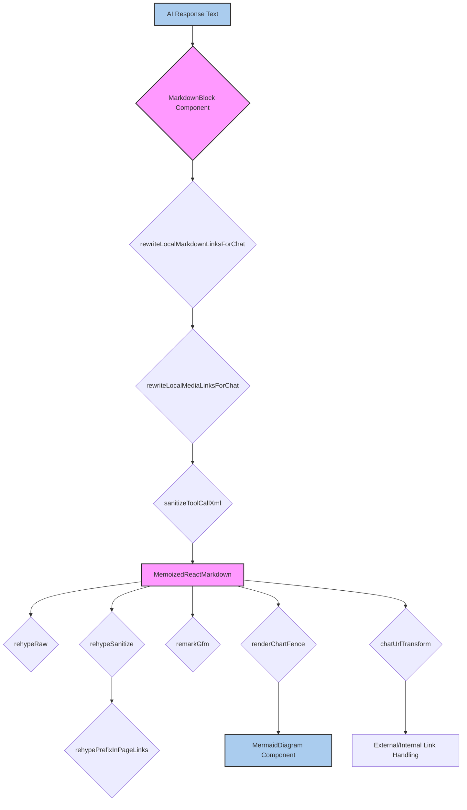
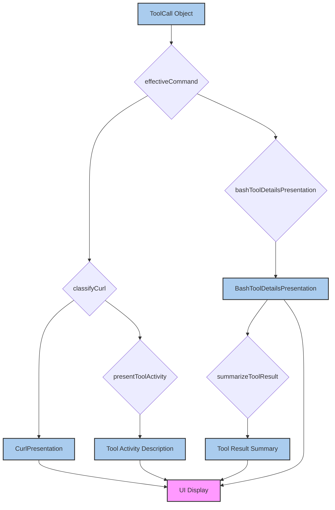

<!-- source: DeepWiki mcp.deepwiki.com · repo screenpipe/screenpipe · extra page Chat UI Internals · fetched 2026-10-27 -->

# Chat UI Internals

<details>
<summary>Relevant source files</summary>

The following files were used as context for generating this wiki page:

- [apps/screenpipe-app-tauri/components/__tests__/global-chat-mentions.test.ts](apps/screenpipe-app-tauri/components/__tests__/global-chat-mentions.test.ts)
- [apps/screenpipe-app-tauri/components/__tests__/markdown-local-media.test.tsx](apps/screenpipe-app-tauri/components/__tests__/markdown-local-media.test.tsx)
- [apps/screenpipe-app-tauri/components/__tests__/markdown-viewer-link.test.ts](apps/screenpipe-app-tauri/components/__tests__/markdown-viewer-link.test.ts)
- [apps/screenpipe-app-tauri/components/chat/charts/chart-fence-eval.test.ts](apps/screenpipe-app-tauri/components/chat/charts/chart-fence-eval.test.ts)
- [apps/screenpipe-app-tauri/components/chat/charts/chart-fence-eval.ts](apps/screenpipe-app-tauri/components/chat/charts/chart-fence-eval.ts)
- [apps/screenpipe-app-tauri/components/chat/charts/chart-frame.tsx](apps/screenpipe-app-tauri/components/chat/charts/chart-frame.tsx)
- [apps/screenpipe-app-tauri/components/chat/charts/chart-markdown.test.tsx](apps/screenpipe-app-tauri/components/chat/charts/chart-markdown.test.tsx)
- [apps/screenpipe-app-tauri/components/chat/charts/chart-marks.tsx](apps/screenpipe-app-tauri/components/chat/charts/chart-marks.tsx)
- [apps/screenpipe-app-tauri/components/chat/charts/chart-prompt-contract.test.ts](apps/screenpipe-app-tauri/components/chat/charts/chart-prompt-contract.test.ts)
- [apps/screenpipe-app-tauri/components/chat/charts/chart-spec.test.ts](apps/screenpipe-app-tauri/components/chat/charts/chart-spec.test.ts)
- [apps/screenpipe-app-tauri/components/chat/charts/chart-spec.ts](apps/screenpipe-app-tauri/components/chat/charts/chart-spec.ts)
- [apps/screenpipe-app-tauri/components/chat/charts/chat-chart.test.tsx](apps/screenpipe-app-tauri/components/chat/charts/chat-chart.test.tsx)
- [apps/screenpipe-app-tauri/components/chat/charts/chat-chart.tsx](apps/screenpipe-app-tauri/components/chat/charts/chat-chart.tsx)
- [apps/screenpipe-app-tauri/components/chat/markdown-block.test.tsx](apps/screenpipe-app-tauri/components/chat/markdown-block.test.tsx)
- [apps/screenpipe-app-tauri/components/chat/markdown-block.tsx](apps/screenpipe-app-tauri/components/chat/markdown-block.tsx)
- [apps/screenpipe-app-tauri/components/chat/standalone/chat-message-list.test.tsx](apps/screenpipe-app-tauri/components/chat/standalone/chat-message-list.test.tsx)
- [apps/screenpipe-app-tauri/components/chat/standalone/chat-message-list.tsx](apps/screenpipe-app-tauri/components/chat/standalone/chat-message-list.tsx)
- [apps/screenpipe-app-tauri/components/chat/standalone/composer-input-box.tsx](apps/screenpipe-app-tauri/components/chat/standalone/composer-input-box.tsx)
- [apps/screenpipe-app-tauri/components/chat/standalone/composer-types.ts](apps/screenpipe-app-tauri/components/chat/standalone/composer-types.ts)
- [apps/screenpipe-app-tauri/components/chat/standalone/hooks/__tests__/pi-preset-switch.test.tsx](apps/screenpipe-app-tauri/components/chat/standalone/hooks/__tests__/pi-preset-switch.test.tsx)
- [apps/screenpipe-app-tauri/components/chat/standalone/hooks/pi-types.ts](apps/screenpipe-app-tauri/components/chat/standalone/hooks/pi-types.ts)
- [apps/screenpipe-app-tauri/components/chat/standalone/hooks/use-chat-mentions.ts](apps/screenpipe-app-tauri/components/chat/standalone/hooks/use-chat-mentions.ts)
- [apps/screenpipe-app-tauri/components/chat/standalone/hooks/use-chat-message-actions.ts](apps/screenpipe-app-tauri/components/chat/standalone/hooks/use-chat-message-actions.ts)
- [apps/screenpipe-app-tauri/components/chat/standalone/hooks/use-chat-window-events.ts](apps/screenpipe-app-tauri/components/chat/standalone/hooks/use-chat-window-events.ts)
- [apps/screenpipe-app-tauri/components/chat/standalone/hooks/use-pi-send-transport.ts](apps/screenpipe-app-tauri/components/chat/standalone/hooks/use-pi-send-transport.ts)
- [apps/screenpipe-app-tauri/components/chat/standalone/hooks/use-pi-session-lifecycle.ts](apps/screenpipe-app-tauri/components/chat/standalone/hooks/use-pi-session-lifecycle.ts)
- [apps/screenpipe-app-tauri/components/chat/standalone/mention-dropdown.tsx](apps/screenpipe-app-tauri/components/chat/standalone/mention-dropdown.tsx)
- [apps/screenpipe-app-tauri/components/chat/standalone/message-content.streaming.test.tsx](apps/screenpipe-app-tauri/components/chat/standalone/message-content.streaming.test.tsx)
- [apps/screenpipe-app-tauri/components/chat/standalone/message-content.tsx](apps/screenpipe-app-tauri/components/chat/standalone/message-content.tsx)
- [apps/screenpipe-app-tauri/components/markdown.tsx](apps/screenpipe-app-tauri/components/markdown.tsx)
- [apps/screenpipe-app-tauri/components/rewind/media.test.tsx](apps/screenpipe-app-tauri/components/rewind/media.test.tsx)
- [apps/screenpipe-app-tauri/components/rewind/media.tsx](apps/screenpipe-app-tauri/components/rewind/media.tsx)
- [apps/screenpipe-app-tauri/e2e/fixtures/mock-acp-agent.ts](apps/screenpipe-app-tauri/e2e/fixtures/mock-acp-agent.ts)
- [apps/screenpipe-app-tauri/e2e/screenshots/chat-slash-skills.png](apps/screenpipe-app-tauri/e2e/screenshots/chat-slash-skills.png)
- [apps/screenpipe-app-tauri/e2e/screenshots/new-chat-first-message/01-background-start.png](apps/screenpipe-app-tauri/e2e/screenshots/new-chat-first-message/01-background-start.png)
- [apps/screenpipe-app-tauri/e2e/screenshots/new-chat-first-message/02-typed-during-start.png](apps/screenpipe-app-tauri/e2e/screenshots/new-chat-first-message/02-typed-during-start.png)
- [apps/screenpipe-app-tauri/e2e/screenshots/new-chat-first-message/03-sent-waiting-for-readiness.png](apps/screenpipe-app-tauri/e2e/screenshots/new-chat-first-message/03-sent-waiting-for-readiness.png)
- [apps/screenpipe-app-tauri/e2e/screenshots/new-chat-first-message/99-final.png](apps/screenpipe-app-tauri/e2e/screenshots/new-chat-first-message/99-final.png)
- [apps/screenpipe-app-tauri/e2e/specs/acp-backend.spec.ts](apps/screenpipe-app-tauri/e2e/specs/acp-backend.spec.ts)
- [apps/screenpipe-app-tauri/e2e/specs/chat-inline-charts.spec.ts](apps/screenpipe-app-tauri/e2e/specs/chat-inline-charts.spec.ts)
- [apps/screenpipe-app-tauri/e2e/specs/chat-new-chat-first-message-ux.spec.ts](apps/screenpipe-app-tauri/e2e/specs/chat-new-chat-first-message-ux.spec.ts)
- [apps/screenpipe-app-tauri/e2e/specs/chat-streaming-performance.spec.ts](apps/screenpipe-app-tauri/e2e/specs/chat-streaming-performance.spec.ts)
- [apps/screenpipe-app-tauri/e2e/specs/chat-tool-activity.spec.ts](apps/screenpipe-app-tauri/e2e/specs/chat-tool-activity.spec.ts)
- [apps/screenpipe-app-tauri/e2e/videos/nonblocking-composer-real-desktop.mp4](apps/screenpipe-app-tauri/e2e/videos/nonblocking-composer-real-desktop.mp4)
- [apps/screenpipe-app-tauri/lib/__tests__/chat-title-generation.test.ts](apps/screenpipe-app-tauri/lib/__tests__/chat-title-generation.test.ts)
- [apps/screenpipe-app-tauri/lib/__tests__/composer-commands.test.ts](apps/screenpipe-app-tauri/lib/__tests__/composer-commands.test.ts)
- [apps/screenpipe-app-tauri/lib/chat-utils.test.ts](apps/screenpipe-app-tauri/lib/chat-utils.test.ts)
- [apps/screenpipe-app-tauri/lib/chat-utils.ts](apps/screenpipe-app-tauri/lib/chat-utils.ts)
- [apps/screenpipe-app-tauri/lib/chat/__tests__/activity-summary.test.ts](apps/screenpipe-app-tauri/lib/chat/__tests__/activity-summary.test.ts)
- [apps/screenpipe-app-tauri/lib/chat/__tests__/system-prompt.test.ts](apps/screenpipe-app-tauri/lib/chat/__tests__/system-prompt.test.ts)
- [apps/screenpipe-app-tauri/lib/chat/__tests__/tool-presentation.test.ts](apps/screenpipe-app-tauri/lib/chat/__tests__/tool-presentation.test.ts)
- [apps/screenpipe-app-tauri/lib/chat/system-prompt.ts](apps/screenpipe-app-tauri/lib/chat/system-prompt.ts)
- [apps/screenpipe-app-tauri/lib/chat/tool-presentation.ts](apps/screenpipe-app-tauri/lib/chat/tool-presentation.ts)
- [apps/screenpipe-app-tauri/lib/composer-commands.ts](apps/screenpipe-app-tauri/lib/composer-commands.ts)
- [apps/screenpipe-app-tauri/lib/stores/acp-boot-state.ts](apps/screenpipe-app-tauri/lib/stores/acp-boot-state.ts)
- [apps/screenpipe-app-tauri/lib/utils/chat-title.ts](apps/screenpipe-app-tauri/lib/utils/chat-title.ts)
- [apps/screenpipe-app-tauri/lib/utils/media-file-path.test.ts](apps/screenpipe-app-tauri/lib/utils/media-file-path.test.ts)
- [apps/screenpipe-app-tauri/lib/utils/media-file-path.ts](apps/screenpipe-app-tauri/lib/utils/media-file-path.ts)
- [apps/screenpipe-app-tauri/lib/utils/notification-toggle.test.ts](apps/screenpipe-app-tauri/lib/utils/notification-toggle.test.ts)
- [apps/screenpipe-app-tauri/lib/utils/notification-toggle.ts](apps/screenpipe-app-tauri/lib/utils/notification-toggle.ts)
- [apps/screenpipe-app-tauri/lib/utils/validation.test.ts](apps/screenpipe-app-tauri/lib/utils/validation.test.ts)
- [apps/screenpipe-app-tauri/lib/utils/validation.ts](apps/screenpipe-app-tauri/lib/utils/validation.ts)
- [apps/screenpipe-app-tauri/scripts/chat-stream-render-benchmark.tsx](apps/screenpipe-app-tauri/scripts/chat-stream-render-benchmark.tsx)
- [apps/screenpipe-app-tauri/scripts/eval-chart-fence.ts](apps/screenpipe-app-tauri/scripts/eval-chart-fence.ts)
- [docs/pr-assets/6513/chat-live-view-action-menu.jpg](docs/pr-assets/6513/chat-live-view-action-menu.jpg)
- [docs/pr-assets/inline-message-edit/before-full-width-editor.png](docs/pr-assets/inline-message-edit/before-full-width-editor.png)
- [docs/pr-assets/inline-message-edit/dark-cancelled.png](docs/pr-assets/inline-message-edit/dark-cancelled.png)
- [docs/pr-assets/inline-message-edit/dark-edit-multiline.png](docs/pr-assets/inline-message-edit/dark-edit-multiline.png)
- [docs/pr-assets/inline-message-edit/dark-edit-short.png](docs/pr-assets/inline-message-edit/dark-edit-short.png)
- [docs/pr-assets/inline-message-edit/dark-hover.png](docs/pr-assets/inline-message-edit/dark-hover.png)
- [docs/pr-assets/inline-message-edit/dark-rest.png](docs/pr-assets/inline-message-edit/dark-rest.png)
- [docs/pr-assets/inline-message-edit/dark-saved.png](docs/pr-assets/inline-message-edit/dark-saved.png)
- [docs/pr-assets/inline-message-edit/dark-state-matrix.png](docs/pr-assets/inline-message-edit/dark-state-matrix.png)
- [docs/pr-assets/inline-message-edit/light-cancelled.png](docs/pr-assets/inline-message-edit/light-cancelled.png)
- [docs/pr-assets/provider-install-status/after.jpg](docs/pr-assets/provider-install-status/after.jpg)
- [docs/pr-assets/provider-install-status/before.jpg](docs/pr-assets/provider-install-status/before.jpg)
- [docs/pr-assets/provider-install-status/completed.jpg](docs/pr-assets/provider-install-status/completed.jpg)

</details>


This page details the internal workings of the chat user interface, covering the standalone chat composer, message list rendering, streaming updates, integration of markdown and chart blocks, handling of mentions, presentation of tool calls, and the construction of the system prompt for the AI assistant.

## Chat Message List and Streaming Rendering

The core of the chat UI is the `ChatMessageList` component [apps/screenpipe-app-tauri/components/chat/standalone/chat-message-list.tsx:122-165](), responsible for displaying all messages in a conversation. It receives an array of `Message` objects and various state flags (`isLoading`, `isStreaming`) and callbacks for user interactions.

Messages are rendered individually, with different visual treatments for user and assistant messages. Streaming responses from the AI are handled by progressively updating the content of the latest assistant message. The `MessageContent` component [apps/screenpipe-app-tauri/components/chat/standalone/message-content.tsx:116-119]() is a key part of this, rendering markdown, tool calls, and other structured output.

The `ChatMessageList` manages UI interactions such as:
*   Toggling collapsed steer work [apps/screenpipe-app-tauri/components/chat/standalone/chat-message-list.tsx:85]()
*   Highlighting messages [apps/screenpipe-app-tauri/components/chat/standalone/chat-message-list.tsx:86]()
*   Editing messages [apps/screenpipe-app-tauri/components/chat/standalone/chat-message-list.tsx:87-96]()
*   Copying messages [apps/screenpipe-app-tauri/components/chat/standalone/chat-message-list.tsx:98-99]()
*   Retrying assistant messages [apps/screenpipe-app-tauri/components/chat/standalone/chat-message-list.tsx:104]()
*   Branching conversations [apps/screenpipe-app-tauri/components/chat/standalone/chat-message-list.tsx:109]()

The `resizeMessageEditTextarea` function [apps/screenpipe-app-tauri/components/chat/standalone/chat-message-list.tsx:47-53]() dynamically adjusts the height of the message edit textarea. Timestamps are formatted for display using `formatMessageHoverTime` [apps/screenpipe-app-tauri/components/chat/standalone/chat-message-list.tsx:60-63]() and `formatMessageFullTime` [apps/screenpipe-app-tauri/components/chat/standalone/chat-message-list.tsx:66-75]().

Sources:
*   [apps/screenpipe-app-tauri/components/chat/standalone/chat-message-list.tsx:1-719]()

## Markdown and Chart Blocks

AI responses often contain markdown-formatted text, including code blocks, tables, and links. The `MarkdownBlock` component [apps/screenpipe-app-tauri/components/chat/markdown-block.tsx:115-126]() is responsible for rendering this content. It uses `react-markdown` internally, configured with `rehype-raw` and `rehype-sanitize` to safely render HTML elements while preventing XSS vulnerabilities [apps/screenpipe-app-tauri/components/chat/markdown-block.tsx:35-48]().

Special handling is in place for:
*   **Local file links**: `rewriteLocalMarkdownLinksForChat` [apps/screenpipe-app-tauri/components/markdown.tsx:140-159]() rewrites `file://` URLs to `screenpipe://view?path=` for internal handling, allowing the app to open local files in a viewer.
*   **Media files**: `rewriteLocalMediaLinksForChat` [apps/screenpipe-app-tauri/components/markdown.tsx:124-136]() specifically handles media file paths, ensuring they are correctly formatted for the internal media player. The `isMediaFilePath` [apps/screenpipe-app-tauri/lib/utils/media-file-path.ts:100-103]() and `isAudioMediaPath` [apps/screenpipe-app-tauri/lib/utils/media-file-path.ts:107-110]() functions determine if a path points to a supported media file.
*   **Charts**: The `renderChartFence` function [apps/screenpipe-app-tauri/components/chat/markdown-block.tsx:111-112]() is used to render special code blocks identified as charts, delegating to the `MermaidDiagram` component [apps/screenpipe-app-tauri/components/chat/standalone/message-content.tsx:71-75]() for visualization.

The `chatUrlTransform` [apps/screenpipe-app-tauri/components/markdown.tsx:89-94]() function ensures that only allowed `screenpipe://` URLs are processed, falling back to `defaultUrlTransform` for others.


**Diagram: Markdown and Chart Rendering Pipeline**
Sources:
*   [apps/screenpipe-app-tauri/components/chat/markdown-block.tsx:1-320]()
*   [apps/screenpipe-app-tauri/components/chat/markdown-block.test.tsx:1-607]()
*   [apps/screenpipe-app-tauri/components/chat/standalone/message-content.tsx:1-2094]()
*   [apps/screenpipe-app-tauri/components/markdown.tsx:1-303]()
*   [apps/screenpipe-app-tauri/lib/utils/media-file-path.test.ts:1-166]()
*   [apps/screenpipe-app-tauri/lib/utils/media-file-path.ts] ()

## Mentions

The chat composer supports mentions, allowing users to reference specific entities or commands. The `normalizeComposerMentionsForModel` function [apps/screenpipe-app-tauri/lib/chat/standalone/hooks/use-pi-send-transport.ts:31]() is responsible for processing these mentions before sending the message to the AI model. This ensures that mentions are correctly interpreted by the backend.

The `useChatMentions` hook [apps/screenpipe-app-tauri/components/chat/standalone/hooks/use-chat-mentions.ts]() manages the UI aspects of mentions, such as displaying suggestions as the user types.

Sources:
*   [apps/screenpipe-app-tauri/lib/chat/standalone/hooks/use-pi-send-transport.ts:31]()
*   [apps/screenpipe-app-tauri/components/chat/standalone/hooks/use-chat-mentions.ts]()

## Tool Presentation

The AI assistant can execute various tools, and their calls and results need to be presented clearly to the user. The `MessageContent` component [apps/screenpipe-app-tauri/components/chat/standalone/message-content.tsx:116-119]() handles the rendering of `ToolCall` objects.

Key functions for tool presentation include:
*   `effectiveCommand` [apps/screenpipe-app-tauri/components/chat/standalone/message-content.tsx:99-104](): Extracts the underlying command from a `ToolCall`, especially for `bash` tools.
*   `classifyCurl` [apps/screenpipe-app-tauri/lib/chat/tool-presentation.ts:166-173](): Analyzes `curl` commands to provide human-readable labels, such as "Searched recordings" or "Fetched example.com".
*   `bashToolDetailsPresentation` [apps/screenpipe-app-tauri/components/chat/standalone/message-content.tsx:135-174](): Formats details of bash tool calls, including endpoint, method, and parameters, for display.
*   `summarizeToolResult` [apps/screenpipe-app-tauri/lib/chat/tool-presentation.ts:300-303](): Provides a concise summary of tool execution results.
*   `presentToolActivity` [apps/screenpipe-app-tauri/lib/chat/tool-presentation.ts:479-482](): Generates a user-friendly description of a tool's activity.

The `ToolDetailField` interface [apps/screenpipe-app-tauri/components/chat/standalone/message-content.tsx:121-124]() defines the structure for displaying tool details.


**Diagram: Tool Presentation Data Flow**
Sources:
*   [apps/screenpipe-app-tauri/components/chat/standalone/message-content.tsx:1-2094]()
*   [apps/screenpipe-app-tauri/lib/chat/tool-presentation.ts:1-1131]()
*   [apps/screenpipe-app-tauri/lib/chat/__tests__/tool-presentation.test.ts]()
*   [apps/screenpipe-app-tauri/e2e/specs/chat-tool-activity.spec.ts]()

## System Prompt Construction

The AI assistant's behavior is heavily influenced by its system prompt. The `buildSystemPrompt` function [apps/screenpipe-app-tauri/lib/chat/system-prompt.ts:16-81]() dynamically constructs this prompt, incorporating current time and timezone information.

The system prompt includes:
*   **Role definition**: "You are the user's screenpipe assistant."
*   **Behavioral rules**: Guidelines on voice, length, technical mode activation, handling ambiguous input, activity recaps, and acting on requests.
*   **Privacy and safety**: Instructions on not expanding scope from captured content, handling sensitive data, and connection write policies.
*   **Tool selection guidance**: Directives on which tools to use for common user requests (e.g., "upcoming meetings" -> calendar integration).
*   **Git repository and worktree safety**: Specific instructions for coding agents interacting with Git repositories, emphasizing worktree usage and avoiding direct edits to primary checkouts.

The `getTimezoneOffsetString` function [apps/screenpipe-app-tauri/lib/chat/system-prompt.ts:9-12]() helps in accurately reflecting the user's local time in the prompt.

Sources:
*   [apps/screenpipe-app-tauri/lib/chat/system-prompt.ts:1-270]()
*   [apps/screenpipe-app-tauri/lib/chat/__tests__/system-prompt.test.ts]()

## Standalone Chat Composer

The chat composer, typically represented by `ComposerInputBox` [apps/screenpipe-app-tauri/components/chat/standalone/composer-input-box.tsx](), allows users to input messages, attach images, and interact with the AI.

Key functionalities include:
*   **Input handling**: Manages user text input, including mentions and command suggestions.
*   **Image attachment**: Allows users to attach images to their messages.
*   **Prefill events**: The `useChatPrefillListener` hook [apps/screenpipe-app-tauri/components/chat/standalone/hooks/use-chat-window-events.ts:117-139]() listens for `chat-prefill` events, enabling external parts of the application to pre-populate the composer with context or prompts. This is crucial for features like "Ask Pi about this frame."
*   **Sending messages**: The `sendMessage` function [apps/screenpipe-app-tauri/components/chat/standalone/chat-message-list.tsx:106]() (passed down as a prop) handles dispatching the user's message to the AI backend.
*   **Pi Send Transport**: The `usePiSendTransport` hook [apps/screenpipe-app-tauri/components/chat/standalone/hooks/use-pi-send-transport.ts:45]() manages the communication with the Pi coding agent, including message preparation (`piMessageFromDataUrl`, `piImageFromFrameId`, `promptWithConversationHistory` [apps/screenpipe-app-tauri/components/chat/standalone/hooks/use-pi-send-transport.ts:27-29]()), error recovery (`isRecoverablePiPromptDispatchError` [apps/screenpipe-app-tauri/components/chat/standalone/hooks/use-pi-send-transport.ts:79-91]()), and ensuring the Pi session is ready (`awaitPiStartInFlight` [apps/screenpipe-app-tauri/components/chat/standalone/hooks/use-pi-send-transport.ts:115-123]()).

The `chat-utils.ts` file [apps/screenpipe-app-tauri/lib/chat-utils.ts:1-1250]() contains shared utilities for chat, including functions to detect and extract user text from injected system prompts (`isInjectedTitleSourcePrompt`, `isConnectionsContextPrompt`, `extractInjectedUserText` [apps/screenpipe-app-tauri/lib/chat-utils.ts:39-107]()).

```mermaid
graph TD
    A[User Input] --> B[ComposerInputBox];
    B --> C{useChatMentions};
    C --> D[Mention Suggestions];
    B --> E[Image Attachment];
    E --> F[normalizeImageDataUrls];
    B --> G[Send Message Action];
    G --> H{usePiSendTransport};
    H --> I[prepareCodingWorkspaceForSend];
    H --> J[dispatchPiPromptWithRecovery];
    J --> K[AI Backend (Pi Agent)];
    L[External Event (e.g., "Ask Pi")] --> M[chat-prefill event];
    M --> N{useChatPrefillListener};
    N --> B;

    style A fill:#ace,stroke:#333,stroke-width:2px
    style B fill:#f9f,stroke:#333,stroke-width:2px
    style D fill:#ace,stroke:#333,stroke-width:2px
    style F fill:#ace,stroke:#333,stroke-width:2px
    style K fill:#ace,stroke:#333,stroke-width:2px
```
**Diagram: Chat Composer Data Flow**
Sources:
*   [apps/screenpipe-app-tauri/components/chat/standalone/composer-input-box.tsx]()
*   [apps/screenpipe-app-tauri/components/chat/standalone/chat-message-list.tsx:106]()
*   [apps/screenpipe-app-tauri/components/chat/standalone/hooks/use-pi-send-transport.ts:1-1219]()
*   [apps/screenpipe-app-tauri/components/chat/standalone/hooks/use-chat-window-events.ts:117-139]()
*   [apps/screenpipe-app-tauri/lib/chat-utils.ts:1-1250]()
*   [apps/screenpipe-app-tauri/lib/chat-utils.test.ts]()

---

