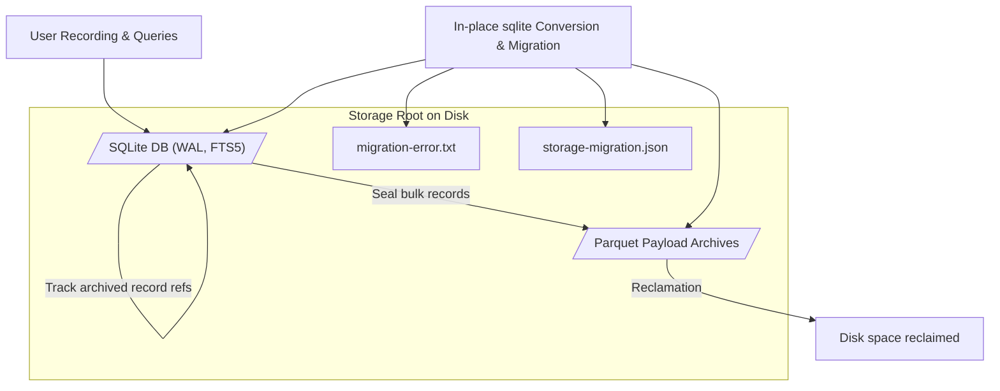
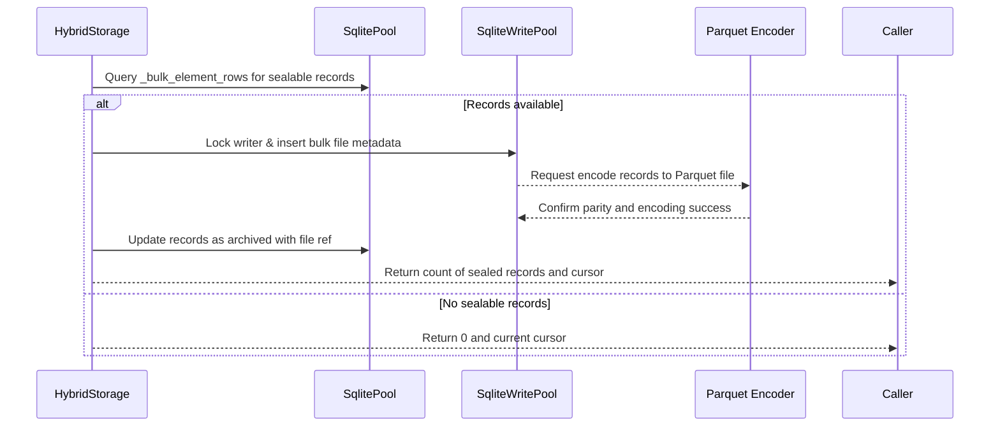
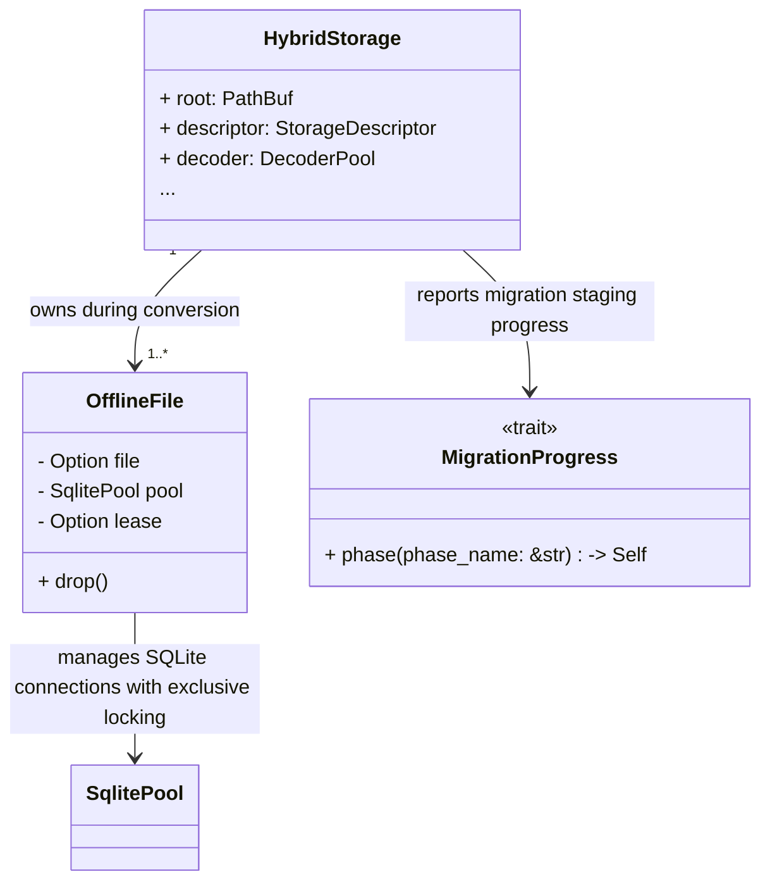
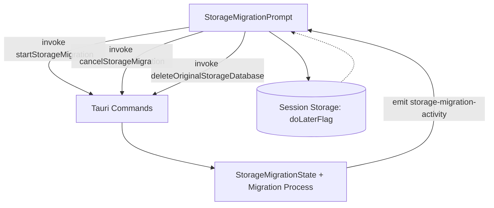

<!-- source: DeepWiki mcp.deepwiki.com · repo screenpipe/screenpipe · extra page Hybrid Storage & Migration · fetched 2026-10-27 -->

# Hybrid Storage & Migration

<details>
<summary>Relevant source files</summary>

The following files were used as context for generating this wiki page:

- [apps/screenpipe-app-tauri/components/settings/storage-migration-card.test.tsx](apps/screenpipe-app-tauri/components/settings/storage-migration-card.test.tsx)
- [apps/screenpipe-app-tauri/components/settings/storage-migration-card.tsx](apps/screenpipe-app-tauri/components/settings/storage-migration-card.tsx)
- [apps/screenpipe-app-tauri/components/storage-migration-gate.test.tsx](apps/screenpipe-app-tauri/components/storage-migration-gate.test.tsx)
- [apps/screenpipe-app-tauri/components/storage-migration-gate.tsx](apps/screenpipe-app-tauri/components/storage-migration-gate.tsx)
- [apps/screenpipe-app-tauri/components/storage-migration-prompt.test.tsx](apps/screenpipe-app-tauri/components/storage-migration-prompt.test.tsx)
- [apps/screenpipe-app-tauri/components/storage-migration-prompt.tsx](apps/screenpipe-app-tauri/components/storage-migration-prompt.tsx)
- [apps/screenpipe-app-tauri/components/update-banner.test.tsx](apps/screenpipe-app-tauri/components/update-banner.test.tsx)
- [apps/screenpipe-app-tauri/e2e/COVERAGE.md](apps/screenpipe-app-tauri/e2e/COVERAGE.md)
- [apps/screenpipe-app-tauri/e2e/coverage-map.json](apps/screenpipe-app-tauri/e2e/coverage-map.json)
- [apps/screenpipe-app-tauri/src-tauri/src/feedback_upload.rs](apps/screenpipe-app-tauri/src-tauri/src/feedback_upload.rs)
- [apps/screenpipe-app-tauri/src-tauri/src/storage_migration.rs](apps/screenpipe-app-tauri/src-tauri/src/storage_migration.rs)
- [crates/screenpipe-db/src/storage/bulk/cache.rs](crates/screenpipe-db/src/storage/bulk/cache.rs)
- [crates/screenpipe-db/src/storage/bulk/elements.rs](crates/screenpipe-db/src/storage/bulk/elements.rs)
- [crates/screenpipe-db/src/storage/bulk/elements/lifecycle.rs](crates/screenpipe-db/src/storage/bulk/elements/lifecycle.rs)
- [crates/screenpipe-db/src/storage/bulk/lifecycle.rs](crates/screenpipe-db/src/storage/bulk/lifecycle.rs)
- [crates/screenpipe-db/src/storage/bulk/tests.rs](crates/screenpipe-db/src/storage/bulk/tests.rs)
- [crates/screenpipe-db/src/storage/diagnostics.rs](crates/screenpipe-db/src/storage/diagnostics.rs)
- [crates/screenpipe-db/src/storage/import.rs](crates/screenpipe-db/src/storage/import.rs)
- [crates/screenpipe-db/src/storage/in_place.rs](crates/screenpipe-db/src/storage/in_place.rs)
- [crates/screenpipe-db/src/storage/lifecycle.rs](crates/screenpipe-db/src/storage/lifecycle.rs)
- [crates/screenpipe-db/src/storage/mod.rs](crates/screenpipe-db/src/storage/mod.rs)
- [crates/screenpipe-db/src/storage/parity.rs](crates/screenpipe-db/src/storage/parity.rs)
- [crates/screenpipe-db/src/storage/reclaim.rs](crates/screenpipe-db/src/storage/reclaim.rs)
- [crates/screenpipe-db/src/storage/sealing.rs](crates/screenpipe-db/src/storage/sealing.rs)
- [crates/screenpipe-db/tests/in_place_migration.rs](crates/screenpipe-db/tests/in_place_migration.rs)
- [crates/screenpipe-db/tests/migration_foreign_keys.rs](crates/screenpipe-db/tests/migration_foreign_keys.rs)
- [crates/screenpipe-db/tests/migration_source_recovery.rs](crates/screenpipe-db/tests/migration_source_recovery.rs)
- [docs/COVERAGE.md](docs/COVERAGE.md)
- [docs/coverage/CORE.md](docs/coverage/CORE.md)
- [docs/coverage/core-engine-map.json](docs/coverage/core-engine-map.json)

</details>


This page provides a comprehensive deep dive into Screenpipe’s hybrid storage system with an emphasis on handling Parquet payload archives, sealed storage, reclamation strategies, in-place SQLite storage conversions, migration journaling and diagnostics, as well as the desktop user experience for storage migration. These features collectively enable Screenpipe to efficiently manage and transition large volumes of recorded AI memory data in a local-first, resilient manner.

---

## Purpose and Scope

Screenpipe employs a hybrid storage architecture that blends on-disk compact Parquet payload archive files with relational SQLite metadata and indexes. This hybrid approach enables advanced storage compaction, archival, and efficient search while maintaining seamless real-time recording capabilities. The page covers the implementation mechanics of this hybrid storage, migration workflows including resumable in-place conversions, error handling, migration progress tracking, and the interactive user interface components managing migration states.

---

## 1. HybridStorage: Architecture and Role

`HybridStorage` is the core abstraction that manages a dual storage model combining:

- **SQLite DB**: Handles indexing, relational metadata, and search using WAL mode and FTS5 extensions.
- **Parquet Payload Archives**: Store large payload data compactly in columnar Parquet files external to SQLite for scalable storage.

`HybridStorage` interacts with these layers to read, write, seal, and reclaim storage efficiently.

The hybrid design allows capturing most data into payload archives while SQLite metadata references the payloads for querying, facilitating scalable long-term storage.

### Key Components and Data Flow

- **Payload Directory Structure**: Archives are organized under the storage root within designated payload paths, e.g., `bulk-v1/elements/`.
- **Sealing Process**: Records are collected from SQLite `*_rows` staging tables, encoded into Parquet archives, and metadata within SQLite is updated to mark these records as archived.
- **Reclamation**: Old, unused payload files are identified and safely deleted to reclaim disk space.
- **In-place SQLite Conversion**: An offline exclusive SQLite connection runs a conversion process to progressively embed these archives’ data into SQLite/indexes without data loss or service interruption.
- **Migration Journaling/Diagnostics**: Progress, errors, and migration steps are durably logged in JSON and error files to facilitate retries and diagnostics.



**Sources:**  
- `crates/screenpipe-db/src/storage/bulk/elements/lifecycle.rs:48-95`  
- `crates/screenpipe-db/src/storage/in_place.rs:1-154`  
- `apps/screenpipe-app-tauri/src-tauri/src/storage_migration.rs:1-195`  

---

## 2. Sealing: Creating Parquet Payload Archives

Sealing is the process that converts staged live records from SQLite into compacted Parquet archive files on disk.

### How Sealing Works

1. **Identify Sealable Records**: Query `_bulk_element_rows` for records flagged as not deleted and ready for sealing.
2. **Select Range**: Retrieve a contiguous range of records to encode.
3. **Encoding and Verification**:  
   - Records are encoded via the `codec` module into a Parquet file named with a UUID under `bulk-v1/elements/`.
   - Encoding includes data parity checks; decoding back verifies the archive integrity.
4. **Write Metadata in SQLite**: Insert the archive’s description and rows into `_bulk_files`.
5. **Settle and Sync**: Sync directory metadata to ensure durable committing.
6. **Mark Records as Archived**: Update SQLite to mark sealed records so they aren't reprocessed.
7. **Return Next Cursor**: Provide a cursor ID for incremental sealing continuation.

### Important Function: `seal_after`

- `seal_after` loops to find the next sealable range and rewrite the archive.
- Avoids interfering with concurrent edits by retrying if a range is blocked.
- Uses a write lock pool to serialize file metadata updates.



**Sources:**  
- `crates/screenpipe-db/src/storage/bulk/elements/lifecycle.rs:48-95`  

---

## 3. Reclamation: Disk Space Recovery

Reclamation safely removes old Parquet archive files no longer referenced or needed, freeing disk space without disrupting live recording.

- Uses a `Reclaimer` type that scans storage roots for unreferenced archives.
- Deletes safely only after ensuring no ongoing migration or referencing.
- Runs asynchronously alongside migration and recording.

**Sources:**  
- `crates/screenpipe-db/src/storage/in_place.rs:135-139`

---

## 4. In-Place SQLite Conversion

To migrate legacy or external payloads into a consistent resident format, Screenpipe provides an **in-place conversion** operation that operates under exclusive offline SQLite ownership.

### Conversion Workflow

- Acquires an exclusive SQLite manager lease on the database file.
- Opens the database with appropriate pragmas for exclusive locking.
- Uses a single offline SQLite connection pool with limited concurrency.
- Runs migration steps atomically in batches:
  - Converts Parquet payloads or other bulk payloads into resident SQLite indexes.
  - Optionally reclaims payload files once safely embedded.
  - Updates `_storage_conversion_steps` table to track progress persistently.
- Supports **resuming after interruptions**, avoiding starting over.
- Includes consistency checks and validation.

### OfflineFile

- Encapsulates the exclusive SQLite File handle, connection pool, and lease.
- Ensures asynchronous shutdown and proper resource cleanup when dropped.

### Reserve Disk Space

- `reserve()` verifies enough free disk space is available before conversion batches.
- Ensures a buffer of space proportional to the configured `StorageBudget`.



**Sources:**  
- `crates/screenpipe-db/src/storage/in_place.rs:14-154`  

---

## 5. Migration Journaling & Diagnostic State

Screenpipe records migration state between app sessions to ensure recoverability and user transparency.

### StorageMigrationState

- Wraps an internal `Operation` with a mutex for safe cross-thread access.
- `Operation` tracks:
  - Migration root path
  - Busy flag
  - Recovering flag
  - Message/status string
  - Error details
  - Timing info (start time, elapsed seconds)
  - Records processed, total record count
  - Bytes saved and available
  - Completion state
  - Background (hidden) migration flag

### Error Journals

- Migration errors are serialized to readable retry blocks (`storage-migration-error.txt`) with meaningful messages.
- Migration progress and checkpoints recorded in `storage-migration.json`.

### Commands exposed to frontend (Tauri commands)

- `get_storage_migration_activity` returns the current `StorageMigrationActivity` for UI polling.
- Controls progress updates via `update_operation()` that also emits Tauri events for webview listeners.

### Hidden UI Migration Starts

- Background (ui-hidden) migrations start automatically when permitted by policy and state.
- Logs both successes and failures without direct user interaction.

```mermaid
flowchart LR
  subgraph Native Backend (Rust)
    MigrationState[StorageMigrationState (Mutex<Operation>)]
    OperationDetails[Operation State: message, error, progress, etc.]
    MigrationErrorFile["migration-error.txt"]
    MigrationJournal["storage-migration.json"]
    TauriCommands[get_storage_migration_activity, start_storage_migration, cancel_storage_migration]
    EventEmitter["storage-migration-activity event"]
  end

  subgraph Frontend (Webview)
    UI[StorageMigrationPrompt UI]
  end

  MigrationState --> OperationDetails
  OperationDetails -.-> MigrationErrorFile
  OperationDetails -.-> MigrationJournal
  MigrationState --> TauriCommands
  TauriCommands --> EventEmitter
  EventEmitter --> UI
  UI --> TauriCommands
```

**Sources:**  
- `apps/screenpipe-app-tauri/src-tauri/src/storage_migration.rs:21-125`  

---

## 6. Desktop Storage Migration User Experience (UX)

Screenpipe's desktop application presents UI components that interact with the migration state to provide users clear migration controls and messaging:

- The `StorageMigrationPrompt` component triggers when legacy storage is detected and migration is needed.
- It explains migration impact such as paused recording, system awake requirement.
- Offers buttons: **Start now**, **Do later**, **Try again** to control migration initiation and retries.
- Respects users' choice to defer migration for the current app session via session storage.
- Avoids repetitive prompts within the same app process unless the app is restarted (new session ID).
- Shows progress, errors, and completion messages clearly.
- Also supports handling interrupted migrations and recovery workflows.



### Testing & Resilience

- Tests validate withheld prompts if migration is busy or blocked due to app state.
- Tests cover interrupted in-place conversions showing only resume options.
- Confirms migration prompts respect session storage to avoid nagging.
- Verifies the prompt shows contextual messaging about storage state and migration readiness.

**Sources:**  
- `apps/screenpipe-app-tauri/components/storage-migration-prompt.tsx:1-133`  

---

## 7. Summary Mermaid Diagram: Bridging Concepts to Code Entities

```mermaid
flowchart TB
  subgraph "Hybrid Storage Core"
    HS[HybridStorage (crates/screenpipe-db)]
    Parquet[Parquet Payload Archives]
    SQLite[SQLite DB with FTS5]
  end

  subgraph "Sealing & Reclamation"
    Seal[seal_after / seal (bulk/lifecycle.rs)]
    Reclaim[Reclaimer (in_place.rs)]
  end

  subgraph "Migration & In-place Conversion"
    Offline[OfflineFile (in_place.rs)]
    Convert[convert / recover_recording]
    Progress[StorageMigrationState (storage_migration.rs)]
    ErrorJournal[storage-migration-error.txt]
    MigrationJournal[storage-migration.json]
  end

  subgraph "Desktop Application UX"
    UI[StorageMigrationPrompt (prompt.tsx)]
    Commands[Tauri Commands (storage_migration.rs)]
  end

  UserRecording --> HS
  HS --> Parquet
  HS --> SQLite

  HS --> Seal --> Parquet
  HS --> Reclaim --> DiskSpaceFree

  Convert --> Offline --> SQLite
  Convert --> Seal
  Convert --> Progress --> ErrorJournal & MigrationJournal

  Commands --> Progress
  UI --> Commands
  Progress --> UI

  subgraph Legend
    UserRecording[User Recording & Queries]
    DiskSpaceFree[Disk Free/Reclaimed]
  end
```

---

# References & Sources

- Hybrid storage sealing and bulk lifecycle: `crates/screenpipe-db/src/storage/bulk/elements/lifecycle.rs:48-95`  
- In-place SQLite conversion, OfflineFile, migraton logic: `crates/screenpipe-db/src/storage/in_place.rs:1-154`  
- Storage migration state management, journaling, background hidden migration: `apps/screenpipe-app-tauri/src-tauri/src/storage_migration.rs:1-195`  
- Desktop UI Migration Prompt interactions (TypeScript/React): `apps/screenpipe-app-tauri/components/storage-migration-prompt.tsx:1-133`  

This completes the detailed technical overview of Screenpipe's hybrid storage architecture and migration system.

---

