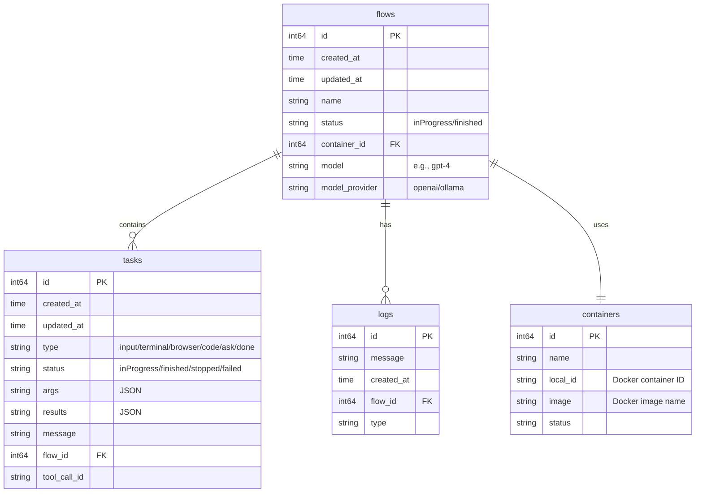
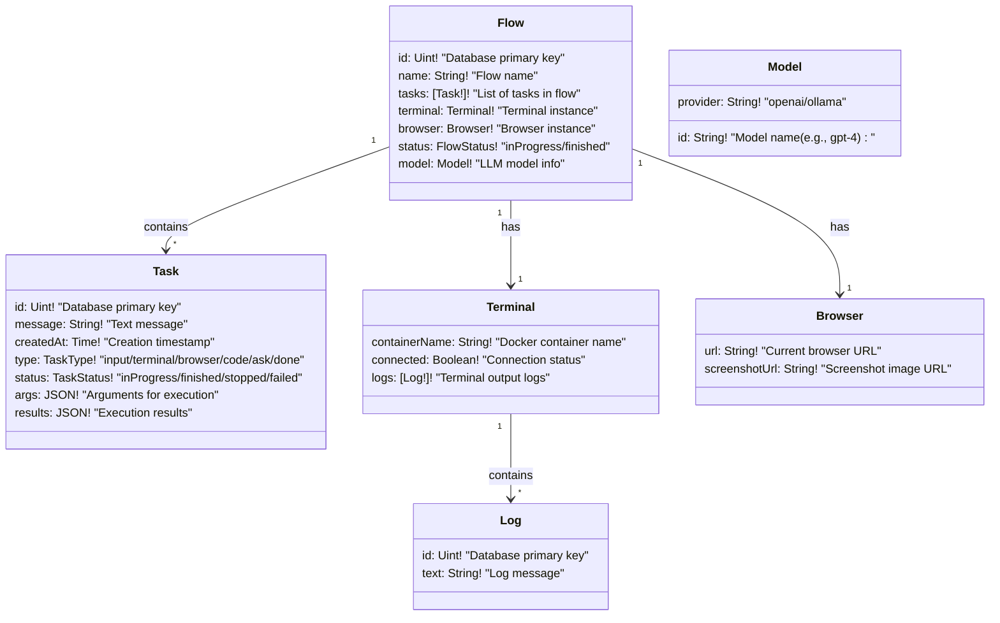
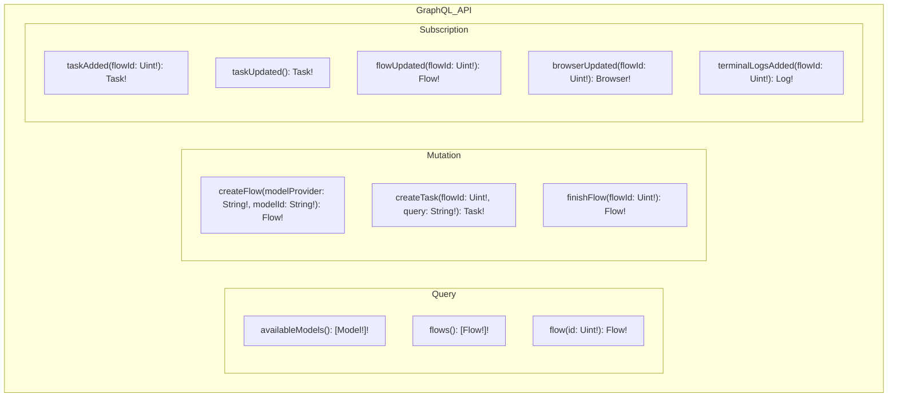
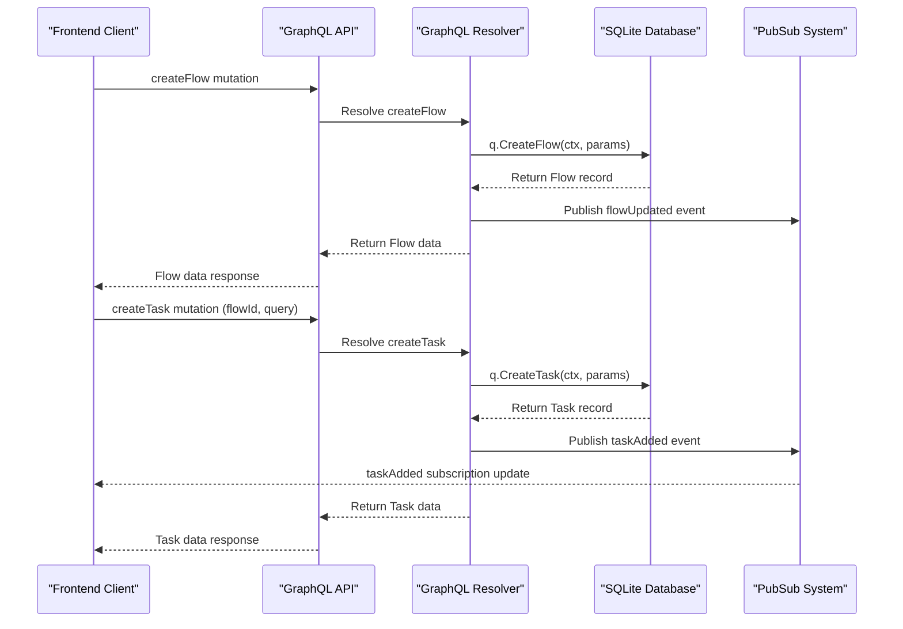
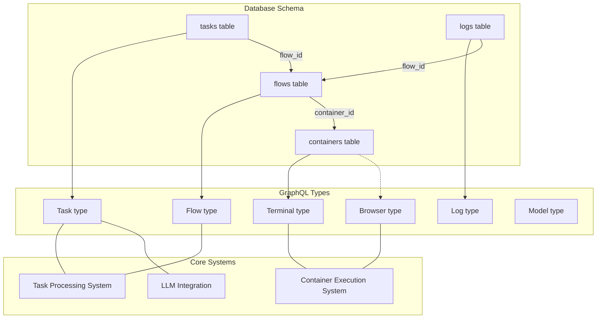

<!-- source: DeepWiki mcp.deepwiki.com · repo semanser/codel · page 4 Data Architecture · fetched 2026-10-27 -->

# Data Architecture

<details>
<summary>Relevant source files</summary>

The following files were used as context for generating this wiki page:

- [backend/database/flows.sql.go](backend/database/flows.sql.go)
- [backend/database/models.go](backend/database/models.go)
- [backend/database/tasks.sql.go](backend/database/tasks.sql.go)
- [backend/graph/generated.go](backend/graph/generated.go)
- [backend/graph/schema.graphqls](backend/graph/schema.graphqls)
- [backend/migrations/20240328114536_tool_call_id_field.sql](backend/migrations/20240328114536_tool_call_id_field.sql)
- [backend/models/flows.sql](backend/models/flows.sql)
- [backend/models/tasks.sql](backend/models/tasks.sql)

</details>


This document describes the core data structures, database schema, GraphQL API, and data flows that form the foundation of Codel's system. It covers how data is stored, retrieved, and communicated between components. For information about the task processing system that uses this data, see [Task Processing System](#3.1). For details on real-time communication, see [Real-time Communication](#4.3).

## Database Schema

Codel uses a SQL database for persistence with four primary tables: flows, tasks, containers, and logs. These tables store the core data needed for the autonomous AI agent to function effectively.



Sources: [backend/database/models.go:12-50](), [backend/models/flows.sql:1-45](), [backend/models/tasks.sql:1-36]()

### Flows

Flows represent user sessions or conversations with the AI agent. Each flow has:
- A unique ID
- A name
- A status (inProgress or finished)
- An associated container for execution
- Information about the language model being used (provider and ID)

The Go struct for a Flow is defined in [backend/database/models.go:20-29]():

```go
type Flow struct {
    ID            int64
    CreatedAt     sql.NullTime
    UpdatedAt     sql.NullTime
    Name          sql.NullString
    Status        sql.NullString
    ContainerID   sql.NullInt64
    Model         sql.NullString
    ModelProvider sql.NullString
}
```

CRUD operations for flows are defined in [backend/models/flows.sql:1-45]() and implemented in [backend/database/flows.sql.go:13-236]().

### Tasks

Tasks represent actions taken by the AI agent within a flow. Each task has:
- A unique ID
- A type (input, terminal, browser, code, ask, done)
- A status (inProgress, finished, stopped, failed)
- Arguments and results (stored as JSON strings)
- A message (prompt or response)
- A reference to the flow it belongs to
- A tool call ID for tracking language model function calls

The Go struct for a Task is defined in [backend/database/models.go:39-50]():

```go
type Task struct {
    ID         int64
    CreatedAt  sql.NullTime
    UpdatedAt  sql.NullTime
    Type       sql.NullString
    Status     sql.NullString
    Args       sql.NullString
    Results    sql.NullString
    Message    sql.NullString
    FlowID     sql.NullInt64
    ToolCallID sql.NullString
}
```

CRUD operations for tasks are defined in [backend/models/tasks.sql:1-36]() and implemented in [backend/database/tasks.sql.go:13-192]().

### Containers

Containers store information about Docker containers used for execution. Each container has:
- A unique ID
- A name
- A local ID (Docker container ID)
- An image name
- A status

The Go struct for a Container is defined in [backend/database/models.go:12-18]():

```go
type Container struct {
    ID      int64
    Name    sql.NullString
    LocalID sql.NullString
    Image   sql.NullString
    Status  sql.NullString
}
```

### Logs

Logs store terminal output and system messages. Each log entry has:
- A unique ID
- A message
- A timestamp
- A reference to the flow it belongs to
- A type

The Go struct for a Log is defined in [backend/database/models.go:31-37]():

```go
type Log struct {
    ID        int64
    Message   string
    CreatedAt time.Time
    FlowID    sql.NullInt64
    Type      string
}
```

## GraphQL API

Codel's GraphQL API serves as the interface between the frontend and backend. It defines types that mirror the database models, along with queries, mutations, and subscriptions for data operations.

### GraphQL Schema Types

The GraphQL schema is defined in [backend/graph/schema.graphqls:1-90]():



Sources: [backend/graph/schema.graphqls:21-65]()

The schema defines several enum types for representing states:

```graphql
enum TaskType {
  input
  terminal
  browser
  code
  ask
  done
}

enum TaskStatus {
  inProgress
  finished
  stopped
  failed
}

enum FlowStatus {
  inProgress
  finished
}
```

Sources: [backend/graph/schema.graphqls:5-18](), [backend/graph/schema.graphqls:31-34]()

### GraphQL Operations

The schema defines queries, mutations, and subscriptions for interacting with the data:



Sources: [backend/graph/schema.graphqls:67-89]()

#### Queries, Mutations, and Subscriptions

The GraphQL API provides the following operations:

| Type | Operation | Description | Parameters | Return Type |
|------|-----------|-------------|------------|-------------|
| Query | `availableModels` | Lists available language models | None | `[Model!]!` |
| Query | `flows` | Lists all flows (user sessions) | None | `[Flow!]!` |
| Query | `flow` | Gets a specific flow by ID | `id: Uint!` | `Flow!` |
| Mutation | `createFlow` | Creates a new flow | `modelProvider: String!`, `modelId: String!` | `Flow!` |
| Mutation | `createTask` | Creates a new task within a flow | `flowId: Uint!`, `query: String!` | `Task!` |
| Mutation | `finishFlow` | Marks a flow as finished | `flowId: Uint!` | `Flow!` |
| Subscription | `taskAdded` | Notifies of new task added to a flow | `flowId: Uint!` | `Task!` |
| Subscription | `taskUpdated` | Notifies when any task is updated | None | `Task!` |
| Subscription | `flowUpdated` | Notifies when a flow is updated | `flowId: Uint!` | `Flow!` |
| Subscription | `browserUpdated` | Notifies of browser state changes | `flowId: Uint!` | `Browser!` |
| Subscription | `terminalLogsAdded` | Notifies of new terminal logs | `flowId: Uint!` | `Log!` |

Sources: [backend/graph/schema.graphqls:67-89]()

## Data Flow

The following diagram illustrates how data flows through Codel when a user creates a flow and adds tasks:



Sources: [backend/graph/schema.graphqls:73-75](), [backend/graph/schema.graphqls:82-84](), [backend/database/flows.sql.go:13-51](), [backend/database/tasks.sql.go:13-62]()

1. A user creates a flow by sending a `createFlow` mutation to the GraphQL API
2. The GraphQL resolver calls the `CreateFlow` database function to insert a flow record
3. The resolver publishes a `flowUpdated` event and returns the flow data to the client
4. The user adds a task to the flow by sending a `createTask` mutation
5. The GraphQL resolver calls the `CreateTask` database function to insert a task record
6. The resolver publishes a `taskAdded` event and returns the task data to the client
7. Clients subscribed to the `taskAdded` event receive a real-time update via the PubSub system

## ORM Layer

Codel uses SQL queries defined in `.sql` files and Go structs to interact with the database. The Go code for executing SQL queries is generated using the `sqlc` tool.

### SQL Query Definitions

SQL queries for flows are defined in [backend/models/flows.sql:1-45]():

```sql
-- CreateFlow inserts a new flow record
INSERT INTO flows (name, status, container_id, model, model_provider)
VALUES (?, ?, ?, ?, ?)
RETURNING *;

-- ReadAllFlows retrieves all flows with their container names
SELECT f.*, c.name AS container_name
FROM flows f
LEFT JOIN containers c ON f.container_id = c.id
ORDER BY f.created_at DESC;

-- ReadFlow retrieves a specific flow with its container details
SELECT f.*, c.name AS container_name, c.image AS container_image,
  c.status AS container_status, c.local_id AS container_local_id
FROM flows f
LEFT JOIN containers c ON f.container_id = c.id
WHERE f.id = ?;
```

SQL queries for tasks are defined in [backend/models/tasks.sql:1-36]():

```sql
-- CreateTask inserts a new task record
INSERT INTO tasks (type, status, args, results, flow_id, message, tool_call_id)
VALUES (?, ?, ?, ?, ?, ?, ?)
RETURNING *;

-- ReadTasksByFlowId retrieves all tasks for a specific flow
SELECT * FROM tasks
WHERE flow_id = ?
ORDER BY created_at ASC;

-- UpdateTaskStatus updates a task's status
UPDATE tasks SET status = ? WHERE id = ? RETURNING *;
```

### Generated Code

The generated Go code in [backend/database/flows.sql.go:13-236]() and [backend/database/tasks.sql.go:13-192]() provides type-safe functions for executing SQL queries. For example:

```go
// CreateFlow inserts a new flow record
func (q *Queries) CreateFlow(ctx context.Context, arg CreateFlowParams) (Flow, error) {
    row := q.db.QueryRowContext(ctx, createFlow,
        arg.Name,
        arg.Status,
        arg.ContainerID,
        arg.Model,
        arg.ModelProvider,
    )
    var i Flow
    err := row.Scan(
        &i.ID,
        &i.CreatedAt,
        &i.UpdatedAt,
        &i.Name,
        &i.Status,
        &i.ContainerID,
        &i.Model,
        &i.ModelProvider,
    )
    return i, err
}
```

Sources: [backend/database/flows.sql.go:31-51]()

## Schema Evolution

Codel uses database migrations to evolve the schema over time. A recent migration added the `tool_call_id` field to the `tasks` table:

```sql
-- +goose Up
ALTER TABLE tasks ADD COLUMN tool_call_id TEXT;

-- +goose Down
ALTER TABLE tasks DROP COLUMN tool_call_id;
```

Sources: [backend/migrations/20240328114536_tool_call_id_field.sql:1-9]()

## Data Mapping

The following diagram illustrates how database entities map to GraphQL types and how they relate to the core functionality of Codel:



Sources: [backend/graph/schema.graphqls:21-65](), [backend/database/models.go:12-50]()

## Conclusion

Codel's data architecture is built around four key entities:

1. **Flows** - User sessions that contain tasks and reference execution containers
2. **Tasks** - Individual actions executed by the AI agent
3. **Containers** - Docker environments used for executing commands
4. **Logs** - Terminal output and system messages

The GraphQL API provides a flexible interface for frontend-backend communication, including real-time subscriptions for a responsive user experience. The SQL database with the ORM layer provides efficient data storage and retrieval, while the modular design allows for easy extension and modification.

This architecture supports the autonomous nature of Codel by providing a structured way to store actions, their results, and the state of execution environments, enabling the AI agent to make informed decisions and perform complex tasks across terminal, browser, and code operations.

---

