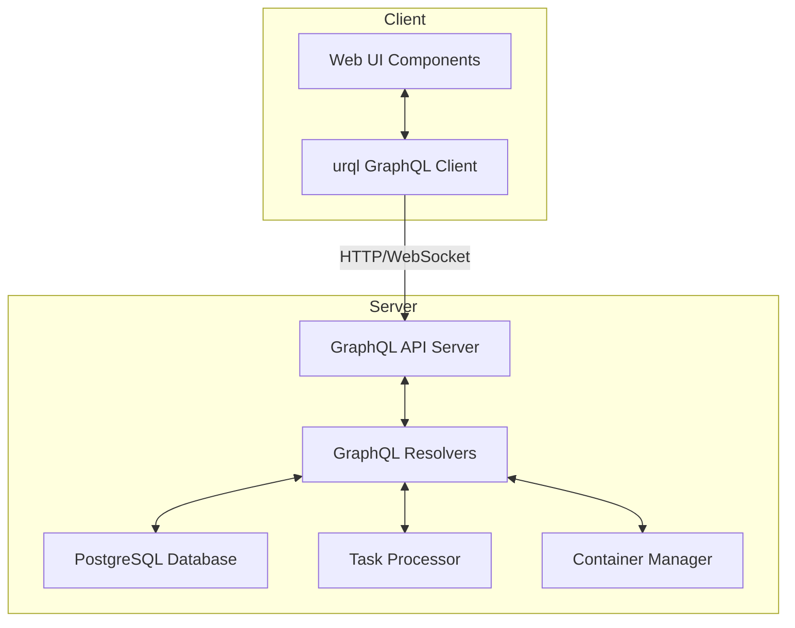
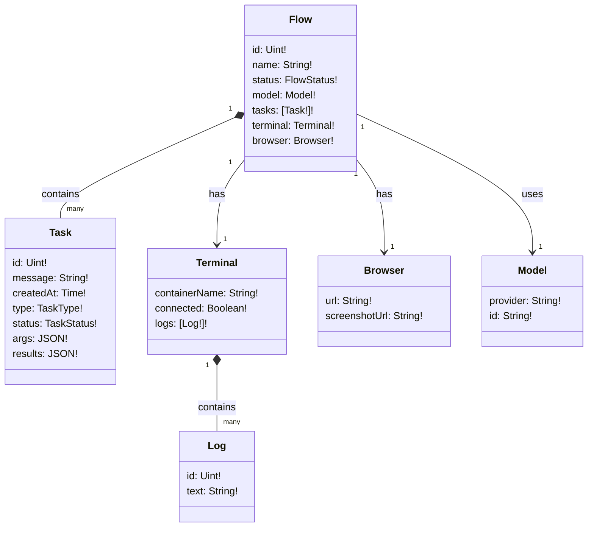
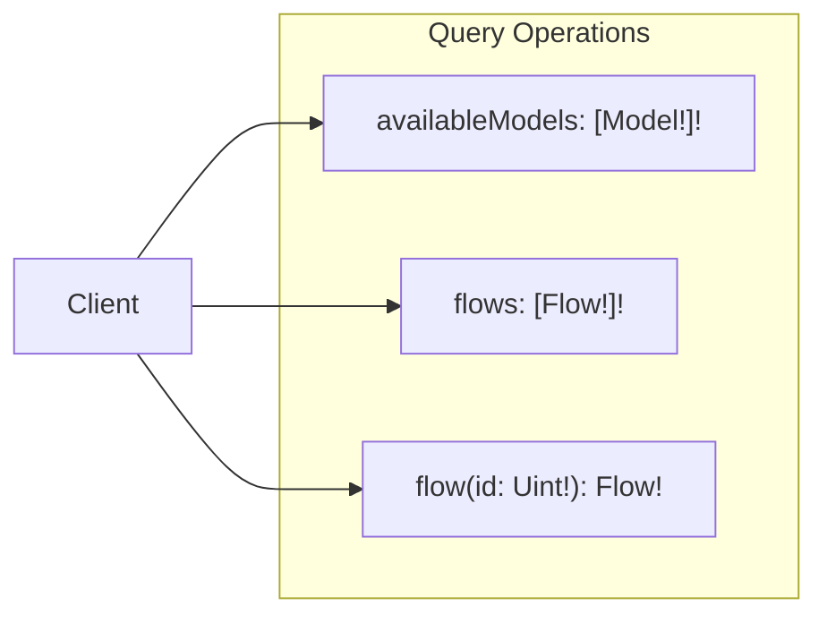
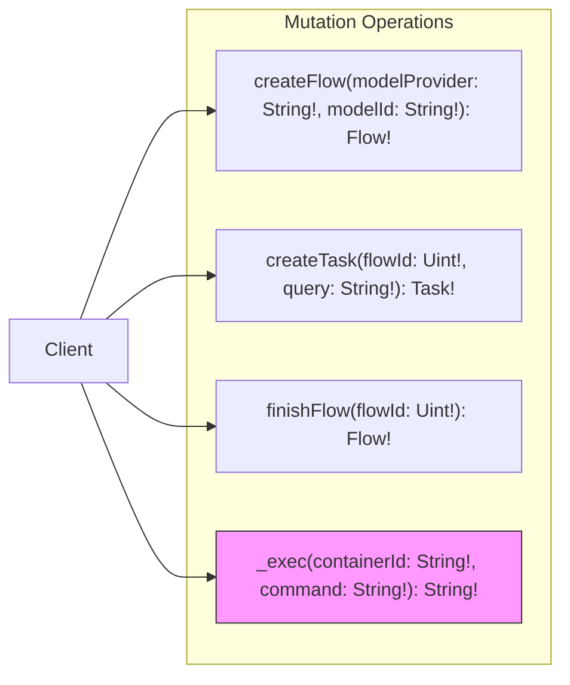
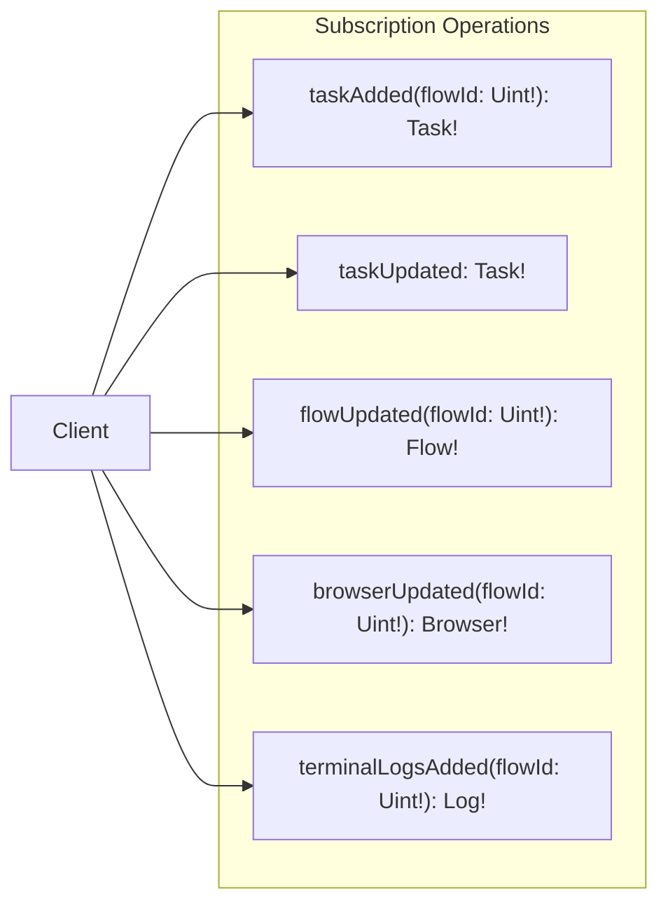
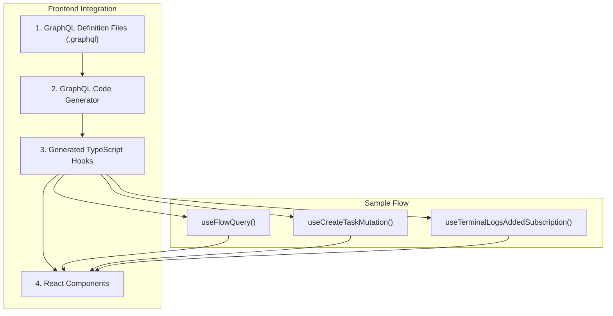
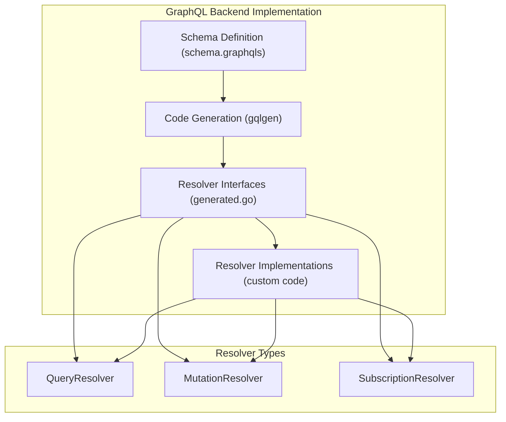

<!-- source: DeepWiki mcp.deepwiki.com · repo semanser/codel · page 4.2 GraphQL API · fetched 2026-10-27 -->

# GraphQL API

<details>
<summary>Relevant source files</summary>

The following files were used as context for generating this wiki page:

- [backend/graph/generated.go](backend/graph/generated.go)
- [backend/graph/schema.graphqls](backend/graph/schema.graphqls)
- [frontend/generated/graphql.schema.json](frontend/generated/graphql.schema.json)
- [frontend/generated/graphql.ts](frontend/generated/graphql.ts)
- [frontend/src/pages/ChatPage/ChatPage.graphql](frontend/src/pages/ChatPage/ChatPage.graphql)

</details>


This document explains the GraphQL API that serves as the primary communication interface between the frontend and backend components of Codel. The API enables the frontend to query data, execute operations, and receive real-time updates from the backend. For information about how real-time updates are implemented, see [Real-time Communication](#4.3).

## Overview

The GraphQL API in Codel is implemented using the gqlgen library on the Go backend and consumed by the frontend using the urql GraphQL client. It provides a type-safe, efficient way to interact with the core Codel functionalities.



**Diagram: GraphQL API Communication Flow**

Sources: [backend/graph/schema.graphqls:1-90](), [frontend/generated/graphql.ts:1-60]()

## Schema Structure

The GraphQL schema defines the available operations and data types in the API. Codel's schema is organized around key entities such as Flows, Tasks, Terminals, and Browsers.



**Diagram: GraphQL Schema Entity Relationships**

Sources: [backend/graph/schema.graphqls:5-65]()

### Enumerations

The schema includes several enumerations to represent fixed sets of values:

| Enum | Values | Description |
|------|--------|-------------|
| TaskType | input, terminal, browser, code, ask, done | Defines the type of task being performed |
| TaskStatus | inProgress, finished, stopped, failed | Represents the execution status of a task |
| FlowStatus | inProgress, finished | Indicates whether a flow is active or completed |

Sources: [backend/graph/schema.graphqls:5-19](), [backend/graph/schema.graphqls:31-34]()

## Operations

The GraphQL API provides three types of operations: queries for fetching data, mutations for modifying data, and subscriptions for receiving real-time updates.

### Queries

Queries allow the client to fetch data from the server. Codel provides the following queries:



**Diagram: Available GraphQL Queries**

Sources: [backend/graph/schema.graphqls:67-71]()

#### Example Query

This query fetches a specific flow with its associated tasks, terminal information, and browser state:

```graphql
query flow($id: Uint!) {
  flow(id: $id) {
    id
    name
    status
    model {
      provider
      id
    }
    terminal {
      containerName
      connected
      logs {
        text
        id
      }
    }
    browser {
      url
      screenshotUrl
    }
    tasks {
      id
      type
      message
      status
      args
      results
      createdAt
    }
  }
}
```

Sources: [frontend/src/pages/ChatPage/ChatPage.graphql:43-47]()

### Mutations

Mutations allow the client to modify data on the server. Codel provides the following mutations:



**Diagram: Available GraphQL Mutations**

Sources: [backend/graph/schema.graphqls:73-80]()

#### Example Mutation

This mutation creates a new task within a flow:

```graphql
mutation createTask($flowId: Uint!, $query: String!) {
  createTask(flowId: $flowId, query: $query) {
    id
    type
    message
    status
    args
    results
    createdAt
  }
}
```

Sources: [frontend/src/pages/ChatPage/ChatPage.graphql:56-60]()

### Subscriptions

Subscriptions enable real-time updates through a persistent connection. Codel uses subscriptions to notify clients about new tasks, updated tasks, flow changes, browser updates, and terminal logs:



**Diagram: Available GraphQL Subscriptions**

Sources: [backend/graph/schema.graphqls:82-89]()

#### Example Subscription

This subscription listens for new terminal logs in a specific flow:

```graphql
subscription terminalLogsAdded($flowId: Uint!) {
  terminalLogsAdded(flowId: $flowId) {
    text
    id
  }
}
```

Sources: [frontend/src/pages/ChatPage/ChatPage.graphql:75-79]()

## Frontend Integration

The frontend integrates with the GraphQL API using the urql client and generated hooks. The process involves:

1. Defining GraphQL operations in `.graphql` files
2. Generating TypeScript types and hooks using the GraphQL Code Generator
3. Using the generated hooks in React components



**Diagram: Frontend GraphQL Integration Process**

Sources: [frontend/generated/graphql.ts:233-246](), [frontend/generated/graphql.ts:267-280](), [frontend/generated/graphql.ts:311-314]()

### Generated Hooks

The frontend uses generated hooks to interact with the API:

| Operation Type | Generated Hook | Usage |
|----------------|----------------|-------|
| Query | `useFlowQuery` | Fetch a specific flow |
| Query | `useFlowsQuery` | Fetch all flows |
| Query | `useAvailableModelsQuery` | Fetch available models |
| Mutation | `useCreateFlowMutation` | Create a new flow |
| Mutation | `useCreateTaskMutation` | Create a new task |
| Mutation | `useFinishFlowMutation` | Finish a flow |
| Subscription | `useTaskAddedSubscription` | Listen for new tasks |
| Subscription | `useTerminalLogsAddedSubscription` | Listen for new terminal logs |
| Subscription | `useFlowUpdatedSubscription` | Listen for flow updates |
| Subscription | `useBrowserUpdatedSubscription` | Listen for browser updates |

Sources: [frontend/generated/graphql.ts:233-341]()

## Backend Implementation

On the backend, the GraphQL API is implemented using the gqlgen library. The main components are:

1. **Schema Definition**: Defined in `schema.graphqls`
2. **Resolver Interfaces**: Generated in `generated.go`
3. **Resolver Implementations**: Custom code that fulfills the resolver interfaces



**Diagram: Backend GraphQL Implementation**

Sources: [backend/graph/generated.go:43-47](), [backend/graph/generated.go:116-133]()

### Resolver Interfaces

The gqlgen library generates interfaces that must be implemented to handle GraphQL operations:

```go
type MutationResolver interface {
    CreateFlow(ctx context.Context, modelProvider string, modelID string) (*gmodel.Flow, error)
    CreateTask(ctx context.Context, flowID uint, query string) (*gmodel.Task, error)
    FinishFlow(ctx context.Context, flowID uint) (*gmodel.Flow, error)
    Exec(ctx context.Context, containerID string, command string) (string, error)
}

type QueryResolver interface {
    AvailableModels(ctx context.Context) ([]*gmodel.Model, error)
    Flows(ctx context.Context) ([]*gmodel.Flow, error)
    Flow(ctx context.Context, id uint) (*gmodel.Flow, error)
}

type SubscriptionResolver interface {
    TaskAdded(ctx context.Context, flowID uint) (<-chan *gmodel.Task, error)
    TaskUpdated(ctx context.Context) (<-chan *gmodel.Task, error)
    FlowUpdated(ctx context.Context, flowID uint) (<-chan *gmodel.Flow, error)
    BrowserUpdated(ctx context.Context, flowID uint) (<-chan *gmodel.Browser, error)
    TerminalLogsAdded(ctx context.Context, flowID uint) (<-chan *gmodel.Log, error)
}
```

Sources: [backend/graph/generated.go:116-133]()

## Security Considerations

The GraphQL API does not implement authentication or authorization in the current version. The `_exec` mutation is marked for development purposes only and could pose security risks if exposed in production.

Sources: [backend/graph/schema.graphqls:78-79]()

## Summary

The GraphQL API serves as the central communication layer in Codel, enabling:

1. Data retrieval through queries
2. Data modification through mutations
3. Real-time updates through subscriptions

This architecture provides a flexible, type-safe, and efficient way for the frontend to interact with the backend services, facilitating the autonomous AI agent capabilities of Codel.

---

