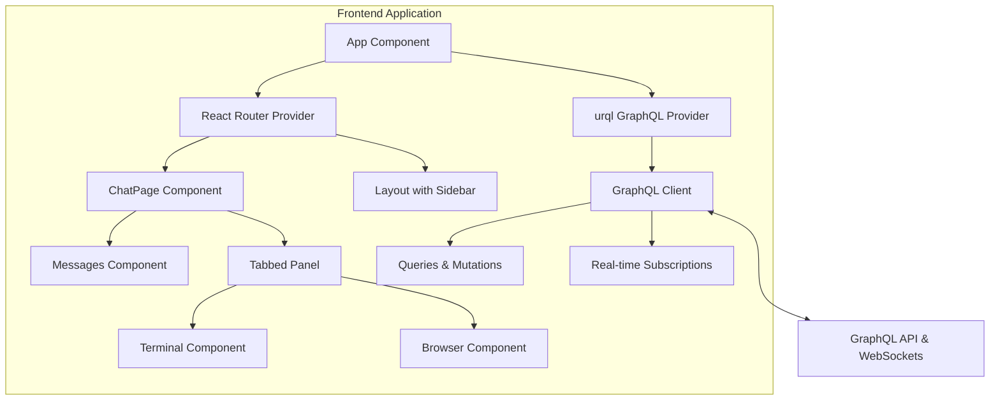
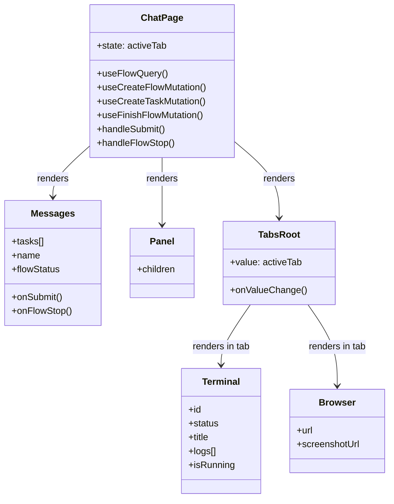
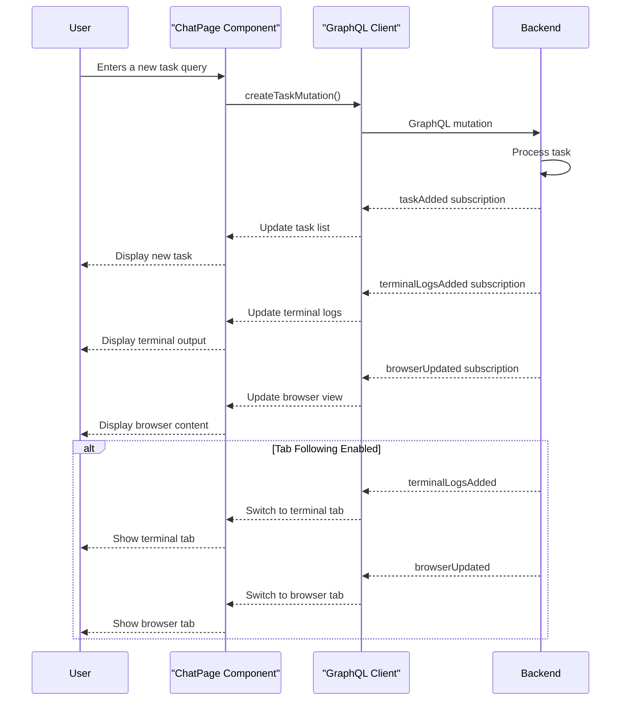
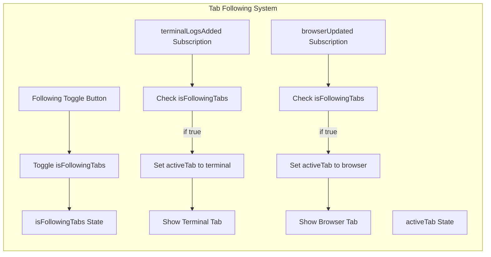
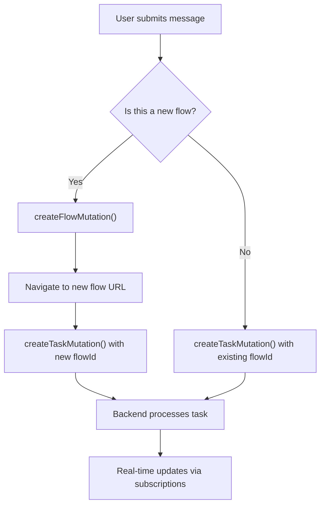
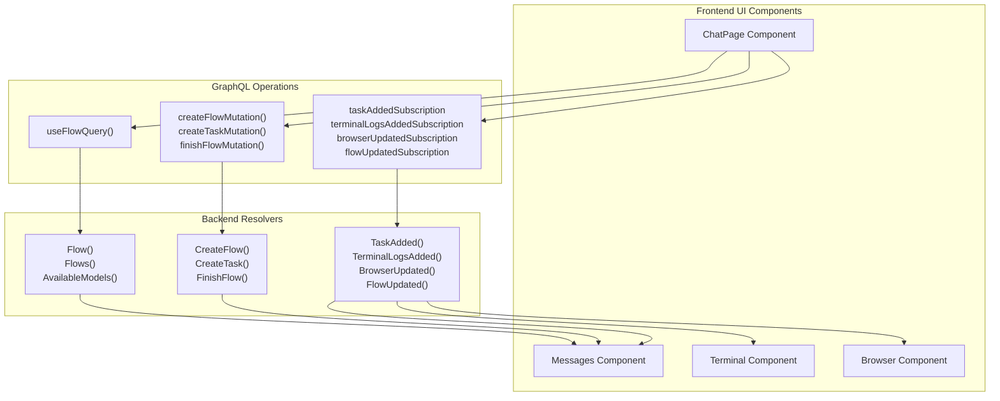
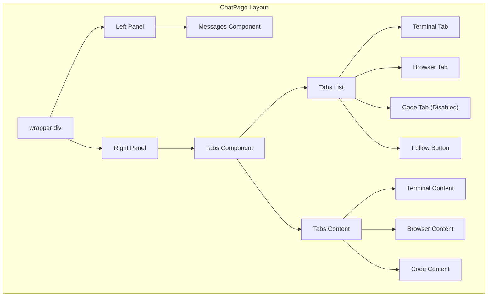

<!-- source: DeepWiki mcp.deepwiki.com · repo semanser/codel · page 5 User Interface · fetched 2026-10-27 -->

# User Interface

Relevant source files

The following files were used as context for generating this wiki page:

- [backend/graph/schema.resolvers.go](backend/graph/schema.resolvers.go)
- [frontend/package.json](frontend/package.json)
- [frontend/src/main.tsx](frontend/src/main.tsx)
- [frontend/src/pages/ChatPage/ChatPage.tsx](frontend/src/pages/ChatPage/ChatPage.tsx)
- [frontend/yarn.lock](frontend/yarn.lock)

This document provides an overview of Codel's user interface architecture, component system, and interaction patterns. It covers the frontend application structure, key components, and how they communicate with the backend services. For information about specific UI components such as the terminal or messages system, see the related pages: [Main Chat Interface](#5.1), [Terminal Component](#5.2), [Messages System](#5.3), and [Navigation and UI Components](#5.4).

## Frontend Architecture Overview

The Codel user interface is built as a React application using TypeScript, with GraphQL as the communication layer between frontend and backend. The UI is designed to provide a seamless experience for interacting with the autonomous AI agent, displaying task results, and managing terminal and browser sessions.

Sources: [frontend/src/pages/ChatPage/ChatPage.tsx:5-18](), [frontend/package.json:17-42]()

## Core UI Components

The main UI consists of several key components that work together to provide the user experience:

| Component | Description | Responsibility |
|-----------|-------------|----------------|
| ChatPage | Main page component | Orchestrates the entire chat experience, manages state and GraphQL operations |
| Messages | Message display component | Renders the conversation history, input field, and task results |
| Tabs & Panel | Container for tool interfaces | Provides tabs to switch between terminal, browser, and code interfaces |
| Terminal | Terminal emulation | Displays and interacts with the container's terminal session |
| Browser | Browser preview | Shows screenshots and URLs of the browser component |

Sources: [frontend/src/pages/ChatPage/ChatPage.tsx:6-17](), [frontend/src/pages/ChatPage/ChatPage.tsx:133-209]()

## ChatPage Component Structure

The ChatPage is the primary user interface component, responsible for managing the conversation with the AI agent and displaying the terminal and browser interfaces.

Sources: [frontend/src/pages/ChatPage/ChatPage.tsx:38-211]()

## Data Flow and Real-time Updates

The UI leverages GraphQL subscriptions to provide real-time updates of terminal logs, browser changes, and task progress.

Sources: [frontend/src/pages/ChatPage/ChatPage.tsx:67-89](), [frontend/src/pages/ChatPage/ChatPage.tsx:91-99]()

## Subscription System

The UI remains synchronized with backend state using GraphQL subscriptions, which provide real-time updates for various aspects of the system.

| Subscription | Purpose | Effect on UI |
|--------------|---------|-------------|
| useTaskAddedSubscription | Notifies when a new task is added | Updates the task list in Messages component |
| useTerminalLogsAddedSubscription | Notifies when new terminal logs are available | Updates terminal display and optionally switches to terminal tab |
| useBrowserUpdatedSubscription | Notifies when browser content changes | Updates browser display and optionally switches to browser tab |
| useFlowUpdatedSubscription | Notifies when flow status changes | Updates flow status display |

Sources: [frontend/src/pages/ChatPage/ChatPage.tsx:67-99]()

## Dynamic Tab Management

The Codel UI features a tab-following system that automatically switches between terminal and browser tabs based on the AI agent's activity.

Sources: [frontend/src/pages/ChatPage/ChatPage.tsx:45-48](), [frontend/src/pages/ChatPage/ChatPage.tsx:67-89](), [frontend/src/pages/ChatPage/ChatPage.tsx:170-186]()

## Task Submission Flow

When a user submits a new task, the UI initiates a series of operations to create a flow (if needed) and add a task to that flow.

Sources: [frontend/src/pages/ChatPage/ChatPage.tsx:101-123]()

## UI Components Integration with Backend

The following diagram illustrates how the UI components integrate with the backend GraphQL API:

Sources: [frontend/src/pages/ChatPage/ChatPage.tsx:20-29](), [backend/graph/schema.resolvers.go:23-284]()

## Technology Stack

The Codel frontend is built using modern web technologies:

| Category | Technologies | Purpose |
|----------|--------------|---------|
| Core Framework | React, TypeScript | Application foundation |
| Routing | React Router | Page navigation |
| GraphQL Client | urql | Communication with backend |
| UI Components | Radix UI | Tabs, tooltips, dropdowns |
| Terminal | xterm.js | Terminal emulation |
| Styling | vanilla-extract | CSS-in-JS solution |
| Build Tools | Vite | Development server and build |

Sources: [frontend/package.json:17-42]()

## Responsive Layout

The ChatPage layout is structured to provide an effective interface for both viewing the conversation and interacting with tools.

Sources: [frontend/src/pages/ChatPage/ChatPage.tsx:133-209]()

## Conclusion

The Codel user interface provides a comprehensive environment for interacting with the autonomous AI agent. The GraphQL-based communication layer ensures efficient, real-time updates across all components, while the tabbed interface allows users to seamlessly switch between terminal, browser, and (future) code views. The automatic tab following feature enhances the user experience by showing the most relevant content as the AI agent performs its tasks.

The UI architecture follows modern React patterns with a clean separation of concerns and uses GraphQL subscriptions to maintain synchronization with the backend state.

---

