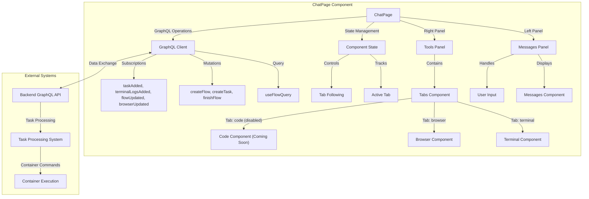
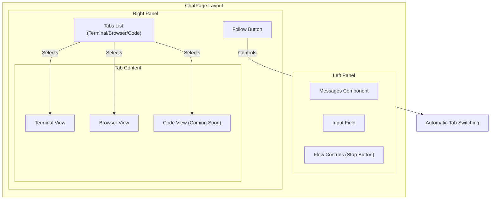
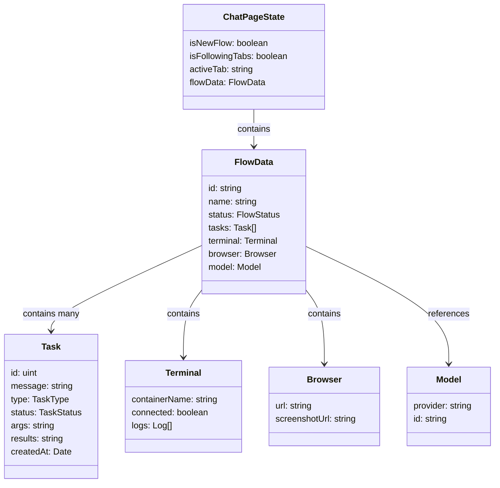
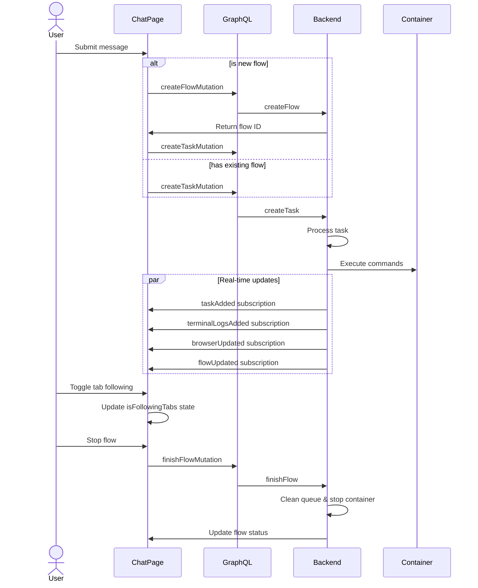
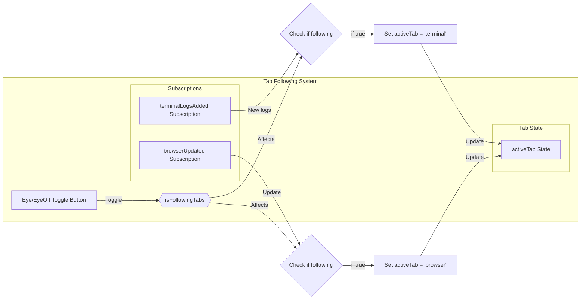

<!-- source: DeepWiki mcp.deepwiki.com · repo semanser/codel · page 5.1 Main Chat Interface · fetched 2026-10-27 -->

# Main Chat Interface

<details>
<summary>Relevant source files</summary>

The following files were used as context for generating this wiki page:

- [backend/graph/schema.resolvers.go](backend/graph/schema.resolvers.go)
- [frontend/src/pages/ChatPage/ChatPage.css.ts](frontend/src/pages/ChatPage/ChatPage.css.ts)
- [frontend/src/pages/ChatPage/ChatPage.graphql](frontend/src/pages/ChatPage/ChatPage.graphql)
- [frontend/src/pages/ChatPage/ChatPage.tsx](frontend/src/pages/ChatPage/ChatPage.tsx)

</details>


The Main Chat Interface is the primary user interface component in Codel where users interact with the AI agent. This interface provides a unified view of the conversation with the AI agent, while also displaying the tools the agent uses to perform tasks, such as the terminal and browser. The chat interface allows users to submit queries, view AI responses, and observe the agent's actions in real-time.

For information about the Terminal component specifically, see [Terminal Component](#5.2). For details about how messages are displayed, see [Messages System](#5.3).

## Architecture Overview

The Main Chat Interface is implemented as the `ChatPage` component, which combines several key components to provide a seamless user experience.



Sources: [frontend/src/pages/ChatPage/ChatPage.tsx:38-211]()

## Component Layout

The ChatPage is structured with a two-panel layout:

1. **Left Panel**: Contains the Messages component that displays the conversation history and input field
2. **Right Panel**: Contains tabbed tools (Terminal, Browser, Code) that the AI agent can use



Sources: [frontend/src/pages/ChatPage/ChatPage.tsx:133-209](), [frontend/src/pages/ChatPage/ChatPage.css.ts:3-26]()

## Data Model and State Management

The ChatPage manages several important pieces of state:

1. **Flow Data**: Information about the current chat flow including tasks, terminal logs, and browser state
2. **Active Tab**: Currently selected tool tab (terminal, browser, or code)
3. **Tab Following**: Whether to automatically switch to tabs with new activity
4. **New Flow State**: Special handling for creating new flows



Sources: [frontend/src/pages/ChatPage/ChatPage.tsx:44-66](), [frontend/src/pages/ChatPage/ChatPage.graphql:1-41]()

## User Interaction Flow

The ChatPage handles several key user interactions:

1. **Submitting a message**: Triggers task creation in the backend
2. **Stopping a flow**: Terminates the current task execution
3. **Toggling tab following**: Controls automatic tab switching behavior
4. **Switching tabs**: Changes the active tool view



Sources: [frontend/src/pages/ChatPage/ChatPage.tsx:101-127](), [frontend/src/pages/ChatPage/ChatPage.graphql:49-96](), [backend/graph/schema.resolvers.go:24-127]()

## GraphQL Integration

The ChatPage heavily relies on GraphQL for data fetching, mutations, and real-time updates through subscriptions. This enables a responsive user experience with minimal page refreshes.

### Key GraphQL Operations:

| Operation Type | Name | Purpose |
|---------------|------|---------|
| Query | `flow` | Fetch details of a specific flow, including tasks, terminal logs, and browser state |
| Mutation | `createFlow` | Create a new flow with specified model parameters |
| Mutation | `createTask` | Add a new task to an existing flow |
| Mutation | `finishFlow` | Terminate an active flow |
| Subscription | `taskAdded` | Receive real-time updates when new tasks are added |
| Subscription | `terminalLogsAdded` | Receive terminal output in real-time |
| Subscription | `flowUpdated` | Get updates when flow properties change |
| Subscription | `browserUpdated` | Receive updates when browser state changes |

Sources: [frontend/src/pages/ChatPage/ChatPage.graphql:43-96](), [frontend/src/pages/ChatPage/ChatPage.tsx:52-98]()

## Real-time Tab Management

One of the unique features of the ChatPage is its "tab following" capability, which automatically switches to the relevant tool tab when new activity occurs:



Sources: [frontend/src/pages/ChatPage/ChatPage.tsx:67-89](), [frontend/src/pages/ChatPage/ChatPage.tsx:169-186]()

## Backend Integration Details

The ChatPage relies on the following backend GraphQL resolvers:

1. **CreateFlow Resolver**: Initializes a new chat flow with the selected language model
2. **CreateTask Resolver**: Adds user's message as a task and triggers the processing queue
3. **FinishFlow Resolver**: Terminates a flow, cleans the task queue, and deletes the associated Docker container
4. **Flow Query Resolver**: Retrieves comprehensive data about a specific flow
5. **Subscription Resolvers**: Push real-time updates to the frontend

Sources: [backend/graph/schema.resolvers.go:24-127](), [backend/graph/schema.resolvers.go:190-259](), [backend/graph/schema.resolvers.go:262-284]()

## Key Components Implementation

### ChatPage Component
The ChatPage serves as the container for all interface elements. It manages state, handles user inputs, and orchestrates data flow between the frontend and backend.

```
<div className={wrapperStyles}>
  <Panel>
    <Messages
      tasks={tasks}
      name={name}
      onSubmit={handleSubmit}
      flowStatus={status}
      isNew={isNewFlow}
      onFlowStop={handleFlowStop}
      model={model}
    />
  </Panel>
  <Panel>
    <Tabs.Root className={tabsRootStyles} value={activeTab} onValueChange={setActiveTab}>
      <Tabs.List className={tabsListStyles}>
        <!-- Tabs navigation and controls -->
      </Tabs.List>
      <Tabs.Content className={tabsContentStyles} value="terminal">
        <Terminal
          id={isNewFlow ? "" : id}
          status={status}
          title={terminal?.containerName}
          logs={terminal?.logs ?? []}
          isRunning={terminal?.connected}
        />
      </Tabs.Content>
      <Tabs.Content className={tabsContentStyles} value="browser">
        <Browser
          url={browser?.url || undefined}
          screenshotUrl={browser?.screenshotUrl ?? ""}
        />
      </Tabs.Content>
      <Tabs.Content className={tabsContentStyles} value="code">
        code
      </Tabs.Content>
    </Tabs.Root>
  </Panel>
</div>
```

Sources: [frontend/src/pages/ChatPage/ChatPage.tsx:133-209]()

### Message Submission Implementation
The `handleSubmit` function processes user input and initiates task creation:

```typescript
const handleSubmit = async (message: string) => {
  if (isNewFlow && selectedModel.id) {
    const result = await createFlowMutation({
      modelProvider: selectedModel.provider,
      modelId: selectedModel.id,
    });

    const flowId = result?.data?.createFlow.id;
    if (flowId) {
      navigate(`/chat/${flowId}`, { replace: true });

      createTaskMutation({
        flowId: flowId,
        query: message,
      });
    }
  } else {
    createTaskMutation({
      flowId: id,
      query: message,
    });
  }
};
```

Sources: [frontend/src/pages/ChatPage/ChatPage.tsx:101-123]()

## Conclusion

The Main Chat Interface serves as the central interaction point for users working with the Codel AI agent. It combines a conversation interface with real-time tool displays, enabling users to submit queries and observe the agent's actions across terminal sessions and web browsing. The component leverages GraphQL for data operations and real-time updates, ensuring a responsive and interactive experience.

---

