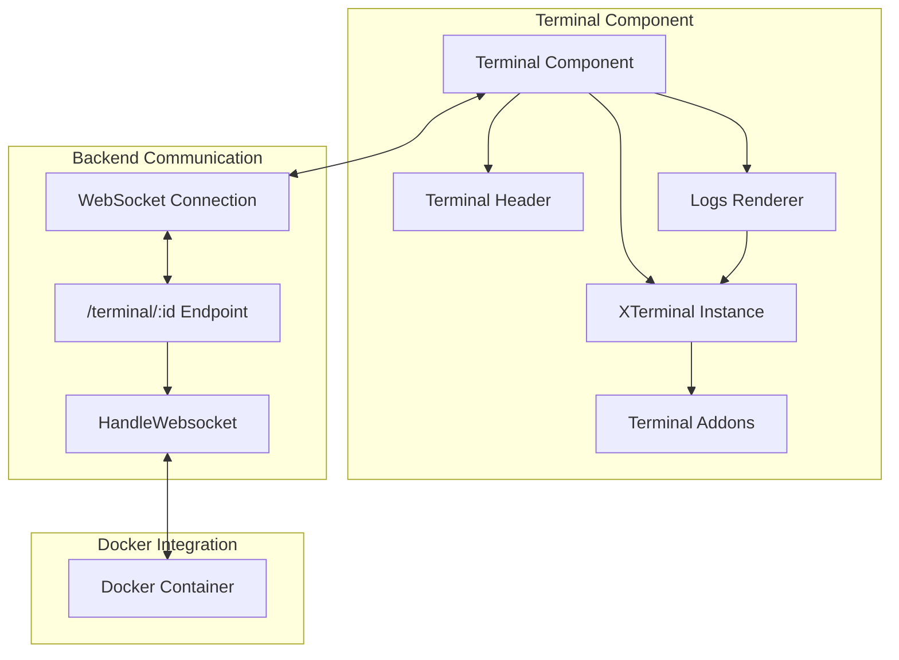
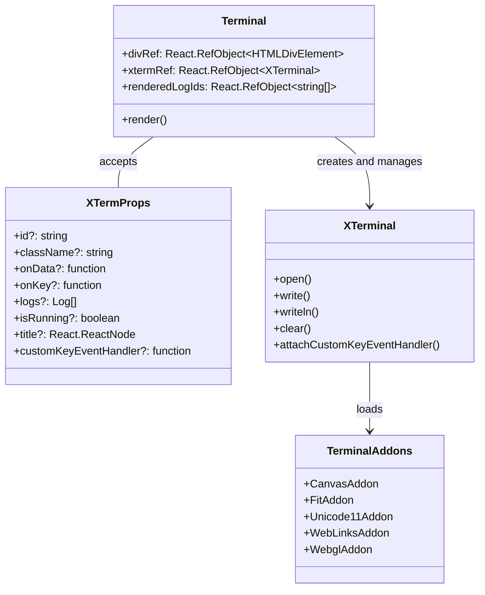
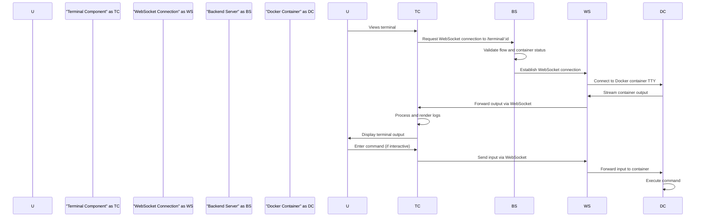
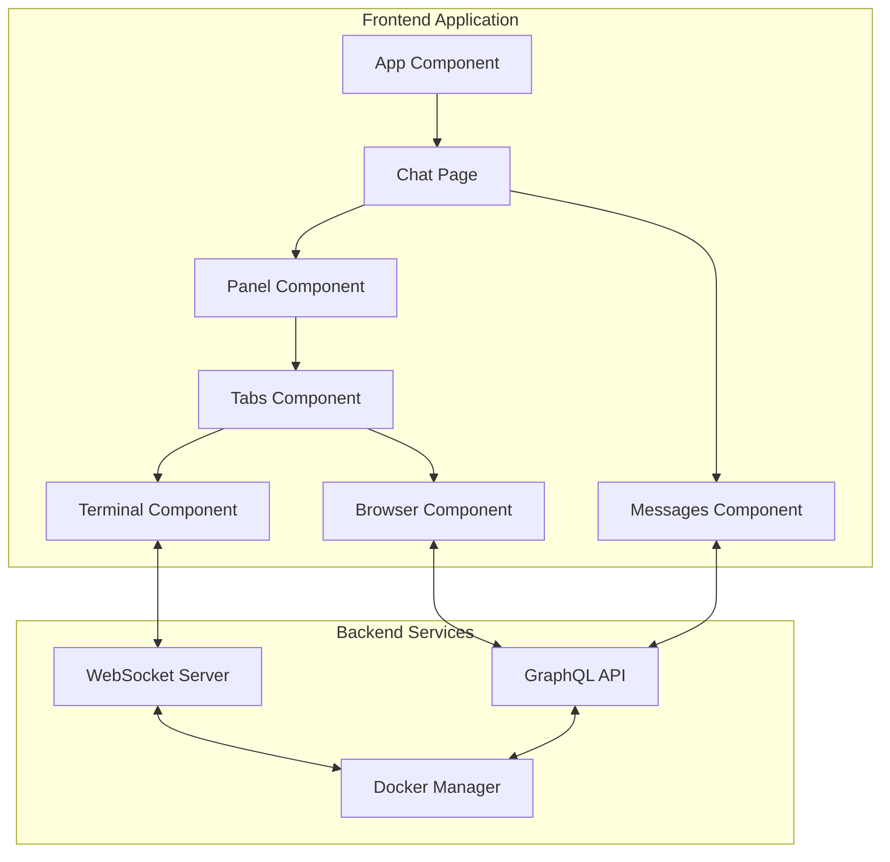

<!-- source: DeepWiki mcp.deepwiki.com · repo semanser/codel · page 5.2 Terminal Component · fetched 2026-10-27 -->

# Terminal Component

<details>
<summary>Relevant source files</summary>

The following files were used as context for generating this wiki page:

- [backend/router/router.go](backend/router/router.go)
- [frontend/src/components/Terminal/Terminal.tsx](frontend/src/components/Terminal/Terminal.tsx)

</details>


## Purpose and Overview

The Terminal Component provides real-time terminal access to Docker containers within the Codel system. It enables users to view terminal outputs from commands executed by the AI agent and displays the status of container connections. This component is a crucial part of the user interface that bridges the gap between the container execution system and the web frontend.

For information about the overall user interface architecture, see [User Interface](#5), and for details about how containers are managed, see [Container Execution System](#3.3).

Sources: [frontend/src/components/Terminal/Terminal.tsx:1-191](), [backend/router/router.go:46-48]()

## Component Architecture

The Terminal Component is built using xterm.js, a terminal emulator for the browser, along with several addons to enhance its functionality and performance.



The Terminal Component architecture uses xterm.js as its foundation and connects to Docker containers through a WebSocket connection managed by the backend.

Sources: [frontend/src/components/Terminal/Terminal.tsx:4-13](), [frontend/src/components/Terminal/Terminal.tsx:78-82](), [backend/router/router.go:120-150]()

## Implementation Details

### Frontend Implementation

The Terminal component is implemented as a React functional component that wraps the xterm.js library. It handles terminal initialization, event binding, and rendering logs.



The Terminal component manages the lifecycle of an xterm.js instance, including initialization, addon loading, and event handling.

Sources: [frontend/src/components/Terminal/Terminal.tsx:53-76](), [frontend/src/components/Terminal/Terminal.tsx:84-191]()

### Key Component Properties

The Terminal component accepts several properties to customize its behavior:

| Property | Type | Description |
|----------|------|-------------|
| `id` | string | Unique identifier for the terminal instance |
| `className` | string | CSS class for styling |
| `onData` | function | Event handler for data received from the terminal |
| `onKey` | function | Event handler for key events |
| `customKeyEventHandler` | function | Custom handler for keyboard events |
| `logs` | Log[] | Array of log entries to display |
| `isRunning` | boolean | Whether the container is currently running |
| `title` | React.ReactNode | Title to display in the terminal header |

Sources: [frontend/src/components/Terminal/Terminal.tsx:53-76]()

### Terminal Initialization and Addon Loading

The Terminal component initializes the xterm.js instance and loads several addons to enhance functionality:

1. **Unicode11Addon**: Provides Unicode v11 character support
2. **CanvasAddon**: Renders the terminal using Canvas API
3. **WebglAddon**: Accelerates rendering with WebGL (if supported)
4. **WebLinksAddon**: Makes URLs clickable in the terminal
5. **FitAddon**: Automatically resizes the terminal to fit its container

The component selects the appropriate rendering addon based on the browser's capabilities, falling back to WebLinksAddon if WebGL is not supported.

Sources: [frontend/src/components/Terminal/Terminal.tsx:78-82](), [frontend/src/components/Terminal/Terminal.tsx:127-151]()

### Log Rendering

The Terminal component maintains a list of already rendered log IDs to prevent duplicate rendering. When new logs are received, only those not already rendered are added to the terminal:

```
useEffect(() => {
  if (!xtermRef.current) return;

  for (const log of logs) {
    if (renderedLogIds.current.includes(log.id)) continue;

    xtermRef.current.writeln(log.text);
    renderedLogIds.current.push(log.id);
  }
}, [logs]);
```

When a new terminal instance is created (indicated by a change in `id`), the component clears the terminal and resets the rendered log tracking.

Sources: [frontend/src/components/Terminal/Terminal.tsx:109-125]()

### Event Handling

The Terminal component supports a wide range of event handlers that can be passed as props:

- `onBell`, `onBinary`, `onCursorMove`, `onData`, `onKey`, `onLineFeed`
- `onRender`, `onResize`, `onScroll`, `onSelectionChange`
- `onTitleChange`, `onWriteParsed`

These handlers are bound to the xterm.js instance using a custom `useBind` hook that properly manages event listener lifecycles.

Sources: [frontend/src/components/Terminal/Terminal.tsx:24-51](), [frontend/src/components/Terminal/Terminal.tsx:153-164]()

### Visual Interface

The Terminal component includes a header that displays the connection status:

1. **Connected state**: Shows the Docker icon, container title, and "Active" label
2. **Disconnected state**: Shows "Disconnected" text

This provides users with immediate visual feedback about whether the terminal is currently connected to a running container.

Sources: [frontend/src/components/Terminal/Terminal.tsx:176-188]()

## Backend Integration

### WebSocket Connection

The terminal connects to Docker containers through a WebSocket endpoint at `/terminal/:id`, where `id` is the flow ID.

The backend implements several validation checks before establishing the connection:

1. Verifies the flow exists
2. Ensures the flow is in progress
3. Confirms the container is running

If these conditions are met, the WebSocket connection is established using the `HandleWebsocket` function.

Sources: [backend/router/router.go:120-150]()

### Data Flow



This sequence illustrates how the Terminal component connects to a Docker container and streams terminal I/O in real-time.

Sources: [backend/router/router.go:120-150](), [frontend/src/components/Terminal/Terminal.tsx:109-125]()

## Integration with Codel

The Terminal Component is a critical part of the user interface that allows users to monitor the execution of tasks in the container. It is typically displayed alongside the Browser component in a tabbed interface.



The Terminal Component works in conjunction with other UI components to provide a comprehensive interface for interacting with the AI agent and monitoring its actions.

Sources: [frontend/src/components/Terminal/Terminal.tsx:1-191](), [backend/router/router.go:46-48]()

## Summary

The Terminal Component is a crucial element of the Codel UI that provides real-time access to container terminal output. Built on xterm.js with various rendering and functionality addons, it offers a responsive and feature-rich terminal experience in the browser. The component interfaces with Docker containers through WebSocket connections, displaying command outputs and execution results to the user.

This component plays a key role in making the AI agent's actions transparent and observable, allowing users to monitor the execution of terminal commands in real-time.

---

