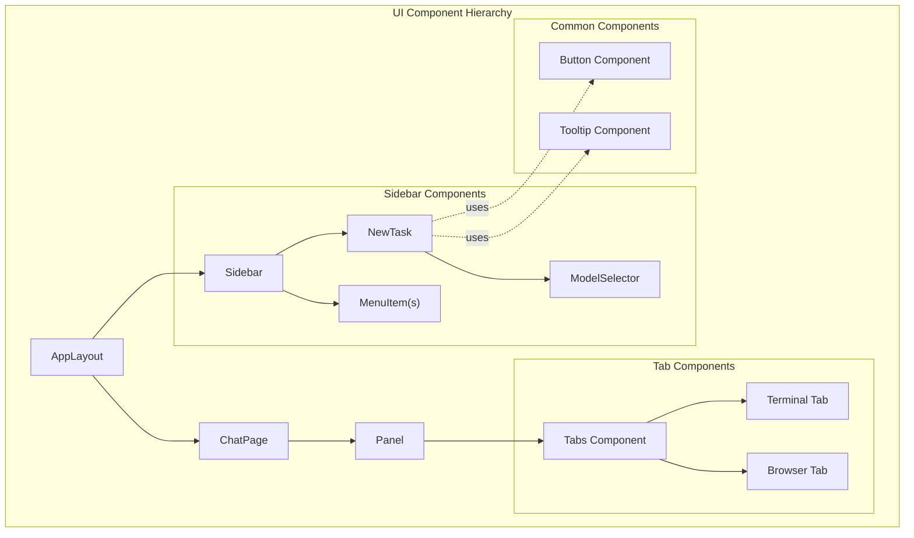
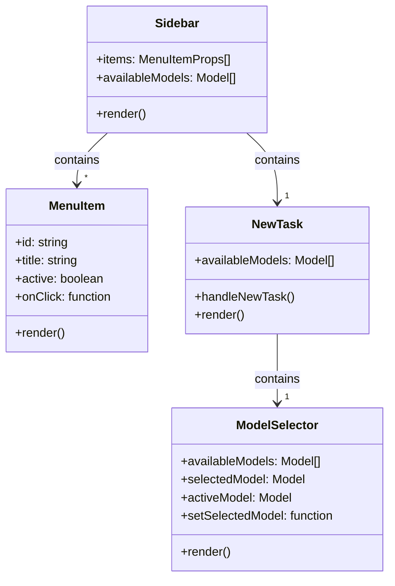
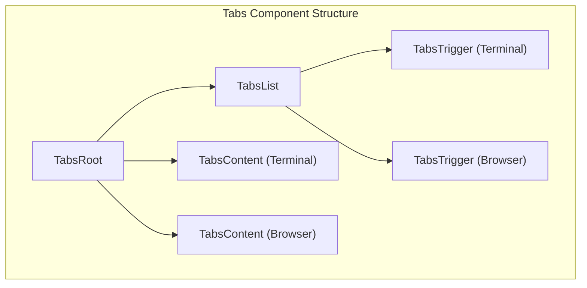
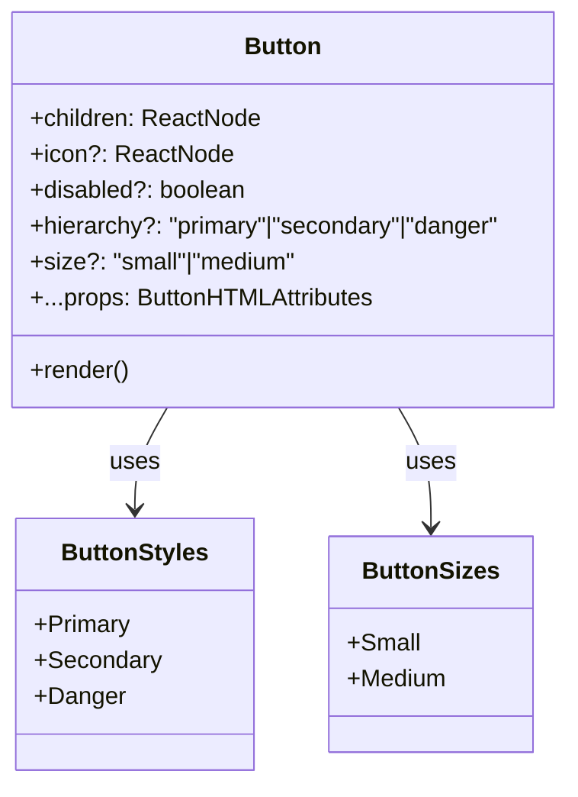
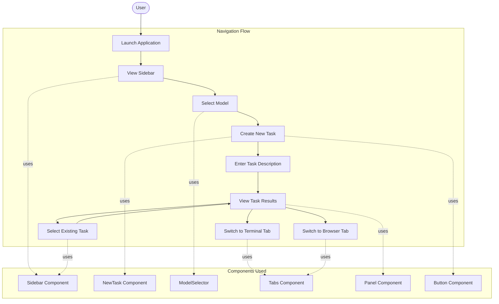
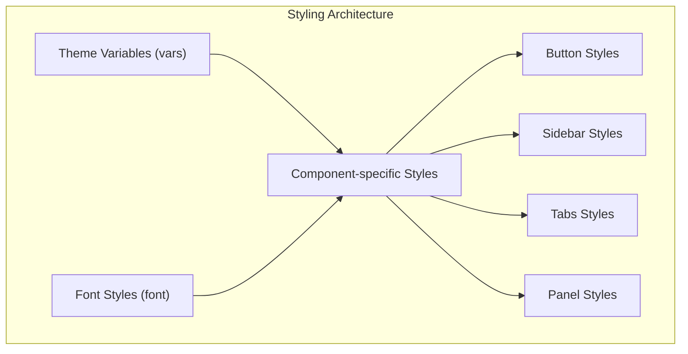

<!-- source: DeepWiki mcp.deepwiki.com · repo semanser/codel · page 5.4 Navigation and UI Components · fetched 2026-10-27 -->

# Navigation and UI Components

<details>
<summary>Relevant source files</summary>

The following files were used as context for generating this wiki page:

- [frontend/src/components/Button/Button.css.ts](frontend/src/components/Button/Button.css.ts)
- [frontend/src/components/Button/Button.tsx](frontend/src/components/Button/Button.tsx)
- [frontend/src/components/Panel/Panel.tsx](frontend/src/components/Panel/Panel.tsx)
- [frontend/src/components/Sidebar/NewTask/NewTask.css.ts](frontend/src/components/Sidebar/NewTask/NewTask.css.ts)
- [frontend/src/components/Sidebar/NewTask/NewTask.tsx](frontend/src/components/Sidebar/NewTask/NewTask.tsx)
- [frontend/src/components/Sidebar/Sidebar.css.ts](frontend/src/components/Sidebar/Sidebar.css.ts)
- [frontend/src/components/Sidebar/Sidebar.tsx](frontend/src/components/Sidebar/Sidebar.tsx)
- [frontend/src/components/Tabs/Tabs.css.ts](frontend/src/components/Tabs/Tabs.css.ts)
- [frontend/src/components/Terminal/Terminal.css.ts](frontend/src/components/Terminal/Terminal.css.ts)

</details>


This page documents the navigation and user interface components that make up Codel's front-end interface. These components work together to provide a cohesive user experience for interacting with AI agents, managing tasks, and viewing results. For information about the main chat interface, see [Main Chat Interface](#5.1), for terminal functionality specifics, see [Terminal Component](#5.2), and for the message display system, see [Messages System](#5.3).

## Component Overview

The Codel UI is built with a component-based architecture using React with TypeScript. The navigation and UI components are organized to provide intuitive access to tasks, terminal interactions, and browser functionality.



Sources: 
- [frontend/src/components/Sidebar/Sidebar.tsx]()
- [frontend/src/components/Panel/Panel.tsx]()
- [frontend/src/components/Sidebar/NewTask/NewTask.tsx]()

## Sidebar Component

The Sidebar provides the main navigation structure for Codel, displaying a list of available tasks and allowing users to create new ones.

### Structure and Implementation

The Sidebar component is a vertical panel that contains:
1. The NewTask button at the top
2. A list of MenuItems representing existing tasks/flows



The Sidebar component renders a vertical list with fixed width (280px) and scrollable content. It's implemented in [frontend/src/components/Sidebar/Sidebar.tsx:11-20](), which renders both the NewTask component and maps through the provided menu items.

Sources:
- [frontend/src/components/Sidebar/Sidebar.tsx]()
- [frontend/src/components/Sidebar/Sidebar.css.ts]()

### NewTask Component

The NewTask component enables users to create new tasks/flows. It includes:
1. A button to create a new task
2. A model selector dropdown for choosing the AI model to use

```typescript
// Implementation details from NewTask.tsx
export const NewTask = ({ availableModels = [] }: NewTaskProps) => {
  // ...
  return (
    <div className={wrapperStyles}>
      <Tooltip content={tooltipContent}>
        <button
          className={linkWrapperStyles}
          onClick={handleNewTask}
          disabled={!activeModel}
        >
          ✨ New task
        </button>
      </Tooltip>
      <ModelSelector
        availableModels={availableModels}
        selectedModel={selectedModel}
        activeModel={activeModel}
        setSelectedModel={setSelectedModel}
      />
    </div>
  );
};
```

The component uses `useLocalStorage` to persist the user's model selection between sessions and shows a tooltip explaining why the button might be disabled (if no model is selected).

Sources:
- [frontend/src/components/Sidebar/NewTask/NewTask.tsx]()
- [frontend/src/components/Sidebar/NewTask/NewTask.css.ts]()

## Tabs Component

The Tabs component provides a tabbed interface to switch between different content panels, primarily used to toggle between Terminal and Browser views.

### Structure and Styling

The Tabs component uses a clean, minimalist design with the following structure:
- Tab list container at the top
- Individual tab triggers with active state indicators
- Content area below that shows the active tab's content



The styling details from [frontend/src/components/Tabs/Tabs.css.ts]() show:
- Tabs are styled with a subtle background (`gray2` color)
- Active tabs have a primary color indicator at the bottom
- Active tabs have a slightly different background (`gray3` color)
- Hover states provide subtle feedback

Sources:
- [frontend/src/components/Tabs/Tabs.css.ts]()

## Button Component

The Button component is a versatile UI element used throughout the application for various actions.

### Variants and Usage

The Button component supports three hierarchy variants:
1. **Primary** - For main actions (blue background)
2. **Secondary** - For secondary actions (gray background with border)
3. **Danger** - For destructive actions (red background)

It also supports two sizes:
1. **Small** - Compact (4px padding)
2. **Medium** - Standard (8px padding)

The component accepts an optional icon that's displayed before the button text.



Sources:
- [frontend/src/components/Button/Button.tsx]()
- [frontend/src/components/Button/Button.css.ts]()

## Panel Component

The Panel component is a simple container wrapper that provides consistent styling for content sections. It's primarily used to contain the Tabs component and its content.

```typescript
// Simple implementation from Panel.tsx
export const Panel = ({ children }: PanelProps) => (
  <div className={wrapperStyles}>{children}</div>
);
```

Sources:
- [frontend/src/components/Panel/Panel.tsx]()

## User Navigation Flow

The following diagram illustrates how users navigate through the Codel interface using the components described above:



Sources:
- [frontend/src/components/Sidebar/Sidebar.tsx]()
- [frontend/src/components/Sidebar/NewTask/NewTask.tsx]()
- [frontend/src/components/Tabs/Tabs.css.ts]()

## Component Style Consistency

The UI components use a consistent styling approach with:
1. Vanilla Extract CSS for type-safe styling
2. A shared color system using theme variables
3. Consistent typography through font styles
4. Standardized spacing and padding

The styling is modular, with each component having its dedicated CSS file (e.g., `Sidebar.css.ts`, `Button.css.ts`).



The styling system uses:
- CSS variables for colors (e.g., `vars.color.gray3`)
- Font styles for typography (e.g., `font.textSmSemibold`)
- Vanilla Extract for creating style variants (e.g., `buttonStyles.Primary`)

Sources:
- [frontend/src/components/Button/Button.css.ts]()
- [frontend/src/components/Sidebar/Sidebar.css.ts]()
- [frontend/src/components/Tabs/Tabs.css.ts]()
- [frontend/src/components/Sidebar/NewTask/NewTask.css.ts]()

## Integration with the Application

These navigation and UI components integrate with the larger application architecture to provide a cohesive user experience. The Sidebar allows navigation between different flows, the Panel and Tabs components organize the terminal and browser functionality, and the Button component provides consistent interaction points throughout the interface.

---

