<!-- source: DeepWiki mcp.deepwiki.com · repo semanser/codel · page 7 Application Bootstrapping · fetched 2026-10-27 -->

# Application Bootstrapping

Relevant source files

The following files were used as context for generating this wiki page:

- [backend/go.mod](backend/go.mod)
- [backend/go.sum](backend/go.sum)
- [backend/main.go](backend/main.go)
- [backend/models/models.go](backend/models/models.go)
- [frontend/index.html](frontend/index.html)
- [frontend/public/android-chrome-192x192.png](frontend/public/android-chrome-192x192.png)
- [frontend/src/App.tsx](frontend/src/App.tsx)
- [frontend/src/vite-env.d.ts](frontend/src/vite-env.d.ts)
- [frontend/tsconfig.json](frontend/tsconfig.json)
- [frontend/vite.config.ts](frontend/vite.config.ts)

This page documents how the Codel application initializes and bootstraps both its backend (Go server) and frontend (React application) components. It covers the startup process, dependency initialization, and the sequence of operations that occur when the application launches.

## Overview

Codel's bootstrapping process consists of two main parts:
1. **Backend Bootstrapping**: Go server initialization, database setup, and service preparation
2. **Frontend Bootstrapping**: React application initialization, routing setup, and GraphQL client configuration

The following sections detail each part of the bootstrapping process and how they connect.

## Backend Bootstrapping

The backend bootstrapping process is responsible for initializing the Go server, configuring dependencies, establishing database connections, and preparing Docker containers.

### Backend Bootstrapping Sequence

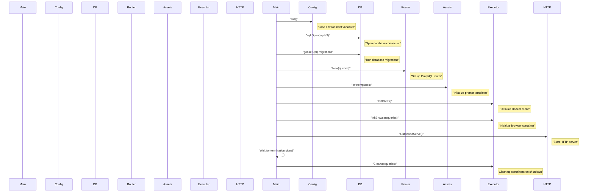

Sources: [backend/main.go:31-86]()

### Backend Embedded Resources

The backend embeds several key resources during initialization:

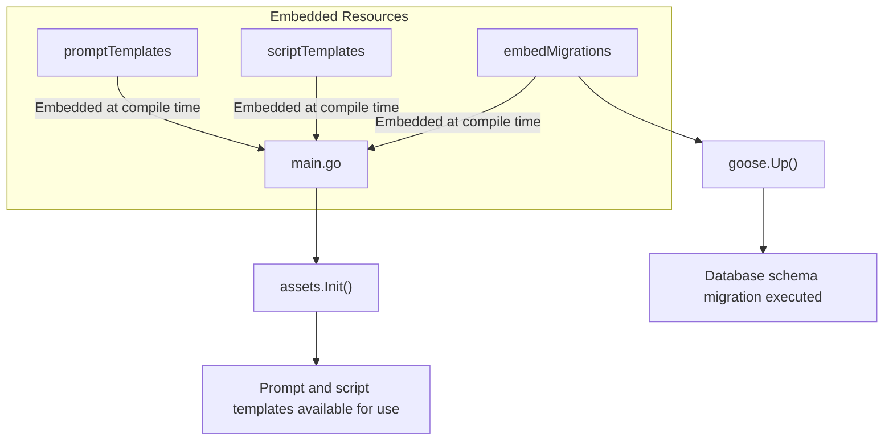

Sources: [backend/main.go:22-29](), [backend/main.go:56-60]()

### Database Initialization

The database initialization process involves:

1. Opening a connection to the SQLite database
2. Creating a query interface 
3. Running migrations from embedded SQL files

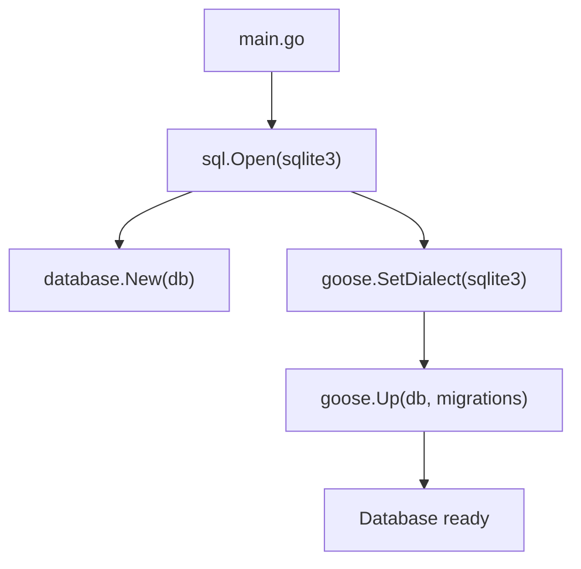

Sources: [backend/main.go:36-50]()

### Docker and Browser Initialization

Codel relies on Docker containers for task execution. The bootstrapping process initializes the Docker client and prepares a browser container:

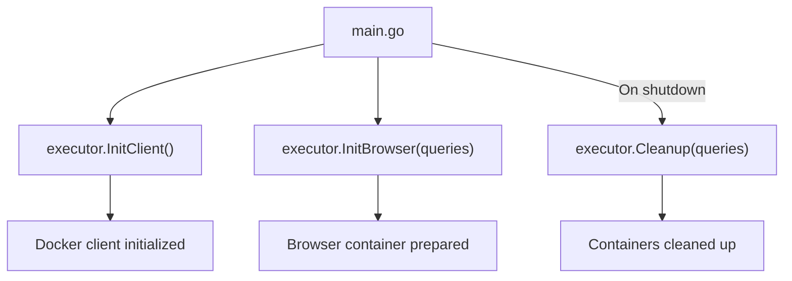

Sources: [backend/main.go:58-66](), [backend/main.go:80-83]()

## Frontend Bootstrapping

The frontend bootstrapping process initializes the React application, sets up routing, and configures the GraphQL client for API communication.

### Frontend Initialization Sequence

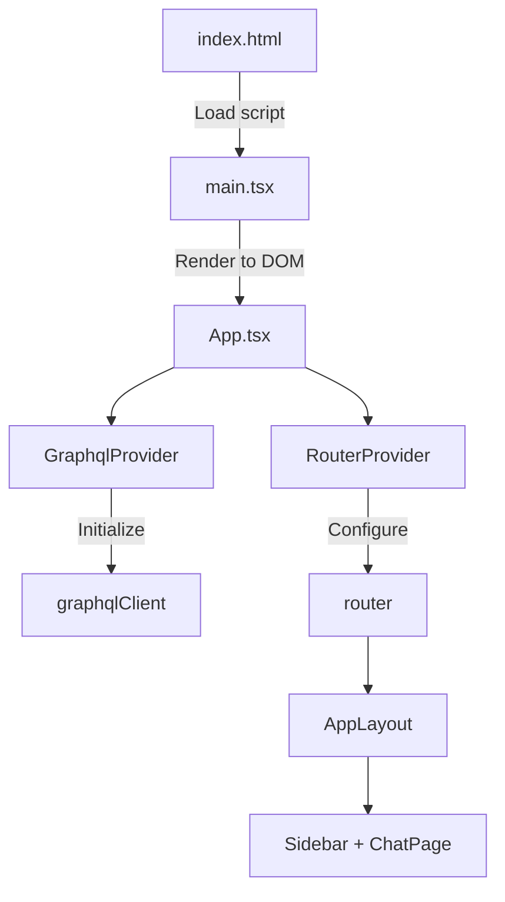

Sources: [frontend/index.html:14-17](), [frontend/src/App.tsx:17-34]()

### React Application Structure

The React application bootstraps with the following component hierarchy:

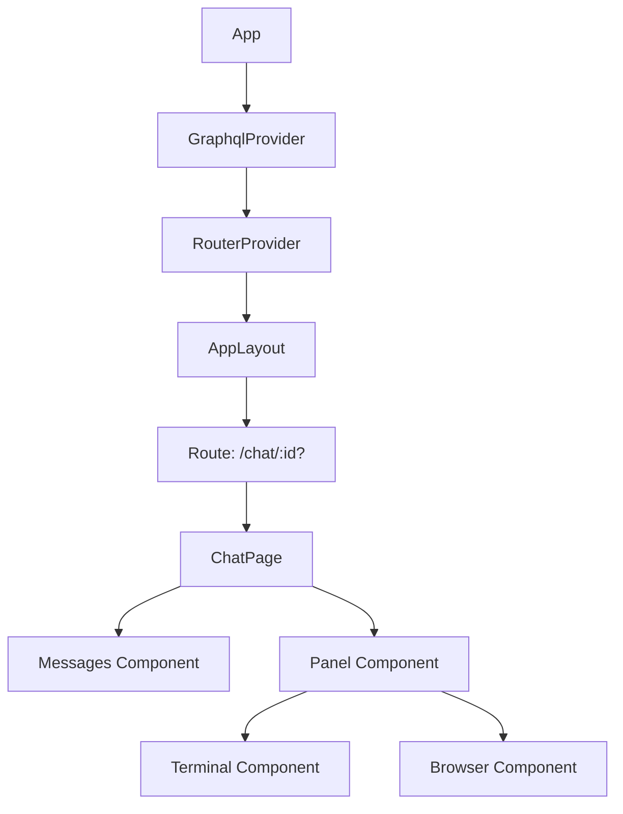

Sources: [frontend/src/App.tsx:16-34]()

## Environment Configuration

The application relies on environment variables for configuration, which are loaded during the bootstrapping process.

### Backend Configuration

The backend reads environment variables through the `config.Init()` call, which initializes application settings:

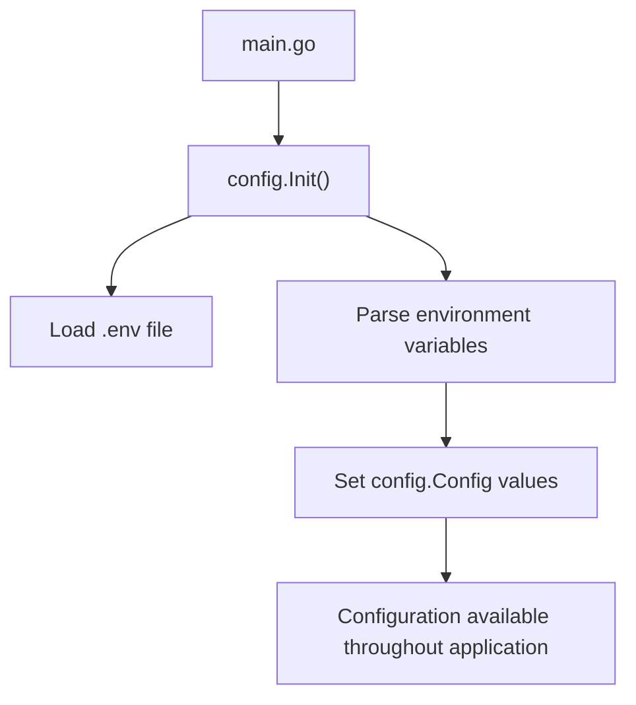

Sources: [backend/main.go:32](), [backend/go.mod:17]()

### Frontend Environment Variables

The frontend uses Vite's environment variables, defined in the `vite-env.d.ts` file:

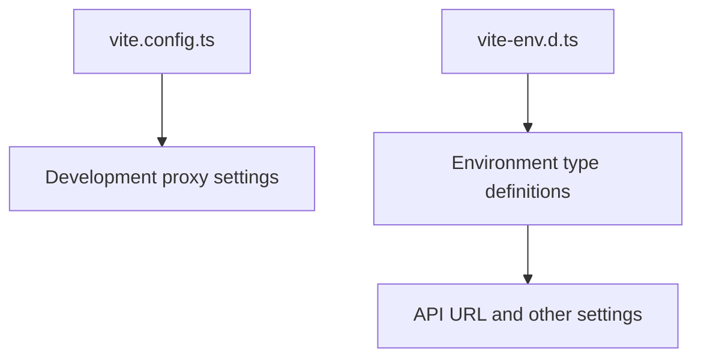

Sources: [frontend/vite.config.ts:8-13](), [frontend/src/vite-env.d.ts:3-9]()

## GraphQL API Initialization

The GraphQL API is a central part of Codel's architecture and is set up during both backend and frontend bootstrapping:

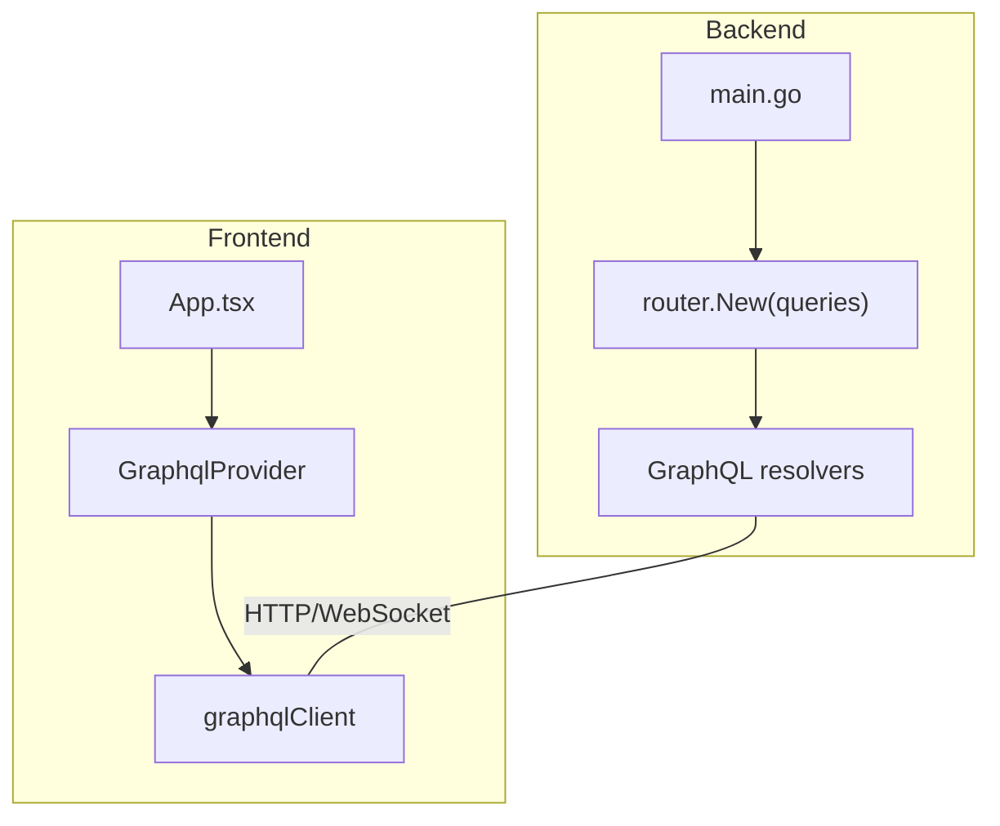

Sources: [backend/main.go:54](), [frontend/src/App.tsx:30]()

## Initialization Lifecycle

The overall bootstrapping lifecycle combines both backend and frontend initialization processes:

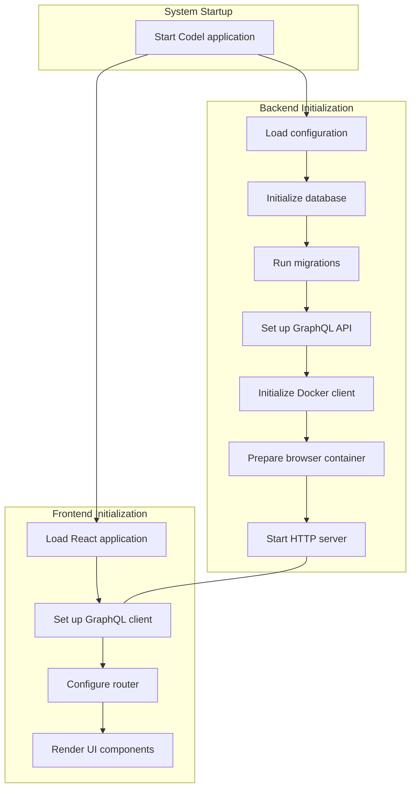

Sources: [backend/main.go:31-86](), [frontend/src/App.tsx:28-34](), [frontend/index.html:14-17]()

## Shutdown Process

The backend also includes a graceful shutdown process that's triggered by system signals:

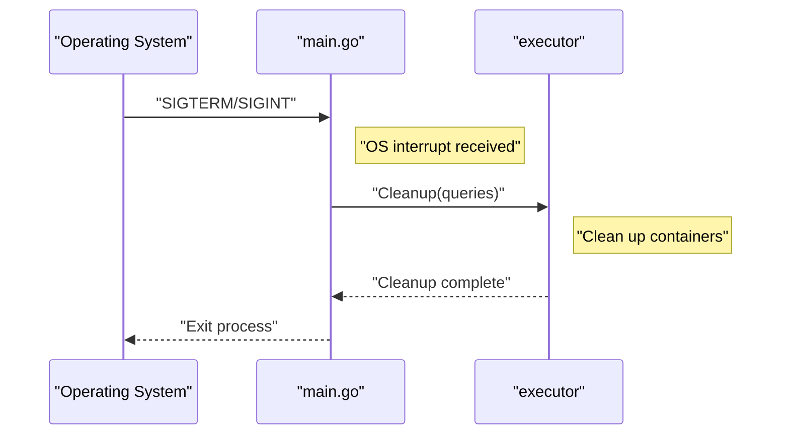

Sources: [backend/main.go:33-34](), [backend/main.go:76-85]()

## Data Models Used During Bootstrapping

The bootstrapping process initializes various data models defined in the application:

| Model | Description | Used By |
|-------|-------------|---------|
| Flow | Represents a user session with tasks | Database, GraphQL API |
| Task | Individual operation to be executed | Task processor, Queue |
| Container | Docker container information | Executor, Docker client |
| Provider | Language model interface | Next task determination |

Sources: [backend/models/models.go:10-64]()

## Conclusion

The bootstrapping process in Codel follows a well-defined sequence to initialize all required components. The backend prepares the database, initializes Docker services, and starts the HTTP server with GraphQL API. The frontend initializes the React application with routing and GraphQL client setup. This coordinated bootstrapping ensures all components are properly initialized before the application becomes available to users.

When the application receives a termination signal, it performs a graceful shutdown by cleaning up containers and closing connections before exiting.