# Page: Overview

# Overview

<details>
<summary>Relevant source files</summary>

The following files were used as context for generating this wiki page:

- [.github/logo.png](.github/logo.png)
- [DEVELOPMENT.md](DEVELOPMENT.md)
- [README.md](README.md)
- [backend/.env.example](backend/.env.example)
- [backend/go.mod](backend/go.mod)
- [backend/go.sum](backend/go.sum)
- [backend/main.go](backend/main.go)
- [backend/models/models.go](backend/models/models.go)
- [frontend/.env.example](frontend/.env.example)

</details>


Codel is an autonomous AI agent system designed to perform complex tasks using terminal, browser, and editor functionalities. This document provides a high-level introduction to Codel's architecture, components, and capabilities.

## What is Codel?

Codel is a fully autonomous AI agent that can understand user requests, break them down into actionable steps, and execute these steps using various tools like terminal commands, web browsing, and code editing. All operations run in a sandboxed Docker environment for security, with a modern web-based UI for interaction.

Key features include:
- 🔓 Secure sandboxed Docker environment for all operations
- 🤖 Autonomous task planning and execution using language models
- 🔍 Built-in browser for web access and information gathering
- 📙 Integrated text editor for code viewing and modification
- 🧠 Task history and context preservation in a database
- 📦 Automatic Docker image selection based on task requirements
- 🤳 Self-hosted deployment

Sources: [README.md:1-16]()

## System Architecture

Codel follows a client-server architecture with several key systems working together:

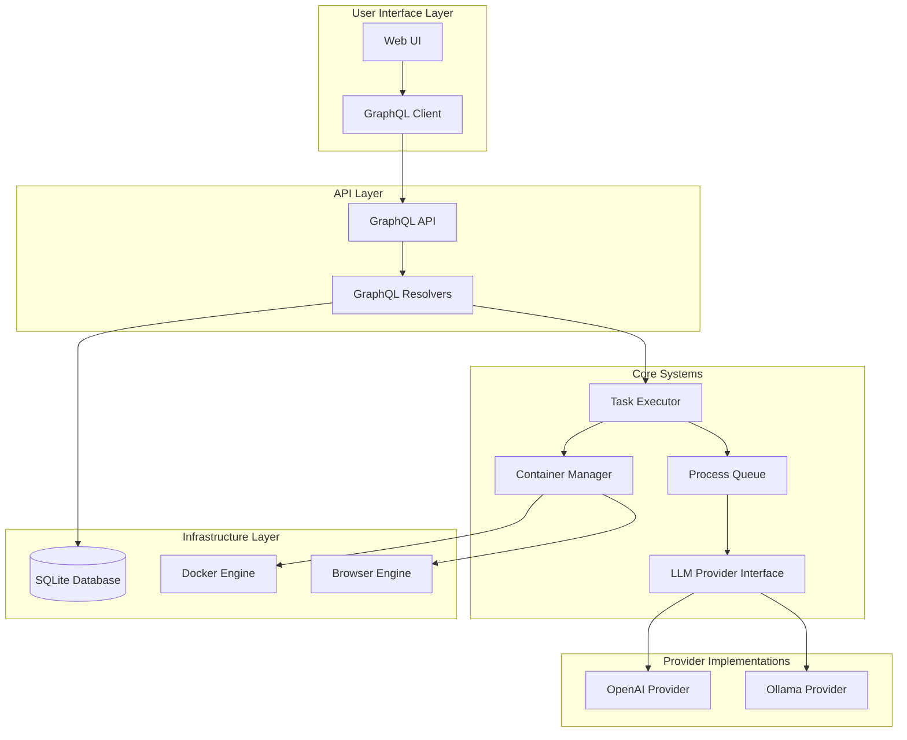

Sources: [backend/main.go:1-86](), [README.md:7-15]()

## Core Components

### 1. Task Processing System

The Task Processing System manages the execution flow of tasks. It consists of:

- **Task Executor**: Orchestrates task execution and manages the process queue
- **Process Queue**: Maintains the sequence of tasks to be executed
- **LLM Provider Interface**: Abstract interface for language model integration

Tasks in Codel follow a defined lifecycle, progressing from creation through execution to completion:

```mermaid
stateDiagram-v2
    [*] --> "Task Created"
    "Task Created" --> "In Progress": Added to Queue
    "In Progress" --> "LLM Processing": Planning next steps
    "LLM Processing" --> "Execution": Terminal/Browser/Code
    "Execution" --> "Result Capture": Collect output
    "Result Capture" --> "In Progress": Continue processing
    "In Progress" --> "Finished": Task complete
    "In Progress" --> "Failed": Error occurred
    "Finished" --> [*]
    "Failed" --> [*]
```

Sources: [backend/models/models.go:19-47]()

### 2. Data Model

Codel's core data model consists of several key entities:

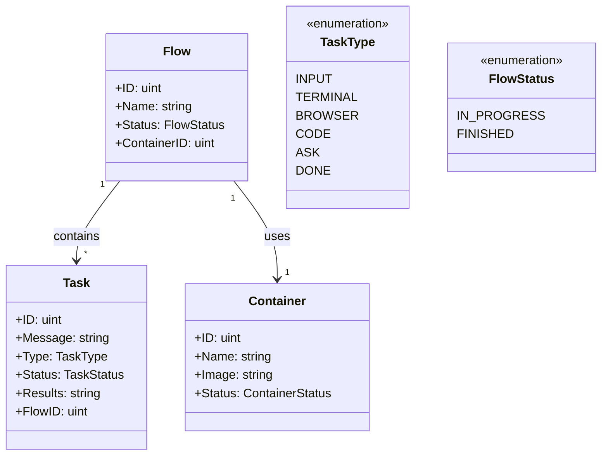

The data model defines several key types:

| Entity | Description | Possible States |
|--------|-------------|----------------|
| Flow | A user session containing tasks | `in_progress`, `finished` |
| Task | A single step within a flow | `in_progress`, `finished`, `stopped`, `failed` |
| Container | Docker container for task execution | `starting`, `running`, `stopped`, `failed` |
| TaskType | The type of operation to perform | `input`, `terminal`, `browser`, `code`, `ask`, `done` |

Sources: [backend/models/models.go:1-64]()

### 3. Language Model Integration

Codel integrates with language models through a provider interface that abstracts the specific implementation details:

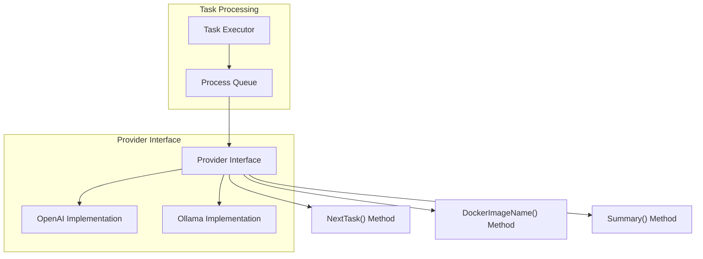

Language models in Codel are primarily used for:
1. Determining the next steps based on the context
2. Selecting appropriate Docker images for specific tasks
3. Generating summaries of task results

Codel supports multiple LLM providers:

| Provider | Configuration | Default Model |
|----------|---------------|---------------|
| OpenAI | `OPEN_AI_KEY`, `OPEN_AI_MODEL`, `OPEN_AI_SERVER_URL` | gpt-4-0125-preview |
| Ollama | `OLLAMA_MODEL`, `OLLAMA_SERVER_URL` | llama2 |

Sources: [README.md:41-47](), [backend/.env.example:6-13]()

### 4. Container Execution System

Codel executes tasks in isolated Docker containers, providing a secure environment for terminal commands, browser interactions, and code operations:

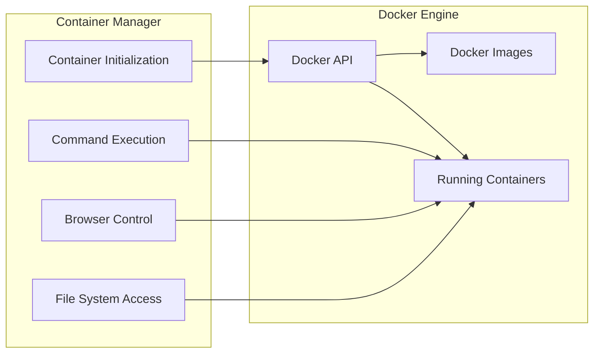

The Container Execution System features:
- Automatic Docker image selection based on task requirements
- Terminal command execution with output capture
- Browser interaction through a headless browser
- File system access for code operations
- Container lifecycle management (creation, execution, cleanup)

Sources: [backend/main.go:58-66](), [backend/main.go:80-83]()

## System Workflow

The following diagram illustrates how a typical task flows through Codel's components:

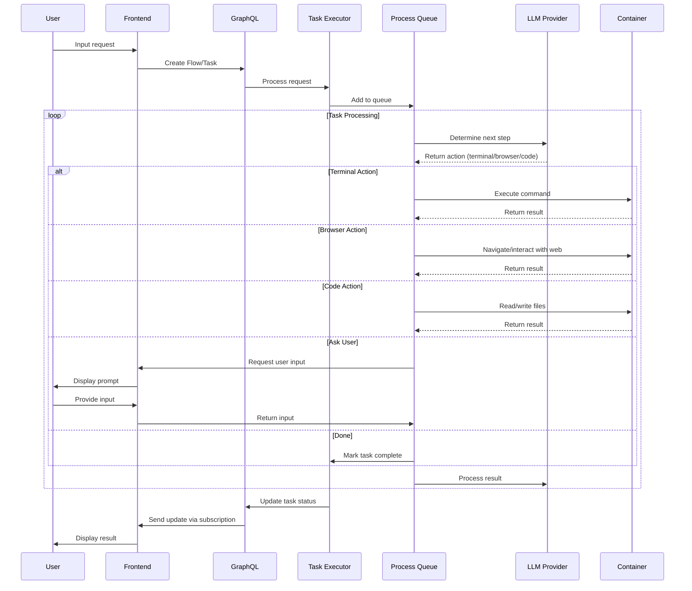

Sources: [backend/models/models.go:19-47]()

## Configuration and Deployment

Codel can be deployed using Docker with various configuration options:

```
docker run \
  -e OPEN_AI_KEY=your_open_ai_key \
  -e OPEN_AI_MODEL=gpt-4-0125-preview \
  -e OLLAMA_MODEL=llama2 \
  -p 3000:8080 \
  -v /var/run/docker.sock:/var/run/docker.sock \
  ghcr.io/semanser/codel:latest
```

The Docker container needs access to the host's Docker socket to create and manage containers for tasks.

Key environment variables include:

| Variable | Purpose | Default |
|----------|---------|---------|
| OPEN_AI_KEY | OpenAI API key | - |
| OPEN_AI_MODEL | OpenAI model to use | gpt-4-0125-preview |
| OPEN_AI_SERVER_URL | Custom OpenAI-compatible server | https://api.openai.com/v1 |
| OLLAMA_MODEL | Ollama model to use | llama2 |
| OLLAMA_SERVER_URL | Ollama server URL | https://host.docker.internal:11434 |
| PORT | Server port | 8080 |

For more detailed information about specific subsystems, see:
- [Task Processing System](#3.1)
- [Language Model Integration](#3.2)
- [Container Execution System](#3.3)
- [Getting Started](#2)

Sources: [README.md:17-47](), [DEVELOPMENT.md:9-24]()

---

# Page: Getting Started

# Getting Started

<details>
<summary>Relevant source files</summary>

The following files were used as context for generating this wiki page:

- [.dockerignore](.dockerignore)
- [.github/logo.png](.github/logo.png)
- [.gitignore](.gitignore)
- [DEVELOPMENT.md](DEVELOPMENT.md)
- [Dockerfile](Dockerfile)
- [README.md](README.md)
- [backend/.env.example](backend/.env.example)
- [backend/.gitignore](backend/.gitignore)
- [backend/config/config.go](backend/config/config.go)
- [backend/executor/browser.go](backend/executor/browser.go)
- [backend/providers/common.go](backend/providers/common.go)
- [backend/providers/ollama.go](backend/providers/ollama.go)
- [frontend/.env.example](frontend/.env.example)

</details>


This guide explains how to install, configure, and start using Codel - an autonomous AI agent system capable of performing complex tasks using terminal, browser, and editor functionalities in a secure, sandboxed environment.

For details about Codel's internal architecture, see [Core Systems](#3).

## Prerequisites

Before you can use Codel, you'll need:

- Docker installed and running
- One of the following language model providers:
  - OpenAI API key (requires account at [platform.openai.com](https://platform.openai.com))
  - Running Ollama instance (for open-source model support)
- Docker socket access for container creation

Sources: [README.md:17-37](), [DEVELOPMENT.md:3-8]()

## Installation

The simplest way to run Codel is using the pre-built Docker image available from the GitHub Container Registry.

```bash
docker run \
  -e OPEN_AI_KEY=your_open_ai_key \
  -e OPEN_AI_MODEL=gpt-4-0125-preview \
  -p 3000:8080 \
  -v /var/run/docker.sock:/var/run/docker.sock \
  ghcr.io/semanser/codel:latest
```

This command:
1. Runs the Codel container with your OpenAI API key
2. Specifies the OpenAI model to use
3. Maps port 3000 on your host to port 8080 in the container
4. Mounts the Docker socket to allow Codel to create containers

After running this command, access Codel at http://localhost:3000 in your browser.

### Codel Deployment Architecture

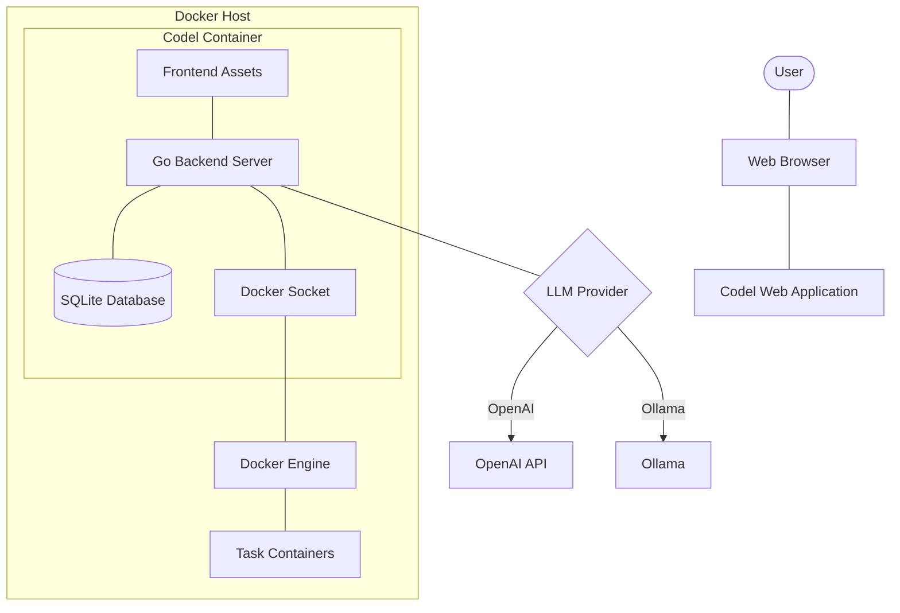

Sources: [README.md:17-37](), [Dockerfile:1-43]()

## Configuration Options

### Environment Variables

Codel is configured through environment variables loaded by the `config.Init()` function:

| Variable | Description | Default |
|----------|-------------|---------|
| `OPEN_AI_KEY` | OpenAI API key | None |
| `OPEN_AI_MODEL` | OpenAI model to use | gpt-4-0125-preview |
| `OPEN_AI_SERVER_URL` | OpenAI API endpoint | https://api.openai.com/v1 |
| `OLLAMA_MODEL` | Ollama model name | None |
| `OLLAMA_SERVER_URL` | Ollama server URL | http://host.docker.internal:11434 |
| `DATABASE_URL` | Database path | database.db |
| `PORT` | Server port | 8080 |

You can provide these variables using the `-e` flag with Docker run or using an environment file:

```bash
docker run \
  --env-file ./my-env-file \
  -p 3000:8080 \
  -v /var/run/docker.sock:/var/run/docker.sock \
  ghcr.io/semanser/codel:latest
```

Example environment file content:
```
OPEN_AI_KEY=your_open_ai_key
OPEN_AI_MODEL=gpt-4-0125-preview
```

### Configuration System Flow

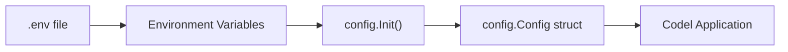

Sources: [backend/config/config.go:10-35](), [backend/.env.example:1-17](), [README.md:38-49]()

## Using Codel

After starting the Codel container, access the web interface at http://localhost:3000.

### Creating Your First Task

1. Open the Codel web interface
2. Click "New Task" in the sidebar
3. Enter a natural language description of your task (e.g., "Create a simple Node.js web server")
4. Codel will automatically:
   - Analyze your request using the configured language model
   - Select an appropriate Docker image based on the task requirements
   - Create a sandboxed container environment
   - Execute the necessary commands to complete your task
   - Show results and progress in real-time

### Task Execution Flow

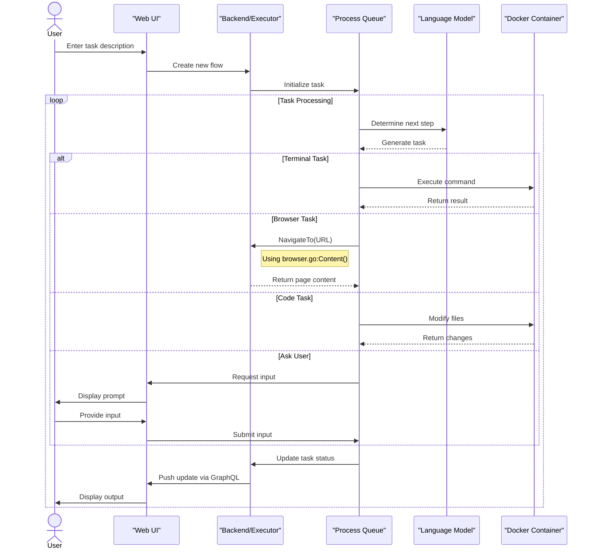

Sources: [README.md:7-15](), [backend/executor/browser.go:26-52]()

## Language Model Configuration

Codel supports two language model providers that implement the common `Provider` interface:

### OpenAI

To use OpenAI models, provide your API key through the `OPEN_AI_KEY` environment variable. You can also specify:

- `OPEN_AI_MODEL`: The model to use (default: gpt-4-0125-preview)
- `OPEN_AI_SERVER_URL`: The API endpoint (default: https://api.openai.com/v1)

### Ollama

To use locally hosted Ollama models, set:

- `OLLAMA_MODEL`: The name of the model (e.g., "llama2")
- `OLLAMA_SERVER_URL`: The Ollama server URL (default: http://host.docker.internal:11434)

### Provider System Architecture

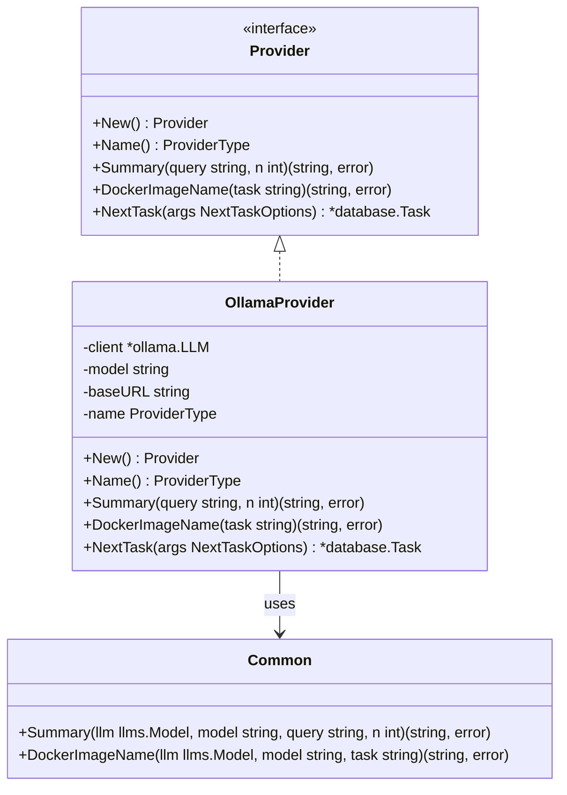

Sources: [backend/providers/common.go:1-53](), [backend/providers/ollama.go:1-163]()

## Docker Integration

Codel uses Docker to create isolated environments for executing tasks. The Docker socket must be mounted to allow Codel to create and manage containers:

```bash
-v /var/run/docker.sock:/var/run/docker.sock
```

The system automatically determines the appropriate Docker image based on the task using the language model. For browser-related tasks, it uses the `BrowserName()` function to create a browser container named "codel-browser".

Sources: [backend/executor/browser.go:166-168](), [README.md:17-37]()

## Next Steps

After getting started with Codel, you might want to explore:

- [Core Systems](#3) - Detailed explanations of Codel's internal architecture
- [Task Processing System](#3.1) - How tasks are sequentially processed and executed
- [Language Model Integration](#3.2) - More details on language model integration
- [Container Execution System](#3.3) - Details on container creation and management

For development setup and contributing to Codel, refer to the DEVELOPMENT.md file in the repository.

---

# Page: Core Systems

# Core Systems

<details>
<summary>Relevant source files</summary>

The following files were used as context for generating this wiki page:

- [backend/executor/processor.go](backend/executor/processor.go)
- [backend/executor/queue.go](backend/executor/queue.go)
- [backend/providers/openai.go](backend/providers/openai.go)
- [backend/providers/providers.go](backend/providers/providers.go)
- [backend/providers/types.go](backend/providers/types.go)
- [backend/templates/prompts/agent.tmpl](backend/templates/prompts/agent.tmpl)

</details>


This page provides a detailed overview of the key systems that power Codel's autonomous capabilities. These core systems work together to enable Codel to understand user tasks, execute them step by step, and provide real-time feedback.

For information about installation and configuration, see [Getting Started](#2). For details about the data architecture and models, see [Data Architecture](#4).

## Overview of Core Systems

Codel's core functionality is built around three primary systems:

1. **Task Processing System** - Manages the sequential processing of tasks through a queue
2. **Language Model Integration** - Provides AI decision-making capabilities via OpenAI or Ollama
3. **Container Execution System** - Executes commands in isolated Docker environments

These systems work together to create an autonomous agent that can understand complex instructions and execute them across different environments.

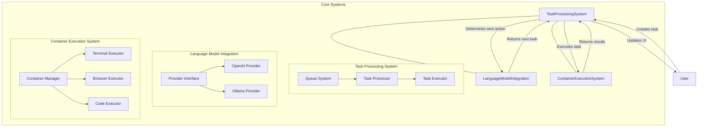

Sources: [backend/executor/queue.go](backend/executor/queue.go), [backend/providers/providers.go](backend/providers/providers.go), [backend/executor/processor.go](backend/executor/processor.go)

## Task Processing System

The Task Processing System is responsible for managing the flow of tasks in Codel. It maintains a queue of tasks, processes them sequentially, and determines the next steps using language models.

### Queue Architecture

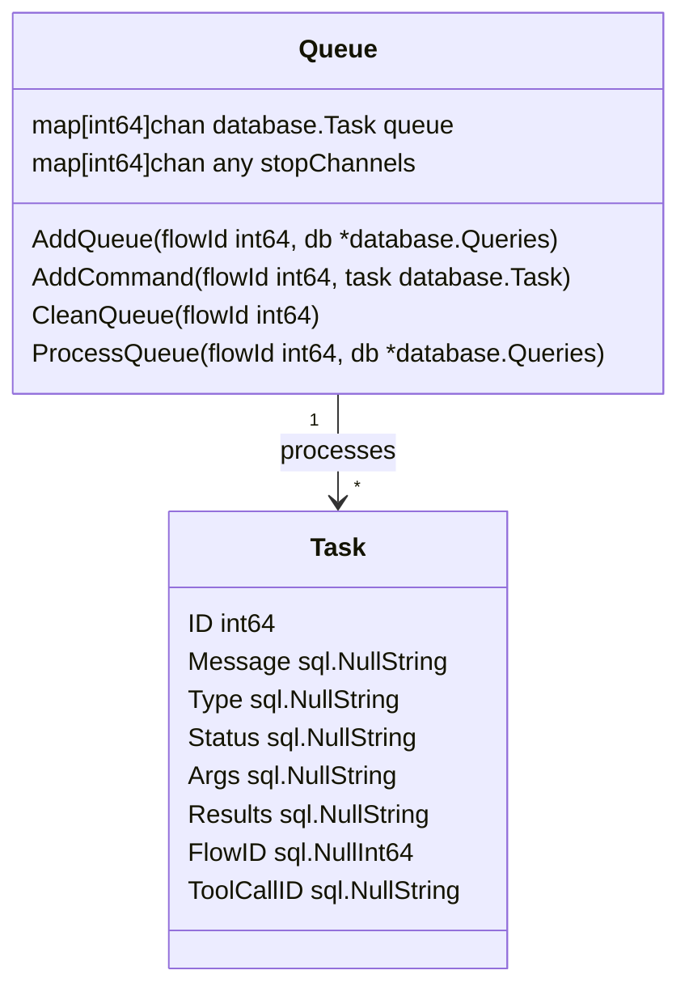

Sources: [backend/executor/queue.go:15-46](backend/executor/queue.go:15-46)

The queue system is implemented as a map of Go channels, where each flow has its own channel for tasks. This allows for concurrent processing of tasks from different flows.

```go
var queue = make(map[int64]chan database.Task)
var stopChannels = make(map[int64]chan any)
```

The primary functions of the queue system are:

1. **AddQueue** - Creates a new queue for a flow and starts processing it
2. **AddCommand** - Adds a new task to a flow's queue
3. **CleanQueue** - Removes a queue when a flow is finished
4. **ProcessQueue** - Processes tasks in a queue

Sources: [backend/executor/queue.go:18-46](backend/executor/queue.go:18-46)

### Task Processing Flow

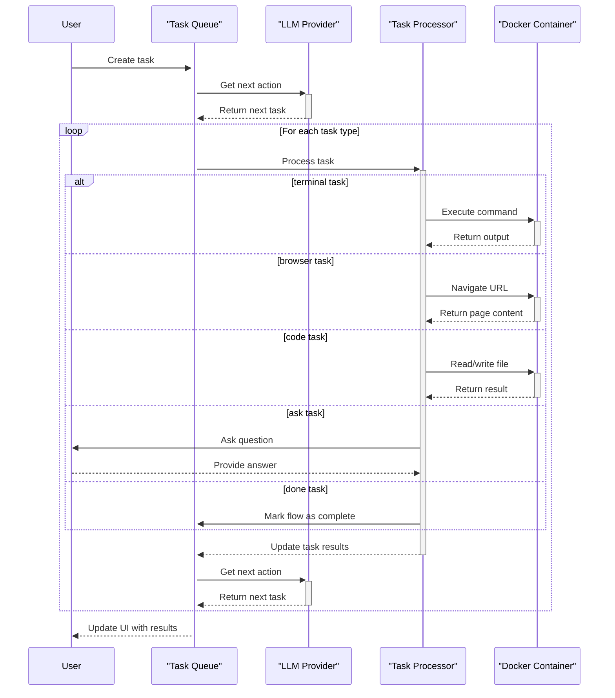

Sources: [backend/executor/queue.go:48-243](backend/executor/queue.go:48-243), [backend/executor/processor.go:18-288](backend/executor/processor.go:18-288)

The task processing flow starts when a user adds a task to a flow. The task is added to the queue and processed according to its type. After processing, the results are used to determine the next action through the language model provider.

Key task types include:

| Task Type | Description | Handler |
|-----------|-------------|---------|
| `input` | User input that starts a flow | `processInputTask()` |
| `terminal` | Command to be executed in the terminal | `processTerminalTask()` |
| `browser` | Action to be performed in a browser | `processBrowserTask()` |
| `code` | Operation on code files | `processCodeTask()` |
| `ask` | Question to be asked to the user | `processAskTask()` |
| `done` | Marks a flow as complete | `processDoneTask()` |

Sources: [backend/executor/processor.go:18-288](backend/executor/processor.go:18-288)

## Language Model Integration

The Language Model Integration system provides the AI capabilities that drive Codel's autonomous decision-making. It determines what actions to take based on the current state of a flow and the results of previous tasks.

### Provider Architecture

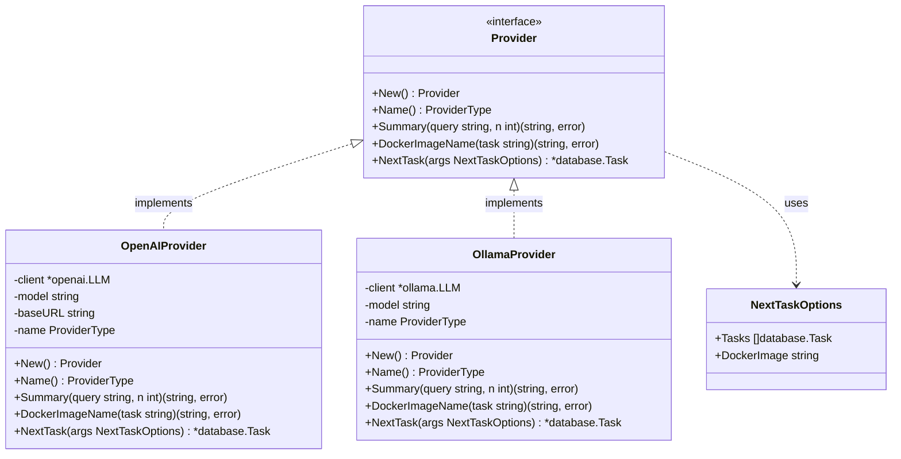

Sources: [backend/providers/providers.go:16-35](backend/providers/providers.go:16-35), [backend/providers/openai.go:16-43](backend/providers/openai.go:16-43)

The Provider interface defines the methods that all language model providers must implement:

```go
type Provider interface {
    New() Provider
    Name() ProviderType
    Summary(query string, n int) (string, error)
    DockerImageName(task string) (string, error)
    NextTask(args NextTaskOptions) *database.Task
}
```

Sources: [backend/providers/providers.go:23-29](backend/providers/providers.go:23-29)

Currently, Codel supports two provider implementations:

1. **OpenAIProvider** - Uses OpenAI's models (like GPT-4)
2. **OllamaProvider** - Uses locally hosted Ollama models

The `ProviderFactory` function creates the appropriate provider based on the provider type:

```go
func ProviderFactory(provider ProviderType) (Provider, error) {
    switch provider {
    case ProviderOpenAI:
        return OpenAIProvider{}.New(), nil
    case ProviderOllama:
        return OllamaProvider{}.New(), nil
    default:
        return nil, fmt.Errorf("unknown provider: %s", provider)
    }
}
```

Sources: [backend/providers/providers.go:79-88](backend/providers/providers.go:79-88)

### Tool Definitions

The language models use a set of predefined tools to interact with Codel:

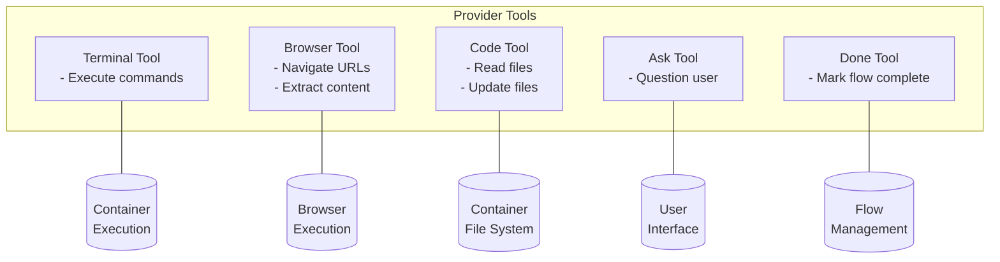

Sources: [backend/providers/providers.go:36-76](backend/providers/providers.go:36-76), [backend/providers/types.go:1-76](backend/providers/types.go:1-76)

Each tool is defined with a name, description, and parameters schema:

| Tool | Description | Parameters |
|------|-------------|------------|
| `terminal` | Executes a command in the terminal | `input`: Command to run |
| `browser` | Performs browser actions | `url`: URL to navigate to<br>`action`: `read` or `url` |
| `code` | Manipulates code files | `action`: `read_file` or `update_file`<br>`path`: File path<br>`content`: File content |
| `ask` | Asks a question to the user | `input`: Question text |
| `done` | Marks a flow as complete | None |

Sources: [backend/providers/providers.go:36-76](backend/providers/providers.go:36-76), [backend/providers/types.go:8-76](backend/providers/types.go:8-76)

### Agent Prompt and Task Generation

The language model's decisions are guided by a system prompt defined in the template file. This prompt provides context and instructions for the agent:

```
You're a robot that performs engineering work to successfully finish a user-defined task.
You have access to the terminal, browser, and text editor.
You have to perform step-by-step work execution to achieve the end goal that is determined by the user.
You will be provided with a list of previous commands (generated by LLM) and inputs (generated by the user).
Your goal is to give the next best step in this flow.
...
```

Sources: [backend/templates/prompts/agent.tmpl:1-18](backend/templates/prompts/agent.tmpl:1-18)

The `NextTask` method of the provider is responsible for generating the next task in a flow. It:

1. Builds a prompt using the agent template
2. Converts previous tasks to a message format
3. Sends the message to the language model
4. Converts the model's response to a task

Sources: [backend/providers/openai.go:57-104](backend/providers/openai.go:57-104)

## Container Execution System

The Container Execution System manages Docker containers used to execute tasks. It provides isolated environments for running terminal commands, browsing the web, and manipulating code files.

### Container Management Architecture

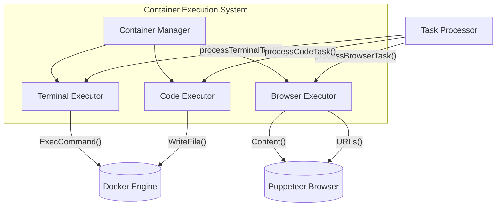

Sources: [backend/executor/processor.go:18-288](backend/executor/processor.go:18-288)

### Terminal Execution

Terminal tasks are executed in Docker containers. The `processTerminalTask` function:

1. Unmarshals the task arguments
2. Calls `ExecCommand` to execute the command in the container
3. Updates the task results with the command output

```go
func processTerminalTask(db *database.Queries, task database.Task) error {
    var args = providers.TerminalArgs{}
    err := json.Unmarshal([]byte(task.Args.String), &args)
    if err != nil {
        return fmt.Errorf("failed to unmarshal args: %v", err)
    }

    results, err := ExecCommand(task.FlowID.Int64, args.Input, db)

    if err != nil {
        return fmt.Errorf("failed to execute command: %w", err)
    }

    _, err = db.UpdateTaskResults(context.Background(), database.UpdateTaskResultsParams{
        ID:      task.ID,
        Results: database.StringToNullString(results),
    })

    if err != nil {
        return fmt.Errorf("failed to update task results: %w", err)
    }

    return nil
}
```

Sources: [backend/executor/processor.go:219-242](backend/executor/processor.go:219-242)

### Browser Execution

Browser tasks are executed using Puppeteer. The `processBrowserTask` function:

1. Unmarshals the task arguments
2. Calls either `Content` or `URLs` based on the action
3. Updates the task results with the content
4. Broadcasts browser updates to the frontend

```go
func processBrowserTask(db *database.Queries, task database.Task) error {
    var args = providers.BrowserArgs{}
    err := json.Unmarshal([]byte(task.Args.String), &args)
    if err != nil {
        return fmt.Errorf("failed to unmarshal args: %v", err)
    }

    var url = args.Url
    var screenshotName string

    if args.Action == providers.Read {
        content, screenshot, err := Content(url)
        // ...
    }

    if args.Action == providers.Url {
        content, screenshot, err := URLs(url)
        // ...
    }

    subscriptions.BroadcastBrowserUpdated(task.FlowID.Int64, &gmodel.Browser{
        URL: url,
        ScreenshotURL: "http://localhost:8080/browser/" + screenshotName,
    })

    return nil
}
```

Sources: [backend/executor/processor.go:18-74](backend/executor/processor.go:18-74)

### Code Execution

Code tasks manipulate files in Docker containers. The `processCodeTask` function:

1. Unmarshals the task arguments
2. Performs the action (read or update) on the file
3. Updates the task results

```go
func processCodeTask(db *database.Queries, task database.Task) error {
    var args = providers.CodeArgs{}
    err := json.Unmarshal([]byte(task.Args.String), &args)
    if err != nil {
        return fmt.Errorf("failed to unmarshal args: %v", err)
    }

    var cmd = ""
    var results = ""

    if args.Action == providers.ReadFile {
        cmd = fmt.Sprintf("cat %s", args.Path)
        results, err = ExecCommand(task.FlowID.Int64, cmd, db)
        // ...
    }

    if args.Action == providers.UpdateFile {
        err = WriteFile(task.FlowID.Int64, args.Content, args.Path, db)
        // ...
        results = "File updated"
    }

    _, err = db.UpdateTaskResults(context.Background(), database.UpdateTaskResultsParams{
        ID:      task.ID,
        Results: database.StringToNullString(results),
    })
    // ...

    return nil
}
```

Sources: [backend/executor/processor.go:244-288](backend/executor/processor.go:244-288)

## Integration Between Core Systems

The three core systems work together to provide Codel's autonomous capabilities:

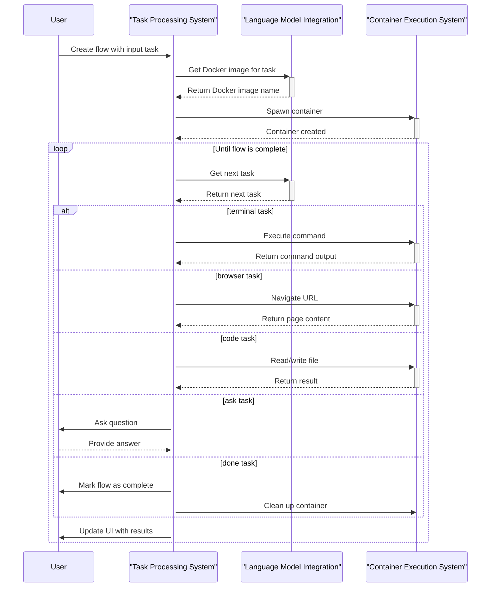

Sources: [backend/executor/queue.go:48-243](backend/executor/queue.go:48-243), [backend/executor/processor.go:18-288](backend/executor/processor.go:18-288), [backend/providers/openai.go:57-104](backend/providers/openai.go:57-104)

The task processing flow typically follows these steps:

1. User creates a flow with an input task
2. Task system gets Docker image from language model
3. Container system creates Docker container
4. Task system gets next task from language model
5. Task system executes task using container system
6. Results are returned to task system
7. Task system gets next task from language model
8. Process repeats until flow is complete

For more detailed information about specific aspects of the core systems, see:
- [Task Processing System](#3.1) for details on the task queue
- [Language Model Integration](#3.2) for details on the provider interface
- [Container Execution System](#3.3) for details on container management

---

# Page: Task Processing System

# Task Processing System

<details>
<summary>Relevant source files</summary>

The following files were used as context for generating this wiki page:

- [backend/executor/queue.go](backend/executor/queue.go)
- [backend/templates/prompts/agent.tmpl](backend/templates/prompts/agent.tmpl)

</details>


The Task Processing System is a core component of Codel that manages the sequential execution of tasks within autonomous flows. This system is responsible for managing queues of tasks, processing different task types, determining the next actions using language models, and coordinating with other components like the container execution system and browser interface.

For information about how language models are integrated into the system, see [Language Model Integration](#3.2). For details on how tasks are executed in containers, see [Container Execution System](#3.3).

## System Architecture

The Task Processing System uses a queue-based architecture to manage and process tasks. Each flow has its own dedicated queue that handles tasks sequentially.

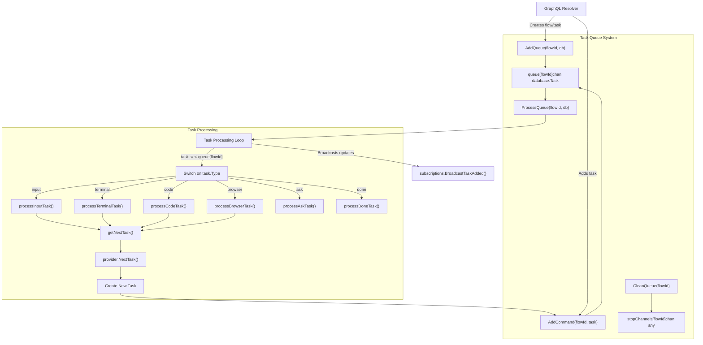

Sources: [backend/executor/queue.go:15-46](), [backend/executor/queue.go:48-185]()

## Queue Management

The system maintains two global maps that store the task channels and stop signals for each flow:

```go
var queue = make(map[int64]chan database.Task)
var stopChannels = make(map[int64]chan any)
```

The queue management functions include:

| Function | Purpose | Implementation |
|----------|---------|----------------|
| `AddQueue` | Creates a new queue for a flow and starts processing | [queue.go:18-26]() |
| `AddCommand` | Adds a task to a flow's queue | [queue.go:28-33]() |
| `CleanQueue` | Cleans up resources when a flow ends | [queue.go:35-46]() |
| `ProcessQueue` | Processes tasks in a queue | [queue.go:48-185]() |

Sources: [backend/executor/queue.go:15-46]()

## Task Types and Processing Flow

The system supports different task types, each handled by specific processing logic:

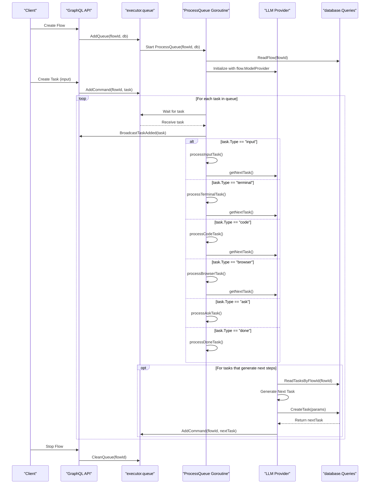

Sources: [backend/executor/queue.go:69-184]()

The task types supported by the system include:

| Task Type | Description | Function | Generates Next Task |
|-----------|-------------|----------|---------------------|
| `input` | Tasks created from user input | `processInputTask` | Yes |
| `terminal` | Executes commands in the container | `processTerminalTask` | Yes |
| `code` | Reads or modifies files | `processCodeTask` | Yes |
| `browser` | Interacts with web pages | `processBrowserTask` | Yes |
| `ask` | Requests information from the user | `processAskTask` | No |
| `done` | Marks the flow as complete | `processDoneTask` | No |

Sources: [backend/executor/queue.go:94-181]()

## Next Task Determination

A key function of the Task Processing System is determining the next task to execute after completing certain task types. This is handled by the `getNextTask` function:

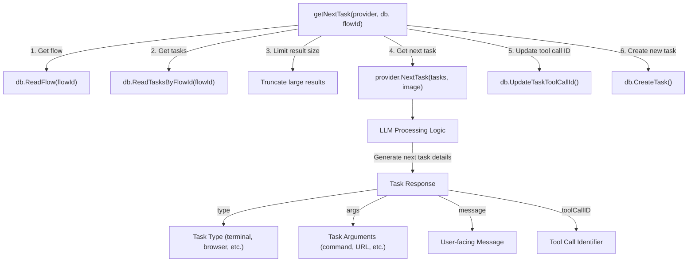

Sources: [backend/executor/queue.go:187-243]()

## Language Model Prompt Template

The Task Processing System uses language models to determine the next tasks to execute. The system passes previous tasks to the language model along with a prompt template that guides the model's response format.

The prompt template (`agent.tmpl`) defines:

1. The agent's role as an engineering assistant
2. Available task types and their functionality
3. Required argument formats for each task type
4. History of all previous tasks in the flow

The language model processes this information and returns a structured response that the system uses to create the next task.

Sources: [backend/templates/prompts/agent.tmpl:1-53]()

## Integration with Other Systems

The Task Processing System integrates with several other components of Codel:

1. **Database Integration**: Uses `database.Queries` to read and write task data
2. **GraphQL API**: Receives task creation requests and broadcasts updates via subscriptions
3. **Language Model Providers**: Uses providers like OpenAI or Ollama to determine next tasks
4. **Container Execution System**: Executes terminal, code, and browser tasks in containers

When processing tasks that interact with the container environment (terminal, code, browser), the system calls specialized handler functions that communicate with the Container Execution System to execute the commands in the appropriate environment.

## Implementation Details

The Task Processing System uses Go's concurrency features extensively:

1. Each flow has its own goroutine that processes tasks sequentially
2. Channels are used for task queuing and stopping processing
3. Broadcasts task updates using GraphQL subscriptions
4. Limits result sizes to avoid overwhelming the language model

This design ensures that:

- Tasks for a flow are processed in order
- Multiple flows can be processed concurrently
- Resources are cleaned up properly when flows end
- Real-time updates are provided to clients

Sources: [backend/executor/queue.go:15-243]()

---

# Page: Language Model Integration

# Language Model Integration

<details>
<summary>Relevant source files</summary>

The following files were used as context for generating this wiki page:

- [backend/executor/processor.go](backend/executor/processor.go)
- [backend/providers/openai.go](backend/providers/openai.go)
- [backend/providers/providers.go](backend/providers/providers.go)
- [backend/providers/types.go](backend/providers/types.go)

</details>


This document describes the architecture and implementation of language model (LLM) integration in Codel. It covers how Codel interfaces with different LLM providers, handles communication with these models, and converts LLM responses into executable tasks. For information about how these tasks are processed and executed, see [Task Processing System](#3.1).

## Provider Architecture

The language model integration in Codel follows a provider pattern that allows for multiple LLM backends while maintaining a consistent interface throughout the system.

```mermaid
classDiagram
    class Provider {
        <<interface>>
        +New() Provider
        +Name() ProviderType
        +Summary(query string, n int) (string, error)
        +DockerImageName(task string) (string, error)
        +NextTask(args NextTaskOptions) *database.Task
    }

    class ProviderType {
        <<enum>>
        +ProviderOpenAI
        +ProviderOllama
    }

    class OpenAIProvider {
        -client *openai.LLM
        -model string
        -baseURL string
        -name ProviderType
        +New() Provider
        +Name() ProviderType
        +Summary(query string, n int) (string, error)
        +DockerImageName(task string) (string, error)
        +NextTask(args NextTaskOptions) *database.Task
    }

    class OllamaProvider {
        -client *ollama.LLM
        -model string
        -name ProviderType
        +New() Provider
        +Name() ProviderType
        +Summary(query string, n int) (string, error)
        +DockerImageName(task string) (string, error)
        +NextTask(args NextTaskOptions) *database.Task
    }

    class ProviderFactory {
        +ProviderFactory(provider ProviderType) (Provider, error)
    }

    Provider <|.. OpenAIProvider
    Provider <|.. OllamaProvider
    ProviderFactory ..> Provider: creates
    ProviderFactory ..> ProviderType: uses
```

### Provider Interface

The `Provider` interface defined in [backend/providers/providers.go:23-29]() is the central abstraction that enables Codel to work with different language model providers. It requires implementing the following methods:

- `New()`: Create a new instance of the provider
- `Name()`: Return the type of provider (OpenAI or Ollama)
- `Summary()`: Generate a concise summary of a text
- `DockerImageName()`: Determine an appropriate Docker image for a task
- `NextTask()`: Generate the next task for the AI agent to execute

Sources: [backend/providers/providers.go:23-29](), [backend/providers/providers.go:16-21](), [backend/providers/providers.go:79-88]()

### Provider Implementations

Codel currently supports two LLM providers:

1. **OpenAI Provider**: Integrates with OpenAI's models (like GPT-4) through their API
2. **Ollama Provider**: Connects to locally hosted Ollama models

The provider factory pattern instantiates the appropriate provider based on configuration:

```go
func ProviderFactory(provider ProviderType) (Provider, error) {
    switch provider {
    case ProviderOpenAI:
        return OpenAIProvider{}.New(), nil
    case ProviderOllama:
        return OllamaProvider{}.New(), nil
    default:
        return nil, fmt.Errorf("unknown provider: %s", provider)
    }
}
```

Sources: [backend/providers/providers.go:79-88](), [backend/providers/openai.go:16-104]()

## Language Model Communication

Codel uses a structured approach to communicate with language models, employing function/tool calling capabilities to receive structured responses that can be directly converted into executable tasks.

```mermaid
sequenceDiagram
    participant "Task Queue" as Queue
    participant "Provider Interface" as Provider
    participant "OpenAI/Ollama" as LLM
    participant "Tool Parser" as Parser
    participant "Task Processor" as Processor

    Queue->>Provider: NextTask(previousTasks, dockerImage)
    Provider->>Provider: Format prompt from previous tasks
    Provider->>LLM: GenerateContent(messages, tools)
    LLM-->>Provider: Response with tool calls
    Provider->>Parser: toolToTask(choices)
    Parser-->>Provider: Structured task
    Provider-->>Queue: Return database.Task
    Queue->>Processor: Execute task
```

### Tool Definitions

The system defines a set of tools that the language model can invoke, each corresponding to a different action that the agent can perform:

```mermaid
classDiagram
    class Tools {
        +terminal
        +browser
        +code
        +ask
        +done
    }
    
    class TerminalArgs {
        +Input string
        +Message string
    }
    
    class BrowserArgs {
        +Url string
        +Action BrowserAction
        +Message string
    }
    
    class CodeArgs {
        +Action CodeAction
        +Content string
        +Path string
        +Message string
    }
    
    class AskArgs {
        +Message string
    }
    
    class DoneArgs {
        +Message string
    }
    
    class Messanger {
        <<interface>>
        +GetMessage() Message
    }
    
    Tools --> TerminalArgs
    Tools --> BrowserArgs
    Tools --> CodeArgs
    Tools --> AskArgs
    Tools --> DoneArgs
    
    Messanger <|.. TerminalArgs
    Messanger <|.. BrowserArgs
    Messanger <|.. CodeArgs
    Messanger <|.. AskArgs
    Messanger <|.. DoneArgs
```

These tools are defined in [backend/providers/providers.go:36-77]() and provide the language model with a structured interface to issue commands to the system. Each tool has a corresponding argument type in [backend/providers/types.go]() that implements the `Messanger` interface to extract the message component.

Sources: [backend/providers/providers.go:36-77](), [backend/providers/types.go:1-76]()

### Conversation Context Management

To maintain context across multiple interactions, Codel converts previous tasks to a format that can be included in prompts to the language model:

```mermaid
flowchart TD
    subgraph "Task to Message Conversion"
        Tasks["Task History"] --> Conversion["tasksToMessages()"]
        Conversion --> Prompt["System Message with Prompt"]
        Conversion --> UserMessages["User Input Messages"]
        Conversion --> AssistantMessages["Assistant Tool Call Messages"]
        Conversion --> ToolResponses["Tool Response Messages"]
    end
    
    subgraph "Message Structure"
        Prompt --> LLMRequest["LLM Request"]
        UserMessages --> LLMRequest
        AssistantMessages --> LLMRequest
        ToolResponses --> LLMRequest
    end
    
    LLMRequest --> LLMProvider["LLM Provider"]
    LLMProvider --> Response["LLM Response with Tool Calls"]
```

The `tasksToMessages` function in [backend/providers/providers.go:104-162]() converts a list of previous tasks into a structured conversation history that provides context for the language model.

Sources: [backend/providers/providers.go:104-162](), [backend/providers/openai.go:57-104]()

## Task Generation Process

The most critical function of the language model integration is generating the next task for the agent to execute, which is implemented in the `NextTask` method of each provider.

```mermaid
flowchart TD
    subgraph "NextTask Implementation"
        Start["NextTask(args)"] --> BuildPrompt["Build prompt from tasks"]
        BuildPrompt --> TruncatePrompt["Check prompt length"]
        TruncatePrompt --> TasksToMessages["Convert tasks to messages"]
        TasksToMessages --> CallLLM["Call LLM with tools"]
        CallLLM --> ParseResponse["Parse tool calls from response"]
        ParseResponse --> ExtractArgs["Extract tool arguments"]
        ExtractArgs --> CreateTask["Create database.Task"]
        CreateTask --> Return["Return task"]
    end
    
    subgraph "Error Handling"
        TruncatePrompt -- "If too long" --> AskUser1["Return ask task"]
        CallLLM -- "Error" --> AskUser2["Return ask task"]
        ParseResponse -- "Error" --> AskUser3["Return ask task"]
        ExtractArgs -- "Error" --> AskUser4["Return ask task"]
    end
    
    Return --> TaskProcessor["Task Processing System"]
```

The implementation in OpenAI provider ([backend/providers/openai.go:57-104]()) illustrates this process:

1. Build a prompt using the task history and Docker image information
2. Check if the prompt is too long, and if so, return an "ask" task
3. Convert tasks to a message format for the language model
4. Call the language model with the defined tools
5. Parse the response to extract tool calls
6. Create and return a database task based on the tool call

Sources: [backend/providers/openai.go:57-104](), [backend/providers/providers.go:230-301]()

### Converting LLM Responses to Tasks

The response from the language model contains tool calls which need to be converted to executable tasks:

```mermaid
flowchart LR
    subgraph "LLM Response Format"
        Response["LLM Response"]
        Choices["ContentChoice[]"]
        ToolCalls["ToolCall[]"]
        FunctionCall["FunctionCall"]
    end
    
    subgraph "Task Conversion"
        ToolParser["toolToTask()"]
        ExtractArgs["extractToolArgs()"]
        TaskCreation["Create database.Task"]
    end
    
    Response --> Choices
    Choices --> ToolCalls
    ToolCalls --> FunctionCall
    
    FunctionCall --> ToolParser
    ToolParser --> ExtractArgs
    ExtractArgs --> TaskCreation
```

The `toolToTask` function in [backend/providers/providers.go:230-293]() handles this conversion, extracting the function name and arguments from the tool call and creating a corresponding task.

Sources: [backend/providers/providers.go:230-293](), [backend/providers/providers.go:295-301]()

## Specialized LLM Functions

Besides generating tasks, the language models are used for specialized functions:

### Task Summarization

The `Summary` method generates a concise description of the user's request, which is used for naming flows:

```mermaid
sequenceDiagram
    participant TaskProcessor as "Task Processor"
    participant Provider as "Provider"
    participant LLM as "Language Model"
    
    TaskProcessor->>Provider: Summary(query, n)
    Provider->>LLM: RequestSummary(query, n tokens)
    LLM-->>Provider: Concise summary
    Provider-->>TaskProcessor: Return summary
    TaskProcessor->>Database: Update flow name
```

This is used in [backend/executor/processor.go:108-113]() when processing the first task in a flow to generate a descriptive name for the flow.

Sources: [backend/providers/openai.go:49-51](), [backend/executor/processor.go:108-113]()

### Docker Image Selection

The `DockerImageName` method asks the language model to select an appropriate Docker image for a given task:

```mermaid
sequenceDiagram
    participant TaskProcessor as "Task Processor"
    participant Provider as "Provider"
    participant LLM as "Language Model"
    
    TaskProcessor->>Provider: DockerImageName(task)
    Provider->>LLM: RequestImageName(task description)
    LLM-->>Provider: Appropriate Docker image
    Provider-->>TaskProcessor: Return image name
    TaskProcessor->>DockerSystem: Spawn container with image
```

This is used in [backend/executor/processor.go:114-118]() to determine the proper environment for executing the user's task.

Sources: [backend/providers/openai.go:53-55](), [backend/executor/processor.go:114-118]()

## Integration with Task Processing System

The language model integration connects with the task processing system to form a complete cycle of task generation and execution:

```mermaid
flowchart TD
    subgraph "Task Execution Flow"
        UserInput["User Input"] --> InputTask["Input Task"]
        InputTask --> TaskQueue["Process Queue"]
        TaskQueue --> ProviderInterface["Provider Interface"]
        ProviderInterface --> NextTask["Generate Next Task"]
        NextTask --> TaskQueue
        
        TaskQueue --> TaskProcessor["Task Processor"]
        TaskProcessor --> TerminalExec["Execute Terminal Command"]
        TaskProcessor --> BrowserExec["Execute Browser Action"]
        TaskProcessor --> CodeExec["Execute Code Action"]
        TaskProcessor --> AskUser["Ask User"]
        TaskProcessor --> MarkDone["Mark as Complete"]
        
        TerminalExec & BrowserExec & CodeExec & AskUser --> TaskQueue
        MarkDone --> FlowComplete["Complete Flow"]
    end
```

When the input task is processed in [backend/executor/processor.go:95-204](), the system uses the provider to determine the Docker image and generate a summary of the task. After each task is executed, the results are passed back to the language model via the task queue to generate the next task, forming a continuous loop until the flow is marked as complete.

Sources: [backend/executor/processor.go:95-204]()

## Error Handling

The language model integration includes robust error handling to ensure the system remains responsive even when the language model fails:

1. **Prompt Truncation**: If the prompt is too long, the system returns an "ask" task to get clarification from the user
2. **Model Errors**: If the language model returns an error, the system gracefully falls back to asking the user
3. **Parsing Errors**: If the response cannot be parsed, the system asks the user for guidance

This approach ensures that failures in the language model do not cause the entire system to fail, maintaining a good user experience.

Sources: [backend/providers/openai.go:69-72](), [backend/providers/openai.go:91-94](), [backend/providers/openai.go:97-101]()

## Summary

The language model integration in Codel is a sophisticated system that enables autonomous decision-making through:

1. A **Provider Interface** that abstracts different LLM backends (OpenAI, Ollama)
2. **Tool Definitions** that allow the model to issue structured commands
3. **Context Management** that maintains conversation history
4. **Task Generation** that converts model responses to executable tasks
5. **Specialized Functions** for task summarization and environment selection
6. **Robust Error Handling** that gracefully handles failures

This architecture allows Codel to leverage the capabilities of language models while maintaining a clean separation of concerns and allowing for future extensions to support additional LLM providers.

---

# Page: Container Execution System

# Container Execution System

<details>
<summary>Relevant source files</summary>

The following files were used as context for generating this wiki page:

- [backend/assets/assets.go](backend/assets/assets.go)
- [backend/executor/container.go](backend/executor/container.go)
- [backend/executor/terminal.go](backend/executor/terminal.go)
- [backend/templates/scripts/content.js](backend/templates/scripts/content.js)

</details>


## Purpose and Scope

The Container Execution System is a core component of Codel that enables the execution of commands, management of terminal sessions, and browser interactions within isolated Docker containers. This system provides a secure sandboxed environment for AI agents to interact with various tools and applications without compromising the host system. 

This document covers the container lifecycle management, terminal session handling, and file operations within containers. For information about how tasks are processed and queued before execution, see [Task Processing System](#3.1). For details on browser-specific interactions, see [Browser Component](#5.2).

## System Architecture

The Container Execution System consists of several interconnected components that manage the lifecycle of Docker containers and facilitate command execution within them.

```mermaid
flowchart TD
    subgraph "Container Execution System"
        ContainerManager["Container Manager"]
        Terminal["Terminal Executor"]
        FileOps["File Operations"]
    end

    DockerClient["Docker Client API"]
    DB[(PostgreSQL Database)]
    
    Executor["Task Executor"] --> ContainerManager
    ContainerManager --> DockerClient
    ContainerManager --> DB
    Terminal --> ContainerManager
    FileOps --> ContainerManager
    
    DockerClient --> DockerDaemon["Docker Daemon"]
    DockerDaemon --> Containers["Task Containers"]
```

The Container Execution System interfaces with the Docker daemon through the Docker client API, managing containers that are used to execute tasks. The system stores container metadata in the PostgreSQL database and provides interfaces for terminal command execution and file operations.

Sources: [backend/executor/container.go:18-252](), [backend/executor/terminal.go:1-193]()

## Container Lifecycle Management

The Container Execution System manages the full lifecycle of Docker containers from creation to deletion.

```mermaid
stateDiagram-v2
    [*] --> Creating
    Creating --> Starting: ContainerCreate
    Starting --> Running: ContainerStart
    Running --> Stopping: ContainerStop
    Stopping --> Stopped
    Stopped --> [*]: ContainerRemove

    note right of Creating: SpawnContainer function
    note right of Stopping: StopContainer function
    note right of Stopped: DeleteContainer function
```

### Container Initialization

The Docker client is initialized when the application starts:

```mermaid
sequenceDiagram
    participant App as "Codel Application"
    participant DockerClient as "Docker Client"
    participant DockerDaemon as "Docker Daemon"
    
    App->>DockerClient: InitClient()
    DockerClient->>DockerDaemon: NegotiateAPIVersion()
    DockerClient->>DockerDaemon: Info()
    DockerDaemon-->>DockerClient: Version and system info
    DockerClient-->>App: Client initialized
```

The `InitClient` function establishes a connection to the Docker daemon and logs information about the Docker environment:

Sources: [backend/executor/container.go:24-43]()

### Container Creation

The `SpawnContainer` function creates a new container with specified configurations:

1. Creates a container record in the database with "starting" status
2. Checks if the required Docker image exists locally
3. Pulls the image if necessary, falling back to "debian:latest" if the pull fails
4. Creates and starts the container
5. Updates the container status in the database to "running" or "failed"

Sources: [backend/executor/container.go:45-147]()

### Container Management

The system provides several functions for managing existing containers:

- `StopContainer`: Stops a running container and updates its status in the database
- `DeleteContainer`: Stops and removes a container
- `IsContainerRunning`: Checks if a container is running
- `Cleanup`: Stops all running containers and sets all in-progress flows to "finished"

Sources: [backend/executor/container.go:149-252]()

## Terminal Execution

The Terminal Execution component allows Codel to run commands within containers and capture their output.

```mermaid
sequenceDiagram
    participant Executor as "Task Executor"
    participant Terminal as "Terminal Executor"
    participant Docker as "Docker Client"
    participant Container as "Docker Container"
    participant DB as "Database"
    participant WS as "WebSocket Subscriptions"
    
    Executor->>Terminal: ExecCommand(flowID, command)
    Terminal->>Terminal: TerminalName(flowID)
    Terminal->>Docker: IsContainerRunning(containerName)
    Docker-->>Terminal: isRunning
    
    Terminal->>DB: CreateLog(flowID, command, "input")
    Terminal->>WS: BroadcastTerminalLogsAdded(flowID, log)
    
    Terminal->>Docker: ContainerExecCreate(container, cmd)
    Docker-->>Terminal: execID
    Terminal->>Docker: ContainerExecAttach(execID)
    Docker-->>Terminal: response
    Terminal->>Docker: ContainerExecInspect(execID)
    
    Terminal->>DB: CreateLog(flowID, result, "output")
    Terminal->>WS: BroadcastTerminalLogsAdded(flowID, log)
    Terminal-->>Executor: result
```

### Command Execution

The `ExecCommand` function executes commands in a container:

1. Generates a container name based on the flow ID
2. Verifies that the container is running
3. Logs the command input in the database
4. Creates an exec instance in the container
5. Attaches to the exec instance to capture output
6. Logs the command output
7. Broadcasts logs through WebSockets for real-time updates

Sources: [backend/executor/terminal.go:19-112]()

### File Operations

The `WriteFile` function writes file content to containers:

1. Verifies that the container is running
2. Logs the file content as input
3. Creates a TAR archive containing the file
4. Copies the archive to the container at the specified path
5. Logs the successful write operation

Sources: [backend/executor/terminal.go:114-189]()

## Container Naming and Identification

Containers are named using a consistent pattern and are associated with specific flows:

- Container names are generated using the `TerminalName` function: `codel-terminal-{flowID}`
- Each container is stored in the database with:
  - Database ID
  - Local Docker container ID
  - Name
  - Image
  - Status

Sources: [backend/executor/terminal.go:191-193](), [backend/executor/container.go:52-56]()

## Error Handling and Recovery

The Container Execution System includes several error handling mechanisms:

```mermaid
flowchart TD
    Start["SpawnContainer()"] --> DB["Create DB record"]
    DB --> LocalImage{"Image exists locally?"}
    LocalImage -->|Yes| Create["Create container"]
    LocalImage -->|No| Pull["Pull image"]
    Pull -->|Success| Create
    Pull -->|Error| Fallback["Use debian:latest"]
    Fallback --> Create
    Create -->|Success| StartContainer["Start container"]
    Create -->|Error| Cleanup["Update DB status to 'failed'"]
    StartContainer -->|Success| UpdateSuccess["Update DB status to 'running'"]
    StartContainer -->|Error| Cleanup
    Cleanup --> End["Return error"]
    UpdateSuccess --> Return["Return container ID"]
```

Key error handling strategies:

1. Deferred function in `SpawnContainer` to update container status
2. Fallback to "debian:latest" if the requested image cannot be pulled
3. Graceful handling of missing containers in `StopContainer`
4. Cleanup procedure that runs on application shutdown to stop all containers

Sources: [backend/executor/container.go:64-94](), [backend/executor/container.go:110-127]()

## Data Flow

This diagram illustrates the data flow for terminal command execution:

```mermaid
flowchart LR
    subgraph "Task Flow"
        Task["Task"] --> Queue["Process Queue"]
        Queue --> Executor["Task Executor"]
    end
    
    subgraph "Container System"
        Executor --> Terminal["Terminal Executor"]
        Terminal --> DockerAPI["Docker API"]
        DockerAPI --> Container["Docker Container"]
        Container --> Results["Command Results"]
        Results --> Terminal
    end
    
    subgraph "Communication Layer"
        Terminal --> DB[(Database)]
        Terminal --> Subscription["WebSocket Subscription"]
        Subscription --> UI["User Interface"]
    end
```

When a terminal command task is executed:

1. The command is sent to the Terminal Executor
2. The Terminal Executor identifies the appropriate container
3. The command is executed in the container via Docker Exec API
4. Results are captured and stored in the database
5. Real-time updates are broadcast through WebSocket subscriptions

Sources: [backend/executor/terminal.go:19-112](), [backend/executor/container.go:45-147]()

## Browser Integration

The Container Execution System also supports browser interactions within containers. JavaScript scripts are injected into web pages to extract content.

```mermaid
sequenceDiagram
    participant Browser as "Browser Component"
    participant Container as "Docker Container"
    participant Script as "Content Extraction Script"
    
    Browser->>Container: Navigate to URL
    Browser->>Container: Inject script
    Container->>Script: Execute script
    Script->>Container: Extract page content
    Container-->>Browser: Return content
    Browser->>Browser: Process and store content
```

Content extraction is performed using embedded JavaScript templates that are injected into the browser environment within the container.

Sources: [backend/assets/assets.go:1-13](), [backend/templates/scripts/content.js:1-31]()

## Security Considerations

The Container Execution System enhances security through isolation:

1. Tasks run in separate Docker containers, isolated from the host system
2. Default image (debian:latest) is used as a fallback to ensure consistent behavior
3. Container lifecycle is managed to prevent resource leaks
4. File operations occur within the container's filesystem

By executing commands in isolated containers, the system prevents malicious or erroneous commands from affecting the host system or other containers.

Sources: [backend/executor/container.go:22-22](), [backend/executor/container.go:149-175]()

## Integration with Task Processing

The Container Execution System integrates with the [Task Processing System](#3.1) to execute tasks generated by the AI:

1. When a flow is created, a dedicated container is spawned
2. When terminal commands need to be executed, they are sent to the appropriate container
3. Results from command execution are returned to the Task Processing System
4. When a flow is completed or terminated, the container is stopped and removed

This integration allows the AI agent to interact with a consistent environment throughout the duration of a flow.

Sources: [backend/executor/container.go:45-147](), [backend/executor/terminal.go:19-112]()

---

# Page: Data Architecture

# Data Architecture

<details>
<summary>Relevant source files</summary>

The following files were used as context for generating this wiki page:

- [backend/database/flows.sql.go](backend/database/flows.sql.go)
- [backend/database/models.go](backend/database/models.go)
- [backend/database/tasks.sql.go](backend/database/tasks.sql.go)
- [backend/graph/generated.go](backend/graph/generated.go)
- [backend/graph/schema.graphqls](backend/graph/schema.graphqls)
- [backend/migrations/20240328114536_tool_call_id_field.sql](backend/migrations/20240328114536_tool_call_id_field.sql)
- [backend/models/flows.sql](backend/models/flows.sql)
- [backend/models/tasks.sql](backend/models/tasks.sql)

</details>


This document describes the core data structures, database schema, GraphQL API, and data flows that form the foundation of Codel's system. It covers how data is stored, retrieved, and communicated between components. For information about the task processing system that uses this data, see [Task Processing System](#3.1). For details on real-time communication, see [Real-time Communication](#4.3).

## Database Schema

Codel uses a SQL database for persistence with four primary tables: flows, tasks, containers, and logs. These tables store the core data needed for the autonomous AI agent to function effectively.

```mermaid
erDiagram
    flows {
        int64 id PK
        time created_at
        time updated_at
        string name
        string status "inProgress/finished"
        int64 container_id FK
        string model "e.g., gpt-4"
        string model_provider "openai/ollama"
    }
    
    tasks {
        int64 id PK
        time created_at
        time updated_at
        string type "input/terminal/browser/code/ask/done"
        string status "inProgress/finished/stopped/failed"
        string args "JSON"
        string results "JSON"
        string message
        int64 flow_id FK
        string tool_call_id
    }
    
    containers {
        int64 id PK
        string name
        string local_id "Docker container ID"
        string image "Docker image name"
        string status
    }
    
    logs {
        int64 id PK
        string message
        time created_at
        int64 flow_id FK
        string type
    }
    
    flows ||--o{ tasks : "contains"
    flows ||--o{ logs : "has"
    flows ||--|| containers : "uses"
```

Sources: [backend/database/models.go:12-50](), [backend/models/flows.sql:1-45](), [backend/models/tasks.sql:1-36]()

### Flows

Flows represent user sessions or conversations with the AI agent. Each flow has:
- A unique ID
- A name
- A status (inProgress or finished)
- An associated container for execution
- Information about the language model being used (provider and ID)

The Go struct for a Flow is defined in [backend/database/models.go:20-29]():

```go
type Flow struct {
    ID            int64
    CreatedAt     sql.NullTime
    UpdatedAt     sql.NullTime
    Name          sql.NullString
    Status        sql.NullString
    ContainerID   sql.NullInt64
    Model         sql.NullString
    ModelProvider sql.NullString
}
```

CRUD operations for flows are defined in [backend/models/flows.sql:1-45]() and implemented in [backend/database/flows.sql.go:13-236]().

### Tasks

Tasks represent actions taken by the AI agent within a flow. Each task has:
- A unique ID
- A type (input, terminal, browser, code, ask, done)
- A status (inProgress, finished, stopped, failed)
- Arguments and results (stored as JSON strings)
- A message (prompt or response)
- A reference to the flow it belongs to
- A tool call ID for tracking language model function calls

The Go struct for a Task is defined in [backend/database/models.go:39-50]():

```go
type Task struct {
    ID         int64
    CreatedAt  sql.NullTime
    UpdatedAt  sql.NullTime
    Type       sql.NullString
    Status     sql.NullString
    Args       sql.NullString
    Results    sql.NullString
    Message    sql.NullString
    FlowID     sql.NullInt64
    ToolCallID sql.NullString
}
```

CRUD operations for tasks are defined in [backend/models/tasks.sql:1-36]() and implemented in [backend/database/tasks.sql.go:13-192]().

### Containers

Containers store information about Docker containers used for execution. Each container has:
- A unique ID
- A name
- A local ID (Docker container ID)
- An image name
- A status

The Go struct for a Container is defined in [backend/database/models.go:12-18]():

```go
type Container struct {
    ID      int64
    Name    sql.NullString
    LocalID sql.NullString
    Image   sql.NullString
    Status  sql.NullString
}
```

### Logs

Logs store terminal output and system messages. Each log entry has:
- A unique ID
- A message
- A timestamp
- A reference to the flow it belongs to
- A type

The Go struct for a Log is defined in [backend/database/models.go:31-37]():

```go
type Log struct {
    ID        int64
    Message   string
    CreatedAt time.Time
    FlowID    sql.NullInt64
    Type      string
}
```

## GraphQL API

Codel's GraphQL API serves as the interface between the frontend and backend. It defines types that mirror the database models, along with queries, mutations, and subscriptions for data operations.

### GraphQL Schema Types

The GraphQL schema is defined in [backend/graph/schema.graphqls:1-90]():

```mermaid
classDiagram
    class Flow {
        id: Uint! "Database primary key"
        name: String! "Flow name"
        tasks: [Task!]! "List of tasks in flow"
        terminal: Terminal! "Terminal instance"
        browser: Browser! "Browser instance"
        status: FlowStatus! "inProgress/finished"
        model: Model! "LLM model info"
    }
    
    class Task {
        id: Uint! "Database primary key"
        message: String! "Text message"
        createdAt: Time! "Creation timestamp"
        type: TaskType! "input/terminal/browser/code/ask/done"
        status: TaskStatus! "inProgress/finished/stopped/failed"
        args: JSON! "Arguments for execution"
        results: JSON! "Execution results"
    }
    
    class Terminal {
        containerName: String! "Docker container name"
        connected: Boolean! "Connection status"
        logs: [Log!]! "Terminal output logs"
    }
    
    class Browser {
        url: String! "Current browser URL"
        screenshotUrl: String! "Screenshot image URL"
    }
    
    class Log {
        id: Uint! "Database primary key"
        text: String! "Log message"
    }
    
    class Model {
        provider: String! "openai/ollama"
        id: String! "Model name (e.g., gpt-4)"
    }
    
    Flow "1" --> "*" Task: contains
    Flow "1" --> "1" Terminal: has
    Flow "1" --> "1" Browser: has
    Terminal "1" --> "*" Log: contains
```

Sources: [backend/graph/schema.graphqls:21-65]()

The schema defines several enum types for representing states:

```graphql
enum TaskType {
  input
  terminal
  browser
  code
  ask
  done
}

enum TaskStatus {
  inProgress
  finished
  stopped
  failed
}

enum FlowStatus {
  inProgress
  finished
}
```

Sources: [backend/graph/schema.graphqls:5-18](), [backend/graph/schema.graphqls:31-34]()

### GraphQL Operations

The schema defines queries, mutations, and subscriptions for interacting with the data:

```mermaid
graph TB
    subgraph "GraphQL_API"
        subgraph "Query"
            availableModels["availableModels(): [Model!]!"]
            flows["flows(): [Flow!]!"]
            flow["flow(id: Uint!): Flow!"]
        end
        
        subgraph "Mutation"
            createFlow["createFlow(modelProvider: String!, modelId: String!): Flow!"]
            createTask["createTask(flowId: Uint!, query: String!): Task!"]
            finishFlow["finishFlow(flowId: Uint!): Flow!"]
        end
        
        subgraph "Subscription"
            taskAdded["taskAdded(flowId: Uint!): Task!"]
            taskUpdated["taskUpdated(): Task!"]
            flowUpdated["flowUpdated(flowId: Uint!): Flow!"]
            browserUpdated["browserUpdated(flowId: Uint!): Browser!"]
            terminalLogsAdded["terminalLogsAdded(flowId: Uint!): Log!"]
        end
    end
```

Sources: [backend/graph/schema.graphqls:67-89]()

#### Queries, Mutations, and Subscriptions

The GraphQL API provides the following operations:

| Type | Operation | Description | Parameters | Return Type |
|------|-----------|-------------|------------|-------------|
| Query | `availableModels` | Lists available language models | None | `[Model!]!` |
| Query | `flows` | Lists all flows (user sessions) | None | `[Flow!]!` |
| Query | `flow` | Gets a specific flow by ID | `id: Uint!` | `Flow!` |
| Mutation | `createFlow` | Creates a new flow | `modelProvider: String!`, `modelId: String!` | `Flow!` |
| Mutation | `createTask` | Creates a new task within a flow | `flowId: Uint!`, `query: String!` | `Task!` |
| Mutation | `finishFlow` | Marks a flow as finished | `flowId: Uint!` | `Flow!` |
| Subscription | `taskAdded` | Notifies of new task added to a flow | `flowId: Uint!` | `Task!` |
| Subscription | `taskUpdated` | Notifies when any task is updated | None | `Task!` |
| Subscription | `flowUpdated` | Notifies when a flow is updated | `flowId: Uint!` | `Flow!` |
| Subscription | `browserUpdated` | Notifies of browser state changes | `flowId: Uint!` | `Browser!` |
| Subscription | `terminalLogsAdded` | Notifies of new terminal logs | `flowId: Uint!` | `Log!` |

Sources: [backend/graph/schema.graphqls:67-89]()

## Data Flow

The following diagram illustrates how data flows through Codel when a user creates a flow and adds tasks:

```mermaid
sequenceDiagram
    participant Client as "Frontend Client"
    participant GraphQL as "GraphQL API"
    participant Resolver as "GraphQL Resolver"
    participant Database as "SQLite Database"
    participant PubSub as "PubSub System"
    
    Client->>GraphQL: createFlow mutation
    GraphQL->>Resolver: Resolve createFlow
    Resolver->>Database: q.CreateFlow(ctx, params)
    Database-->>Resolver: Return Flow record
    Resolver->>PubSub: Publish flowUpdated event
    Resolver-->>GraphQL: Return Flow data
    GraphQL-->>Client: Flow data response
    
    Client->>GraphQL: createTask mutation (flowId, query)
    GraphQL->>Resolver: Resolve createTask
    Resolver->>Database: q.CreateTask(ctx, params)
    Database-->>Resolver: Return Task record
    Resolver->>PubSub: Publish taskAdded event
    PubSub-->>Client: taskAdded subscription update
    Resolver-->>GraphQL: Return Task data
    GraphQL-->>Client: Task data response
```

Sources: [backend/graph/schema.graphqls:73-75](), [backend/graph/schema.graphqls:82-84](), [backend/database/flows.sql.go:13-51](), [backend/database/tasks.sql.go:13-62]()

1. A user creates a flow by sending a `createFlow` mutation to the GraphQL API
2. The GraphQL resolver calls the `CreateFlow` database function to insert a flow record
3. The resolver publishes a `flowUpdated` event and returns the flow data to the client
4. The user adds a task to the flow by sending a `createTask` mutation
5. The GraphQL resolver calls the `CreateTask` database function to insert a task record
6. The resolver publishes a `taskAdded` event and returns the task data to the client
7. Clients subscribed to the `taskAdded` event receive a real-time update via the PubSub system

## ORM Layer

Codel uses SQL queries defined in `.sql` files and Go structs to interact with the database. The Go code for executing SQL queries is generated using the `sqlc` tool.

### SQL Query Definitions

SQL queries for flows are defined in [backend/models/flows.sql:1-45]():

```sql
-- CreateFlow inserts a new flow record
INSERT INTO flows (name, status, container_id, model, model_provider)
VALUES (?, ?, ?, ?, ?)
RETURNING *;

-- ReadAllFlows retrieves all flows with their container names
SELECT f.*, c.name AS container_name
FROM flows f
LEFT JOIN containers c ON f.container_id = c.id
ORDER BY f.created_at DESC;

-- ReadFlow retrieves a specific flow with its container details
SELECT f.*, c.name AS container_name, c.image AS container_image,
  c.status AS container_status, c.local_id AS container_local_id
FROM flows f
LEFT JOIN containers c ON f.container_id = c.id
WHERE f.id = ?;
```

SQL queries for tasks are defined in [backend/models/tasks.sql:1-36]():

```sql
-- CreateTask inserts a new task record
INSERT INTO tasks (type, status, args, results, flow_id, message, tool_call_id)
VALUES (?, ?, ?, ?, ?, ?, ?)
RETURNING *;

-- ReadTasksByFlowId retrieves all tasks for a specific flow
SELECT * FROM tasks
WHERE flow_id = ?
ORDER BY created_at ASC;

-- UpdateTaskStatus updates a task's status
UPDATE tasks SET status = ? WHERE id = ? RETURNING *;
```

### Generated Code

The generated Go code in [backend/database/flows.sql.go:13-236]() and [backend/database/tasks.sql.go:13-192]() provides type-safe functions for executing SQL queries. For example:

```go
// CreateFlow inserts a new flow record
func (q *Queries) CreateFlow(ctx context.Context, arg CreateFlowParams) (Flow, error) {
    row := q.db.QueryRowContext(ctx, createFlow,
        arg.Name,
        arg.Status,
        arg.ContainerID,
        arg.Model,
        arg.ModelProvider,
    )
    var i Flow
    err := row.Scan(
        &i.ID,
        &i.CreatedAt,
        &i.UpdatedAt,
        &i.Name,
        &i.Status,
        &i.ContainerID,
        &i.Model,
        &i.ModelProvider,
    )
    return i, err
}
```

Sources: [backend/database/flows.sql.go:31-51]()

## Schema Evolution

Codel uses database migrations to evolve the schema over time. A recent migration added the `tool_call_id` field to the `tasks` table:

```sql
-- +goose Up
ALTER TABLE tasks ADD COLUMN tool_call_id TEXT;

-- +goose Down
ALTER TABLE tasks DROP COLUMN tool_call_id;
```

Sources: [backend/migrations/20240328114536_tool_call_id_field.sql:1-9]()

## Data Mapping

The following diagram illustrates how database entities map to GraphQL types and how they relate to the core functionality of Codel:

```mermaid
graph TB
    subgraph "Database Schema"
        dbFlows["flows table"]
        dbTasks["tasks table"]
        dbContainers["containers table"]
        dbLogs["logs table"]
    end
    
    subgraph "GraphQL Types"
        gqlFlow["Flow type"]
        gqlTask["Task type"]
        gqlTerminal["Terminal type"]
        gqlBrowser["Browser type"]
        gqlLog["Log type"]
        gqlModel["Model type"]
    end
    
    subgraph "Core Systems"
        taskProcessor["Task Processing System"]
        containerExec["Container Execution System"]
        llmIntegration["LLM Integration"]
    end
    
    dbFlows --> gqlFlow
    dbTasks --> gqlTask
    dbLogs --> gqlLog
    dbContainers --> gqlTerminal
    dbContainers -.-> gqlBrowser
    
    gqlFlow --- taskProcessor
    gqlTask --- taskProcessor
    gqlTask --- llmIntegration
    gqlTerminal --- containerExec
    gqlBrowser --- containerExec
    
    dbFlows -- "container_id" --> dbContainers
    dbTasks -- "flow_id" --> dbFlows
    dbLogs -- "flow_id" --> dbFlows
```

Sources: [backend/graph/schema.graphqls:21-65](), [backend/database/models.go:12-50]()

## Conclusion

Codel's data architecture is built around four key entities:

1. **Flows** - User sessions that contain tasks and reference execution containers
2. **Tasks** - Individual actions executed by the AI agent
3. **Containers** - Docker environments used for executing commands
4. **Logs** - Terminal output and system messages

The GraphQL API provides a flexible interface for frontend-backend communication, including real-time subscriptions for a responsive user experience. The SQL database with the ORM layer provides efficient data storage and retrieval, while the modular design allows for easy extension and modification.

This architecture supports the autonomous nature of Codel by providing a structured way to store actions, their results, and the state of execution environments, enabling the AI agent to make informed decisions and perform complex tasks across terminal, browser, and code operations.

---

# Page: Database Schema

# Database Schema

<details>
<summary>Relevant source files</summary>

The following files were used as context for generating this wiki page:

- [backend/database/containers.sql.go](backend/database/containers.sql.go)
- [backend/database/db.go](backend/database/db.go)
- [backend/database/flows.sql.go](backend/database/flows.sql.go)
- [backend/database/models.go](backend/database/models.go)
- [backend/database/tasks.sql.go](backend/database/tasks.sql.go)
- [backend/migrations/20240325154630_initial_migration.sql](backend/migrations/20240325154630_initial_migration.sql)
- [backend/migrations/20240328114536_tool_call_id_field.sql](backend/migrations/20240328114536_tool_call_id_field.sql)
- [backend/models/containers.sql](backend/models/containers.sql)
- [backend/models/flows.sql](backend/models/flows.sql)
- [backend/models/tasks.sql](backend/models/tasks.sql)
- [backend/sqlc.yml](backend/sqlc.yml)

</details>


This document details the database schema used in Codel, covering the structure and relationships of the core database tables. This schema serves as the foundation for storing flows, tasks, containers, and related data in the Codel system.

For information about the GraphQL API that interfaces with this database schema, see [GraphQL API](#4.2).

## Overview

Codel uses a SQLite database with four primary tables that form the backbone of its data layer:

1. **Containers** - Stores Docker container information
2. **Flows** - Stores autonomous task flow information and sessions
3. **Tasks** - Stores individual tasks that make up a flow
4. **Logs** - Stores system and execution logs

The schema follows a relational model where flows reference containers, and tasks reference flows.

```mermaid
erDiagram
    "containers" {
        int64 id PK
        string name
        string local_id
        string image
        string status
    }
    "flows" {
        int64 id PK
        timestamp created_at
        timestamp updated_at
        string name
        string status
        int64 container_id FK
        string model
        string model_provider
    }
    "tasks" {
        int64 id PK
        timestamp created_at
        timestamp updated_at
        string type
        string status
        string args
        string results
        string message
        int64 flow_id FK
        string tool_call_id
    }
    "logs" {
        int64 id PK
        string message
        timestamp created_at
        int64 flow_id FK
        string type
    }
    
    "flows" ||--o{ "tasks" : "contains"
    "containers" ||--o{ "flows" : "used_by"
    "flows" ||--o{ "logs" : "generates"
```

Sources: [backend/migrations/20240325154630_initial_migration.sql](), [backend/database/models.go]()

## Table Definitions

### Containers Table

The Containers table tracks Docker containers created for task execution environments.

| Column   | Type    | Description                                | Default    |
|----------|---------|--------------------------------------------|------------|
| id       | INTEGER | Primary key                                | AUTOINCREMENT |
| name     | TEXT    | Container name                             | NULL       |
| local_id | TEXT    | Docker container ID                        | NULL       |
| image    | TEXT    | Docker image used                          | NULL       |
| status   | TEXT    | Container status (starting, running, etc.) | 'starting' |

Sources: [backend/migrations/20240325154630_initial_migration.sql:3-9](), [backend/database/models.go:12-18]()

### Flows Table

The Flows table represents autonomous task flows - the primary unit of work within Codel.

| Column         | Type      | Description                          | Default     |
|----------------|-----------|--------------------------------------|-------------|
| id             | INTEGER   | Primary key                          | AUTOINCREMENT |
| created_at     | TIMESTAMP | Creation timestamp                   | CURRENT_TIMESTAMP |
| updated_at     | TIMESTAMP | Last update timestamp                | CURRENT_TIMESTAMP |
| name           | TEXT      | Flow name                            | NULL        |
| status         | TEXT      | Flow status                          | NULL        |
| container_id   | INTEGER   | Foreign key to containers.id         | NULL        |
| model          | TEXT      | LLM model used for the flow          | NULL        |
| model_provider | TEXT      | Provider of the LLM (OpenAI/Ollama)  | NULL        |

Sources: [backend/migrations/20240325154630_initial_migration.sql:11-19](), [backend/database/models.go:20-29]()

### Tasks Table

The Tasks table stores individual tasks that are executed as part of a flow.

| Column       | Type      | Description                    | Default     |
|--------------|-----------|--------------------------------|-------------|
| id           | INTEGER   | Primary key                    | AUTOINCREMENT |
| created_at   | TIMESTAMP | Creation timestamp             | CURRENT_TIMESTAMP |
| updated_at   | TIMESTAMP | Last update timestamp          | CURRENT_TIMESTAMP |
| type         | TEXT      | Task type (terminal, browser, code, ask, done) | NULL |
| status       | TEXT      | Task status                    | NULL |
| args         | TEXT      | JSON-encoded task arguments    | '{}' |
| results      | TEXT      | JSON-encoded task results      | '{}' |
| message      | TEXT      | Human-readable task description| NULL |
| flow_id      | INTEGER   | Foreign key to flows.id        | NULL |
| tool_call_id | TEXT      | LLM tool call identifier       | NULL |

Sources: [backend/migrations/20240325154630_initial_migration.sql:21-32](), [backend/migrations/20240328114536_tool_call_id_field.sql:3](), [backend/database/models.go:39-50]()

### Logs Table

The Logs table captures various system and execution logs associated with flows.

| Column     | Type      | Description                    | Default     |
|------------|-----------|--------------------------------|-------------|
| id         | INTEGER   | Primary key                    | AUTOINCREMENT |
| message    | TEXT      | Log message content            | NOT NULL    |
| created_at | TIMESTAMP | Creation timestamp             | NOT NULL    |
| flow_id    | INTEGER   | Foreign key to flows.id        | NULL        |
| type       | TEXT      | Log type classifier            | NOT NULL    |

Sources: [backend/database/models.go:31-37]()

## Key Relationships

```mermaid
graph TD
    subgraph "Database Schema Relationships"
        Container["Container
        - id: int64
        - name: string
        - local_id: string
        - image: string
        - status: string"]
        
        Flow["Flow
        - id: int64
        - created_at: timestamp
        - updated_at: timestamp
        - name: string
        - status: string
        - container_id: int64
        - model: string
        - model_provider: string"]
        
        Task["Task
        - id: int64
        - created_at: timestamp
        - updated_at: timestamp
        - type: string
        - status: string
        - args: json
        - results: json
        - message: string
        - flow_id: int64
        - tool_call_id: string"]
        
        Log["Log
        - id: int64
        - message: string
        - created_at: timestamp
        - flow_id: int64
        - type: string"]
    
        Container -->|"container_id"| Flow
        Flow -->|"flow_id"| Task
        Flow -->|"flow_id"| Log
    end
```

Sources: [backend/migrations/20240325154630_initial_migration.sql](), [backend/database/models.go]()

## Database Access Layer

Codel uses the sqlc tool to generate type-safe Go code for database access. The generated code includes structs matching the database tables and functions for querying and modifying the data.

### Query Interfaces

The database package provides query functions for each entity:

#### Container Queries
- `CreateContainer` - Creates a new container record
- `GetAllRunningContainers` - Retrieves all containers with 'running' status
- `UpdateContainerStatus` - Updates a container's status
- `UpdateContainerLocalId` - Updates a container's Docker local ID

Sources: [backend/models/containers.sql](), [backend/database/containers.sql.go]()

#### Flow Queries
- `CreateFlow` - Creates a new flow record
- `ReadAllFlows` - Retrieves all flows with container information
- `ReadFlow` - Retrieves a single flow with container details
- `UpdateFlowStatus` - Updates a flow's status
- `UpdateFlowName` - Updates a flow's name
- `UpdateFlowContainer` - Updates a flow's container reference

Sources: [backend/models/flows.sql](), [backend/database/flows.sql.go]()

#### Task Queries
- `CreateTask` - Creates a new task record
- `ReadTasksByFlowId` - Retrieves all tasks for a specific flow
- `UpdateTaskStatus` - Updates a task's status
- `UpdateTaskResults` - Updates a task's results
- `UpdateTaskToolCallId` - Updates a task's tool call ID

Sources: [backend/models/tasks.sql](), [backend/database/tasks.sql.go]()

## Database Usage in System Context

```mermaid
flowchart TD
    subgraph "User Interface"
        UI["Web UI"]
    end
    
    subgraph "Backend System"
        GraphQL["GraphQL API"]
        Executor["Task Executor"]
        
        subgraph "Database Layer"
            DB[("SQLite Database")]
            Queries["SQLC Generated Queries"]
            Models["Database Models
            - Container
            - Flow
            - Task
            - Log"]
        end
        
        ContainerManager["Container Manager"]
        TaskProcessor["Task Processor"]
    end
    
    UI -->|"GraphQL Requests"| GraphQL
    GraphQL -->|"Create/Read/Update"| Queries
    Queries <-->|"SQL Operations"| DB
    Executor -->|"Create Tasks"| Queries
    Executor -->|"Update Tasks"| Queries
    ContainerManager -->|"Create/Update Containers"| Queries
    TaskProcessor -->|"Read/Update Tasks"| Queries
```

Sources: [backend/database/db.go](), [backend/database/models.go]()

## Transaction Management

The database package provides a `WithTx` method for transaction management:

```go
func (q *Queries) WithTx(tx *sql.Tx) *Queries {
    return &Queries{
        db: tx,
    }
}
```

This allows for atomic operations across multiple queries when needed.

Sources: [backend/database/db.go:27-31]()

## Database Migrations

Codel uses Goose for database migrations. Initial schema creation and subsequent modifications are managed through migration files:

1. Initial migration creating the core tables: [backend/migrations/20240325154630_initial_migration.sql]()
2. Tool call ID field addition: [backend/migrations/20240328114536_tool_call_id_field.sql]()

New migrations can be added to extend or modify the schema as the application evolves.

Sources: [backend/migrations/20240325154630_initial_migration.sql](), [backend/migrations/20240328114536_tool_call_id_field.sql]()

## JSON Data Storage

Several fields in the Tasks table (`args` and `results`) store JSON-encoded data. This allows for flexible storage of varied inputs and outputs while maintaining a fixed schema. The application code is responsible for properly serializing and deserializing this JSON data.

Sources: [backend/migrations/20240325154630_initial_migration.sql:27-28]()

---

# Page: GraphQL API

# GraphQL API

<details>
<summary>Relevant source files</summary>

The following files were used as context for generating this wiki page:

- [backend/graph/generated.go](backend/graph/generated.go)
- [backend/graph/schema.graphqls](backend/graph/schema.graphqls)
- [frontend/generated/graphql.schema.json](frontend/generated/graphql.schema.json)
- [frontend/generated/graphql.ts](frontend/generated/graphql.ts)
- [frontend/src/pages/ChatPage/ChatPage.graphql](frontend/src/pages/ChatPage/ChatPage.graphql)

</details>


This document explains the GraphQL API that serves as the primary communication interface between the frontend and backend components of Codel. The API enables the frontend to query data, execute operations, and receive real-time updates from the backend. For information about how real-time updates are implemented, see [Real-time Communication](#4.3).

## Overview

The GraphQL API in Codel is implemented using the gqlgen library on the Go backend and consumed by the frontend using the urql GraphQL client. It provides a type-safe, efficient way to interact with the core Codel functionalities.

```mermaid
graph TD
    subgraph "Client"
        UI["Web UI Components"]
        GQLClient["urql GraphQL Client"]
        UI <--> GQLClient
    end
    
    subgraph "Server"
        GQLServer["GraphQL API Server"]
        Resolvers["GraphQL Resolvers"]
        DB["PostgreSQL Database"]
        
        GQLServer <--> Resolvers
        Resolvers <--> DB
        Resolvers <--> TaskProcessor["Task Processor"]
        Resolvers <--> ContainerManager["Container Manager"]
    end
    
    GQLClient -- "HTTP/WebSocket" --> GQLServer
    
    class GQLServer,GQLClient,Resolvers emphasis
```

**Diagram: GraphQL API Communication Flow**

Sources: [backend/graph/schema.graphqls:1-90](), [frontend/generated/graphql.ts:1-60]()

## Schema Structure

The GraphQL schema defines the available operations and data types in the API. Codel's schema is organized around key entities such as Flows, Tasks, Terminals, and Browsers.

```mermaid
classDiagram
    class Flow {
        id: Uint!
        name: String!
        status: FlowStatus!
        model: Model!
        tasks: [Task!]!
        terminal: Terminal!
        browser: Browser!
    }
    
    class Task {
        id: Uint!
        message: String!
        createdAt: Time!
        type: TaskType!
        status: TaskStatus!
        args: JSON!
        results: JSON!
    }
    
    class Terminal {
        containerName: String!
        connected: Boolean!
        logs: [Log!]!
    }
    
    class Browser {
        url: String!
        screenshotUrl: String!
    }
    
    class Model {
        provider: String!
        id: String!
    }
    
    class Log {
        id: Uint!
        text: String!
    }
    
    Flow "1" *-- "many" Task : contains
    Flow "1" --> "1" Terminal : has
    Flow "1" --> "1" Browser : has
    Flow "1" --> "1" Model : uses
    Terminal "1" *-- "many" Log : contains
```

**Diagram: GraphQL Schema Entity Relationships**

Sources: [backend/graph/schema.graphqls:5-65]()

### Enumerations

The schema includes several enumerations to represent fixed sets of values:

| Enum | Values | Description |
|------|--------|-------------|
| TaskType | input, terminal, browser, code, ask, done | Defines the type of task being performed |
| TaskStatus | inProgress, finished, stopped, failed | Represents the execution status of a task |
| FlowStatus | inProgress, finished | Indicates whether a flow is active or completed |

Sources: [backend/graph/schema.graphqls:5-19](), [backend/graph/schema.graphqls:31-34]()

## Operations

The GraphQL API provides three types of operations: queries for fetching data, mutations for modifying data, and subscriptions for receiving real-time updates.

### Queries

Queries allow the client to fetch data from the server. Codel provides the following queries:

```mermaid
graph LR
    subgraph "Query Operations"
        availableModels["availableModels: [Model!]!"]
        flows["flows: [Flow!]!"]
        flow["flow(id: Uint!): Flow!"]
    end
    
    Client --> availableModels
    Client --> flows
    Client --> flow
```

**Diagram: Available GraphQL Queries**

Sources: [backend/graph/schema.graphqls:67-71]()

#### Example Query

This query fetches a specific flow with its associated tasks, terminal information, and browser state:

```graphql
query flow($id: Uint!) {
  flow(id: $id) {
    id
    name
    status
    model {
      provider
      id
    }
    terminal {
      containerName
      connected
      logs {
        text
        id
      }
    }
    browser {
      url
      screenshotUrl
    }
    tasks {
      id
      type
      message
      status
      args
      results
      createdAt
    }
  }
}
```

Sources: [frontend/src/pages/ChatPage/ChatPage.graphql:43-47]()

### Mutations

Mutations allow the client to modify data on the server. Codel provides the following mutations:

```mermaid
graph LR
    subgraph "Mutation Operations"
        createFlow["createFlow(modelProvider: String!, modelId: String!): Flow!"]
        createTask["createTask(flowId: Uint!, query: String!): Task!"]
        finishFlow["finishFlow(flowId: Uint!): Flow!"]
        exec["_exec(containerId: String!, command: String!): String!"]
    end
    
    Client --> createFlow
    Client --> createTask
    Client --> finishFlow
    Client --> exec
    
    style exec fill:#f9f,stroke:#333,stroke-width:1px
```

**Diagram: Available GraphQL Mutations**

Sources: [backend/graph/schema.graphqls:73-80]()

#### Example Mutation

This mutation creates a new task within a flow:

```graphql
mutation createTask($flowId: Uint!, $query: String!) {
  createTask(flowId: $flowId, query: $query) {
    id
    type
    message
    status
    args
    results
    createdAt
  }
}
```

Sources: [frontend/src/pages/ChatPage/ChatPage.graphql:56-60]()

### Subscriptions

Subscriptions enable real-time updates through a persistent connection. Codel uses subscriptions to notify clients about new tasks, updated tasks, flow changes, browser updates, and terminal logs:

```mermaid
graph LR
    subgraph "Subscription Operations"
        taskAdded["taskAdded(flowId: Uint!): Task!"]
        taskUpdated["taskUpdated: Task!"]
        flowUpdated["flowUpdated(flowId: Uint!): Flow!"]
        browserUpdated["browserUpdated(flowId: Uint!): Browser!"]
        terminalLogsAdded["terminalLogsAdded(flowId: Uint!): Log!"]
    end
    
    Client --> taskAdded
    Client --> taskUpdated
    Client --> flowUpdated
    Client --> browserUpdated
    Client --> terminalLogsAdded
```

**Diagram: Available GraphQL Subscriptions**

Sources: [backend/graph/schema.graphqls:82-89]()

#### Example Subscription

This subscription listens for new terminal logs in a specific flow:

```graphql
subscription terminalLogsAdded($flowId: Uint!) {
  terminalLogsAdded(flowId: $flowId) {
    text
    id
  }
}
```

Sources: [frontend/src/pages/ChatPage/ChatPage.graphql:75-79]()

## Frontend Integration

The frontend integrates with the GraphQL API using the urql client and generated hooks. The process involves:

1. Defining GraphQL operations in `.graphql` files
2. Generating TypeScript types and hooks using the GraphQL Code Generator
3. Using the generated hooks in React components

```mermaid
flowchart TD
    subgraph "Frontend Integration"
        definition["1. GraphQL Definition Files (.graphql)"]
        generation["2. GraphQL Code Generator"]
        hooks["3. Generated TypeScript Hooks"]
        components["4. React Components"]
        
        definition --> generation
        generation --> hooks
        hooks --> components
    end
    
    subgraph "Sample Flow"
        useFlowQuery["useFlowQuery()"]
        useCreateTaskMutation["useCreateTaskMutation()"]
        useTerminalLogsAddedSubscription["useTerminalLogsAddedSubscription()"]
    end
    
    hooks --> useFlowQuery & useCreateTaskMutation & useTerminalLogsAddedSubscription
    useFlowQuery & useCreateTaskMutation & useTerminalLogsAddedSubscription --> components
```

**Diagram: Frontend GraphQL Integration Process**

Sources: [frontend/generated/graphql.ts:233-246](), [frontend/generated/graphql.ts:267-280](), [frontend/generated/graphql.ts:311-314]()

### Generated Hooks

The frontend uses generated hooks to interact with the API:

| Operation Type | Generated Hook | Usage |
|----------------|----------------|-------|
| Query | `useFlowQuery` | Fetch a specific flow |
| Query | `useFlowsQuery` | Fetch all flows |
| Query | `useAvailableModelsQuery` | Fetch available models |
| Mutation | `useCreateFlowMutation` | Create a new flow |
| Mutation | `useCreateTaskMutation` | Create a new task |
| Mutation | `useFinishFlowMutation` | Finish a flow |
| Subscription | `useTaskAddedSubscription` | Listen for new tasks |
| Subscription | `useTerminalLogsAddedSubscription` | Listen for new terminal logs |
| Subscription | `useFlowUpdatedSubscription` | Listen for flow updates |
| Subscription | `useBrowserUpdatedSubscription` | Listen for browser updates |

Sources: [frontend/generated/graphql.ts:233-341]()

## Backend Implementation

On the backend, the GraphQL API is implemented using the gqlgen library. The main components are:

1. **Schema Definition**: Defined in `schema.graphqls`
2. **Resolver Interfaces**: Generated in `generated.go`
3. **Resolver Implementations**: Custom code that fulfills the resolver interfaces

```mermaid
flowchart TD
    subgraph "GraphQL Backend Implementation"
        schema["Schema Definition (schema.graphqls)"]
        generation["Code Generation (gqlgen)"]
        interfaces["Resolver Interfaces (generated.go)"]
        implementations["Resolver Implementations (custom code)"]
        
        schema --> generation
        generation --> interfaces
        interfaces --> implementations
    end
    
    subgraph "Resolver Types"
        query["QueryResolver"]
        mutation["MutationResolver"]
        subscription["SubscriptionResolver"]
    end
    
    interfaces --> query & mutation & subscription
    implementations --> query & mutation & subscription
```

**Diagram: Backend GraphQL Implementation**

Sources: [backend/graph/generated.go:43-47](), [backend/graph/generated.go:116-133]()

### Resolver Interfaces

The gqlgen library generates interfaces that must be implemented to handle GraphQL operations:

```go
type MutationResolver interface {
    CreateFlow(ctx context.Context, modelProvider string, modelID string) (*gmodel.Flow, error)
    CreateTask(ctx context.Context, flowID uint, query string) (*gmodel.Task, error)
    FinishFlow(ctx context.Context, flowID uint) (*gmodel.Flow, error)
    Exec(ctx context.Context, containerID string, command string) (string, error)
}

type QueryResolver interface {
    AvailableModels(ctx context.Context) ([]*gmodel.Model, error)
    Flows(ctx context.Context) ([]*gmodel.Flow, error)
    Flow(ctx context.Context, id uint) (*gmodel.Flow, error)
}

type SubscriptionResolver interface {
    TaskAdded(ctx context.Context, flowID uint) (<-chan *gmodel.Task, error)
    TaskUpdated(ctx context.Context) (<-chan *gmodel.Task, error)
    FlowUpdated(ctx context.Context, flowID uint) (<-chan *gmodel.Flow, error)
    BrowserUpdated(ctx context.Context, flowID uint) (<-chan *gmodel.Browser, error)
    TerminalLogsAdded(ctx context.Context, flowID uint) (<-chan *gmodel.Log, error)
}
```

Sources: [backend/graph/generated.go:116-133]()

## Security Considerations

The GraphQL API does not implement authentication or authorization in the current version. The `_exec` mutation is marked for development purposes only and could pose security risks if exposed in production.

Sources: [backend/graph/schema.graphqls:78-79]()

## Summary

The GraphQL API serves as the central communication layer in Codel, enabling:

1. Data retrieval through queries
2. Data modification through mutations
3. Real-time updates through subscriptions

This architecture provides a flexible, type-safe, and efficient way for the frontend to interact with the backend services, facilitating the autonomous AI agent capabilities of Codel.

---

# Page: Real-time Communication

# Real-time Communication

<details>
<summary>Relevant source files</summary>

The following files were used as context for generating this wiki page:

- [backend/graph/model/models_gen.go](backend/graph/model/models_gen.go)
- [backend/graph/subscriptions/broadcast.go](backend/graph/subscriptions/broadcast.go)
- [backend/graph/subscriptions/manager.go](backend/graph/subscriptions/manager.go)
- [backend/graph/subscriptions/subscriptions.go](backend/graph/subscriptions/subscriptions.go)
- [frontend/src/graphql.ts](frontend/src/graphql.ts)
- [frontend/src/layouts/AppLayout/AppLayout.graphql](frontend/src/layouts/AppLayout/AppLayout.graphql)
- [frontend/src/layouts/AppLayout/AppLayout.tsx](frontend/src/layouts/AppLayout/AppLayout.tsx)

</details>


## Purpose and Scope

This document explains Codel's real-time communication system, which enables live updates between the backend and frontend. The system uses GraphQL subscriptions and WebSockets to deliver instant updates for task additions, terminal output, browser changes, and flow status modifications without requiring page refreshes.

For information about the overall GraphQL API structure, see [GraphQL API](#4.2).

## Architecture Overview

Codel implements real-time communication using a subscription-based architecture with GraphQL as the transport layer and WebSockets as the underlying protocol. This enables bi-directional communication and instant updates to the UI when changes occur on the server.

```mermaid
flowchart TD
    subgraph "Frontend"
        UI["UI Components"]
        Cache["urql Cache"]
        Client["GraphQL Client"]
        WSClient["WebSocket Client"]
    end

    subgraph "Backend"
        GQLServer["GraphQL Server"]
        SubManager["Subscription Manager"]
        SubHandlers["Subscription Handlers"]
        
        subgraph "Channels"
            TaskChan["taskAddedSubscriptions"]
            BrowserChan["browserSubscriptions"]
            TerminalChan["terminalLogsAddedSubscriptions"]
            FlowChan["flowUpdatedSubscriptions"]
        end
        
        EventBroadcast["Event Broadcasters"]
    end

    UI <--> Cache
    Cache <--> Client
    Client <--> WSClient
    WSClient <--"WebSocket Connection"--> GQLServer
    GQLServer <--> SubHandlers
    SubHandlers <--> SubManager
    SubManager <--> Channels
    EventBroadcast --> Channels
```

**Real-time Communication Architecture**

Sources: [frontend/src/graphql.ts:73-101](), [backend/graph/subscriptions/manager.go:1-42](), [backend/graph/subscriptions/subscriptions.go:1-68]()

## Subscription System

### Backend Implementation

The backend subscription system consists of three main components:

1. **Subscription Manager**: Maintains maps of subscription channels and handles subscription lifecycle
2. **Subscription Handlers**: Provides methods for clients to subscribe to specific event types
3. **Event Broadcasters**: Publishes events to relevant subscription channels

```mermaid
classDiagram
    class SubManager {
        +taskAddedSubscriptions map[int64]chan *Task
        +flowUpdatedSubscriptions map[int64]chan *Flow
        +terminalLogsAddedSubscriptions map[int64]chan *Log
        +browserSubscriptions map[int64]chan *Browser
        +subscribe() chan, unsubscribe()
    }
    
    class SubHandlers {
        +TaskAdded(ctx, flowId) chan *Task
        +FlowUpdated(ctx, flowId) chan *Flow
        +TerminalLogsAdded(ctx, flowId) chan *Log
        +BrowserUpdated(ctx, flowId) chan *Browser
    }
    
    class Broadcasters {
        +BroadcastTaskAdded(flowId, task)
        +BroadcastFlowUpdated(flowId, flow)
        +BroadcastTerminalLogsAdded(flowId, log)
        +BroadcastBrowserUpdated(flowId, browser)
    }
    
    SubHandlers --> SubManager: uses
    Broadcasters --> SubManager: publishes to
```

**Backend Subscription System**

Sources: [backend/graph/subscriptions/manager.go:1-42](), [backend/graph/subscriptions/subscriptions.go:1-68](), [backend/graph/subscriptions/broadcast.go:1-29]()

#### Subscription Channel Management

The subscription manager maintains separate channel maps for each subscription type, indexed by flow ID:

```go
var (
    taskAddedSubscriptions         = make(map[int64]chan *gmodel.Task)
    flowUpdatedSubscriptions       = make(map[int64]chan *gmodel.Flow)
    terminalLogsAddedSubscriptions = make(map[int64]chan *gmodel.Log)
    browserSubscriptions           = make(map[int64]chan *gmodel.Browser)
)
```

It provides a generic `subscribe` function that creates a channel, registers it, and returns an unsubscribe function that handles cleanup:

```go
func subscribe[B any](flowID int64, subscriptions map[int64]chan B) (channel chan B, unsubscribe func())
```

Sources: [backend/graph/subscriptions/manager.go:7-42]()

#### Subscription Handlers

The subscription handlers take a context and flow ID, subscribe to the appropriate channel, and set up automatic unsubscription when the context is canceled:

```go
func TaskAdded(ctx context.Context, flowId int64) (<-chan *gmodel.Task, error)
func FlowUpdated(ctx context.Context, flowId int64) (<-chan *gmodel.Flow, error)
func TerminalLogsAdded(ctx context.Context, flowId int64) (<-chan *gmodel.Log, error)
func BrowserUpdated(ctx context.Context, flowId int64) (<-chan *gmodel.Browser, error)
```

Each handler follows a similar pattern:
1. Get a channel and unsubscribe function from the subscription manager
2. Start a goroutine that monitors the context and unsubscribes when it's done
3. Return the channel to the GraphQL resolver

Sources: [backend/graph/subscriptions/subscriptions.go:9-68]()

#### Event Broadcasters

The broadcasters are simple functions that send events to the appropriate subscription channels:

```go
func BroadcastTaskAdded(flowID int64, task *gmodel.Task)
func BroadcastFlowUpdated(flowID int64, flow *gmodel.Flow)
func BroadcastTerminalLogsAdded(flowID int64, flow *gmodel.Log)
func BroadcastBrowserUpdated(flowID int64, browser *gmodel.Browser)
```

These functions are called by various parts of the application when events occur that should be broadcast to subscribers.

Sources: [backend/graph/subscriptions/broadcast.go:1-29]()

### Frontend Implementation

The frontend uses the `urql` GraphQL client with subscription support to receive real-time updates from the backend.

#### WebSocket Client Setup

The frontend creates a WebSocket client that connects to the GraphQL endpoint:

```javascript
const wsClient = createWSClient({
  url: "ws://" + import.meta.env.VITE_API_URL + "/graphql",
});
```

Sources: [frontend/src/graphql.ts:73-75]()

#### GraphQL Client Configuration

The GraphQL client is configured with several exchanges, including the subscription exchange that forwards subscription requests to the WebSocket client:

```javascript
export const graphqlClient = createClient({
  url: window.location.origin + "/graphql",
  fetchOptions: {},
  exchanges: [
    devtoolsExchange,
    cache,
    fetchExchange,
    subscriptionExchange({
      forwardSubscription(request) {
        const input = { ...request, query: request.query || "" };
        return {
          subscribe(sink) {
            const unsubscribe = wsClient.subscribe(input, sink);
            
            wsClient.on("error", (error) => {
              console.error("The subscription errored:", error);
            });
            
            return { unsubscribe };
          },
        };
      },
    }),
  ],
});
```

Sources: [frontend/src/graphql.ts:77-101]()

#### Cache Updates for Real-time Data

The frontend uses the `cacheExchange` from `urql` to update the local cache when subscription events are received:

```mermaid
sequenceDiagram
    participant Backend
    participant WSClient as "WebSocket Client"
    participant Cache as "urql Cache"
    participant UI as "UI Components"
    
    Backend->>WSClient: Event (taskAdded, terminalLogsAdded, etc.)
    WSClient->>Cache: Update cache with new data
    Note over Cache: Apply cache update rules
    Cache->>UI: Re-render with updated data
```

**Frontend Cache Update Flow**

Sources: [frontend/src/graphql.ts:8-71]()

The cache exchange defines update rules for different subscription events:

```javascript
updates: {
  Subscription: {
    browserUpdated: (result, _args, cache) => {
      const flowId = _args.flowId;
      const flowEntityKey = `Flow:${flowId}`;
      const browser = result.browserUpdated as Data;
      cache.link(flowEntityKey, "browser", browser as Data);
    },
    terminalLogsAdded: (result, _args, cache) => {
      const flowId = _args.flowId;
      const flowEntityKey = `Flow:${flowId}.terminal`;
      const logs = cache.resolve(flowEntityKey, "logs");
      const log = result.terminalLogsAdded as Data;

      if (Array.isArray(logs)) {
        logs.push(log);
        cache.link(flowEntityKey, "logs", logs as Data[]);
      }
    },
    taskAdded: (result, _args, cache) => {
      const flowId = _args.flowId;
      const flowEntityKey = `Flow:${flowId}`;
      const tasks = cache.resolve(flowEntityKey, "tasks");
      const task = result.taskAdded as Data;

      if (Array.isArray(tasks)) {
        tasks.push(task);
        cache.link(flowEntityKey, "tasks", tasks as Data[]);
      }
    },
  },
}
```

This ensures that when new data arrives via subscriptions, the UI components automatically re-render with the latest data.

Sources: [frontend/src/graphql.ts:36-65]()

## Subscription Types and Data Models

Codel's real-time communication system handles several types of events, each corresponding to a specific data model:

| Subscription Type | Data Model | Purpose |
|-------------------|------------|---------|
| `taskAdded` | `Task` | Notifies when a new task is added to a flow |
| `terminalLogsAdded` | `Log` | Delivers new terminal output in real-time |
| `browserUpdated` | `Browser` | Updates when the browser state changes |
| `flowUpdated` | `Flow` | Notifies when a flow's status changes |

The data models are defined in the GraphQL schema:

```mermaid
classDiagram
    class Flow {
        +uint ID
        +string Name
        +Task[] Tasks
        +Terminal terminal
        +Browser browser
        +FlowStatus Status
        +Model model
    }
    
    class Task {
        +uint ID
        +string Message
        +time.Time CreatedAt
        +TaskType Type
        +TaskStatus Status
        +string Args
        +string Results
    }
    
    class Terminal {
        +string ContainerName
        +bool Connected
        +Log[] Logs
    }
    
    class Browser {
        +string URL
        +string ScreenshotURL
    }
    
    class Log {
        +uint ID
        +string Text
    }
    
    Flow "1" --> "*" Task: contains
    Flow "1" --> "1" Terminal: has
    Flow "1" --> "1" Browser: has
    Terminal "1" --> "*" Log: contains
```

**Data Models for Real-time Communication**

Sources: [backend/graph/model/models_gen.go:12-60]()

## Event Flow and Integration

### Complete Event Flow

The complete event flow in the real-time communication system follows this pattern:

```mermaid
flowchart LR
    subgraph "Backend Events"
        TaskExec["Task Execution"]
        TermOutput["Terminal Output"]
        BrowserAction["Browser Action"]
        FlowUpdate["Flow Status Update"]
    end
    
    subgraph "Broadcast Functions"
        BTaskAdded["BroadcastTaskAdded()"]
        BTerminalLogs["BroadcastTerminalLogsAdded()"]
        BBrowserUpdate["BroadcastBrowserUpdated()"]
        BFlowUpdate["BroadcastFlowUpdated()"]
    end
    
    subgraph "Subscription Channels"
        TaskChan["taskAddedSubscriptions"]
        TermChan["terminalLogsAddedSubscriptions"]
        BrowserChan["browserSubscriptions"]
        FlowChan["flowUpdatedSubscriptions"]
    end
    
    subgraph "GraphQL Subscriptions"
        TaskSub["TaskAdded Subscription"]
        TermSub["TerminalLogsAdded Subscription"]
        BrowserSub["BrowserUpdated Subscription"]
        FlowSub["FlowUpdated Subscription"]
    end
    
    subgraph "Frontend Components"
        Messages["Messages Component"]
        Terminal["Terminal Component"]
        Browser["Browser Component"]
        FlowStatus["Flow Status Component"]
    end
    
    TaskExec --> BTaskAdded
    TermOutput --> BTerminalLogs
    BrowserAction --> BBrowserUpdate
    FlowUpdate --> BFlowUpdate
    
    BTaskAdded --> TaskChan
    BTerminalLogs --> TermChan
    BBrowserUpdate --> BrowserChan
    BFlowUpdate --> FlowChan
    
    TaskChan --> TaskSub
    TermChan --> TermSub
    BrowserChan --> BrowserSub
    FlowChan --> FlowSub
    
    TaskSub --> Messages
    TermSub --> Terminal
    BrowserSub --> Browser
    FlowSub --> FlowStatus
```

**Complete Event Flow**

Sources: [backend/graph/subscriptions/broadcast.go:1-29](), [backend/graph/subscriptions/subscriptions.go:1-68](), [frontend/src/graphql.ts:36-65]()

### Integration with UI Components

The real-time updates from subscriptions are automatically reflected in the UI through urql's cache exchange. When a subscription event is received:

1. The event data is passed to the appropriate update function in the cache exchange
2. The cache is updated with the new data
3. The UI components that depend on this data are automatically re-rendered

For example, when a new terminal log is received:

1. The backend calls `BroadcastTerminalLogsAdded` with the flow ID and log
2. The log is sent to the appropriate subscription channel
3. The GraphQL subscription receives the log via WebSocket
4. The cache exchange's `terminalLogsAdded` update function adds the log to the terminal logs array
5. The Terminal component re-renders to display the new log

This integration enables a seamless real-time user experience without requiring explicit handling of WebSocket events in the UI components.

Sources: [frontend/src/graphql.ts:8-71](), [frontend/src/layouts/AppLayout/AppLayout.tsx:1-32]()

## Summary

Codel's real-time communication system provides a robust foundation for delivering live updates to the user interface. By leveraging GraphQL subscriptions over WebSockets, it enables:

1. Real-time task updates
2. Live terminal output
3. Instant browser state changes
4. Flow status notifications

The system is built with a clean separation between the subscription management on the backend and the cache update logic on the frontend, making it both maintainable and efficient.

---

# Page: User Interface

# User Interface

<details>
<summary>Relevant source files</summary>

The following files were used as context for generating this wiki page:

- [backend/graph/schema.resolvers.go](backend/graph/schema.resolvers.go)
- [frontend/package.json](frontend/package.json)
- [frontend/src/main.tsx](frontend/src/main.tsx)
- [frontend/src/pages/ChatPage/ChatPage.tsx](frontend/src/pages/ChatPage/ChatPage.tsx)
- [frontend/yarn.lock](frontend/yarn.lock)

</details>


This document provides an overview of Codel's user interface architecture, component system, and interaction patterns. It covers the frontend application structure, key components, and how they communicate with the backend services. For information about specific UI components such as the terminal or messages system, see the related pages: [Main Chat Interface](#5.1), [Terminal Component](#5.2), [Messages System](#5.3), and [Navigation and UI Components](#5.4).

## Frontend Architecture Overview

The Codel user interface is built as a React application using TypeScript, with GraphQL as the communication layer between frontend and backend. The UI is designed to provide a seamless experience for interacting with the autonomous AI agent, displaying task results, and managing terminal and browser sessions.

```mermaid
flowchart TB
    subgraph "Frontend Application"
        App["App Component"] --> RouterProvider["React Router Provider"]
        App --> GraphQLProvider["urql GraphQL Provider"]
        
        RouterProvider --> ChatPage["ChatPage Component"]
        RouterProvider --> SidebarLayout["Layout with Sidebar"]
        
        ChatPage --> Messages["Messages Component"]
        ChatPage --> TabsPanel["Tabbed Panel"]
        
        TabsPanel --> Terminal["Terminal Component"]
        TabsPanel --> Browser["Browser Component"]
        
        GraphQLProvider --> GraphQLClient["GraphQL Client"]
        GraphQLClient --> Queries["Queries & Mutations"]
        GraphQLClient --> Subscriptions["Real-time Subscriptions"]
    end
    
    GraphQLClient <---> Backend["GraphQL API & WebSockets"]
```

Sources: [frontend/src/pages/ChatPage/ChatPage.tsx:5-18](), [frontend/package.json:17-42]()

## Core UI Components

The main UI consists of several key components that work together to provide the user experience:

| Component | Description | Responsibility |
|-----------|-------------|----------------|
| ChatPage | Main page component | Orchestrates the entire chat experience, manages state and GraphQL operations |
| Messages | Message display component | Renders the conversation history, input field, and task results |
| Tabs & Panel | Container for tool interfaces | Provides tabs to switch between terminal, browser, and code interfaces |
| Terminal | Terminal emulation | Displays and interacts with the container's terminal session |
| Browser | Browser preview | Shows screenshots and URLs of the browser component |

Sources: [frontend/src/pages/ChatPage/ChatPage.tsx:6-17](), [frontend/src/pages/ChatPage/ChatPage.tsx:133-209]()

## ChatPage Component Structure

The ChatPage is the primary user interface component, responsible for managing the conversation with the AI agent and displaying the terminal and browser interfaces.

```mermaid
classDiagram
    class ChatPage {
        +useFlowQuery()
        +useCreateFlowMutation()
        +useCreateTaskMutation()
        +useFinishFlowMutation()
        +state: activeTab
        +handleSubmit()
        +handleFlowStop()
    }
    
    class Messages {
        +tasks[]
        +name
        +onSubmit()
        +flowStatus
        +onFlowStop()
    }
    
    class Panel {
        +children
    }
    
    class TabsRoot {
        +value: activeTab
        +onValueChange()
    }
    
    class Terminal {
        +id
        +status
        +title
        +logs[]
        +isRunning
    }
    
    class Browser {
        +url
        +screenshotUrl
    }
    
    ChatPage --> Messages: renders
    ChatPage --> Panel: renders
    ChatPage --> TabsRoot: renders
    TabsRoot --> Terminal: renders in tab
    TabsRoot --> Browser: renders in tab
```

Sources: [frontend/src/pages/ChatPage/ChatPage.tsx:38-211]()

## Data Flow and Real-time Updates

The UI leverages GraphQL subscriptions to provide real-time updates of terminal logs, browser changes, and task progress.

```mermaid
sequenceDiagram
    participant User
    participant Frontend as "ChatPage Component"
    participant GraphQL as "GraphQL Client"
    participant Backend
    
    User->>Frontend: Enters a new task query
    Frontend->>GraphQL: createTaskMutation()
    GraphQL->>Backend: GraphQL mutation
    Backend->>Backend: Process task
    
    Backend-->>GraphQL: taskAdded subscription
    GraphQL-->>Frontend: Update task list
    Frontend-->>User: Display new task
    
    Backend-->>GraphQL: terminalLogsAdded subscription
    GraphQL-->>Frontend: Update terminal logs
    Frontend-->>User: Display terminal output
    
    Backend-->>GraphQL: browserUpdated subscription
    GraphQL-->>Frontend: Update browser view
    Frontend-->>User: Display browser content
    
    alt Tab Following Enabled
        Backend-->>GraphQL: terminalLogsAdded
        GraphQL-->>Frontend: Switch to terminal tab
        Frontend-->>User: Show terminal tab
        
        Backend-->>GraphQL: browserUpdated
        GraphQL-->>Frontend: Switch to browser tab
        Frontend-->>User: Show browser tab
    end
```

Sources: [frontend/src/pages/ChatPage/ChatPage.tsx:67-89](), [frontend/src/pages/ChatPage/ChatPage.tsx:91-99]()

## Subscription System

The UI remains synchronized with backend state using GraphQL subscriptions, which provide real-time updates for various aspects of the system.

| Subscription | Purpose | Effect on UI |
|--------------|---------|-------------|
| useTaskAddedSubscription | Notifies when a new task is added | Updates the task list in Messages component |
| useTerminalLogsAddedSubscription | Notifies when new terminal logs are available | Updates terminal display and optionally switches to terminal tab |
| useBrowserUpdatedSubscription | Notifies when browser content changes | Updates browser display and optionally switches to browser tab |
| useFlowUpdatedSubscription | Notifies when flow status changes | Updates flow status display |

Sources: [frontend/src/pages/ChatPage/ChatPage.tsx:67-99]()

## Dynamic Tab Management

The Codel UI features a tab-following system that automatically switches between terminal and browser tabs based on the AI agent's activity.

```mermaid
flowchart LR
    subgraph "Tab Following System"
        isFollowingTabs["isFollowingTabs State"]
        activeTab["activeTab State"]
        
        terminalSub["terminalLogsAdded Subscription"] --> checkFollowing1["Check isFollowingTabs"]
        browserSub["browserUpdated Subscription"] --> checkFollowing2["Check isFollowingTabs"]
        
        checkFollowing1 --> |"if true"| setTerminalTab["Set activeTab to terminal"]
        checkFollowing2 --> |"if true"| setBrowserTab["Set activeTab to browser"]
        
        setTerminalTab --> showTerminal["Show Terminal Tab"]
        setBrowserTab --> showBrowser["Show Browser Tab"]
        
        toggleButton["Following Toggle Button"] --> toggleFollowing["Toggle isFollowingTabs"]
        toggleFollowing --> isFollowingTabs
    end
```

Sources: [frontend/src/pages/ChatPage/ChatPage.tsx:45-48](), [frontend/src/pages/ChatPage/ChatPage.tsx:67-89](), [frontend/src/pages/ChatPage/ChatPage.tsx:170-186]()

## Task Submission Flow

When a user submits a new task, the UI initiates a series of operations to create a flow (if needed) and add a task to that flow.

```mermaid
flowchart TD
    A["User submits message"] --> B{"Is this a new flow?"}
    B -->|"Yes"| C["createFlowMutation()"]
    B -->|"No"| F["createTaskMutation() with existing flowId"]
    
    C --> D["Navigate to new flow URL"]
    D --> E["createTaskMutation() with new flowId"]
    
    E --> G["Backend processes task"]
    F --> G
    
    G --> H["Real-time updates via subscriptions"]
```

Sources: [frontend/src/pages/ChatPage/ChatPage.tsx:101-123]()

## UI Components Integration with Backend

The following diagram illustrates how the UI components integrate with the backend GraphQL API:

```mermaid
flowchart TB
    subgraph "Frontend UI Components"
        ChatPage["ChatPage Component"]
        Messages["Messages Component"]
        Terminal["Terminal Component"]
        Browser["Browser Component"]
    end
    
    subgraph "GraphQL Operations"
        Queries["useFlowQuery()"]
        Mutations["createFlowMutation()\ncreateTaskMutation()\nfinishFlowMutation()"]
        Subscriptions["taskAddedSubscription\nterminalLogsAddedSubscription\nbrowserUpdatedSubscription\nflowUpdatedSubscription"]
    end
    
    subgraph "Backend Resolvers"
        QueryResolvers["Flow()\nFlows()\nAvailableModels()"]
        MutationResolvers["CreateFlow()\nCreateTask()\nFinishFlow()"]
        SubscriptionResolvers["TaskAdded()\nTerminalLogsAdded()\nBrowserUpdated()\nFlowUpdated()"]
    end
    
    ChatPage --> Queries
    ChatPage --> Mutations
    ChatPage --> Subscriptions
    
    Queries --> QueryResolvers
    Mutations --> MutationResolvers
    Subscriptions --> SubscriptionResolvers
    
    QueryResolvers --> Messages
    MutationResolvers --> Messages
    SubscriptionResolvers --> Messages
    SubscriptionResolvers --> Terminal
    SubscriptionResolvers --> Browser
```

Sources: [frontend/src/pages/ChatPage/ChatPage.tsx:20-29](), [backend/graph/schema.resolvers.go:23-284]()

## Technology Stack

The Codel frontend is built using modern web technologies:

| Category | Technologies | Purpose |
|----------|--------------|---------|
| Core Framework | React, TypeScript | Application foundation |
| Routing | React Router | Page navigation |
| GraphQL Client | urql | Communication with backend |
| UI Components | Radix UI | Tabs, tooltips, dropdowns |
| Terminal | xterm.js | Terminal emulation |
| Styling | vanilla-extract | CSS-in-JS solution |
| Build Tools | Vite | Development server and build |

Sources: [frontend/package.json:17-42]()

## Responsive Layout

The ChatPage layout is structured to provide an effective interface for both viewing the conversation and interacting with tools.

```mermaid
graph TD
    subgraph "ChatPage Layout"
        wrapper["wrapper div"]
        leftPanel["Left Panel"]
        rightPanel["Right Panel"]
        
        wrapper --> leftPanel
        wrapper --> rightPanel
        
        leftPanel --> messages["Messages Component"]
        rightPanel --> tabs["Tabs Component"]
        
        tabs --> tabsList["Tabs List"]
        tabs --> tabsContent["Tabs Content"]
        
        tabsList --> terminalTab["Terminal Tab"]
        tabsList --> browserTab["Browser Tab"]
        tabsList --> codeTab["Code Tab (Disabled)"]
        tabsList --> followButton["Follow Button"]
        
        tabsContent --> terminalContent["Terminal Content"]
        tabsContent --> browserContent["Browser Content"]
        tabsContent --> codeContent["Code Content"]
    end
```

Sources: [frontend/src/pages/ChatPage/ChatPage.tsx:133-209]()

## Conclusion

The Codel user interface provides a comprehensive environment for interacting with the autonomous AI agent. The GraphQL-based communication layer ensures efficient, real-time updates across all components, while the tabbed interface allows users to seamlessly switch between terminal, browser, and (future) code views. The automatic tab following feature enhances the user experience by showing the most relevant content as the AI agent performs its tasks.

The UI architecture follows modern React patterns with a clean separation of concerns and uses GraphQL subscriptions to maintain synchronization with the backend state.

---

# Page: Main Chat Interface

# Main Chat Interface

<details>
<summary>Relevant source files</summary>

The following files were used as context for generating this wiki page:

- [backend/graph/schema.resolvers.go](backend/graph/schema.resolvers.go)
- [frontend/src/pages/ChatPage/ChatPage.css.ts](frontend/src/pages/ChatPage/ChatPage.css.ts)
- [frontend/src/pages/ChatPage/ChatPage.graphql](frontend/src/pages/ChatPage/ChatPage.graphql)
- [frontend/src/pages/ChatPage/ChatPage.tsx](frontend/src/pages/ChatPage/ChatPage.tsx)

</details>


The Main Chat Interface is the primary user interface component in Codel where users interact with the AI agent. This interface provides a unified view of the conversation with the AI agent, while also displaying the tools the agent uses to perform tasks, such as the terminal and browser. The chat interface allows users to submit queries, view AI responses, and observe the agent's actions in real-time.

For information about the Terminal component specifically, see [Terminal Component](#5.2). For details about how messages are displayed, see [Messages System](#5.3).

## Architecture Overview

The Main Chat Interface is implemented as the `ChatPage` component, which combines several key components to provide a seamless user experience.

```mermaid
graph TB
    subgraph "ChatPage Component"
        CP["ChatPage"]
        CP -->|"Left Panel"| MP["Messages Panel"]
        CP -->|"Right Panel"| TP["Tools Panel"]
        
        MP -->|"Displays"| MSG["Messages Component"]
        MP -->|"Handles"| IN["User Input"]
        
        TP -->|"Contains"| TABS["Tabs Component"]
        TABS -->|"Tab: terminal"| TERM["Terminal Component"]
        TABS -->|"Tab: browser"| BROW["Browser Component"]
        TABS -->|"Tab: code (disabled)"| CODE["Code Component (Coming Soon)"]
        
        CP -->|"State Management"| STATE["Component State"]
        STATE -->|"Tracks"| ACTIVE["Active Tab"]
        STATE -->|"Controls"| FOLLOW["Tab Following"]
        
        CP -->|"GraphQL Operations"| GQL["GraphQL Client"]
        GQL -->|"Query"| FLOW_Q["useFlowQuery"]
        GQL -->|"Mutations"| MUT["createFlow, createTask, finishFlow"]
        GQL -->|"Subscriptions"| SUB["taskAdded, terminalLogsAdded, flowUpdated, browserUpdated"]
    end
    
    subgraph "External Systems"
        BACKEND["Backend GraphQL API"]
        TASKS["Task Processing System"]
        CONT["Container Execution"]
    end
    
    GQL <-->|"Data Exchange"| BACKEND
    BACKEND -->|"Task Processing"| TASKS
    TASKS -->|"Container Commands"| CONT
```

Sources: [frontend/src/pages/ChatPage/ChatPage.tsx:38-211]()

## Component Layout

The ChatPage is structured with a two-panel layout:

1. **Left Panel**: Contains the Messages component that displays the conversation history and input field
2. **Right Panel**: Contains tabbed tools (Terminal, Browser, Code) that the AI agent can use

```mermaid
flowchart TD
    subgraph "ChatPage Layout"
        subgraph "Left Panel"
            Messages["Messages Component"]
            Input["Input Field"]
            FlowControls["Flow Controls (Stop Button)"]
        end
        
        subgraph "Right Panel"
            TabsList["Tabs List (Terminal/Browser/Code)"]
            FollowButton["Follow Button"]
            
            subgraph "Tab Content"
                TerminalView["Terminal View"]
                BrowserView["Browser View"]
                CodeView["Code View (Coming Soon)"]
            end
        end
    end
    
    TabsList -->|"Selects"| TerminalView
    TabsList -->|"Selects"| BrowserView
    TabsList -->|"Selects"| CodeView
    FollowButton -->|"Controls"| AutoTabSwitching["Automatic Tab Switching"]
```

Sources: [frontend/src/pages/ChatPage/ChatPage.tsx:133-209](), [frontend/src/pages/ChatPage/ChatPage.css.ts:3-26]()

## Data Model and State Management

The ChatPage manages several important pieces of state:

1. **Flow Data**: Information about the current chat flow including tasks, terminal logs, and browser state
2. **Active Tab**: Currently selected tool tab (terminal, browser, or code)
3. **Tab Following**: Whether to automatically switch to tabs with new activity
4. **New Flow State**: Special handling for creating new flows

```mermaid
classDiagram
    class ChatPageState {
        isNewFlow: boolean
        isFollowingTabs: boolean
        activeTab: string
        flowData: FlowData
    }
    
    class FlowData {
        id: string
        name: string
        status: FlowStatus
        tasks: Task[]
        terminal: Terminal
        browser: Browser
        model: Model
    }
    
    class Task {
        id: uint
        message: string
        type: TaskType
        status: TaskStatus
        args: string
        results: string
        createdAt: Date
    }
    
    class Terminal {
        containerName: string
        connected: boolean
        logs: Log[]
    }
    
    class Browser {
        url: string
        screenshotUrl: string
    }
    
    class Model {
        provider: string
        id: string
    }
    
    ChatPageState --> FlowData: contains
    FlowData --> Task: contains many
    FlowData --> Terminal: contains
    FlowData --> Browser: contains
    FlowData --> Model: references
```

Sources: [frontend/src/pages/ChatPage/ChatPage.tsx:44-66](), [frontend/src/pages/ChatPage/ChatPage.graphql:1-41]()

## User Interaction Flow

The ChatPage handles several key user interactions:

1. **Submitting a message**: Triggers task creation in the backend
2. **Stopping a flow**: Terminates the current task execution
3. **Toggling tab following**: Controls automatic tab switching behavior
4. **Switching tabs**: Changes the active tool view

```mermaid
sequenceDiagram
    actor User
    participant ChatPage
    participant GraphQL
    participant Backend
    participant Container
    
    User->>ChatPage: Submit message
    alt is new flow
        ChatPage->>GraphQL: createFlowMutation
        GraphQL->>Backend: createFlow
        Backend->>ChatPage: Return flow ID
        ChatPage->>GraphQL: createTaskMutation
    else has existing flow
        ChatPage->>GraphQL: createTaskMutation
    end
    GraphQL->>Backend: createTask
    Backend->>Backend: Process task
    Backend->>Container: Execute commands
    
    par Real-time updates
        Backend->>ChatPage: taskAdded subscription
        Backend->>ChatPage: terminalLogsAdded subscription
        Backend->>ChatPage: browserUpdated subscription
        Backend->>ChatPage: flowUpdated subscription
    end
    
    User->>ChatPage: Toggle tab following
    ChatPage->>ChatPage: Update isFollowingTabs state
    
    User->>ChatPage: Stop flow
    ChatPage->>GraphQL: finishFlowMutation
    GraphQL->>Backend: finishFlow
    Backend->>Backend: Clean queue & stop container
    Backend->>ChatPage: Update flow status
```

Sources: [frontend/src/pages/ChatPage/ChatPage.tsx:101-127](), [frontend/src/pages/ChatPage/ChatPage.graphql:49-96](), [backend/graph/schema.resolvers.go:24-127]()

## GraphQL Integration

The ChatPage heavily relies on GraphQL for data fetching, mutations, and real-time updates through subscriptions. This enables a responsive user experience with minimal page refreshes.

### Key GraphQL Operations:

| Operation Type | Name | Purpose |
|---------------|------|---------|
| Query | `flow` | Fetch details of a specific flow, including tasks, terminal logs, and browser state |
| Mutation | `createFlow` | Create a new flow with specified model parameters |
| Mutation | `createTask` | Add a new task to an existing flow |
| Mutation | `finishFlow` | Terminate an active flow |
| Subscription | `taskAdded` | Receive real-time updates when new tasks are added |
| Subscription | `terminalLogsAdded` | Receive terminal output in real-time |
| Subscription | `flowUpdated` | Get updates when flow properties change |
| Subscription | `browserUpdated` | Receive updates when browser state changes |

Sources: [frontend/src/pages/ChatPage/ChatPage.graphql:43-96](), [frontend/src/pages/ChatPage/ChatPage.tsx:52-98]()

## Real-time Tab Management

One of the unique features of the ChatPage is its "tab following" capability, which automatically switches to the relevant tool tab when new activity occurs:

```mermaid
flowchart LR
    subgraph "Tab Following System"
        IsFollowing{{"isFollowingTabs"}}
        
        subgraph "Subscriptions"
            TerminalLogs["terminalLogsAdded Subscription"]
            BrowserUpdate["browserUpdated Subscription"]
        end
        
        subgraph "Tab State"
            ActiveTab["activeTab State"]
        end
        
        FollowButton["Eye/EyeOff Toggle Button"]
    end
    
    TerminalLogs -->|"New logs"| CheckFollowing1{"Check if following"}
    BrowserUpdate -->|"Update"| CheckFollowing2{"Check if following"}
    
    CheckFollowing1 -->|"if true"| SetTerminal["Set activeTab = 'terminal'"]
    CheckFollowing2 -->|"if true"| SetBrowser["Set activeTab = 'browser'"]
    
    FollowButton -->|"Toggle"| IsFollowing
    IsFollowing -->|"Affects"| CheckFollowing1
    IsFollowing -->|"Affects"| CheckFollowing2
    
    SetTerminal -->|"Update"| ActiveTab
    SetBrowser -->|"Update"| ActiveTab
```

Sources: [frontend/src/pages/ChatPage/ChatPage.tsx:67-89](), [frontend/src/pages/ChatPage/ChatPage.tsx:169-186]()

## Backend Integration Details

The ChatPage relies on the following backend GraphQL resolvers:

1. **CreateFlow Resolver**: Initializes a new chat flow with the selected language model
2. **CreateTask Resolver**: Adds user's message as a task and triggers the processing queue
3. **FinishFlow Resolver**: Terminates a flow, cleans the task queue, and deletes the associated Docker container
4. **Flow Query Resolver**: Retrieves comprehensive data about a specific flow
5. **Subscription Resolvers**: Push real-time updates to the frontend

Sources: [backend/graph/schema.resolvers.go:24-127](), [backend/graph/schema.resolvers.go:190-259](), [backend/graph/schema.resolvers.go:262-284]()

## Key Components Implementation

### ChatPage Component
The ChatPage serves as the container for all interface elements. It manages state, handles user inputs, and orchestrates data flow between the frontend and backend.

```
<div className={wrapperStyles}>
  <Panel>
    <Messages
      tasks={tasks}
      name={name}
      onSubmit={handleSubmit}
      flowStatus={status}
      isNew={isNewFlow}
      onFlowStop={handleFlowStop}
      model={model}
    />
  </Panel>
  <Panel>
    <Tabs.Root className={tabsRootStyles} value={activeTab} onValueChange={setActiveTab}>
      <Tabs.List className={tabsListStyles}>
        <!-- Tabs navigation and controls -->
      </Tabs.List>
      <Tabs.Content className={tabsContentStyles} value="terminal">
        <Terminal
          id={isNewFlow ? "" : id}
          status={status}
          title={terminal?.containerName}
          logs={terminal?.logs ?? []}
          isRunning={terminal?.connected}
        />
      </Tabs.Content>
      <Tabs.Content className={tabsContentStyles} value="browser">
        <Browser
          url={browser?.url || undefined}
          screenshotUrl={browser?.screenshotUrl ?? ""}
        />
      </Tabs.Content>
      <Tabs.Content className={tabsContentStyles} value="code">
        code
      </Tabs.Content>
    </Tabs.Root>
  </Panel>
</div>
```

Sources: [frontend/src/pages/ChatPage/ChatPage.tsx:133-209]()

### Message Submission Implementation
The `handleSubmit` function processes user input and initiates task creation:

```typescript
const handleSubmit = async (message: string) => {
  if (isNewFlow && selectedModel.id) {
    const result = await createFlowMutation({
      modelProvider: selectedModel.provider,
      modelId: selectedModel.id,
    });

    const flowId = result?.data?.createFlow.id;
    if (flowId) {
      navigate(`/chat/${flowId}`, { replace: true });

      createTaskMutation({
        flowId: flowId,
        query: message,
      });
    }
  } else {
    createTaskMutation({
      flowId: id,
      query: message,
    });
  }
};
```

Sources: [frontend/src/pages/ChatPage/ChatPage.tsx:101-123]()

## Conclusion

The Main Chat Interface serves as the central interaction point for users working with the Codel AI agent. It combines a conversation interface with real-time tool displays, enabling users to submit queries and observe the agent's actions across terminal sessions and web browsing. The component leverages GraphQL for data operations and real-time updates, ensuring a responsive and interactive experience.

---

# Page: Terminal Component

# Terminal Component

<details>
<summary>Relevant source files</summary>

The following files were used as context for generating this wiki page:

- [backend/router/router.go](backend/router/router.go)
- [frontend/src/components/Terminal/Terminal.tsx](frontend/src/components/Terminal/Terminal.tsx)

</details>


## Purpose and Overview

The Terminal Component provides real-time terminal access to Docker containers within the Codel system. It enables users to view terminal outputs from commands executed by the AI agent and displays the status of container connections. This component is a crucial part of the user interface that bridges the gap between the container execution system and the web frontend.

For information about the overall user interface architecture, see [User Interface](#5), and for details about how containers are managed, see [Container Execution System](#3.3).

Sources: [frontend/src/components/Terminal/Terminal.tsx:1-191](), [backend/router/router.go:46-48]()

## Component Architecture

The Terminal Component is built using xterm.js, a terminal emulator for the browser, along with several addons to enhance its functionality and performance.

```mermaid
graph TD
    subgraph "Terminal Component"
        TerminalComponent["Terminal Component"]
        XtermInstance["XTerminal Instance"]
        TerminalAddons["Terminal Addons"]
        TerminalHeader["Terminal Header"]
        LogsRenderer["Logs Renderer"]
    end

    subgraph "Backend Communication"
        WebSocketConnection["WebSocket Connection"]
        TerminalEndpoint["/terminal/:id Endpoint"]
        WebSocketHandler["HandleWebsocket"]
    end

    subgraph "Docker Integration"
        DockerContainer["Docker Container"]
    end

    TerminalComponent --> XtermInstance
    TerminalComponent --> TerminalHeader
    TerminalComponent --> LogsRenderer
    XtermInstance --> TerminalAddons
    
    TerminalComponent <--> WebSocketConnection
    WebSocketConnection <--> TerminalEndpoint
    TerminalEndpoint --> WebSocketHandler
    WebSocketHandler <--> DockerContainer
    
    LogsRenderer --> XtermInstance
```

The Terminal Component architecture uses xterm.js as its foundation and connects to Docker containers through a WebSocket connection managed by the backend.

Sources: [frontend/src/components/Terminal/Terminal.tsx:4-13](), [frontend/src/components/Terminal/Terminal.tsx:78-82](), [backend/router/router.go:120-150]()

## Implementation Details

### Frontend Implementation

The Terminal component is implemented as a React functional component that wraps the xterm.js library. It handles terminal initialization, event binding, and rendering logs.

```mermaid
classDiagram
    class Terminal {
        +divRef: React.RefObject~HTMLDivElement~
        +xtermRef: React.RefObject~XTerminal~
        +renderedLogIds: React.RefObject~string[]~
        +render()
    }
    
    class XTermProps {
        +id?: string
        +className?: string
        +onData?: function
        +onKey?: function
        +logs?: Log[]
        +isRunning?: boolean
        +title?: React.ReactNode
        +customKeyEventHandler?: function
    }
    
    class XTerminal {
        +open()
        +write()
        +writeln()
        +clear()
        +attachCustomKeyEventHandler()
    }
    
    class TerminalAddons {
        +CanvasAddon
        +FitAddon
        +Unicode11Addon
        +WebLinksAddon
        +WebglAddon
    }
    
    Terminal -- XTermProps: accepts
    Terminal --> XTerminal: creates and manages
    XTerminal --> TerminalAddons: loads
```

The Terminal component manages the lifecycle of an xterm.js instance, including initialization, addon loading, and event handling.

Sources: [frontend/src/components/Terminal/Terminal.tsx:53-76](), [frontend/src/components/Terminal/Terminal.tsx:84-191]()

### Key Component Properties

The Terminal component accepts several properties to customize its behavior:

| Property | Type | Description |
|----------|------|-------------|
| `id` | string | Unique identifier for the terminal instance |
| `className` | string | CSS class for styling |
| `onData` | function | Event handler for data received from the terminal |
| `onKey` | function | Event handler for key events |
| `customKeyEventHandler` | function | Custom handler for keyboard events |
| `logs` | Log[] | Array of log entries to display |
| `isRunning` | boolean | Whether the container is currently running |
| `title` | React.ReactNode | Title to display in the terminal header |

Sources: [frontend/src/components/Terminal/Terminal.tsx:53-76]()

### Terminal Initialization and Addon Loading

The Terminal component initializes the xterm.js instance and loads several addons to enhance functionality:

1. **Unicode11Addon**: Provides Unicode v11 character support
2. **CanvasAddon**: Renders the terminal using Canvas API
3. **WebglAddon**: Accelerates rendering with WebGL (if supported)
4. **WebLinksAddon**: Makes URLs clickable in the terminal
5. **FitAddon**: Automatically resizes the terminal to fit its container

The component selects the appropriate rendering addon based on the browser's capabilities, falling back to WebLinksAddon if WebGL is not supported.

Sources: [frontend/src/components/Terminal/Terminal.tsx:78-82](), [frontend/src/components/Terminal/Terminal.tsx:127-151]()

### Log Rendering

The Terminal component maintains a list of already rendered log IDs to prevent duplicate rendering. When new logs are received, only those not already rendered are added to the terminal:

```
useEffect(() => {
  if (!xtermRef.current) return;

  for (const log of logs) {
    if (renderedLogIds.current.includes(log.id)) continue;

    xtermRef.current.writeln(log.text);
    renderedLogIds.current.push(log.id);
  }
}, [logs]);
```

When a new terminal instance is created (indicated by a change in `id`), the component clears the terminal and resets the rendered log tracking.

Sources: [frontend/src/components/Terminal/Terminal.tsx:109-125]()

### Event Handling

The Terminal component supports a wide range of event handlers that can be passed as props:

- `onBell`, `onBinary`, `onCursorMove`, `onData`, `onKey`, `onLineFeed`
- `onRender`, `onResize`, `onScroll`, `onSelectionChange`
- `onTitleChange`, `onWriteParsed`

These handlers are bound to the xterm.js instance using a custom `useBind` hook that properly manages event listener lifecycles.

Sources: [frontend/src/components/Terminal/Terminal.tsx:24-51](), [frontend/src/components/Terminal/Terminal.tsx:153-164]()

### Visual Interface

The Terminal component includes a header that displays the connection status:

1. **Connected state**: Shows the Docker icon, container title, and "Active" label
2. **Disconnected state**: Shows "Disconnected" text

This provides users with immediate visual feedback about whether the terminal is currently connected to a running container.

Sources: [frontend/src/components/Terminal/Terminal.tsx:176-188]()

## Backend Integration

### WebSocket Connection

The terminal connects to Docker containers through a WebSocket endpoint at `/terminal/:id`, where `id` is the flow ID.

The backend implements several validation checks before establishing the connection:

1. Verifies the flow exists
2. Ensures the flow is in progress
3. Confirms the container is running

If these conditions are met, the WebSocket connection is established using the `HandleWebsocket` function.

Sources: [backend/router/router.go:120-150]()

### Data Flow

```mermaid
sequenceDiagram
    participant "User" as U
    participant "Terminal Component" as TC
    participant "WebSocket Connection" as WS
    participant "Backend Server" as BS
    participant "Docker Container" as DC
    
    U->>TC: Views terminal
    TC->>BS: Request WebSocket connection to /terminal/:id
    BS->>BS: Validate flow and container status
    BS->>WS: Establish WebSocket connection
    WS->>DC: Connect to Docker container TTY
    
    DC->>WS: Stream container output
    WS->>TC: Forward output via WebSocket
    TC->>TC: Process and render logs
    TC->>U: Display terminal output
    
    U->>TC: Enter command (if interactive)
    TC->>WS: Send input via WebSocket
    WS->>DC: Forward input to container
    DC->>DC: Execute command
```

This sequence illustrates how the Terminal component connects to a Docker container and streams terminal I/O in real-time.

Sources: [backend/router/router.go:120-150](), [frontend/src/components/Terminal/Terminal.tsx:109-125]()

## Integration with Codel

The Terminal Component is a critical part of the user interface that allows users to monitor the execution of tasks in the container. It is typically displayed alongside the Browser component in a tabbed interface.

```mermaid
graph TD
    subgraph "Frontend Application"
        App["App Component"]
        ChatPage["Chat Page"]
        Panel["Panel Component"]
        Tabs["Tabs Component"]
        Terminal["Terminal Component"]
        Browser["Browser Component"]
        Messages["Messages Component"]
    end
    
    App --> ChatPage
    ChatPage --> Panel
    ChatPage --> Messages
    Panel --> Tabs
    Tabs --> Terminal
    Tabs --> Browser
    
    subgraph "Backend Services"
        GraphQLAPI["GraphQL API"]
        WebSocket["WebSocket Server"]
        DockerManager["Docker Manager"]
    end
    
    Terminal <--> WebSocket
    WebSocket <--> DockerManager
    Messages <--> GraphQLAPI
    Browser <--> GraphQLAPI
    GraphQLAPI <--> DockerManager
```

The Terminal Component works in conjunction with other UI components to provide a comprehensive interface for interacting with the AI agent and monitoring its actions.

Sources: [frontend/src/components/Terminal/Terminal.tsx:1-191](), [backend/router/router.go:46-48]()

## Summary

The Terminal Component is a crucial element of the Codel UI that provides real-time access to container terminal output. Built on xterm.js with various rendering and functionality addons, it offers a responsive and feature-rich terminal experience in the browser. The component interfaces with Docker containers through WebSocket connections, displaying command outputs and execution results to the user.

This component plays a key role in making the AI agent's actions transparent and observable, allowing users to monitor the execution of terminal commands in real-time.

---

# Page: Messages System

# Messages System

<details>
<summary>Relevant source files</summary>

The following files were used as context for generating this wiki page:

- [frontend/src/assets/logo.png](frontend/src/assets/logo.png)
- [frontend/src/assets/me.png](frontend/src/assets/me.png)
- [frontend/src/components/Messages/Message/Message.css.ts](frontend/src/components/Messages/Message/Message.css.ts)
- [frontend/src/components/Messages/Message/Message.tsx](frontend/src/components/Messages/Message/Message.tsx)
- [frontend/src/components/Messages/Messages.css.ts](frontend/src/components/Messages/Messages.css.ts)
- [frontend/src/components/Messages/Messages.tsx](frontend/src/components/Messages/Messages.tsx)
- [frontend/src/components/Panel/Panel.css.ts](frontend/src/components/Panel/Panel.css.ts)

</details>


This page documents the Messages System component of Codel, which displays and manages the conversation history between the user and the AI agent in the user interface. The Messages System handles rendering different types of task messages, displays appropriate visual indicators for task status, and provides user input capabilities.

## Component Overview

The Messages System consists of two primary React components that work together to display the conversation interface:

```mermaid
graph TD
    subgraph "Component Hierarchy"
        ChatPage["ChatPage"] --> MessagesComponent["Messages Component"]
        ChatPage --> PanelComponent["Panel Component"]
        MessagesComponent --> MessageComponent["Message Component (multiple instances)"]
    end
```

Sources: [frontend/src/components/Messages/Messages.tsx](), [frontend/src/components/Messages/Message/Message.tsx]()

## Messages Component Structure

The `Messages` component is the container that manages the list of messages and the user input field. It transforms task data from the backend into renderable message objects.

### Component Properties

```mermaid
classDiagram
    class MessagesProps {
        +tasks: Task[]
        +name: string
        +onSubmit(message: string): void
        +onFlowStop(): void
        +flowStatus?: FlowStatus
        +isNew?: boolean
        +model?: Model
    }
    
    class Task {
        +id: string
        +message: string
        +createdAt: Date
        +status: TaskStatus
        +type: TaskType
        +results: string
    }
    
    MessagesProps --> Task: transforms
```

Sources: [frontend/src/components/Messages/Messages.tsx:15-23]()

### Key Features

1. **Task Transformation**: Transforms GraphQL Task objects into message objects:

```
const messages = tasks.map((task) => ({
    id: task.id,
    message: task.message,
    time: task.createdAt,
    status: task.status,
    type: task.type,
    output: task.results,
}));
```

Sources: [frontend/src/components/Messages/Messages.tsx:34-42]()

2. **Auto-scrolling Behavior**: Implements intelligent auto-scrolling to follow new messages:

```mermaid
flowchart TD
    A["New message arrives"] --> B{"Is autoScrollEnabledRef.current true?"}
    B -->|"Yes"| C["Scroll to bottom"]
    B -->|"No"| D["Don't scroll"]
    
    E["User scrolls"] --> F{"Is scroll position near bottom?"}
    F -->|"Yes"| G["Enable auto-scroll"]
    F -->|"No"| H["Disable auto-scroll"]
```

Sources: [frontend/src/components/Messages/Messages.tsx:59-88]()

3. **Input Handling**: Manages user input and submits messages:

```mermaid
sequenceDiagram
    participant User
    participant Textarea as "Input Textarea"
    participant Messages as "Messages Component"
    participant Parent as "Parent Component"
    
    User->>Textarea: Types message
    User->>Textarea: Presses Enter
    Textarea->>Messages: handleKeyPress() triggered
    Messages->>Messages: Clear textarea
    Messages->>Parent: onSubmit(message)
```

Sources: [frontend/src/components/Messages/Messages.tsx:47-57]()

## Message Component

The `Message` component renders individual messages with appropriate styling based on message type and status.

### Component Properties

```mermaid
classDiagram
    class MessageProps {
        +message: string
        +time: Date
        +type: TaskType
        +status: TaskStatus
        +output: string
    }
```

Sources: [frontend/src/components/Messages/Message/Message.tsx:21-27]()

### Message Types and Styling

The component handles different task types, each with its own icon and styling:

| Task Type | Icon Component | Description |
|-----------|---------------|-------------|
| `Input` | (User input) | User message with user avatar |
| `Browser` | `Icon.Browser` | Browser task |
| `Terminal` | `Icon.Terminal` | Terminal command |
| `Code` | `Icon.Code` | Code operation |
| `Ask` | `Icon.MessageQuestion` | Question to user |
| `Done` | `Icon.CheckCircle` | Task completion |

Sources: [frontend/src/components/Messages/Message/Message.tsx:89-111]()

The visual styling of messages is determined by their type and status:

```mermaid
graph TD
    MessageType["Message Type & Status"] -->|"type: Input"| InputStyle["messageStyles.Input<br>User Avatar (me.png)"]
    MessageType -->|"type: !Input<br>status: !Failed"| RegularStyle["messageStyles.Regular<br>AI Avatar (logo.png)"]
    MessageType -->|"status: Failed"| FailedStyle["messageStyles.Failed<br>AI Avatar (logo.png)"]
```

Sources: [frontend/src/components/Messages/Message/Message.tsx:55-62](), [frontend/src/components/Messages/Message/Message.css.ts:43-75]()

### Expandable Output

Each message can be expanded to show detailed output/results:

```mermaid
sequenceDiagram
    participant User
    participant Message as "Message Component"
    
    User->>Message: Clicks on message
    Message->>Message: toggleExpand()
    Message->>User: Renders output section if isExpanded is true
```

Sources: [frontend/src/components/Messages/Message/Message.tsx:36-40](), [frontend/src/components/Messages/Message/Message.tsx:83]()

## Visual Layout

The Messages component has several distinct visual sections:

```mermaid
graph TD
    MessagesComponent["Messages Component"] --> TitleBar["Title Bar (name, model, finish button)"]
    MessagesComponent --> MessagesList["Messages List (scrollable container)"]
    MessagesComponent --> InputArea["Input Textarea"]
    
    MessagesList --> Message1["Message 1"]
    MessagesList --> Message2["Message 2"]
    MessagesList --> MessageN["Message N"]
    
    Message1 --> Avatar1["Avatar Image"]
    Message1 --> Content1["Message Content with Icon"]
    Message1 --> Output1["Expandable Output (optional)"]
```

Sources: [frontend/src/components/Messages/Messages.tsx:92-126](), [frontend/src/components/Messages/Messages.css.ts:6-64]()

## Complete Data Flow

The following diagram illustrates the complete data flow through the Messages System:

```mermaid
sequenceDiagram
    participant Backend as "GraphQL Backend"
    participant Parent as "Parent Component"
    participant Messages as "Messages Component"
    participant Message as "Message Component"
    participant User
    
    Backend->>Parent: Provides Task data
    Parent->>Messages: Passes tasks array
    Messages->>Messages: Transforms tasks to message objects
    Messages->>Message: Renders Message component for each task
    Message->>User: Displays message with appropriate styling
    
    User->>Message: Clicks message to toggle output display
    Message->>User: Shows/hides output section
    
    User->>Messages: Types new message and presses Enter
    Messages->>Parent: Calls onSubmit with message text
    Parent->>Backend: Submits new message
    Backend->>Parent: Returns updated tasks array
    Parent->>Messages: Updates with new tasks
    Messages->>Message: Renders new messages
```

Sources: [frontend/src/components/Messages/Messages.tsx](), [frontend/src/components/Messages/Message/Message.tsx]()

## Message Component CSS Structure

The Message component uses a set of CSS styles defined with vanilla-extract to create the visual appearance:

| CSS Class | Purpose | Source |
|-----------|---------|--------|
| `wrapperStyles` | Container for the entire message | [Message.css.ts:6-9]() |
| `avatarStyles` | Styling for avatar images | [Message.css.ts:11-14]() |
| `messageStyles.Input` | Styling for user input messages | [Message.css.ts:44-52]() |
| `messageStyles.Regular` | Styling for AI task messages | [Message.css.ts:53-63]() |
| `messageStyles.Failed` | Styling for failed task messages | [Message.css.ts:64-74]() |
| `outputStyles` | Styling for expanded output section | [Message.css.ts:108-121]() |

Sources: [frontend/src/components/Messages/Message/Message.css.ts]()

## Interaction with TaskStatus and TaskType

The Messages System visualizes different task types and statuses. The following shows how task types and statuses affect the message appearance:

```mermaid
graph TD
    subgraph "TaskType Enum"
        Input["TaskType.Input"]
        Browser["TaskType.Browser"]
        Terminal["TaskType.Terminal"]
        Code["TaskType.Code"]
        Ask["TaskType.Ask"]
        Done["TaskType.Done"]
    end
    
    subgraph "TaskStatus Enum"
        InProgress["TaskStatus.InProgress"]
        Completed["TaskStatus.Completed"]
        Failed["TaskStatus.Failed"]
    end
    
    TaskType --- MessageAppearance["Message Appearance"]
    TaskStatus --- MessageAppearance
    
    MessageAppearance -->|"Shows appropriate icon"| VisualIndicator
    MessageAppearance -->|"Determines message styling"| MessageStyling
    MessageAppearance -->|"Failed status"| ErrorStyling["Red error styling"]
    MessageAppearance -->|"InProgress status"| LoadingState["Shows Stop button"]
```

Sources: [frontend/src/components/Messages/Message/Message.tsx:55-81]()

## Conclusion

The Messages System provides the primary interface for users to interact with the Codel AI agent. It displays conversation history with appropriate visual indicators for different task types and statuses, enables user input, and shows task results in an expandable format. The system's auto-scrolling behavior ensures new messages are visible while allowing users to browse previous messages.

---

# Page: Navigation and UI Components

# Navigation and UI Components

<details>
<summary>Relevant source files</summary>

The following files were used as context for generating this wiki page:

- [frontend/src/components/Button/Button.css.ts](frontend/src/components/Button/Button.css.ts)
- [frontend/src/components/Button/Button.tsx](frontend/src/components/Button/Button.tsx)
- [frontend/src/components/Panel/Panel.tsx](frontend/src/components/Panel/Panel.tsx)
- [frontend/src/components/Sidebar/NewTask/NewTask.css.ts](frontend/src/components/Sidebar/NewTask/NewTask.css.ts)
- [frontend/src/components/Sidebar/NewTask/NewTask.tsx](frontend/src/components/Sidebar/NewTask/NewTask.tsx)
- [frontend/src/components/Sidebar/Sidebar.css.ts](frontend/src/components/Sidebar/Sidebar.css.ts)
- [frontend/src/components/Sidebar/Sidebar.tsx](frontend/src/components/Sidebar/Sidebar.tsx)
- [frontend/src/components/Tabs/Tabs.css.ts](frontend/src/components/Tabs/Tabs.css.ts)
- [frontend/src/components/Terminal/Terminal.css.ts](frontend/src/components/Terminal/Terminal.css.ts)

</details>


This page documents the navigation and user interface components that make up Codel's front-end interface. These components work together to provide a cohesive user experience for interacting with AI agents, managing tasks, and viewing results. For information about the main chat interface, see [Main Chat Interface](#5.1), for terminal functionality specifics, see [Terminal Component](#5.2), and for the message display system, see [Messages System](#5.3).

## Component Overview

The Codel UI is built with a component-based architecture using React with TypeScript. The navigation and UI components are organized to provide intuitive access to tasks, terminal interactions, and browser functionality.

```mermaid
graph TB
    subgraph "UI Component Hierarchy"
        AppLayout["AppLayout"]
        Sidebar["Sidebar"]
        ChatPage["ChatPage"]
        Panel["Panel"]
        Tabs["Tabs Component"]
        
        AppLayout --> Sidebar
        AppLayout --> ChatPage
        ChatPage --> Panel
        Panel --> Tabs
        
        subgraph "Sidebar Components"
            Sidebar --> NewTask["NewTask"]
            Sidebar --> MenuItems["MenuItem(s)"]
            NewTask --> ModelSelector["ModelSelector"]
        end
        
        subgraph "Tab Components"
            Tabs --> TerminalTab["Terminal Tab"]
            Tabs --> BrowserTab["Browser Tab"]
        end
        
        subgraph "Common Components"
            Button["Button Component"]
            Tooltip["Tooltip Component"]
            
            NewTask -.uses.-> Button
            NewTask -.uses.-> Tooltip
        end
    end
```

Sources: 
- [frontend/src/components/Sidebar/Sidebar.tsx]()
- [frontend/src/components/Panel/Panel.tsx]()
- [frontend/src/components/Sidebar/NewTask/NewTask.tsx]()

## Sidebar Component

The Sidebar provides the main navigation structure for Codel, displaying a list of available tasks and allowing users to create new ones.

### Structure and Implementation

The Sidebar component is a vertical panel that contains:
1. The NewTask button at the top
2. A list of MenuItems representing existing tasks/flows

```mermaid
classDiagram
    class Sidebar {
        +items: MenuItemProps[]
        +availableModels: Model[]
        +render()
    }
    
    class MenuItem {
        +id: string
        +title: string
        +active: boolean
        +onClick: function
        +render()
    }
    
    class NewTask {
        +availableModels: Model[]
        +handleNewTask()
        +render()
    }
    
    class ModelSelector {
        +availableModels: Model[]
        +selectedModel: Model
        +activeModel: Model
        +setSelectedModel: function
        +render()
    }
    
    Sidebar --> "1" NewTask: contains
    Sidebar --> "*" MenuItem: contains
    NewTask --> "1" ModelSelector: contains
```

The Sidebar component renders a vertical list with fixed width (280px) and scrollable content. It's implemented in [frontend/src/components/Sidebar/Sidebar.tsx:11-20](), which renders both the NewTask component and maps through the provided menu items.

Sources:
- [frontend/src/components/Sidebar/Sidebar.tsx]()
- [frontend/src/components/Sidebar/Sidebar.css.ts]()

### NewTask Component

The NewTask component enables users to create new tasks/flows. It includes:
1. A button to create a new task
2. A model selector dropdown for choosing the AI model to use

```typescript
// Implementation details from NewTask.tsx
export const NewTask = ({ availableModels = [] }: NewTaskProps) => {
  // ...
  return (
    <div className={wrapperStyles}>
      <Tooltip content={tooltipContent}>
        <button
          className={linkWrapperStyles}
          onClick={handleNewTask}
          disabled={!activeModel}
        >
          ✨ New task
        </button>
      </Tooltip>
      <ModelSelector
        availableModels={availableModels}
        selectedModel={selectedModel}
        activeModel={activeModel}
        setSelectedModel={setSelectedModel}
      />
    </div>
  );
};
```

The component uses `useLocalStorage` to persist the user's model selection between sessions and shows a tooltip explaining why the button might be disabled (if no model is selected).

Sources:
- [frontend/src/components/Sidebar/NewTask/NewTask.tsx]()
- [frontend/src/components/Sidebar/NewTask/NewTask.css.ts]()

## Tabs Component

The Tabs component provides a tabbed interface to switch between different content panels, primarily used to toggle between Terminal and Browser views.

### Structure and Styling

The Tabs component uses a clean, minimalist design with the following structure:
- Tab list container at the top
- Individual tab triggers with active state indicators
- Content area below that shows the active tab's content

```mermaid
graph TB
    subgraph "Tabs Component Structure"
        TabsRoot["TabsRoot"]
        TabsList["TabsList"]
        TabsTrigger1["TabsTrigger (Terminal)"]
        TabsTrigger2["TabsTrigger (Browser)"]
        TabsContent1["TabsContent (Terminal)"]
        TabsContent2["TabsContent (Browser)"]
        
        TabsRoot --> TabsList
        TabsRoot --> TabsContent1
        TabsRoot --> TabsContent2
        TabsList --> TabsTrigger1
        TabsList --> TabsTrigger2
    end
```

The styling details from [frontend/src/components/Tabs/Tabs.css.ts]() show:
- Tabs are styled with a subtle background (`gray2` color)
- Active tabs have a primary color indicator at the bottom
- Active tabs have a slightly different background (`gray3` color)
- Hover states provide subtle feedback

Sources:
- [frontend/src/components/Tabs/Tabs.css.ts]()

## Button Component

The Button component is a versatile UI element used throughout the application for various actions.

### Variants and Usage

The Button component supports three hierarchy variants:
1. **Primary** - For main actions (blue background)
2. **Secondary** - For secondary actions (gray background with border)
3. **Danger** - For destructive actions (red background)

It also supports two sizes:
1. **Small** - Compact (4px padding)
2. **Medium** - Standard (8px padding)

The component accepts an optional icon that's displayed before the button text.

```mermaid
classDiagram
    class Button {
        +children: ReactNode
        +icon?: ReactNode
        +disabled?: boolean
        +hierarchy?: "primary"|"secondary"|"danger"
        +size?: "small"|"medium"
        +...props: ButtonHTMLAttributes
        +render()
    }
    
    class ButtonStyles {
        +Primary
        +Secondary
        +Danger
    }
    
    class ButtonSizes {
        +Small
        +Medium
    }
    
    Button --> ButtonStyles: uses
    Button --> ButtonSizes: uses
```

Sources:
- [frontend/src/components/Button/Button.tsx]()
- [frontend/src/components/Button/Button.css.ts]()

## Panel Component

The Panel component is a simple container wrapper that provides consistent styling for content sections. It's primarily used to contain the Tabs component and its content.

```typescript
// Simple implementation from Panel.tsx
export const Panel = ({ children }: PanelProps) => (
  <div className={wrapperStyles}>{children}</div>
);
```

Sources:
- [frontend/src/components/Panel/Panel.tsx]()

## User Navigation Flow

The following diagram illustrates how users navigate through the Codel interface using the components described above:

```mermaid
flowchart TD
    User(["User"])
    
    subgraph "Navigation Flow"
        direction TB
        A["Launch Application"]
        B["View Sidebar"]
        C["Select Model"]
        D["Create New Task"]
        E["Enter Task Description"]
        F["View Task Results"]
        G["Switch to Terminal Tab"]
        H["Switch to Browser Tab"]
        I["Select Existing Task"]
        
        A --> B
        B --> C
        C --> D
        D --> E
        E --> F
        F --> G
        F --> H
        F --> I
        I --> F
    end
    
    User --> A
    
    subgraph "Components Used"
        SB["Sidebar Component"]
        NT["NewTask Component"]
        MS["ModelSelector"]
        TB["Tabs Component"]
        PN["Panel Component"]
        BT["Button Component"]
        
        B -.uses.-> SB
        C -.uses.-> MS
        D -.uses.-> NT
        D -.uses.-> BT
        G -.uses.-> TB
        H -.uses.-> TB
        F -.uses.-> PN
        I -.uses.-> SB
    end
```

Sources:
- [frontend/src/components/Sidebar/Sidebar.tsx]()
- [frontend/src/components/Sidebar/NewTask/NewTask.tsx]()
- [frontend/src/components/Tabs/Tabs.css.ts]()

## Component Style Consistency

The UI components use a consistent styling approach with:
1. Vanilla Extract CSS for type-safe styling
2. A shared color system using theme variables
3. Consistent typography through font styles
4. Standardized spacing and padding

The styling is modular, with each component having its dedicated CSS file (e.g., `Sidebar.css.ts`, `Button.css.ts`).

```mermaid
graph TD
    subgraph "Styling Architecture"
        ThemeVars["Theme Variables (vars)"]
        FontStyles["Font Styles (font)"]
        ComponentStyles["Component-specific Styles"]
        
        ThemeVars --> ComponentStyles
        FontStyles --> ComponentStyles
        
        ComponentStyles --> Button["Button Styles"]
        ComponentStyles --> Sidebar["Sidebar Styles"]
        ComponentStyles --> Tabs["Tabs Styles"]
        ComponentStyles --> Panel["Panel Styles"]
    end
```

The styling system uses:
- CSS variables for colors (e.g., `vars.color.gray3`)
- Font styles for typography (e.g., `font.textSmSemibold`)
- Vanilla Extract for creating style variants (e.g., `buttonStyles.Primary`)

Sources:
- [frontend/src/components/Button/Button.css.ts]()
- [frontend/src/components/Sidebar/Sidebar.css.ts]()
- [frontend/src/components/Tabs/Tabs.css.ts]()
- [frontend/src/components/Sidebar/NewTask/NewTask.css.ts]()

## Integration with the Application

These navigation and UI components integrate with the larger application architecture to provide a cohesive user experience. The Sidebar allows navigation between different flows, the Panel and Tabs components organize the terminal and browser functionality, and the Button component provides consistent interaction points throughout the interface.

---

# Page: Deployment

# Deployment

<details>
<summary>Relevant source files</summary>

The following files were used as context for generating this wiki page:

- [.dockerignore](.dockerignore)
- [.github/logo.png](.github/logo.png)
- [.gitignore](.gitignore)
- [DEVELOPMENT.md](DEVELOPMENT.md)
- [Dockerfile](Dockerfile)
- [README.md](README.md)
- [backend/.env.example](backend/.env.example)
- [backend/.gitignore](backend/.gitignore)
- [frontend/.env.example](frontend/.env.example)

</details>


This document covers the deployment of Codel, an autonomous AI agent system. It provides detailed instructions for containerized deployment, configuration options, and best practices for different environments. For information about the core systems that run within the deployed environment, see [Core Systems](#3).

## Deployment Overview

Codel is designed to be run as a Docker container, providing a secure, isolated environment for AI agent operations. The primary deployment method uses a pre-built Docker image available on GitHub Container Registry, requiring minimal setup while ensuring consistency across different environments.

```mermaid
graph TB
    User[("User")] -->|Access via browser| HostPort["Host Port (3000)"]
    
    subgraph "Host Machine"
        HostPort -->|Forwards to| ContainerPort["Container Port (8080)"]
        DockerSocket["Docker Socket"] --> HostDockerDaemon["Host Docker Daemon"]
    end
    
    subgraph "Codel Container"
        ContainerPort --> BackendServer["backend/main.go"]
        BackendServer --> FrontendAssets["Frontend Assets (/fe)"]
        BackendServer --> SQLiteDB["SQLite Database"]
        BackendServer --> DockerClient["Docker Client"]
        BackendServer --> ProviderInterface["provider.Provider Interface"]
    end
    
    DockerClient -->|Mounts| DockerSocket
    
    ProviderInterface -->|"HTTPS (if OpenAI)"| ExternalLLM["External LLM API"]
    ProviderInterface -->|"HTTP (if Ollama)"| LocalLLM["Local LLM"]
    
    HostDockerDaemon --> TaskContainers["Task Containers"]
```

Sources: [README.md:17-37](), [Dockerfile:1-43]()

## Basic Docker Deployment

The simplest way to deploy Codel is using the pre-built Docker image with the following command:

```bash
docker run \
  -e OPEN_AI_KEY=your_open_ai_key \
  -e OPEN_AI_MODEL=gpt-4-0125-preview \
  -e OLLAMA_MODEL=llama2 \
  -p 3000:8080 \
  -v /var/run/docker.sock:/var/run/docker.sock \
  ghcr.io/semanser/codel:latest
```

This command:
1. Sets required environment variables for LLM providers
2. Maps port 3000 on the host to port 8080 in the container
3. Mounts the Docker socket to enable container creation from within Codel
4. Uses the latest Codel image from GitHub Container Registry

After running this command, you can access Codel by navigating to `http://localhost:3000` in your browser.

Sources: [README.md:17-37]()

## Environment Variables Configuration

Codel's behavior can be customized through various environment variables:

| Variable | Description | Default | Required |
|----------|-------------|---------|----------|
| `OPEN_AI_KEY` | OpenAI API key | - | Yes, if using OpenAI |
| `OPEN_AI_MODEL` | OpenAI model name | gpt-4-0125-preview | No |
| `OPEN_AI_SERVER_URL` | Custom OpenAI-compatible server URL | https://api.openai.com/v1 | No |
| `OLLAMA_MODEL` | Ollama model name | - | Yes, if using Ollama |
| `OLLAMA_SERVER_URL` | Ollama server URL | host.docker.internal:11434 | No |
| `DATABASE_URL` | Database connection string | - | No |
| `PORT` | Server port inside container | 8080 | No |

Instead of passing environment variables directly in the Docker command, you can use an environment file:

```bash
docker run \
  --env-file ./my-codel.env \
  -p 3000:8080 \
  -v /var/run/docker.sock:/var/run/docker.sock \
  ghcr.io/semanser/codel:latest
```

Sources: [README.md:39-47](), [backend/.env.example:1-17]()

## Docker Socket Configuration

The Docker socket mount (`-v /var/run/docker.sock:/var/run/docker.sock`) is crucial as it allows Codel to create and manage containers for task execution. This is a key architectural feature that provides isolation for running tasks.

On macOS with Docker Desktop, the socket path might be different:
```bash
-v ~/Library/Containers/com.docker.docker/Data/docker.raw.sock:/var/run/docker.sock
```

Sources: [README.md:26-32](), [DEVELOPMENT.md:16]()

## Deployment Architecture Components

```mermaid
flowchart TB
    subgraph "Deployment Components"
        direction TB
        DB[("SQLite Database
        (for persistence)")] --- BackendServer["Backend Server
        (Go executable)"]
        BackendServer --- FrontendAssets["Frontend Assets
        (Static files)"]
        BackendServer --- DockerAPI["Docker API
        (container creation)"]
        BackendServer --- LLMAPI["LLM Provider API
        (task planning)"]
    end
    
    subgraph "Container Structure"
        direction TB
        Alpine["Alpine Base Image"] --- SQLite["SQLite Installation"]
        Alpine --- GoApp["/app (Go backend)"]
        Alpine --- Frontend["/fe (Frontend assets)"]
    end
    
    subgraph "Build Process"
        direction TB
        FEBuild["Frontend Build
        (Node.js container)"] --> StaticAssets
        BEBuild["Backend Build
        (Go container)"] --> CompiledBinary
        StaticAssets --> FinalImage
        CompiledBinary --> FinalImage
    end
```

Sources: [Dockerfile:1-43]()

## Container Build Process

Codel uses a multi-stage Docker build process:

1. **Frontend Build Stage**:
   - Uses Node.js to build the React frontend
   - Generates TypeScript types from GraphQL schema
   - Creates optimized static assets

2. **Backend Build Stage**:
   - Compiles the Go backend with static linking
   - Creates a standalone executable

3. **Final Stage**:
   - Uses Alpine Linux as a minimal base
   - Includes only the compiled backend and frontend assets
   - Adds SQLite for database functionality

Sources: [Dockerfile:1-43]()

## Production Deployment Best Practices

For production deployments, consider these best practices:

1. **Environment Management**: Use environment files instead of passing sensitive values directly in Docker commands.

2. **Data Persistence**: Consider mounting a volume for the SQLite database to ensure data persistence across container restarts:
   ```bash
   -v /path/to/data:/data
   ```

3. **Resource Limits**: Set container resource limits to prevent resource exhaustion:
   ```bash
   --memory=2g --cpus=2
   ```

4. **Security Considerations**: The Docker socket provides significant access to the host. Ensure your host system is properly secured and consider additional Docker security options:
   ```bash
   --security-opt=no-new-privileges
   ```

5. **Logging**: Configure appropriate logging by setting up a logging driver:
   ```bash
   --log-driver=json-file --log-opt max-size=10m --log-opt max-file=3
   ```

## Deployment Configuration Flow

```mermaid
flowchart TD
    Start["Start Deployment"] --> PrepEnv["Prepare Environment Variables"]
    PrepEnv --> RunContainer["Run Docker Container"]
    
    RunContainer --> MountDocker["Mount Docker Socket
    (-v /var/run/docker.sock:/var/run/docker.sock)"]
    MountDocker --> ConfigPort["Configure Port Mapping
    (-p 3000:8080)"]
    
    ConfigPort --> ChooseProvider{"Choose LLM Provider"}
    ChooseProvider -->|"OpenAI"| ConfigOpenAI["Set OPEN_AI_KEY
    Set OPEN_AI_MODEL"]
    ChooseProvider -->|"Ollama"| ConfigOllama["Set OLLAMA_MODEL
    Set OLLAMA_SERVER_URL"]
    
    ConfigOpenAI & ConfigOllama --> StartContainer["Start Container"]
    StartContainer --> VerifyAccess["Verify Access
    (http://localhost:3000)"]
```

Sources: [README.md:24-37]()

## Development Environment Setup

For development purposes, you can set up Codel directly on your machine:

1. **Prerequisites**:
   - Golang for the backend
   - Node.js for the frontend
   - Docker for container management
   - PostgreSQL for the database (development mode only)

2. **Backend Setup**:
   - Create a `.env` file based on `.env.example`
   - Configure the PostgreSQL database connection
   - Configure the Docker host connection
   - Run with `go run .`

3. **Frontend Setup**:
   - Create a `.env.local` file with `VITE_API_URL` set to the backend address
   - Install dependencies with `yarn`
   - Start the development server with `yarn dev`

Sources: [DEVELOPMENT.md:1-41]()

## Troubleshooting

Common deployment issues and their solutions:

1. **Docker Socket Permission Issues**
   - Error: `permission denied while trying to connect to the Docker daemon socket`
   - Solution: Ensure the user has appropriate permissions to access the Docker socket

2. **LLM Provider Configuration Issues**
   - Error: `invalid api key provided` or `failed to connect to LLM provider`
   - Solution: Verify the environment variables for your chosen LLM provider are correctly set

3. **Port Conflicts**
   - Error: `Error starting container: port is already allocated`
   - Solution: Choose a different host port with `-p <different-port>:8080`

4. **Container Startup Failures**
   - Check logs with `docker logs <container-id>`
   - Ensure all required environment variables are properly set

## Related Documentation

- [Overview](#1) - For a high-level introduction to Codel's capabilities
- [Getting Started](#2) - For basic usage instructions after deployment
- [Core Systems](#3) - For details on how the internal systems work
- [Container Execution System](#3.3) - For specifics on how Codel manages Docker containers

---

# Page: Application Bootstrapping

# Application Bootstrapping

<details>
<summary>Relevant source files</summary>

The following files were used as context for generating this wiki page:

- [backend/go.mod](backend/go.mod)
- [backend/go.sum](backend/go.sum)
- [backend/main.go](backend/main.go)
- [backend/models/models.go](backend/models/models.go)
- [frontend/index.html](frontend/index.html)
- [frontend/public/android-chrome-192x192.png](frontend/public/android-chrome-192x192.png)
- [frontend/src/App.tsx](frontend/src/App.tsx)
- [frontend/src/vite-env.d.ts](frontend/src/vite-env.d.ts)
- [frontend/tsconfig.json](frontend/tsconfig.json)
- [frontend/vite.config.ts](frontend/vite.config.ts)

</details>


This page documents how the Codel application initializes and bootstraps both its backend (Go server) and frontend (React application) components. It covers the startup process, dependency initialization, and the sequence of operations that occur when the application launches.

## Overview

Codel's bootstrapping process consists of two main parts:
1. **Backend Bootstrapping**: Go server initialization, database setup, and service preparation
2. **Frontend Bootstrapping**: React application initialization, routing setup, and GraphQL client configuration

The following sections detail each part of the bootstrapping process and how they connect.

## Backend Bootstrapping

The backend bootstrapping process is responsible for initializing the Go server, configuring dependencies, establishing database connections, and preparing Docker containers.

### Backend Bootstrapping Sequence

```mermaid
sequenceDiagram
    participant "main.go" as Main
    participant "config" as Config
    participant "database" as DB
    participant "router" as Router
    participant "assets" as Assets
    participant "executor" as Executor
    participant "http" as HTTP
    
    Main->>Config: "Init()"
    Note right of Config: "Load environment variables"
    
    Main->>DB: "sql.Open(sqlite3)"
    Note right of DB: "Open database connection"
    
    Main->>DB: "goose.Up() migrations"
    Note right of DB: "Run database migrations"
    
    Main->>Router: "New(queries)"
    Note right of Router: "Set up GraphQL router"
    
    Main->>Assets: "Init(templates)"
    Note right of Assets: "Initialize prompt templates"
    
    Main->>Executor: "InitClient()"
    Note right of Executor: "Initialize Docker client"
    
    Main->>Executor: "InitBrowser(queries)"
    Note right of Executor: "Initialize browser container"
    
    Main->>HTTP: "ListenAndServe()"
    Note right of HTTP: "Start HTTP server"
    
    Main-->>Main: "Wait for termination signal"
    Main->>Executor: "Cleanup(queries)"
    Note right of Executor: "Clean up containers on shutdown"
```

Sources: [backend/main.go:31-86]()

### Backend Embedded Resources

The backend embeds several key resources during initialization:

```mermaid
graph TD
    subgraph "Embedded Resources"
        A["promptTemplates"] --> |"Embedded at compile time"| D["main.go"]
        B["scriptTemplates"] --> |"Embedded at compile time"| D
        C["embedMigrations"] --> |"Embedded at compile time"| D
    end
    
    D --> E["assets.Init()"]
    C --> F["goose.Up()"]
    
    E --> G["Prompt and script templates available for use"]
    F --> H["Database schema migration executed"]
```

Sources: [backend/main.go:22-29](), [backend/main.go:56-60]()

### Database Initialization

The database initialization process involves:

1. Opening a connection to the SQLite database
2. Creating a query interface 
3. Running migrations from embedded SQL files

```mermaid
graph TD
    A["main.go"] --> B["sql.Open(sqlite3)"]
    B --> C["database.New(db)"]
    B --> D["goose.SetDialect(sqlite3)"]
    D --> E["goose.Up(db, migrations)"]
    E --> F["Database ready"]
```

Sources: [backend/main.go:36-50]()

### Docker and Browser Initialization

Codel relies on Docker containers for task execution. The bootstrapping process initializes the Docker client and prepares a browser container:

```mermaid
graph TD
    A["main.go"] --> B["executor.InitClient()"]
    A --> C["executor.InitBrowser(queries)"]
    
    B --> D["Docker client initialized"]
    C --> E["Browser container prepared"]
    
    A -->|"On shutdown"| F["executor.Cleanup(queries)"]
    F --> G["Containers cleaned up"]
```

Sources: [backend/main.go:58-66](), [backend/main.go:80-83]()

## Frontend Bootstrapping

The frontend bootstrapping process initializes the React application, sets up routing, and configures the GraphQL client for API communication.

### Frontend Initialization Sequence

```mermaid
graph TD
    A["index.html"] -->|"Load script"| B["main.tsx"]
    B -->|"Render to DOM"| C["App.tsx"]
    
    C --> D["GraphqlProvider"]
    C --> E["RouterProvider"]
    
    D -->|"Initialize"| F["graphqlClient"]
    E -->|"Configure"| G["router"]
    
    G --> H["AppLayout"]
    H --> I["Sidebar + ChatPage"]
```

Sources: [frontend/index.html:14-17](), [frontend/src/App.tsx:17-34]()

### React Application Structure

The React application bootstraps with the following component hierarchy:

```mermaid
graph TD
    A["App"] --> B["GraphqlProvider"]
    B --> C["RouterProvider"]
    C --> D["AppLayout"]
    D --> E["Route: /chat/:id?"]
    E --> F["ChatPage"]
    
    F --> G["Messages Component"]
    F --> H["Panel Component"]
    H --> I["Terminal Component"]
    H --> J["Browser Component"]
```

Sources: [frontend/src/App.tsx:16-34]()

## Environment Configuration

The application relies on environment variables for configuration, which are loaded during the bootstrapping process.

### Backend Configuration

The backend reads environment variables through the `config.Init()` call, which initializes application settings:

```mermaid
graph TD
    A["main.go"] --> B["config.Init()"]
    B --> C["Load .env file"]
    B --> D["Parse environment variables"]
    D --> E["Set config.Config values"]
    E --> F["Configuration available throughout application"]
```

Sources: [backend/main.go:32](), [backend/go.mod:17]()

### Frontend Environment Variables

The frontend uses Vite's environment variables, defined in the `vite-env.d.ts` file:

```mermaid
graph TD
    A["vite.config.ts"] --> B["Development proxy settings"]
    C["vite-env.d.ts"] --> D["Environment type definitions"]
    D --> E["API URL and other settings"]
```

Sources: [frontend/vite.config.ts:8-13](), [frontend/src/vite-env.d.ts:3-9]()

## GraphQL API Initialization

The GraphQL API is a central part of Codel's architecture and is set up during both backend and frontend bootstrapping:

```mermaid
graph TD
    subgraph "Backend"
        A["main.go"] --> B["router.New(queries)"]
        B --> C["GraphQL resolvers"]
    end
    
    subgraph "Frontend"
        D["App.tsx"] --> E["GraphqlProvider"]
        E --> F["graphqlClient"]
    end
    
    C --- |"HTTP/WebSocket"| F
```

Sources: [backend/main.go:54](), [frontend/src/App.tsx:30]()

## Initialization Lifecycle

The overall bootstrapping lifecycle combines both backend and frontend initialization processes:

```mermaid
graph TD
    subgraph "System Startup"
        A["Start Codel application"]
    end
    
    subgraph "Backend Initialization"
        B["Load configuration"]
        C["Initialize database"]
        D["Run migrations"]
        E["Set up GraphQL API"]
        F["Initialize Docker client"]
        G["Prepare browser container"]
        H["Start HTTP server"]
    end
    
    subgraph "Frontend Initialization"
        I["Load React application"]
        J["Set up GraphQL client"]
        K["Configure router"]
        L["Render UI components"]
    end
    
    A --> B
    B --> C
    C --> D
    D --> E
    E --> F
    F --> G
    G --> H
    
    A --> I
    I --> J
    J --> K
    K --> L
    
    H --- J
```

Sources: [backend/main.go:31-86](), [frontend/src/App.tsx:28-34](), [frontend/index.html:14-17]()

## Shutdown Process

The backend also includes a graceful shutdown process that's triggered by system signals:

```mermaid
sequenceDiagram
    participant System as "Operating System"
    participant Main as "main.go"
    participant Executor as "executor"
    
    System->>Main: "SIGTERM/SIGINT"
    Note right of Main: "OS interrupt received"
    Main->>Executor: "Cleanup(queries)"
    Note right of Executor: "Clean up containers"
    Executor-->>Main: "Cleanup complete"
    Main-->>System: "Exit process"
```

Sources: [backend/main.go:33-34](), [backend/main.go:76-85]()

## Data Models Used During Bootstrapping

The bootstrapping process initializes various data models defined in the application:

| Model | Description | Used By |
|-------|-------------|---------|
| Flow | Represents a user session with tasks | Database, GraphQL API |
| Task | Individual operation to be executed | Task processor, Queue |
| Container | Docker container information | Executor, Docker client |
| Provider | Language model interface | Next task determination |

Sources: [backend/models/models.go:10-64]()

## Conclusion

The bootstrapping process in Codel follows a well-defined sequence to initialize all required components. The backend prepares the database, initializes Docker services, and starts the HTTP server with GraphQL API. The frontend initializes the React application with routing and GraphQL client setup. This coordinated bootstrapping ensures all components are properly initialized before the application becomes available to users.

When the application receives a termination signal, it performs a graceful shutdown by cleaning up containers and closing connections before exiting.