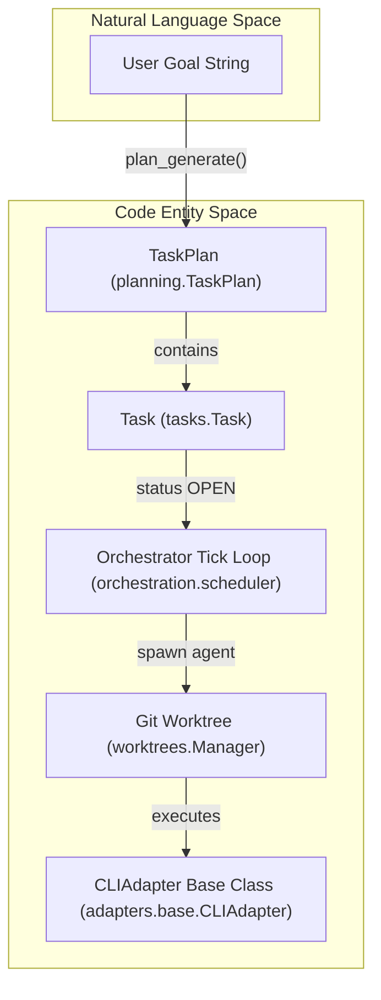
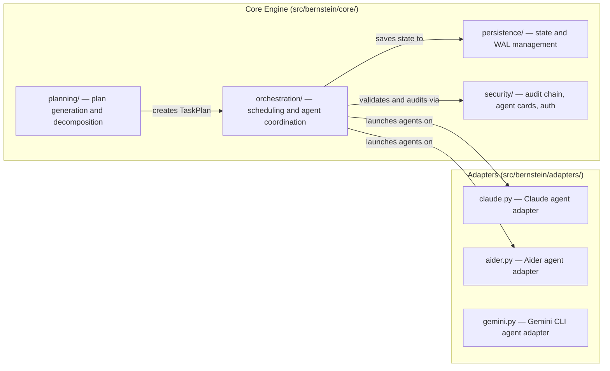

<!-- source: DeepWiki mcp.deepwiki.com · repo sipyourdrink-ltd/bernstein · page 1 Overview · fetched 2026-10-27 -->

# Overview

Relevant source files

The following files were used as context for generating this wiki page:

- [.cursor/rules/module-map.mdc](.cursor/rules/module-map.mdc)
- [.cursor/rules/overview.mdc](.cursor/rules/overview.mdc)
- [.goosehints](.goosehints)
- [.plugin/plugin.json](.plugin/plugin.json)
- [.well-known/security.txt](.well-known/security.txt)
- [AGENTS.md](AGENTS.md)
- [CHANGELOG.md](CHANGELOG.md)
- [CLAUDE.md](CLAUDE.md)
- [CONVENTIONS.md](CONVENTIONS.md)
- [README.md](README.md)
- [SECURITY.md](SECURITY.md)
- [bernstein.yaml](bernstein.yaml)
- [docker/sandbox/docker-compose.researcher.yaml](docker/sandbox/docker-compose.researcher.yaml)
- [docs/adapters/ADAPTER_GUIDE.md](docs/adapters/ADAPTER_GUIDE.md)
- [docs/architecture/plans.md](docs/architecture/plans.md)
- [docs/index.md](docs/index.md)
- [docs/integrations/agent-session.md](docs/integrations/agent-session.md)
- [docs/operations/run.md](docs/operations/run.md)
- [docs/reference/cli-reference.md](docs/reference/cli-reference.md)
- [docs/release-notes/unreleased.md](docs/release-notes/unreleased.md)
- [docs/release-notes/v3.13.0.md](docs/release-notes/v3.13.0.md)
- [docs/release-notes/v3.14.159.md](docs/release-notes/v3.14.159.md)
- [docs/whats-new.md](docs/whats-new.md)
- [examples/cluster/cloudflared/Dockerfile](examples/cluster/cloudflared/Dockerfile)
- [examples/cluster/cloudflared/config.yml](examples/cluster/cloudflared/config.yml)
- [examples/cluster/cloudflared/docker-compose.yml](examples/cluster/cloudflared/docker-compose.yml)
- [examples/cluster/tailscale/bernstein.yaml](examples/cluster/tailscale/bernstein.yaml)
- [examples/cluster/tailscale/docker-compose.yml](examples/cluster/tailscale/docker-compose.yml)
- [examples/cluster/tailscale/tailscale.json](examples/cluster/tailscale/tailscale.json)
- [mcp.json](mcp.json)
- [mkdocs.yml](mkdocs.yml)
- [packaging/npm/package.json](packaging/npm/package.json)
- [plugin.json](plugin.json)
- [pyproject.toml](pyproject.toml)
- [schemas/agent-plugins/1.0.0/mcp.schema.json](schemas/agent-plugins/1.0.0/mcp.schema.json)
- [schemas/agent-plugins/1.0.0/plugin.schema.json](schemas/agent-plugins/1.0.0/plugin.schema.json)
- [schemas/agent-plugins/README.md](schemas/agent-plugins/README.md)
- [scripts/gen_distribution_manifests.py](scripts/gen_distribution_manifests.py)
- [scripts/researcher_sandbox.sh](scripts/researcher_sandbox.sh)
- [server.json](server.json)
- [src/bernstein/adapters/_contract.py](src/bernstein/adapters/_contract.py)
- [src/bernstein/adapters/registry.py](src/bernstein/adapters/registry.py)
- [src/bernstein/adapters/report.py](src/bernstein/adapters/report.py)
- [src/bernstein/adapters/use_cases.py](src/bernstein/adapters/use_cases.py)
- [src/bernstein/cli/commands/adapter_cmd.py](src/bernstein/cli/commands/adapter_cmd.py)
- [src/bernstein/cli/main.py](src/bernstein/cli/main.py)
- [src/bernstein/cli/release_notes.py](src/bernstein/cli/release_notes.py)
- [src/bernstein/core/security/audit_chain.py](src/bernstein/core/security/audit_chain.py)
- [tests/integration/cluster/test_cluster_tunnel_smoke.py](tests/integration/cluster/test_cluster_tunnel_smoke.py)
- [tests/unit/test_adapter_contract.py](tests/unit/test_adapter_contract.py)
- [tests/unit/test_distribution_manifests.py](tests/unit/test_distribution_manifests.py)
- [tests/unit/test_readme_api_coverage.py](tests/unit/test_readme_api_coverage.py)
- [uv.lock](uv.lock)

Bernstein is a deterministic multi-agent orchestration platform designed specifically for CLI-based coding agents. Named after the conductor Leonard Bernstein, it coordinates a "crew" of agents—such as Claude Code, Aider, and Codex—ensuring every player follows a deterministic "score" while providing audit-grade compliance required by regulated engineering teams.

The system's core philosophy is **zero-LLM coordination**: while agents employ large language models (LLMs) to generate code, the orchestration logic itself is deterministic and implemented in standard Python. This design avoids "hallucination loops" common in recursive agent systems and guarantees that a plan generated once will reproduce identical execution results on every replay.

---

## Core Value Proposition

- **Deterministic Orchestration**  
  All scheduling and coordination are handled by a plain Python scheduler, **without any LLM in the coordination loop**. This eliminates nondeterminism and ensures reliable, repeatable task execution across runs and environments. Replaying yesterday's plan reproduces its exact task graph.  
  _[README.md:45-45]()_

- **Audit-Grade Compliance**  
  Bernstein records every scheduling decision and significant event in a tamper-evident HMAC-SHA256 **audit chain**. This chain, along with a signed **lineage spine**, enables offline verification and detection of non-determinism or tampering without rerunning the workflow.  
  _[README.md:49-52]()_

- **Agent-Agnostic and Extensible**  
  Supports over 40 CLI agent adapters (e.g., Claude, Codex, Gemini CLI, Aider) allowing teams to adopt or rotate LLMs seamlessly without changing orchestration logic or task definitions.  
  _[README.md:48-48]()_

- **Strong Isolation and Security**  
  Each coding task runs in its own **Git worktree**, isolating filesystem changes and avoiding concurrent mutation conflicts. Signed **agent cards** (JSON Web Signatures - JWS) and an air-gap deployment profile add zero-trust security for regulated environments.  
  _[README.md:21-23]()_

---

## Architectural Overview

Bernstein employs a **three-tier architectural model** to separate concerns and scale efficiently:

1. **User Interfaces (CLI, TUI, and Web Dashboard)**  
   Operators submit goals, monitor progress, and review agent outputs through interactive frontends decoding the common task API.

2. **Task Server (FastAPI-based)**  
   Central task state hub managing task lifecycles, authentication, rate-limiting, audits, and eventing. The server API runs by default on port 8052.  
   _[README.md:50-50]()_

3. **Orchestrator & Agents**  
   The orchestration engine schedules, claims, and monitors tasks. Agents run in isolated, ephemeral Git worktrees or sandboxed environments, executing assigned tasks deterministically.

---

### System Entity Map: Bridging User Goals and Code Entities

This diagram illustrates how a natural language goal submitted by a user translates into Bernstein code-level entities managing plan execution.

---

## Key Concepts

Bernstein’s design revolves around several fundamental abstractions:

- **Tasks and Plans**  
  A user goal is decomposed into a `TaskPlan` YAML manifest containing multiple `Task` objects, each representing atomic work steps assigned to agents. These tasks form a dependency graph defining execution order and batching.

- **Roles and Adapters**  
  Each task specifies a `Role` determining which agent adapter (e.g., ClaudeAdapter, AiderAdapter) is used. This enables polymorphic support across different LLM providers behind a consistent orchestration interface.

- **`.sdd/` Directory (State, Data, and Decisions)**  
  This local project directory holds all runtime state including the task graph, execution logs, audit chain files, worktree metadata, and configuration. It acts as the single source of truth for a Bernstein project run.

- **Worktree Isolation**  
  Every task executes in its own isolated Git worktree, preventing file-system race conditions and enabling clean merges. Artifact-mode tasks use dedicated working directories within `.sdd/workspaces/`.

For detailed descriptions of these abstractions and their relationships, see [Core Concepts and Terminology](#1.2).

---

## Codebase Organization and Navigation

Bernstein's code is modularized mainly under `src/bernstein/core/` and `src/bernstein/adapters/` packages:

---

## Wiki Roadmap

This wiki page serves as the parent overview and links into the following detailed child sections:

- **[Getting Started](#1.1)**  
  Installation instructions (pip, Homebrew, npm, Docker, air-gap), initial project setup with `bernstein init`, directory layout, configuration files (`bernstein.yaml`), quickstart examples, and the `doctor` pre-flight command.

- **[Core Concepts and Terminology](#1.2)**  
  Thorough explanation of Bernstein's main abstractions including Tasks, Agents, Roles, Worktrees, the audit chain, Janitor gate runner, and organizational rule enforcement.

- **Architecture Section (2)**  
  In-depth components such as the Task Server API, Orchestrator lifecycle, Agent spawning mechanisms, Task planning and decomposition, Git integration, persistence, and sandbox backend approaches.

- **Security and Compliance (5)**  
  Detailed coverage of authentication, authorization, audit trails, guardrails, compliance features, and air-gap deployment practices.

- **Quality Gates and Verification (7)**  
  Describes the Janitor verification engine and mechanisms ensuring produced deliverables meet quality and compliance thresholds.

- **More Sections...**  
  Sections cover CLI references, UI frontends, observability, cost management, model routing, knowledge and memory systems, integrations, deployment, testing, and contribution guidelines.

---

Bernstein is designed to be extensible and transparent, providing reproducible automation workflows for modern engineering teams leveraging advanced CLI coding agents with strict security and compliance guarantees.

---
**Sources:**  
- [pyproject.toml:5-51]() (Project metadata and core description)  
- [README.md:15-58]() (Core value proposition and design)  
- [CLAUDE.md:8-66]() (Code module map and architecture clues)  
- [src/bernstein/cli/run_bootstrap.py:44-72]() (Plan generation and execution flow)  
- [src/bernstein/adapters/base.py:78-78]() (CLIAdapter class reference)

---

