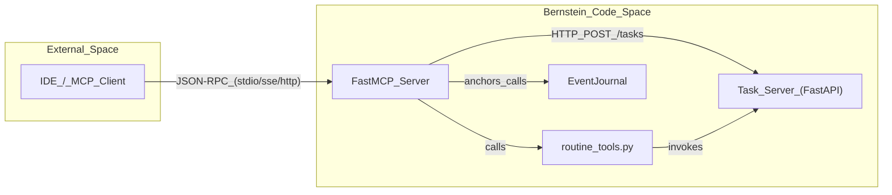
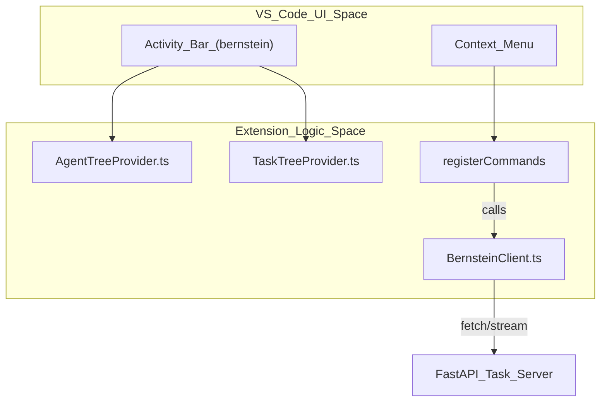

<!-- source: DeepWiki mcp.deepwiki.com · repo sipyourdrink-ltd/bernstein · page 10 Integrations and Extensions · fetched 2026-10-27 -->

# Integrations and Extensions

Relevant source files

The following files were used as context for generating this wiki page:

- [docs/mcp/server.md](docs/mcp/server.md)
- [docs/mcp/tool_tiers.md](docs/mcp/tool_tiers.md)
- [docs/operations/autofix-tier3.md](docs/operations/autofix-tier3.md)
- [src/bernstein/benchmark/swe_bench.py](src/bernstein/benchmark/swe_bench.py)
- [src/bernstein/bridges/openclaw_gateway.py](src/bernstein/bridges/openclaw_gateway.py)
- [src/bernstein/cli/commands/quickstart_cmd.py](src/bernstein/cli/commands/quickstart_cmd.py)
- [src/bernstein/cli/dashboard_actions.py](src/bernstein/cli/dashboard_actions.py)
- [src/bernstein/cli/run_confirm.py](src/bernstein/cli/run_confirm.py)
- [src/bernstein/cli/status.py](src/bernstein/cli/status.py)
- [src/bernstein/core/agents/claude_agent_card.py](src/bernstein/core/agents/claude_agent_card.py)
- [src/bernstein/core/agents/claude_message_normalizer.py](src/bernstein/core/agents/claude_message_normalizer.py)
- [src/bernstein/core/autofix/tier3.py](src/bernstein/core/autofix/tier3.py)
- [src/bernstein/core/orchestration/run_report.py](src/bernstein/core/orchestration/run_report.py)
- [src/bernstein/core/persistence/file_health.py](src/bernstein/core/persistence/file_health.py)
- [src/bernstein/core/protocols/mcp/claim_receipt.py](src/bernstein/core/protocols/mcp/claim_receipt.py)
- [src/bernstein/core/protocols/mcp/tool_tiers.py](src/bernstein/core/protocols/mcp/tool_tiers.py)
- [src/bernstein/core/routes/task_claim_receipt.py](src/bernstein/core/routes/task_claim_receipt.py)
- [src/bernstein/core/security/command_policy.py](src/bernstein/core/security/command_policy.py)
- [src/bernstein/core/security/policy_engine.py](src/bernstein/core/security/policy_engine.py)
- [src/bernstein/core/security/rule_enforcer.py](src/bernstein/core/security/rule_enforcer.py)
- [src/bernstein/eval/scenario_runner.py](src/bernstein/eval/scenario_runner.py)
- [src/bernstein/mcp/oauth.py](src/bernstein/mcp/oauth.py)
- [src/bernstein/mcp/remote_transport.py](src/bernstein/mcp/remote_transport.py)
- [src/bernstein/mcp/server.py](src/bernstein/mcp/server.py)
- [src/bernstein/mcp/signal_paths.py](src/bernstein/mcp/signal_paths.py)
- [src/bernstein/plugins/hookspecs.py](src/bernstein/plugins/hookspecs.py)
- [src/bernstein/plugins/manager.py](src/bernstein/plugins/manager.py)
- [tests/unit/autofix/test_tier3_shadow.py](tests/unit/autofix/test_tier3_shadow.py)
- [tests/unit/mcp/test_claim_update_tools.py](tests/unit/mcp/test_claim_update_tools.py)
- [tests/unit/mcp/test_oauth_discovery.py](tests/unit/mcp/test_oauth_discovery.py)
- [tests/unit/mcp/test_tool_tiering.py](tests/unit/mcp/test_tool_tiering.py)
- [tests/unit/test_hook_exit_codes.py](tests/unit/test_hook_exit_codes.py)
- [tests/unit/test_mcp_pull_worker_loop.py](tests/unit/test_mcp_pull_worker_loop.py)
- [tests/unit/test_mcp_remote_transport.py](tests/unit/test_mcp_remote_transport.py)
- [tests/unit/test_mcp_server.py](tests/unit/test_mcp_server.py)
- [tests/unit/test_mcp_tasks.py](tests/unit/test_mcp_tasks.py)
- [tests/unit/test_metrics.py](tests/unit/test_metrics.py)
- [tests/unit/test_path_containment.py](tests/unit/test_path_containment.py)

Bernstein is designed as an open platform that extends beyond its core orchestrator. It facilitates communication with external LLM clients via standardized protocols, provides a robust plugin architecture for lifecycle customization, and offers deep integration with developer environments like VS Code.

## External Protocol Support

Bernstein implements several protocols to bridge the gap between the orchestrator and external ecosystems. The primary integration point for modern AI IDEs is the **Model Context Protocol (MCP)**.

The `FastMCP` server [src/bernstein/mcp/server.py:70-70]() exposes Bernstein's internal state and controls as tools. This allows external clients (e.g., Cursor, Claude Code, Cline) to trigger runs, check status, and approve tasks directly. The server supports multiple transports: `stdio` for local IDEs and `sse` or **Streamable HTTP** for remote/web integrations [src/bernstein/mcp/server.py:7-9]().

### Protocol Interaction Map
The following diagram illustrates how the `FastMCP` server mediates between external clients and the internal Task Server, utilizing a stateless architecture where continuity is anchored in the `EventJournal` [src/bernstein/mcp/remote_transport.py:8-10]().

**Diagram: MCP to Task Server Bridge**

*Sources: [src/bernstein/mcp/server.py:18-31](), [src/bernstein/mcp/remote_transport.py:1-14](), [docs/mcp/server.md:9-15]()*

For details on federation and mTLS, see [MCP, A2A, and Protocol Integrations](#10.1).

## Plugin System

Bernstein utilizes a `pluggy`-based architecture [src/bernstein/plugins/manager.py:20-20]() to allow developers to hook into the agent lifecycle. The `PluginManager` discovers and invokes plugins that implement the `BernsteinSpec` [src/bernstein/plugins/hookspecs.py:97-97]().

### Core Lifecycle Hooks
| Hook Name | Purpose |
|---|---|
| `on_pre_task_create` | Intercept and potentially block task creation (exit code 2) [src/bernstein/plugins/hookspecs.py:135-145](). |
| `on_task_completed` | Trigger post-processing after an agent finishes work [src/bernstein/plugins/hookspecs.py:155-155](). |
| `on_agent_spawned` | Track resources or inject environment variables into new sessions [src/bernstein/plugins/hookspecs.py:175-175](). |
| `on_evolve_proposal` | React to self-evolution verdicts [src/bernstein/plugins/hookspecs.py:195-195](). |

Plugins can be implemented as Python classes using `@hookimpl` [src/bernstein/plugins/manager.py:37-37]() or as standalone shell scripts located in `.bernstein/hooks/` [src/bernstein/plugins/manager.py:165-170](). The system supports **Elicitation**, allowing hooks to pause and request user input via `ElicitationRequest` [src/bernstein/plugins/hookspecs.py:50-62]().

For details on writing custom adapters, see [Plugin System](#10.2).

## IDE Extensions and SDK

Bernstein provides first-class support for VS Code through a dedicated extension. The extension communicates with the orchestrator API (default `http://127.0.0.1:8052`) to provide real-time visibility.

### VS Code Architecture
The extension utilizes several providers to render the `ActivityBar` views:
*   `AgentTreeProvider`: Displays the hierarchy of active agents, their roles, and current costs.
*   `TaskTreeProvider`: Groups tasks by state (Open, In Progress, Pending Approval).
*   `BernsteinClient`: The TypeScript client that handles communication with the backend.

**Diagram: VS Code Extension to Code Entity Mapping**

*Sources: [src/bernstein/mcp/server.py:123-123](), [src/bernstein/cli/commands/quickstart_cmd.py:129-129]()*

For details on the TypeScript and Python SDKs, see [IDE Extensions and SDK](#10.3).

## Autofix and Auto-Heal

Bernstein includes specialized integrations for CI/CD environments to detect and repair failures automatically. The `autofix` daemon monitors pipeline results and uses escalation logic to assign agents to fix breaking changes.

The system supports a `quickstart` mode [src/bernstein/cli/commands/quickstart_cmd.py:1-12]() that seeds a project with a TODO API and sets up a `.sdd` workspace with `backend` and `qa` tasks to demonstrate the orchestration loop. It uses `_poll_until_done` to monitor the transition of tasks from `open` to `done` or `failed` [src/bernstein/cli/commands/quickstart_cmd.py:162-175]().

For details on CI failure detection and escalation, see [Autofix and Auto-Heal](#10.4).

---
**Sources:**
*   `src/bernstein/mcp/server.py`
*   `src/bernstein/mcp/remote_transport.py`
*   `src/bernstein/plugins/manager.py`
*   `src/bernstein/plugins/hookspecs.py`
*   `src/bernstein/cli/commands/quickstart_cmd.py`
*   `docs/mcp/server.md`
*   `src/bernstein/cli/status.py`

---

