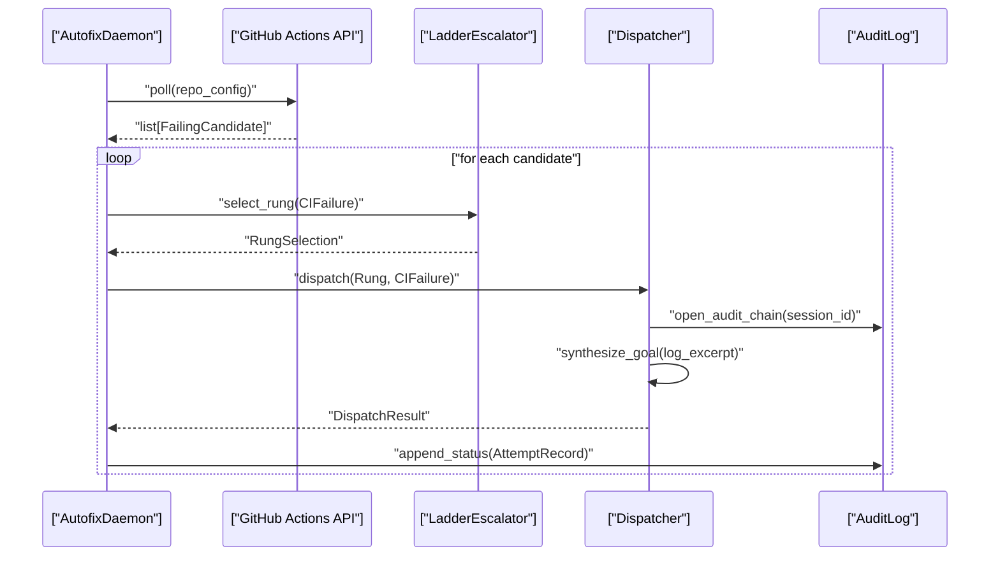
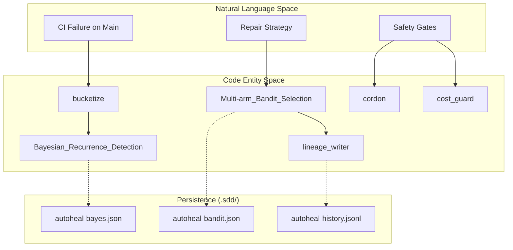

<!-- source: DeepWiki mcp.deepwiki.com · repo sipyourdrink-ltd/bernstein · page 10.4 Autofix and Auto-Heal · fetched 2026-10-27 -->

# Autofix and Auto-Heal

Relevant source files

The following files were used as context for generating this wiki page:

- [.github/actions/bootstrap/action.yml](.github/actions/bootstrap/action.yml)
- [.github/workflows/auto-heal.yml](.github/workflows/auto-heal.yml)
- [.github/workflows/bernstein-ci-fix.yml](.github/workflows/bernstein-ci-fix.yml)
- [.github/workflows/ci.yml](.github/workflows/ci.yml)
- [.github/workflows/cifuzz-pr.yml](.github/workflows/cifuzz-pr.yml)
- [.github/workflows/cluster-tunnel-e2e.yml](.github/workflows/cluster-tunnel-e2e.yml)
- [.github/workflows/codeql.yml](.github/workflows/codeql.yml)
- [.github/workflows/contract-drift-autofix.yml](.github/workflows/contract-drift-autofix.yml)
- [.github/workflows/dependency-review.yml](.github/workflows/dependency-review.yml)
- [.github/workflows/docs-drift.yml](.github/workflows/docs-drift.yml)
- [.github/workflows/release-major-minor.yml](.github/workflows/release-major-minor.yml)
- [.github/workflows/sbom.yml](.github/workflows/sbom.yml)
- [.github/workflows/scorecard.yml](.github/workflows/scorecard.yml)
- [.github/workflows/static-analysis-extended.yml](.github/workflows/static-analysis-extended.yml)
- [.github/workflows/trufflehog.yml](.github/workflows/trufflehog.yml)
- [.github/workflows/zizmor.yml](.github/workflows/zizmor.yml)
- [.readthedocs.yaml](.readthedocs.yaml)
- [action.yml](action.yml)
- [docs/requirements.in](docs/requirements.in)
- [docs/requirements.txt](docs/requirements.txt)
- [renovate.json](renovate.json)
- [src/bernstein/cli/commands/diff_cmd.py](src/bernstein/cli/commands/diff_cmd.py)
- [src/bernstein/cli/commands/undo_cmd.py](src/bernstein/cli/commands/undo_cmd.py)
- [src/bernstein/cli/commit_stats.py](src/bernstein/cli/commit_stats.py)
- [src/bernstein/cli/display/compare_screen.py](src/bernstein/cli/display/compare_screen.py)
- [src/bernstein/core/quality/ci_fix.py](src/bernstein/core/quality/ci_fix.py)
- [src/bernstein/core/quality/dead_code_detector.py](src/bernstein/core/quality/dead_code_detector.py)
- [tests/unit/cli/test_undo_cmd.py](tests/unit/cli/test_undo_cmd.py)
- [tests/unit/test_ci_fix.py](tests/unit/test_ci_fix.py)
- [tests/unit/test_doctor.py](tests/unit/test_doctor.py)
- [tests/unit/test_trufflehog_workflow_yaml.py](tests/unit/test_trufflehog_workflow_yaml.py)
- [tests/unit/test_zizmor_workflow_yaml.py](tests/unit/test_zizmor_workflow_yaml.py)

Bernstein provides two distinct self-correction mechanisms: the **Autofix Daemon**, which repairs CI failures on Bernstein-authored pull requests via an escalation ladder, and the **Auto-Heal Workflow**, a specialized GitHub Actions pipeline for self-healing failures on the `main` branch using Bayesian confidence and multi-arm bandit strategy selection.

## 1. The Autofix Daemon

The autofix system is a background process that monitors configured repositories for failed checks on pull requests opened by Bernstein sessions. It enforces ownership by validating session identifiers to ensure it only operates on its own PRs.

### Escalation Ladder
The daemon uses a four-rung escalation ladder to determine the most cost-effective repair strategy. This ensures that trivial fixes (like linting) do not consume expensive LLM tokens.

| Rung | Identity | Detector Criteria | Action |
| :--- | :--- | :--- | :--- |
| **0** | `rung-0-lint` | Lint/format drift (e.g., `ruff`) | `ruff check --fix` (No LLM spend) |
| **1** | `rung-1-single-file` | Single-file failure, diff <= 30 lines | Spawn `ci-fixer` (1 round) |
| **2** | `rung-2-multi-file` | Multi-file failure on PR-touched files | Spawn `ci-fixer` + `qa` (Approval required) |
| **3** | `rung-3-out-of-scope` | Failure on files NOT touched by PR | Post comment, label for human |

### Data Flow: CI Failure to Dispatch
The `Dispatcher` orchestrates the lifecycle of a repair attempt, from cost-cap validation to goal synthesis.

Title: Autofix Dispatch Sequence

Sources: [.github/workflows/ci.yml:147-153](), [.github/workflows/contract-drift-autofix.yml:1-20]()

## 2. Auto-Heal Workflow (v2)

The Auto-Heal system is a high-confidence pipeline triggered by CI failures on the `main` branch [.github/workflows/auto-heal.yml:1-6](). It uses a multi-layered approach (Detection, Classification, Repair, Safety, and Provenance) to apply patches without human intervention.

### Bayesian Confidence and Bandit Selection
Auto-heal does not use static rules. Instead, it employs:
*   **Bayesian Confidence:** Scores per-class failure confidence stored in `autoheal-bayes.json` [.github/workflows/auto-heal.yml:11-11]().
*   **Multi-arm Bandit:** Uses strategy selection from `autoheal-bandit.json` [.github/workflows/auto-heal.yml:12-12]().
*   **Flake Detection:** Distinguishes between transient flakes and real failures via `flake_detector` [.github/workflows/auto-heal.yml:13-13]().

### Cordon and Safety Rails
To prevent destructive self-healing, the workflow enforces a **Cordon Zone**. The system validates that agents only modify files within an explicit allowlist or whitespace-only globs [.github/workflows/auto-heal.yml:16-16](). It also includes a `cost_guard` circuit breaker to prevent runaway spend [.github/workflows/auto-heal.yml:17-17]().

Title: Auto-Heal Code Entity Map

Sources: [.github/workflows/auto-heal.yml:8-24](), [.github/workflows/bernstein-ci-fix.yml:1-12]()

## 3. Specialized Autofix Workflows

Beyond general CI failures, Bernstein implements specific autofixers for internal hygiene and contract stability.

### Contract Drift Autofix
This workflow detects and patches drift in CLI documentation and FastAPI route parity [.github/workflows/contract-drift-autofix.yml:7-17]().
*   **Inline-fix model:** For same-repo PRs, it commits regens directly to the source PR head ref [.github/workflows/contract-drift-autofix.yml:24-26]().
*   **LOC Cap:** Diffs are capped at 30 lines to ensure only mechanical changes are auto-applied [.github/workflows/contract-drift-autofix.yml:46-47]().

### Bernstein CI Fix (Fallback)
The `bernstein-ci-fix.yml` workflow acts as a fallback fixer when the Auto-heal v2 pipeline does not open a PR [.github/workflows/bernstein-ci-fix.yml:8-12](). It focuses on triage and classification of complex failures [.github/workflows/bernstein-ci-fix.yml:74-76]().

Sources: [.github/workflows/contract-drift-autofix.yml:22-33](), [.github/workflows/bernstein-ci-fix.yml:8-12]()

## 4. The `bernstein autofix` Command

The CLI provides operator-facing controls for the daemon lifecycle.

| Command | Function |
| :--- | :--- |
| `start` | Launches the daemon in background or foreground mode. |
| `stop` | Gracefully terminates the daemon process. |
| `status` | Returns a snapshot of active fix attempts and cost tracking. |
| `attach` | Tails the live JSONL status feed for real-time observation. |

### Configuration
Autofix behavior is governed by the `autofix` block in the configuration, which defines the budget per PR and enables/disables specific rungs of the escalation ladder.

Sources: [.github/workflows/auto-heal.yml:71-74](), [.github/workflows/bernstein-ci-fix.yml:17-18]()

---

