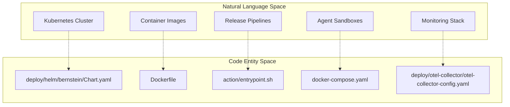
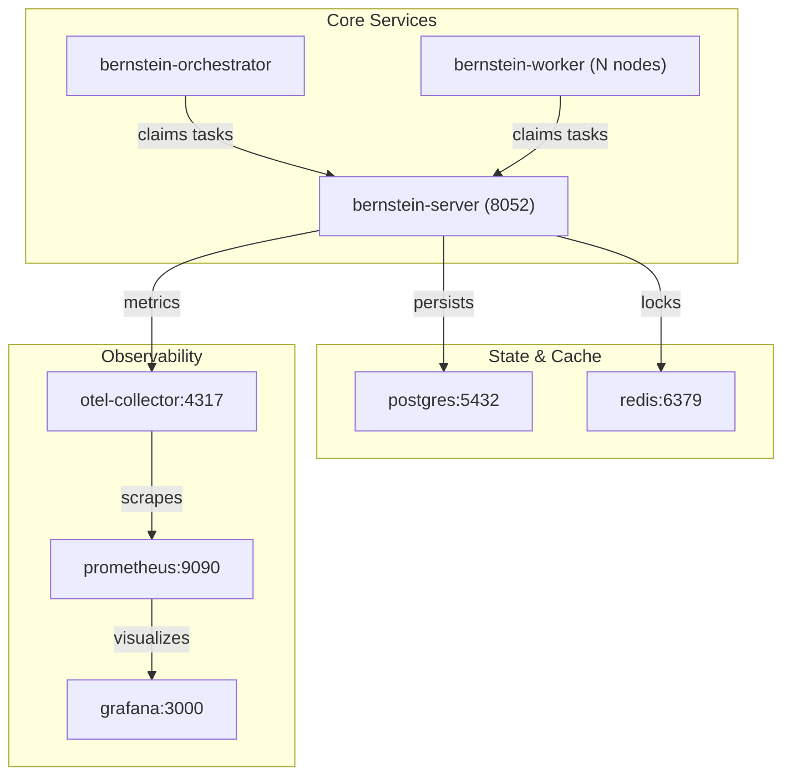

<!-- source: DeepWiki mcp.deepwiki.com · repo sipyourdrink-ltd/bernstein · page 11 Deployment and Infrastructure · fetched 2026-10-27 -->

# Deployment and Infrastructure

Relevant source files

The following files were used as context for generating this wiki page:

- [Dockerfile](Dockerfile)
- [action/entrypoint.sh](action/entrypoint.sh)
- [deploy/github-app/app.yml](deploy/github-app/app.yml)
- [deploy/grafana/dashboards/bernstein-otel.json](deploy/grafana/dashboards/bernstein-otel.json)
- [deploy/grafana/provisioning/dashboards/bernstein.yml](deploy/grafana/provisioning/dashboards/bernstein.yml)
- [deploy/helm/bernstein/Chart.yaml](deploy/helm/bernstein/Chart.yaml)
- [deploy/otel-collector/otel-collector-config.yaml](deploy/otel-collector/otel-collector-config.yaml)
- [deploy/prometheus/prometheus.yml](deploy/prometheus/prometheus.yml)
- [docker-compose.yaml](docker-compose.yaml)
- [docker/demo/Dockerfile](docker/demo/Dockerfile)
- [docker/demo/demo-cycle.sh](docker/demo/demo-cycle.sh)
- [docs/integrations/github-action.md](docs/integrations/github-action.md)
- [packages/cursor-plugin/skills/bernstein-agents/scripts/agents.sh](packages/cursor-plugin/skills/bernstein-agents/scripts/agents.sh)
- [packages/cursor-plugin/skills/bernstein-alerts/scripts/alerts.sh](packages/cursor-plugin/skills/bernstein-alerts/scripts/alerts.sh)
- [packages/cursor-plugin/skills/bernstein-approve/scripts/approvals.sh](packages/cursor-plugin/skills/bernstein-approve/scripts/approvals.sh)
- [packages/cursor-plugin/skills/bernstein-cost/scripts/costs.sh](packages/cursor-plugin/skills/bernstein-cost/scripts/costs.sh)
- [packages/cursor-plugin/skills/bernstein-create-task/scripts/create-task.sh](packages/cursor-plugin/skills/bernstein-create-task/scripts/create-task.sh)
- [packages/cursor-plugin/skills/bernstein-plan/scripts/plan.sh](packages/cursor-plugin/skills/bernstein-plan/scripts/plan.sh)
- [packages/cursor-plugin/skills/bernstein-quality/scripts/quality.sh](packages/cursor-plugin/skills/bernstein-quality/scripts/quality.sh)
- [scripts/ci_debug.sh](scripts/ci_debug.sh)
- [scripts/safe-push-main.sh](scripts/safe-push-main.sh)
- [tests/unit/test_shipped_shell_cli_invocations.py](tests/unit/test_shipped_shell_cli_invocations.py)

Bernstein is designed to run in diverse environments ranging from local developer machines to large-scale, air-gapped enterprise Kubernetes clusters. The infrastructure is managed through a combination of Docker containerization, Helm-based orchestration, and a robust GitHub Actions CI/CD topology that ensures deterministic releases and self-healing automation.

## Infrastructure Overview

The system architecture bridges the gap between local execution and cloud-native scaling. While the core logic resides in the `src/bernstein/` Python package, the deployment surface extends into multiple package ecosystems (PyPI, npm, Homebrew) and container registries.

### Code to Infrastructure Mapping

The following diagram maps high-level infrastructure concepts to their corresponding entities in the codebase.

**Infrastructure Component Mapping**

Sources: [deploy/helm/bernstein/Chart.yaml:1-6](), [Dockerfile:1-18](), [action/entrypoint.sh:1-15](), [docker-compose.yaml:1-13](), [deploy/otel-collector/otel-collector-config.yaml:1-21]().

## Deployment Options

Bernstein supports three primary deployment modalities, each optimized for different security and scale requirements.

### 1. Kubernetes and Helm
For production environments, Bernstein provides a comprehensive Helm chart in `deploy/helm/bernstein/` [deploy/helm/bernstein/Chart.yaml:1-5](). This handles the orchestration of the **Task Server** (`bernstein.core.server`), the **Orchestrator** tick loop (`bernstein.core.orchestrator`), and the horizontal scaling of **Workers** [docker-compose.yaml:74-130](). The deployment manages critical state via Persistent Volume Claims (PVCs) for the `.sdd/` directory [Dockerfile:34-35]() and integrates with Prometheus and Grafana for observability [docker-compose.yaml:9-12]().

For details, see [Kubernetes and Helm Deployment](#11.1).

### 2. Docker and Sandbox Backends
Containerization is central to Bernstein's security model. The primary `Dockerfile` provides a standardized environment for the Task Server [Dockerfile:1-56](), while specialized images like `docker/demo/Dockerfile` support ephemeral project environments with pre-installed agents like Claude Code [docker/demo/Dockerfile:1-58](). Bernstein supports multiple sandbox backends to isolate agent execution, including Docker-in-Docker (via host socket mount), E2B, and local worktree isolation [docker-compose.yaml:48-64]().

For details, see [Docker and Sandbox Backends](#11.3).

### 3. CI/CD and Release Automation
The Bernstein release process is fully automated via GitHub Actions. It features a "self-healing" pipeline where the `fix-ci` mode in `action/entrypoint.sh` can download failed logs and attempt to repair its own CI failures [action/entrypoint.sh:157-181](). The infrastructure also includes developer toolkits like `scripts/safe-push-main.sh` to validate local environments against CI standards before pushing [scripts/safe-push-main.sh:83-130]().

For details, see [CI/CD Pipelines and Release Automation](#11.2).

## Deployment Topology

The system can be deployed as a distributed cluster using `docker-compose.yaml`, which defines the relationships between the core services and the monitoring stack.

**Service Dependency Graph**

Sources: [docker-compose.yaml:70-130](), [docker-compose.yaml:136-180](), [deploy/otel-collector/otel-collector-config.yaml:35-44]().

### Automated Maintenance and Debugging
The infrastructure includes specialized debugging and maintenance frameworks:
*   **CI Debug Framework**: A shell-based utility (`scripts/ci_debug.sh`) for diagnosing failed runs, cleaning runtimes, and managing agent worktrees [scripts/ci_debug.sh:1-145]().
*   **Demo Cycle Manager**: An automated script (`docker/demo/demo-cycle.sh`) that resets projects, cancels stale tasks, and seeds fresh demo data every 15 minutes [docker/demo/demo-cycle.sh:1-171]().
*   **CLI Invocation Guard**: A unit test suite (`tests/unit/test_shipped_shell_cli_invocations.py`) that ensures all `bernstein` commands used in infrastructure scripts (like the GitHub Action) are valid against the current CLI schema [tests/unit/test_shipped_shell_cli_invocations.py:1-19]().

## Deployment Configuration Summary

| Feature | Code Reference | Description |
| :--- | :--- | :--- |
| **Containerization** | `Dockerfile` | Multi-stage build for the core server and CLI [Dockerfile:1-56](). |
| **Orchestration** | `deploy/helm/` | Helm v3 charts for K8s deployment [deploy/helm/bernstein/Chart.yaml:1-5](). |
| **Cluster Mode** | `docker-compose.yaml` | Multi-node setup with Postgres, Redis, and OTel [docker-compose.yaml:1-13](). |
| **CI Gatekeeper** | `action/entrypoint.sh` | Handles GitHub Action triggers (fix-ci, decompose, run) [action/entrypoint.sh:1-8](). |
| **Observability** | `deploy/otel-collector/` | OTLP pipeline for metrics and traces [deploy/otel-collector/otel-collector-config.yaml:1-21](). |

Sources: [Dockerfile:1-56](), [deploy/helm/bernstein/Chart.yaml:1-5](), [docker-compose.yaml:1-13](), [action/entrypoint.sh:1-8](), [deploy/otel-collector/otel-collector-config.yaml:1-21]().

---

