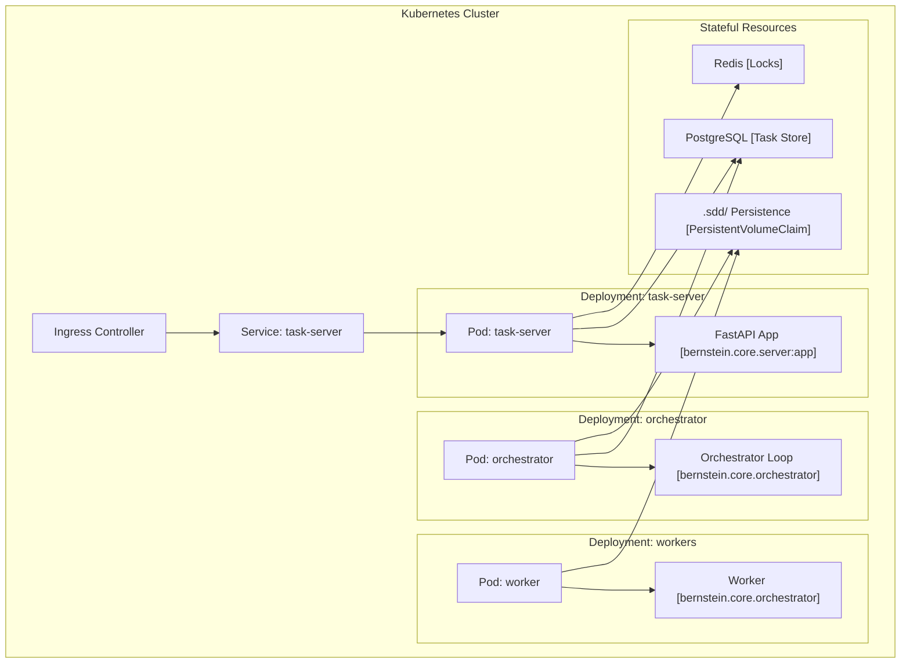

<!-- source: DeepWiki mcp.deepwiki.com · repo sipyourdrink-ltd/bernstein · page 11.1 Kubernetes and Helm Deployment · fetched 2026-10-27 -->

# Kubernetes and Helm Deployment

Relevant source files

The following files were used as context for generating this wiki page:

- [Dockerfile](Dockerfile)
- [action/entrypoint.sh](action/entrypoint.sh)
- [deploy/github-app/app.yml](deploy/github-app/app.yml)
- [deploy/grafana/dashboards/bernstein-otel.json](deploy/grafana/dashboards/bernstein-otel.json)
- [deploy/grafana/provisioning/dashboards/bernstein.yml](deploy/grafana/provisioning/dashboards/bernstein.yml)
- [deploy/helm/bernstein/Chart.yaml](deploy/helm/bernstein/Chart.yaml)
- [deploy/otel-collector/otel-collector-config.yaml](deploy/otel-collector/otel-collector-config.yaml)
- [deploy/prometheus/prometheus.yml](deploy/prometheus/prometheus.yml)
- [docker-compose.yaml](docker-compose.yaml)
- [docker/demo/Dockerfile](docker/demo/Dockerfile)
- [docker/demo/demo-cycle.sh](docker/demo/demo-cycle.sh)
- [docs/integrations/github-action.md](docs/integrations/github-action.md)
- [packages/cursor-plugin/skills/bernstein-agents/scripts/agents.sh](packages/cursor-plugin/skills/bernstein-agents/scripts/agents.sh)
- [packages/cursor-plugin/skills/bernstein-alerts/scripts/alerts.sh](packages/cursor-plugin/skills/bernstein-alerts/scripts/alerts.sh)
- [packages/cursor-plugin/skills/bernstein-approve/scripts/approvals.sh](packages/cursor-plugin/skills/bernstein-approve/scripts/approvals.sh)
- [packages/cursor-plugin/skills/bernstein-cost/scripts/costs.sh](packages/cursor-plugin/skills/bernstein-cost/scripts/costs.sh)
- [packages/cursor-plugin/skills/bernstein-create-task/scripts/create-task.sh](packages/cursor-plugin/skills/bernstein-create-task/scripts/create-task.sh)
- [packages/cursor-plugin/skills/bernstein-plan/scripts/plan.sh](packages/cursor-plugin/skills/bernstein-plan/scripts/plan.sh)
- [packages/cursor-plugin/skills/bernstein-quality/scripts/quality.sh](packages/cursor-plugin/skills/bernstein-quality/scripts/quality.sh)
- [scripts/ci_debug.sh](scripts/ci_debug.sh)
- [scripts/safe-push-main.sh](scripts/safe-push-main.sh)
- [tests/unit/test_shipped_shell_cli_invocations.py](tests/unit/test_shipped_shell_cli_invocations.py)

Bernstein is designed to be deployed as a resilient, multi-component system within Kubernetes. The deployment model separates the stateless API and Orchestrator layers from the stateful worker and persistence layers, using Helm as the primary orchestration tool for infrastructure.

## Deployment Architecture

The Bernstein Helm chart (`deploy/helm/bernstein/`) [deploy/helm/bernstein/Chart.yaml:1-5]() coordinates several interconnected services. The architecture transitions from a local-first `.sdd/` file-based state to a distributed model suitable for enterprise fleet management.

### Component Topology

| Component | Role | Scalability |
| :--- | :--- | :--- |
| **Task Server** | FastAPI-based REST/gRPC entry point for CLI and Web UI. | Horizontal (HPA) |
| **Orchestrator** | The central tick-loop that manages the Task State Machine. | Singleton (per namespace) |
| **Workers** | Independent orchestrator instances that claim and execute tasks. | Horizontal (HPA) |
| **PostgreSQL** | Relational state for the task store. | StatefulSet |
| **Redis** | Distributed locks and bulletin board. | StatefulSet |
| **OTel Collector** | Receives OTLP from agents and re-exports to Prometheus/Jaeger. | Horizontal |

### System Data Flow and Code Entities

The following diagram maps the high-level Kubernetes resources to the specific code entities they execute.

**Deployment to Code Mapping**

**Sources:** [docker-compose.yaml:6-12](), [docker-compose.yaml:74-85](), [docker-compose.yaml:112-115](), [docker-compose.yaml:123-126](), [Dockerfile:35-38]()

## State Management and Persistence

While Bernstein is "local-first," in Kubernetes, "local" refers to the shared `PersistentVolumeClaim` (PVC) mounted at `/workspace/.sdd` [Dockerfile:34-35]().

### The .sdd/ Directory Structure
The PVC preserves critical subdirectories across pod restarts:
*   `backlog/`: Task definitions and status.
*   `audit/`: HMAC-chained tamper-evident logs.
*   `runtime/`: Write-Ahead Logs (WAL) and file locks.

In a cluster deployment, the `BERNSTEIN_CLUSTER_ENABLED` environment variable is set to `"true"` [docker-compose.yaml:35-35](), signaling the core to use the database and redis backends for shared state rather than purely local files.

**Sources:** [docker-compose.yaml:35-35](), [Dockerfile:34-35](), [docker-compose.yaml:45-47]()

## Security and Secrets

Deployment in Kubernetes requires managing sensitive LLM provider keys and authentication tokens.

1.  **Provider Key Secrets**: Credentials for Anthropic, OpenAI, and Google are injected via environment variables [docker-compose.yaml:36-41]().
2.  **Auth Token**: The `BERNSTEIN_AUTH_TOKEN` is required for inter-service communication and CLI access [docker-compose.yaml:33-33]().
3.  **Sandbox Isolation**: Agents can be run in sibling containers if the host Docker socket is mounted [docker-compose.yaml:48-64](). However, this requires specific image capabilities and is flagged as a security risk (host root access) [docker-compose.yaml:62-63]().

**Sources:** [docker-compose.yaml:31-41](), [docker-compose.yaml:62-64](), [Dockerfile:30-32]()

## Observability and Monitoring

The deployment includes an OpenTelemetry (OTel) Collector to manage traces, metrics, and logs [docker-compose.yaml:136-137]().

### Metrics Pipeline
1.  **Bernstein Server**: Exposes a `/metrics` endpoint for Prometheus [docker-compose.yaml:9-9]().
2.  **OTel Collector**: Scrapes the server and receives OTLP gRPC/HTTP from agents [deploy/otel-collector/otel-collector-config.yaml:22-34]().
3.  **Exporters**: Data is forwarded to Prometheus (port 8889), Jaeger (distributed tracing), and optionally Datadog or New Relic [deploy/otel-collector/otel-collector-config.yaml:80-123]().

### Dashboards
Grafana is provisioned with pre-built dashboards for agent monitoring [docker-compose.yaml:10-10]().
*   **Grafana Port**: 3000 [docker-compose.yaml:21-21]()
*   **Prometheus Port**: 9090 [docker-compose.yaml:20-20]()

**Sources:** [docker-compose.yaml:136-148](), [deploy/otel-collector/otel-collector-config.yaml:1-171](), [docker-compose.yaml:9-21]()

## Container Image Strategy

Bernstein provides two primary Docker images:

1.  **Standard Image (`Dockerfile`)**: A slim, production-ready image containing the `bernstein` binary. It uses `python:3.13-slim` as the base [Dockerfile:13-18]().
2.  **Demo Image (`docker/demo/Dockerfile`)**: Includes additional tools like Node.js and `@anthropic-ai/claude-code` for real agent execution [docker/demo/Dockerfile:21-27]().

### Image Entrypoints

| Service | Entrypoint | Command |
| :--- | :--- | :--- |
| **Task Server** | `python -m uvicorn` | `bernstein.core.server:app` [docker-compose.yaml:79-81]() |
| **Orchestrator** | `python -m bernstein.core.orchestrator` | - [docker-compose.yaml:114-114]() |
| **Worker** | `python -m bernstein.core.orchestrator` | - [docker-compose.yaml:125-125]() |
| **Default** | `bernstein` | `serve` [Dockerfile:54-55]() |

**Sources:** [Dockerfile:1-55](), [docker/demo/Dockerfile:1-57](), [docker-compose.yaml:74-130]()

## Scaling and Lifecycle

### Worker Scaling
Workers are independent orchestrator instances that connect to the central server [docker-compose.yaml:121-122](). They can be scaled horizontally using Kubernetes HPA or Docker Compose `--scale` [docker-compose.yaml:16-16]().

### Health Checks
Probes are defined to ensure service availability:
*   **Server**: Probes `http://localhost:8052/health` [Dockerfile:43-44]().
*   **OTel Collector**: Probes `http://localhost:13133/healthz` [docker-compose.yaml:155-155]().

**Sources:** [docker-compose.yaml:120-130](), [Dockerfile:43-44](), [docker-compose.yaml:154-159]()

---

