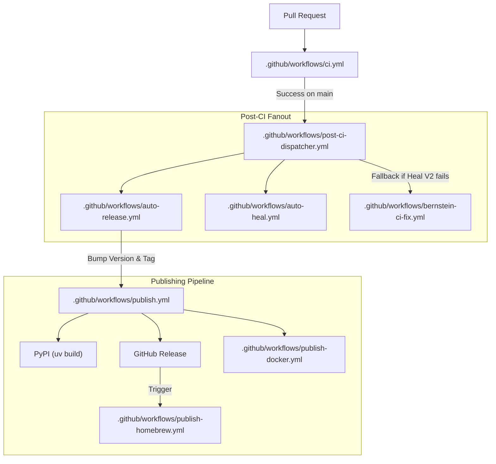

<!-- source: DeepWiki mcp.deepwiki.com · repo sipyourdrink-ltd/bernstein · page 11.2 CI/CD Pipelines and Release Automation · fetched 2026-10-27 -->

# CI/CD Pipelines and Release Automation

Relevant source files

The following files were used as context for generating this wiki page:

- [.github/actions/bootstrap/action.yml](.github/actions/bootstrap/action.yml)
- [.github/workflows/adapter-contract-drift.yml](.github/workflows/adapter-contract-drift.yml)
- [.github/workflows/auto-heal.yml](.github/workflows/auto-heal.yml)
- [.github/workflows/auto-release.yml](.github/workflows/auto-release.yml)
- [.github/workflows/bernstein-ci-fix.yml](.github/workflows/bernstein-ci-fix.yml)
- [.github/workflows/bernstein-pr-review.yml](.github/workflows/bernstein-pr-review.yml)
- [.github/workflows/ci.yml](.github/workflows/ci.yml)
- [.github/workflows/cifuzz-pr.yml](.github/workflows/cifuzz-pr.yml)
- [.github/workflows/cluster-tunnel-e2e.yml](.github/workflows/cluster-tunnel-e2e.yml)
- [.github/workflows/codeql.yml](.github/workflows/codeql.yml)
- [.github/workflows/contract-drift-autofix.yml](.github/workflows/contract-drift-autofix.yml)
- [.github/workflows/dependency-review.yml](.github/workflows/dependency-review.yml)
- [.github/workflows/docs-drift.yml](.github/workflows/docs-drift.yml)
- [.github/workflows/post-ci-dispatcher.yml](.github/workflows/post-ci-dispatcher.yml)
- [.github/workflows/publish-docker.yml](.github/workflows/publish-docker.yml)
- [.github/workflows/publish-extension.yml](.github/workflows/publish-extension.yml)
- [.github/workflows/publish-homebrew.yml](.github/workflows/publish-homebrew.yml)
- [.github/workflows/publish.yml](.github/workflows/publish.yml)
- [.github/workflows/reconcile-release.yml](.github/workflows/reconcile-release.yml)
- [.github/workflows/release-major-minor.yml](.github/workflows/release-major-minor.yml)
- [.github/workflows/review-bot-ack-publish.yml](.github/workflows/review-bot-ack-publish.yml)
- [.github/workflows/review-bot-ack.yml](.github/workflows/review-bot-ack.yml)
- [.github/workflows/review-bot-sweep.yml](.github/workflows/review-bot-sweep.yml)
- [.github/workflows/sbom.yml](.github/workflows/sbom.yml)
- [.github/workflows/scorecard.yml](.github/workflows/scorecard.yml)
- [.github/workflows/stale.yml](.github/workflows/stale.yml)
- [.github/workflows/static-analysis-extended.yml](.github/workflows/static-analysis-extended.yml)
- [.github/workflows/trufflehog.yml](.github/workflows/trufflehog.yml)
- [.github/workflows/zizmor.yml](.github/workflows/zizmor.yml)
- [.readthedocs.yaml](.readthedocs.yaml)
- [action.yml](action.yml)
- [docs/maintainers/ci-apps.md](docs/maintainers/ci-apps.md)
- [docs/operations/ci-topology.md](docs/operations/ci-topology.md)
- [docs/operations/ci.md](docs/operations/ci.md)
- [docs/operations/post-ci-dispatcher.md](docs/operations/post-ci-dispatcher.md)
- [docs/operations/release.md](docs/operations/release.md)
- [docs/operations/review-bot-ack.md](docs/operations/review-bot-ack.md)
- [docs/requirements.in](docs/requirements.in)
- [docs/requirements.txt](docs/requirements.txt)
- [packaging/npm/README.md](packaging/npm/README.md)
- [renovate.json](renovate.json)
- [scripts/ack_publisher_currency.py](scripts/ack_publisher_currency.py)
- [scripts/copr_build_watch.py](scripts/copr_build_watch.py)
- [scripts/publish_required_check.py](scripts/publish_required_check.py)
- [scripts/review_bot_ack.py](scripts/review_bot_ack.py)
- [scripts/review_bot_sweep.py](scripts/review_bot_sweep.py)
- [src/bernstein/cli/commands/integrations_cmd.py](src/bernstein/cli/commands/integrations_cmd.py)
- [tests/unit/cli/test_integrations_list.py](tests/unit/cli/test_integrations_list.py)
- [tests/unit/scripts/test_copr_build_watch.py](tests/unit/scripts/test_copr_build_watch.py)
- [tests/unit/scripts/test_review_bot_ack_finding_taxonomy.py](tests/unit/scripts/test_review_bot_ack_finding_taxonomy.py)
- [tests/unit/scripts/test_review_bot_ack_run_detection.py](tests/unit/scripts/test_review_bot_ack_run_detection.py)
- [tests/unit/test_abandon_models.py](tests/unit/test_abandon_models.py)
- [tests/unit/test_autoheal_workflow_yaml.py](tests/unit/test_autoheal_workflow_yaml.py)
- [tests/unit/test_bot_pull_request_tokens_yaml.py](tests/unit/test_bot_pull_request_tokens_yaml.py)
- [tests/unit/test_gui_pwa.py](tests/unit/test_gui_pwa.py)
- [tests/unit/test_merge_queue_gate_coverage_yaml.py](tests/unit/test_merge_queue_gate_coverage_yaml.py)
- [tests/unit/test_post_ci_dispatcher_yaml.py](tests/unit/test_post_ci_dispatcher_yaml.py)
- [tests/unit/test_publish_required_check.py](tests/unit/test_publish_required_check.py)
- [tests/unit/test_publish_workflow_yaml.py](tests/unit/test_publish_workflow_yaml.py)
- [tests/unit/test_pull_request_workflow_concurrency_yaml.py](tests/unit/test_pull_request_workflow_concurrency_yaml.py)
- [tests/unit/test_reconcile_release_workflow_yaml.py](tests/unit/test_reconcile_release_workflow_yaml.py)
- [tests/unit/test_release_attestation_workflow.py](tests/unit/test_release_attestation_workflow.py)
- [tests/unit/test_release_entrypoint_docs.py](tests/unit/test_release_entrypoint_docs.py)
- [tests/unit/test_release_followup_dispatch_yaml.py](tests/unit/test_release_followup_dispatch_yaml.py)
- [tests/unit/test_review_bot_ack_workflow_yaml.py](tests/unit/test_review_bot_ack_workflow_yaml.py)
- [tests/unit/test_sbom_workflow_yaml.py](tests/unit/test_sbom_workflow_yaml.py)
- [tests/unit/test_trufflehog_workflow_yaml.py](tests/unit/test_trufflehog_workflow_yaml.py)
- [tests/unit/test_zizmor_workflow_yaml.py](tests/unit/test_zizmor_workflow_yaml.py)

Bernstein utilizes a multi-layered GitHub Actions topology designed for high-frequency releases, strict protocol compliance, and self-healing infrastructure. The pipeline transitions from a "gatekeeper" CI model to an automated release loop that handles multi-platform publishing (PyPI, npm, VS Code Marketplace, Homebrew, Docker) while maintaining SLSA-3 build provenance.

## Pipeline Topology and Data Flow

The automation architecture is centered around a "Success-Triggered Release" loop orchestrated by the `post-ci-dispatcher.yml`. The core `CI` workflow acts as the primary gatekeeper; its successful conclusion on the `main` branch triggers the `Auto-release` sequence and other post-CI consumers.

### Workflow Hierarchy Diagram

This diagram maps the logical flow of code from a Pull Request to a multi-platform release, identifying the key YAML files and their triggers.

**Sources:** [.github/workflows/ci.yml:3-15](), [.github/workflows/post-ci-dispatcher.yml:1-5](), [.github/workflows/auto-release.yml:13-35](), [.github/workflows/publish.yml:3-6](), [.github/workflows/publish-docker.yml:12-13](), [.github/workflows/auto-heal.yml:35-50]().

## CI Gatekeeper and Planner

The `CI` workflow employs a "Planner" pattern to optimize runner usage. The `determine-changes` job classifies the diff to emit boolean outputs such as `python_changed`, `tests_changed`, and `macos_sensitive` [.github/workflows/ci.yml:154-171]().

*   **Concurrency Policy**: To prevent race conditions during rapid merges, pushes to `main` use a per-SHA grouping with `cancel-in-progress: false`. Pull requests use `cancel-in-progress: true` to save runner minutes on stale SHAs [.github/workflows/ci.yml:113-139]().
*   **Permissions**: The workflow defaults to `contents: read` to follow the principle of least privilege [.github/workflows/ci.yml:143-144]().
*   **Bootstrap**: All jobs utilize the local composite action `.github/actions/bootstrap` to set up `uv` and Python with pinned versions and transient failure retries [.github/actions/bootstrap/action.yml:1-10]().

**Sources:** [.github/workflows/ci.yml:112-167](), [.github/actions/bootstrap/action.yml:33-104]().

## Automated Release and Reconcile Loop

### Success-Triggered Release
The `auto-release.yml` workflow is invoked by the dispatcher after a successful CI run on `main` [.github/workflows/auto-release.yml:7-14]().
1.  **Alerting**: If CI fails on `main`, `alert-on-stale-release-trigger` opens a tracking issue. It includes a 24-hour deduplication window to prevent noise during rapid hotfix cycles [.github/workflows/auto-release.yml:45-137]().
2.  **Watchdog**: The `reconcile-release.yml` workflow (referenced as a watchdog) ensures that the state of `main` matches the latest published tag, triggering corrections if drift is detected.

### Protocol Compatibility Gate
Before publishing, the `publish.yml` workflow executes a `protocol-gate`. It runs `pytest tests/protocol/` to detect breaking changes in MCP (Model Context Protocol) or A2A (Agent-to-Agent) federation [.github/workflows/publish.yml:39-103]().
*   **Bypass**: Breaking changes can be forced by including `ACKNOWLEDGE_BREAKING_CHANGES` in the commit message [.github/workflows/publish.yml:115-127]().

**Sources:** [.github/workflows/auto-release.yml:1-146](), [.github/workflows/publish.yml:39-128]().

## Supply Chain Security and Attestations

Bernstein implements **SLSA-3 (Supply-chain Levels for Software Artifacts)** build provenance.

| Security Feature | Implementation | Verification Command |
| :--- | :--- | :--- |
| **Harden Runner** | Egress filtering via `step-security/harden-runner` | N/A (Audit Logs) |
| **Sigstore Attestation** | OIDC-based keyless signing of wheels/sdist and Docker images | `gh attestation verify <artifact> --owner sipyourdrink-ltd` |
| **Review Gate** | `review-bot-ack.yml` blocks merge until bot findings are addressed | N/A (Required Check) |
| **CodeQL** | Weekly and per-PR static analysis | N/A (Security Tab) |

**Sources:** [.github/workflows/publish.yml:139-141](), [.github/workflows/publish-docker.yml:117-123](), [.github/workflows/codeql.yml:58-61](), [.github/workflows/review-bot-ack.yml:3-15]().

## Self-Healing Workflows

Bernstein features a multi-tiered self-healing system coordinated by the `post-ci-dispatcher.yml`.

### Auto-Heal v2
The `auto-heal.yml` workflow is the primary recovery mechanism. It uses a Bayesian confidence model and a multi-arm-bandit strategy to select repair recipes [.github/workflows/auto-heal.yml:8-22]().
*   **Cordon & Guard**: It implements a `cost_guard` circuit-breaker and a `blast_radius` gate to ensure automated fixes do not cause cascading failures [.github/workflows/auto-heal.yml:17-21]().
*   **Lineage**: Attestations are written to `autoheal-history.jsonl` via a `lineage_writer` [.github/workflows/auto-heal.yml:18]().

### Bernstein CI Fix (Fallback)
If `Auto-heal v2` fails to resolve a failure, `bernstein-ci-fix.yml` is invoked as a fallback [.github/workflows/bernstein-ci-fix.yml:8-12]().
*   **Triage**: It classifies failures into "Gemini-safe" categories (Lint, Spelling, Workflow lint, Repo hygiene) [.github/workflows/bernstein-ci-fix.yml:143-163]().
*   **Mechanism**: Spawns a headless agent to attempt a fix and opens an `auto-heal/<short_sha>` PR [.github/workflows/bernstein-ci-fix.yml:3-6]().

**Sources:** [.github/workflows/auto-heal.yml:1-101](), [.github/workflows/bernstein-ci-fix.yml:1-163]().

## Distribution and Infrastructure

### Docker Publishing
The `publish-docker.yml` workflow builds multi-arch images (`linux/amd64`, `linux/arm64`) for `ghcr.io/sipyourdrink-ltd/bernstein` [.github/workflows/publish-docker.yml:8-104](). It generates tags for full semver, major/minor versions, and a `latest` tag for stable releases [.github/workflows/publish-docker.yml:80-91]().

### Specialized Pipelines
*   **Homebrew**: `publish-homebrew.yml` automates formula updates in the tap repository.
*   **VS Code**: `publish-extension.yml` handles Marketplace and Open VSX deployment.
*   **Contract Drift**: `contract-drift-autofix.yml` handles mechanical drift (e.g., CLI doc updates) with an auto-commit loop for internal PRs.

**Sources:** [.github/workflows/publish-docker.yml:1-123](), [docs/operations/ci-topology.md:16-54]().

## Testing and Verification Pipelines

The `ci-topology.md` report tracks the extensive specialized testing surfaces:

| Workflow | Purpose | Frequency |
| :--- | :--- | :--- |
| `a2a-federation-e2e.yml` | Cross-agent communication tests | PR & Scheduled |
| `airgap-e2e.yml` | Validates air-gap wheelhouse installation | PR & Push |
| `adapter-conformance-canary.yml` | Checks LLM adapter API compatibility | Scheduled |
| `nightly-deep-tests.yml` | Resource-heavy integration and chaos tests | Nightly |
| `pentest.yml` | Adversarial security suite | Dispatch |

**Sources:** [docs/operations/ci-topology.md:14-50](), [docs/operations/ci.md:24-39]().

---

