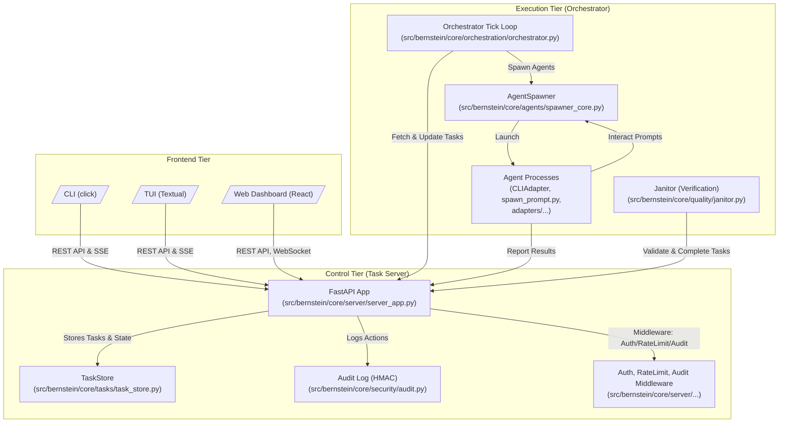
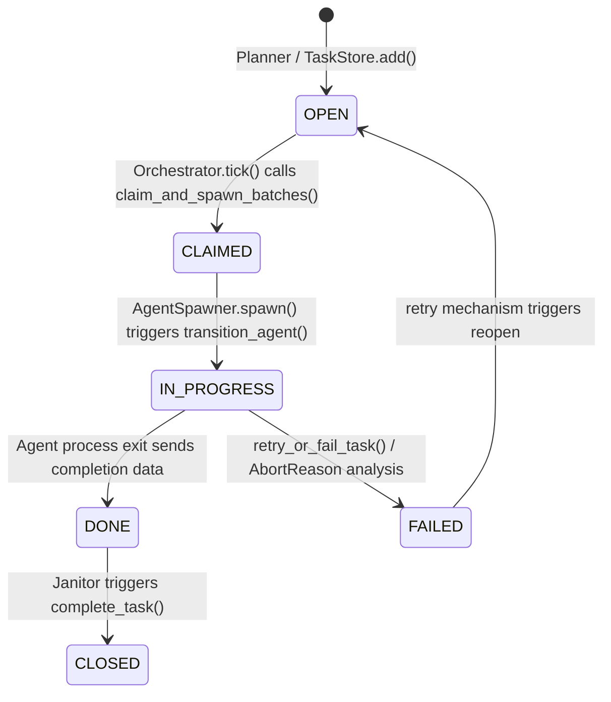

<!-- source: DeepWiki mcp.deepwiki.com · repo sipyourdrink-ltd/bernstein · page 2 Architecture · fetched 2026-10-27 -->

# Architecture

Relevant source files

The following files were used as context for generating this wiki page:

- [docs/architecture/ARCHITECTURE.md](docs/architecture/ARCHITECTURE.md)
- [docs/gui/index.md](docs/gui/index.md)
- [docs/guides/index.md](docs/guides/index.md)
- [docs/operations/work-ledger.md](docs/operations/work-ledger.md)
- [src/bernstein/cli/__init__.py](src/bernstein/cli/__init__.py)
- [src/bernstein/cli/commands/ledger_cmd.py](src/bernstein/cli/commands/ledger_cmd.py)
- [src/bernstein/cli/commands/resume_cmd.py](src/bernstein/cli/commands/resume_cmd.py)
- [src/bernstein/cli/helpers.py](src/bernstein/cli/helpers.py)
- [src/bernstein/core/__init__.py](src/bernstein/core/__init__.py)
- [src/bernstein/core/agents/prompt_cache_locality.py](src/bernstein/core/agents/prompt_cache_locality.py)
- [src/bernstein/core/agents/spawn_prompt.py](src/bernstein/core/agents/spawn_prompt.py)
- [src/bernstein/core/compat_redirect_ledger.py](src/bernstein/core/compat_redirect_ledger.py)
- [src/bernstein/core/defaults.py](src/bernstein/core/defaults.py)
- [src/bernstein/core/git/changelog.py](src/bernstein/core/git/changelog.py)
- [src/bernstein/core/git/git_context.py](src/bernstein/core/git/git_context.py)
- [src/bernstein/core/knowledge/knowledge_base.py](src/bernstein/core/knowledge/knowledge_base.py)
- [src/bernstein/core/observability/loop_detector.py](src/bernstein/core/observability/loop_detector.py)
- [src/bernstein/core/observability/prometheus.py](src/bernstein/core/observability/prometheus.py)
- [src/bernstein/core/persistence/ledger_git.py](src/bernstein/core/persistence/ledger_git.py)
- [src/bernstein/core/persistence/wal.py](src/bernstein/core/persistence/wal.py)
- [tests/property/__init__.py](tests/property/__init__.py)
- [tests/property/test_wal_cas_bughunt.py](tests/property/test_wal_cas_bughunt.py)
- [tests/unit/test_acp.py](tests/unit/test_acp.py)
- [tests/unit/test_audit_chain_work_ledger.py](tests/unit/test_audit_chain_work_ledger.py)
- [tests/unit/test_bandit_router.py](tests/unit/test_bandit_router.py)
- [tests/unit/test_cli_server_url.py](tests/unit/test_cli_server_url.py)
- [tests/unit/test_container_wiring.py](tests/unit/test_container_wiring.py)
- [tests/unit/test_differential_privacy.py](tests/unit/test_differential_privacy.py)
- [tests/unit/test_eu_ai_act.py](tests/unit/test_eu_ai_act.py)
- [tests/unit/test_incident.py](tests/unit/test_incident.py)
- [tests/unit/test_license_scanner.py](tests/unit/test_license_scanner.py)
- [tests/unit/test_llm_watcher_detector_pack.py](tests/unit/test_llm_watcher_detector_pack.py)
- [tests/unit/test_mcp_cmd.py](tests/unit/test_mcp_cmd.py)
- [tests/unit/test_memory_integrity.py](tests/unit/test_memory_integrity.py)
- [tests/unit/test_merkle.py](tests/unit/test_merkle.py)
- [tests/unit/test_prompt_cache_locality.py](tests/unit/test_prompt_cache_locality.py)
- [tests/unit/test_prompt_cache_locality_vendors.py](tests/unit/test_prompt_cache_locality_vendors.py)
- [tests/unit/test_run_benchmark.py](tests/unit/test_run_benchmark.py)
- [tests/unit/test_runbooks.py](tests/unit/test_runbooks.py)
- [tests/unit/test_spawn_prompt_memory_inject.py](tests/unit/test_spawn_prompt_memory_inject.py)
- [tests/unit/test_wal.py](tests/unit/test_wal.py)
- [tests/unit/test_wal_replay.py](tests/unit/test_wal_replay.py)
- [tests/unit/test_workflow.py](tests/unit/test_workflow.py)

Bernstein is designed as a deterministic orchestration system that coordinates autonomous agents to achieve complex engineering goals. Unlike "agentic" frameworks that rely on LLMs to manage their own control flow, Bernstein employs a **three-tier architecture** where core logic—task scheduling, dependency management, and state transitions—is implemented in high-integrity Python code.

This architecture enables a clear transition from "Natural Language Space" (goals and plans) to "Code Entity Space" (tasks and processes) through a structured pipeline, ensuring auditability, reproducibility, and safe concurrency.

---

## The Three-Tier Model

Bernstein's system is organized into three distinct operational layers:

### 1. Frontend (CLI/TUI/Web)

Users interact with Bernstein through CLI commands, an optional Textual-based terminal UI (TUI), or a React web dashboard. These frontend components communicate with the Task Server exclusively via a REST API and Server-Sent Events (SSE), guaranteeing a clean separation from the backend.

- CLI commands (`bernstein`) and TUI issue HTTP requests and listen for SSE events.
- The web dashboard interfaces through REST and WebSocket APIs.
  
### 2. Task Server (FastAPI)

The Task Server, running on default port 8052, acts as the authoritative data store and API gateway for the Bernstein system.

- It manages the task graph, user sessions, rate limiting, authentication, and audit logging.
- Implements FastAPI routes to serve tasks, agents, audits, and various other resources.
- Provides API version parity and supports WebSocket and SSE for real-time updates.

### 3. Orchestrator and Agents

The Orchestrator embodies the system's execution engine.

- Runs a single-threaded "tick" loop that drives the state machine of tasks, performing claim, spawn, monitor, and cleanup operations.
- Spawns isolated `AgentSession` processes to work on tasks, using adapters that wrap various LLM providers or tools.
- The Janitor performs verification and cleanup duties post-agent completion.
- Implements batching strategies, dead letter queues, write-ahead logging (WAL), and manages graceful shutdown (drain) workflows.
  
### Three-Tier Interaction Diagram

This diagram bridges Bernstein's natural-language workflow terms with concrete code entities that implement them, showing data and control flow across tiers.

Sources: [src/bernstein/core/server/server_app.py:24-55](), [src/bernstein/core/orchestration/orchestrator.py:6-15](), [src/bernstein/core/agents/spawner_core.py:10-30](), [src/bernstein/core/security/audit.py:180-200](), [src/bernstein/core/quality/janitor.py:1-25]().

---

## File-Based State Model (`.sdd/`)

Bernstein employs a file-based, local-first persistence model centered around the `.sdd/` directory within each workspace. This directory acts as the core system state repository, enabling atomic file operations, crash safety, and audit-grade logs without requiring heavyweight database systems.

Key subdirectories and their roles:

- **`backlog/`**: Contains subfolders like `open/`, `claimed/`, and `done/` where serialized JSON files represent task states. Tasks move between these based on their status updates.
- **`runtime/`**: Holds ephemeral state such as active process PID files, agent session tokens, and the orchestrator's Write-Ahead Log (WAL).
- **`audit/`**: Stores tamper-evident HMAC-chained audit logs that record every significant system event for compliance and traceability.
- **`agents/`**: Metadata about current and dead agents, facilitating tracking and debugging.
- **`mcp/`**: Includes Model Context Protocol tools and inventories used by agents and the orchestrator.

This structure enables Bernstein to survive crashes, permit offline operation, and provide a transparent state layout that users and operators can inspect manually.

For comprehensive details, see [Persistence and State Management](#2.6).

Sources: [src/bernstein/core/tasks/models.py:150-175](), [src/bernstein/core/persistence/wal.py:1-60](), [src/bernstein/core/security/audit.py:180-200]().

---

## Major Subsystems Overview

### Task Server and API

The `FastAPI`-based Task Server (default port 8052) hosts the authoritative task state machine and exposes REST APIs for:

- Task CRUD operations and lifecycle transitions.
- Agent registration, heartbeats, and logs.
- Audit event submission and lineage queries.
- Real-time updates via SSE and WebSocket endpoints.

It includes robust middleware for authentication (JWT, OIDC, SAML), rate limiting, and audit metadata enrichment. Routes are organized modularly under `src/bernstein/core/routes/`.

For technical details on startup, middleware, route modules, and API version compatibility, see [Task Server and API](#2.1).

Sources: [src/bernstein/core/server/server_app.py:20-60](), [src/bernstein/core/server/api_compat.py:1-30]().

---

### Orchestrator and Task Lifecycle

The Orchestrator runs a stateful tick loop that:

- Queries the Task Store API for open and claimable tasks.
- Claims batches of tasks grouped by agent role and validates dependencies using `DependencyValidator`.
- Spawns agents via the `AgentSpawner` for tasks in `OPEN` status.
- Monitors agent progress and transitions task states through the lifecycle (`OPEN → CLAIMED → IN_PROGRESS → DONE → CLOSED`).
- Detects and handles conflicts such as file ownership clashes.
- Maintains durability and determinism via the Write-Ahead Log (WAL), supporting crash recovery.
- Supports a Dead Letter Queue (DLQ) for tasks that repeatedly fail.
- Coordinates graceful shutdown and drain sequences.

For a full explanation of the orchestrator tick phases, task state machine, batching strategies, and shutdown handling, see [Orchestrator and Task Lifecycle](#2.2).

Sources: [src/bernstein/core/orchestration/orchestrator.py:10-50](), [src/bernstein/core/tasks/task_lifecycle.py:40-80](), [src/bernstein/core/persistence/wal.py:1-130]().

---

### Agent Spawning and Adapters

The `AgentSpawner` abstracts the process of isolating and launching agent subprocesses:

- Supports multiple adapter types (`CLIAdapter`s) for different LLM APIs and tools (Claude, Codex, Gemini, Aider, Qwen, Cursor, Copilot, etc.).
- Manages lifecycle events: spawn, watchdog supervision, and cleanup/reaping.
- Runs agents inside isolated git worktrees or sandbox backends to prevent state collisions.
- Handles environment isolation and LLM rate limit detection.
- Implements a `bernstein-worker` wrapper to unify agent bootstrap and messaging.

For the architecture of the spawning system, adapter catalog, and process control flow, see [Agent Spawning and Adapters](#2.3).

Sources: [src/bernstein/core/agents/spawner_core.py:10-40](), [src/bernstein/core/agents/spawn_prompt.py:1-50]().

---

### Planning and Task Decomposition

Goals provided by the user or system are converted into detailed task graphs by the Planner subsystem:

- The Planner reads and composes `Plan` YAML schemas defining workflows and dependencies.
- The `Manager` agent role authorizes recursive task decomposition, automatically splitting large tasks into manageable sub-tasks.
- Uses a refinement loop involving critics and adversaries to vet plans before execution.
- Supports vertical slice planning, a workflow DSL, and domain-specific Recipe execution.
- Ships with a library of 24 ready-made plan templates in `examples/plans/`.

For insight into plan interpretation, decomposition, refinement, and templates, see [Planning and Task Decomposition](#2.4).

Sources: [src/bernstein/core/planning/planner.py:1-60](), [src/bernstein/core/agents/spawn_prompt.py:20-60]().

---

### Git Integration and Worktree Isolation

To avoid concurrency conflicts and ensure agent workspace integrity:

- Bernstein leverages `git worktrees` to provide isolated checkouts per agent.
- `WorktreeManager` handles lifecycle: create, classify (busy/free), and reaping stale worktrees.
- Incremental merges and PR generation support multi-agent integration.
- Incorporates aggressive git hygiene checks, a merge queue, and auto-committing drain sequences to ensure safe and traceable merges.

See [Git Integration and Worktree Isolation](#2.5) for the detailed handling of worktree lifecycle, merges, and PR automation.

Sources: [src/bernstein/core/git/changelog.py:10-50](), [src/bernstein/core/agents/spawner_core.py:70-110]().

---

## Code Entity Mapping: Task Lifecycle

To connect high-level task states to precise code functions and classes, the diagram below illustrates the state machine governing task progression and the orchestrator components responsible for each transition.

Sources: [src/bernstein/core/orchestration/orchestrator.py:130-150](), [src/bernstein/core/tasks/task_lifecycle.py:45-80](), [src/bernstein/core/tasks/models.py:150-170]().

---

## Operational Safety and Draining

Bernstein supports robust operational safety, including a sophisticated shutdown protocol implemented in the `DrainCoordinator`.

When a drain is triggered (e.g., via `bernstein stop`), the system performs a phased shutdown:

1. Freeze acceptance of new tasks.
2. Signal active agents to checkpoint and stop accepting new inputs (using `write_shutdown_signals()`).
3. Commit all outstanding changes within active worktrees.
4. Perform final merges and cleanups before process termination.

This sequence ensures no data loss, clean task completion, and graceful worker termination.

For the complete orchestration shutdown flow, see [Orchestrator and Task Lifecycle](#2.2).

Sources: [src/bernstein/core/orchestration/drain.py:40-80](), [src/bernstein/cli/commands/stop_cmd.py:90-130]().

---

# Child Pages for Deeper Details

- [Task Server and API](#2.1) — Server startup, API routes, models, middleware, and real-time event support.
- [Orchestrator and Task Lifecycle](#2.2) — Task state machine, tick loop, batching, WAL, DLQ, and graceful shutdown.
- [Agent Spawning and Adapters](#2.3) — Agent lifecycle, CLIAdapters, isolation, and supported LLM provider adapters.
- [Planning and Task Decomposition](#2.4) — Planner internals, task graph construction, refinement, and plan templates.
- [Git Integration and Worktree Isolation](#2.5) — Worktree management, incremental merge, and related git workflows.
- [Persistence and State Management](#2.6) — File-based state layout, WAL details, checkpoints, and optional backend support.

This hierarchical structure allows readers to explore from a concise architectural overview down into system internals and code specifics.

---

Sources:  
[src/bernstein/core/__init__.py:1-70](),  
[src/bernstein/core/orchestration/orchestrator.py:6-25](),  
[src/bernstein/core/server/server_app.py:20-70](),  
[src/bernstein/core/agents/spawner_core.py:10-30](),  
[src/bernstein/core/security/audit.py:180-200](),  
[src/bernstein/core/tasks/models.py:150-175](),  
[src/bernstein/core/persistence/wal.py:1-130](),  
[src/bernstein/core/agents/spawn_prompt.py:1-100](),  
[src/bernstein/core/git/changelog.py:15-45](),  
[src/bernstein/core/orchestration/drain.py:40-80](),  
[src/bernstein/cli/commands/stop_cmd.py:90-130]()

---

