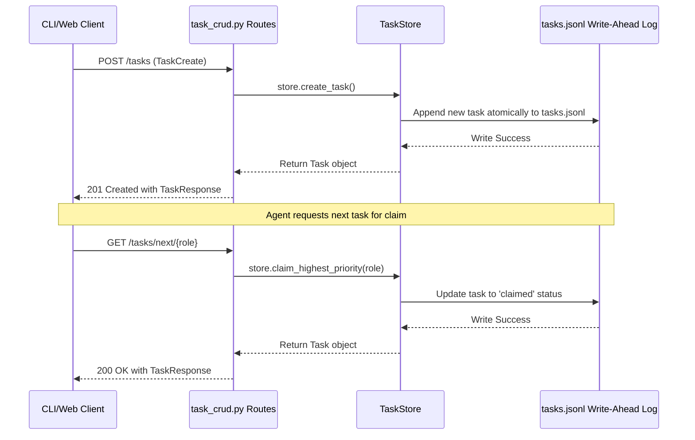
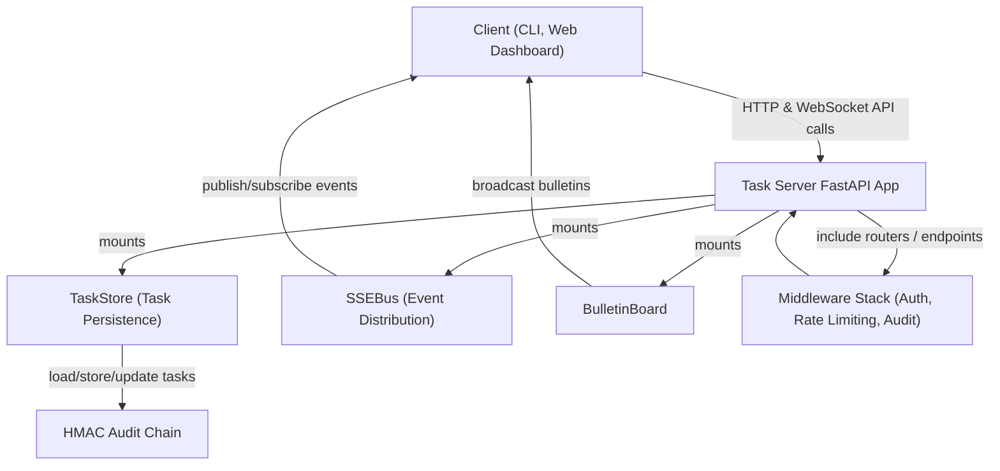

<!-- source: DeepWiki mcp.deepwiki.com · repo sipyourdrink-ltd/bernstein · page 2.1 Task Server and API · fetched 2026-10-27 -->

# Task Server and API

<details>
<summary>Relevant source files</summary>

The following files were used as context for generating this wiki page:

- [src/bernstein/core/agents/claude_max_turns.py](src/bernstein/core/agents/claude_max_turns.py)
- [src/bernstein/core/lifecycle/__init__.py](src/bernstein/core/lifecycle/__init__.py)
- [src/bernstein/core/memory/sqlite_store.py](src/bernstein/core/memory/sqlite_store.py)
- [src/bernstein/core/observability/apm_integration.py](src/bernstein/core/observability/apm_integration.py)
- [src/bernstein/core/observability/cascading_failure_circuit_breaker.py](src/bernstein/core/observability/cascading_failure_circuit_breaker.py)
- [src/bernstein/core/observability/datadog_export.py](src/bernstein/core/observability/datadog_export.py)
- [src/bernstein/core/orchestration/adaptive_tick.py](src/bernstein/core/orchestration/adaptive_tick.py)
- [src/bernstein/core/orchestration/convergence_guard.py](src/bernstein/core/orchestration/convergence_guard.py)
- [src/bernstein/core/orchestration/orchestrator_config.py](src/bernstein/core/orchestration/orchestrator_config.py)
- [src/bernstein/core/orchestration/orchestrator_health.py](src/bernstein/core/orchestration/orchestrator_health.py)
- [src/bernstein/core/routes/_sse.py](src/bernstein/core/routes/_sse.py)
- [src/bernstein/core/routes/_unconfigured.py](src/bernstein/core/routes/_unconfigured.py)
- [src/bernstein/core/routes/acp.py](src/bernstein/core/routes/acp.py)
- [src/bernstein/core/routes/agents.py](src/bernstein/core/routes/agents.py)
- [src/bernstein/core/routes/auth.py](src/bernstein/core/routes/auth.py)
- [src/bernstein/core/routes/costs.py](src/bernstein/core/routes/costs.py)
- [src/bernstein/core/routes/health.py](src/bernstein/core/routes/health.py)
- [src/bernstein/core/routes/paginated_tasks.py](src/bernstein/core/routes/paginated_tasks.py)
- [src/bernstein/core/routes/plans.py](src/bernstein/core/routes/plans.py)
- [src/bernstein/core/routes/sla.py](src/bernstein/core/routes/sla.py)
- [src/bernstein/core/routes/status_events.py](src/bernstein/core/routes/status_events.py)
- [src/bernstein/core/routes/status_lifecycle.py](src/bernstein/core/routes/status_lifecycle.py)
- [src/bernstein/core/routes/task_crud.py](src/bernstein/core/routes/task_crud.py)
- [src/bernstein/core/routes/task_detail.py](src/bernstein/core/routes/task_detail.py)
- [src/bernstein/core/routes/tasks.py](src/bernstein/core/routes/tasks.py)
- [src/bernstein/core/routes/telemetry_webhooks.py](src/bernstein/core/routes/telemetry_webhooks.py)
- [src/bernstein/core/routes/tracker_webhooks.py](src/bernstein/core/routes/tracker_webhooks.py)
- [src/bernstein/core/routes/webhooks.py](src/bernstein/core/routes/webhooks.py)
- [src/bernstein/core/routes/websocket.py](src/bernstein/core/routes/websocket.py)
- [src/bernstein/core/routes/well_known.py](src/bernstein/core/routes/well_known.py)
- [src/bernstein/core/routes/workspace.py](src/bernstein/core/routes/workspace.py)
- [src/bernstein/core/server/server_app.py](src/bernstein/core/server/server_app.py)
- [src/bernstein/core/server/server_models.py](src/bernstein/core/server/server_models.py)
- [src/bernstein/core/tokens/compaction_receipt.py](src/bernstein/core/tokens/compaction_receipt.py)
- [src/bernstein/core/tokens/context_compression.py](src/bernstein/core/tokens/context_compression.py)
- [src/bernstein/core/tokens/sensitive_gate.py](src/bernstein/core/tokens/sensitive_gate.py)
- [src/bernstein/core/tokens/template_compression.py](src/bernstein/core/tokens/template_compression.py)
- [templates/adapters/TEMPLATE.py](templates/adapters/TEMPLATE.py)
- [tests/contract/test_task_server_schemathesis.py](tests/contract/test_task_server_schemathesis.py)
- [tests/unit/test_auto_commit_on_complete.py](tests/unit/test_auto_commit_on_complete.py)
- [tests/unit/test_automation_bridge_route.py](tests/unit/test_automation_bridge_route.py)
- [tests/unit/test_claude_max_turns.py](tests/unit/test_claude_max_turns.py)
- [tests/unit/test_cli_agents.py](tests/unit/test_cli_agents.py)
- [tests/unit/test_cost_per_line.py](tests/unit/test_cost_per_line.py)
- [tests/unit/test_generic_webhook.py](tests/unit/test_generic_webhook.py)
- [tests/unit/test_issue_3166_unconfigured_subsystem_status.py](tests/unit/test_issue_3166_unconfigured_subsystem_status.py)
- [tests/unit/test_route_input_validation.py](tests/unit/test_route_input_validation.py)
- [tests/unit/test_task_create_bounds.py](tests/unit/test_task_create_bounds.py)

</details>


The Bernstein Task Server is a high-performance **FastAPI** application running by default on port **8052**, serving as the central coordination hub for the orchestration runtime. It manages the task backlog, agent lifecycle, inter-agent communication, real-time observability through SSE events, and enforces audit-grade compliance via an HMAC audit chain.

This page documents in detail the server's startup and bootstrap process, route structure and organization, API versioning practices, server models, middleware stack (authentication, rate limiting, audit logging), Server-Sent Events (SSE) event system, and WebSocket support. It covers all route modules located under `src/bernstein/core/routes/`.

---

## Startup and Bootstrap

The server's lifecycle is managed primarily by the bootstrap and server application modules. The bootstrap process ensures environment readiness, including file-system state and process locks, before instantiating the FastAPI application.

### Key Steps in Server Bootstrap

1. **PID Locking**  
   To prevent multiple concurrent server instances on the same worktree, a PID lock file `.sdd/runtime/bernstein.pid` is acquired on startup via `_acquire_pid_lock` [src/bernstein/core/orchestration/bootstrap.py:74-108](). This mutual exclusion ensures that only one server modifies the state directory concurrently.

2. **File System Readiness: `.sdd/` Directory Structure**  
   The standard Bernstein state directory `.sdd/` is validated and created if missing by the `ensure_sdd()` function. This directory includes sub-folders for backlog, agents, runtime caches, and audit metadata used by the server and orchestrator [src/bernstein/core/orchestration/bootstrap.py:175-184]().

3. **FastAPI Application Factory: `create_app()`**  
   The FastAPI app is created via the `create_app()` function in `server_app.py` which:  
   - Instantiates and mounts core state stores such as the `TaskStore` (task backlog management), the `SSEBus` (event distribution), and the `BulletinBoard` (cross-agent message broadcast).  
   - Attaches middleware such as the authentication middleware, rate limiting middleware, crash guards, and body size limits.  
   - Mounts the route modules to expose HTTP REST API endpoints.  
   - Initializes shared application state for tenant registry, audit chain, and task coordination [src/bernstein/core/server/server_app.py:24-55]().

4. **Server Supervision and Graceful Shutdown**  
   The server runs in a supervisor-managed loop which handles clean startup, graceful shutdown on signals, and auto-restarts upon failure. This robustness is crucial in production deployments [src/bernstein/core/orchestration/bootstrap.py:64]().

---

### Task Server Component Mapping

This diagram bridges the conceptual runtime components of Bernstein’s Task Server with their implementation classes and code entities.

```mermaid
graph TD
    subgraph "Code Entity Space"
        App[FastAPI_app:create_app()]
        Store[TaskStore<br/>(src/bernstein/core/tasks/task_store.py)]
        SSE[SSEBus<br/>(src/bernstein/core/server/server_app.py)]
        Bulletin[BulletinBoard<br/>(src/bernstein/core/bulletin.py)]
        Middleware[RequestRateLimitMiddleware]
        Audit[AuditChain<br/>(src/bernstein/core/security/audit.py)]
    end

    subgraph "Logical System Space"
        API[API Endpoint on Port 8052]
        Backlog[Task Backlog Persistence]
        Events[Real-time Server-Sent Events]
        Messages[Inter-Agent Messaging & Bulletins]
        SecurityAudit[HMAC Audit & Compliance]
    end

    App -- mounts --> Store
    App -- mounts --> SSE
    App -- mounts --> Bulletin
    App -- uses --> Middleware
    API -- "HTTP REST API implemented by" --> App
    Store -- persists --> Backlog
    SSE -- distributes --> Events
    Bulletin -- broadcasts --> Messages
    SecurityAudit -- implemented by --> Audit
```

Sources: [src/bernstein/core/server/server_app.py:24-55](), [src/bernstein/core/orchestration/bootstrap.py:74-184](), [src/bernstein/core/security/audit.py:1-20](), [src/bernstein/core/bulletin.py:5-45]().

---

## Route Structure and API Versioning

The Bernstein Task Server organizes its API via FastAPI's `APIRouter` system, modularizing route handlers into cohesive focus areas under `src/bernstein/core/routes/`. This structure facilitates maintainability and incremental development while preserving a backward-compatible root router.

### Modular Route Organization

The main task routes are split across these submodules and re-composed inside `task.py`:

| Module Name           | Description                                  | Main Endpoints / Features                    |
|----------------------|----------------------------------------------|---------------------------------------------|
| `task_crud`          | Core Task-CRUD, agent heartbeats, bulletins, direct channels | `/tasks` POST, GET, PATCH, agent heartbeats, bulletin endpoints |
| `task_a2a`           | Agent-to-Agent federation protocol routes    | Federation handshake, artifact exchange     |
| `task_cluster`       | Multi-node cluster management                 | Node join/leave, capacity, health checks    |
| `task_artifacts`     | Task artifact upload/download                  | Artifact-related APIs                        |
| `task_claim_receipt` | Claim receipt recording for audit trail       | Claim receipt endpoints                      |
| `task_mailbox`       | Agent mailbox messaging                        | Inbox and notification routes                |
| `task_steer`         | Task steering, cancellation, and backpressure | Task control commands                        |

These are all included into a single router via `router.include_router()` calls internally [src/bernstein/core/routes/tasks.py:13-42]().

Additional route modules outside `task.py` implement domain-specific features such as:

| Module Name       | Description                                       | Key Endpoints or Areas                    |
|-------------------|-------------------------------------------------|------------------------------------------|
| `costs.py`        | Cost budget and real-time spend metrics          | `/costs`, `/events/cost`, `/costs/efficiency` |
| `auth.py`         | Authentication: OIDC, SAML, device flow, logout | `/auth/*` auth endpoints                  |
| `webhooks.py`     | External webhook triggers                         | `/webhook` (GitHub/GitLab) POST           |
| `telemetry_webhooks.py` | Telemetry-based autofix webhook receivers  | `/webhooks/telemetry/<source>/`           |
| `well_known.py`   | Static manifest, JWKS keys, and agent card       | `/.well-known/*` routes                    |
| `status_events.py` | Server liveness health and status                | `/health`, `/health/ready`, `/status`     |
| `websocket.py`    | WebSocket support for interactive clients         | `/ws` WebSocket endpoint                   |

---

### API Versioning and Compatibility

Bernstein currently exposes a stable REST API on port 8052 without explicit numeric versioning in URLs. Backwards compatibility is ensured by:

- Keeping all routes under the `/tasks`, `/auth`, and `/webhook` namespaces with stable request and response models.
- Composing route handlers from focused submodules reducible to minimal modifications.
- Employing Pydantic models under `server_models.py` for request/response validation, with careful addition of non-breaking fields.
- Using deprecated patterns remapped transparently in legacy modules like `task.py` which aggregates multiple focused routers.

This strategy allows progressive API evolution without disruptive breaking changes.

---

### API Data Flow Example (Task Creation & Claiming)



Sources: [src/bernstein/core/routes/task_crud.py:1-73](), [src/bernstein/core/routes/tasks.py:1-42]().

---

## Server Models (Pydantic Request/Response Schemas)

Bernstein uses Pydantic BaseModel classes for data validation and serialization of API requests and responses, located centrally in `server_models.py`. These models enforce length and type constraints to protect against payload exhaustion or malformed inputs.

### Highlights of Server Models

- **TaskCreate**: Model for task creation requests. Enforces caps on string length (e.g., title ≤ 500 chars), list lengths (e.g., depends_on ≤ 100), and dictionary serialization sizes to prevent abuse [src/bernstein/core/server/server_models.py:110-430]().

- **CompletionSignalSchema**: Models completion signals used for automated task completion checks.

- **TaskResponse**: Serialized view of a task sent back to clients, including all task metadata and status.

- **BatchClaimRequest / Response**: Used for advanced batch claiming of tasks by agents to reduce coordination overhead.

- **AgentKillResponse, AgentLogsResponse**: Agent lifecycle and telemetry-related response models.

These models also implement validators for sanitizing free text fields (to prevent log injection) and validating enumerated task fields, ensuring robust interface guarantees.

Sources: [src/bernstein/core/server/server_models.py:20-430]().

---

## Middleware

The Bernstein server employs a multi-layered middleware stack for security, performance, and reliability.

### 1. Authentication and Rate Limiting

- **RequestRateLimitMiddleware**: Applies per-IP rate limits with separate buckets for critical endpoints like `/tasks` and `/auth`. The limits throttle write requests to prevent abuse (typical default ~30 writes per minute and 300 reads per minute) [src/bernstein/core/auth_rate_limiter.py:112-183]().

- **Auth Middleware**: Various authentication middlewares integrate with the stateful AuthService to enforce JWT token checks, session validation, and RBAC against request roles [src/bernstein/core/routes/auth.py:1-120]().

### 2. Body Size Limiting

- **ContentLengthMiddleware**: Rejects incoming HTTP request bodies larger than 1MB (configurable), with early termination returning `413 Request Entity Too Large`. This prevents memory exhaustion and large request abuse before route handlers run [src/bernstein/core/server/server_app.py:74-186]().

### 3. Audit and Crash Guards

- **CrashGuardMiddleware**: Catches any unhandled exceptions from route handlers to ensure the server remains alive and returns structured 500 errors [src/bernstein/core/server/server_app.py:41-44]().

- **StructuredAccessLogMiddleware**: Instrumentation middleware for structured logging of request metadata and timing.

- **HMAC Audit Chain**: The audit chain middleware records every significant event in the system into a tamper-evident HMAC-SHA256 chained ledger. This supports regulatory compliance and forensic tracing of state changes [src/bernstein/core/security/audit.py:150-200]().

---

## Server-Sent Events (SSE)

Bernstein extensively uses SSE to deliver real-time streaming updates to clients and agents.

### Core SSE Components

- **`SSEBus`**: Central event bus for publishing and subscribing to events. The `SSEBus` manages subscriber queues and broadcasts messages concurrently to subscribed clients [src/bernstein/core/server/server_app.py:10-40]().

- **Bulletin Channel**: Implements cross-agent bulletin messages for broadcasting findings, blockers, or status updates.

- **Cost Events (`/events/cost`)**: Streams live cost tracking updates derived from bulletin messages flagged with `live_cost_update` content. Filters and forwards only these cost-specific events, alongside periodic heartbeat signals to keep connections alive [src/bernstein/core/routes/costs.py:100-135]().

- **Heartbeat Events**: Periodic `event: heartbeat` messages emitted to maintain client connections through proxy and load balancer timeouts.

### SSE Endpoint Example

```python
@router.get("/events/cost", response_class=StreamingResponse)
def cost_events(request: Request) -> StreamingResponse:
    sse_bus = _get_sse_bus(request)
    queue = sse_bus.subscribe()

    async def event_generator():
        yield 'event: heartbeat\ndata: {"connected": true}\n\n'
        sse_bus.mark_read(queue)
        while True:
            message = await queue.get()
            cost_event = _extract_cost_event(message)  # filters cost messages
            if cost_event:
                yield cost_event
            if "event: heartbeat" in message:
                yield message

    return StreamingResponse(
        event_generator(),
        media_type="text/event-stream",
        headers={
            "Cache-Control": "no-cache",
            "Connection": "keep-alive",
            "X-Accel-Buffering": "no",
        },
    )
```

Sources: [src/bernstein/core/server/server_app.py:15-40](), [src/bernstein/core/routes/costs.py:90-135]().

---

## WebSocket Support

Bernstein supports full-duplex WebSocket connections for interactive real-time communication with clients or agents, mainly implemented under `websocket.py`. WebSocket endpoints facilitate:

- Interactive agent sessions.
- Real-time log streaming.
- State change notifications with low latency.

The FastAPI application mounts the `websocket` router to expose these endpoints and integrates middleware to handle authentication and rate limiting over the WebSocket lifecycle.

Sources: [src/bernstein/core/routes/websocket.py:1-100]() (module overview, implementation details omitted here for brevity).

---

## Summary of Task Server and API Workflow



---

# References

- `src/bernstein/core/routes/tasks.py`  
- `src/bernstein/core/routes/task_crud.py`  
- `src/bernstein/core/server/server_app.py`  
- `src/bernstein/core/server/server_models.py`  
- `src/bernstein/core/routes/costs.py`  
- `src/bernstein/core/routes/webhooks.py`  
- `src/bernstein/core/routes/auth.py`  
- `src/bernstein/core/auth_rate_limiter.py`  
- `src/bernstein/core/security/audit.py`  
- `src/bernstein/core/orchestration/bootstrap.py`  
- `src/bernstein/core/routes/websocket.py`  
- `src/bernstein/core/routes/telemetry_webhooks.py`  
- `src/bernstein/core/routes/well_known.py`

---

