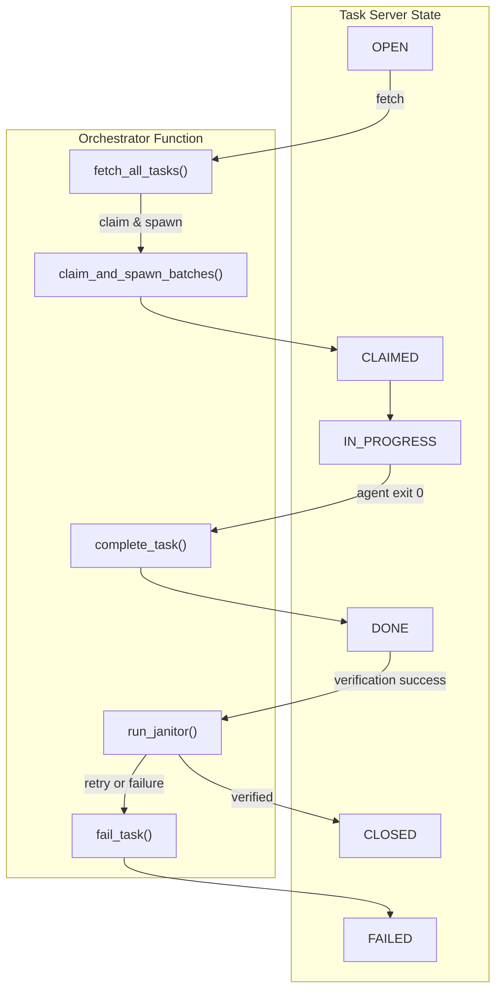
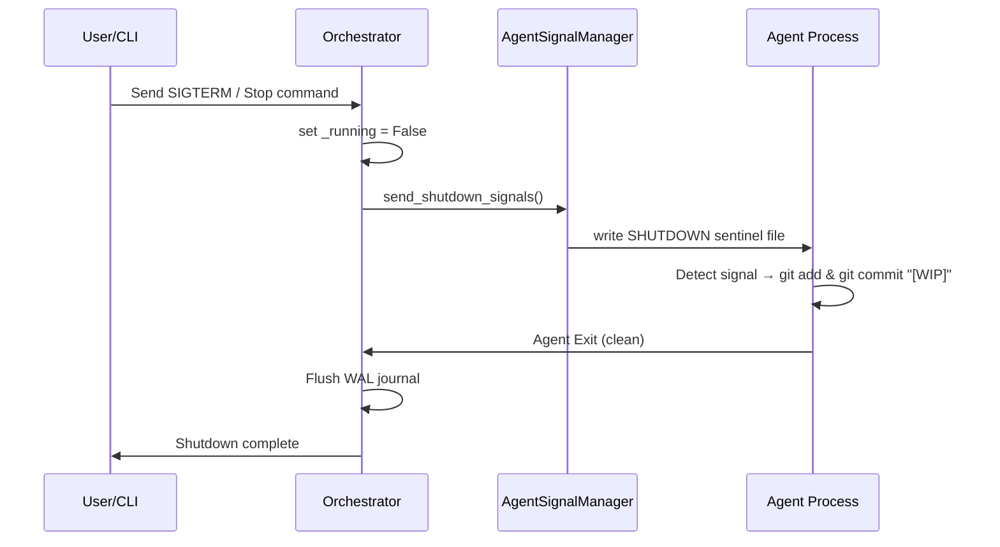

<!-- source: DeepWiki mcp.deepwiki.com · repo sipyourdrink-ltd/bernstein · page 2.2 Orchestrator and Task Lifecycle · fetched 2026-10-27 -->

# Orchestrator and Task Lifecycle

Relevant source files

The following files were used as context for generating this wiki page:

- [docs/examples/agent-prompt-template.md](docs/examples/agent-prompt-template.md)
- [docs/orchestration/worker-coordination.md](docs/orchestration/worker-coordination.md)
- [docs/release-notes/v2.16.0.md](docs/release-notes/v2.16.0.md)
- [docs/substrate/claude-code.md](docs/substrate/claude-code.md)
- [mutmut_config.py](mutmut_config.py)
- [src/bernstein/adapters/council_runner.py](src/bernstein/adapters/council_runner.py)
- [src/bernstein/adapters/env_isolation.py](src/bernstein/adapters/env_isolation.py)
- [src/bernstein/adapters/openai_agents.py](src/bernstein/adapters/openai_agents.py)
- [src/bernstein/adapters/openai_agents_runner.py](src/bernstein/adapters/openai_agents_runner.py)
- [src/bernstein/cli/commands/stop_cmd.py](src/bernstein/cli/commands/stop_cmd.py)
- [src/bernstein/cli/plan/plan_display.py](src/bernstein/cli/plan/plan_display.py)
- [src/bernstein/cli/run_bootstrap.py](src/bernstein/cli/run_bootstrap.py)
- [src/bernstein/cli/run_preflight.py](src/bernstein/cli/run_preflight.py)
- [src/bernstein/core/agents/spawner_core.py](src/bernstein/core/agents/spawner_core.py)
- [src/bernstein/core/git/github.py](src/bernstein/core/git/github.py)
- [src/bernstein/core/instrumentation.py](src/bernstein/core/instrumentation.py)
- [src/bernstein/core/observability/rate_limit_tracker.py](src/bernstein/core/observability/rate_limit_tracker.py)
- [src/bernstein/core/orchestration/activity_modalities.py](src/bernstein/core/orchestration/activity_modalities.py)
- [src/bernstein/core/orchestration/adaptive_parallelism.py](src/bernstein/core/orchestration/adaptive_parallelism.py)
- [src/bernstein/core/orchestration/bootstrap.py](src/bernstein/core/orchestration/bootstrap.py)
- [src/bernstein/core/orchestration/commit_completion.py](src/bernstein/core/orchestration/commit_completion.py)
- [src/bernstein/core/orchestration/drain.py](src/bernstein/core/orchestration/drain.py)
- [src/bernstein/core/orchestration/drain_merge.py](src/bernstein/core/orchestration/drain_merge.py)
- [src/bernstein/core/orchestration/holds.py](src/bernstein/core/orchestration/holds.py)
- [src/bernstein/core/orchestration/multi_cell.py](src/bernstein/core/orchestration/multi_cell.py)
- [src/bernstein/core/orchestration/orchestrator.py](src/bernstein/core/orchestration/orchestrator.py)
- [src/bernstein/core/orchestration/orchestrator_backlog.py](src/bernstein/core/orchestration/orchestrator_backlog.py)
- [src/bernstein/core/orchestration/run_changelog.py](src/bernstein/core/orchestration/run_changelog.py)
- [src/bernstein/core/orchestration/tick_pipeline.py](src/bernstein/core/orchestration/tick_pipeline.py)
- [src/bernstein/core/orchestration/trigger_manager.py](src/bernstein/core/orchestration/trigger_manager.py)
- [src/bernstein/core/routes/orchestrator_holds.py](src/bernstein/core/routes/orchestrator_holds.py)
- [src/bernstein/core/server/server_launch.py](src/bernstein/core/server/server_launch.py)
- [src/bernstein/core/server/server_supervisor.py](src/bernstein/core/server/server_supervisor.py)
- [src/bernstein/core/tasks/models.py](src/bernstein/core/tasks/models.py)
- [src/bernstein/core/tasks/task_lifecycle.py](src/bernstein/core/tasks/task_lifecycle.py)
- [src/bernstein/core/tasks/task_store_core.py](src/bernstein/core/tasks/task_store_core.py)
- [templates/roles/manager/system_prompt.md](templates/roles/manager/system_prompt.md)
- [templates/roles/manager/task_prompt.md](templates/roles/manager/task_prompt.md)
- [tests/integration/test_manager_auth_to_task_server.py](tests/integration/test_manager_auth_to_task_server.py)
- [tests/unit/adapters/test_openai_agents_builtins.py](tests/unit/adapters/test_openai_agents_builtins.py)
- [tests/unit/routing/test_router_core.py](tests/unit/routing/test_router_core.py)
- [tests/unit/test_agent_lifecycle.py](tests/unit/test_agent_lifecycle.py)
- [tests/unit/test_chaos.py](tests/unit/test_chaos.py)
- [tests/unit/test_coverage_thresholds.py](tests/unit/test_coverage_thresholds.py)
- [tests/unit/test_detached_run_visibility.py](tests/unit/test_detached_run_visibility.py)
- [tests/unit/test_env_isolation.py](tests/unit/test_env_isolation.py)
- [tests/unit/test_failure_aware_retry.py](tests/unit/test_failure_aware_retry.py)
- [tests/unit/test_fast_path.py](tests/unit/test_fast_path.py)
- [tests/unit/test_file_overlap.py](tests/unit/test_file_overlap.py)
- [tests/unit/test_github.py](tests/unit/test_github.py)
- [tests/unit/test_instrumentation_capture.py](tests/unit/test_instrumentation_capture.py)
- [tests/unit/test_janitor_alive_exit.py](tests/unit/test_janitor_alive_exit.py)
- [tests/unit/test_max_output_tokens_escalation.py](tests/unit/test_max_output_tokens_escalation.py)
- [tests/unit/test_mcp_discovery.py](tests/unit/test_mcp_discovery.py)
- [tests/unit/test_mutation_setup.py](tests/unit/test_mutation_setup.py)
- [tests/unit/test_orchestrator.py](tests/unit/test_orchestrator.py)
- [tests/unit/test_orchestrator_holds_routes.py](tests/unit/test_orchestrator_holds_routes.py)
- [tests/unit/test_plugin_trust.py](tests/unit/test_plugin_trust.py)
- [tests/unit/test_proactive_compaction.py](tests/unit/test_proactive_compaction.py)
- [tests/unit/test_rate_limit_tracker.py](tests/unit/test_rate_limit_tracker.py)
- [tests/unit/test_reactive_compact_413.py](tests/unit/test_reactive_compact_413.py)
- [tests/unit/test_retry_or_fail_task.py](tests/unit/test_retry_or_fail_task.py)
- [tests/unit/test_router.py](tests/unit/test_router.py)
- [tests/unit/test_run_cmd_track_b.py](tests/unit/test_run_cmd_track_b.py)
- [tests/unit/test_run_preflight_model_resolution.py](tests/unit/test_run_preflight_model_resolution.py)
- [tests/unit/test_spawner.py](tests/unit/test_spawner.py)
- [tests/unit/test_spawner_agent_token.py](tests/unit/test_spawner_agent_token.py)
- [tests/unit/test_spawner_openclaw_bridge.py](tests/unit/test_spawner_openclaw_bridge.py)
- [tests/unit/test_startup_task_count_consistency.py](tests/unit/test_startup_task_count_consistency.py)
- [tests/unit/test_task_completion.py](tests/unit/test_task_completion.py)
- [tests/unit/test_task_lifecycle.py](tests/unit/test_task_lifecycle.py)
- [tests/unit/test_task_release_receipt.py](tests/unit/test_task_release_receipt.py)
- [tests/unit/test_uvicorn_reload_disabled.py](tests/unit/test_uvicorn_reload_disabled.py)
- [tests/unit/test_worker_cmd_spawn.py](tests/unit/test_worker_cmd_spawn.py)

The Orchestrator is the central deterministic engine of Bernstein. Unlike the agents it manages, the Orchestrator contains no LLM coordination logic; it is a state machine that drives the transition of tasks from definition to verified completion. It manages the "tick" loop, enforces task dependencies, detects file-level conflicts between parallel agents, and ensures system integrity through a Write-Ahead Log (WAL) and graceful shutdown sequences.

---

### Orchestrator Tick Loop

Bernstein's Orchestrator runs on a single-threaded periodic execution loop called a **tick**. This loop continuously synchronizes state, manages agents, and drives the lifecycle of tasks. The tick loop runs inside the `Orchestrator.run()` method, which iterates while its `_running` flag remains true [src/bernstein/core/orchestration/orchestrator.py:6-9](). The single-threaded design avoids concurrency hazards during state transitions.

The tick is divided conceptually into phases:

| Tick Phase   | Frequency            | Responsibilities                                                                                |
|--------------|----------------------|------------------------------------------------------------------------------------------------|
| **Fast Path** | On every tick         | Agent heartbeat refresh, dead agent reaping, file lock refresh, and signal processing         [src/bernstein/core/orchestration/orchestrator.py:35-38]() |
| **Normal Tick** | Every 6 ticks         | Fetch tasks from server, group by role, claim and spawn agents for eligible tasks             [src/bernstein/core/orchestration/tick_pipeline.py:100-115]() |
| **Slow Tick** | Every 30 ticks        | Refresh knowledge base, cost rollup, checkpointing, and janitor verification                  [src/bernstein/core/orchestration/orchestrator.py:54-60]() |

This phased design allows workload prioritization and system maintenance without blocking the core dispatcher. Timing parameters like tick intervals and frequency of each phase are configurable via runtime defaults [src/bernstein/core/defaults.py:46-61]().

**Sources:** [src/bernstein/core/orchestration/orchestrator.py:1-15, 34-60](), [src/bernstein/core/orchestration/tick_pipeline.py:100-115](), [src/bernstein/core/defaults.py:46-61]().

---

### Task State Machine

Tasks in Bernstein proceed through a well-defined finite state machine, managed by the Orchestrator and the `TaskStore`. The state transitions are strictly validated to prevent illegal sequences, and each transition corresponds to an internal code operation.

#### Task Lifecycle States

| State          | Description                                                                                   |
|----------------|-----------------------------------------------------------------------------------------------|
| **OPEN**       | Task is in the backlog, available for claiming by agents.                                    |
| **CLAIMED**    | Task has been exclusively claimed by an agent; environment preparation underway.              |
| **IN_PROGRESS**| Agent processes are active and working on the task.                                           |
| **DONE**       | Agent has successfully completed the task and exited cleanly.                                |
| **CLOSED**     | Task has been verified and merged; no further changes expected.                              |
| **FAILED**     | Task has permanently failed, e.g., exhausted retries or reached terminal error.               |

These states correspond to the `TaskStatus` enum values managed in the core `models.py` module [src/bernstein/core/tasks/models.py:176-204]().

#### State Transitions and Their Code Mappings

The diagram below shows the lifecycle flow of tasks from `OPEN` to `CLOSED` or `FAILED`. Each transition is driven by key orchestrator functions:

Each transition occurs within a consistent transactional context, often involving server API calls and local agent management [src/bernstein/core/tasks/task_lifecycle.py:140-175](), [src/bernstein/core/tasks/task_store_core.py:30-85]().

**Sources:** [src/bernstein/core/tasks/models.py:176-204](), [src/bernstein/core/tasks/task_lifecycle.py:30-90](), [src/bernstein/core/tasks/task_store_core.py:30-85]().

---

### Batching by Role and Dependency Filtering

To optimize agent utilization and maintain logical consistency, the Orchestrator batches tasks based on their assigned `role` (e.g., frontend, backend, qa). This grouping is performed by `group_by_role()` in the tick pipeline [src/bernstein/core/orchestration/tick_pipeline.py:113-114]().

Batching allows spawning single agents capable of handling multiple related tasks simultaneously. However, before spawning a batch:

- **Dependency Filtering**: The orchestrator filters out tasks that are blocked by unfinished dependencies.
- **File-Ownership Conflict Detection**: It checks that no two active agents own overlapping file sets to avoid merge conflicts.

#### File-Ownership Conflict Detection

This subsystem leverages:

- `infer_affected_paths(task)` to guess which files a task will modify, based on title and description analysis [src/bernstein/core/tasks/task_lifecycle.py:145-177]().

- The in-memory `_file_ownership` map tracks files locked by currently active agents; tasks touching such files must not be spawned concurrently.

- During `claim_and_spawn_batches()`, any batch with conflicting file ownership is skipped to ensure safe parallelism without conflicts [src/bernstein/core/tasks/task_lifecycle.py:181-200](), [tests/unit/test_task_lifecycle.py:180-200]().

This restraint improves continuous integration stability by preventing competing uncommitted changes against the same source code location.

**Sources:** [src/bernstein/core/tasks/task_lifecycle.py:145-200](), [src/bernstein/core/orchestration/tick_pipeline.py:112-115](), [tests/unit/test_task_lifecycle.py:180-200]().

---

### Write-Ahead Log (WAL)

To guarantee consistency and durability of orchestrator state changes, Bernstein employs a Write-Ahead Log (WAL) subsystem.

- Each critical task lifecycle operation (claim, complete, fail) appends an entry to the WAL as a `WALEntry` before the operation is confirmed persistent in the TaskStore [src/bernstein/core/orchestration/orchestrator.py:143-144]().

- The `WALRecovery` engine replays the WAL during startup, reconciling incomplete state changes or orphaned claims. For example, tasks stuck in `CLAIMED` but with no live agents are reset to `OPEN` [tests/unit/test_chaos.py:150-185]().

- A **Dead Letter Queue (DLQ)** mechanism holds tasks that repeatedly fail to claim or spawn, isolating them to avoid clogging the active tick cycles and enabling operator intervention [src/bernstein/core/tasks/task_lifecycle.py:200-215]().

This WAL with recovery and DLQ enables crash resilience, operator auditability, and ensures progress without losing work.

**Sources:** [src/bernstein/core/orchestration/orchestrator.py:143-144](), [src/bernstein/core/tasks/task_lifecycle.py:200-215](), [tests/unit/test_chaos.py:150-185]().

---

### Drain and Graceful Shutdown

Bernstein supports a clean **drain** protocol to gracefully shut down the Orchestrator and all active agents:

1. When a signal such as `SIGTERM` or the CLI `bernstein stop` command is received, the Orchestrator sets `_running = False` which stops the tick loop [src/bernstein/core/orchestration/orchestrator.py:27-29]().
2. It invokes `send_shutdown_signals()` from the signal manager to drop sentinel files (`SHUTDOWN`) into `.sdd/runtime/signals/{session_id}/` folders [src/bernstein/core/agents/spawner_core.py:175-196]().
3. Agents monitor the shutdown sentinel and, upon detection, perform a `git add -A` and `git commit -m "[WIP]"` to checkpoint their unfinished work in their isolated worktrees [src/bernstein/core/defaults.py:58-58]().
4. The Orchestrator waits for a configured drain timeout (default 60 seconds).
5. After the timeout, remaining agents are hard-killed via `SIGKILL` to avoid dangling processes [src/bernstein/core/defaults.py:97-97]().
6. Final steps flush the WAL ensuring all progress is persisted before the Orchestrator fully exits.

#### Shutdown Data Flow Diagram

This sequence enables fully audited checkpoint commits and minimizes uncommitted work during shutdown.

**Sources:** [src/bernstein/core/orchestration/orchestrator.py:27-29](), [src/bernstein/core/agents/spawner_core.py:175-196](), [src/bernstein/core/defaults.py:58-97]().

---

### Summary Diagram: From Natural Language Concepts to Code Entities

```mermaid
graph TD
    subgraph "Natural Language Concepts"
        NL_Orchestrator["Orchestrator (Tick Loop)"]
        NL_TaskLifecycle["Task Lifecycle (OPEN→CLAIMED→IN_PROGRESS→DONE→CLOSED)"]
        NL_Batching["Batching by Role & Dependency Checks"]
        NL_ConflictDetection["File-Ownership Conflict Detection"]
        NL_WAL["Write-Ahead Log (WAL)"]
        NL_DLQ["Dead Letter Queue (DLQ)"]
        NL_DrainSeq["Drain & Graceful Shutdown"]
    end

    subgraph "Code Entities"
        CE_OrchPy["src/bernstein/core/orchestration/orchestrator.py"]
        CE_TickPipeline["src/bernstein/core/orchestration/tick_pipeline.py"]
        CE_TaskLifecycle["src/bernstein/core/tasks/task_lifecycle.py"]
        CE_TaskStore["src/bernstein/core/tasks/task_store_core.py"]
        CE_FileOwnership["src/bernstein/core/tasks/task_lifecycle.py (infer_affected_paths)"]
        CE_WAL["src/bernstein/core/orchestration/wal.py"]
        CE_WALReplay["src/bernstein/core/orchestration/wal_replay.py"]
        CE_DLQ["src/bernstein/core/tasks/task_lifecycle.py (_enqueue_dlq_if_workdir)"]
        CE_SpawnerCore["src/bernstein/core/agents/spawner_core.py (send_shutdown_signals)"]
        CE_Defaults["src/bernstein/core/defaults.py (drain timeouts)"]
    end

    NL_Orchestrator --> CE_OrchPy
    NL_Orchestrator --> CE_TickPipeline
    NL_TaskLifecycle --> CE_TaskLifecycle
    NL_TaskLifecycle --> CE_TaskStore
    NL_Batching --> CE_TickPipeline
    NL_Batching --> CE_TaskLifecycle
    NL_ConflictDetection --> CE_FileOwnership
    NL_WAL --> CE_WAL
    NL_WAL --> CE_WALReplay
    NL_DLQ --> CE_DLQ
    NL_DrainSeq --> CE_SpawnerCore
    NL_DrainSeq --> CE_Defaults
```

---

# References

- `src/bernstein/core/orchestration/orchestrator.py:1-15, 25-60`  
- `src/bernstein/core/orchestration/tick_pipeline.py:100-115`  
- `src/bernstein/core/tasks/task_lifecycle.py:140-215`  
- `src/bernstein/core/tasks/task_store_core.py:30-85`  
- `src/bernstein/core/tasks/models.py:176-204`  
- `src/bernstein/core/tasks/task_lifecycle.py:145-200`  
- `tests/unit/test_task_lifecycle.py:180-200`  
- `tests/unit/test_chaos.py:150-185`  
- `src/bernstein/core/orchestration/wal.py` (not listed in imports, but core WAL)  
- `src/bernstein/core/orchestration/wal_replay.py`  
- `src/bernstein/core/agents/spawner_core.py:175-196`  
- `src/bernstein/core/defaults.py:46-61,58-97`

---

