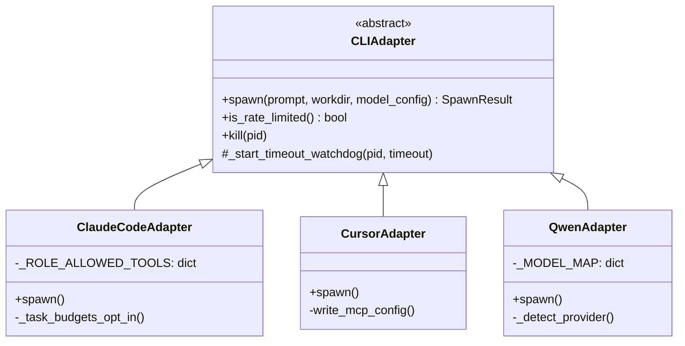
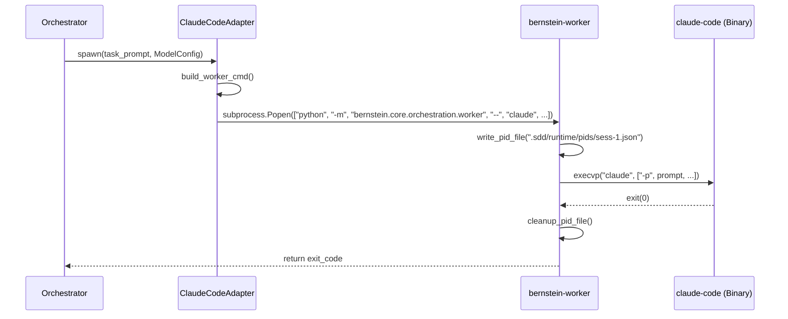

<!-- source: DeepWiki mcp.deepwiki.com · repo sipyourdrink-ltd/bernstein · page 2.3 Agent Spawning and Adapters · fetched 2026-10-27 -->

# Agent Spawning and Adapters

Relevant source files

The following files were used as context for generating this wiki page:

- [docs/operations/merge-gate.md](docs/operations/merge-gate.md)
- [src/bernstein/adapters/aider.py](src/bernstein/adapters/aider.py)
- [src/bernstein/adapters/amp.py](src/bernstein/adapters/amp.py)
- [src/bernstein/adapters/base.py](src/bernstein/adapters/base.py)
- [src/bernstein/adapters/caching_adapter.py](src/bernstein/adapters/caching_adapter.py)
- [src/bernstein/adapters/claude.py](src/bernstein/adapters/claude.py)
- [src/bernstein/adapters/codex.py](src/bernstein/adapters/codex.py)
- [src/bernstein/adapters/cody.py](src/bernstein/adapters/cody.py)
- [src/bernstein/adapters/continue_dev.py](src/bernstein/adapters/continue_dev.py)
- [src/bernstein/adapters/cursor.py](src/bernstein/adapters/cursor.py)
- [src/bernstein/adapters/gemini.py](src/bernstein/adapters/gemini.py)
- [src/bernstein/adapters/generic.py](src/bernstein/adapters/generic.py)
- [src/bernstein/adapters/goose.py](src/bernstein/adapters/goose.py)
- [src/bernstein/adapters/iac.py](src/bernstein/adapters/iac.py)
- [src/bernstein/adapters/kilo.py](src/bernstein/adapters/kilo.py)
- [src/bernstein/adapters/manager.py](src/bernstein/adapters/manager.py)
- [src/bernstein/adapters/opencode.py](src/bernstein/adapters/opencode.py)
- [src/bernstein/adapters/qwen.py](src/bernstein/adapters/qwen.py)
- [src/bernstein/cli/commands/compaction_cmd.py](src/bernstein/cli/commands/compaction_cmd.py)
- [src/bernstein/core/agents/agent_lifecycle.py](src/bernstein/core/agents/agent_lifecycle.py)
- [src/bernstein/core/agents/agent_log_aggregator.py](src/bernstein/core/agents/agent_log_aggregator.py)
- [src/bernstein/core/agents/agent_recycling.py](src/bernstein/core/agents/agent_recycling.py)
- [src/bernstein/core/agents/cross_agent_consistency.py](src/bernstein/core/agents/cross_agent_consistency.py)
- [src/bernstein/core/agents/heartbeat.py](src/bernstein/core/agents/heartbeat.py)
- [src/bernstein/core/config/platform_compat.py](src/bernstein/core/config/platform_compat.py)
- [src/bernstein/core/cost/cli_adapter_usage.py](src/bernstein/core/cost/cli_adapter_usage.py)
- [src/bernstein/core/cost/model_prices.py](src/bernstein/core/cost/model_prices.py)
- [src/bernstein/core/observability/watchdog.py](src/bernstein/core/observability/watchdog.py)
- [src/bernstein/core/orchestration/proactive_compaction.py](src/bernstein/core/orchestration/proactive_compaction.py)
- [src/bernstein/core/orchestration/watchdog.py](src/bernstein/core/orchestration/watchdog.py)
- [tests/contract/contracts/qwen.yaml](tests/contract/contracts/qwen.yaml)
- [tests/integration/test_adapter_conformance_lifecycle.py](tests/integration/test_adapter_conformance_lifecycle.py)
- [tests/unit/adapters/test_openai_agents.py](tests/unit/adapters/test_openai_agents.py)
- [tests/unit/test_adapter_aider.py](tests/unit/test_adapter_aider.py)
- [tests/unit/test_adapter_amp.py](tests/unit/test_adapter_amp.py)
- [tests/unit/test_adapter_claude.py](tests/unit/test_adapter_claude.py)
- [tests/unit/test_adapter_codex.py](tests/unit/test_adapter_codex.py)
- [tests/unit/test_adapter_gemini.py](tests/unit/test_adapter_gemini.py)
- [tests/unit/test_adapter_generic.py](tests/unit/test_adapter_generic.py)
- [tests/unit/test_adapter_iac.py](tests/unit/test_adapter_iac.py)
- [tests/unit/test_adapter_non_claude.py](tests/unit/test_adapter_non_claude.py)
- [tests/unit/test_adapter_qwen.py](tests/unit/test_adapter_qwen.py)
- [tests/unit/test_adapter_timeout.py](tests/unit/test_adapter_timeout.py)
- [tests/unit/test_agent_log_layout_resolution.py](tests/unit/test_agent_log_layout_resolution.py)
- [tests/unit/test_audit_chain_process_reap.py](tests/unit/test_audit_chain_process_reap.py)
- [tests/unit/test_caching_adapter.py](tests/unit/test_caching_adapter.py)
- [tests/unit/test_cli_adapter_usage.py](tests/unit/test_cli_adapter_usage.py)
- [tests/unit/test_cost_price_model_usage.py](tests/unit/test_cost_price_model_usage.py)
- [tests/unit/test_evolution_integration.py](tests/unit/test_evolution_integration.py)
- [tests/unit/test_heartbeat_liveness_gate.py](tests/unit/test_heartbeat_liveness_gate.py)
- [tests/unit/test_heartbeat_log_only_cap.py](tests/unit/test_heartbeat_log_only_cap.py)
- [tests/unit/test_heartbeat_phase_field.py](tests/unit/test_heartbeat_phase_field.py)
- [tests/unit/test_heartbeat_signal_layouts.py](tests/unit/test_heartbeat_signal_layouts.py)
- [tests/unit/test_issue_3013_free_route_banner_pricing.py](tests/unit/test_issue_3013_free_route_banner_pricing.py)
- [tests/unit/test_orchestration_watchdog.py](tests/unit/test_orchestration_watchdog.py)
- [tests/unit/test_platform_compat.py](tests/unit/test_platform_compat.py)
- [tests/unit/test_platform_process_tree.py](tests/unit/test_platform_process_tree.py)
- [tests/unit/test_platform_win_process_branch.py](tests/unit/test_platform_win_process_branch.py)
- [tests/unit/test_reap_none_pid_session.py](tests/unit/test_reap_none_pid_session.py)
- [tests/unit/test_watchdog.py](tests/unit/test_watchdog.py)

Bernstein manages the lifecycle of autonomous coding agents by abstracting them behind a unified **Adapter** interface. Instead of reimplementing agentic logic, Bernstein orchestrates existing high-performance CLI agents (like Claude Code, Aider, and Cursor) within isolated environments, providing them with structured tasks and monitoring their progress through a specialized process wrapper.

## The CLIAdapter Base Class

All agent integrations inherit from the `CLIAdapter` abstract base class. This class defines the contract for spawning, monitoring, and terminating agent processes while providing shared utilities for rate-limit detection and environment isolation.

### Key Responsibilities
*   **Process Management**: Spawning the agent as a subprocess and tracking its PID [src/bernstein/adapters/base.py:11-23]().
*   **Rate Limit Tracking**: Using a `RateLimitMeter` to record and decay 429-class errors from upstream providers [src/bernstein/adapters/base.py:81-119]().
*   **Resource Constraints**: Applying `ResourceLimits` (CPU, memory, file descriptors) to the spawned process [src/bernstein/adapters/base.py:24-24]().
*   **Network Policy**: Enforcing egress rules to ensure agents only communicate with approved model endpoints [src/bernstein/adapters/base.py:270-270]().

### Implementation Diagram: Adapter Hierarchy
The following diagram illustrates how specific adapters extend the base class to map Bernstein's internal `ModelConfig` to provider-specific CLI flags.

Sources: [src/bernstein/adapters/base.py:41-188](), [src/bernstein/adapters/claude.py:110-131](), [src/bernstein/adapters/cursor.py:59-79](), [src/bernstein/adapters/qwen.py:28-34]()

---

## Agent Spawning Lifecycle

The `AgentSpawner` (invoked by the Orchestrator) follows a strict **Spawn → Watchdog → Reap** sequence to ensure agents do not leak resources or run indefinitely.

### 1. Spawn
When a task is claimed, the adapter's `spawn()` method is called. It constructs the command line, including:
*   **Tool Filtering**: Limiting tools based on the agent's role (e.g., a `qa` agent may only get `Read` and `Bash` tools) [src/bernstein/adapters/claude.py:126-131]().
*   **Environment Isolation**: Filtering the parent environment to prevent leaking secrets [src/bernstein/adapters/claude.py:52-56]().
*   **Worker Wrapping**: The command is wrapped in `bernstein-worker` [src/bernstein/adapters/base.py:246-268]().

### 2. Watchdog
Every spawn initiates a `_start_timeout_watchdog`. This thread monitors the process and sends `SIGTERM` (followed by `SIGKILL` after a grace period) if the `DEFAULT_TIMEOUT_SECONDS` (30 minutes) is exceeded [src/bernstein/adapters/base.py:37-38]().

### 3. Reap
The `bernstein-worker` wrapper ensures that when the agent exits, its PID file is removed from `.sdd/runtime/pids/` and its exit code is correctly propagated to the Orchestrator [src/bernstein/core/orchestration/watchdog.py:100-100](). The `reap_process_group` function is used to clean up the process group associated with the agent [src/bernstein/core/platform_compat.py:100-100]().

### Process Flow: Natural Language to Code Execution
This diagram bridges the Orchestrator's task selection to the actual OS process execution.

Sources: [src/bernstein/adapters/base.py:246-268](), [src/bernstein/adapters/claude.py:188-210](), [src/bernstein/core/orchestration/watchdog.py:100-100](), [src/bernstein/core/platform_compat.py:100-100]()

---

## The `bernstein-worker` Wrapper

The `bernstein-worker` is a critical shim that runs as a parent to the actual agent CLI. It provides:
*   **Process Visibility**: Writes metadata (role, session ID, model) to a JSON PID file so `bernstein ps` can display active agents [src/bernstein/adapters/base.py:246-268]().
*   **Signal Forwarding**: Forwards `SIGTERM` to the child process group to ensure graceful shutdown [src/bernstein/core/platform_compat.py:100-100]().
*   **Exit Code Normalization**: Ensures that if a child is killed by a signal, the exit code is reported as `128 + N` [src/bernstein/core/platform_compat.py:100-100]().

Sources: [src/bernstein/adapters/base.py:246-268](), [src/bernstein/core/platform_compat.py:100-100]()

---

## Rate-Limit Detection and Mitigation

Bernstein implements provider-aware rate limiting to prevent "retry spirals."

*   **Probing**: The `ClaudeCodeAdapter` probes `claude --version` or a minimal "say ok" prompt to detect account-level limits before attempting a heavy task [src/bernstein/adapters/claude.py:140-167]().
*   **Backoff**: When a 429 is detected, the `RateLimitMeter` applies exponential backoff (1s, 2s, 4s...) capped at 60s [src/bernstein/adapters/base.py:143-146]().
*   **Status Reporting**: Active rate limits are surfaced in the `bernstein status` panel via `get_rate_limit_meters()` [src/bernstein/adapters/base.py:181-181]().

Sources: [src/bernstein/adapters/claude.py:140-167](), [src/bernstein/adapters/base.py:143-146](), [src/bernstein/adapters/base.py:181-181]()

---

## Supported Adapters Catalog

Bernstein includes a wide variety of built-in adapters.

| Adapter Name | Binary / CLI | Primary Use Case |
| :--- | :--- | :--- |
| `claude` | `claude-code` | High-reasoning engineering tasks [src/bernstein/adapters/claude.py:1-13]() |
| `aider` | `aider` | Fast, iterative code editing [src/bernstein/adapters/aider.py:1-1]() |
| `cursor` | `cursor-agent` | IDE-native agentic workflows [src/bernstein/adapters/cursor.py:1-1]() |
| `codex` | `codex` | OpenAI-based legacy and reasoning models [src/bernstein/adapters/codex.py:1-1]() |
| `gemini` | `antigravity` or `gemini` | Large context window tasks [src/bernstein/adapters/gemini.py:1-1]() |
| `qwen` | `qwen` | OpenAI-compatible local or cloud models [src/bernstein/adapters/qwen.py:1-1]() |
| `generic` | User-defined | Wrapping custom scripts or unsupported CLIs [src/bernstein/adapters/generic.py:1-1]()
| `amp` | `amp` | Specialized for code generation and refactoring [src/bernstein/adapters/amp.py:1-1]()
| `continue_dev` | `continue` | Continuous development workflows [src/bernstein/adapters/continue_dev.py:1-1]()
| `goose` | `goose` | Focused on specific code analysis and transformation tasks [src/bernstein/adapters/goose.py:1-1]()
| `iac` | `iac` | Infrastructure as Code generation and management [src/bernstein/adapters/iac.py:1-1]()
| `kilo` | `kilo` | Lightweight code generation and scripting [src/bernstein/adapters/kilo.py:1-1]()
| `manager` | `manager` | Orchestration and high-level task management [src/bernstein/adapters/manager.py:1-1]()
| `opencode` | `opencode` | Open-source model integration [src/bernstein/adapters/opencode.py:1-1]()
| `cody` | `cody` | Context-aware code assistance [src/bernstein/adapters/cody.py:1-1]()

### Caching Wrapper
The `CachingAdapter` is a decorator that can wrap any standard adapter. It intercepts `spawn()` calls to:
1.  Check a **Response Cache** (Semantic Similarity >= 0.95) to skip execution entirely if a similar task was recently completed [src/bernstein/adapters/caching_adapter.py:163-171]().
2.  Track **Cache Breaks** to identify when system prompt changes cause upstream KV-cache misses [src/bernstein/adapters/caching_adapter.py:130-152]().

Sources: [src/bernstein/adapters/claude.py:1-13](), [src/bernstein/adapters/aider.py:1-1](), [src/bernstein/adapters/cursor.py:1-1](), [src/bernstein/adapters/codex.py:1-1](), [src/bernstein/adapters/gemini.py:1-1](), [src/bernstein/adapters/qwen.py:1-1](), [src/bernstein/adapters/generic.py:1-1](), [src/bernstein/adapters/amp.py:1-1](), [src/bernstein/adapters/continue_dev.py:1-1](), [src/bernstein/adapters/goose.py:1-1](), [src/bernstein/adapters/iac.py:1-1](), [src/bernstein/adapters/kilo.py:1-1](), [src/bernstein/adapters/manager.py:1-1](), [src/bernstein/adapters/opencode.py:1-1](), [src/bernstein/adapters/cody.py:1-1](), [src/bernstein/adapters/caching_adapter.py:31-55](), [src/bernstein/adapters/caching_adapter.py:130-152](), [src/bernstein/adapters/caching_adapter.py:163-171]()

---

