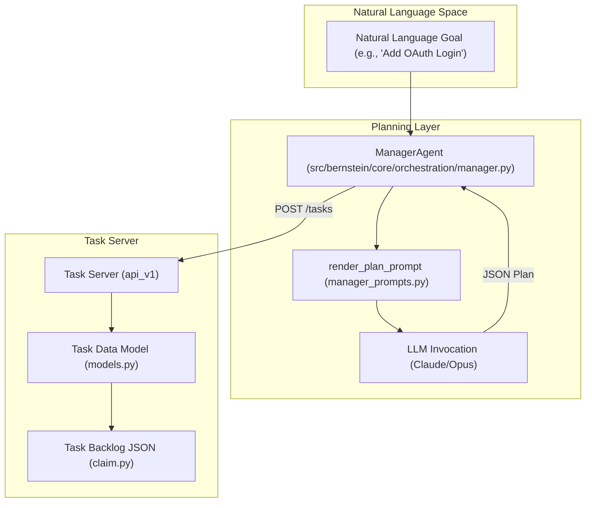
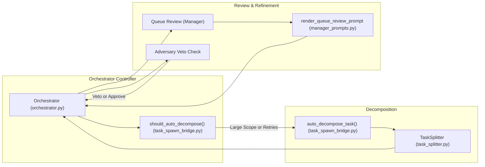

<!-- source: DeepWiki mcp.deepwiki.com · repo sipyourdrink-ltd/bernstein · page 2.4 Planning and Task Decomposition · fetched 2026-10-27 -->

# Planning and Task Decomposition

Relevant source files

The following files were used as context for generating this wiki page:

- [docs/concepts/abstracted-code-review.md](docs/concepts/abstracted-code-review.md)
- [docs/concepts/action-cache.md](docs/concepts/action-cache.md)
- [docs/concepts/artifact-lineage.md](docs/concepts/artifact-lineage.md)
- [docs/concepts/best-of-n.md](docs/concepts/best-of-n.md)
- [docs/concepts/feature-contract.md](docs/concepts/feature-contract.md)
- [docs/concepts/orchestrator-hardening.md](docs/concepts/orchestrator-hardening.md)
- [docs/concepts/phase-pipeline.md](docs/concepts/phase-pipeline.md)
- [docs/concepts/sandbox-selector.md](docs/concepts/sandbox-selector.md)
- [docs/concepts/schema-validation-retry.md](docs/concepts/schema-validation-retry.md)
- [docs/concepts/spec-as-test.md](docs/concepts/spec-as-test.md)
- [docs/concepts/swarm-migration.md](docs/concepts/swarm-migration.md)
- [docs/concepts/team-hub.md](docs/concepts/team-hub.md)
- [docs/lineage.md](docs/lineage.md)
- [docs/operations/recipes.md](docs/operations/recipes.md)
- [docs/operations/schedule.md](docs/operations/schedule.md)
- [docs/release-notes/v3.6.0.md](docs/release-notes/v3.6.0.md)
- [docs/workflows/on-fail-recovery-receipts.md](docs/workflows/on-fail-recovery-receipts.md)
- [examples/plans/flask-api.yaml](examples/plans/flask-api.yaml)
- [src/bernstein/cli/commands/lineage_verify_cmd.py](src/bernstein/cli/commands/lineage_verify_cmd.py)
- [src/bernstein/cli/commands/plan_validate_cmd.py](src/bernstein/cli/commands/plan_validate_cmd.py)
- [src/bernstein/cli/commands/recipes_cmd.py](src/bernstein/cli/commands/recipes_cmd.py)
- [src/bernstein/cli/commands/schedule_cmd.py](src/bernstein/cli/commands/schedule_cmd.py)
- [src/bernstein/core/lifecycle/hooks.py](src/bernstein/core/lifecycle/hooks.py)
- [src/bernstein/core/orchestration/collision.py](src/bernstein/core/orchestration/collision.py)
- [src/bernstein/core/orchestration/schedule_kinds.py](src/bernstein/core/orchestration/schedule_kinds.py)
- [src/bernstein/core/orchestration/schedule_projection.py](src/bernstein/core/orchestration/schedule_projection.py)
- [src/bernstein/core/orchestration/schedule_supervisor.py](src/bernstein/core/orchestration/schedule_supervisor.py)
- [src/bernstein/core/planning/plan_loader.py](src/bernstein/core/planning/plan_loader.py)
- [src/bernstein/core/planning/plan_schema.py](src/bernstein/core/planning/plan_schema.py)
- [src/bernstein/core/planning/schedule_store.py](src/bernstein/core/planning/schedule_store.py)
- [src/bernstein/core/planning/workflow_dsl.py](src/bernstein/core/planning/workflow_dsl.py)
- [src/bernstein/core/trigger_sources/schedule.py](src/bernstein/core/trigger_sources/schedule.py)
- [src/bernstein/core/workflows/recipe_fleet.py](src/bernstein/core/workflows/recipe_fleet.py)
- [src/bernstein/core/workflows/recipe_registry.py](src/bernstein/core/workflows/recipe_registry.py)
- [src/bernstein/core/workflows/recipe_spec.py](src/bernstein/core/workflows/recipe_spec.py)
- [templates/plan.yaml](templates/plan.yaml)
- [templates/roles/adversary/config.yaml](templates/roles/adversary/config.yaml)
- [templates/roles/adversary/system_prompt.md](templates/roles/adversary/system_prompt.md)
- [templates/roles/adversary/task_prompt.md](templates/roles/adversary/task_prompt.md)
- [tests/integration/test_schedule_audit_chain.py](tests/integration/test_schedule_audit_chain.py)
- [tests/property/test_recipe_hash_properties.py](tests/property/test_recipe_hash_properties.py)
- [tests/unit/lineage/test_spine_cli.py](tests/unit/lineage/test_spine_cli.py)
- [tests/unit/orchestration/test_commit_completion.py](tests/unit/orchestration/test_commit_completion.py)
- [tests/unit/test_adversary_role.py](tests/unit/test_adversary_role.py)
- [tests/unit/test_plan_loader.py](tests/unit/test_plan_loader.py)
- [tests/unit/test_plan_schema.py](tests/unit/test_plan_schema.py)
- [tests/unit/test_plan_validate.py](tests/unit/test_plan_validate.py)
- [tests/unit/test_recipe_registry.py](tests/unit/test_recipe_registry.py)
- [tests/unit/test_recipes_cmd.py](tests/unit/test_recipes_cmd.py)
- [tests/unit/test_recipes_register_cli.py](tests/unit/test_recipes_register_cli.py)
- [tests/unit/test_recovery_receipt.py](tests/unit/test_recovery_receipt.py)
- [tests/unit/test_schedule_projection.py](tests/unit/test_schedule_projection.py)
- [tests/unit/test_schedule_supervisor.py](tests/unit/test_schedule_supervisor.py)
- [tests/unit/test_workflow_dsl.py](tests/unit/test_workflow_dsl.py)

Bernstein transforms high-level goals into executable task graphs using a deterministic orchestrator coordinated by an LLM-powered **Manager**. This page describes the core components and mechanisms involved in turning goals into decomposed task graphs ready for multi-agent execution. It covers the **Planner**, the **Plan YAML** schema, the **Manager agent role**, automated task decomposition, the **Refinement Loop** with adversarial veto logic, vertical slice planning, the **Workflow DSL**, and Recipe execution patterns. It also references the library of ready-made plan templates in `examples/plans/` and `plans/templates/`.

---

## The Planner and Plan YAML Schema

### Planner Overview

At the heart of Bernstein's planning is the **Planner**, responsible for converting a natural language goal (or operator intent) into a structured graph of tasks. This task graph encodes dependencies, agent roles, priorities, resources, and completion criteria.

The key input to the Planner is a **plan file**—a YAML document specifying stages of sequential or parallel steps. These plans can be operator-written or dynamically generated by the Manager agent.

### Plan YAML Schema

Bernstein plans use a rich and validated YAML schema defined in `src/bernstein/core/planning/plan_schema.py` covering:

- **Plan-level metadata**: `name`, `description`, global `constraints`, default `cli` adapter, `budget`, and repository references for multi-repo plans.
- **Stages**: Named groups of steps, with optional `depends_on` referencing other stages for topological ordering.
- **Steps**: Core tasks with fields like:
  - `title` (preferred) or legacy `goal` (both accepted)
  - `role` (e.g., `backend`, `manager`, `qa`, `resolver`)
  - `scope` (`small`/`medium`/`large`), `complexity`, `priority`
  - `depends_on`: task-level dependency edges
  - `completion_signals`: machine-checkable success criteria (e.g. file existence, tests passing, LLM review)
  - `artifact_spec`: declarations of expected output artifacts with verification criteria

Extensive validation guards against malformed plans including duplicate step titles, missing dependencies, unknown roles, and cycles in the dependency DAG, returning actionable error messages. The loader also rejects seed configs mistaken for plans [src/bernstein/core/planning/plan_loader.py:20-171]().

### Plan Loading and Parsing

The function `load_plan_from_yaml(path: Path) -> list[Task]` parses a plan YAML file and generates a flat list of `Task` instances with resolved dependencies, roles, and metadata. It maps stages and steps to a complete DAG [src/bernstein/core/planning/plan_loader.py:102-270](). The PlanConfig dataclass encapsulates the top-level config.

---

## Manager Agent Role and Planning Workflow

The **ManagerAgent** (in `src/bernstein/core/orchestration/manager.py`) is the LLM-powered orchestrator responsible for:

- Interpreting the overall goal and project state
- Decomposing abstract goals into atomic tasks and subtasks
- Reviewing the task queue and reassigning roles, priorities, or canceling unnecessary tasks
- Reviewer / critic role for quality checks and adversary vetos

### Manager Planning Process

1. **Context Gathering**: The Manager collects current project context including repo files, agent roles (from predefined `templates/roles/`), and constraints [src/bernstein/core/orchestration/manager.py:20-30]().
2. **Plan Prompt Rendering**: Using `render_plan_prompt`, the Manager turns inputs into an LLM prompt designed to elicit structured JSON describing the plan stages and steps [src/bernstein/core/orchestration/manager_prompts.py:102-112]().
3. **LLM Execution and Parsing**: The LLM (often Claude 3.5 Sonata or Opus) generates a JSON plan which is parsed into Bernstein `Task` objects.
4. **Task Creation**: The Manager POSTS the new tasks to the **Task Server**, which persists them in the task backlog [src/bernstein/core/orchestration/manager.py:80-110]().

### Manager Queue Review and Refinement Loop

Periodically, the Manager scans running tasks to perform a "queue review" and issues corrections by generating a queue review prompt (`render_queue_review_prompt`). This prompt enables:

- Reassignment of roles if a different specialist is better suited
- Cancellation of stale, duplicate, or redundant tasks
- Priority adjustments based on urgency analyses
- Adding missing or new tasks discovered during execution

This forms a continual **Refinement Loop** where plans evolve through iterative critique [src/bernstein/core/orchestration/manager_prompts.py:132-204]().

---

## Auto-Decomposition of Large Tasks

Bernstein automatically identifies tasks that exceed operational scope limits or have failed repeatedly, triggering **auto-decomposition**:

- Criteria include tasks flagged with `scope: LARGE` or tasks failed 2+ times [src/bernstein/core/tasks/task_spawn_bridge.py:20-70]().
- Auto-decomposition spawns a ManagerAgent to split the large task into smaller atomic subtasks (typically 3-5) with tightened scopes and dependencies [src/bernstein/core/tasks/task_spawn_bridge.py:130-160]().

This prevents overload downstream and keeps agent reasoning atomic.

---

## The Refinement Loop and Adversary Veto

The system supports an adversarial critique step where a separate LLM instance plays the role of an **Adversary**. This agent attempts to find:

- Flaws in the current task graph, e.g., cycles or unsatisfiable dependencies
- Security or compliance issues overlooked  
- Missing essential subtasks

Using adversary vetoes embedded within the Refinement Loop, Bernstein prevents problematic plans from progressing [src/bernstein/core/orchestration/manager_prompts.py:190-208](), [src/bernstein/core/tasks/models.py:100-150]().

---

## Vertical Slice Planning

Bernstein embraces **Vertical Slice** planning for large systems:

- Instead of layering by technology (backend, frontend, DB) it slices horizontally through all layers for each feature slice.
- This yields faster integration, incremental delivery, and easier debugging.

Vertical slice support is reflected in the plan schema and task dependencies [src/bernstein/core/tasks/models.py:140-151]().

---

## The Workflow DSL and Recipe Execution

Bernstein allows complex workflows to be defined as **Recipes** or authored via a **DSL** embedded in plan YAML.

- Recipes provide parameterized reusable plan patterns (e.g., for bug-fix workflows, dependency upgrades, refactoring).
- They template tasks and steps which the Manager instantiates at runtime, binding names and parameters [src/bernstein/core/workflows/recipe_registry.py:10-50]().

Recipes execute under the orchestrator's control, utilizing the Manager as the planning agent, and incorporate roles, priorities, completion signals, and artifact contracts.

---

## Library of Ready-Made Plans and Templates

Bernstein ships with a comprehensive plan library in:

- `examples/plans/`: 24 ready-made plan patterns for common use cases including CI/CD pipelines, authentication systems, and database migrations.
- `plans/templates/`: curated role and plan templates for rapid composition.

These can be loaded and executed deterministically via the CLI or orchestrator APIs [examples/plans/flask-api.yaml](), [templates/plan.yaml]().

---

## Data Flow Diagrams

### Natural Language Goal to Code Entities

### Decomposition and Refinement Lifecycle

---

# Summary

This planning and decomposition subsystem ensures that:

- High-level, ambiguous goals are reliably structured into executable, atomic tasks.
- Plans are validated, transparent, and traceable.
- Large tasks are auto-segmented for manageable agent workloads.
- The Manager agent continuously refines and critiques the evolving task graph.
- Vertical slice and recipe-driven workflows accelerate delivery with composable patterns.
- A rich library of plan templates enables rapid adoption.

---

# References and Sources

- Plan loading, validation, and schema:  
  `src/bernstein/core/planning/plan_loader.py:1-171`  
  `src/bernstein/core/planning/plan_schema.py:1-200`  
  `tests/unit/test_plan_loader.py:1-210`  
  `src/bernstein/cli/commands/plan_validate_cmd.py:1-180`

- Manager agent and prompt rendering:  
  `src/bernstein/core/orchestration/manager.py:1-110`  
  `src/bernstein/core/orchestration/manager_prompts.py:100-210`

- Auto-decomposition and task spawn bridge:  
  `src/bernstein/core/tasks/task_spawn_bridge.py:10-160`

- Task models including vertical slice support:  
  `src/bernstein/core/tasks/models.py:100-160`

- Recipe registration and execution:  
  `src/bernstein/core/workflows/recipe_registry.py:10-50`

- Examples and templates:  
  `examples/plans/flask-api.yaml` (sample plan)  
  `templates/plan.yaml` (template example)

- CLI validation command:  
  `src/bernstein/cli/commands/plan_validate_cmd.py:1-180`

---

This page serves as the authoritative reference for the implementation and concepts behind Bernstein's planning and task decomposition layer.

---

