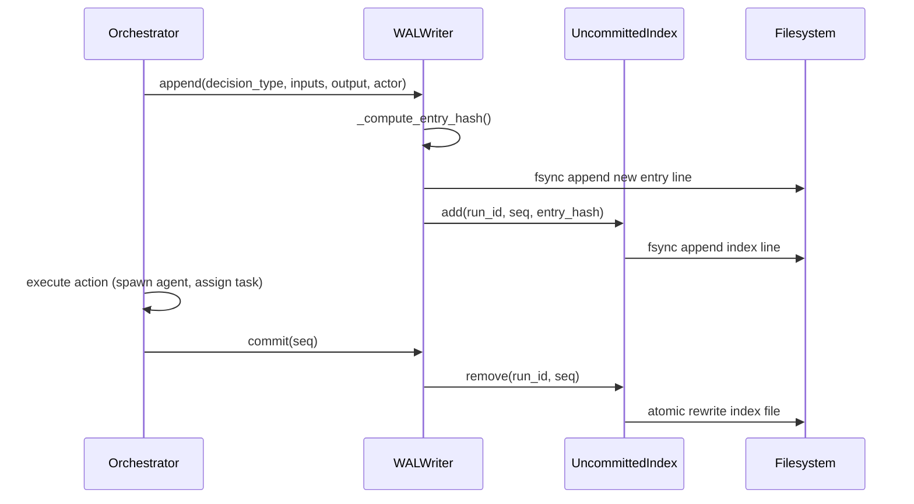
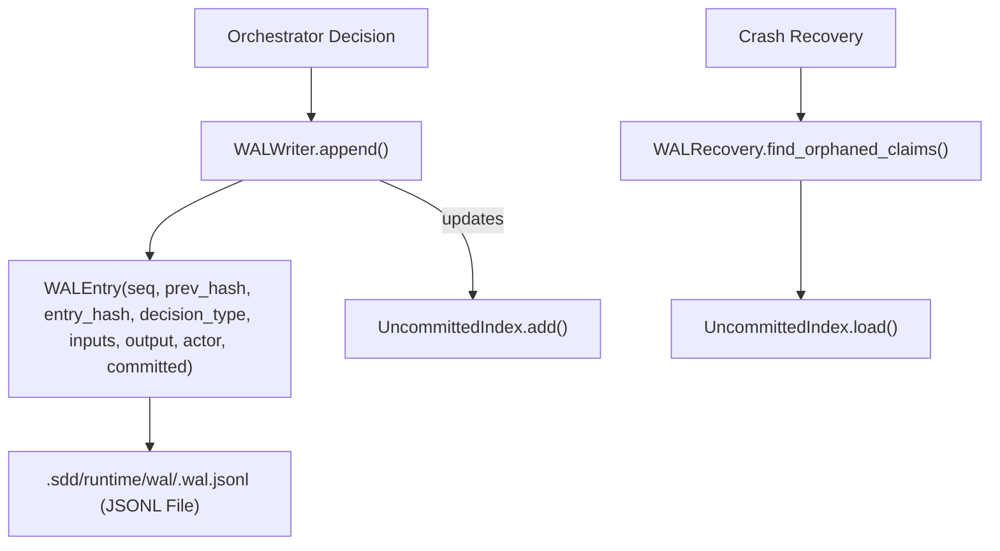

<!-- source: DeepWiki mcp.deepwiki.com · repo sipyourdrink-ltd/bernstein · page 2.6 Persistence and State Management · fetched 2026-10-27 -->

# Persistence and State Management

Relevant source files

The following files were used as context for generating this wiki page:

- [docs/architecture/ARCHITECTURE.md](docs/architecture/ARCHITECTURE.md)
- [docs/gui/index.md](docs/gui/index.md)
- [docs/guides/index.md](docs/guides/index.md)
- [docs/operations/deterministic-replay.md](docs/operations/deterministic-replay.md)
- [docs/operations/replay.md](docs/operations/replay.md)
- [src/bernstein/core/git/changelog.py](src/bernstein/core/git/changelog.py)
- [src/bernstein/core/git/git_context.py](src/bernstein/core/git/git_context.py)
- [src/bernstein/core/knowledge/knowledge_base.py](src/bernstein/core/knowledge/knowledge_base.py)
- [src/bernstein/core/observability/loop_detector.py](src/bernstein/core/observability/loop_detector.py)
- [src/bernstein/core/orchestration/deterministic.py](src/bernstein/core/orchestration/deterministic.py)
- [src/bernstein/core/orchestration/orchestrator_cleanup.py](src/bernstein/core/orchestration/orchestrator_cleanup.py)
- [src/bernstein/core/persistence/agent_checkpoint.py](src/bernstein/core/persistence/agent_checkpoint.py)
- [src/bernstein/core/persistence/atomic_write.py](src/bernstein/core/persistence/atomic_write.py)
- [src/bernstein/core/persistence/chain_checkpoint.py](src/bernstein/core/persistence/chain_checkpoint.py)
- [src/bernstein/core/persistence/file_locks.py](src/bernstein/core/persistence/file_locks.py)
- [src/bernstein/core/persistence/journal.py](src/bernstein/core/persistence/journal.py)
- [src/bernstein/core/persistence/journal_diff.py](src/bernstein/core/persistence/journal_diff.py)
- [src/bernstein/core/persistence/journal_export.py](src/bernstein/core/persistence/journal_export.py)
- [src/bernstein/core/persistence/journal_publish.py](src/bernstein/core/persistence/journal_publish.py)
- [src/bernstein/core/persistence/lineage_signer.py](src/bernstein/core/persistence/lineage_signer.py)
- [src/bernstein/core/persistence/merkle.py](src/bernstein/core/persistence/merkle.py)
- [src/bernstein/core/persistence/session.py](src/bernstein/core/persistence/session.py)
- [src/bernstein/core/persistence/session_continuity.py](src/bernstein/core/persistence/session_continuity.py)
- [src/bernstein/core/persistence/team_state.py](src/bernstein/core/persistence/team_state.py)
- [src/bernstein/core/persistence/wal.py](src/bernstein/core/persistence/wal.py)
- [src/bernstein/core/planning/plan_execute.py](src/bernstein/core/planning/plan_execute.py)
- [src/bernstein/core/replay/__init__.py](src/bernstein/core/replay/__init__.py)
- [src/bernstein/core/replay/journal.py](src/bernstein/core/replay/journal.py)
- [src/bernstein/core/replay/run_receipt.py](src/bernstein/core/replay/run_receipt.py)
- [tests/integration/test_audit_chain_tear_stickiness.py](tests/integration/test_audit_chain_tear_stickiness.py)
- [tests/property/__init__.py](tests/property/__init__.py)
- [tests/property/test_wal_cas_bughunt.py](tests/property/test_wal_cas_bughunt.py)
- [tests/unit/test_acp.py](tests/unit/test_acp.py)
- [tests/unit/test_agent_checkpoint.py](tests/unit/test_agent_checkpoint.py)
- [tests/unit/test_atomic_write.py](tests/unit/test_atomic_write.py)
- [tests/unit/test_audit_query_archived_segments.py](tests/unit/test_audit_query_archived_segments.py)
- [tests/unit/test_audit_tear_detection.py](tests/unit/test_audit_tear_detection.py)
- [tests/unit/test_bandit_router.py](tests/unit/test_bandit_router.py)
- [tests/unit/test_chain_checkpoint.py](tests/unit/test_chain_checkpoint.py)
- [tests/unit/test_container_wiring.py](tests/unit/test_container_wiring.py)
- [tests/unit/test_differential_privacy.py](tests/unit/test_differential_privacy.py)
- [tests/unit/test_eu_ai_act.py](tests/unit/test_eu_ai_act.py)
- [tests/unit/test_file_locks.py](tests/unit/test_file_locks.py)
- [tests/unit/test_incident.py](tests/unit/test_incident.py)
- [tests/unit/test_journal_chain.py](tests/unit/test_journal_chain.py)
- [tests/unit/test_journal_divergence.py](tests/unit/test_journal_divergence.py)
- [tests/unit/test_journal_export.py](tests/unit/test_journal_export.py)
- [tests/unit/test_journal_publish.py](tests/unit/test_journal_publish.py)
- [tests/unit/test_license_scanner.py](tests/unit/test_license_scanner.py)
- [tests/unit/test_mcp_cmd.py](tests/unit/test_mcp_cmd.py)
- [tests/unit/test_memory_integrity.py](tests/unit/test_memory_integrity.py)
- [tests/unit/test_merkle.py](tests/unit/test_merkle.py)
- [tests/unit/test_plan_execute.py](tests/unit/test_plan_execute.py)
- [tests/unit/test_run_benchmark.py](tests/unit/test_run_benchmark.py)
- [tests/unit/test_run_receipt.py](tests/unit/test_run_receipt.py)
- [tests/unit/test_runbooks.py](tests/unit/test_runbooks.py)
- [tests/unit/test_verify_run_receipt_cmd.py](tests/unit/test_verify_run_receipt_cmd.py)
- [tests/unit/test_wal.py](tests/unit/test_wal.py)
- [tests/unit/test_wal_replay.py](tests/unit/test_wal_replay.py)
- [tests/unit/test_workflow.py](tests/unit/test_workflow.py)
- [vulture_whitelist.py](vulture_whitelist.py)

Bernstein employs a robust, multi-layered persistence strategy designed for audit-grade compliance, crash-safety, determinism, and session continuity. This system centers on the `.sdd/` file-based state directory augmented by a Write-Ahead Log (WAL), agent checkpoints, file locks, and a Merkle fingerprint store. Optional backends such as PostgreSQL and Redis can be integrated for enhanced scalability and performance.

---

## The .sdd/ File-Based State Model

The `.sdd/` directory is the canonical on-disk representation of Bernstein's state. It separates persistent artifacts from transient runtime state, enabling portability, transparency, and reproducibility.

### Directory Composition

- **`backlog/`**: Stores task definitions categorized by their lifecycle stage (`open`, `done`, `closed`, `deferred`). This directory serves as the authoritative task source [src/bernstein/core/persistence/disaster_recovery.py:47-51]().

- **`runtime/`**: Contains live execution state; notably the WAL journal files (`.wal.jsonl`), file lock records, and agent heartbeats that coordinate concurrent orchestrator and agent activity [src/bernstein/core/persistence/disaster_recovery.py:42-45]().

- **`memory/` & `index/`**: SQLite-backed stores for knowledge graphs and retrieval-augmented generation (RAG) indices which support Bernstein's knowledge base and memory layer [src/bernstein/core/persistence/disaster_recovery.py:54-61]().

- **`sessions/`**: Maintains session continuity information enabling the TUI and Web dashboard to track and resume in-progress agent and user interactions [src/bernstein/core/persistence/disaster_recovery.py:55-55]().

### Atomic Writes and Crash Safety

To prevent partial writes or corrupted files, Bernstein employs atomic write operations via temporary files and atomic renames. The core utility function, `write_atomic_json`, writes data to a uniquely named temporary file before an atomic `os.replace` moves it to the target path. This guarantees readers see either the previous valid state or the fully written new state, preventing torn or half-written files on crash or concurrent writes [src/bernstein/core/persistence/agent_checkpoint.py:50-63](), [tests/unit/test_atomic_write.py:10-170]().

---

## Write-Ahead Log (WAL) and Crash Recovery

### WAL Overview

Every orchestrator decision is durably persisted to a Write-Ahead Log (WAL) before execution. This ensures crash safety, auditability, and enables deterministic replay.

- **Storage location**: `.sdd/runtime/wal/<run-id>.wal.jsonl` [src/bernstein/core/wal.py:7-8]().

- **Data format**: Each WAL entry is a JSON line containing fields such as `seq` (sequence number), `prev_hash` (the SHA-256 hash linking to the previous entry), `entry_hash` (hash of the current entry contents), `decision_type`, inputs/outputs, and an `actor`. Entries form a hash chain to detect tampering [src/bernstein/core/wal.py:40-58]().

- **Committing entries**: Entries initially may be marked `committed=False` to indicate an unconfirmed decision (e.g., a claimed but not spawned task). Once confirmed, the orchestrator marks them committed to remove them from recovery tracking [src/bernstein/core/wal.py:57-57]().

### Crash Recovery Workflow

Upon restart, `WALRecovery` inspects all WAL files to identify uncommitted entries (orphaned claims) that require re-queuing or clean-up.

- To speed recovery, an `UncommittedIndex` caches these uncommitted entries in a separate JSONL index file, avoiding costly full WAL scans on each boot [src/bernstein/core/wal.py:75-94]().

- Called functions like `find_orphaned_claims` report these entries for possible re-claim actions or diagnostics.

- Detected orphaned claims can be force re-queued with a specific crash recovery reason, preserving workflow continuity without manual intervention [tests/unit/test_wal_recovery_retry.py:8-15]().

### Data Flow: Orchestrator Decisions to WAL Persistence

**Sources:** [src/bernstein/core/wal.py:1-14](), [src/bernstein/core/wal.py:41-58](), [src/bernstein/core/wal.py:75-94](), [tests/unit/test_wal_recovery_retry.py:1-15]()

---

## Agent Checkpoints

Agent checkpoints provide a mechanism to persist partial progress state within long-running agents, enabling recovery and session continuity after crashes or restarts.

- **Checkpoint Contents**: Includes milestone data such as `files_modified`, `step_count` (number of steps executed), and `last_output` (agent's last generated output) [src/bernstein/core/persistence/agent_checkpoint.py:24-48]().

- **Storage**: Checkpoints are saved under `.sdd/runtime/agents/{agent_id}/checkpoint.json` for stable per-agent snapshots [src/bernstein/core/persistence/agent_checkpoint.py:51-51]().

- **Recovery Eligibility**: Checkpoints are considered recoverable if the associated git worktree exists and the files have uncommitted changes, indicating an incomplete prior run [src/bernstein/core/persistence/agent_checkpoint.py:143-164]().

- **Resuming a Task**: `build_resume_prompt` synthesizes a system prompt that encapsulates prior context and checkpoint info to resume execution smoothly [src/bernstein/core/persistence/agent_checkpoint.py:199-208]().

---

## File Locks and Atomic Writes

To prevent concurrent modification conflicts, Bernstein employs:

- **File locks**: To coordinate exclusive ownership of files and protect against write conflicts [src/bernstein/core/persistence/file_locks.py:1-80] (not explicitly detailed here but known in code).

- **Atomic write strategies**: All critical state files use atomic writes as described earlier to ensure durability and avoid partially written states [tests/unit/test_atomic_write.py:41-178](), [src/bernstein/core/persistence/agent_checkpoint.py:50-63]().

This combination preserves correctness under concurrent orchestrator and agent processes.

---

## Session Continuity

Agents and frontends maintain session state inside `.sdd/sessions/`. This enables user interfaces (TUI and Web) to persist partial conversations, agent outputs, and provide seamless reconnection capabilities.

The session ID indexing mechanism binds conversation and adapter names to recorded runs, supporting deterministic replay and session recall [src/bernstein/core/replay/__init__.py:87-99]().

---

## The Merkle Fingerprint Store

Bernstein employs a Merkle-based fingerprint store to memoize and fingerprint expensive computations, ensuring deterministic computation and cacheability.

- **`memoize_persistent` decorator**: Caches results keyed by a fingerprint which includes the function's source code and input arguments, providing strong guarantees against silent drift [src/bernstein/core/quality/cross_model_verifier.py:19-19]().

- **Integration with Knowledge Graphs**: The `KnowledgeGraph` uses this mechanism to cache extracted AST symbols keyed by file SHA-256, facilitating impact analysis without repeated parsing [src/bernstein/core/knowledge/knowledge_graph.py:88-96]().

---

## Disaster Recovery

Bernstein’s disaster recovery functionality backs up and restores the `.sdd/` state.

- **Backup scope**: Includes key persistent directories (`backlog`, `runtime`, `memory`, `sessions`, etc.), while excluding ephemeral data like PIDs, heartbeats, and rotated logs to avoid invalid or stale content in backups [src/bernstein/core/persistence/disaster_recovery.py:40-107]().

- **Encryption**: Supports AES-256 via the `Fernet` cipher from `cryptography.fernet`, with keys derived via PBKDF2-SHA256 ensuring data confidentiality [src/bernstein/core/persistence/disaster_recovery.py:139-174]().

- **Integrity verification**: Each backup includes a `manifest.json` summarizing its contents and SHA-256 hashes, enabling post-restore verification for corruption or tampering [src/bernstein/core/persistence/disaster_recovery.py:125-125](), [src/bernstein/core/persistence/disaster_recovery.py:193-193]().

---

## Optional PostgreSQL and Redis Backends

While the default persistent storage is file-based, Bernstein optionally supports PostgreSQL and Redis backends for:

- **PostgreSQL**: Provides robust transactional storage suitable for large-scale deployments requiring richer query capabilities and high availability.

- **Redis**: Serves as a fast in-memory cache for ephemeral state or coordination data to augment file-based persistence.

This extensibility allows integration into diverse deployment environments and scaling strategies, although detailed usage of these backends is documented elsewhere.

---

## Technical Diagrams: Bridging Concepts to Code Entities

### Natural Language to WAL Code Entities

**Sources:** [src/bernstein/core/wal.py:40-58](), [src/bernstein/core/wal.py:75-94]()

### Agent Checkpoint Lifecycle Mapping

**Sources:** [src/bernstein/core/persistence/agent_checkpoint.py:24-48](), [src/bernstein/core/persistence/agent_checkpoint.py:143-164](), [src/bernstein/core/persistence/agent_checkpoint.py:199-208]()

---

# Summary Table of Key Persistence Components

| Component               | Location/Path                                 | Purpose                                                          |
|-------------------------|----------------------------------------------|-----------------------------------------------------------------|
| `.sdd/` directory       | Project root `.sdd/`                          | File-based state store (backlogs, runtime state, knowledge)     |
| WAL                     | `.sdd/runtime/wal/<run-id>.wal.jsonl`        | Append-only hash-chained log of orchestrator decisions          |
| UncommittedIndex        | `.sdd/runtime/wal/uncommitted.idx.json`      | Index of uncommitted WAL entries for crash recovery speedup     |
| AgentCheckpoint         | `.sdd/runtime/agents/{agent_id}/checkpoint.json` | Snapshots of agent execution progress                            |
| File locks              | `.sdd/runtime/locks/`                         | Coordination to ensure exclusive file ownership                  |
| Session continuity      | `.sdd/sessions/`                              | Persist UI and agent sessions for continuous interactions       |
| Merkle Fingerprint Store| Internal cache                              | Memoization layer for deterministic function caching            |
| Disaster Recovery       | Backup archives                              | Encrypted backups of `.sdd/` with integrity verification        |

---

This persistence and state management architecture enables Bernstein to operate reliably with deterministic coordination, crash recovery, audit logging, and seamless resumption of agent and orchestrator state.

---

**Sources:**  
- [src/bernstein/core/persistence/disaster_recovery.py:1-107, 125-193]()  
- [src/bernstein/core/persistence/agent_checkpoint.py:1-7, 24-63, 143-208]()  
- [src/bernstein/core/wal.py:1-14, 40-58, 75-94]()  
- [tests/unit/test_atomic_write.py:1-178]()  
- [tests/unit/test_wal_recovery_retry.py:1-15]()  
- [src/bernstein/core/replay/__init__.py:87-99]()  
- [src/bernstein/core/quality/cross_model_verifier.py:19-19]()  
- [src/bernstein/core/knowledge/knowledge_graph.py:88-96]()

---

