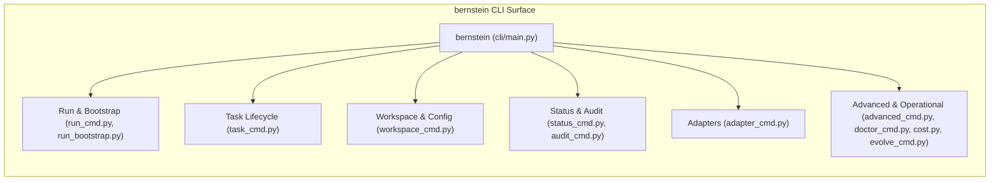
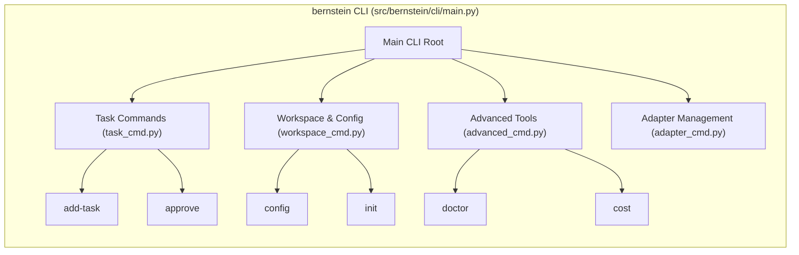

<!-- source: DeepWiki mcp.deepwiki.com · repo sipyourdrink-ltd/bernstein · page 3 CLI Reference · fetched 2026-10-27 -->

# CLI Reference

<details>
<summary>Relevant source files</summary>

The following files were used as context for generating this wiki page:

- [.cursor/rules/module-map.mdc](.cursor/rules/module-map.mdc)
- [.cursor/rules/overview.mdc](.cursor/rules/overview.mdc)
- [.goosehints](.goosehints)
- [AGENTS.md](AGENTS.md)
- [CLAUDE.md](CLAUDE.md)
- [CONVENTIONS.md](CONVENTIONS.md)
- [README.md](README.md)
- [docs/adapters/ADAPTER_GUIDE.md](docs/adapters/ADAPTER_GUIDE.md)
- [docs/reference/cli-reference.md](docs/reference/cli-reference.md)
- [docs/release-notes/unreleased.md](docs/release-notes/unreleased.md)
- [src/bernstein/adapters/_contract.py](src/bernstein/adapters/_contract.py)
- [src/bernstein/adapters/registry.py](src/bernstein/adapters/registry.py)
- [src/bernstein/adapters/report.py](src/bernstein/adapters/report.py)
- [src/bernstein/adapters/use_cases.py](src/bernstein/adapters/use_cases.py)
- [src/bernstein/cli/commands/adapter_cmd.py](src/bernstein/cli/commands/adapter_cmd.py)
- [src/bernstein/cli/commands/advanced_cmd.py](src/bernstein/cli/commands/advanced_cmd.py)
- [src/bernstein/cli/dashboard_app.py](src/bernstein/cli/dashboard_app.py)
- [src/bernstein/cli/dashboard_polling.py](src/bernstein/cli/dashboard_polling.py)
- [src/bernstein/cli/live.py](src/bernstein/cli/live.py)
- [src/bernstein/cli/main.py](src/bernstein/cli/main.py)
- [src/bernstein/core/security/audit_chain.py](src/bernstein/core/security/audit_chain.py)
- [tests/unit/test_adapter_contract.py](tests/unit/test_adapter_contract.py)
- [tests/unit/test_dashboard_server_resolution.py](tests/unit/test_dashboard_server_resolution.py)
- [tests/unit/test_readme_api_coverage.py](tests/unit/test_readme_api_coverage.py)

</details>


The Bernstein CLI provides a deterministic interface for orchestrating multi-agent coding workflows. It is designed for high-compliance environments where every routing decision and file modification must be auditable and reproducible. The CLI surface is divided into two primary entrypoints:

- `bernstein`: The main orchestrator and management tool, used by operators to interact with the system for running orchestration sessions, managing tasks, auditing, and more.
- `bernstein-worker`: A specialized entrypoint invoked by the orchestrator to wrap individual agent processes, enabling environment isolation, spawning, and monitoring of CLI coding agents.

---

### Entrypoints Overview

Bernstein exposes these two command binaries:

| Entrypoint         | Purpose                                                                                     |
|--------------------|---------------------------------------------------------------------------------------------|
| `bernstein`        | Primary CLI for project initialization, orchestration sessions, task lifecycle, audits     |
| `bernstein-worker` | Internal wrapper for executing individual agent tasks in an isolated and supervised manner |

The `bernstein-worker` command is not typically invoked directly by end users but is essential for running agents in sandboxed environments during a Bernstein run session.

Sources: [src/bernstein/cli/main.py:1-18](), [src/bernstein/cli/main.py:133]()

---

## Command Organization

The CLI uses Python's `click` library and organizes commands into logical groups to cleanly separate concerns and user workflows. These include lifecycle commands, workspace management, advanced tools, adapters, auditing, and many others.

Most commands interact with the **Task Server** (usually listening on port 8052) or the `.sdd/` file-based state directory. The Task Server runs a FastAPI backend exposing routes for task creation, status querying, and agent coordination.

Commands are registered in `src/bernstein/cli/main.py`, which imports and composes subcommand groups from various modules like `task_cmd.py`, `workspace_cmd.py`, and others.

---

### High-Level Command Grouping

Here is a simplified conceptual grouping of primary command categories and where they live:



Each major group contains multiple commands or subgroups focused on a coherent area of Bernstein's capabilities.

Sources: [src/bernstein/cli/main.py:1-18](), [src/bernstein/cli/run_bootstrap.py:1-34](), [src/bernstein/cli/task_cmd.py:1-50](), [src/bernstein/cli/adapter_cmd.py:1-30]()

---

### Natural Language Goals to Code Entities Mapping

Bernstein's CLI commands serve as the user-facing interface transitioning from natural language or project goals to internal system actions. Below is a diagram showing how a user action via the CLI maps into internal code entities and runtime components:

```mermaid
graph TD
    User["Operator (Shell)"]

    User -->|`bernstein -g "goal..."`| CLI_Main["`cli.main:cli` root group"]
    CLI_Main -->|`run` command| RunBootstrap["`cli.run_bootstrap:run`"]
    RunBootstrap -->|Generates| SyntheticPlan["Synthetic Plan (plan_approval:create_plan)"]
    RunBootstrap -->|POST /tasks| TaskServer["FastAPI Task Server (routes/*.py)"]

    User -->|`bernstein status`| StatusCmd["`cli.status_cmd:status`"]

    TaskServer -->|Read/Write| SDD_State["`.sdd/` Directory State"]

    subgraph Execution
       Worker["`bernstein-worker` (cli.worker_cmd)"]
       Adapter["CLI Adapter (adapters/base.py)"]
       AgentProc["Agent Process (Claude, Aider, etc.)"]

       Worker -->|Executes| Adapter
       Adapter -->|Spawns| AgentProc
    end
```

This mapping illustrates the flow from user commands into the orchestration loop, task queue, and runtime agents performing work.

Sources: [src/bernstein/cli/main.py:1-18](), [src/bernstein/cli/run_bootstrap.py:30-72](), [src/bernstein/adapters/base.py:1-20]()

---

## 3.1 Run, Init, and Bootstrap Commands

These commands handle project initialization and the core orchestration lifecycle.

- **`bernstein init` / `bernstein init --wizard`**: Prepare the `.sdd/` directory structure and create a baseline `bernstein.yaml` project configuration [src/bernstein/cli/run_bootstrap.py:394-410]().
- **`bernstein run`**: The primary command to execute a plan or goal. It performs preflight steps such as cost estimation, synthetic plan generation, environment flag propagation, and starts the orchestration engine and agent spawns [src/bernstein/cli/run_bootstrap.py:1-62]().
- **`bernstein cook`**: Runs a multi-stage recipe or demo workflow [src/bernstein/cli/run_confirm.py:50-80]() (see demo and quickstart commands as well).
- **`bernstein dry-run`**: Simulates execution without spawning agents, useful for verification and validation of task plan dependencies [src/bernstein/cli/dry_run_cmd.py:190-230]().

See the child page [Run, Init, and Bootstrap Commands](#3.1) for a deep dive into the bootstrap lifecycle, cost cap propagation, network policy installation, and synthetic plan approval flow.

Sources: [src/bernstein/cli/run_bootstrap.py:1-62](), [src/bernstein/cli/run_confirm.py:40-85](), [src/bernstein/cli/dry_run_cmd.py:190-230](), [src/bernstein/cli/main.py:90-110]()

---

## 3.2 Status, Audit, and Lineage Commands

This group provides visibility into running tasks, audit logs, and forensic lineage:

- **`bernstein status` / `bernstein ps`**: Show real-time snapshots of active tasks, claims, and isolated worktrees [src/bernstein/cli/status_cmd.py:10-50]().
- **`bernstein audit`**: Examine and verify the tamper-evident HMAC-SHA256 audit chain recording every scheduling event and operator action [src/bernstein/cli/audit_cmd.py:10-60]().
- **`bernstein lineage`**: Trace full file change provenance through versioned lineage v1/v2 stores. Includes lineage validation and export features [src/bernstein/cli/lineage_cmd.py:1-60]() and [src/bernstein/cli/verify_cmd.py:110-150]().
- **`bernstein verify`**: A standalone auditor useful for verifying signed receipts, agent cards, and other compliance artefacts offline [src/bernstein/cli/verify_cmd.py:100-160]().

This area supports compliance, governance, and post-mortem investigations. For detailed usage, parameters, and examples, see the child page [Status, Audit, and Lineage Commands](#3.2).

Sources: [src/bernstein/cli/status_cmd.py:10-50](), [src/bernstein/cli/audit_cmd.py:1-60](), [src/bernstein/cli/verify_cmd.py:100-160](), [tests/unit/test_readme_api_coverage.py:160-200]()

---

## 3.3 Cost, Adapter, and Operational Commands

Focused on resource management and operational health, these commands help maintain smooth operation and monitor expenses:

- **`bernstein cost` / `estimate`**: Report token consumption and monetary cost per run or aggregated by model/provider [src/bernstein/cli/cost.py:30-80]().
- **`bernstein adapters`**: List all supported CLI agent adapters (40+), test their health, and display conformance matrices [src/bernstein/cli/adapter_cmd.py:20-50]().
- **`bernstein doctor`**: Run health checks on environment components such as sandbox backends (Docker, worktrees) and flag potential issues [src/bernstein/cli/advanced_cmd.py:20-50]().
- **`bernstein autofix`**: Trigger or monitor the autofix daemon that automatically detects and repairs CI failures, file conflicts, or other operational errors [src/bernstein/cli/autofix_cmd.py:10-60]().

For operational best practices and detailed usage instructions for cost control and adapter management, see [Cost, Adapter, and Operational Commands](#3.3).

Sources: [src/bernstein/cli/cost.py:20-80](), [src/bernstein/cli/adapter_cmd.py:1-36](), [src/bernstein/cli/advanced_cmd.py:20-50](), [tests/unit/test_readme_api_coverage.py:160-180]()

---

### Command Discovery and Help Utilities

Bernstein CLI includes tools to assist operators in navigating its large command set:

- **`bernstein help-all`**: Displays complete help text for every registered subcommand, aiding discoverability [src/bernstein/cli/advanced_cmd.py:34-48]().
- **`bernstein explain`**: Provides natural language explanations for Bernstein concepts and commands [src/bernstein/cli/explain_help_cmd.py:70-110]().
- **`bernstein man-pages`**: Generates local manpages for offline reference across the full CLI surface [src/bernstein/cli/man_page.py:50-100]().

---

### Command Grouping Entity Map

The primary CLI groups compose the main CLI class, linking source files to command clusters:



This shows the modular code structure and corresponding user-facing command hierarchy.

Sources: [src/bernstein/cli/main.py:1-18]()

---

# Child Pages for Details

This page provides a high-level overview of Bernstein’s CLI surface. Detailed documentation of major command groups lives in the following child pages:

- **[Run, Init, and Bootstrap Commands](#3.1)** — Covers all commands related to starting runs, initializing projects, bootstrapping orchestration sessions, and their underlying lifecycles.
- **[Status, Audit, and Lineage Commands](#3.2)** — Focuses on commands that report status, inspect task state, audit runs, verify tamper-evident data, and lineage provenance.
- **[Cost, Adapter, and Operational Commands](#3.3)** — Details commands for cost reporting, adapter health and testing, operational diagnostics, and self-healing automation.

For comprehensive understanding of each area, consult these pages.

---

This completes the high-level reference for Bernstein’s command-line interface surface, outlining how the CLI entrypoints, command groups, and tasks map into the underlying orchestration system.

# End of CLI Reference

---

**Sources:**

- [src/bernstein/cli/main.py:1-18, 90-110, 133]()
- [src/bernstein/cli/run_bootstrap.py:1-62, 394-410]()
- [src/bernstein/cli/run_confirm.py:40-85]()
- [src/bernstein/cli/dry_run_cmd.py:190-230]()
- [src/bernstein/cli/status_cmd.py:10-50]()
- [src/bernstein/cli/audit_cmd.py:1-60]()
- [src/bernstein/cli/verify_cmd.py:100-160]()
- [src/bernstein/cli/cost.py:20-80]()
- [src/bernstein/cli/adapter_cmd.py:1-50]()
- [src/bernstein/adapters/base.py:1-20]()
- [tests/unit/test_readme_api_coverage.py:150-180]()

---

