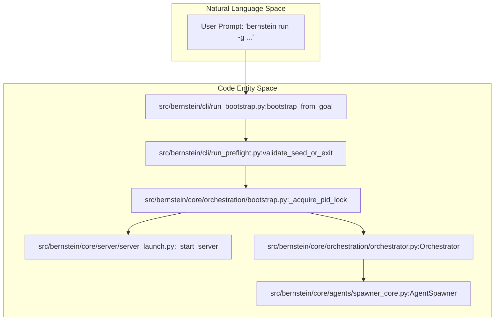
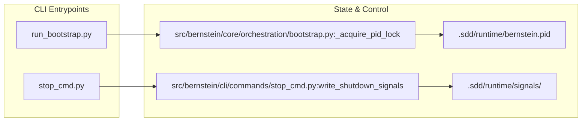

<!-- source: DeepWiki mcp.deepwiki.com · repo sipyourdrink-ltd/bernstein · page 3.1 Run, Init, and Bootstrap Commands · fetched 2026-10-27 -->

# Run, Init, and Bootstrap Commands

Relevant source files

The following files were used as context for generating this wiki page:

- [docs/orchestration/issue-to-pr.md](docs/orchestration/issue-to-pr.md)
- [docs/orchestration/worker-coordination.md](docs/orchestration/worker-coordination.md)
- [docs/substrate/claude-code.md](docs/substrate/claude-code.md)
- [src/bernstein/adapters/council_runner.py](src/bernstein/adapters/council_runner.py)
- [src/bernstein/adapters/env_isolation.py](src/bernstein/adapters/env_isolation.py)
- [src/bernstein/adapters/openai_agents.py](src/bernstein/adapters/openai_agents.py)
- [src/bernstein/adapters/openai_agents_runner.py](src/bernstein/adapters/openai_agents_runner.py)
- [src/bernstein/cli/commands/incident_cmd.py](src/bernstein/cli/commands/incident_cmd.py)
- [src/bernstein/cli/commands/postmortem_cmd.py](src/bernstein/cli/commands/postmortem_cmd.py)
- [src/bernstein/cli/commands/status_cmd.py](src/bernstein/cli/commands/status_cmd.py)
- [src/bernstein/cli/commands/stop_cmd.py](src/bernstein/cli/commands/stop_cmd.py)
- [src/bernstein/cli/plan/plan_display.py](src/bernstein/cli/plan/plan_display.py)
- [src/bernstein/cli/run_bootstrap.py](src/bernstein/cli/run_bootstrap.py)
- [src/bernstein/cli/run_preflight.py](src/bernstein/cli/run_preflight.py)
- [src/bernstein/core/agents/spawner_core.py](src/bernstein/core/agents/spawner_core.py)
- [src/bernstein/core/git/github.py](src/bernstein/core/git/github.py)
- [src/bernstein/core/instrumentation.py](src/bernstein/core/instrumentation.py)
- [src/bernstein/core/orchestration/activity_modalities.py](src/bernstein/core/orchestration/activity_modalities.py)
- [src/bernstein/core/orchestration/adaptive_parallelism.py](src/bernstein/core/orchestration/adaptive_parallelism.py)
- [src/bernstein/core/orchestration/bootstrap.py](src/bernstein/core/orchestration/bootstrap.py)
- [src/bernstein/core/orchestration/commit_completion.py](src/bernstein/core/orchestration/commit_completion.py)
- [src/bernstein/core/orchestration/drain.py](src/bernstein/core/orchestration/drain.py)
- [src/bernstein/core/orchestration/drain_merge.py](src/bernstein/core/orchestration/drain_merge.py)
- [src/bernstein/core/orchestration/holds.py](src/bernstein/core/orchestration/holds.py)
- [src/bernstein/core/orchestration/multi_cell.py](src/bernstein/core/orchestration/multi_cell.py)
- [src/bernstein/core/orchestration/orchestrator.py](src/bernstein/core/orchestration/orchestrator.py)
- [src/bernstein/core/orchestration/orchestrator_backlog.py](src/bernstein/core/orchestration/orchestrator_backlog.py)
- [src/bernstein/core/orchestration/run_changelog.py](src/bernstein/core/orchestration/run_changelog.py)
- [src/bernstein/core/orchestration/tick_pipeline.py](src/bernstein/core/orchestration/tick_pipeline.py)
- [src/bernstein/core/orchestration/trigger_manager.py](src/bernstein/core/orchestration/trigger_manager.py)
- [src/bernstein/core/routes/orchestrator_holds.py](src/bernstein/core/routes/orchestrator_holds.py)
- [src/bernstein/core/server/server_launch.py](src/bernstein/core/server/server_launch.py)
- [src/bernstein/core/server/server_supervisor.py](src/bernstein/core/server/server_supervisor.py)
- [src/bernstein/core/tasks/models.py](src/bernstein/core/tasks/models.py)
- [src/bernstein/core/tasks/task_lifecycle.py](src/bernstein/core/tasks/task_lifecycle.py)
- [src/bernstein/core/tasks/task_store_core.py](src/bernstein/core/tasks/task_store_core.py)
- [templates/roles/manager/system_prompt.md](templates/roles/manager/system_prompt.md)
- [templates/roles/manager/task_prompt.md](templates/roles/manager/task_prompt.md)
- [tests/integration/orchestration/test_consensus_relay_flow.py](tests/integration/orchestration/test_consensus_relay_flow.py)
- [tests/integration/test_manager_auth_to_task_server.py](tests/integration/test_manager_auth_to_task_server.py)
- [tests/unit/test_detached_run_visibility.py](tests/unit/test_detached_run_visibility.py)
- [tests/unit/test_env_isolation.py](tests/unit/test_env_isolation.py)
- [tests/unit/test_github.py](tests/unit/test_github.py)
- [tests/unit/test_instrumentation_capture.py](tests/unit/test_instrumentation_capture.py)
- [tests/unit/test_mcp_discovery.py](tests/unit/test_mcp_discovery.py)
- [tests/unit/test_orchestrator_holds_routes.py](tests/unit/test_orchestrator_holds_routes.py)
- [tests/unit/test_run_cmd_track_b.py](tests/unit/test_run_cmd_track_b.py)
- [tests/unit/test_run_preflight_model_resolution.py](tests/unit/test_run_preflight_model_resolution.py)
- [tests/unit/test_spawner_agent_token.py](tests/unit/test_spawner_agent_token.py)
- [tests/unit/test_startup_task_count_consistency.py](tests/unit/test_startup_task_count_consistency.py)
- [tests/unit/test_task_release_receipt.py](tests/unit/test_task_release_receipt.py)
- [tests/unit/test_uvicorn_reload_disabled.py](tests/unit/test_uvicorn_reload_disabled.py)
- [tests/unit/test_worker_cmd_spawn.py](tests/unit/test_worker_cmd_spawn.py)

This section details the primary CLI entry points for initializing workspaces and executing agentic workflows. It covers the preflight validation sequence, the bootstrap lifecycle for the Task Server and Orchestrator, and the mechanisms for cost estimation and dry-running plans.

## Initialization and Quickstart

The initialization process prepares the local environment for Bernstein orchestration by creating the `.sdd/` state directory and generating core configuration files.

*   **`bernstein init`**: The primary command to initialize a new Bernstein workspace. It sets up the directory structure defined in `SDD_DIRS` [src/bernstein/cli/run_bootstrap.py:22]().
*   **The `.sdd/` Structure**: The initialization sequence ensures a deterministic state directory exists. Key components include:
    *   `.sdd/backlog/`: Subdirectories for `open/`, `claimed/`, and `closed/` task tickets [src/bernstein/cli/commands/stop_cmd.py:155-169]().
    *   `.sdd/runtime/`: Holds PIDs (e.g., `bernstein.pid`) and session metadata [src/bernstein/core/orchestration/bootstrap.py:116-118]().
    *   `.sdd/runtime/plans/`: Stores rendered plan markdown files [src/bernstein/cli/run_bootstrap.py:176]().

**Sources:** [src/bernstein/cli/run_bootstrap.py:22-29](), [src/bernstein/core/orchestration/bootstrap.py:116-120](), [src/bernstein/cli/commands/stop_cmd.py:155-169]()

---

## The Run Sequence and Preflight

The `run` command triggers a complex sequence that validates the environment, estimates costs, and bootstraps background services.

### Preflight Validation
Before agents are spawned, the system executes `run_preflight.py`. This sequence performs:
1.  **Seed Validation**: Validates the `goal` and `team` configuration from `bernstein.yaml` or an inline goal [src/bernstein/cli/run_bootstrap.py:96-131]().
2.  **Auth Verification**: Checks for valid credentials for providers like Claude, Codex, or Gemini [src/bernstein/core/orchestration/bootstrap.py:39-44]().
3.  **PID Locking**: Invokes `_acquire_pid_lock` to ensure only one Bernstein instance runs per working directory [src/bernstein/core/orchestration/bootstrap.py:101-115]().

### Cost Estimation
Bernstein estimates run costs before execution to prevent budget overruns.
*   **`estimate_run_cost`**: Calculates predicted expenditure based on the plan and model pricing [src/bernstein/cli/run_bootstrap.py:46]().
*   **Preview**: The `_estimate_run_preview` function displays a summary of the expected tasks and costs to the operator [src/bernstein/cli/run_preflight.py:39]().

### Run Bootstrap Lifecycle
The `run_bootstrap.py` module manages the transition from CLI command to long-running orchestration.

| Phase | Action | Entity |
| :--- | :--- | :--- |
| **Server** | Launch FastAPI Task Server on port 8052 | `_start_server` [src/bernstein/core/orchestration/bootstrap.py:70]() |
| **Spawner** | Initialize the agent spawner process | `_start_spawner` [src/bernstein/core/orchestration/bootstrap.py:71]() |
| **Orchestrator** | Start the deterministic tick loop | `orchestrator.py` [src/bernstein/core/orchestration/orchestrator.py:1-15]() |
| **Index** | Build codebase index for RAG/Context | `_build_codebase_index` [src/bernstein/core/orchestration/bootstrap.py:60]() |

**Sources:** [src/bernstein/cli/run_bootstrap.py:34-57](), [src/bernstein/core/orchestration/bootstrap.py:58-77](), [src/bernstein/core/orchestration/orchestrator.py:1-15]()

---

## Command Execution Flow

The following diagram illustrates the transition from the Natural Language prompt in the CLI to the initialization of the Task Server and Orchestrator entities.

**CLI to Orchestrator Bootstrap**

**Sources:** [src/bernstein/cli/run_bootstrap.py:66-135](), [src/bernstein/core/orchestration/bootstrap.py:101-140](), [src/bernstein/core/orchestration/orchestrator.py:1-15]()

---

## Operational Control: Cook, Stop, and Dry-Run

### Synthetic Plan Generation (`cook`)
The `_build_synthetic_plan` function generates a "synthetic plan" from a goal string [src/bernstein/cli/run_bootstrap.py:66](). It creates a set of `Task` objects with assigned roles (defaulting to `manager`) and priorities, allowing the operator to preview the task graph before execution [src/bernstein/cli/run_bootstrap.py:80-93]().

### Lifecycle Termination (`stop`)
The `stop_cmd.py` module manages graceful and forced shutdowns:
*   **Shutdown Signals**: `write_shutdown_signals` creates signal files in `.sdd/runtime/signals/` to notify active agents to save work and exit [src/bernstein/cli/commands/stop_cmd.py:112-141]().
*   **Ticket Recovery**: `return_claimed_to_open` moves tickets from `claimed/` back to `open/` so they can be resumed in a subsequent run [src/bernstein/cli/commands/stop_cmd.py:144-182]().
*   **PID Cleanup**: `sigkill_pid` and `kill_pid_hard` are used to terminate the server and spawner processes [src/bernstein/cli/commands/stop_cmd.py:32-36]().

### Dry-Run Execution
The `dry-run` mode resolves the effective goal and team [src/bernstein/cli/run_bootstrap.py:96](), loads tasks from a plan file or a running server [src/bernstein/cli/run_bootstrap.py:187](), and simulates the run without spawning agents or modifying the production environment.

**Sources:** [src/bernstein/cli/run_bootstrap.py:66-110](), [src/bernstein/cli/commands/stop_cmd.py:112-182](), [src/bernstein/core/orchestration/bootstrap.py:142-156]()

---

## Environment and Agent Isolation

When agents are spawned, Bernstein enforces strict environment isolation to prevent credential leakage.

*   **`build_filtered_env`**: Constructs a minimal environment for the agent [src/bernstein/adapters/env_isolation.py:10-12]().
*   **Base Allowlist**: Always includes critical variables like `PATH`, `HOME`, and `USER`, as well as Bernstein-specific identifiers like `BERNSTEIN_RUN_ID` [src/bernstein/adapters/env_isolation.py:33-156]().
*   **Credential Scoping**: The `AgentCredentialPolicy` ensures that only the necessary API keys (e.g., `OPENAI_API_KEY`) are propagated to the agent subprocess [src/bernstein/adapters/openai_agents.py:55-60]().

**Process Lifecycle and PID Management**

**Sources:** [src/bernstein/core/orchestration/bootstrap.py:101-115](), [src/bernstein/cli/commands/stop_cmd.py:112-125](), [src/bernstein/adapters/env_isolation.py:33-165]()

---

