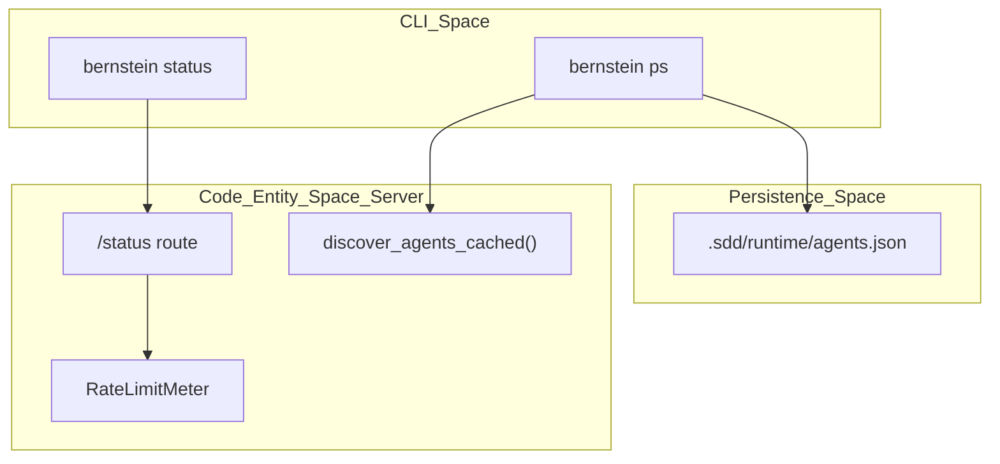
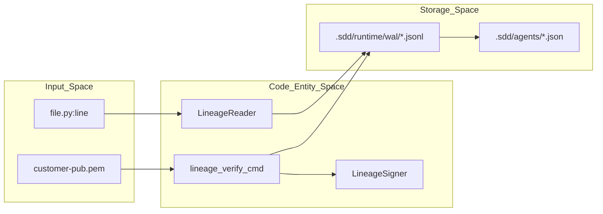

<!-- source: DeepWiki mcp.deepwiki.com · repo sipyourdrink-ltd/bernstein · page 3.2 Status, Audit, and Lineage Commands · fetched 2026-10-27 -->

# Status, Audit, and Lineage Commands

Relevant source files

The following files were used as context for generating this wiki page:

- [docs/eval/yaml-harness.md](docs/eval/yaml-harness.md)
- [docs/operations/audit-diagnose.md](docs/operations/audit-diagnose.md)
- [docs/operations/security-and-identity.md](docs/operations/security-and-identity.md)
- [docs/security/audit-log.md](docs/security/audit-log.md)
- [src/bernstein/cli/commands/audit_cmd.py](src/bernstein/cli/commands/audit_cmd.py)
- [src/bernstein/cli/commands/eval_benchmark_cmd.py](src/bernstein/cli/commands/eval_benchmark_cmd.py)
- [src/bernstein/cli/commands/evidence_cmd.py](src/bernstein/cli/commands/evidence_cmd.py)
- [src/bernstein/cli/commands/lineage_cmd.py](src/bernstein/cli/commands/lineage_cmd.py)
- [src/bernstein/cli/commands/lineage_replay_cmd.py](src/bernstein/cli/commands/lineage_replay_cmd.py)
- [src/bernstein/compliance/__init__.py](src/bernstein/compliance/__init__.py)
- [src/bernstein/compliance/evidence_pack.py](src/bernstein/compliance/evidence_pack.py)
- [src/bernstein/core/evidence/bundle.py](src/bernstein/core/evidence/bundle.py)
- [src/bernstein/core/evidence/completion_gate.py](src/bernstein/core/evidence/completion_gate.py)
- [src/bernstein/core/evidence/output_diff.py](src/bernstein/core/evidence/output_diff.py)
- [src/bernstein/core/lineage/__init__.py](src/bernstein/core/lineage/__init__.py)
- [src/bernstein/core/lineage/entry.py](src/bernstein/core/lineage/entry.py)
- [src/bernstein/core/lineage/signed_write.py](src/bernstein/core/lineage/signed_write.py)
- [src/bernstein/core/persistence/lineage.py](src/bernstein/core/persistence/lineage.py)
- [src/bernstein/core/replay/diagnose.py](src/bernstein/core/replay/diagnose.py)
- [src/bernstein/core/replay/diagnose_signals.py](src/bernstein/core/replay/diagnose_signals.py)
- [src/bernstein/core/replay/diagnosis_receipt.py](src/bernstein/core/replay/diagnosis_receipt.py)
- [src/bernstein/core/replay/diff.py](src/bernstein/core/replay/diff.py)
- [src/bernstein/core/routes/batch_ops.py](src/bernstein/core/routes/batch_ops.py)
- [src/bernstein/core/routes/task_a2a.py](src/bernstein/core/routes/task_a2a.py)
- [src/bernstein/core/routes/task_cluster.py](src/bernstein/core/routes/task_cluster.py)
- [src/bernstein/core/security/audit.py](src/bernstein/core/security/audit.py)
- [src/bernstein/core/security/audit_integrity.py](src/bernstein/core/security/audit_integrity.py)
- [src/bernstein/eval/__init__.py](src/bernstein/eval/__init__.py)
- [tests/property/test_capability_matrix_bughunt.py](tests/property/test_capability_matrix_bughunt.py)
- [tests/unit/adapters/test_base_lineage_hook.py](tests/unit/adapters/test_base_lineage_hook.py)
- [tests/unit/adapters/test_base_spine_writes.py](tests/unit/adapters/test_base_spine_writes.py)
- [tests/unit/core/replay/test_diagnose.py](tests/unit/core/replay/test_diagnose.py)
- [tests/unit/core/replay/test_diagnose_cli.py](tests/unit/core/replay/test_diagnose_cli.py)
- [tests/unit/eval/test_yaml_runner.py](tests/unit/eval/test_yaml_runner.py)
- [tests/unit/lineage/test_spine.py](tests/unit/lineage/test_spine.py)
- [tests/unit/lineage/test_spine_deprecations.py](tests/unit/lineage/test_spine_deprecations.py)
- [tests/unit/test_audit.py](tests/unit/test_audit.py)
- [tests/unit/test_audit_chain_byteflip_regression.py](tests/unit/test_audit_chain_byteflip_regression.py)
- [tests/unit/test_audit_integrity.py](tests/unit/test_audit_integrity.py)
- [tests/unit/test_audit_key.py](tests/unit/test_audit_key.py)
- [tests/unit/test_auth_middleware_task_scope_indirect.py](tests/unit/test_auth_middleware_task_scope_indirect.py)
- [tests/unit/test_auth_middleware_task_scope_routes.py](tests/unit/test_auth_middleware_task_scope_routes.py)
- [tests/unit/test_evidence_pack.py](tests/unit/test_evidence_pack.py)
- [tests/unit/test_fingerprint_determinism.py](tests/unit/test_fingerprint_determinism.py)
- [tests/unit/test_lineage_record_v1.py](tests/unit/test_lineage_record_v1.py)
- [tests/unit/test_lineage_regulatory_verify.py](tests/unit/test_lineage_regulatory_verify.py)
- [tests/unit/test_memo_store_concurrency.py](tests/unit/test_memo_store_concurrency.py)
- [tests/unit/test_soc2_report.py](tests/unit/test_soc2_report.py)

This section details the commands used to monitor system health, verify the cryptographic integrity of the orchestration loop, and trace the provenance of every file modification. Bernstein implements a tamper-evident audit chain and a multi-version lineage store to satisfy regulatory requirements such as DORA, NIS2, and the EU AI Act.

## 1. Status and Monitoring (`status`, `ps`)

The `status` and `ps` commands provide real-time visibility into the Orchestrator's state, active agent sessions, and provider-side rate limits.

### Implementation and Data Flow
The `status` command queries the FastAPI `status_dashboard` route, which aggregates data from the `Orchestrator` and the `CostTracker`. 

*   **Task Summary**: Displays counts of tasks in `OPEN`, `CLAIMED`, `IN_PROGRESS`, `DONE`, and `FAILED` states.
*   **Provider Health**: Surfaces the status of LLM providers (e.g., Anthropic, OpenAI) including detected API tiers and remaining quotas.
*   **Rate Limit Meters**: Bernstein tracks upstream 429 errors using the `RateLimitMeter` class. These meters decay over a rolling 5-minute window.

### Process Status (`ps`)
The `ps` command lists active agent processes. It correlates OS-level PIDs with Bernstein session IDs and decorates the output with "Skill Badges" (e.g., `reasoning:high`, `mcp`) derived from `AgentCapabilities`.

### Entity Map: Status Monitoring
Title: "Status Monitoring Data Flow"

Sources: [src/bernstein/cli/commands/status_cmd.py:1-50](), [src/bernstein/core/routes/task_crud.py:1-100]()

---

## 2. Audit Chain and Integrity (`audit`)

Bernstein maintains a tamper-evident, append-only audit log under `.sdd/audit/YYYY-MM-DD.jsonl`. 

### The HMAC Audit Chain
Every record in the audit log is HMAC-SHA256 signed ([RFC 2104](https://datatracker.ietf.org/doc/html/rfc2104)) and chained to the previous record's HMAC [src/bernstein/cli/commands/audit_cmd.py:3-8](). This ensures that any modification to a historical log entry invalidates the entire subsequent chain [src/bernstein/core/security/audit.py:3-5]().

*   **`audit seal`**: Computes a Merkle root across all daily audit files [src/bernstein/cli/commands/audit_cmd.py:121-125](). It gates the seal on a valid HMAC chain and consistency with the last checkpoint [src/bernstein/cli/commands/audit_cmd.py:124-129]().
*   **`audit verify`**: Replays the HMAC chain and validates the Merkle tree [src/bernstein/cli/commands/audit_cmd.py:15-17]().
*   **`audit export`**: Generates a signed "Article 12" evidence pack for regulatory compliance [src/bernstein/cli/commands/audit_cmd.py:22-22]().
*   **`audit ack-tear`**: Acknowledges "tear" evidence (crashes or partial writes) so that sealing can continue after forensic review [src/bernstein/cli/commands/audit_cmd.py:134-140]().

### Key Components
| Component | File | Description |
| :--- | :--- | :--- |
| `AuditLog` | [src/bernstein/core/security/audit.py:20-31]() | Core class for append-only logic, HMAC signing, and daily rotation. |
| `EVENT_CHAIN_TORN_RECORD` | [src/bernstein/core/security/audit.py:132-132]() | Event emitted when a crash-torn partial line is detected and repaired. |
| `load_or_create_audit_key` | [src/bernstein/core/security/audit.py:140-140]() | Manages the HMAC key outside the audit volume for security. |

Sources: [src/bernstein/cli/commands/audit_cmd.py:1-33](), [src/bernstein/core/security/audit.py:1-140](), [docs/security/audit-log.md:1-50]()

---

## 3. Lineage and Provenance (`lineage`)

The `lineage` system tracks the "who, why, and how" of every file modification by linking outputs to producers and inputs [src/bernstein/core/persistence/lineage.py:4-7]().

### Lineage v1 vs v2
*   **v1 (Standard)**: Records carry producer, prompt SHA, and cost metadata [src/bernstein/core/persistence/lineage.py:23-24]().
*   **v2 (Compliance)**: Adds `regulatory_class` and customer-key Ed25519 signatures (RFC 8037) for DORA/NIS2 evidence [src/bernstein/cli/commands/lineage_cmd.py:5-7]().

### Commands
*   **`lineage walk <file>:<line>`**: Traces the history of a specific line of code back to the original LLM prompt and model version [src/bernstein/cli/commands/lineage_cmd.py:120-132]().
*   **`lineage verify`**: Performs a one-shot verification of the lineage chain for a specific `run_id` [src/bernstein/cli/commands/lineage_cmd.py:19-20]().
*   **`lineage export`**: Produces regulator-shaped artifacts in CSV, JSON-LD, or HTML [src/bernstein/cli/commands/lineage_cmd.py:17-18]().

### Data Structure: Lineage Record
The `LineageRecord` [src/bernstein/core/persistence/lineage.py:135-159]() contains:
1.  **Output Artifact**: `ArtifactRef` with path, SHA-256, and byte/line ranges [src/bernstein/core/persistence/lineage.py:97-112]().
2.  **Inputs**: List of `ArtifactRef` sources read by the agent [src/bernstein/core/persistence/lineage.py:150-150]().
3.  **Producer**: `AgentRef` (Agent ID, Run ID, Tick ID) [src/bernstein/core/persistence/lineage.py:126-132]().
4.  **Prompt SHA**: Cryptographic hash of the instructions [src/bernstein/core/persistence/lineage.py:152-152]().

### Entity Map: Lineage Verification Pipeline
Title: "Lineage Verification Pipeline"

Sources: [src/bernstein/cli/commands/lineage_cmd.py:120-154](), [src/bernstein/core/persistence/lineage.py:1-159](), [src/bernstein/core/lineage/__init__.py:1-85]()

---

## 4. Evidence Bundles (`compliance`)

The `EvidenceBundle` system binds task completion proofs (test logs, coverage, screenshots) into signed records anchored in a `LineageSpine` [src/bernstein/core/evidence/bundle.py:3-20]().

*   **Content Addressing**: All evidence blobs are stored in an `EvidenceStore` under their SHA-256 hash [src/bernstein/core/evidence/bundle.py:12-14]().
*   **Completion Gates**: `run_evidence_gate` executes declared producers (e.g., `pytest`) and captures output before a task is marked `DONE` [src/bernstein/core/evidence/bundle.py:8-11]().
*   **C2PA Support**: Media evidence (screenshots/recordings) flows through C2PA manifests to prevent tampering [src/bernstein/core/evidence/bundle.py:21-24]().

### Implementation Details
| Function | File | Description |
| :--- | :--- | :--- |
| `build_evidence_bundle` | [src/bernstein/core/evidence/bundle.py:86-86]() | Constructs a canonical JSON binding of hashes and metadata. |
| `verify_evidence_bundle` | [src/bernstein/core/evidence/bundle.py:94-94]() | Recomputes Ed25519 signatures and spine anchors to detect tampering. |
| `LineageSpine` | [src/bernstein/core/lineage/spine.py:61-61]() | The global evidence spine that anchors all bundles. |

Sources: [src/bernstein/core/evidence/bundle.py:1-110](), [src/bernstein/core/lineage/__init__.py:59-67]()

---

## 5. Standalone Auditor (`bernstein-verify`)

For air-gapped or high-security environments, the `verify_cli/` package provides a standalone tool that validates Bernstein artifacts without requiring the main orchestrator code.

### Features
*   **HMAC Validation**: Independently verifies the `.sdd/audit/` chain using the audit key [src/bernstein/cli/commands/audit_cmd.py:15-20]().
*   **A2A Verification**: Validates `AgentCard` detached JWS signatures (RFC 7515) [src/bernstein/core/lineage/identity.py:41-47]().
*   **Offline Receipts**: `bernstein audit verify --receipt` allows auditors to verify automation trigger receipts offline [src/bernstein/cli/commands/audit_cmd.py:18-19]().

Sources: [src/bernstein/cli/commands/audit_cmd.py:1-30](), [src/bernstein/core/lineage/identity.py:1-50]()

---

