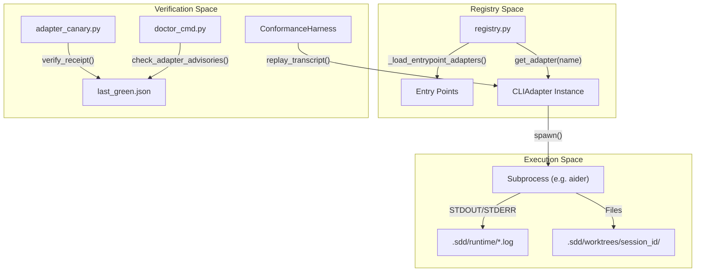

<!-- source: DeepWiki mcp.deepwiki.com · repo sipyourdrink-ltd/bernstein · page 3.3 Cost, Adapter, and Operational Commands · fetched 2026-10-27 -->

# Cost, Adapter, and Operational Commands

Relevant source files

The following files were used as context for generating this wiki page:

- [docs/adapters/conformance-canary.md](docs/adapters/conformance-canary.md)
- [docs/cloudflare/cloudflare-mcp.md](docs/cloudflare/cloudflare-mcp.md)
- [docs/observability/task-artifacts.md](docs/observability/task-artifacts.md)
- [docs/operations/adapters.md](docs/operations/adapters.md)
- [docs/operations/cost-envelopes.md](docs/operations/cost-envelopes.md)
- [docs/operations/debug-bundle.md](docs/operations/debug-bundle.md)
- [docs/operations/skill-provenance.md](docs/operations/skill-provenance.md)
- [scripts/adapter_canary.py](scripts/adapter_canary.py)
- [src/bernstein/adapters/canary.py](src/bernstein/adapters/canary.py)
- [src/bernstein/adapters/claude_cache_control.py](src/bernstein/adapters/claude_cache_control.py)
- [src/bernstein/adapters/claude_mcp_loader.py](src/bernstein/adapters/claude_mcp_loader.py)
- [src/bernstein/adapters/claude_stream_parser.py](src/bernstein/adapters/claude_stream_parser.py)
- [src/bernstein/adapters/conformance.py](src/bernstein/adapters/conformance.py)
- [src/bernstein/adapters/floor_refresh.py](src/bernstein/adapters/floor_refresh.py)
- [src/bernstein/adapters/last_green.json](src/bernstein/adapters/last_green.json)
- [src/bernstein/adapters/security_floor.py](src/bernstein/adapters/security_floor.py)
- [src/bernstein/cli/commands/__init__.py](src/bernstein/cli/commands/__init__.py)
- [src/bernstein/cli/commands/adapters_cmd.py](src/bernstein/cli/commands/adapters_cmd.py)
- [src/bernstein/cli/commands/artifact_cmd.py](src/bernstein/cli/commands/artifact_cmd.py)
- [src/bernstein/cli/commands/artifacts_cmd.py](src/bernstein/cli/commands/artifacts_cmd.py)
- [src/bernstein/cli/commands/cost.py](src/bernstein/cli/commands/cost.py)
- [src/bernstein/cli/commands/debug_cmd.py](src/bernstein/cli/commands/debug_cmd.py)
- [src/bernstein/cli/commands/doctor_cmd.py](src/bernstein/cli/commands/doctor_cmd.py)
- [src/bernstein/core/chat/drivers/teams.py](src/bernstein/core/chat/drivers/teams.py)
- [src/bernstein/core/communication/bulletin.py](src/bernstein/core/communication/bulletin.py)
- [src/bernstein/core/communication/signal_actions.py](src/bernstein/core/communication/signal_actions.py)
- [src/bernstein/core/cost/scheduling/knob_matrix.py](src/bernstein/core/cost/scheduling/knob_matrix.py)
- [src/bernstein/core/protocols/mcp/mcp_client.py](src/bernstein/core/protocols/mcp/mcp_client.py)
- [src/bernstein/core/security/intent_capsule.py](src/bernstein/core/security/intent_capsule.py)
- [src/bernstein/core/skills/catalog/revocation.py](src/bernstein/core/skills/catalog/revocation.py)
- [src/bernstein/core/tasks/artifact_completion.py](src/bernstein/core/tasks/artifact_completion.py)
- [src/bernstein/core/tasks/artifacts.py](src/bernstein/core/tasks/artifacts.py)
- [src/bernstein/eval/significance.py](src/bernstein/eval/significance.py)
- [tests/integration/adapters/test_adapters_check_cli.py](tests/integration/adapters/test_adapters_check_cli.py)
- [tests/property/test_adapter_report_properties.py](tests/property/test_adapter_report_properties.py)
- [tests/unit/adapters/test_capability_enums.py](tests/unit/adapters/test_capability_enums.py)
- [tests/unit/adapters/test_report.py](tests/unit/adapters/test_report.py)
- [tests/unit/core/chat/test_teams_driver.py](tests/unit/core/chat/test_teams_driver.py)
- [tests/unit/tasks/test_artifact_completion.py](tests/unit/tasks/test_artifact_completion.py)
- [tests/unit/test_adapter_canary.py](tests/unit/test_adapter_canary.py)
- [tests/unit/test_adapter_security_floor.py](tests/unit/test_adapter_security_floor.py)
- [tests/unit/test_eval_significance.py](tests/unit/test_eval_significance.py)

This section covers the operational surface of Bernstein, including cost management, adapter health, the autofix daemon, and the system's memory and self-evolution triggers. These commands provide the "Day 2" operations required to maintain a healthy, cost-effective, and improving multi-agent environment.

## Cost Management and Reporting

Bernstein implements a multi-layered cost tracking system that monitors token usage and USD spend across different LLM providers and models.

### Data Flow and Persistence
The `CostTracker` [src/bernstein/core/cost/cost_tracker.py:1-13]() is the central authority for budget enforcement. It tracks cumulative usage per orchestrator run and persists data to `.sdd/runtime/costs/{run_id}.json` [src/bernstein/core/cost/cost_tracker.py:7-9]().

1.  **Resolution**: The budget is resolved from layered sources: the `BERNSTEIN_MAX_COST_USD` environment variable, the runtime `run_config.json`, or the `budget` field in `bernstein.yaml` [src/bernstein/core/cost/cost_tracker.py:51-79]().
2.  **Thresholds**: The tracker emits warnings at 80% and 95% of the budget, and triggers a hard stop at 100% [src/bernstein/core/cost/cost_tracker.py:105-107]().
3.  **Aggregation**: The `bernstein cost` command aggregates metrics from files discovered via `iter_metric_files` [src/bernstein/cli/commands/cost.py:18]() to provide visibility into spend by agent, model, or task [src/bernstein/cli/commands/cost.py:205-206]().

### Cost Comparison and Savings
Bernstein calculates "savings" by comparing the actual cost of a model cascade against an "all-Opus" baseline [src/bernstein/cli/commands/cost.py:132-162](). The CLI renders an ASCII bar chart via `_ascii_bar` [src/bernstein/cli/commands/cost.py:70-77]() to visualize these savings.

**Cost Entity Mapping**

| Logic Component | Code Entity | File |
| :--- | :--- | :--- |
| **Budget Resolver** | `resolve_run_budget_usd` | [src/bernstein/core/cost/cost_tracker.py:51]() |
| **Usage Buffer** | `DEFAULT_USAGE_BUFFER` | [src/bernstein/core/cost/cost_tracker.py:123]() |
| **Quota Envelopes** | `EnvelopeConfig` | [src/bernstein/core/cost/cost_tracker.py:166]() |
| **CLI Reporter** | `bernstein cost` | [src/bernstein/cli/commands/cost.py:13]() |

Sources: [src/bernstein/core/cost/cost_tracker.py:1-190](), [src/bernstein/cli/commands/cost.py:1-160]()

---

## Adapter Health and Conformance

Adapters are the bridge between Bernstein and external agentic CLIs. Bernstein employs a strict conformance and advisory system to prevent upstream breaking changes from affecting production runs.

### Conformance Canary and Advisories
Upstream agent CLIs release on their own schedules, which can break adapter contracts [docs/adapters/conformance-canary.md:3-9]().
*   **Advisories**: `bernstein doctor` uses `ADAPTER_MIN_SAFE_VERSIONS` [src/bernstein/cli/commands/doctor_cmd.py:135-138]() to warn about known-old versions.
*   **Nightly Canary**: A nightly workflow drives `scripts/adapter_canary.py` [docs/adapters/conformance-canary.md:13-16]() to test primary adapters against fresh upstream releases.
*   **Receipts**: Each probe seals a SHA-256 receipt [docs/adapters/conformance-canary.md:31-32](). The "last-green" known good versions are stored in `src/bernstein/adapters/last_green.json` [src/bernstein/adapters/last_green.json:1-59]().

### Conformance Harness
The `ConformanceHarness` [src/bernstein/adapters/conformance.py:16]() replays "golden transcripts" (YAML/JSON files describing expected inputs/outputs) against live adapters with mocked subprocesses [src/bernstein/adapters/conformance.py:6-9](). It ensures that every adapter under the registry declares its resume, dangerous-mode, and event-channel strategies in the `STRATEGY_MATRIX` [src/bernstein/adapters/conformance.py:210-213]().

### Implementation Diagram: Adapter Lifecycle

Sources: [src/bernstein/adapters/conformance.py:1-218](), [docs/adapters/conformance-canary.md:1-139](), [src/bernstein/cli/commands/doctor_cmd.py:70-160]()

---

## The Doctor Command

The `bernstein doctor` command serves as a comprehensive health-check suite [src/bernstein/cli/commands/doctor_cmd.py:1-9]().

### Check Categories
1.  **Environment**: Checks Python version >= 3.12 [src/bernstein/cli/commands/doctor_cmd.py:58-67]() and system resources like disk space and git availability.
2.  **Adapters**: Probes installed versions via `_probe_adapter_version` [src/bernstein/cli/commands/doctor_cmd.py:86]() and compares them against the safety floor [src/bernstein/cli/commands/doctor_cmd.py:141-160]().
3.  **Connectivity**: Verifies the Task Server is reachable at `SERVER_URL` [src/bernstein/cli/commands/doctor_cmd.py:27]().
4.  **Posture**: Collects "version posture" entries which are bindable to signed receipts [src/bernstein/cli/commands/doctor_cmd.py:124-134]().

Sources: [src/bernstein/cli/commands/doctor_cmd.py:1-210]()

---

## Artifact and Communication Operations

### Artifact Verification
The `bernstein artifact verify` command re-derives canonical artifact hashes from stored bytes and ties them to the signed lineage record [src/bernstein/cli/commands/artifact_cmd.py:5-10](). It uses `verify_artifact` [src/bernstein/cli/commands/artifact_cmd.py:95]() to ensure that "the agent produced this exact artifact" is a cryptographic fact.

### Signal Actions and Blockers
Bernstein uses an append-only `BulletinBoard` [src/bernstein/core/communication/bulletin.py:1-10]() for cross-agent coordination. 
*   **Blocker Projection**: A `blocker` signal is proyected into a deterministic clearance gate [src/bernstein/core/communication/signal_actions.py:9-13](). 
*   **Audit Anchoring**: Every projection is sealed as a `signal.gate_projection` receipt on the HMAC-chained audit log [src/bernstein/core/communication/signal_actions.py:24-26]().
*   **Verification**: The `ClearanceChainUnverified` exception is raised if the gate index cannot be built from an authenticated chain [src/bernstein/core/communication/signal_actions.py:89-98]().

**Operational Entity Mapping**

| Concept | Code Entity | File |
| :--- | :--- | :--- |
| **Artifact Verifier** | `verify_artifact` | [src/bernstein/core/lineage/artifact_record.py]() |
| **Signal Action** | `ACTION_MATERIALIZE_CLEARANCE_GATE` | [src/bernstein/core/communication/signal_actions.py:69]() |
| **Intent Capsule** | `INTENT_CAPSULE_VERSION` | [src/bernstein/core/security/intent_capsule.py:61]() |
| **MCP Meta** | `build_request_meta` | [src/bernstein/core/protocols/mcp/stateless_core.py]() |

Sources: [src/bernstein/cli/commands/artifact_cmd.py:1-118](), [src/bernstein/core/communication/signal_actions.py:1-170](), [src/bernstein/core/communication/bulletin.py:61-115]()

---

