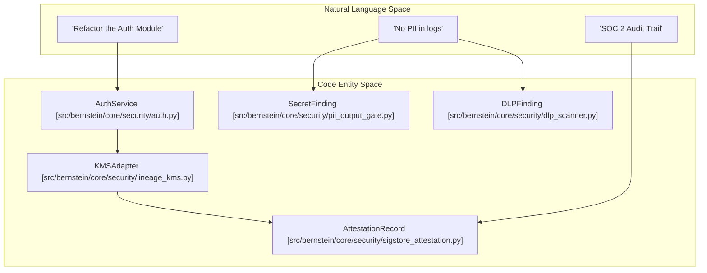
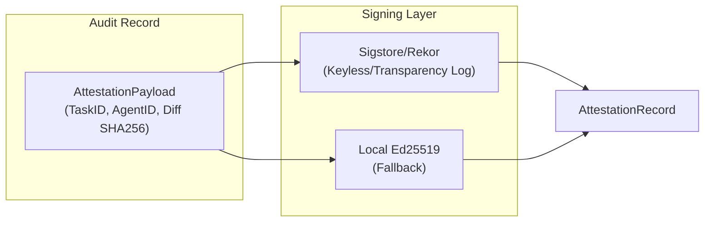

<!-- source: DeepWiki mcp.deepwiki.com · repo sipyourdrink-ltd/bernstein · page 5 Security and Compliance · fetched 2026-10-27 -->

# Security and Compliance

Relevant source files

The following files were used as context for generating this wiki page:

- [src/bernstein/core/cost/completion_budget.py](src/bernstein/core/cost/completion_budget.py)
- [src/bernstein/core/git/merge_queue.py](src/bernstein/core/git/merge_queue.py)
- [src/bernstein/core/git/pr_size_governor.py](src/bernstein/core/git/pr_size_governor.py)
- [src/bernstein/core/git/worktree_claude_md.py](src/bernstein/core/git/worktree_claude_md.py)
- [src/bernstein/core/git/worktree_isolation.py](src/bernstein/core/git/worktree_isolation.py)
- [src/bernstein/core/knowledge/memory_integrity.py](src/bernstein/core/knowledge/memory_integrity.py)
- [src/bernstein/core/observability/traces.py](src/bernstein/core/observability/traces.py)
- [src/bernstein/core/planning/workflow_importer.py](src/bernstein/core/planning/workflow_importer.py)
- [src/bernstein/core/quality/ci_monitor.py](src/bernstein/core/quality/ci_monitor.py)
- [src/bernstein/core/quality/comment_quality.py](src/bernstein/core/quality/comment_quality.py)
- [src/bernstein/core/quality/quality_gates.py](src/bernstein/core/quality/quality_gates.py)
- [src/bernstein/core/security/agent_card_signer.py](src/bernstein/core/security/agent_card_signer.py)
- [src/bernstein/core/security/always_allow.py](src/bernstein/core/security/always_allow.py)
- [src/bernstein/core/security/audit_export.py](src/bernstein/core/security/audit_export.py)
- [src/bernstein/core/security/audit_head_signature.py](src/bernstein/core/security/audit_head_signature.py)
- [src/bernstein/core/security/audit_pack.py](src/bernstein/core/security/audit_pack.py)
- [src/bernstein/core/security/auth.py](src/bernstein/core/security/auth.py)
- [src/bernstein/core/security/compliance.py](src/bernstein/core/security/compliance.py)
- [src/bernstein/core/security/dlp_scanner.py](src/bernstein/core/security/dlp_scanner.py)
- [src/bernstein/core/security/dlp_scanner_v2.py](src/bernstein/core/security/dlp_scanner_v2.py)
- [src/bernstein/core/security/guardrails.py](src/bernstein/core/security/guardrails.py)
- [src/bernstein/core/security/jwt_tokens.py](src/bernstein/core/security/jwt_tokens.py)
- [src/bernstein/core/security/license_scanner.py](src/bernstein/core/security/license_scanner.py)
- [src/bernstein/core/security/lineage_kms.py](src/bernstein/core/security/lineage_kms.py)
- [src/bernstein/core/security/pii_output_gate.py](src/bernstein/core/security/pii_output_gate.py)
- [src/bernstein/core/security/plan_approval.py](src/bernstein/core/security/plan_approval.py)
- [src/bernstein/core/security/post_tool_enforcement.py](src/bernstein/core/security/post_tool_enforcement.py)
- [src/bernstein/core/security/resource_limits.py](src/bernstein/core/security/resource_limits.py)
- [src/bernstein/core/security/sandbox_profiles.py](src/bernstein/core/security/sandbox_profiles.py)
- [src/bernstein/core/security/sensitive_file_detector.py](src/bernstein/core/security/sensitive_file_detector.py)
- [src/bernstein/core/security/sigstore_attestation.py](src/bernstein/core/security/sigstore_attestation.py)
- [src/bernstein/plugins/security_review.py](src/bernstein/plugins/security_review.py)
- [tests/unit/test_agent_card_signer.py](tests/unit/test_agent_card_signer.py)
- [tests/unit/test_always_allow.py](tests/unit/test_always_allow.py)
- [tests/unit/test_dlp_scanner_v2.py](tests/unit/test_dlp_scanner_v2.py)
- [tests/unit/test_pii_output_gate.py](tests/unit/test_pii_output_gate.py)
- [tests/unit/test_worktree_isolation.py](tests/unit/test_worktree_isolation.py)

Bernstein implements a defense-in-depth security model designed for high-trust autonomous environments. The system treats every agent action as a potentially destructive operation, wrapping it in a multi-layered security pipeline that includes cryptographic audit chains, zero-trust identity management, and automated guardrails.

### Security Architecture Overview

The security model bridges the gap between the high-level goals provided in natural language and the low-level process execution. It ensures that every command executed by an agent is authorized, audited, and compliant with organizational policies.

#### Natural Language to Code Entity Mapping: Security Pipeline

**Sources:** [src/bernstein/core/security/auth.py:1-20](), [src/bernstein/core/security/lineage_kms.py:84-101](), [src/bernstein/core/security/sigstore_attestation.py:125-145](), [src/bernstein/core/security/pii_output_gate.py:39-56](), [src/bernstein/core/security/dlp_scanner.py:55-76]().

---

## 5.1 Authentication, Authorization, and Rate Limiting

Bernstein utilizes a "Secure-by-default" approach where authentication is required for all non-discovery endpoints. The system supports OIDC, SAML 2.0, and a specialized Device Authorization Flow for CLI users [src/bernstein/core/security/auth.py:1-9]().

*   **RBAC and Permissions:** Access is controlled via `AuthRole` (ADMIN, OPERATOR, VIEWER) and specific permission strings like `tasks:write` or `admin:manage` [src/bernstein/core/security/auth.py:83-141]().
*   **User and Session Persistence:** Authenticated identities are stored as `AuthUser` objects in `.sdd/auth/users/`, while `AuthSession` objects map to issued JWTs [src/bernstein/core/security/auth.py:155-212]().
*   **SAML Security:** SAML responses are strictly validated against IdP X.509 certificates; Bernstein refuses to silently accept unsigned assertions [src/bernstein/core/security/auth.py:10-20]().

For details, see [Authentication, Authorization, and Rate Limiting](#5.1).

**Sources:** [src/bernstein/core/security/auth.py:83-141](), [src/bernstein/core/security/auth.py:155-212]().

---

## 5.2 Command Security and Guardrails

Before an agent's output is merged or a command is executed, it passes through a series of automated guardrails that can relax their constraints if a provable sandbox is detected [src/bernstein/core/security/guardrails.py:48-84]().

*   **PII and Secret Detection:** The `pii_output_gate.py` scans diffs for AWS keys, GitHub tokens, and PII using high-confidence regex patterns [src/bernstein/core/security/pii_output_gate.py:65-179]().
*   **DLP Scanner:** Extends secret detection to include license violations (SPDX identifiers), regulated data (HIPAA/PHI), and proprietary data leakage like internal hostnames [src/bernstein/core/security/dlp_scanner.py:1-12]().
*   **Always-Allow Rules:** Short-circuits prompts for known-safe tool signatures (e.g., `grep` on `src/`), provided the rules file passes tamper verification [src/bernstein/core/security/always_allow.py:1-26]().
*   **Intent Verification:** An LLM-based gate compares the original task description with the agent's git diff to ensure the agent hasn't diverged from its goal [src/bernstein/core/quality/quality_gates.py:85-115]().

For details, see [Command Security and Guardrails](#5.2).

**Sources:** [src/bernstein/core/security/pii_output_gate.py:65-179](), [src/bernstein/core/security/dlp_scanner.py:1-12](), [src/bernstein/core/security/always_allow.py:1-26](), [src/bernstein/core/quality/quality_gates.py:85-115]().

---

## 5.3 Audit Chain, Lineage, and Compliance

Bernstein provides an immutable, tamper-evident record of all system activities, leveraging modern cryptographic standards for non-repudiation.

#### The Attestation Pipeline

Every task completion is attested via `AttestationRecord`, which supports keyless signing through Sigstore/Rekor or a local Ed25519 fallback [src/bernstein/core/security/sigstore_attestation.py:1-16]().

*   **Agent Identity Cards:** Bernstein uses `AgentIdentityCard` signed with Ed25519 JWS (RFC 7515) over JCS-canonicalized JSON (RFC 8785) to enable secure A2A (Agent-to-Agent) federation [src/bernstein/core/security/agent_card_signer.py:1-25]().
*   **Lineage KMS:** The system supports pluggable Key Management Systems via the `KMSAdapter` protocol, allowing lineage signatures to be backed by HSMs, Kubernetes Secrets, or Vault [src/bernstein/core/security/lineage_kms.py:1-20]().
*   **Risk Classification:** Tasks are automatically classified as `low`, `medium`, `high`, or `critical` risk based on keywords (e.g., "auth", "migration") and roles [src/bernstein/core/security/plan_approval.py:82-113]().

For details, see [Audit Chain, Lineage, and Compliance](#5.3).

**Sources:** [src/bernstein/core/security/sigstore_attestation.py:1-16](), [src/bernstein/core/security/agent_card_signer.py:1-25](), [src/bernstein/core/security/lineage_kms.py:1-20](), [src/bernstein/core/security/plan_approval.py:82-113]().

---

## 5.4 Air-Gap and Network Security

Bernstein supports fully air-gapped deployments and strict runtime network isolation through composable sandbox profiles.

*   **Sandbox Profiles:** Fine-grained `SandboxProfile` objects define `NetworkRule` (host/port/protocol) and `FileSystemRule` (path/permissions) constraints for agent execution [src/bernstein/core/security/sandbox_profiles.py:87-109]().
*   **Composition:** Profiles like `web-backend`, `frontend`, and `ci-runner` can be unioned to build specific capability sets [src/bernstein/core/security/sandbox_profiles.py:115-164]().
*   **Runtime Isolation:** The orchestrator enforces these boundaries using backends like Docker or E2B, ensuring agents cannot exfiltrate data or access unauthorized network endpoints.

For details, see [Air-Gap and Network Security](#5.4).

**Sources:** [src/bernstein/core/security/sandbox_profiles.py:87-109](), [src/bernstein/core/security/sandbox_profiles.py:115-164]().

---

